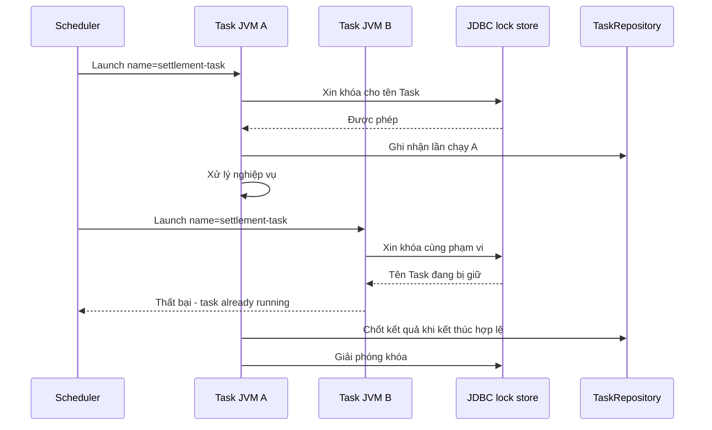
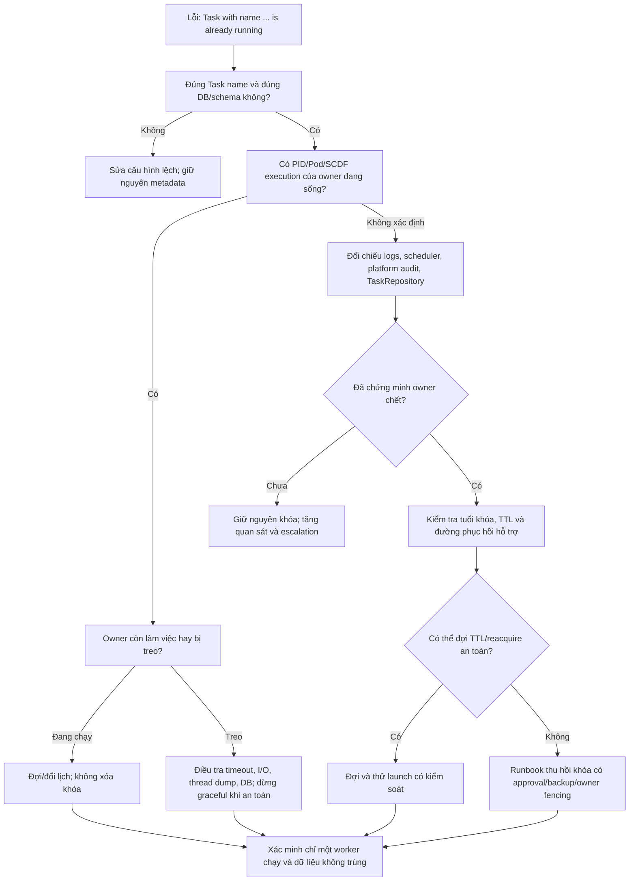

# Lỗi tác vụ cùng tên đang chạy và xử lý khóa còn hiệu lực

## Mục tiêu và tình huống thực tế

Trong **Spring Cloud Task**, mỗi ứng dụng Spring Boot được thiết kế để chạy một công việc **có thời gian sống hữu hạn**: đọc tham số, xử lý nghiệp vụ, ghi trạng thái vào `TaskRepository` và kết thúc. Một ứng dụng như `settlement-task` có thể được khởi chạy theo lịch, từ SCDF, Kubernetes Job hoặc bởi nhân viên vận hành. Với một số công việc không cho phép chạy chồng, Spring Cloud Task hỗ trợ `spring.cloud.task.single-instance-enabled=true`.

Giả sử lúc 02:00 tiến trình A đang đối soát ngày `2026-11-23`. Lúc 02:01, scheduler khởi động tiến trình B với **cùng tên Task**. B bị từ chối bằng thông báo tương tự:

```text
Task with name "settlement-task" is already running.
```

Đây có thể là hành vi **đúng và cần thiết** để tránh chạy chồng. Nhưng nếu A **đã chết từ lâu** mà B vẫn bị từ chối, khả năng có khóa JDBC chưa được giải phóng, TTL quá dài, cấu hình lệch giữa các instance hoặc lỗi kết nối metadata. Cách xử lý phải phân biệt được **khóa có chủ còn sống** với **khóa còn hiệu lực sau crash**.

Sau bài này, bạn sẽ:

- Nhận diện thông báo và mã thoát khi single-instance từ chối một Task cùng tên.
- Hiểu mối quan hệ giữa tên Task, `TaskRepository`, bảng `TASK_LOCK` và `JdbcLockRegistry` của Spring Integration.
- Kiểm tra tiến trình/Pod, metadata Task, cấu hình database và tuổi khóa **bằng những thao tác chỉ đọc**.
- Hiểu `single-instance-lock-check-interval`, `single-instance-lock-ttl`, giới hạn của TTL và rủi ro khóa hết hạn khi công việc còn chạy.
- Có **runbook xử lý sự cố** tránh làm mất quyền sở hữu khóa hoặc gây chạy chồng.
- Kiểm thử tình huống hai JVM, kill giữa chừng, retry của scheduler, mất DB và Task chạy lâu.
- Phân biệt khóa thực thi với **idempotency** trên dữ liệu, nhất là khi Spring Batch hoặc nhiều replica cùng thao tác.

**Phạm vi tài liệu:** Mô tả hành vi theo [Spring Cloud Task – Features](https://docs.spring.io/spring-cloud-task/reference/features.html), [Spring Cloud Task – Task Repository Schema](https://docs.spring.io/spring-cloud-task/reference/appendix-task-repository-schema.html), [Spring Cloud Configuration Properties](https://docs.spring.io/spring-cloud/docs/current/reference/html/configprops.html) và [Spring Integration – JDBC Lock Registry](https://docs.spring.io/spring-integration/reference/jdbc/lock-registry.html). Các cột, API hoặc cơ chế TTL/renewal có thể khác giữa release; trước khi thay cấu hình hay can thiệp vào database, phải kiểm tra phiên bản được triển khai.

## 1. Thông báo “đã có Task cùng tên đang chạy” có nghĩa gì?

Spring Cloud Task cho phép **một lần thực thi cho mỗi Task name tại một thời điểm**, khi **mọi instance liên quan** đều bật chế độ single-instance và sử dụng **kho khóa chung**. Theo tài liệu, thuộc tính này mặc định là `false`:

```yaml
spring:
  application:
    name: settlement-task
  cloud:
    task:
      single-instance-enabled: true
```

Nếu A còn giữ quyền thực thi cho tên `settlement-task`, B cùng tên sẽ bị từ chối. Khi từ chối do tính năng này, **Spring Cloud Task ghi nhận process exit code `1`** theo tài liệu. Bị từ chối **không tự khẳng định B đã chạy nghiệp vụ**; nó có thể thất bại trước khi `ApplicationRunner` của B được gọi. Số bản ghi TaskExecution được tạo/được chốt trong đường lỗi phải quan sát trên phiên bản cụ thể, không đoán.

**Đừng nhầm ba sự kiện:**

1. **Một Task khác đang thực sự chạy**: khóa bận là hành vi đúng. Hãy đợi hoặc thay lịch, không xóa khóa.
2. **Task giữ khóa đã crash**: khóa còn trong database sau sự cố, có thể được giải phóng/tái chiếm theo TTL hoặc quy trình khôi phục.
3. **Lỗi không đến từ khóa bận**: bảng khóa thiếu, tài khoản DB thiếu quyền, khác schema/DataSource, DB timeout hoặc exception do launcher tạo ra. Chúng có thể khiến process cũng thoát mã khác `0`, nhưng phải đọc **nguyên nhân gốc và stack trace** trước khi chọn cách xử lý.

Một process exit code `1` **không phải định danh riêng cho lock conflict**. Spring Boot cũng có thể trả `1` cho nhiều thất bại khác. Phải kết hợp **log lỗi đặc trưng, cấu hình và trạng thái thực tế**.

## 2. Cơ chế single-instance và ranh giới bảo vệ

### 2.1. Khóa được quản lý qua Spring Integration JDBC

Tính năng single-instance dùng các thành phần khóa của **Spring Integration**, vì vậy tài liệu yêu cầu có:

```xml
<dependencies>
    <dependency>
        <groupId>org.springframework.cloud</groupId>
        <artifactId>spring-cloud-starter-task</artifactId>
    </dependency>
    <dependency>
        <groupId>org.springframework.integration</groupId>
        <artifactId>spring-integration-core</artifactId>
    </dependency>
    <dependency>
        <groupId>org.springframework.integration</groupId>
        <artifactId>spring-integration-jdbc</artifactId>
    </dependency>
    <dependency>
        <groupId>org.postgresql</groupId>
        <artifactId>postgresql</artifactId>
        <scope>runtime</scope>
    </dependency>
</dependencies>
```

Đây là đoạn `dependencies` thuộc dự án Spring Boot; cần thêm Boot parent/BOM và Spring Cloud BOM **đúng release train**. Không tự chọn phiên bản Spring Integration không tương thích chỉ để “chữa lỗi khóa”.

Khi Task khởi động, Spring Cloud Task kiểm soát quyền thực thi theo **tên Task** thông qua lock registry. Hạ tầng chia sẻ database được dùng để các JVM/Pod khác nhau không cùng chiếm quyền cho một tên. Ở schema mặc định, Spring Cloud Task có **`TASK_LOCK`** phục vụ tính năng này; `TASK_EXECUTION` lưu lịch sử vòng đời.



Sơ đồ diễn tả **trật tự logic**, không phải thứ tự chính xác của mọi câu SQL/sự kiện framework. Trên đường startup thất bại, TaskExecution có thể chưa được tạo. Sau một crash đột ngột, framework không có cơ hội hoàn tất bước cập nhật metadata/giải phóng khóa như trong đường chạy thành công.

### 2.2. Cùng tên Task không có nghĩa cùng dữ liệu

| A đang chạy | B muốn khởi chạy | Kết quả nếu dùng chung kho khóa và cùng bật single-instance |
| --- | --- | --- |
| `settlement-task` cho shop-42 ngày X | `settlement-task` cho shop-42 ngày X | B bị chặn |
| `settlement-task` cho shop-42 ngày X | `settlement-task` cho shop-43 ngày Y | B **vẫn bị chặn** vì tên giống |
| `settlement-task` cho shop-42 ngày X | `invoice-export-task` cho shop-42 ngày X | Không bị loại trừ bởi khóa **theo tên Task** |
| A đã kết thúc, nhả khóa | `settlement-task` cho shop-42 ngày X | B có thể chạy lại **cùng dữ liệu** |

Tính năng này hạn chế **chạy đồng thời**, không ngăn một tác vụ tuần sau xử lý lại cùng business date. Nếu cần chạy song song theo tenant, khóa toàn tên Task có thể quá rộng; cân nhắc khóa theo partition/tenant được thiết kế riêng. Dù thay phạm vi khóa, **database unique key, idempotency và transaction** vẫn cần để bảo vệ nghiệp vụ khi retry.

### 2.3. Tên Task do đâu mà có?

Theo tài liệu, `TASK_NAME` được xác định bởi `TaskNameResolver`; thông thường `spring.application.name` được dùng để đặt tên. Nếu không đặt, tên mặc định có thể là **`application`**. Hậu quả thường gặp:

- Hai ứng dụng khác nghiệp vụ nhưng đều thiếu `spring.application.name` nên **vô tình tranh cùng tên `application`**.
- Trong container A dùng `spring.application.name=settlement-task`, nhưng container B bị override thành `application` hoặc tên khác, dẫn đến triệu chứng lock khác với mong đợi.
- Một `TaskNameResolver` tự định nghĩa đổi tên ở runtime mà scheduler/dashboard chưa biết.
- Các bản release có cấu hình khác nhau khiến việc loại trừ trở nên quá rộng hoặc quá hẹp.

**Lệnh/kiểm tra đầu tiên là xác định tên thật trong lỗi, trong `TASK_EXECUTION` và trong cấu hình runtime của từng instance.** Không chỉ dựa vào tên file JAR, tên Pod, Task definition SCDF hoặc Kubernetes Job; chúng có thể không khớp với `TaskExecution.taskName`.

## 3. Các nguồn dữ liệu chẩn đoán cần đối chiếu

Đừng chỉ nhìn một bảng DB rồi kết luận “khóa stale”. Một điều tra tối thiểu cần đủ ba nguồn:

| Nguồn | Cần kiểm tra | Giới hạn |
| --- | --- | --- |
| **Runtime**: PID, Pod, Kubernetes Job, SCDF execution | A có còn sống, đang xử lý, bị treo, đang terminate hay đã được restart không? | Pod không còn không có nghĩa external side effect đã hoàn tất |
| **TaskRepository**: `TASK_EXECUTION` | Lần chạy cùng tên nào có `START_TIME`, `END_TIME`, `EXIT_CODE`, `LAST_UPDATED`? | `EXIT_CODE=NULL` có thể do crash, không khẳng định đang chạy |
| **JDBC lock store**: `TASK_LOCK` | Lock row/owner, region, thời điểm tạo khóa có còn không? | Một row tồn tại không chứng minh owner còn sống; `CLIENT_ID` không được tùy tiện dùng như khóa join sang TaskExecution |
| **Log và process exit** | Lỗi “already running” hay lỗi DB/permission? | Process exit `1` có thể do nhiều nguyên nhân |
| **Dữ liệu nghiệp vụ / Spring Batch** | Có chunk/transaction hoặc API nào đã commit? | Task failed không khẳng định toàn bộ side effects đã rollback |

`TaskRepository` và kho khóa phải dùng **cùng hạ tầng metadata phù hợp** để nhiều instance có thể điều phối. Khi ứng dụng có nhiều `DataSource`, xác minh `TaskConfigurer` và cách lock registry được cấu hình. H2 in-memory trong **mỗi JVM** không thể làm khóa phân tán đúng giữa hai tiến trình; hai application đều có thể “giữ khóa thành công” trong các database riêng.

## 4. Bảng `TASK_LOCK`: đọc đúng, không xóa vội

Tài liệu schema Spring Cloud Task 5.1 mô tả `TASK_LOCK`:

| Cột | Kiểu theo schema tài liệu | Vai trò |
| --- | --- | --- |
| `LOCK_KEY` | `CHAR(36)` | Định danh khóa do registry sử dụng |
| `REGION` | `VARCHAR(100)` | Nhóm/phạm vi khóa |
| `CLIENT_ID` | `CHAR(36)` | Định danh client/owner lưu trong lock repository |
| `CREATED_DATE` | `DATETIME`/`TIMESTAMP` | Thời điểm ghi nhận lock |

Trước khi truy vấn hãy xác minh **schema/prefix/DDL thực tế**. Đây là bảng dành cho `single-instance-enabled`, **không phải** `TASK_EXECUTION` và không phải `BATCH_JOB_EXECUTION`. Thông tin `CLIENT_ID` hoặc `LOCK_KEY` có thể có cách sinh/mã hóa riêng; **không giả định** nó bằng TaskExecution ID hay chuỗi tên Task để `JOIN` trực tiếp khi chưa xác minh implementation/version.

Truy vấn **chỉ đọc** cho PostgreSQL, giả sử default schema:

```sql
SELECT LOCK_KEY, REGION, CLIENT_ID, CREATED_DATE
FROM TASK_LOCK
ORDER BY CREATED_DATE;
```

Đối chiếu thời điểm hiện tại của **database** (không tin đồng hồ laptop):

```sql
SELECT CURRENT_TIMESTAMP AS db_current_time;
```

Nếu dùng PostgreSQL và cột `CREATED_DATE` có kiểu thời gian tương thích, có thể ước lượng tuổi:

```sql
SELECT
    LOCK_KEY,
    REGION,
    CLIENT_ID,
    CREATED_DATE,
    CURRENT_TIMESTAMP AS observed_at,
    EXTRACT(EPOCH FROM (CURRENT_TIMESTAMP - CREATED_DATE))
        AS approximate_age_seconds
FROM TASK_LOCK
ORDER BY CREATED_DATE;
```

**Các cảnh báo khi đọc kết quả:**

- Thời điểm tạo khóa **không tự phản ánh lần gia hạn cuối cùng** ở mọi phiên bản registry. Spring Integration đã thay đổi cơ chế TTL/renewal giữa các phiên bản; trường dùng tính expiry phải đối chiếu DDL/logic thật.
- **Row cũ** không tự chứng minh stale lock: có thể owner còn sống, TTL dài hoặc có cơ chế renew.
- **Không có row** tại thời điểm truy vấn không tự khẳng định an toàn để chạy lại: khóa có thể được lấy **ngay sau** truy vấn; cơ chế điều phối phải quyết định quyền.
- Đừng sử dụng `SELECT * FOR UPDATE`, lệnh DDL hoặc một giao dịch đọc kéo dài chỉ để quan sát; điều tra phải giảm rủi ro làm ảnh hưởng các tiến trình đang xin khóa.
- Nếu lock table tên khác do `spring.cloud.task.table-prefix` hoặc schema riêng, **không tạo một bảng mới cùng tên mặc định** để “sửa lỗi” trước khi xác minh cấu hình.

### 4.1. So sánh với `TASK_EXECUTION`

Truy vấn lịch sử cùng tên Task:

```sql
SELECT
    TASK_EXECUTION_ID,
    TASK_NAME,
    START_TIME,
    END_TIME,
    EXIT_CODE,
    LAST_UPDATED,
    EXTERNAL_EXECUTION_ID,
    ERROR_MESSAGE
FROM TASK_EXECUTION
WHERE TASK_NAME = 'settlement-task'
ORDER BY TASK_EXECUTION_ID DESC;
```

Tìm những lần chưa chốt metadata:

```sql
SELECT
    TASK_EXECUTION_ID,
    TASK_NAME,
    START_TIME,
    END_TIME,
    EXIT_CODE,
    LAST_UPDATED
FROM TASK_EXECUTION
WHERE TASK_NAME = 'settlement-task'
  AND (END_TIME IS NULL OR EXIT_CODE IS NULL)
ORDER BY START_TIME;
```

Ở Spring Cloud Task, `EXIT_CODE=NULL` **trong khi đang chạy** là bình thường. Nhưng sau khi bị `SIGKILL`/OOM-kill, ứng dụng có thể không cập nhật được mã và thời điểm kết thúc; bản ghi vẫn `NULL` dù JVM không còn. Ngược lại, lỗi bootstrap trước khi `ApplicationContext` được tạo đầy đủ có thể **không có TaskExecution**. Vì thế cần đối chiếu **trạng thái process/container**, logs, scheduler và các dòng `TASK_LOCK` trước khi kết luận.

**Không làm “sạch” dashboard bằng `UPDATE TASK_EXECUTION SET EXIT_CODE=1 WHERE EXIT_CODE IS NULL`.** Việc đó vừa làm sai lịch sử vừa không giải phóng khóa. Sự cố repository và sự cố lock registry là các vấn đề khác nhau.

### 4.2. Phân biệt lock registry với khóa transaction SQL

Nếu một giao dịch DB giữ row lock quá lâu, các query lấy khóa có thể chậm/hết timeout; nhưng **PostgreSQL row lock** và bản ghi ứng dụng trong `TASK_LOCK` không phải cùng một khái niệm. Khi nhìn thấy lỗi `deadlock detected`, `lock timeout`, `cannot acquire JDBC connection` hoặc `permission denied for relation TASK_LOCK`, hãy phân loại đó là **lỗi hạ tầng/truy cập database**, không vội kết luận do một Task cùng tên đang chạy.

## 5. Kiểm tra cấu hình `single-instance-lock-*` và thời gian giữ khóa

Theo danh mục Spring Cloud Task configuration properties, các thuộc tính chính gồm:

| Thuộc tính | Giá trị mặc định theo tài liệu | Tác dụng |
| --- | --- | --- |
| `spring.cloud.task.single-instance-enabled` | `false` | Bật giới hạn một Task cùng tên đang chạy tại một thời điểm |
| `spring.cloud.task.single-instance-lock-check-interval` | `500` **mili-giây** | Khoảng cách giữa các lần kiểm tra/thử đối với khóa |
| `spring.cloud.task.single-instance-lock-ttl` | `Integer.MAX_VALUE` **mili-giây** theo mô tả | Thời gian tối đa một Task giữ quyền khóa trước khi cơ chế expiry áp dụng |
| `spring.cloud.task.table-prefix` | `TASK_` | Tiền tố các bảng repository, bao gồm bảng khóa theo cấu hình |
| `spring.application.name` | Tùy ứng dụng | Tên thông thường được `TaskNameResolver` sử dụng để xác định phạm vi khóa |

Hai nhóm giá trị quan trọng đều theo **mili-giây**, không phải giây. Ví dụ:

```yaml
spring:
  application:
    name: settlement-task
  main:
    web-application-type: none
  cloud:
    task:
      single-instance-enabled: true
      single-instance-lock-check-interval: 500
      single-instance-lock-ttl: 1800000
      initialize-enabled: false
      closecontext-enabled: true
```

`1800000` mili-giây là **30 phút**. Đây chỉ là **giá trị cho kịch bản giả định Task luôn kết thúc ngắn hơn 30 phút**; **không** sao chép vào production nếu Task có thể chạy trên 30 phút. TTL quá ngắn có thể cho B lấy lại khóa khi A vẫn đang ghi dữ liệu. TTL quá dài khiến một JVM đã chết nhưng chưa nhả khóa có thể chặn Task sau trong thời gian khó chấp nhận.

**Cần phân biệt rõ:**

- `lock-check-interval` **không phải** timeout toàn Task; đổi từ `500` lên `1000` không “giải phóng” một khóa đang bị giữ.
- `lock-ttl` **không phải** timeout chấm dứt Task đang chạy; nó là thời gian hiệu lực của **quyền khóa**. Hết TTL không tự kill A hay rollback những ghi dữ liệu mà A đang làm.
- `closecontext-enabled=true` giúp đóng context sau các runner và có thể giúp process thoát khi không còn thành phần cần sống; nó **không** tự giải quyết khóa còn lại sau `SIGKILL`.
- Spring Integration `JdbcLockRegistry` có khái niệm **renewLock** ở các phiên bản tương ứng, nhưng **không nên giả định** tính năng single-instance của Task tự động gia hạn khóa cho mọi workload và mọi phiên bản. Nếu Task có thể chạy lâu hơn TTL, kiểm tra implementation/logs hoặc giữ TTL phù hợp và có lớp chống trùng dữ liệu.
- Trong Spring Integration 7.0+, một số cơ chế TTL/schema đã thay đổi, ví dụ xuất hiện thêm cột `EXPIRED_AFTER` trong DDL của `INT_LOCK` theo tài liệu 7.x. **Không áp SQL migration cho `INT_LOCK` lên `TASK_LOCK` của một phiên bản khác** mà không đối chiếu DDL chính thức và cấu hình lock repository thực tế.

### 5.1. Chọn TTL dựa trên dữ liệu đo được, không dựa vào cảm giác

Một mô hình quyết định:

```text
Task P99 runtime:      12 phút
Đuôi chậm/outlier:     18 phút
Graceful termination:  2 phút
TTL thử nghiệm:        > thời gian xử lý cực đại thực tế + biên an toàn
RTO khi crash:         có thể cần ngắn hơn TTL đề xuất
```

Đây là hai yêu cầu **đánh đổi**:

- **Safety**: TTL phải đủ dài để một owner sống không mất quyền giữa chừng.
- **Availability**: TTL ngắn để owner chết không chặn Task kế tiếp quá lâu.

Nếu không thể đáp ứng cả hai chỉ bằng TTL, cần thiết kế **ownership/lease renewal phù hợp phiên bản + fencing/idempotency tại nơi ghi dữ liệu**, hoặc chọn quy trình vận hành xác minh owner đã chết trước khi can thiệp. Không thể chữa bài toán an toàn bằng cách đơn giản đặt TTL cực ngắn.

### 5.2. Cấu hình thay đổi ở runtime mà ít người để ý

Spring Boot cho phép externalized configuration. Vì vậy file `application.yml` không chắc phản ánh giá trị cuối cùng:

- Biến môi trường có thể bật/tắt `single-instance-enabled`.
- JVM system properties `-D...` và CLI `--spring.cloud.task...` có thể thay đổi giá trị trong thứ tự ưu tiên phù hợp.
- Profile `prod`, Config Server, Helm values, Kubernetes ConfigMap/Secret có thể tạo thêm nguồn.
- Một Pod dùng release cũ có thể có TTL khác Pod mới dù tên Task giống nhau.

Trong sự cố, thu thập **cấu hình hiệu lực** từ deployment và log startup một cách an toàn, không dump secrets. Đặc biệt, không đặt `--spring.cloud.task.single-instance-enabled=false` trên một Pod mới chỉ để “chạy qua lỗi”; điều đó **phá cơ chế loại trừ**, có thể tạo hai phiên xử lý cạnh tranh.

## 6. Thực hành tái hiện lỗi hai JVM trên database chung

Phần này chỉ dùng cho môi trường **thử nghiệm**, không chạy trên một database nghiệp vụ production. Ta xây một `ApplicationRunner` ngủ 45 giây để quan sát khi một JVM giữ quyền thực thi.

### 6.1. Ứng dụng Spring Cloud Task ngắn

Tạo file `src/main/java/com/example/task/SingleInstanceLabApplication.java`:

```java
package com.example.task;

import java.time.LocalDate;
import java.util.List;

import org.springframework.boot.ApplicationRunner;
import org.springframework.boot.SpringApplication;
import org.springframework.boot.autoconfigure.SpringBootApplication;
import org.springframework.cloud.task.configuration.EnableTask;
import org.springframework.context.annotation.Bean;

@SpringBootApplication
@EnableTask
public class SingleInstanceLabApplication {

    public static void main(String[] args) {
        SpringApplication.run(SingleInstanceLabApplication.class, args);
    }

    @Bean
    ApplicationRunner demoRunner() {
        return args -> {
            List<String> values =
                    args.getOptionValues("business-date");

            if (values == null || values.size() != 1) {
                throw new IllegalArgumentException(
                        "Cần --business-date=YYYY-MM-DD");
            }

            LocalDate date = LocalDate.parse(values.get(0));

            System.out.printf(
                    "RUN_START businessDate=%s%n", date);

            // Chỉ dùng để tái hiện chạy chồng trong lab.
            Thread.sleep(45_000L);

            System.out.printf(
                    "RUN_END businessDate=%s%n", date);
        };
    }
}
```

Đây là ứng dụng demo có một runner, không có tác động nghiệp vụ. `@EnableTask` yêu cầu Spring Cloud Task có trên classpath; với starter và auto-config phù hợp, Task lifecycle sẽ tạo metadata. Build với Java và các phiên bản Boot/Cloud tương thích do BOM quản lý.

### 6.2. Cấu hình database bền vững dùng chung

`src/main/resources/application.yml`:

```yaml
spring:
  application:
    name: single-instance-lab
  main:
    web-application-type: none
  datasource:
    url: ${TASK_DB_URL}
    username: ${TASK_DB_USER}
    password: ${TASK_DB_PASSWORD}
  cloud:
    task:
      single-instance-enabled: true
      single-instance-lock-check-interval: 500
      single-instance-lock-ttl: 120000
      initialize-enabled: false
      closecontext-enabled: true

logging:
  level:
    org.springframework.cloud.task: DEBUG
```

`120000` mili-giây = **2 phút**; demo runner chạy **45 giây** nên TTL đủ dài trong tình huống bình thường. Cấu hình giả định đã có PostgreSQL riêng cho lab, driver JDBC, schema `TASK_EXECUTION` và `TASK_LOCK` được migration đúng phiên bản, cùng account có đủ quyền DML. **Không** dùng `jdbc:h2:mem:...` ở hai process khác nhau vì chúng không chia sẻ lock store.

Trước khi chạy, thiết lập các biến `TASK_DB_URL`, `TASK_DB_USER`, `TASK_DB_PASSWORD` trong hai terminal bằng cơ chế an toàn của môi trường. Không paste password vào lệnh Java hoặc history shell để tiện thử.

### 6.3. Chạy A rồi B

Sau khi build ra đúng JAR theo artifact của dự án, ví dụ:

```bash
# Terminal A
java -jar target/single-instance-lab.jar \
  --business-date=2026-11-23

# Ngay khi A đang sleep, mở Terminal B:
java -jar target/single-instance-lab.jar \
  --business-date=2026-11-24
```

Kỳ vọng:

1. A khởi động, thấy `RUN_START` và ngủ 45 giây.
2. B có cùng `spring.application.name=single-instance-lab`, cùng DB và đã bật single-instance nên bị từ chối. Log có thể chứa `Task with name "single-instance-lab" is already running.`. Tài liệu quy định **mã thoát `1`** cho lỗi này.
3. Khi A hoàn tất, thử chạy B **lần nữa**: B được phép bắt đầu, vì khóa của A đã được giải phóng.
4. Nếu B được chạy với tên Task khác hoặc kết nối database khác, cơ chế này không bảo vệ cùng phạm vi; kết quả thử sẽ **không còn kiểm tra đúng bài toán**.

Trên Bash, gõ `echo $?` **ngay sau** lệnh Java để xem mã thoát của chính process; trong PowerShell dùng `$LASTEXITCODE`. Nếu chạy qua `mvn spring-boot:run`, Maven/plugin là tiến trình trung gian; kiểm chứng exit code của JAR đóng gói thì nên chạy `java -jar` trực tiếp.

Một SQL chỉ đọc để quan sát trong lúc A chạy:

```sql
SELECT LOCK_KEY, REGION, CLIENT_ID, CREATED_DATE
FROM TASK_LOCK
ORDER BY CREATED_DATE;
```

Không kiểm tra `CLIENT_ID` như thể đó là `TASK_EXECUTION_ID` của A. Để liên hệ, dùng timestamp, task name, runtime logs, launcher execution ID và tài liệu implementation tương ứng.

### 6.4. Biến thể kiểm thử stale lock sau crash

Chỉ trong **lab với database dùng riêng**:

1. Khởi chạy A, chờ log `RUN_START`.
2. Tạo tình huống JVM **bị dừng cưỡng bức** (ví dụ công cụ test kill process, không cho thực hiện shutdown hooks bình thường).
3. Kiểm tra Pod/PID của A **đã thực sự không còn**, đồng thời tra `TASK_LOCK` và `TASK_EXECUTION` bằng query chỉ đọc.
4. Khởi chạy B trước và sau mốc TTL thử nghiệm; ghi nhận có bị từ chối và khi nào được phép chạy.
5. Sau khi B chạy, kiểm tra lại lịch sử Task, không chỉnh `EXIT_CODE` của A chỉ để dashboard đẹp hơn.

**Không dùng `kill -9`, `kubectl delete pod --force` hoặc xóa bảng khóa trên production để mô phỏng.** Hành vi cụ thể sau crash phụ thuộc phiên bản JdbcLockRegistry, TTL và lịch đời của tiến trình; kết quả lab phải được ghi lại cùng version/schema để đánh giá. Một bản ghi `TASK_EXECUTION` của A có thể còn `EXIT_CODE=NULL` dù A đã chết.

## 7. Sơ đồ quyết định chẩn đoán trước khi can thiệp




## 8. Runbook xử lý khóa còn hiệu lực sau sự cố

Mục tiêu của runbook là **phục hồi được quyền khởi chạy** mà không làm hai tiến trình cùng tác động lên một dữ liệu nghiệp vụ. Mọi thao tác kiểm tra thông thường là **read-only**; can thiệp/thu hồi lock cần có quyền và cơ chế phê duyệt riêng.

### Bước 1 — Khoanh vùng sự cố và ngăn tạo thêm lần chạy

Ghi nhận tên Task trong log, thời điểm, image/version, profile, `TaskExecutionId` nếu có, scheduler/SCDF execution ID và tên environment. Tạm dừng **retry storm** từ launcher/scheduler nếu mỗi lần thất bại lại tạo Pod/Task mới. Không tự ý đổi `single-instance-enabled=false`.

Câu hỏi đầu tiên: lỗi xảy ra với **một tên Task** hay **nhiều Task không liên quan**?

- Chỉ một tên bị chặn, tên khác bình thường → nghi khóa bận đúng chức năng hoặc stale lock theo tên.
- Hàng loạt Task lỗi SQL/permission/connection timeout → nghi database, schema, pool hoặc migration, **không** nghi một khóa đơn lẻ.
- Có Task cùng tên vẫn chạy song song → nghi cấu hình single-instance không đồng nhất, TaskNameResolver khác hoặc không chung lock store, TTL quá ngắn.

### Bước 2 — Xác định tất cả tiến trình có khả năng là owner

Trên Kubernetes, với **namespace và label đã xác minh**:

```bash
kubectl get jobs -n batch-workloads -l app=settlement-task
kubectl get pods -n batch-workloads -l app=settlement-task -o wide
kubectl describe pod -n batch-workloads <pod-name>
kubectl logs -n batch-workloads <pod-name> --timestamps
```

Dấu `<pod-name>` là placeholder phải thay bằng Pod thật. Nếu container đã restart **trong cùng Pod** và còn log của container trước:

```bash
kubectl logs -n batch-workloads <pod-name> \
  --previous --timestamps
```

`--previous` không giúp khôi phục log của **Pod đã bị xóa**; trong trường hợp ấy phải tra backend tập trung và audit của platform. Với tiến trình chạy trên VM, xem PID, process start time và exit status từ supervisor/systemd thay vì suy từ một lệnh `ps` duy nhất.

**Phân loại owner:**

| Kết quả runtime | Diễn giải trước khi xử lý lock |
| --- | --- |
| Pod/VM process còn sống, đang xử lý đúng SLA | Khóa có thể **đang được giữ hợp lệ**; không can thiệp |
| Process còn sống nhưng tắc I/O/DB, vượt SLA | Điều tra thread dump, log, downstream, lock waits; cần quy trình dừng graceful |
| Pod không còn, có exit reason/trace xác nhận chết | Có cơ sở nghi stale lock nhưng vẫn phải kiểm tra các replica/launcher khác |
| Không xác định được owner | Chưa đủ chứng cứ để xóa khóa; nâng mức quan sát/escalation |
| Hai process cùng tên đều hoạt động | Xem ngay TTL, config, database, lock registry; **ưu tiên ngăn ghi trùng** |

Đối với Spring Cloud Data Flow, đối chiếu Task execution listing, deployer resource và `externalExecutionId`. SCDF có thể triển khai **Pod hoặc Job tùy platform/deployer**, không mặc định nó luôn tạo cùng loại đối tượng Kubernetes. Không xóa thủ công resource do SCDF quản lý nếu chưa hiểu lifecycle của deployer.

### Bước 3 — Xác nhận cấu hình runtime và database

Kiểm tra các giá trị **đang thực sự có hiệu lực** ở mọi launcher liên quan:

- `spring.application.name` và `TaskNameResolver`.
- `spring.cloud.task.single-instance-enabled` phải cùng `true` nếu muốn loại trừ nhau.
- `spring.cloud.task.single-instance-lock-ttl`, `single-instance-lock-check-interval` và release của Spring Cloud Task.
- JDBC URL, database/schema, table prefix, account, quyền `SELECT/INSERT/UPDATE/DELETE` cần thiết trên lock table theo implementation.
- Các dependency Spring Integration và phiên bản schema phù hợp.
- Tên Task/DB trong môi trường dev/staging/prod có bị tái sử dụng nhầm không.

**Không in JDBC password/token ra log hoặc ticket.** Khi có nhiều DataSource, cần xác định rõ **TaskRepository/LockRepository** đang dùng nguồn nào; URL DB nghiệp vụ không nhất thiết cũng là kho khóa.

### Bước 4 — Đọc Task metadata và lock store, không sửa

Chạy những query read-only ở mục 4:

```sql
SELECT TASK_EXECUTION_ID, TASK_NAME, START_TIME,
       END_TIME, EXIT_CODE, LAST_UPDATED
FROM TASK_EXECUTION
WHERE TASK_NAME = 'settlement-task'
ORDER BY TASK_EXECUTION_ID DESC;
```

```sql
SELECT LOCK_KEY, REGION, CLIENT_ID, CREATED_DATE
FROM TASK_LOCK
ORDER BY CREATED_DATE;
```

So sánh timestamp với **database time**, process start/end và log được liên kết bằng execution ID. Bảng `TASK_LOCK` có thể chứa các khóa của **những phạm vi khác**, vì vậy **không xóa tất cả rows chỉ vì một Task bị chặn**.

Nếu thấy `TaskExecution` chưa chốt mà owner đã chết, đó là dấu vết có thể giải thích hành vi khóa sau crash; nhưng việc `EXIT_CODE=NULL` **không phải bằng chứng duy nhất**. Một lỗi bootstrap của B có thể không tạo dòng TaskExecution B, không nên coi là “DB không ghi được” nếu nguyên nhân đã rõ là bị từ chối trước giai đoạn tạo bản ghi.

### Bước 5 — Quyết định chờ TTL hay xử lý sự cố chủ sở hữu

**Nhánh an toàn nhất:** nếu A đang chạy, **đợi**. Nếu A bị treo và còn sống, phối hợp đội ứng dụng dừng theo **quy trình graceful** sau khi đánh giá side effects. Nếu đã xác minh A chết và không còn owner khác, xem TTL đã đặt, logic expiry của đúng phiên bản và quan sát lần lock acquisition tiếp theo.

- Nếu hệ thống tự hồi phục sau expiry → kiểm tra chỉ có **một** instance mới chiếm quyền, ghi rõ nguyên nhân crash/TTL.
- Nếu TTL quá dài so với RTO → chuẩn bị phương án sự cố với DBA/SRE, **không** thay TTL ngay trên một loạt Pod production khi owner sống còn chưa được xác minh.
- Nếu có owner vẫn chạy nhưng mất quyền do TTL → cần ngăn cả owner cũ và owner mới cùng ghi bằng **fencing/idempotency**; không chỉ tìm cách xóa dòng khóa.

**Thu hồi khóa thủ công là biện pháp cuối cùng.** Nếu runbook được tổ chức duyệt cho phép thao tác trên `TASK_LOCK`, cần ít nhất: xác nhận owner đã dừng, tạm dừng mọi launcher cạnh tranh, backup/snapshot cần thiết, khóa chính xác `LOCK_KEY` + `REGION` + owner theo implementation, quyền và transaction giới hạn, kiểm tra affected rows, audit, và kế hoạch ngăn worker cũ quay lại. Đây là **quy trình có đặc thù phiên bản**, không có một câu `DELETE FROM TASK_LOCK` chung an toàn cho mọi triển khai. Bài này **không cung cấp lệnh xóa khóa mặc định** để tránh áp dụng sai trong sự cố thật.

**Tuyệt đối tránh:**

```text
Không chạy: DELETE FROM TASK_LOCK;
Không chạy: TRUNCATE TASK_LOCK;
Không chạy: UPDATE TASK_EXECUTION SET EXIT_CODE = 0 ...;
Không tắt single-instance chỉ để chạy lại khi owner chưa rõ.
Không kill connection/process tùy ý trên database production.
```

Những dòng trên là **anti-pattern** được nêu để nhận diện; không phải câu lệnh được đề nghị thực thi.

### Bước 6 — Thử khởi chạy lại có kiểm soát và đối soát

Chỉ sau khi có quyền và trạng thái owner rõ ràng:

1. Cho **một** yêu cầu khởi chạy lại, với tên Task và JDBC config đúng.
2. Theo dõi `TASK_LOCK`, `TaskExecutionId`, process/Pod và log.
3. Xác minh không có **hai owner cùng xử lý nghiệp vụ**; nếu có, dừng/giới hạn theo quy trình an toàn dữ liệu.
4. Kiểm tra kết quả nghiệp vụ theo **business key**; một lần Task thất bại vẫn có thể đã commit một phần dữ liệu.
5. Đọc lại `TASK_EXECUTION` và liên kết Batch Job nếu có.
6. Mở lại lịch chạy/retry với backoff và quota sau khi hệ thống ổn định.

### Bước 7 — Ghi postmortem và phòng tái diễn

Lưu timeline, log lỗi, phiên bản code/schema, tên Task thật, TTL/check interval, thời lượng Task, trạng thái owner, query read-only, hành động được phê duyệt và kết quả dữ liệu. Đề xuất sửa **nguyên nhân**: scheduler chạy trùng, context không đóng, thread treo, lock TTL không phù hợp, thiếu index/quyền, DB timeout, cấu hình multi-datasource sai hoặc deployment thiếu cleanup.

## 9. Bảng chẩn đoán theo triệu chứng

| Triệu chứng / thông báo | Nguyên nhân khả dĩ | Kiểm tra trước tiên | Hướng xử lý |
| --- | --- | --- | --- |
| `Task with name "settlement-task" is already running.`, A còn chạy | Loại trừ cùng tên đang hoạt động đúng | Runtime A, tên Task, TaskRepository | Chờ A hoặc thay lịch; không xóa khóa |
| Cùng lỗi nhưng Pod A bị OOM-kill | Khóa tồn dư sau crash, TTL dài | Owner chết thật, lock row/time, log OOM | Chờ expiry hoặc runbook thu hồi có phê duyệt |
| Hai ứng dụng không liên quan cùng lỗi tên `application` | Cùng dùng default Task name | `spring.application.name`, `TASK_NAME` | Đặt tên Task rõ, khác cho ứng dụng khác |
| B không bị chặn dù A đang chạy cùng tên | B tắt tính năng, DB khác, TTL quá ngắn | Config thực tế, datasource, schema, thời lượng | Sửa chia sẻ lock và tăng an toàn dữ liệu |
| `relation TASK_LOCK does not exist` | Chưa migration schema hoặc table prefix khác | DB/schema/DDL, Task config | Tạo/migrate đúng schema trong pipeline, không vá bừa |
| `permission denied for TASK_LOCK` | Quyền DB runtime thiếu | DB grants/account | Cấp quyền tối thiểu cần thiết theo schema |
| `CannotAcquireLockException`/JDBC exception | Connection pool, DB outage, lock contention hoặc giới hạn cache tùy version | Root cause, DB metrics, stack trace | Xử lý hạ tầng; không quy kết ngay cho stale lock |
| Timeout khi khởi động Task | DB, hạ tầng hoặc lock operation chậm | Network/pool/transaction, logs | Điều tra timeout; kiểm tra race/retry |
| Task hoàn tất nhưng JVM/Pod vẫn sống | Context/thread còn chạy, listener/worker chưa đóng | Thread dump, runner/lifecycle, closecontext | Đóng tài nguyên/thread đúng cách |
| Lock row cũ nhưng TaskExecution `EXIT_CODE=0` | Khác phiên/ngữ cảnh, lỗi unlock hoặc timestamp không cập nhật như tưởng | Row owner, schema, runtime logs, registry version | Chẩn đoán trước khi kết luận stale |
| TaskExecution `EXIT_CODE=NULL` nhiều giờ | Task còn chạy hoặc crash trước khi chốt | Runtime, logs, `LAST_UPDATED` | Đối soát; không sửa SQL lịch sử tùy ý |
| SCDF/Scheduler cứ tạo Job mới sau exit `1` | Retry mọi mã lỗi không phân loại | Retry policy, mã lỗi và log | Backoff/điều kiện retry theo nguyên nhân |
| Spring Batch Job restart gây ghi trùng | Khóa chỉ chống đồng thời, không chống retry tuần tự | `JobExecution`, checkpoint, business key | Writer idempotent, unique constraint, đối soát |

**Không dùng riêng cột `CREATED_DATE` trong `TASK_LOCK` để tính “ngày hết hiệu lực” rồi quyết định xóa.** Chỉ một số implementation có thể làm như vậy. Cần xác minh TTL/renewal/expiry theo mã và DDL của bản Spring Integration thực tế.

## 10. Đối chiếu với Kubernetes CronJob, SCDF và launcher tùy biến

### 10.1. Vì sao `concurrencyPolicy: Forbid` không thay thế single-instance?

Kubernetes CronJob có `concurrencyPolicy: Forbid` để ngăn **các Job của cùng CronJob** chạy chồng lên nhau. Tuy nhiên:

- Một Job được người vận hành tạo thủ công, Job từ CronJob khác hoặc Task từ SCDF **không bị chính concurrencyPolicy đó kiểm soát**.
- Scheduler bị trễ/retry theo logic riêng có thể khởi chạy nhiều request tới ứng dụng.
- Hai Task tên khác vẫn có thể ghi cùng một dòng dữ liệu nghiệp vụ.
- Nếu A chết, việc cho một Job mới chạy sau đó không chứng minh dữ liệu trước đã rollback.

Vì thế ở hệ thống có nhiều nguồn launch, cần một cơ chế nhất quán về lock ở tầng Task hoặc bộ điều phối, và **luôn** có idempotency tại nơi ghi dữ liệu.

```yaml
apiVersion: batch/v1
kind: CronJob
metadata:
  name: settlement-nightly
spec:
  schedule: "0 2 * * *"
  concurrencyPolicy: Forbid
  jobTemplate:
    spec:
      template:
        spec:
          restartPolicy: Never
          containers:
            - name: task
              image: registry.example.internal/settlement-task:1.0.0
```

Đây là **manifest rút gọn để minh họa tính năng concurrency**, không đủ cho production: cần secret/DataSource, resource limits, timezone, backoff, service account, logging và policy image. Với Task nhiều tenant, `Forbid` ở CronJob có thể cũng quá rộng nếu nhiệm vụ được kích hoạt độc lập.

### 10.2. SCDF, composed task và nhiều lần launch

Spring Cloud Data Flow có khả năng khởi chạy một Task definition nhiều lần, theo dõi execution và thực hiện composed workflow. Một Job/Task bị từ chối do single-instance là **thất bại ở mức khởi chạy** đối với lần đó; không đồng nghĩa node đã bắt đầu xử lý dữ liệu.

Hãy đối chiếu ba ID:

- `TaskExecutionId` của Spring Cloud Task trong `TASK_EXECUTION`.
- `externalExecutionId` hoặc ID resource của SCDF/deployer, dùng cho correlation.
- `JobExecutionId` của Spring Batch, **không phải** TaskExecutionId.

Một số attempt thất bại quá sớm **không có TaskExecution**. Với composed task, một child bị từ chối có thể làm đồ thị phụ thuộc không tiến tiếp theo chính sách `&&` hoặc nhánh lỗi; kiểm tra logs/definition thay vì chỉ nhìn `EXIT_CODE` của parent.

### 10.3. Retry của scheduler

Mã thoát `1` có thể kích hoạt job retry mặc định và gây **retry storm** khi A vẫn chạy:

```text
02:00  A đang giữ khóa
02:01  B bị từ chối exit=1
02:01  Scheduler retry B
02:01  C lại bị từ chối
02:02  Hàng loạt launch thất bại, logs tăng, DB bị thử khóa liên tục
```

Phân biệt **lỗi đang bận** với **lỗi DB hỏng** bằng log/error type trong launcher, không chỉ exit code `1`. Cấu hình **backoff, jitter, retry budget**, và khi cần **queue/delay** thay vì tạo Job mới liên tục. Nếu cần xử lý **mọi kỳ dữ liệu** thay vì bỏ lần lịch bị chặn, scheduler phải quản lý backlog/business-date và khởi chạy bù có idempotency.

## 11. Spring Batch, idempotency và dữ liệu đã commit một phần

Spring Cloud Task và Spring Batch theo dõi các cấp khác nhau:

- `TaskExecution`: một lần chạy ứng dụng/tiến trình.
- `JobExecution` và `StepExecution`: trạng thái Batch Job và từng Step; có checkpoint và read/write/skip counts.
- `TASK_LOCK`: metadata phục vụ khóa thực thi, **không** phải bảng kết quả nghiệp vụ.

Một Task A có thể commit 10 chunk đầu của Batch Job rồi chết giữa chunk 11. Khóa vẫn chưa được giải phóng hoặc đã hết TTL. B được khởi chạy lại cùng ngày:

- **Nếu writer thiếu unique business key**, B có thể ghi trùng 10 chunk đã commit.
- **Nếu JobRepository còn checkpoint hợp lệ và restart đúng JobInstance**, Spring Batch có thể tiếp tục theo cơ chế restart.
- **Nếu JobExecution ID mới được tạo cho JobInstance mới** với các identifying JobParameters khác, dữ liệu có thể bị đọc từ đầu dù khóa thực thi vẫn hoạt động đúng.
- Nếu ghi tới API ngoài Kafka/email/thanh toán, transaction DB của Batch không tự hoàn tác side effect đã gửi.

Ví dụ bảng nghiệp vụ PostgreSQL:

```sql
CREATE TABLE settlement_result (
    tenant_id      VARCHAR(80) NOT NULL,
    business_date  DATE NOT NULL,
    total_amount   NUMERIC(20, 2) NOT NULL,
    PRIMARY KEY (tenant_id, business_date)
);
```

Một phương án chống trùng ở tầng DB:

```sql
INSERT INTO settlement_result (
    tenant_id, business_date, total_amount
) VALUES ('shop-42', DATE '2026-11-23', 180000.00)
ON CONFLICT (tenant_id, business_date) DO NOTHING;
```

Đây là **ví dụ PostgreSQL** để giữ tối đa một dòng tổng hợp cho mỗi tenant/ngày; nó **không** tự giải quyết mọi xử lý hai lần. Khi conflict, ứng dụng phải đọc kết quả cũ và **so sánh payload** để phân biệt replay hợp lệ với dữ liệu đã thay đổi. Với nghiệp vụ cho phép báo cáo phiên bản mới, business key cần thêm `reportVersion`. Nếu gửi external API, dùng idempotency key phía nhận hoặc outbox/dedup.

**Không “chữa khóa” bằng cách cho hai worker cùng xử lý rồi hy vọng database tự giải quyết hết**. Unique constraint là phòng tuyến cuối, nhưng vẫn có thể lãng phí tài nguyên hoặc tạo side effect ngoài DB.

## 12. Monitoring và cảnh báo giúp phát hiện trước khi khóa gây gián đoạn

Dashboard nên hiển thị **ba lớp**:

| Lớp | Chỉ số/tín hiệu | Cảnh báo hữu ích |
| --- | --- | --- |
| Runtime | Số process/Pod theo task name, started/finished, OOMKill, pending/terminating | Owner chết nhưng scheduler còn nghĩ đang chạy; >1 worker cùng phạm vi |
| Lock/DB | Số lỗi single-instance, thời gian đợi/thử, `TASK_LOCK` rows, DB connections, SQL errors | Lỗi tranh khóa tăng đột biến; lock age bất thường sau crash |
| Task/Batch | `TaskExecution` `END_TIME`/`EXIT_CODE`, `JobExecution`/`StepExecution`, failure reasons | `NULL` quá SLA, Batch Job FAILED, retry lặp |
| Nghiệp vụ | Số bản ghi mới, duplicate claim, idempotency conflict, last successful business date | Bỏ kỳ xử lý hoặc kết quả trùng sau sự cố |

Không đặt `TaskExecutionId` hoặc `LOCK_KEY` làm **metric label có cardinality vô hạn**. Đưa các ID vào log/tracing để correlation, dùng metric tags ít biến động như `taskName`, `environment`, `errorCategory`. Không log raw Task CLI arguments có secret hoặc dữ liệu cá nhân.

### 12.1. Thiết lập ngưỡng dựa vào SLA

Ví dụ chính sách giả định:

- Task `settlement-task` bình thường chạy 2–8 phút, SLA 20 phút.
- Nếu log “already running” xuất hiện **lần đầu** khi một Pod đang sống 5 phút, đó có thể là cảnh báo mức thấp do lịch chạy chồng.
- Nếu cùng lỗi lặp lại hơn 30 phút trong khi không còn Pod owner, cần điều tra stale lock/TTL.
- Nếu đồng thời có **hai worker ghi một business key**, đó là cảnh báo **an toàn dữ liệu** cần ưu tiên cao.
- Nếu DB không kết nối được và nhiều tên Task lỗi cùng lúc, nâng cảnh báo hạ tầng thay vì tập trung vào một lock row.

Các con số trên chỉ là ví dụ. Chọn ngưỡng theo runtime P95/P99, business SLA, TTL hiện tại và khả năng retry/backlog của hệ thống.

## 13. Ma trận kiểm thử hồi quy

Sau khi sửa cấu hình hoặc chạy runbook, kiểm tra trên **môi trường thử nghiệm** có DB dùng chung:

| Ca kiểm thử | Thao tác | Kết quả cần quan sát |
| --- | --- | --- |
| Hai JVM cùng tên | Khởi chạy B khi A đang sleep | B bị từ chối, A hoàn tất |
| B chạy sau A | Đợi A nhả khóa rồi chạy B | B được khởi chạy |
| Hai task name khác | A và B dùng tên khác | Single-instance không loại trừ nhau |
| Tên mặc định trùng | Hai app thiếu `spring.application.name` | Xác minh cùng tên `application` có thể tạo tranh khóa |
| Khác tenant, cùng tên | A tenant 1, B tenant 2 | B vẫn có thể bị chặn vì tên Task |
| Database không chia sẻ | A và B dùng hai database lab khác nhau | Không có loại trừ phân tán đáng tin; phát hiện cấu hình sai |
| B tắt `single-instance-enabled` | Chạy B trong lab khi A đang chạy | Có thể chạy chồng; xác định nguy cơ |
| A crash cưỡng bức | Kill JVM A trong lab, giữ DB | Theo dõi lock TTL và recovery; Task metadata có thể chưa chốt |
| TTL quá ngắn | Task sleep lâu hơn TTL có kiểm soát | Có thể xảy ra chạy chồng; business constraint vẫn bảo vệ |
| DB lock store lỗi | Tạm mô phỏng mất kết nối trên DB lab | Lỗi phân biệt với “Task already running” |
| Concurrent Batch retries | A commit vài chunk rồi crash, B retry | Không tạo dòng/side effect trùng; checkpoint và unique key đúng |
| Scheduler retry storm | Giới hạn thử lại và giả lập A chạy lâu | Có backoff/quota; không tạo Pod lỗi vô hạn |
| Task kết thúc nhưng thread còn sống | Dùng worker bất đồng bộ trong lab | Kiểm tra đóng context/thread và khóa được giải phóng |
| Artifact nhiều replica | Các replica dùng cùng Task name, config và shared JDBC | Chỉ một owner được chạy; tất cả có quan sát chung |

**Kết quả của một lần test A/B không chứng minh hệ thống đã đạt “exactly once”.** Ngoài concurrency phải test retry **tuần tự**, crash ở từng cửa sổ commit và side effects ngoài DB.

## 14. Bài tập tình huống

**A.** Hai Task `daily-import` và `daily-report` khác chức năng nhưng đều log `Task with name "application" is already running.`. Cấu hình nào cần kiểm tra đầu tiên?

**Gợi ý:** `spring.application.name`/`TaskNameResolver`. Nếu cả hai dùng tên mặc định `application`, chúng có thể tranh cùng phạm vi khóa dù là hai ứng dụng khác nhau.

**B.** Scheduler chạy B bị exit `1`, nhưng một Pod A cùng tên vẫn chạy bình thường và chưa vượt SLA. DBA đề nghị `DELETE FROM TASK_LOCK` để B chạy ngay. Có nên làm không?

**Gợi ý:** Không. Đó có thể là khóa hợp lệ của A. Xóa sẽ cho B có cơ hội chạy chồng với A, gây ghi dữ liệu đồng thời.

**C.** A bị OOM-kill, TaskExecution còn `EXIT_CODE=NULL`, `TASK_LOCK` có một row cũ. Có chắc row ấy là stale lock của A không?

**Gợi ý:** Chưa chắc. Cần đối chiếu nguồn DB/schema, Task name, region/owner theo phiên bản, logs và các replica khác. Nếu đã chứng minh owner chết, mới xem TTL/đường recovery an toàn.

**D.** Task chạy lâu 45 phút nhưng `single-instance-lock-ttl=600000`. Khi B được phép chạy sau phút thứ 10, chuyện gì có thể xảy ra?

**Gợi ý:** TTL 600000 ms = 10 phút. Nếu không có cơ chế renewal phù hợp, B có thể lấy quyền trong lúc A còn xử lý. Không thể coi TTL là lệnh kill A; cần điều chỉnh TTL hoặc lease/fencing và luôn có idempotency.

**E.** Query `SELECT ... FROM TASK_LOCK` không có row, nhưng Task vẫn báo lỗi kết nối JDBC. Có nên gọi đó là “khóa đã hết hạn” không?

**Gợi ý:** Không. Lỗi có thể đến từ DB permissions, transaction/pool hoặc schema khác. Truy vấn trong một thời điểm không chứng minh toàn bộ hệ thống không gặp lock conflict/race.

**F.** A đã thành công hôm qua, hôm nay B cùng tên khởi chạy lại **cùng businessDate** và tạo hóa đơn trùng. `single-instance-enabled` đã sai không?

**Gợi ý:** Chưa chắc. Single-instance chỉ ngăn **hai Task cùng chạy một lúc**. Sau A kết thúc, B được phép chạy. Dùng khóa nghiệp vụ ổn định và unique/idempotency để tránh trùng dữ liệu.

**G.** SCDF composed workflow có child lỗi do đã có instance cùng tên, nhưng parent có một JobExecution riêng. Có nên lấy `JOB_EXECUTION_ID` của parent để điều tra `TASK_LOCK` bằng cách `JOIN`?

**Gợi ý:** Không. `JobExecutionId`, `TaskExecutionId` và lock registry key là ba định danh khác nhau. Dùng SCDF logs/execution, TaskRepository metadata và schema registry theo version để correlation đúng.

## 15. Checklist vận hành và khắc phục sự cố

- [ ] Phân biệt lỗi **single-instance conflict** với lỗi schema, JDBC, permission, connection pool hay transaction timeout.
- [ ] Kiểm tra tên Task thực tế; mỗi ứng dụng có `spring.application.name` rõ ràng và `TaskNameResolver` nhất quán.
- [ ] Mọi instance cần loại trừ dùng chung JDBC lock store, schema, prefix và cấu hình `single-instance-enabled=true`.
- [ ] Dependency Spring Integration/JDBC và bảng `TASK_LOCK` đúng **phiên bản** Spring Cloud Task đang dùng.
- [ ] Biết `single-instance-lock-check-interval` và `single-instance-lock-ttl` là **mili-giây**; không nhầm TTL với timeout thực thi.
- [ ] TTL đủ dài cho công việc đang chạy; hiểu renewal/fencing nếu có; không để owner mất quyền giữa lúc đang ghi.
- [ ] Điều tra trạng thái Pod/PID/SCDF execution và logs **trước** khi kết luận lock còn hiệu lực sau crash.
- [ ] Dùng query **read-only** trên `TASK_LOCK` và `TASK_EXECUTION`; không suy owner chỉ từ `CLIENT_ID` hoặc `CREATED_DATE`.
- [ ] Không dùng `EXIT_CODE=NULL` để khẳng định Task còn chạy; không sửa lịch sử TaskRepository cho đẹp dashboard.
- [ ] Không xóa toàn bảng khóa, tắt single-instance hoặc kill DB session khi chưa xác minh owner.
- [ ] Khi owner chết, có quy trình chờ TTL hoặc can thiệp có approval, backup, owner fencing và audit.
- [ ] Giới hạn retry storm bằng backoff/quota; tránh nhiều launcher tạo Pod thất bại liên tục.
- [ ] Có unique business key, transaction, checkpoint và external API idempotency để bảo vệ dữ liệu khi chạy lại.
- [ ] Giám sát kết quả process/container, TaskExecution, Batch JobExecution, lock và side effects sau mỗi lần recovery.
- [ ] Kiểm thử hai JVM, crash, TTL quá ngắn, khác DataSource, Task name trùng, Spring Batch restart và scheduler retry trên DB thử nghiệm.

## 16. Tài liệu tham khảo chính thức

1. [Spring Cloud Task 5.1 – Restricting Spring Cloud Task Instances](https://docs.spring.io/spring-cloud-task/reference/features.html#restricting-spring-cloud-task-instances) — tính năng single-instance, dependency Spring Integration, thông báo Task cùng tên và exit code `1`.
2. [Spring Cloud Task – Task Repository Schema](https://docs.spring.io/spring-cloud-task/reference/appendix-task-repository-schema.html) — `TASK_EXECUTION`, `TASK_LOCK`, các cột `LOCK_KEY`/`REGION`/`CLIENT_ID`/`CREATED_DATE`.
3. [Spring Cloud – Configuration Properties](https://docs.spring.io/spring-cloud/docs/current/reference/html/configprops.html) — `single-instance-enabled`, `single-instance-lock-check-interval` và `single-instance-lock-ttl` với mặc định/đơn vị mili-giây.
4. [Spring Integration – JDBC Lock Registry](https://docs.spring.io/spring-integration/reference/jdbc/lock-registry.html) — `JdbcLockRegistry`, `DefaultLockRepository`, stale locks, TTL và renewal theo phiên bản.
5. [Spring Boot – Externalized Configuration](https://docs.spring.io/spring-boot/reference/features/external-config.html) — property sources và ưu tiên cấu hình môi trường/CLI.
6. [Kubernetes – CronJob](https://kubernetes.io/docs/concepts/workloads/controllers/cron-jobs/) — `concurrencyPolicy: Forbid`, phạm vi CronJob và retry/lịch.
7. [Kubernetes – Job](https://kubernetes.io/docs/concepts/workloads/controllers/job/) — trạng thái Pod/Job, retry/backoff và kết thúc Job.
8. [Spring Cloud Task – Batch integration](https://docs.spring.io/spring-cloud-task/reference/batch.html) — TaskExecution và JobExecution, truyền lỗi của Batch lên Task.
9. [Spring Batch – Job Restart](https://docs.spring.io/spring-batch/reference/job.html) — lifecycle JobInstance/JobExecution và restart semantics.

**Nguyên tắc ghi nhớ:** **“Task cùng tên đang chạy” là một biện pháp bảo vệ đồng thời, không mặc nhiên là lỗi cần xóa khóa.** Muốn khắc phục an toàn, xác minh **Task name → runtime owner → TaskRepository → JDBC lock/TTL → kết quả nghiệp vụ**, rồi mới quyết định đợi, phục hồi hoặc can thiệp có kiểm soát. **Không xóa khóa chỉ vì nhìn thấy một row cũ, và không dùng khóa thực thi thay cho idempotency dữ liệu.**
