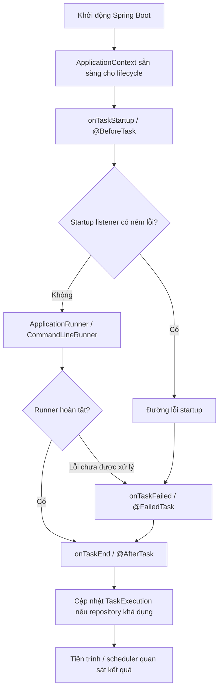
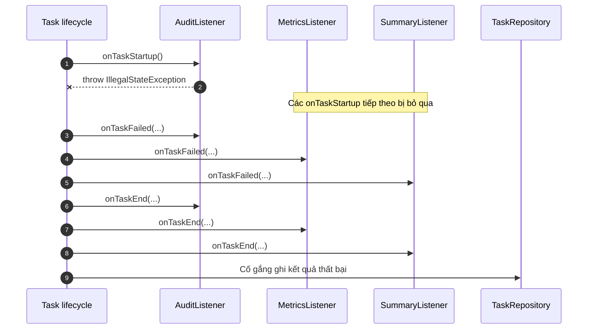

# Listener ném ngoại lệ hoặc thông điệp kết thúc bị ghi đè trong Spring Cloud Task

## 1. Hai triệu chứng khó hiểu khi chẩn đoán một Task

Trong module **Spring Cloud Task**, một ứng dụng Spring Boot thường chạy hữu hạn: xử lý tham số, thực hiện công việc, lưu kết quả hoặc gọi **Spring Batch**, sau đó kết thúc. `TaskRepository` lưu `TaskExecution` để trả lời ứng dụng đã bắt đầu khi nào, kết thúc ra sao và gặp lỗi gì.

Khi mở lịch sử chạy, người vận hành đôi khi gặp hai tình huống:

- **Listener ném ngoại lệ:** một `@BeforeTask`, `@FailedTask`, `@AfterTask` hoặc `TaskExecutionListener` thất bại. Những callback khác không chạy như mong đợi; job có thể bị báo lỗi dù logic nghiệp vụ đã hoàn thành, hoặc thông tin lỗi không đầy đủ.
- **`exitMessage` bị ghi đè:** lúc runner lỗi, `onTaskFailed` ghi `FAILED: gateway timeout`, nhưng `onTaskEnd` lại ghi `DONE`. Truy vấn cuối cùng chỉ thấy `DONE` dù `errorMessage` và `exitCode` cho biết Task thất bại.

Cả hai đều có thể gây nhầm lẫn cho dashboard, scheduler, cảnh báo và quy trình retry. Một nhà vận hành chỉ nhìn cột `EXIT_MESSAGE` rất dễ kết luận sai rằng “Task thành công”.

Bài thuộc chương **Chẩn đoán**, chủ đề **Listener ném ngoại lệ hoặc thông điệp kết thúc bị ghi đè**. Nội dung kết hợp cách Spring Cloud Task theo dõi vòng đời, cách phân biệt mã thoát với thông điệp, thực hành Java, SQL và quy trình xử lý sự cố trên scheduler/container.

Sau bài này, bạn có thể:

1. Mô tả ba callback `onTaskStartup`, `onTaskFailed`, `onTaskEnd` và các annotation tương ứng.
2. Dự đoán chuyện gì xảy ra khi một listener ném lỗi và vì sao các listener khác không được gọi.
3. Giải thích thứ tự ưu tiên của `exitMessage` và phân biệt nó với `errorMessage`/`exitCode`.
4. Viết listener an toàn, không làm hỏng Task chỉ vì log, metric hay cleanup phụ trợ.
5. Kiểm tra kết quả trong `TaskRepository`, log, mã thoát process và platform.
6. Tạo kịch bản kiểm thử cho lỗi startup, lỗi runner, lỗi callback và thông điệp bị ghi đè.
7. Thiết kế retry, kiểm soát mã thoát và phối hợp Spring Batch mà không che lỗi nghiệp vụ.

## 2. Vòng đời Task và vị trí các listener

Khi ứng dụng Spring Boot đã bootstrap `ApplicationContext` thành công, Spring Cloud Task khởi tạo `TaskExecution` cho lần chạy đó. Sau đó `ApplicationRunner`/`CommandLineRunner` thực thi. Hạ tầng Task sử dụng các event của Spring Boot để xác định thành công hoặc lỗi và cập nhật repository.

Ba callback chính của `TaskExecutionListener` là:

| Callback interface | Annotation tương ứng | Thời điểm khái niệm | Trách nhiệm nên có |
| --- | --- | --- | --- |
| `onTaskStartup(TaskExecution)` | `@BeforeTask` | Giai đoạn bắt đầu, trước runner | Bổ sung metadata khởi đầu ngắn gọn, log correlation ID |
| `onTaskFailed(TaskExecution, Throwable)` | `@FailedTask` | Khi Task thất bại do lỗi chưa được xử lý | Ghi nhận loại lỗi, thông điệp kết thúc có ích, metric thất bại |
| `onTaskEnd(TaskExecution)` | `@AfterTask` | Giai đoạn cuối, trước khi hoàn tất metadata | Bổ sung kết quả cuối nếu còn thiếu, cleanup phụ trợ an toàn |

**Hai đặc điểm quan trọng:**

- `onTaskEnd` **không chỉ chạy trong trường hợp thành công**. Nó còn có thể được gọi sau `onTaskFailed` khi Task thất bại.
- Thời điểm callback so với thao tác INSERT/UPDATE metadata chi tiết có thể phụ thuộc phiên bản triển khai; không viết logic dựa trên giả định rằng một transaction ở callback nhất định đã commit ở database.



Sơ đồ minh họa **luồng logic thường gặp**. Một lỗi bootstrap rất sớm có thể khiến Task không có bản ghi nào, còn shutdown cưỡng bức hoặc mất kết nối database có thể khiến `END_TIME` chưa được cập nhật.

### 2.1. Listener interface và listener annotation

Bạn có thể tạo một bean implements `TaskExecutionListener` để xử lý cả ba sự kiện. Hoặc bạn có thể dùng `@BeforeTask`, `@FailedTask` và `@AfterTask` trên các phương thức bean được Spring quản lý.

Ví dụ annotation:

```java
import org.springframework.cloud.task.listener.annotation.BeforeTask;
import org.springframework.cloud.task.listener.annotation.AfterTask;
import org.springframework.cloud.task.listener.annotation.FailedTask;
import org.springframework.cloud.task.repository.TaskExecution;
import org.springframework.stereotype.Component;

@Component
class TaskEventObserver {

    @BeforeTask
    public void before(TaskExecution execution) {
        System.out.println("Starting Task " + execution.getTaskName());
    }

    @FailedTask
    public void failed(TaskExecution execution, Throwable throwable) {
        System.err.println(
            "Task failed with " + throwable.getClass().getSimpleName());
    }

    @AfterTask
    public void after(TaskExecution execution) {
        System.out.println("Task reached the end callback");
    }
}
```

Đoạn mã thể hiện **cú pháp sự kiện**; `System.out` chỉ để học, trong môi trường thực dùng logger và hệ thống quan sát thích hợp. `@FailedTask` cần cả `TaskExecution` và `Throwable`; đừng giả định callback này chạy cho một lỗi đã bị runner bắt và nuốt.

### 2.2. Không tự thay `TaskLifecycleListener` bằng `ApplicationListener` có thứ tự tùy tiện

`TaskLifecycleListener` là thành phần nền tảng của Spring Cloud Task. Tài liệu chính thức cảnh báo việc chèn một `ApplicationListener` chạy **sớm hơn** thành phần này trong chuỗi xử lý event có thể gây hiệu ứng ngoài dự kiến.

Vì vậy, để nhận lifecycle Task, ưu tiên `TaskExecutionListener` hoặc annotation tương ứng. Không dùng `@Order(HIGHEST_PRECEDENCE)` trên listener `ApplicationReadyEvent` chỉ nhằm “ghi `exitMessage` trước Task” mà không hiểu thứ tự hoàn tất metadata.

## 3. Ba trường `exitCode`, `exitMessage` và `errorMessage`

Các trường này cùng ở `TaskExecution` nhưng phục vụ mục đích khác nhau.

| Trường | Kiểu/ý nghĩa | Nguồn phổ biến | Khi chẩn đoán cần làm gì? |
| --- | --- | --- | --- |
| `exitCode` | Số nguyên biểu diễn kết quả Task | Event/exception/mapping của Spring Cloud Task | Kiểm tra 0 hay khác 0, đối chiếu OS exit code |
| `exitMessage` | Chuỗi tóm tắt kết quả do ứng dụng/listener đặt | `setExitMessage(...)` ở callback | Đọc **ngữ cảnh**, không dùng làm nguồn chân lý duy nhất |
| `errorMessage` | Thông tin lỗi/stack trace khi ứng dụng vào đường thất bại | Exception từ `ApplicationFailedEvent` và xử lý listener | Tìm nguyên nhân kỹ thuật; có thể chứa dữ liệu nhạy cảm |
| `endTime` | Mốc Task hoàn tất được ghi nhận | Lifecycle hoàn tất | Nếu rỗng, kiểm tra process/Pod, không kết luận vẫn chạy |

Ví dụ giả định một lần Task:

```text
TASK_EXECUTION_ID = 412
TASK_NAME         = daily-settlement
EXIT_CODE         = 1
EXIT_MESSAGE      = DONE
ERROR_MESSAGE     = java.net.SocketTimeoutException: ...
END_TIME          = 2026-11-24 02:05:16
```

Đây là tình huống **đáng nghi**: `exitCode=1` và `errorMessage` cho thấy lỗi, nhưng `exitMessage=DONE` có thể đã bị callback cuối ghi đè.

**Nguyên tắc:** `exitMessage` không phải trạng thái enum của Spring Cloud Task, cũng không thay cho `errorMessage`. Một chuỗi `"COMPLETED"` được đặt bằng Java **không ép Task thành công**, và một chuỗi `"FAILED"` cũng **không tự làm mã thoát khác 0**.

### 3.1. Trạng thái database và mã thoát hệ điều hành có thể khác

`TaskRepository` được cập nhật qua lifecycle Spring; mã thoát của **tiến trình JVM** được hệ điều hành/scheduler nhận khi process kết thúc. Nếu callback kết thúc lỗi, có cơ chế thoát tùy chỉnh hoặc process bị `SIGKILL`, hai nguồn có thể khác nhau.

Trong các sự cố khó, luôn đối chiếu:

1. Log exception đầu tiên và thứ tự callback.
2. `TASK_EXECUTION.EXIT_CODE`, `EXIT_MESSAGE`, `ERROR_MESSAGE`, `END_TIME`.
3. OS exit code hoặc Kubernetes Job/Pod status.
4. Kết quả nghiệp vụ thật ở database/API/tệp đích.

## 4. Điều gì xảy ra nếu `TaskExecutionListener` ném ngoại lệ?

Theo tài liệu Spring Cloud Task, nếu một listener ném ngoại lệ trong một phase, **quá trình gọi các listener còn lại của chính phase đó dừng**. Các callback thuộc phase khác **vẫn có cơ hội được gọi** theo đường lỗi/lifecycle.

Giả sử đăng ký ba listener `AuditListener`, `MetricsListener`, `SummaryListener`. Ở `onTaskStartup`, `AuditListener` ném exception:



Trong sơ đồ, thứ tự cụ thể của các bean chỉ mang tính minh họa. **Không mặc định `@Order` đảm bảo đúng mọi thứ tự nếu có cả listener interface, adapter annotation và cấu hình phiên bản khác nhau.** Mấu chốt là lỗi trong một phase có thể khiến những callback tiếp theo của phase ấy không được gọi.

### 4.1. Hệ quả của lỗi trong từng phase

| Phase gặp lỗi | Triệu chứng dễ thấy | Rủi ro |
| --- | --- | --- |
| `onTaskStartup` / `@BeforeTask` | Runner có thể không được thực thi; Task kết thúc lỗi sớm | Job không chạy dù dữ liệu đầu vào đúng |
| `onTaskFailed` / `@FailedTask` | Một listener đang xử lý lỗi lại ném lỗi mới; các callback failed phía sau bị bỏ qua | Nguyên nhân ban đầu bị che trong log/thông điệp |
| `onTaskEnd` / `@AfterTask` | Runner có thể đã xong nhưng bước ghi audit, cleanup, metric cuối lỗi | Task metadata/message không khớp với dữ liệu đã xử lý |
| Bất kỳ phase | Một phần listener chạy, phần khác không | Thiếu metric/cảnh báo; thứ tự log khó hiểu |

Việc xử lý callback tùy thuộc phiên bản framework; **đừng khẳng định mọi lần ném exception trong `onTaskEnd` đều khiến JVM chết ngay hoặc luôn ghi cùng một `exitCode`**. Cần dùng kiểm thử tích hợp với version đang sử dụng.

### 4.2. Tại sao một listener báo cáo thất bại lại có thể gây thêm lỗi?

Ví dụ một `@FailedTask` gửi HTTP request tới dịch vụ audit. Chính vì API đích đang lỗi mạng nên Task thất bại; listener lại cố gọi cùng hệ thống và ném `SocketTimeoutException` mới. Hậu quả:

- Lỗi **nghiệp vụ ban đầu** có thể bị che bởi lỗi audit.
- Các listener còn lại của phase failed không được gọi.
- Tăng thời gian shutdown, ảnh hưởng deadline của scheduler.
- `exitMessage` có thể thiếu/ngắn hơn mong muốn.
- Nếu listener cố truy cập `TaskRepository` khi database mất kết nối, có thể làm đường ghi kết quả cuối phức tạp hơn.

**Không đặt side effect có xác suất lỗi cao vào callback lifecycle nếu chỉ để quan sát.** Audit bắt buộc phải được thiết kế bằng một cơ chế bền vững và xử lý lỗi rõ ràng, không dựa vào HTTP call không có timeout ở `onTaskEnd`.

## 5. Quy tắc mã thoát khi listener ném lỗi

Tài liệu Spring Cloud Task mô tả quy tắc ưu tiên cho lỗi của `TaskExecutionListener`:

1. Nếu có `ExitCodeEvent`, mã trong event là một nguồn được ưu tiên.
2. Nếu không có event và exception phù hợp với `ExitCodeGenerator`, lấy mã của `getExitCode()`.
3. Nếu không có mã tùy chỉnh phù hợp, dùng mã lỗi mặc định, thường là **`1`**.

Tài liệu cũng nêu trường hợp **`onTaskStartup` ném exception** được báo với mã lỗi `1` và nhấn mạnh **`ExitCodeExceptionMapper` không được dùng để ghi đè mã của ngoại lệ phát sinh trong những callback listener này**.

Tuy nhiên, có hai lý do phải **kiểm chứng trên phiên bản và môi trường thật**:

- Các callback cuối được gọi trong quá trình **hoàn tất metadata**, có thể sau bước tính toán trạng thái; timing và cách bắt exception trong source code có thể thay đổi giữa các dòng Spring Cloud Task.
- Mã được lưu trong `TaskExecution` và mã mà scheduler nhận khi JVM kết thúc **không nhất thiết trùng nhau** trong các đường lỗi đặc biệt.

| Nguồn điều khiển | Nó tác động tới đâu? | Lưu ý |
| --- | --- | --- |
| `ExitCodeEvent` | Spring Cloud Task ghi nhận mã theo event hỗ trợ | Cần phát đúng thời điểm và cơ chế của phiên bản |
| `ExitCodeGenerator` | Có thể cung cấp mã theo exception/bean hoặc đường exit của Spring Boot | Không sửa được mọi trường hợp listener lỗi sau khi tính trạng thái |
| `ExitCodeExceptionMapper` | Ánh xạ một số lỗi ứng dụng thành mã thoát | Tài liệu nêu **không override được mã listener exception** |
| `taskExecution.setExitMessage(...)` | Sửa **chuỗi mô tả kết thúc** | **Không đồng nghĩa** thay đổi mã thoát |
| `System.exit(...)` | Kết thúc JVM | Gọi trực tiếp trong listener có thể cắt ngang ghi metadata |

Không nên “chữa” lỗi listener bằng `System.exit(1)` ngay trong callback. Việc này có thể khiến `TaskRepository` chưa kịp ghi `endTime` hoặc cleanup bị cắt ngang. Hãy loại bỏ lỗi không cần thiết ở listener, truyền lỗi nghiệp vụ đúng ranh giới và đo kết quả.

## 6. Vì sao `exitMessage` bị ghi đè?

Tài liệu Spring Cloud Task công bố **thứ tự ưu tiên giữa ba phase** khi chúng cùng đặt `exitMessage`:

1. **`onTaskEnd` / `@AfterTask`** — ưu tiên cao nhất.
2. **`onTaskFailed` / `@FailedTask`**.
3. **`onTaskStartup` / `@BeforeTask`** — ưu tiên thấp nhất.

Đây là **ưu tiên theo thời điểm callback**, không phải một enum/priority được ứng dụng tùy ý cấu hình. Callback `onTaskEnd` chạy sau phase failed khi có lỗi, vì thế giá trị nó đặt có thể thay thế thông điệp thất bại trước đó.

### 6.1. Bảng dự đoán kết quả

Giả sử mỗi phase có thể đặt một giá trị không rỗng:

| Thông điệp startup | Thông điệp failed | Thông điệp end | Trạng thái runner | `exitMessage` cuối |
| --- | --- | --- | --- | --- |
| `STARTED` | Không gọi | Không đặt | Thành công | `STARTED` |
| `STARTED` | Không gọi | `DONE` | Thành công | `DONE` |
| `STARTED` | `FAILED: timeout` | Không đặt | Thất bại | `FAILED: timeout` |
| `STARTED` | `FAILED: timeout` | `DONE` | Thất bại | **`DONE`** |
| Không đặt | `FAILED: validation` | `FINISHED_WITH_ERROR` | Thất bại | `FINISHED_WITH_ERROR` |

Trên thực tế, nếu callback gọi `setExitMessage(null)` hoặc không sửa giá trị, hành vi có thể khác với việc đặt một chuỗi cụ thể. Phần quan trọng là **lần ghi thông điệp ở phase cuối có thể thắng**.

**Đừng coi `onTaskEnd` là callback “chỉ khi success”.** Đây là nguyên nhân phổ biến nhất khiến `exitMessage` báo `DONE` trong khi `errorMessage` chứa stack trace lỗi.

### 6.2. Ví dụ cấu hình dễ gây sai

```java
import org.springframework.cloud.task.listener.annotation.AfterTask;
import org.springframework.cloud.task.listener.annotation.FailedTask;
import org.springframework.cloud.task.repository.TaskExecution;
import org.springframework.stereotype.Component;

@Component
class MisleadingExitMessageListener {

    @FailedTask
    public void failed(TaskExecution execution, Throwable error) {
        execution.setExitMessage(
            "FAILED: " + error.getClass().getSimpleName());
    }

    @AfterTask
    public void end(TaskExecution execution) {
        // SAI: callback này chạy cả sau một Task thất bại.
        execution.setExitMessage("DONE");
    }
}
```

Kết quả có thể là:

```text
EXIT_CODE     = 1
EXIT_MESSAGE  = DONE
ERROR_MESSAGE = ... lỗi của runner ...
```

`"DONE"` ở đây **không biến Task thành công**. Nó chỉ làm dashboard và người đọc hiểu nhầm.

### 6.3. Nhiều listener trong cùng phase

Nếu có hai bean `@AfterTask` cùng gọi `setExitMessage(...)`, giá trị cuối phụ thuộc thứ tự callback thực thi. Việc phase `onTaskEnd` ưu tiên hơn `onTaskFailed` **không tự định nghĩa thứ tự giữa hai `onTaskEnd`**.

Đừng dùng nhiều bean tranh nhau làm “nguồn chân lý” của exit message. Hãy **chỉ định một listener chịu trách nhiệm tổng hợp thông điệp cuối**, các listener khác dùng log/metric hoặc lưu thông tin vào kho nghiệp vụ riêng.

## 7. Viết listener an toàn: không ghi đè thông điệp lỗi

Một cách giảm rủi ro là **chỉ đặt `exitMessage` tại `@AfterTask` khi chưa có thông điệp**. Ở phase failed, chỉ ghi một thông điệp ngắn, không chứa stack trace đầy đủ hoặc dữ liệu nhạy cảm.

```java
import org.slf4j.Logger;
import org.slf4j.LoggerFactory;
import org.springframework.cloud.task.listener.annotation.AfterTask;
import org.springframework.cloud.task.listener.annotation.BeforeTask;
import org.springframework.cloud.task.listener.annotation.FailedTask;
import org.springframework.cloud.task.repository.TaskExecution;
import org.springframework.stereotype.Component;
import org.springframework.util.StringUtils;

@Component
public class SafeDiagnosticTaskListener {

    private static final Logger log =
        LoggerFactory.getLogger(SafeDiagnosticTaskListener.class);

    @BeforeTask
    public void before(TaskExecution execution) {
        log.info("Task started: name={}, executionId={}",
            execution.getTaskName(),
            execution.getExecutionId());
        // Không đặt exitMessage thành "SUCCESS" ở giai đoạn bắt đầu.
    }

    @FailedTask
    public void failed(TaskExecution execution, Throwable error) {
        String errorType = error.getClass().getSimpleName();

        // Không lưu nguyên Throwable.getMessage(): có thể chứa dữ liệu nhạy cảm.
        execution.setExitMessage("FAILED: " + errorType);

        log.error(
            "Task failed: name={}, executionId={}, errorType={}",
            execution.getTaskName(),
            execution.getExecutionId(),
            errorType, error);
    }

    @AfterTask
    public void after(TaskExecution execution) {
        if (!StringUtils.hasText(execution.getExitMessage())) {
            execution.setExitMessage("FINISHED");
        }

        log.info(
            "Task end callback: name={}, executionId={}, exitMessage={}",
            execution.getTaskName(),
            execution.getExecutionId(),
            execution.getExitMessage());
    }
}
```

Đây là ví dụ **quan sát lifecycle**, không phải lớp điều khiển trạng thái thành công/thất bại. Nếu Task thất bại, `@FailedTask` đặt thông điệp và `@AfterTask` giữ nguyên vì đã có giá trị. Nếu không có lỗi và chưa có thông điệp, `@AfterTask` bổ sung `FINISHED`.

**Vẫn cần cảnh giác:** `FINISHED` chỉ có nghĩa callback cuối được gọi; không bảo đảm kết quả nghiệp vụ đạt yêu cầu. Muốn biểu diễn trạng thái một cách chính xác, đọc thêm `exitCode` và dữ liệu thực. Nếu cần phân biệt nhiều loại kết quả nghiệp vụ, nên có kiểu kết quả/domain status rõ ràng thay vì suy luận từ một chuỗi tự do.

### 7.1. Không che lỗi hệ thống bằng cách nuốt mọi exception

Ví dụ trên dùng logger thông thường; trong thực tế log pipeline cũng có thể có lỗi. Với các công việc **phụ trợ** như gửi metric, có thể bắt exception **cục bộ và log** để listener không làm Task thất bại chỉ vì dịch vụ monitoring không khả dụng.

```java
@AfterTask
public void emitMetricSafely(TaskExecution execution) {
    try {
        metricsPublisher.publishCompletion(execution.getTaskName());
    } catch (RuntimeException monitoringError) {
        // Chỉ nuốt lỗi của telemetry không trọng yếu.
        log.warn("Could not publish task metric", monitoringError);
    }
}
```

Đoạn trên minh họa một phương thức đặt trong bean có sẵn biến `metricsPublisher`/`log`, **không phải class biên dịch độc lập**. Cần giới hạn timeout cho telemetry, tránh retry đồng bộ kéo dài shutdown.

Trái lại, **không được bắt rồi bỏ qua lỗi nghiệp vụ chính** trong `ApplicationRunner` để Task nhìn như thành công. Đường lỗi nghiệp vụ phải được báo qua exception/trạng thái thích hợp; việc không làm đổ Task vì **telemetry thất bại** là một quyết định khác.

### 7.2. Cleanup có tính bắt buộc nên nằm ở đâu?

Nếu việc giải phóng một tài nguyên là điều kiện để dữ liệu nhất quán, hãy thiết kế nó trong transaction/try-with-resources/finally của **logic nghiệp vụ** hoặc một cơ chế recovery bền vững, thay vì dựa hoàn toàn vào `@AfterTask`.

`@AfterTask` là chỗ tốt cho thao tác nhẹ, idempotent, có timeout ngắn. Nó không được gọi trong mọi trường hợp cưỡng bức như `kill -9`, hết điện hoặc mất node.

## 8. Ví dụ tái hiện ngoại lệ listener có kiểm soát

Để chẩn đoán một ứng dụng thật, tốt nhất có **fault injection trong môi trường test**, không tạo lỗi ngẫu nhiên trên production.

Một listener sau có thể được bật bằng Spring profile `listener-fault-test`. Nó ném exception tại một phase được chọn qua property `app.test.listener-fail-phase`.

```java
import org.springframework.beans.factory.annotation.Value;
import org.springframework.cloud.task.listener.TaskExecutionListener;
import org.springframework.cloud.task.repository.TaskExecution;
import org.springframework.context.annotation.Profile;
import org.springframework.stereotype.Component;

@Component
@Profile("listener-fault-test")
public class FaultInjectionTaskListener
        implements TaskExecutionListener {

    private final String phase;

    public FaultInjectionTaskListener(
            @Value("${app.test.listener-fail-phase:none}") String phase) {
        this.phase = phase;
    }

    @Override
    public void onTaskStartup(TaskExecution execution) {
        failIfSelected("startup");
    }

    @Override
    public void onTaskFailed(
            TaskExecution execution, Throwable throwable) {
        failIfSelected("failed");
    }

    @Override
    public void onTaskEnd(TaskExecution execution) {
        failIfSelected("end");
    }

    private void failIfSelected(String current) {
        if (current.equals(phase)) {
            throw new IllegalStateException(
                "Test-only listener failure in " + current);
        }
    }
}
```

**Chỉ dùng class này trong test/diagnostic profile được cô lập.** Không bật nó cùng secret hoặc datasource production; một lỗi trong `onTaskStartup` có thể khiến Task không chạy nghiệp vụ, còn lỗi phase cuối có thể gây khó khăn cho ghi metadata hoàn chỉnh.

### 8.1. Ứng dụng Task thử nghiệm

```java
import org.springframework.boot.ApplicationRunner;
import org.springframework.boot.SpringApplication;
import org.springframework.boot.autoconfigure.SpringBootApplication;
import org.springframework.cloud.task.configuration.EnableTask;
import org.springframework.context.annotation.Bean;
import org.springframework.beans.factory.annotation.Value;

@SpringBootApplication
@EnableTask
public class ListenerDiagnosticsTaskApplication {

    public static void main(String[] args) {
        SpringApplication.run(ListenerDiagnosticsTaskApplication.class, args);
    }

    @Bean
    ApplicationRunner testRunner(
            @Value("${app.test.runner-fail:false}") boolean shouldFail) {
        return args -> {
            System.out.println("Runner started");
            if (shouldFail) {
                throw new IllegalStateException(
                    "Test-only business failure");
            }
            System.out.println("Runner completed");
        };
    }
}
```

Để kiểm tra `@FailedTask`, đặt `app.test.runner-fail=true`. Để kiểm tra lỗi callback startup, đặt `app.test.listener-fail-phase=startup`. Không cần ném lỗi giả trong code Spring Cloud Task; chỉ cần gây lỗi ở bean listener của ứng dụng.

### 8.2. Cấu hình môi trường test

```yaml
spring:
  application:
    name: listener-diagnostics-worker
  main:
    web-application-type: none
  cloud:
    task:
      name: listener-diagnostics
      closecontext-enabled: true
  datasource:
    url: ${TASK_TEST_DB_URL}
    username: ${TASK_TEST_DB_USER}
    password: ${TASK_TEST_DB_PASSWORD}
app:
  test:
    runner-fail: false
    listener-fail-phase: none
```

YAML yêu cầu datasource **test riêng**, đã có schema Spring Cloud Task phù hợp với version. `spring.cloud.task.closecontext-enabled=true` là lựa chọn cho các lượt chạy JAR được giám sát; khi dùng `@SpringBootTest` để inject bean sau startup, thường đặt `false` trong phạm vi test để context không bị đóng sớm.

Không sử dụng H2 in-memory mỗi process nếu bạn muốn truy vấn lịch sử **sau khi JVM con kết thúc** từ một process khác; dùng PostgreSQL/Testcontainers hoặc database test bền vững có thể đọc lại.

## 9. Ma trận lỗi để so sánh hành vi thực tế

Chạy riêng từng kịch bản, mỗi lần với một database test/schema sạch hoặc một correlation ID riêng. Không bật nhiều nguồn fault injection cùng lúc trong vòng đầu.

| Kịch bản | Runner | Phase ném lỗi | Cần quan sát |
| --- | --- | --- | --- |
| A — baseline | Thành công | Không | `TaskExecution` hoàn tất, exit code thường 0 |
| B — lỗi nghiệp vụ | Ném lỗi | Không | `onTaskFailed` rồi `onTaskEnd`, errorMessage có nguyên nhân |
| C — lỗi startup listener | Có thể chưa chạy | `onTaskStartup` | Listener startup tiếp theo bị bỏ qua; kiểm tra đường lỗi và mã thoát |
| D — lỗi failed listener | Runner ném lỗi | `onTaskFailed` | Failed listener sau có thể bị bỏ qua; end callback vẫn có cơ hội chạy |
| E — lỗi end listener | Runner hoàn tất | `onTaskEnd` | End listener sau có thể bị bỏ qua; đối chiếu DB với OS exit |
| F — ghi đè thông điệp | Runner ném lỗi | Không cần ném lỗi | `@AfterTask` ghi `DONE` thay message `FAILED` |
| G — listener an toàn | Runner ném lỗi | Không | Thông điệp `FAILED:<type>` được giữ tới cuối |

**Kết quả mong đợi cần được đo**, không viết test chỉ assert “listener throw luôn có mã 1”. Tài liệu công bố quy tắc mã cho listener exceptions, nhưng thời điểm tính/cập nhật mã và đường thoát JVM có thể khác giữa phiên bản. Ma trận này chính là cách xác minh contract đang sử dụng.

### 9.1. Một số lệnh thử nghiệm trên JAR test

```bash
# A: không cố tình gây lỗi
java -jar listener-diagnostics.jar \
  --spring.profiles.active=listener-fault-test \
  --app.test.listener-fail-phase=none \
  --app.test.runner-fail=false

# C: lỗi callback startup
java -jar listener-diagnostics.jar \
  --spring.profiles.active=listener-fault-test \
  --app.test.listener-fail-phase=startup

# D: runner lỗi, callback failed cũng lỗi
java -jar listener-diagnostics.jar \
  --spring.profiles.active=listener-fault-test \
  --app.test.runner-fail=true \
  --app.test.listener-fail-phase=failed

# E: callback end lỗi
java -jar listener-diagnostics.jar \
  --spring.profiles.active=listener-fault-test \
  --app.test.listener-fail-phase=end
```

Đây là cú pháp shell Linux/macOS; PowerShell có ký tự nối dòng khác. Chạy `echo $?` **ngay sau từng lệnh Java** để xem mã thoát; nếu chạy thêm `grep`, `psql` hoặc lệnh khác trước đó, `$?` sẽ không còn là mã của Java.

**Không gửi secret database qua CLI**. Các biến môi trường `TASK_TEST_DB_*` phải có trong môi trường thử nghiệm; không ghi password vào log hoặc `TASK_EXECUTION_PARAMS`.

## 10. Truy vấn `TaskRepository` để xác định thông điệp nào được lưu

Với schema JDBC Spring Cloud Task thông dụng:

```sql
SELECT TASK_EXECUTION_ID,
       TASK_NAME,
       START_TIME,
       END_TIME,
       EXIT_CODE,
       EXIT_MESSAGE,
       ERROR_MESSAGE
FROM TASK_EXECUTION
WHERE TASK_NAME = 'listener-diagnostics'
ORDER BY TASK_EXECUTION_ID DESC;
```

Một lần thực thi có `EXIT_CODE=1`, `EXIT_MESSAGE='DONE'` và `ERROR_MESSAGE` chứa stack trace có thể gợi ý **ghi đè thông điệp trong callback cuối**. Nhưng để kết luận chắc chắn, phải đối chiếu log từng listener hoặc tái hiện bằng test.

### 10.1. Nếu không thấy bản ghi nào?

Không nên kết luận listener “chưa được gọi” chỉ từ việc không thấy dòng trong `TASK_EXECUTION`. Có thể:

- Context lỗi trước khi hạ tầng Task khởi tạo bản ghi.
- Datasource sai URL/schema hoặc không có quyền ghi.
- Task đang dùng một database khác với nơi bạn truy vấn.
- Exception ở giai đoạn bootstrap cản Task lifecycle.
- Task đã tạo process nhưng JVM bị kill trước khi tạo metadata.

Đọc log bootstrap, mã process và cấu hình `spring.datasource.*`, sau đó kiểm tra schema **đúng phiên bản**. Đừng tự sửa `TASK_EXECUTION` trong production để che lỗi.

### 10.2. Nếu `END_TIME` rỗng?

Có thể Task đang chạy, cũng có thể bị kill, node chết hoặc database mất kết nối khi ghi kết thúc. Đối chiếu `kubectl get/describe pod`, OS process status, scheduler và log. Không dùng chỉ `END_TIME IS NULL` làm lệnh “chạy lại ngay” vì công việc nghiệp vụ có thể đã hoàn tất.

### 10.3. Nếu thông điệp đúng nhưng mã thoát sai?

Kiểm tra mã/ngoại lệ được cung cấp qua `ExitCodeEvent`, `ExitCodeGenerator`, `ExitCodeExceptionMapper` và code tại `main` (nếu dùng `SpringApplication.exit`). Kiểm tra có gọi `System.exit(...)` quá sớm hoặc nuốt exception trong runner không.

**Không sửa `EXIT_CODE` bằng cách đổi `EXIT_MESSAGE`.** Đây là hai trường độc lập và phải được xử lý ở đúng ranh giới.

## 11. Thiết kế log có thể truy vết mà không phụ thuộc vào `exitMessage`

`exitMessage` nên là **tóm tắt ngắn**. Khi cần chi tiết, lưu log có cấu trúc và một correlation ID hoặc execution ID để tra cứu.

Ví dụ các trường log:

```text
timestamp=2026-11-24T02:00:00Z
taskName=listener-diagnostics
taskExecutionId=412
phase=onTaskFailed
errorType=SocketTimeoutException
businessKey=settlement:2026-11-23
artifactVersion=1.0.0
```

Những trường trên là **minh họa**, không phải yêu cầu mọi framework tự tạo log định dạng này. Đừng đưa token, payload, số tài khoản hay dữ liệu cá nhân vào `exitMessage` hoặc MDC.

Đề xuất quan sát:

- Log một record tại startup, failed và end, với **phase** rõ ràng.
- Tạo metric listener error theo loại phase/exception nhưng tránh cardinality quá cao.
- Theo dõi số Task có `END_TIME` rỗng so với Pod/Job đã kết thúc.
- Cảnh báo khi `EXIT_CODE != 0`, không chỉ khi `EXIT_MESSAGE` chứa `FAILED`.
- Với lỗi telemetry, log cảnh báo và giữ lỗi nghiệp vụ **ban đầu**.
- Với message bị ghi đè, bổ sung test kiểm tra giá trị cuối trong repository, không chỉ mock method đã gọi.

## 12. Khi tích hợp Spring Batch: một loại lỗi khác dễ nhầm

Spring Cloud Task và Spring Batch có metadata khác nhau:

| Tầng | Metadata | Có thể báo lỗi thế nào? |
| --- | --- | --- |
| Task | `TaskExecution` | `exitCode`, `exitMessage`, `errorMessage` |
| Batch job | `JobExecution` | `BatchStatus.FAILED`, `ExitStatus` |
| Batch step | `StepExecution` | `STATUS`, `EXIT_CODE`, `EXIT_MESSAGE`, `READ_COUNT`, `WRITE_COUNT` |

Một Spring Batch job có thể **`BatchStatus.FAILED`** dù runner không ném exception ra ngoài theo đường mặc định. Khi đó `@FailedTask` **có thể không được gọi** vì không có lỗi Task startup được lan truyền. Tưởng rằng listener bị hỏng, nhưng nguyên nhân là **trạng thái Batch chưa được chuyển thành lỗi Task**.

Ở các phiên bản tích hợp hỗ trợ, cấu hình:

```yaml
spring:
  cloud:
    task:
      batch:
        fail-on-job-failure: true
```

giúp cơ chế runner tích hợp phát hiện `BatchStatus.FAILED` và lan truyền lỗi sang kết quả Task. Property này **không tự bắt mọi lỗi do một custom JobLauncher tự viết phát sinh**, và cũng không bảo đảm một `ExitStatus` tùy chỉnh khác `FAILED` luôn được coi là lỗi.

Để chẩn đoán, xem **cả hai repository**:

```sql
SELECT JOB_EXECUTION_ID,
       STATUS,
       EXIT_CODE,
       EXIT_MESSAGE,
       START_TIME,
       END_TIME
FROM BATCH_JOB_EXECUTION
ORDER BY JOB_EXECUTION_ID DESC;
```

Đừng nhầm `BATCH_JOB_EXECUTION.EXIT_CODE` là chuỗi ExitStatus của Batch với `TASK_EXECUTION.EXIT_CODE` là số nguyên. Khi mapping kết quả Batch → Task, kiểm tra đúng runner/auto-configuration, thứ tự callback và việc dùng Spring Batch async.

## 13. Trình tự chẩn đoán một sự cố thực tế

Giả sử scheduler báo Task `daily-settlement` không thành công; dashboard lại hiển thị `exitMessage=DONE`. Đừng xóa lịch sử hay khởi chạy lại ngay. Có thể xử lý theo thứ tự:

### Bước 1 — Khoanh vùng lượt chạy

Lấy `taskName`, `TaskExecution.executionId` (nếu tồn tại), thời điểm, artifact version, environment và input business key. Với Kubernetes, giữ thêm Job/Pod UID và container ID.

### Bước 2 — Đọc dữ liệu gốc

Truy vấn `TASK_EXECUTION`: `START_TIME`, `END_TIME`, `EXIT_CODE`, `EXIT_MESSAGE`, `ERROR_MESSAGE`. Nếu có Batch, truy vấn cả `BATCH_JOB_EXECUTION`/`BATCH_STEP_EXECUTION`.

### Bước 3 — Đối chiếu log theo phase

Tìm thứ tự log `onTaskStartup` → runner → `onTaskFailed` (nếu có) → `onTaskEnd`. Xác định **exception đầu tiên** và xem sau đó có exception trong audit/metric/cleanup listener nữa không.

### Bước 4 — Tìm nơi gọi `setExitMessage`

Kiểm tra tất cả bean implements `TaskExecutionListener` hoặc mang `@BeforeTask`, `@FailedTask`, `@AfterTask` của **mã nguồn bài toán đang sử dụng**. Ưu tiên phát hiện một `@AfterTask` luôn ghi `DONE` hoặc hai listener tranh nhau ghi chuỗi cuối.

Đừng suy luận thứ tự chỉ từ tên class. Nếu nhiều listener, cần thử nghiệm thứ tự callback thật và chỉ định một nơi duy nhất sở hữu summary.

### Bước 5 — Phân loại lỗi

| Nhóm | Ví dụ | Cách phản ứng |
| --- | --- | --- |
| Lỗi nghiệp vụ | Input sai, API trả `503`, constraint DB | Xử lý/retry có kiểm soát theo hợp đồng nghiệp vụ |
| Lỗi listener phụ trợ | Audit endpoint timeout, metric exporter lỗi | Giảm side effect, timeout ngắn, log cảnh báo; không che lỗi gốc |
| Ghi đè thông điệp | `@AfterTask` ghi `DONE` sau `@FailedTask` | Chỉ điền khi chưa có message; thêm test regression |
| Lỗi repository | Mất DB, schema sai, thiếu quyền | Khôi phục metadata DB, đối chiếu platform/output, không chỉnh DB thủ công |
| Lỗi platform | `OOMKilled`, node eviction, image pull | Kiểm tra Pod/Job/OS, tài nguyên và startup |
| Lỗi Batch không lan ra Task | `BatchStatus.FAILED` nhưng Task mã 0 | Kiểm tra runner và `fail-on-job-failure` |

### Bước 6 — Đối chiếu kết quả nghiệp vụ rồi mới retry

Một Task có thể đã gửi thanh toán, tải tệp hay ghi báo cáo xong trước khi listener cuối bị lỗi. **Chỉ vì dashboard báo thất bại không có nghĩa mọi side effect đã rollback.**

Trước khi retry, tra idempotency key, nguồn dữ liệu và trạng thái bên đích. Nếu kết quả không chắc chắn, xử lý đối soát; tránh gửi yêu cầu mới với khóa mới khiến dữ liệu bị tạo trùng.

### Bước 7 — Sửa nguyên nhân, thử nghiệm và triển khai

Tạo một kịch bản test tái hiện lỗi. Thêm assertion cho message cuối trong repository, errorMessage, exitCode và OS exit. Sửa listener, kiểm thử trên DB test, chạy canary rồi theo dõi lần chạy kế tiếp.

## 14. Kiểm thử hồi quy về listener và thông điệp kết thúc

Có hai lớp test phù hợp:

1. **Unit test cho logic tạo thông điệp**: không cần Spring, xác nhận không ghi đè message đã có.
2. **Integration/process test**: khởi chạy Spring Cloud Task với DB test thật, gây lỗi ở từng phase và đọc lại `TaskExecution`.

### 14.1. Tách logic “chỉ điền message khi trống”

```java
import org.springframework.cloud.task.repository.TaskExecution;
import org.springframework.util.StringUtils;

public final class ExitMessagePolicy {

    public void setDefaultIfEmpty(
            TaskExecution execution, String fallback) {

        if (!StringUtils.hasText(execution.getExitMessage())) {
            execution.setExitMessage(fallback);
        }
    }
}
```

JUnit minh họa:

```java
import static org.assertj.core.api.Assertions.assertThat;

import org.junit.jupiter.api.Test;
import org.springframework.cloud.task.repository.TaskExecution;

class ExitMessagePolicyTest {

    private final ExitMessagePolicy policy = new ExitMessagePolicy();

    @Test
    void preservesFailureMessage() {
        TaskExecution execution = new TaskExecution();
        execution.setExitMessage("FAILED: Timeout");

        policy.setDefaultIfEmpty(execution, "FINISHED");

        assertThat(execution.getExitMessage())
            .isEqualTo("FAILED: Timeout");
    }

    @Test
    void fillsMissingMessage() {
        TaskExecution execution = new TaskExecution();

        policy.setDefaultIfEmpty(execution, "FINISHED");

        assertThat(execution.getExitMessage())
            .isEqualTo("FINISHED");
    }
}
```

Unit test này chỉ chứng minh **logic không ghi đè**. Nó **không chứng minh** framework đã gọi `@AfterTask` sau `@FailedTask`, có ghi DB đúng lúc hoặc exit code chuẩn. Những việc đó phải được kiểm chứng ở test tích hợp.

### 14.2. Integration test không dùng database production

Dùng một PostgreSQL test hoặc Testcontainers, tạo schema Task đúng phiên bản, chuẩn bị JAR test và chạy các kịch bản ở mục 9. Sau mỗi lượt, tra `TASK_EXECUTION` với task name/correlation ID riêng.

Không đặt `spring.cloud.task.closecontext-enabled=true` trong một `@SpringBootTest` mà các test method còn cần context mở; trong test dạng context nên override thành `false`. Nếu cần kiểm tra **process đóng thật**, dùng subprocess tách JVM.

### 14.3. Assertions cần có

| Trường hợp | Assertion tối thiểu |
| --- | --- |
| Thành công | Không có lỗi ngoài mong đợi; Task có kết quả cuối phù hợp |
| Runner ném lỗi | Callback failed có được gọi; repository chứa dấu vết lỗi |
| Startup listener ném lỗi | Runner không được coi là thành công; listener cùng phase sau bị bỏ qua |
| Failed listener ném lỗi | Có log lỗi phụ; nguyên nhân ban đầu vẫn truy được |
| End listener ném lỗi | Các end listener khác/metadata theo version được quan sát, không đoán |
| Message của failed đặt trước end | `exitMessage` cuối **không bị sửa thành `DONE`** |
| JVM bị kill | Có thể thiếu `END_TIME`; hệ thống điều phối phát hiện |
| Batch job `FAILED` | Task được báo đúng khi runner tích hợp/thuộc tính phù hợp |

Với nhiều version Spring Cloud Task, hãy coi test process-level + SQL readback là **contract test** để phát hiện thay đổi không mong muốn sau nâng cấp.

## 15. Thực hành vận hành: log và câu lệnh kiểm tra

### 15.1. Kubernetes Job/Pod

Trên Kubernetes:

```bash
kubectl get jobs -n batch-workloads
kubectl get pods -n batch-workloads
kubectl describe pod <pod-name> -n batch-workloads
kubectl logs <pod-name> -n batch-workloads
```

Nếu container khởi động lại trong cùng Pod, có thể cần `kubectl logs --previous` cho lần trước theo khả năng của Pod/runtime. Với Job tạo Pod mới, phải chọn **đúng Pod của lượt chạy**.

Một Pod kết thúc với mã `137` cần kiểm tra reason (chẳng hạn `OOMKilled`), không suy luận ngay đó là lỗi listener. Nếu Pod không khởi tạo được Java, có thể hoàn toàn không có `TaskExecution`.

### 15.2. Đối chiếu thời điểm theo timeline

Ví dụ log mong muốn:

```text
02:00:00 Task startup: executionId=412
02:00:01 Runner begins
02:05:15 Runner throws SocketTimeoutException
02:05:15 onTaskFailed writes exitMessage=FAILED: SocketTimeoutException
02:05:15 onTaskEnd preserves previous exitMessage
02:05:16 TaskRepository completion recorded
02:05:16 JVM exit code observed by scheduler
```

Nếu thay dòng thứ năm thành `onTaskEnd writes exitMessage=DONE`, đó là manh mối mạnh của lỗi ghi đè. Nếu không có dòng `onTaskFailed`, tìm hiểu có phải runner đã **nuốt exception**, Task chưa vào đường failed hoặc callback failed trước đó đã ném lỗi.

Đặt timestamps, correlation ID và artifact version trong log để so sánh. `TaskExecution.exitMessage` chỉ là một chuỗi tóm tắt; đừng lưu cả stack trace lớn, payload hoặc thông tin nhạy cảm ở đó.

## 16. Những cách sửa sai cần tránh

| Cách làm hấp tấp | Vì sao sai? | Lựa chọn đúng hơn |
| --- | --- | --- |
| `@AfterTask` luôn ghi `SUCCESS` | Ghi đè lỗi từ `@FailedTask` | Chỉ điền message khi chưa có; đọc exitCode |
| `@FailedTask` gọi API audit không timeout | Có thể ném exception phụ và kéo dài shutdown | Dùng timeout/try-catch cho telemetry, cơ chế outbox nếu audit trọng yếu |
| Gọi `System.exit(1)` trong callback | Có thể cắt ngang lifecycle và ghi metadata | Để logic nghiệp vụ báo lỗi ở runner, kiểm tra OS exit riêng |
| Chỉ xem `EXIT_MESSAGE` để quyết định retry | Message có thể bị ghi đè mà exitCode không đổi | Đối chiếu exitCode, errorMessage, platform, dữ liệu đích |
| Sửa trực tiếp `TASK_EXECUTION.EXIT_CODE` khi báo cáo lỗi | Xóa dấu vết sự cố và sai contract | Sửa code/config, giữ lịch sử và thêm incident annotation riêng |
| Bắt mọi exception trong runner rồi return | Framework có thể báo Task thành công giả | Truyền lỗi chính theo cơ chế thích hợp |
| Bật retry vô hạn vì listener lỗi | Không sửa nguyên nhân, có thể tạo tác dụng phụ lặp | Sửa listener và dùng retry có giới hạn, idempotency |
| Dùng chung DB test và production | Test tạo/sửa metadata thật | Dùng schema/DB test riêng |
| Dựa vào thứ tự bean chưa xác minh | Nhiều listener có thể tranh nhau message | Một owner duy nhất cho exit message; test tích hợp |
| Đổi `@Order` liên tục để “chữa” | Chỉ che vấn đề thiết kế ownership | Tách audit/metric khỏi quyết định kết quả |

## 17. Checklist chẩn đoán trước khi đóng incident

- [ ] Xác định đúng `taskName`, `executionId`, input business key và artifact version.
- [ ] Tra `EXIT_CODE`, `EXIT_MESSAGE`, `ERROR_MESSAGE`, `START_TIME`, `END_TIME`.
- [ ] Đối chiếu OS/Kubernetes Job exit code và trạng thái Pod.
- [ ] Xem thứ tự `onTaskStartup`, `onTaskFailed`, `onTaskEnd` thực tế.
- [ ] Xác nhận listener nào **ném exception đầu tiên** và phase nào bị ngắt.
- [ ] Kiểm tra tất cả nơi gọi `setExitMessage(...)`, đặc biệt `@AfterTask`.
- [ ] Một listener duy nhất sở hữu exit summary cuối, không nhiều bean ghi đè nhau.
- [ ] Telemetry/log/cleanup phụ trợ không ném lỗi làm che nguyên nhân chính.
- [ ] Exception nghiệp vụ vẫn được truyền ra đúng nơi; không chỉ ghi log rồi nuốt.
- [ ] Có nguồn dữ liệu test riêng để tái hiện lỗi và đọc metadata sau khi process dừng.
- [ ] Với Batch, đã kiểm tra `BatchStatus`, `ExitStatus` và cấu hình truyền lỗi sang Task.
- [ ] Kết quả nghiệp vụ thực được đối chiếu trước khi retry/relaunch.
- [ ] Có idempotency key ổn định và ngân sách retry/scheduler có giới hạn.
- [ ] Đã chạy test regression cho lỗi startup, failed, end và ghi đè message.
- [ ] Sau thay đổi, alert/dashboard không chỉ dựa vào một chuỗi `exitMessage`.

## 18. Câu hỏi tự kiểm tra

**Câu 1.** Vì sao một listener `onTaskStartup` ném lỗi có thể khiến listener startup khác không được gọi?

**Câu 2.** Nếu runner lỗi, `onTaskFailed` đặt `FAILED: timeout` nhưng `onTaskEnd` đặt `DONE`, giá trị cuối của `exitMessage` thường là gì?

**Câu 3.** `exitMessage=DONE` có đảm bảo `exitCode=0` không? Tại sao?

**Câu 4.** Phân biệt `exitMessage` với `errorMessage` trong `TaskExecution`. Trường nào thường chứa stack trace?

**Câu 5.** Vì sao không nên dùng `ExitCodeExceptionMapper` để “sửa” lỗi do listener ném ngoại lệ?

**Câu 6.** Một `@FailedTask` gửi metric và metric server bị timeout. Cách xử lý nào tránh che lỗi nghiệp vụ?

**Câu 7.** Một Pod đã bị xóa nhưng `END_TIME` của Task vẫn là `NULL`. Có thể kết luận job chưa từng xử lý dữ liệu không?

**Câu 8.** Một Batch job có `BatchStatus.FAILED` nhưng `@FailedTask` không chạy. Ngoài lỗi listener, còn nguyên nhân nào hợp lý?

**Câu 9.** Nếu hai listener `@AfterTask` cùng ghi message, vì sao chỉ biết thứ tự ưu tiên giữa các phase là chưa đủ?

**Câu 10.** Khi đã sửa việc ghi đè `exitMessage`, vì sao vẫn phải kiểm thử riêng mã thoát JVM và dữ liệu nghiệp vụ?

**Gợi ý đáp án:**

1. Exception có thể dừng việc gọi các listener còn lại **trong cùng phase**.
2. Thường là `DONE` vì `onTaskEnd` ưu tiên cao hơn `onTaskFailed`.
3. Không; text summary độc lập với mã thoát.
4. `exitMessage` là mô tả ngắn do listener đặt, `errorMessage` thường chứa lỗi/stack trace.
5. Tài liệu không cho phép mapper ghi đè mã lỗi phát sinh trong callback listener theo cách này.
6. Có timeout, bắt riêng lỗi telemetry, ghi cảnh báo và giữ exception nghiệp vụ gốc.
7. Không; task có thể đã tạo side effect trước khi bị kill.
8. Batch failure chưa được lan thành lỗi Task qua runner tích hợp.
9. Phải biết thứ tự callback **trong cùng phase** hoặc chỉ có một owner.
10. Vì callback/metadata, process và dữ liệu nghiệp vụ là các nguồn kết quả khác nhau.

## 19. Tổng kết và tài liệu tham khảo

Trong **Spring Cloud Task**, listener phục vụ mở rộng vòng đời chứ không nên là nguồn phát sinh lỗi phụ làm rối kết quả nghiệp vụ. Nếu một `TaskExecutionListener` ném ngoại lệ, các listener tiếp theo của **cùng callback** có thể không được gọi; các phase khác vẫn được xử lý theo lifecycle. Nếu nhiều phase cùng đặt `exitMessage`, **`onTaskEnd` ưu tiên hơn `onTaskFailed`, rồi đến `onTaskStartup`**. Đó là lý do `@AfterTask` ghi `DONE` có thể che thông điệp thất bại được đặt trước.

Giải pháp bền vững là **không cho nhiều callback tranh nhau exit summary**, không ghi đè message đã có tại phase cuối, tách `exitMessage` khỏi `exitCode`/`errorMessage`, quản lý lỗi telemetry có kiểm soát, và kiểm tra kết quả ở cả `TaskRepository`, process/platform và dữ liệu nghiệp vụ. Khi phối hợp Spring Batch hoặc retry, phải bảo đảm lỗi được lan truyền đúng và việc chạy lại không tạo tác dụng phụ trùng.

**Tài liệu chính thức để kiểm tra theo phiên bản đang dùng:**

- [Spring Cloud Task — Features: Task Execution Listener, Exceptions và Exit Messages](https://docs.spring.io/spring-cloud-task/reference/features.html)
- [Spring Cloud Task — Reference Guide, Exceptions Thrown by Task Execution Listener](https://docs.spring.io/spring-cloud-task/docs/current/reference/html/features.html)
- [Spring Cloud Task — TaskExecutionListener API](https://docs.spring.io/spring-cloud-task/docs/current/api/org/springframework/cloud/task/listener/TaskExecutionListener.html)
- [Spring Cloud Task — TaskLifecycleListener source code](https://github.com/spring-cloud/spring-cloud-task/blob/main/spring-cloud-task-core/src/main/java/org/springframework/cloud/task/listener/TaskLifecycleListener.java)
- [Spring Cloud Task — TaskExecution và TaskRepository](https://docs.spring.io/spring-cloud-task/reference/features.html)
- [Spring Boot — Exit Codes and SpringApplication](https://docs.spring.io/spring-boot/reference/features/spring-application.html)
- [Spring Batch — Job and Step Domain](https://docs.spring.io/spring-batch/reference/domain.html)
