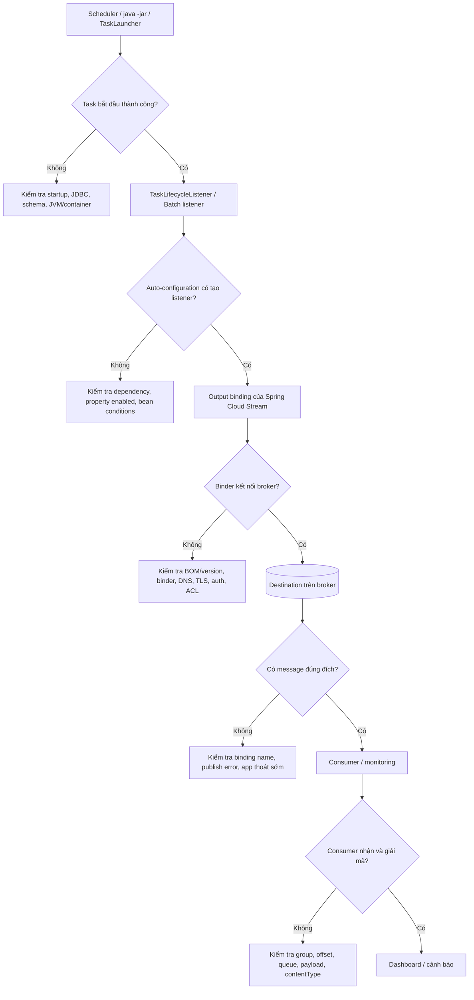

# Không phát sự kiện hoặc cấu hình binder không khớp phiên bản

Một ứng dụng **Spring Cloud Task** thường khởi động, chạy một công việc hữu hạn, cập nhật `TaskExecution` trong **`TaskRepository`** rồi kết thúc. Nếu ứng dụng còn chạy **Spring Batch**, trạng thái Job/Step được lưu trong **`JobRepository`**. Để giám sát hoặc thông báo kết quả cho hệ thống khác, Spring Cloud Task có thể tích hợp **Spring Cloud Stream** để phát **Task events** và **Batch events** qua Kafka, RabbitMQ hoặc binder tương thích.

Sự cố khó chẩn đoán xảy ra khi **task đã chạy, database đã có `TASK_EXECUTION` nhưng dashboard không thấy sự kiện**. Một biến thể khác là ứng dụng hoạt động ở local, nhưng sau nâng cấp Spring Boot/Spring Cloud lại gặp lỗi khởi tạo binder, không tạo binding, hoặc producer gửi lên một destination mà consumer không theo dõi.

Bài **“Không phát sự kiện hoặc cấu hình binder không khớp phiên bản”**, thuộc chương **Chẩn đoán**, hướng dẫn một quy trình xử lý có chứng cứ: xác nhận **Task có thực thi → listener có được tạo → binding có được kết nối → broker có nhận → consumer có đọc được**. Nội dung cũng giải thích cách kiểm tra **ma trận phiên bản**, các công tắc phát sự kiện, sự khác biệt giữa binding name/destination và rủi ro khi task thoát rất nhanh.

Sau bài này, bạn có thể:

- Phân biệt việc **không có TaskExecution**, **không có event được tạo** và **event đã publish nhưng consumer không nhận**.
- Nhận biết đúng các event `task-events`, `job-execution-events`, `step-execution-events` và những event Batch khác.
- Kiểm tra dependency, Spring Cloud BOM, binder implementation và điều kiện auto-configuration.
- Định vị lỗi config `binding name`, `destination`, `binder`, broker credentials và consumer group.
- Dùng log, báo cáo điều kiện bean, metadata JDBC và công cụ broker để chẩn đoán mà không lộ secret.
- Thiết kế kiểm thử tích hợp và runbook an toàn, không coi message event là nguồn sự thật duy nhất khi retry.

## 1. Sự kiện nào đang bị mất?

Trước khi sửa cấu hình, phải biết bạn đang mong đợi **sự kiện cấp Task** hay **sự kiện cấp Spring Batch**.

| Cơ chế | Binding name mặc định | Điều kiện nghiệp vụ để có event | Kho metadata tương ứng |
| --- | --- | --- | --- |
| **Spring Cloud Task events** | `task-events` | Một Spring Cloud Task thực sự chạy và listener phát event hoạt động | `TaskRepository` / `TASK_EXECUTION` |
| **Batch Job execution** | `job-execution-events` | Một Spring Batch `Job` được thực thi trong Task với listener tương ứng | `JobRepository` / `BATCH_JOB_EXECUTION` |
| **Batch Step execution** | `step-execution-events` | Có Step thực sự chạy và listener Step được cấu hình | `BATCH_STEP_EXECUTION` |
| **Batch Chunk** | `chunk-events` | Có callback chunk | Thống kê Step/chunk |
| **Batch Item Read** | `item-read-events` | Có callback đọc item | Reader và Step |
| **Batch Item Process** | `item-process-events` | Có callback xử lý item | Processor và Step |
| **Batch Item Write** | `item-write-events` | Có callback ghi item/nhóm item | Writer và Step |
| **Batch Skip** | `skip-events` | Batch thật sự skip item theo chính sách | Skip counts của Step |

**Không có Skip event** không nhất thiết là lỗi: nếu Job không skip item nào thì listener không có callback tương ứng để phát. Tương tự, một Spring Cloud Task chỉ dùng `ApplicationRunner` mà **không khởi chạy Spring Batch Job** sẽ không tự tạo `job-execution-events`.

Theo tài liệu Spring Cloud Task, Task event có thể phát tại **bắt đầu và kết thúc** một lần thực thi, còn Batch events do các listener theo dõi vòng đời Job/Step/Chunk/Item. Các sự kiện này là **kênh thông báo bổ sung**, không thay thế giao dịch và metadata framework.

### Ba danh tính khác nhau

Ví dụ muốn nhận Step events:

- **Listener**: `StepExecutionListener`, đối tượng theo dõi callback.
- **Binding name**: `step-execution-events`, tên logic output mà listener phát tin.
- **Destination**: `ops.batch.steps.v1`, topic/exchange hoặc đích broker theo binder.

Nếu chỉ đổi `destination`, listener vẫn có thể dùng binding name mặc định. Nếu đổi cả **binding name**, mọi cấu hình `spring.cloud.stream.bindings.<name>.*` cũng phải tham chiếu **tên mới**. Đừng gọi ba khái niệm này là một “topic”.

## 2. Sơ đồ truy vết: xác định bản tin biến mất ở đâu



**Nguyên tắc:** Tìm **điểm cuối cùng có bằng chứng thành công**, rồi kiểm tra đoạn tiếp theo. Không đổi cả năm loại cấu hình cùng lúc, vì rất khó biết thay đổi nào giải quyết vấn đề.

### Bảng phân loại nhanh

| Bằng chứng | Nhận định ban đầu | Bước tiếp theo |
| --- | --- | --- |
| JVM không vào được runner, `TASK_EXECUTION` trống | Có thể lỗi **trước khi event được phát** | Xem startup logs, datasource, schema, cấu hình Spring Boot. |
| `TASK_EXECUTION` có start/end, nhưng không có Task event | Task chạy; nhánh publish cần kiểm tra | Xem `task.events.enabled`, binder và output binding. |
| `task-events` có, nhưng `job-execution-events` không | Nhánh Batch có thể chưa chạy/không được bật | Kiểm tra JobExecution, Batch listener và công tắc Batch. |
| Log publish thành công, broker có message, dashboard trống | Vấn đề nhiều khả năng ở **consumer** | Kiểm tra destination input, group/offset, parser và ACL. |
| Startup báo `NoSuchMethodError` / `ClassNotFoundException` | Có thể có xung đột version/classpath | Kiểm tra BOM và dependency tree. |
| Lúc kết thúc task rất nhanh không thấy message | Có thể publisher chưa hoàn tất hoặc consumer không có subscription | Kiểm tra logs/broker và chính sách gửi trước khi kết luận. |

## 3. Kiểm tra dependency và phiên bản trước khi debug broker

Spring Cloud Task dùng Spring Cloud Stream để phát sự kiện; chỉ có dependency **`spring-cloud-starter-task`** không có nghĩa mọi ứng dụng đều có **binder** được cấu hình và khả dụng. Tài liệu Spring Cloud Task yêu cầu Spring Cloud Stream, binder implementation và task phù hợp trên classpath để cơ chế event được tự cấu hình.

### 3.1. Một bộ dependency minh họa với RabbitMQ

Trong một Maven project đã có **Spring Boot parent**, **Spring Cloud BOM tương thích** và plugin đóng gói JAR:

```xml
<dependencies>
    <dependency>
        <groupId>org.springframework.cloud</groupId>
        <artifactId>spring-cloud-starter-task</artifactId>
    </dependency>
    <dependency>
        <groupId>org.springframework.boot</groupId>
        <artifactId>spring-boot-starter-jdbc</artifactId>
    </dependency>
    <dependency>
        <groupId>org.springframework.cloud</groupId>
        <artifactId>spring-cloud-stream</artifactId>
    </dependency>
    <dependency>
        <groupId>org.springframework.cloud</groupId>
        <artifactId>spring-cloud-stream-binder-rabbit</artifactId>
    </dependency>
    <dependency>
        <groupId>org.postgresql</groupId>
        <artifactId>postgresql</artifactId>
        <scope>runtime</scope>
    </dependency>
</dependencies>
```

Nếu muốn **Batch events**, thêm `spring-boot-starter-batch` và có một Batch Job được khởi chạy thật:

```xml
<dependency>
    <groupId>org.springframework.boot</groupId>
    <artifactId>spring-boot-starter-batch</artifactId>
</dependency>
```

Các đoạn trên **chưa phải POM hoàn chỉnh**. Spring Cloud BOM phải quản lý đồng bộ các dependency Spring Cloud Task, Spring Cloud Stream, binder và những thành phần liên quan. Không tự đặt phiên bản cho `spring-cloud-stream-binder-rabbit` khác release train chỉ để “khớp broker đang chạy”.

Nếu dùng **Kafka**, thay dependency binder RabbitMQ bằng `org.springframework.cloud:spring-cloud-stream-binder-kafka` và thay cấu hình kết nối. Không thêm cả Kafka và Rabbit binder khi chỉ dùng một broker, trừ khi chủ động cấu hình **multiple binders**.

### 3.2. Ma trận tương thích ở mức release train

Spring Cloud và Spring Boot được phát hành theo các nhóm phiên bản tương thích. Ví dụ tại thời điểm viết:

| Spring Boot generation | Spring Cloud release train tương ứng | Lưu ý |
| --- | --- | --- |
| **3.5.x** | **2025.0.x** | Dòng dành cho Boot 3.5; kiểm tra service release được hỗ trợ. |
| **4.0.x / 4.1.x** | **2025.1.x** | Dòng dành cho Boot 4.0/4.1 theo bản service release phù hợp. |
| **4.2.x** | **2026.0.x** | Dòng Boot 4.2 theo thông tin phát hành 2026.0.0. |

**Bảng trên là ví dụ về thế hệ, không phải lệnh nâng cấp tự động.** Khi dự án đang dùng một release train cũ, phải kiểm tra chính xác những bản Boot/Cloud còn được hỗ trợ và **phiên bản Spring Cloud Task/Stream mà BOM quản lý**. Xem [Spring Cloud project và compatibility table](https://spring.io/projects/spring-cloud/) và [Spring Cloud Release Train documentation](https://docs.spring.io/spring-cloud-release/reference/).

**Triệu chứng lệch phiên bản thường gặp:**

- `NoSuchMethodError`, `NoClassDefFoundError`, `ClassNotFoundException` trong package Spring Messaging, Integration, Stream, Cloud Task hoặc binder.
- `BeanCreationException`, lỗi không tìm được `Binder`, không tạo được `MessageChannel` hoặc bind binding thất bại.
- Hành vi bean auto-configuration thay đổi sau khi nâng Spring Boot/Spring Batch, dù YAML chưa đổi.
- Một dependency transitive cũ kéo về version khác với version đang được BOM chọn.

Các triệu chứng này **không chứng minh duy nhất lỗi phiên bản**: phải đọc nguyên nhân gốc trong stack trace. Tuy vậy, chúng là lý do tốt để kiểm tra dependency tree trước khi thay đổi topic/exchange.

### 3.3. Truy vấn dependency thực tế

Trong dự án Maven:

```bash
./mvnw dependency:tree
./mvnw help:effective-pom
```

Kiểm tra trong output có:

- `spring-cloud-starter-task` và các module Task thực tế.
- `spring-cloud-stream`, `spring-cloud-function` và `spring-integration-*` liên quan.
- **Một binder phù hợp**: `spring-cloud-stream-binder-rabbit` hoặc `spring-cloud-stream-binder-kafka`.
- Spring Boot, Spring Messaging, Spring Batch và các phiên bản do BOM đang quản lý.

`effective-pom` cho biết dependency management/plugin management đã được áp dụng ra sao; `dependency:tree` cho biết **những JAR thực tế** trên classpath. Không nhầm “dependency có trong POM” với “dependency không bị loại hoặc thay version khi đóng gói”.

**Nguyên tắc sửa:** chọn đúng Spring Cloud BOM trước, để dependency management thống nhất, rồi kiểm tra lại JAR/image triển khai thực tế. Không “chữa” `NoSuchMethodError` bằng cách thêm ngẫu nhiên nhiều bản `spring-core`, `spring-messaging` hoặc binder.

## 4. Xác minh ứng dụng Task có khởi chạy thật

Một nguồn lỗi căn bản: **sự kiện không có vì task chưa chạy tới mốc phát event**. Ví dụ PostgreSQL không kết nối được, schema `TASK_EXECUTION` chưa tồn tại, `ApplicationContext` lỗi, JVM thoát quá sớm hoặc runner chưa được đăng ký.

### 4.1. Ứng dụng tối thiểu để thử Task event

Tạo `TaskEventProbeApplication.java`:

```java
package com.example.diagnostics;

import org.springframework.boot.ApplicationRunner;
import org.springframework.boot.SpringApplication;
import org.springframework.boot.autoconfigure.SpringBootApplication;
import org.springframework.cloud.task.configuration.EnableTask;
import org.springframework.context.annotation.Bean;

@SpringBootApplication
@EnableTask
public class TaskEventProbeApplication {

    public static void main(String[] args) {
        SpringApplication.run(TaskEventProbeApplication.class, args);
    }

    @Bean
    ApplicationRunner probeRunner() {
        return args -> {
            System.out.println("DIAG: runner started");
            System.out.println("DIAG: runner completed");
        };
    }
}
```

Khi chạy với **TaskRepository và binder đã được cấu hình đúng**, ứng dụng có thể phát Task events ở đầu và cuối vòng đời. Hai dòng `DIAG` chứng minh runner đã được gọi, **không chứng minh** bản tin đã vào broker.

Với đường xử lý lỗi:

```java
@Bean
ApplicationRunner failingRunner() {
    return args -> {
        throw new IllegalStateException("Loi mo phong");
    };
}
```

Đây là **bean thay thế dùng trong một profile/test riêng**, không tạo đồng thời hai runner với ví dụ trên rồi mặc định thứ tự. Nếu runner ném ngoại lệ, có thể có event/metadata lỗi nếu framework và kết nối còn hoạt động; nếu JVM bị `SIGKILL`, callback kết thúc có thể không chạy.

### 4.2. Kiểm tra metadata JDBC

Truy vấn database mà ứng dụng thực sự kết nối:

```sql
SELECT
    TASK_EXECUTION_ID,
    TASK_NAME,
    START_TIME,
    END_TIME,
    EXIT_CODE,
    EXIT_MESSAGE
FROM TASK_EXECUTION
ORDER BY TASK_EXECUTION_ID DESC
LIMIT 20;
```

Đối chiếu bản ghi với thời điểm chạy JAR, tên Task, tên môi trường và log launcher.

- **Không có record**: điều tra startup/JDBC/schema; có thể framework lỗi trước khi metadata được ghi.
- **Có `START_TIME`, thiếu `END_TIME`**: có thể đang chạy hoặc đã chết trước khi cập nhật. Kiểm tra trạng thái process/container.
- **Có start/end và mã thoát**: Task đã có lịch sử, nhưng vẫn cần kiểm tra nhánh publish/broker riêng.

Một lần chạy hoàn tất trong TaskRepository **không bảo đảm một event đã được nhận bởi broker**. Metadata JDBC và việc publish message thường không nằm trong **một transaction nguyên tử**.

## 5. Kiểm tra công tắc phát sự kiện

Spring Cloud Task có các công tắc riêng cho **Task events** và **Batch events**.

```properties
spring.cloud.task.events.enabled=true
spring.cloud.task.batch.events.enabled=true
```

Để **tắt** từng cơ chế:

```properties
spring.cloud.task.events.enabled=false
spring.cloud.task.batch.events.enabled=false
```

**Quan trọng:**

- `spring.cloud.task.events.enabled=false` tắt listener phát **Task events** như `task-events`.
- `spring.cloud.task.batch.events.enabled=false` tắt listener phát **Batch events**.
- `spring.batch.job.enabled=false` chỉ tắt cơ chế **Spring Boot tự chạy Batch Job lúc startup**. Nếu ứng dụng chủ động gọi `JobLauncher`, Job vẫn có thể chạy và phát Batch events.
- Việc tắt event **không tự tắt** ghi `TaskExecution`, `JobExecution` hoặc nghiệp vụ.

### Bảy công tắc riêng của Batch events

```properties
spring.cloud.task.batch.events.job-execution.enabled=false
spring.cloud.task.batch.events.step-execution.enabled=false
spring.cloud.task.batch.events.chunk.enabled=false
spring.cloud.task.batch.events.item-read.enabled=false
spring.cloud.task.batch.events.item-process.enabled=false
spring.cloud.task.batch.events.item-write.enabled=false
spring.cloud.task.batch.events.skip.enabled=false
```

Đoạn trên minh họa **tên của từng property**, không phải cấu hình khuyến nghị tắt tất cả. Nếu chỉ thiếu Job events, phải kiểm tra `job-execution.enabled` và điều kiện khởi chạy Job. Không suy ra `skip-events` bị lỗi khi không có item bị skip.

Với production, thường nên ưu tiên Job/Step/Skip events và cân nhắc tắt các event mức Chunk/Item để tránh quá tải broker nếu không cần theo dõi từng callback.

## 6. Kiểm tra điều kiện tự cấu hình listener

Ngay cả khi `enabled=true`, một listener chỉ tồn tại khi **đủ điều kiện của auto-configuration**. Một số điều kiện tiêu biểu:

| Nhánh | Cần xác minh | Ví dụ nguyên nhân không kích hoạt |
| --- | --- | --- |
| **Task events** | Spring Cloud Task được kích hoạt, Spring Cloud Stream và binder có mặt, task lifecycle được quản lý | Thiếu binder, exclude auto-config, không tạo Task lifecycle. |
| **Batch Job events** | Có Spring Batch, bean `Job` và `TaskLifecycleListener` theo điều kiện phiên bản, job/step được quản lý | Chạy Job ngoài context mong đợi, thiếu listener auto-config. |
| **Batch Step/Chunk/Item** | Job/Step thực sự thực thi và các listener được gắn | Step không chạy, chưa có chunk/item callback, listener bị tắt. |
| **Bản nâng cấp** | Các điều kiện `@ConditionalOnClass`/`@ConditionalOnBean`/`@ConditionalOnProperty` còn đúng | API đổi, thiếu bean hoặc thay đổi cách đăng ký Spring Batch. |

Ví dụ API của Spring Cloud Task 3.0.x mô tả **`BatchEventAutoConfiguration`** với điều kiện có `Job`, `TaskLifecycleListener` và property `spring.cloud.task.batch.events.enabled`. **Không suy rộng nguyên xi sang mọi major version**: cần mở API/source/configuration metadata của phiên bản được chọn.

### Dùng Condition Evaluation Report

Trong môi trường thử nghiệm, có thể khởi động Spring Boot với:

```bash
java -jar target/task-events-probe.jar --debug
```

Và bật log có chọn lọc:

```yaml
logging:
  level:
    org.springframework.cloud.task: DEBUG
    org.springframework.cloud.stream: DEBUG
    org.springframework.integration: DEBUG
```

Từ đó, kiểm tra các mục như `TaskEventAutoConfiguration`/`BatchEventAutoConfiguration`, lý do điều kiện **matched** hoặc **did not match**, tên binding được tạo và exception khi kết nối broker. Tên class có thể khác giữa phiên bản; ưu tiên tìm theo **package và chức năng**, không phụ thuộc một dòng log cố định.

**Không bật DEBUG sâu lâu dài trong production** vì log có thể rất lớn hoặc chứa thông tin cấu hình/headers nhạy cảm. Không dump toàn bộ `Environment` hay password để điều tra.

## 7. Cấu hình binder và destination theo cách dễ kiểm chứng

### 7.1. Một binder RabbitMQ: cấu hình producer

Đoạn `application.yml` dưới đây minh họa một Task chạy hữu hạn, **có một binder RabbitMQ** và đã được tạo schema metadata:

```yaml
spring:
  application:
    name: task-event-probe
  main:
    web-application-type: none
  datasource:
    url: ${TASK_DB_URL}
    username: ${TASK_DB_USERNAME}
    password: ${TASK_DB_PASSWORD}
  cloud:
    task:
      name: taskEventProbe
      initialize-enabled: false
      events:
        enabled: true
      batch:
        events:
          enabled: true
    stream:
      bindings:
        task-events:
          destination: ops.task.lifecycle.v1
        job-execution-events:
          destination: ops.batch.jobs.v1
        step-execution-events:
          destination: ops.batch.steps.v1
  rabbitmq:
    host: rabbitmq.internal
    port: 5672
    username: ${RABBIT_USERNAME}
    password: ${RABBIT_PASSWORD}
```

**Lưu ý:** Các URL/host chỉ là ví dụ. Phải tạo schema Spring Cloud Task đúng phiên bản trước khi chạy với `initialize-enabled: false`. Task chỉ có `ApplicationRunner` ở phần 4 **sẽ không tạo Batch events** dù đã cấu hình destination Batch. Để test Batch events, cần có bean Spring Batch `Job` được thực thi.

Trong trường hợp chỉ có **một binder implementation** trên classpath, Spring Cloud Stream thường tự chọn binder đó. Chỉ bổ sung `spring.cloud.stream.defaultBinder` khi thực sự cần, nhất là khi classpath có nhiều binder.

### 7.2. Cấu hình tương đương với Kafka

Nếu chọn Kafka, **thay binder dependency RabbitMQ bằng Kafka** và sử dụng:

```yaml
spring:
  kafka:
    bootstrap-servers: kafka.internal:9092
  cloud:
    stream:
      bindings:
        task-events:
          destination: ops.task.lifecycle.v1
        job-execution-events:
          destination: ops.batch.jobs.v1
```

Đây là **phần cấu hình thay thế transport**, không phải file đầy đủ. Kafka có các vấn đề riêng về advertised listeners, SASL/TLS, topic ACL, partition và consumer group. Không lấy `spring.rabbitmq.host` cấu hình cho một ứng dụng sử dụng Kafka binder rồi kết luận Kafka đã được thiết lập.

### 7.3. Nếu có nhiều binder trong classpath

Khi ứng dụng chứa cả Kafka và RabbitMQ binder, cần **chỉ rõ** binder mặc định hoặc binder cho từng binding. Ví dụ chủ động chọn RabbitMQ cho Task events và Kafka cho Job events:

```yaml
spring:
  cloud:
    stream:
      bindings:
        task-events:
          binder: rabbit
          destination: ops.task.lifecycle.v1
        job-execution-events:
          binder: kafka
          destination: ops.batch.jobs.v1
```

Ví dụ giả định **hai binder đã được cấu hình hợp lệ** và mỗi broker có cấu hình network/credentials riêng. Nếu dùng cấu hình binder tường minh `spring.cloud.stream.binders.*`, phải tuân thủ quy tắc chọn binder và `defaultCandidate` của phiên bản Stream đang sử dụng; cấu hình tường minh có thể vô hiệu hóa cơ chế binder mặc định.

**Không sửa lỗi “không có event” bằng cách thêm tất cả binder có sẵn**. Mỗi binder thêm vào tạo thêm nguồn auto-configuration và đôi khi cả health check, khiến khó phân biệt broker nào thật sự được chọn.

## 8. Đổi destination khác đổi tên binding

Ví dụ producer sử dụng output binding **`task-events`** nhưng dashboard cần đọc topic/exchange **`ops.task.lifecycle.v1`**:

```properties
spring.cloud.stream.bindings.task-events.destination=ops.task.lifecycle.v1
```

Với Step events:

```properties
spring.cloud.stream.bindings.step-execution-events.destination=ops.batch.steps.v1
```

Trong cả hai trường hợp, **binding name vẫn là tên mặc định**. Đây là cách nên thử trước vì ít điều kiện hơn.

### Khi đổi cả binding name

Spring Cloud Task cung cấp các property đổi tên binding của listener Batch. Trong các release có `TaskEventProperties` tương ứng, ví dụ:

```yaml
spring:
  cloud:
    task:
      batch:
        events:
          step-execution-event-binding-name: stepAuditOut
    stream:
      bindings:
        stepAuditOut:
          destination: ops.batch.steps.v2
```

**Lỗi thường gặp:** Đã đặt `stepAuditOut` nhưng vẫn chỉ cấu hình `spring.cloud.stream.bindings.step-execution-events.destination`. Listener có thể gửi vào binding mới với destination mặc định, trong khi consumer vẫn subscribe đích cũ.

**Chú ý khác biệt tài liệu:** Một số trang hướng dẫn Spring Cloud Task dùng cách viết `step-execution-events-binding-name`, còn cấu hình `TaskEventProperties`/bảng configuration properties ở dòng 3.x thể hiện `step-execution-event-binding-name`. Hãy đối chiếu **config metadata của đúng phiên bản**. Nếu đang chẩn đoán, ưu tiên **giữ binding name mặc định** cho đến khi xác minh producer đã phát đúng.

### Consumer có tên input binding riêng

Một Spring Cloud Stream consumer theo mô hình **functional** có thể có bean `jobStatusConsumer`, tạo input binding `jobStatusConsumer-in-0`; nó cần trỏ tới **destination của producer**, không nhất thiết trùng tên output binding:

```yaml
spring:
  cloud:
    function:
      definition: jobStatusConsumer
    stream:
      bindings:
        jobStatusConsumer-in-0:
          destination: ops.batch.jobs.v1
          group: operations-monitor
```

Phần trên là **cấu hình ứng dụng nhận tin**, cần bean `jobStatusConsumer` và kiểu payload tương thích thực tế. Không áp dụng `spring.cloud.function.definition` vào producer Spring Cloud Task chỉ nhằm sửa một output binding đã tồn tại. Các ví dụ Stream đời cũ dùng `bindings.input.destination`, còn consumer function hiện đại dùng `<functionName>-in-0`; sao chép sai kiểu binding sẽ làm consumer nghe nhầm đích.

## 9. Khi broker có message nhưng dashboard không nhận

Nếu xác minh producer đã phát đúng destination, chuyển sang kiểm tra **broker và consumer**.

### 9.1. Với RabbitMQ

Rabbit binder thường ánh xạ destination tới **exchange** và tạo/bind queue theo cấu hình consumer. Không thể chỉ nhìn exchange tồn tại rồi kết luận **đã có queue nhận bản tin**.

Kiểm tra:

1. Producer và consumer kết nối cùng **host/port, virtual host và môi trường** chưa?
2. Broker có exchange/destination mà producer thật sự publish không?
3. Consumer có queue được tạo/bind tới đúng exchange và có quyền consume không?
4. Routing key, partition, group và quy tắc auto-provisioning có khớp không?
5. Có message vào queue nhưng bị consume, reject, dead-letter hoặc hết TTL không?

Một exchange có số lượng publish tăng nhưng queue của dashboard không có message có thể là **sai routing/binding hoặc chưa có queue tại thời điểm publish**. Tránh tạo lại toàn bộ broker để “thử may”.

### 9.2. Với Kafka

Kiểm tra:

- `bootstrap.servers` và **advertised listeners** có truy cập được từ container task và consumer không?
- Topic `ops.batch.jobs.v1` có tồn tại và principal có quyền produce/consume không?
- Consumer dùng **đúng group.id**, offset và subscription chưa?
- Nếu consumer group mới được tạo sau khi event đã phát, chính sách `auto.offset.reset` có làm consumer bắt đầu từ cuối thay vì đọc message cũ không?
- Có lỗi serializer/deserializer, JSON schema, content type hoặc poison message không?
- Producer có lỗi request timeout, authentication, SSL handshake hay broker unavailable không?

Khi đọc message bằng công cụ Kafka, cần bảo đảm consumer group/offset được chọn có chủ đích. **Không dùng cùng group của dashboard production** để “đọc thử” vì có thể tranh partition và ảnh hưởng consumer thực tế.

### 9.3. Định dạng payload cũng quan trọng

Task events chứa dữ liệu `TaskExecution`; Batch events mang dữ liệu vòng đời Batch. Consumer mong đợi `String`, `byte[]`, JSON object hoặc một class Java cụ thể phải dùng **content type/serializer tương thích**.

Nếu broker có message nhưng handler không nhận hoặc lỗi chuyển đổi:

- Kiểm tra `contentType` trên binding và headers thực tế.
- Kiểm tra cấu trúc JSON, version schema và class được consumer khai báo.
- Đừng dùng trực tiếp một domain class Java nội bộ của producer như hợp đồng vĩnh viễn với các hệ thống khác.
- Nếu đổi version Spring Cloud Task/Batch, cân nhắc **schema version** và test compatibility cho consumer trước khi rollout.

**Phát được message khác với xử lý thành công message.** Bộ nhận có thể lỗi và đưa bản tin vào DLQ hoặc bị retry nhiều lần; kiểm tra số message lỗi, logs và tình trạng listener bên nhận.

## 10. Tác vụ kết thúc quá nhanh: đừng giả định gửi thành công

Một Task có thể kết thúc sau vài trăm mili giây. Event được phát tại các callback lifecycle, nhưng **quá trình gửi đến broker và nhận xác nhận không nhất thiết nằm trong cùng giao dịch với cập nhật metadata**.

Tình huống:

```text
1. Task khởi động và tạo TaskExecution
2. Listener tạo Task start event
3. ApplicationRunner xử lý xong
4. Listener tạo Task end event
5. JVM đóng context hoặc bị kill
6. Broker/consumer chưa chắc đã nhận đủ message
```

Điều này không cho phép kết luận **mọi** Task ngắn đều mất event. Từng binder có cơ chế buffer, gửi đồng bộ/bất đồng bộ và xác nhận riêng. Cần kiểm tra:

- Có log cho thấy listener thực sự được gọi chưa?
- Output binding đã được tạo và kết nối trước khi task kết thúc chưa?
- Broker có xác nhận publish không? Có retry/timeout/buffer chưa flush?
- Có lỗi trong quá trình shutdown hoặc bị `SIGKILL`/OOM không?
- Consumer có queue/topic/subscription đúng thời điểm không?

**Không sửa bằng `Thread.sleep(5000)` trong production** rồi tuyên bố đã đảm bảo exactly-once. Sleep chỉ che race và làm tăng thời gian vận hành; cần chính sách delivery, acknowledgments và xác nhận phù hợp binder.

Nếu một sự kiện kết thúc **bắt buộc** phải được gửi sau khi dữ liệu nghiệp vụ commit, cân nhắc **transactional outbox** trong cùng transaction nghiệp vụ, một dispatcher gửi lại có kiểm soát và xử lý idempotent phía nhận. Ngay cả outbox cũng có thể tạo bản tin lặp sau crash giữa gửi và đánh dấu đã gửi.

## 11. Kiểm tra Batch Job/Step khi Task events vẫn hoạt động

Đây là ca điển hình: dashboard nhận `task-events` nhưng không thấy `job-execution-events` hoặc `step-execution-events`.

### Quy trình xác minh

1. Kiểm tra ứng dụng **có Spring Batch dependency** và có bean `Job` được quản lý trong application context.
2. Kiểm tra **Job có thực sự chạy**. `spring.batch.job.enabled=false` khiến Spring Boot không tự launch Job; khi đó ứng dụng phải gọi `JobLauncher` có chủ đích.
3. Kiểm tra `BATCH_JOB_EXECUTION` và `BATCH_STEP_EXECUTION` có bản ghi mới trong cùng khoảng thời gian không.
4. Kiểm tra `spring.cloud.task.batch.events.enabled=true` và `job-execution.enabled`/`step-execution.enabled` không bị tắt bởi profile hoặc external configuration.
5. Kiểm tra auto-configuration có đăng ký các event listener tương ứng vào Job/Step không.
6. Đọc output binding và destination Batch, bảo đảm consumer subscribe đúng đích.

### Truy vấn trạng thái Spring Batch

```sql
SELECT
    JOB_EXECUTION_ID,
    JOB_INSTANCE_ID,
    STATUS,
    EXIT_CODE,
    START_TIME,
    END_TIME
FROM BATCH_JOB_EXECUTION
ORDER BY JOB_EXECUTION_ID DESC
LIMIT 20;
```

Kiểm tra Step:

```sql
SELECT
    STEP_EXECUTION_ID,
    JOB_EXECUTION_ID,
    STEP_NAME,
    STATUS,
    READ_COUNT,
    WRITE_COUNT,
    READ_SKIP_COUNT,
    PROCESS_SKIP_COUNT,
    WRITE_SKIP_COUNT
FROM BATCH_STEP_EXECUTION
ORDER BY STEP_EXECUTION_ID DESC
LIMIT 30;
```

Cột ở hai ví dụ là dạng phổ biến của Spring Batch JDBC schema; kiểm tra DDL theo release thực tế và table prefix nếu tùy chỉnh.

### Một Job hoàn thành nhưng không có Item Read event?

Có thể Job chỉ gồm một **Tasklet Step**, không dùng `ItemReader`. Khi ấy thiếu `item-read-events` là hợp lý. Một Job hoàn thành nhưng không có Skip event cũng có thể hoàn toàn bình thường. Bắt đầu từ **Job/Step lifecycle events** để xác minh nhánh Batch đang hoạt động rồi mới theo dõi các loại có tần suất cao.

## 12. Quan sát binding khi ứng dụng đang chạy

Spring Cloud Stream có khả năng kiểm tra lifecycle của binding qua **Actuator** hoặc API nội bộ. Tuy nhiên Spring Cloud Task chạy hữu hạn nên có những giới hạn:

- Nếu đã đặt `spring.main.web-application-type=none`, không có HTTP server Actuator thông thường để truy cập từ xa.
- Nếu task chỉ chạy vài giây, có thể kết thúc trước khi người vận hành mở `/actuator/bindings`.
- Không nên biến Task production thành một web service chạy mãi chỉ để có endpoint debug.

Trong một ứng dụng **diagnostic web riêng** hoặc môi trường test có web/actuator được bật, có thể dùng:

```properties
management.endpoints.web.exposure.include=health,bindings
management.health.binders.enabled=true
```

`/actuator/bindings` hiển thị các bindings và trạng thái theo cơ chế được hỗ trợ; `/actuator/health` có thể cho biết binder health. **Không mặc định mọi binder đều hỗ trợ health indicator** hoặc health `UP` chứng minh từng bản tin đã được tiêu thụ.

**Bảo mật:** Chỉ expose endpoint ra mạng quản trị được bảo vệ, không mở public hoặc cho phép thay đổi trạng thái binding tùy ý. Ở ứng dụng Task không có web, ưu tiên log startup/condition report, broker inspection và test binder thay cho việc mở HTTP server.

### Log cần tìm

| Nơi phát sinh | Dấu hiệu hữu ích |
| --- | --- |
| Spring Boot startup | Bean auto-configuration matched/failed, lỗi binding hoặc datasource. |
| Spring Cloud Task | `TaskLifecycleListener`, metadata start/end, event listener. |
| Spring Cloud Stream | Binding được tạo, binder nào được chọn, destination thực tế, lỗi binding retry. |
| RabbitMQ/Kafka client | Authentication, TLS, DNS, topic/exchange ACL, timeout, publisher confirm. |
| Consumer | Input binding, group/queue/offset, conversion lỗi và DLQ/retry. |
| Platform | Pod `Running`/`Failed`, `OOMKilled`, exit code và thời gian sống. |

Chỉ log những thông tin cần thiết; không in token, username/password, toàn bộ môi trường hoặc payload khách hàng khi debug.

## 13. Kịch bản nâng cấp: binder không tương thích

Giả sử hệ thống trước đây dùng Spring Boot 3.x, Spring Cloud Task 3.x và Spring Cloud Stream 4.x; một nhóm nâng riêng dependency binder lên dòng mới trong khi phần còn lại vẫn sử dụng BOM cũ.

Những gì có thể xảy ra:

- Tại build: version conflict, API không tìm thấy, plugin/dependency khác major.
- Tại startup: Spring không tạo được bean hoặc ném `NoSuchMethodError`/`ClassNotFoundException`.
- Khi bind: binder instance không được chọn hoặc thiếu cấu hình cụ thể.
- Khi gửi/nhận: header, serialization, binding naming hoặc behavior đã khác so với consumer cũ.

### Quy trình nâng cấp an toàn

1. **Chụp baseline phiên bản:** Java, Boot, Cloud BOM, Task, Stream, binder, Batch và broker. Lưu `dependency:tree` trước nâng cấp.
2. **Chọn release train tương thích:** không nâng riêng một module lớn khi các module khác chưa theo hỗ trợ của BOM.
3. **Build sạch và kiểm tra classpath:** bảo đảm JAR/image thật không mang hai bản thư viện cùng loại.
4. **Test Task event tối thiểu:** có TaskExecution và message `task-events` ở broker test.
5. **Test Batch lifecycle:** JobExecution/StepExecution và message Job/Step đúng destination.
6. **Test contract producer–consumer:** schema, content type, broker group và xử lý bản tin lỗi.
7. **Test task rất ngắn và task lỗi:** bảo đảm metadata và cơ chế gửi phù hợp điều kiện kết thúc nhanh.
8. **Triển khai theo giai đoạn:** theo dõi publish rate, delivery failure, DLQ, error logs và tình trạng consumer trước khi mở rộng.
9. **Có kế hoạch rollback:** đảm bảo schema/serialization và destination còn tương thích giữa bản cũ/mới trong giai đoạn chuyển tiếp.

**Đặc biệt lưu ý:** Spring Cloud Task 3.x và 5.x không nên bị coi là chỉ khác “số version” mà mọi ví dụ Spring Batch/Stream vẫn biên dịch y hệt; các major Spring Boot/Spring Batch/Spring Framework có thể thay đổi API và điều kiện bean. Bài thực hành phải dùng **dependency được BOM chọn** và kiểm thử trên đúng release.

## 14. Kiểm thử để xác định lỗi nằm ở code, binder hay broker

Một chiến lược kiểm thử hiệu quả chia thành ba lớp:

| Lớp | Công cụ | Mục tiêu |
| --- | --- | --- |
| **Listener / binding logic** | Spring Cloud Stream **test binder**, Spring Test | Kiểm tra event có được tạo vào output binding khi Task/Batch chạy. |
| **Binder + broker thực** | Testcontainers RabbitMQ hoặc Kafka, integration test | Kiểm tra kết nối, destination, publish/consume, auth/provisioning theo môi trường test. |
| **Task process E2E** | Executable JAR/container thật | Kiểm tra task ngắn kết thúc, exit code, metadata, shutdown và delivery. |

### 14.1. Test binder

Spring Cloud Stream cung cấp test binder để cô lập logic ứng dụng khỏi broker khi viết integration tests. Dependency thường dùng trong test:

```xml
<dependency>
    <groupId>org.springframework.cloud</groupId>
    <artifactId>spring-cloud-stream-test-binder</artifactId>
    <scope>test</scope>
</dependency>
```

Với các phiên bản hỗ trợ API `InputDestination`/`OutputDestination`, test có thể kiểm tra message trên output binding, nhưng **phải chắc listener auto-configuration của Spring Cloud Task đang chạy trong context test**. Một test của riêng bean `Function` không tự chứng minh `TaskLifecycleListener` đã phát sự kiện.

Nếu test binder nhận được message mà broker thật không nhận được, hãy tập trung vào **binder production, network/credentials, provisioning và shutdown**. Nếu test binder cũng không có message, kiểm tra **condition/bean, công tắc `enabled` và binding name** trước.

### 14.2. Test broker thực với Testcontainers

Ví dụ, khởi động một container RabbitMQ hoặc Kafka trong integration test, cấp endpoint động cho Spring Boot, chạy Task/Batch và tạo một consumer test subscribe **đúng destination**.

Những điều cần assert:

- Một TaskExecution thành công được lưu vào metadata database test.
- Producer có message ở `task-events` hoặc destination đã ánh xạ.
- Khi Batch Job chạy, có Job/Step events tương ứng.
- Tắt `spring.cloud.task.events.enabled` thực sự làm nhánh Task events không publish, trong khi metadata Task vẫn có.
- Consumer đọc được payload hợp đồng; nếu bản tin lỗi, có cơ chế retry/DLQ tùy binder.
- Khi task kết thúc nhanh, không mất message do cấu hình shutdown chưa phù hợp với binder.

Không dùng credential production hoặc broker chung của tổ chức cho bài thử; một test vượt qua trên in-memory binder chưa thay thế thử trên broker và network thật.

## 15. Runbook chẩn đoán trong 15 bước

Khi vận hành báo “Task/Batch không phát event”, thực hiện lần lượt:

1. **Chọn đúng một lần chạy** theo task name, thời gian, execution ID và môi trường.
2. **Đọc trạng thái process/container**, log startup và mã thoát OS. Task đã chạy tới runner chưa?
3. **Truy vấn `TASK_EXECUTION`**, xác minh TaskRepository cùng datasource/schema mong đợi.
4. **Xác định loại event cần nhận**: Task, Job, Step, Chunk, Item hay Skip.
5. **Với Batch**, truy vấn `BATCH_JOB_EXECUTION`/`BATCH_STEP_EXECUTION` xem Job/Step có thực thi thật không.
6. **Kiểm tra flags `enabled`** của Task và từng Batch listener qua config hiệu lực, không chỉ file YAML trong repo.
7. **Kiểm tra dependency tree**, BOM và binder trên classpath của **artifact đã triển khai**.
8. **Mở condition evaluation** ở môi trường thử nghiệm; tìm bean/event listener bị bỏ qua do điều kiện nào.
9. **Ghi lại binding name thực tế**, ví dụ `task-events` hoặc `stepAuditOut`.
10. **Ghi lại destination và binder được chọn** từ config runtime, tránh nhầm producer và consumer.
11. **Đối chiếu broker endpoint**: Kafka bootstrap/advertised listeners hoặc Rabbit host/vhost, TLS, auth, ACL.
12. **Kiểm tra topic/exchange và consumer subscription**: queue/group/offset, routing key, ACL, DLQ.
13. **Kiểm tra payload/serialization**: content type, headers, consumer class/schema, lỗi deserialize.
14. **Kiểm tra shutdown của task ngắn**, publisher acknowledgment/retry và sự cố OOM/`SIGKILL`.
15. **Sửa đúng một nguyên nhân**, chạy lại trên môi trường test và xác minh đầy đủ từ metadata đến message consumer.

### Ma trận triệu chứng → hành động

| Triệu chứng | Nguyên nhân khả dĩ | Cách xử lý đầu tiên |
| --- | --- | --- |
| Không có TaskExecution và không có event | Startup/JDBC/schema lỗi sớm | Xem lỗi Spring Boot và DB trước khi sửa broker. |
| Có TaskExecution, `task-events` không có | Listener bị tắt/không tạo hoặc binding/broker lỗi | Kiểm tra `spring.cloud.task.events.enabled`, dependency và condition report. |
| Có Task events nhưng Batch events thiếu | Job/Step không chạy hoặc listener Batch không được tạo | Truy vấn JobRepository, kiểm tra `batch.events.*`. |
| Bản tin sang topic/exchange khác mong đợi | Đổi binding name nhưng map destination dưới tên cũ | Đối chiếu `spring.cloud.stream.bindings.<name>.destination`. |
| Application lỗi `NoSuchMethodError` sau upgrade | Dependency không tương thích | Sửa BOM/classpath; không tự nâng rời binder. |
| Binder không được chọn | Nhiều binder không khai báo loại cần dùng | Cấu hình `defaultBinder` hoặc `bindings.<name>.binder`. |
| RabbitMQ có exchange nhưng không có tin ở queue | Queue/binding/group/routing sai | Xem topology và consumer queue. |
| Kafka topic có tin nhưng dashboard không đọc | Group/offset/ACL hoặc deserializer sai | Dùng consumer test riêng, đọc logs và kiểm tra offset. |
| Chỉ mất event lúc task chạy rất nhanh | Shutdown/buffer/ack race hoặc subscribe quá muộn | Test trên broker thật, kiểm tra delivery/shutdown. |
| Event xuất hiện lặp | Retry task hoặc broker redelivery | Deduplicate theo event/correlation ID tại consumer. |
| Event báo thành công nhưng kết quả nghiệp vụ thiếu | Runner nuốt exception hoặc metadata/message không phản ánh commit | Đối chiếu dữ liệu nghiệp vụ và xử lý lỗi của runner. |
| Lúc debug bật Actuator vẫn không thấy bindings | Task không có web, lifecycle quá ngắn hoặc chưa tạo binding | Dùng log/condition report/test broker; không giữ Task sống vĩnh viễn. |

## 16. Vận hành an toàn và xử lý khi event thiếu

**Không dùng sự hiện diện của event làm bằng chứng duy nhất về thành công.** Bản ghi `TASK_EXECUTION` trong database, `JobExecution`/`StepExecution` của Spring Batch, mã thoát process và dữ liệu nghiệp vụ là các nguồn cần đối chiếu. Message có thể thiếu nếu broker không khả dụng; message cũng có thể được gửi lại.

**Không retry ngay chỉ vì dashboard không có event.** Có thể task đã commit toàn bộ dữ liệu và chỉ lỗi publish. Khi chạy lại cùng ngày, ứng dụng không có idempotency có thể tính doanh thu hai lần. Hãy kiểm tra business key, transaction đã commit và dấu xử lý trước khi tạo lần chạy mới.

**Tách giám sát task và giám sát broker.** Dashboard phải biết lúc nào **collector/consumer** bị lỗi, chứ không coi mọi khoảng im lặng là “không có task”. Theo dõi thêm consumer lag, DLQ, broker connectivity, số event nhận theo task và thời gian cập nhật mới nhất.

**Bảo vệ bí mật và payload.** Không đưa mật khẩu, token, API key hoặc dữ liệu cá nhân vào arguments, payload event hay logs. Dùng Secret manager/Kubernetes Secret và quyền tối thiểu trên topic/exchange. Khi chẩn đoán `DEBUG`/Actuator, giới hạn quyền truy cập và thời gian bật.

**Không dựa vào exactly-once mặc định.** Việc gửi event qua broker và commit nghiệp vụ thường không có giao dịch nguyên tử duy nhất. Khi kết quả phải được thông báo đáng tin cậy, dùng cơ chế như **outbox + idempotent consumer** với chiến lược retry/giám sát rõ ràng.

## 17. Bài thực hành

Thực hiện trên **ứng dụng và broker thử nghiệm**, không thay đổi hệ thống production:

1. Tạo Task tối giản dùng `ApplicationRunner`, `@EnableTask`, PostgreSQL metadata và RabbitMQ binder. Chạy JAR, xác minh `TASK_EXECUTION` có bản ghi và broker có Task events.
2. Đặt `spring.cloud.task.events.enabled=false`. Chạy với một request khác: giải thích vì sao vẫn có TaskExecution nhưng không có Task event.
3. Thêm một Spring Batch Job có Step thật; bật `batch.events.enabled=true` và xác minh Job/Step events. Kiểm tra trường hợp `spring.batch.job.enabled=false` mà không có code gọi `JobLauncher`.
4. Bật `item-read.enabled=true` cho Job chỉ có Tasklet Step. Tại sao không nên mặc định mong đợi Item Read events?
5. Đổi destination của `task-events` sang `lab.task.events.v2`. Thử giữ consumer ở destination cũ rồi sửa lại; ghi nhận bằng chứng ở broker.
6. Đổi tên Step binding thành `stepAuditOut`, nhưng cố tình map destination dưới tên cũ. Dùng binding logs xác định chỗ cấu hình sai.
7. Thêm cả Rabbit và Kafka binder vào một ứng dụng test nhưng chưa cấu hình lựa chọn. Xác minh cách `defaultBinder`/`bindings.<name>.binder` giúp chọn đúng.
8. Dùng `dependency:tree` so sánh classpath trước/sau một bản nâng cấp; xác định phiên bản Task, Stream và binder có khớp Spring Cloud BOM không.
9. Mô phỏng broker không khả dụng hoặc tài khoản không có quyền publish. Quan sát startup/binding retry và lỗi, sau đó phục hồi broker.
10. Chạy Task kết thúc rất nhanh. So sánh event trên test binder với broker thật, giải thích vai trò shutdown, producer acknowledgment và consumer subscription.
11. Khi broker có message nhưng consumer không nhận, kiểm tra Kafka group/offset hoặc RabbitMQ exchange/queue, rồi kiểm tra content type và schema.
12. Xây dựng runbook tình huống: `TaskExecution.exitCode=0` nhưng dashboard thiếu event; bạn cần những bằng chứng nào trước khi quyết định retry?

**Câu hỏi ôn tập:**

- `task-events` và `job-execution-events` được tạo bởi cùng một điều kiện nghiệp vụ hay không?
- Vì sao một JAR có Spring Cloud Task dependency nhưng thiếu binder có thể không phát được sự kiện?
- Binding name khác destination ở đâu? Vì sao producer dùng `step-execution-events` nhưng consumer có thể dùng `jobStatusConsumer-in-0`?
- `spring.batch.job.enabled=false` có nghĩa Batch events bị tắt không?
- Khi một Task chỉ có Tasklet Step, tại sao không thấy Item Read events là bình thường?
- Lỗi `NoSuchMethodError` sau nâng cấp gợi ý kiểm tra gì trước khi đổi cấu hình RabbitMQ/Kafka?
- Một Kafka topic có message nhưng dashboard không hiển thị: ngoài broker, cần kiểm tra những thành phần nào?
- Vì sao `TaskExecution` đã kết thúc thành công không bảo đảm event đã đến consumer?
- Với task chạy trong vài giây, vì sao `/actuator/bindings` không phải công cụ duy nhất để kiểm tra?
- Khi không có event kết thúc, vì sao không nên tự động chạy lại nghiệp vụ chưa có idempotency?

**Ghi nhớ:** Sự kiện bị thiếu có thể xuất phát từ **Task chưa khởi động**, **listener không được tự cấu hình**, **binder không đúng dependency/version**, **binding/destination bị ánh xạ sai**, **broker không nhận**, **consumer không subscribe/giải mã được** hoặc **task kết thúc trước khi quá trình gửi hoàn tất**. Chẩn đoán từ đầu đến cuối bằng chứng cứ, dùng Spring Cloud BOM tương thích và luôn đối chiếu `TaskRepository`/`JobRepository` với dữ liệu nghiệp vụ trước khi retry.

**Tài liệu tham khảo chính thức:**

- [Spring Cloud Task — Spring Cloud Stream Integration](https://docs.spring.io/spring-cloud-task/reference/stream.html): Task events, Batch events, binding và công tắc `enabled`.
- [Spring Cloud Task — BatchEventAutoConfiguration API](https://docs.spring.io/spring-cloud-task/docs/current/apidocs/org/springframework/cloud/task/batch/listener/BatchEventAutoConfiguration.html): điều kiện tạo listener trong một phiên bản cụ thể.
- [Spring Cloud Stream — Binder Detection](https://docs.spring.io/spring-cloud-stream/reference/spring-cloud-stream/binder-detection.html): chọn binder từ classpath.
- [Spring Cloud Stream — Multiple Binders](https://docs.spring.io/spring-cloud-stream/reference/spring-cloud-stream/multiple-binders.html): lựa chọn binder tường minh.
- [Spring Cloud Stream — Binding Properties](https://docs.spring.io/spring-cloud-stream/reference/spring-cloud-stream/binding-properties.html): destination, binder và consumer configuration.
- [Spring Cloud Stream — Binding Visualization and Control](https://docs.spring.io/spring-cloud-stream/reference/spring-cloud-stream/binding_visualization_control.html): Actuator bindings và `BindingsLifecycleController`.
- [Spring Cloud — Release Train Compatibility](https://spring.io/projects/spring-cloud/): đối chiếu Spring Boot và Spring Cloud release train.
