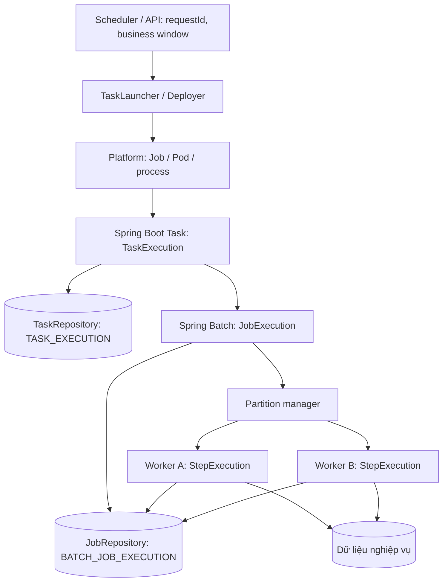
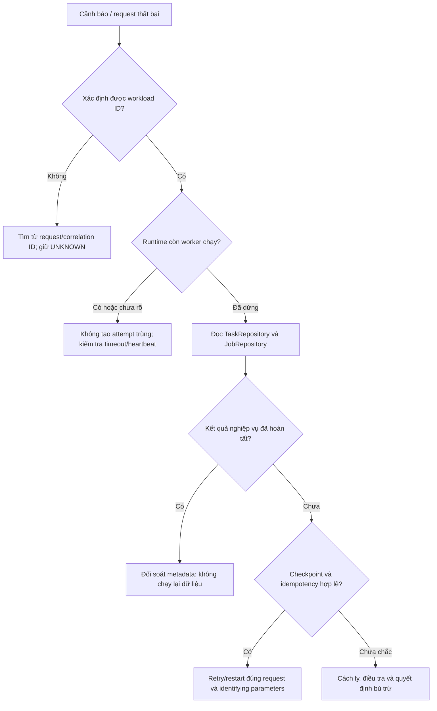
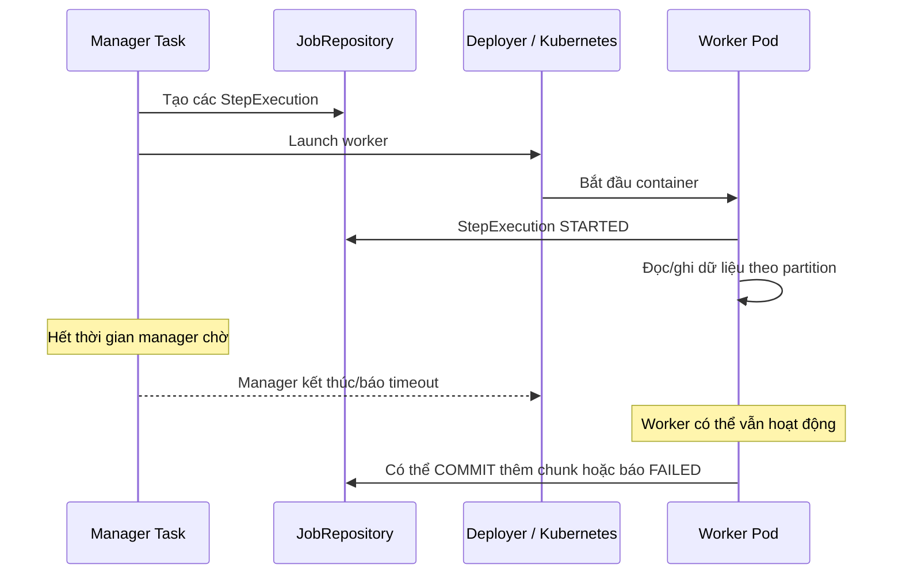

# Tham số sai, phân vùng quá hạn và trạng thái nền tảng lệch kho Task

## 1. Ba nhóm sự cố dễ gây chẩn đoán sai

Trong chương **Chẩn đoán** của **Spring Cloud Task**, chúng ta xử lý những tình huống có thể gặp khi một ứng dụng Spring Boot **chạy hữu hạn** được khởi chạy theo lịch, theo yêu cầu hoặc từ một bộ điều phối. Ứng dụng cần nhận đúng tham số, thực hiện nghiệp vụ, ghi `TaskExecution` trong `TaskRepository` rồi kết thúc bằng kết quả mà scheduler hiểu được. Khi phối hợp với **Spring Batch** và **remote partitioning**, một tác vụ còn có thể tạo nhiều `StepExecution` và nhiều tiến trình worker trên Kubernetes hoặc nền tảng khác.

Ba triệu chứng dưới đây nhìn giống nhau ở màn hình giám sát nhưng có thể có nguyên nhân hoàn toàn khác:

1. **Tham số sai:** task nhận sai ngày nghiệp vụ, loại đối số bị nhầm, tên JobParameter khác kỳ vọng hoặc worker đọc nhầm partition. Chương trình có thể lỗi ngay, hoặc nguy hiểm hơn là **chạy thành công với dữ liệu sai**.
2. **Phân vùng quá hạn:** manager của Spring Batch chờ các worker quá lâu, một `StepExecution` không tiến triển hoặc đã hết deadline nhưng container vẫn hoạt động. Timeout của manager không mặc nhiên giết worker hay rollback tác động đã commit.
3. **Trạng thái nền tảng lệch kho Task:** Kubernetes/Deployer báo process đã kết thúc nhưng `TASK_EXECUTION.END_TIME` còn rỗng; hoặc `TaskRepository` đã có kết quả trong khi Pod vẫn `Running`. Đây có thể là độ trễ đồng bộ, lỗi lưu metadata, sai nguồn tra cứu hoặc tiến trình bị kill.

**Không có một cột status chung cho tất cả.** Để quyết định retry an toàn, cần đối chiếu **request từ scheduler**, **trạng thái hạ tầng**, **TaskRepository**, **JobRepository** và **dữ liệu nghiệp vụ**.

Sau bài học, bạn sẽ có thể:

- Phân loại lỗi tham số ở ranh giới scheduler → Task → Spring Batch → worker, không đồng nhất các lớp đối số.
- Truy vấn `TASK_EXECUTION_PARAMS`, `TASK_EXECUTION` và metadata Batch để kiểm tra kỳ dữ liệu và các attempt.
- Phân biệt timeout manager, polling chậm, worker quá hạn và worker đã chết nhưng metadata còn `STARTED`.
- Điều tra trường hợp Pod/Job, TaskExecution và JobExecution đưa ra những kết quả khác nhau.
- Dùng runbook từng bước để khoanh vùng lỗi mà **không xóa/sửa metadata trực tiếp**.
- Thiết kế checkpoint, idempotency, correlation ID, cảnh báo và thử nghiệm lỗi có kiểm soát.

> **Nguyên tắc an toàn:** Trước khi phát lệnh chạy lại, phải trả lời: *còn tiến trình nào có thể đang ghi dữ liệu không, phần nào đã commit, và yêu cầu retry có dùng đúng khóa nghiệp vụ/JobInstance cũ không?* Nếu chưa xác nhận được, giữ trạng thái **UNKNOWN / cần đối chiếu**, không retry mù quáng.

## 2. Bản đồ định danh và nguồn sự thật

Một lần yêu cầu chạy có thể đi qua nhiều thành phần:



| Định danh / kết quả | Nơi tạo | Ý nghĩa | Điểm dễ nhầm |
| --- | --- | --- | --- |
| `requestId` hoặc window key | Scheduler/API nghiệp vụ | Một yêu cầu logic; thường cố định qua retry | Không phải `TaskExecutionId` |
| `platformExecutionId` / Pod UID / Job UID | TaskLauncher, Kubernetes hoặc nền tảng | Một workload hoặc attempt cụ thể | Không phải ID tự tăng của DB Task |
| `TASK_EXECUTION_ID` | Spring Cloud Task | **Một lần khởi chạy Task** được ghi nhận | Retry thường có ID mới |
| `EXTERNAL_EXECUTION_ID` | Task được gắn từ bên ngoài | Giá trị liên kết với hạ tầng nếu được truyền đúng | Có thể null/không bằng Pod UID |
| `JOB_INSTANCE_ID` | Spring Batch | Tên job + `JobParameters` **định danh** | Giữ nguyên khi restart hợp lệ |
| `JOB_EXECUTION_ID` | Spring Batch | Một lượt chạy Batch Job | Restart tạo execution mới |
| `STEP_EXECUTION_ID` | Spring Batch | Một lần chạy Step hoặc partition Step | Không phải mã worker/container |
| `EXIT_CODE` của Task | `TASK_EXECUTION` | Mã kết quả Task được lưu vào repository | Không mặc nhiên bằng process exit status |
| `STATUS`/`EXIT_CODE` của Batch | `BATCH_JOB_EXECUTION` | Kết quả Batch Job | Batch `EXIT_CODE` thường là chuỗi |

**Nguồn sự thật theo câu hỏi:**

| Câu hỏi | Ưu tiên đọc |
| --- | --- |
| Có Pod/process nào **thật sự đang sống**? | API runtime/deployer và log container |
| Task đã ghi start/end/exit code chưa? | `TaskRepository` (`TASK_EXECUTION`) |
| Partition nào hoàn thành, thất bại, đang chạy? | `JobRepository` (`BATCH_STEP_EXECUTION` và `ExecutionContext`) |
| Đã xử lý đủ và không trùng dữ liệu? | Database/audit nghiệp vụ |
| Có được retry cùng yêu cầu không? | Request store, trạng thái runtime, checkpoint và idempotency |

Mỗi nguồn chỉ biết **một phần sự thật**. Ví dụ Pod không còn không chứng minh database nghiệp vụ chưa có side effect; `END_TIME IS NULL` không chứng minh JVM vẫn còn sống.

## 3. Quy trình chẩn đoán nhanh trước khi thay đổi hệ thống

Khi nhận cảnh báo, ưu tiên **thu bằng chứng chỉ đọc** trước khi thao tác dừng, chạy lại, tăng timeout hoặc sửa dữ liệu.

1. **Đóng băng ngữ cảnh:** ghi `requestId`, tên task, phiên bản artifact, namespace/cluster, tenant, business date/input version, thời điểm trigger và múi giờ.
2. **Xác định attempt:** tìm platform Job/Pod UID, `EXTERNAL_EXECUTION_ID` và `TASK_EXECUTION_ID` nếu có; không tra theo tên Task rồi chọn đại hàng mới nhất của toàn cluster.
3. **Kiểm tra runtime hiện tại:** workload đã `Succeeded`, `Failed`, còn `Running`, `Pending` hay biến mất? Có restart/OOM/timeout không?
4. **Đọc TaskRepository:** có start time, end time, exit code, error message và arguments của **đúng attempt** không?
5. **Nếu có Batch:** tìm `JOB_INSTANCE_ID`/`JOB_EXECUTION_ID`, từng `STEP_EXECUTION_ID`; phân biệt Step chưa bắt đầu với Step đã ghi `STARTED` rồi không cập nhật.
6. **Đối chiếu nghiệp vụ:** bản ghi, checksum, số lượng chunk đã commit, idempotency key và side effect ở hệ thống ngoài.
7. **Phân loại vấn đề:** tham số, triển khai, timeout thực, polling/metadata, lỗi repository hoặc bất nhất dữ liệu.
8. **Chọn hành động có điều kiện:** không retry khi còn worker chưa được xác minh đã dừng; không sửa repository thủ công để “làm xanh” dashboard.



## 4. Nhóm lỗi thứ nhất: tham số Task sai

Thông thường một lệnh khởi chạy có thể mang:

```bash
java -jar order-task.jar \
  --business-date=2026-11-23 \
  --input-version=snapshot-v1 \
  --tenant-id=tenant-a
```

Các giá trị `--business-date`, `--input-version` và `--tenant-id` là **tham số nghiệp vụ do ứng dụng định nghĩa**; Spring Cloud Task **không tự hiểu** ý nghĩa của chúng hoặc biết chúng có đúng yêu cầu scheduler không. Spring Boot `ApplicationArguments` giúp đọc option, nhưng validation phải do code, binder hoặc lớp điều phối thực hiện.

### 4.1. Các lỗi dễ gặp

| Sai lệch | Triệu chứng | Cần so sánh |
| --- | --- | --- |
| Thiếu `--business-date` | Runner throw hoặc tự lấy ngày hiện tại | Request gốc với `ApplicationArguments` |
| Sai format ngày `23/11/2026` | `DateTimeParseException` | Schema hợp đồng ISO `yyyy-MM-dd` |
| Có hai option cùng tên | `getOptionValues` trả nhiều giá trị hoặc logic chọn nhầm | Danh sách option nguyên gốc |
| Gõ `--businessDate` thay `--business-date` | Ứng dụng đọc nhầm key/không thấy | Tên property thực và quy tắc relaxed binding |
| `--input-version` khác snapshot thực | Task vẫn có thể chạy nhưng đọc dữ liệu sai | Manifest/checksum của nguồn |
| Truyền tham số môi trường giả mạo như `--spring.datasource.url` | Kết nối DB sai hoặc vượt phạm vi quyền | Allowlist argument + trusted configuration |
| Scheduler truyền múi giờ/UTC sai | Một sự kiện bị ghi vào ngày kế tiếp | Business window `[start,end)` |
| Cùng request nhưng `--run.id` khác giữa retry | Spring Batch tạo JobInstance khác | Identifying JobParameters |
| Quên truyền ID partition cho worker | Worker không tìm thấy StepExecution hoặc xử lý sai range | Hợp đồng Deployer/worker handler |

**Không nên tự động chấp nhận tham số ngoài schema** chỉ vì Spring Boot khởi động bình thường. Nhiều unknown options không gây lỗi ngay; lỗi có thể xuất hiện ở tầng nghiệp vụ hoặc hoàn toàn không bị phát hiện.

### 4.2. Đọc giá trị một cách nghiêm ngặt

Ví dụ Java 17+ trong một Task:

```java
import java.time.LocalDate;
import java.util.List;

import org.springframework.boot.ApplicationArguments;
import org.springframework.boot.ApplicationRunner;
import org.springframework.context.annotation.Bean;
import org.springframework.context.annotation.Configuration;

@Configuration(proxyBeanMethods = false)
public class RequestValidationConfiguration {

    @Bean
    ApplicationRunner validatedRunner(TaskBusinessService service) {
        return args -> {
            String businessDateText = requireOne(args, "business-date");
            String inputVersion = requireOne(args, "input-version");
            String tenantId = requireOne(args, "tenant-id");

            LocalDate businessDate = LocalDate.parse(businessDateText);
            if (!inputVersion.matches("[A-Za-z0-9._-]{1,80}")) {
                throw new IllegalArgumentException("input-version không hợp lệ");
            }
            if (!tenantId.matches("[A-Za-z0-9_-]{1,60}")) {
                throw new IllegalArgumentException("tenant-id không hợp lệ");
            }

            // Business service phải kiểm tra quyền tenant/snapshot
            // và bảo vệ idempotency của lần retry.
            service.process(tenantId, businessDate, inputVersion);
        };
    }

    private static String requireOne(ApplicationArguments args, String name) {
        List<String> values = args.getOptionValues(name);
        if (values == null || values.size() != 1 ||
                values.get(0) == null || values.get(0).isBlank()) {
            throw new IllegalArgumentException(
                    "Cần đúng một giá trị cho --" + name);
        }
        return values.get(0);
    }
}
```

`TaskBusinessService` là **service ứng dụng cần triển khai**, không phải bean có sẵn. Mẫu cố tình kiểm tra trước khi gọi nghiệp vụ; phiên bản production nên còn có danh sách tham số được phép, ủy quyền tenant và kiểm tra tồn tại của snapshot.

**Ranh giới quan trọng:** `ApplicationRunner` chạy **sau khi Spring Context đã khởi tạo**. Nếu datasource metadata hoặc cấu hình bean lỗi **trước khi tới runner**, `TaskExecution` có thể chưa tồn tại; lỗi đó khác với việc runner từ chối một argument đã nhận.

### 4.3. Không suy ra cửa sổ từ thời điểm retry

Nếu scheduler giao `businessDate=2026-11-23`, retry sau nửa đêm phải giữ nguyên `businessDate` và phiên bản nguồn. Đọc `LocalDate.now().minusDays(1)` trong worker ở mỗi lần thử có thể chuyển sang kỳ khác. Với dữ liệu theo giờ/ngày, nên truyền và lưu cặp UTC `[startInclusive, endExclusive)` hoặc một request/window ID để tải lại giá trị đã quyết định.

Khi có dữ liệu thực, kiểm tra các sự kiện ở sát ranh giới trước và sau mốc `endExclusive`, dùng điều kiện SQL `timestamp >= start AND timestamp < end`. Đừng chuyển đổi múi giờ bằng cách cộng/trừ cố định 24 giờ cho các múi giờ có DST.

## 5. Đối chiếu arguments đã ghi vào `TaskRepository`

Schema JDBC của Spring Cloud Task thường có:

- `TASK_EXECUTION`: ID, tên Task, start/end, exit/error và external execution ID.
- `TASK_EXECUTION_PARAMS`: các tham số command line đã được ghi kèm `TASK_EXECUTION_ID`; tên cột tham số thường là `TASK_PARAM`.

Ví dụ SQL đọc **một execution cụ thể**:

```sql
SELECT t.TASK_EXECUTION_ID,
       t.TASK_NAME,
       t.START_TIME,
       t.END_TIME,
       t.EXIT_CODE,
       t.ERROR_MESSAGE,
       t.EXTERNAL_EXECUTION_ID,
       p.TASK_PARAM
FROM TASK_EXECUTION t
LEFT JOIN TASK_EXECUTION_PARAMS p
    ON p.TASK_EXECUTION_ID = t.TASK_EXECUTION_ID
WHERE t.TASK_EXECUTION_ID = :taskExecutionId;
```

`:taskExecutionId` là named parameter của `NamedParameterJdbcTemplate` hoặc công cụ SQL hỗ trợ binding; sử dụng ID có thật từ lần chạy cần điều tra. Nếu Task có nhiều argument, truy vấn sẽ có nhiều dòng. Không yêu cầu thứ tự của `TASK_EXECUTION_PARAMS` là thứ tự đối số ban đầu, trừ khi schema/công cụ thực có cột thứ tự đáng tin.

**Lưu ý bảo mật:** `TASK_PARAM` có thể chứa giá trị nhạy cảm nếu ứng dụng nhận password/token qua CLI. Chỉ cấp quyền tra cứu cho người cần thiết, che giá trị trong ảnh/log báo cáo và sửa cách cấp secret (environment/secret store) nếu phát hiện rò rỉ. Không paste toàn bộ `TASK_PARAM` vào ticket công khai.

### Khi truy vấn không ra tham số

Khả năng bao gồm: Task chết trước khi ghi metadata, Task dùng repository/schema khác, table prefix khác, DB bị rollback hoặc bản ghi đã bị dọn theo retention. Không kết luận “launcher không gửi argument” chỉ từ một query rỗng. Cần đối chiếu manifest/command line do nền tảng ghi, log cấu hình đã **che secret**, và nguồn dữ liệu đã được ứng dụng đọc.

## 6. Nhóm tham số thứ hai: `JobParameters` không khớp của Spring Batch

Khi Spring Cloud Task chạy Spring Batch, argument truyền tới JVM **không tự động đồng nghĩa** bộ `JobParameters` được `JobLauncher` nhận. Có ba tầng:

1. **Task arguments:** đi vào ứng dụng, có thể được lưu trong `TASK_EXECUTION_PARAMS`.
2. **Spring Batch JobParameters:** các cặp tên/kiểu/giá trị, một số được đánh dấu **identifying** và dùng để tìm `JobInstance`.
3. **Step/partition `ExecutionContext`:** dữ liệu phạm vi `startId`, `endIdExclusive`, checkpoint mà worker Step sử dụng.

Ví dụ Spring Batch 5.x:

```java
JobParameters parameters = new JobParametersBuilder()
        .addString("tenantId", "tenant-a", true)
        .addString("businessDate", "2026-11-23", true)
        .addString("inputVersion", "snapshot-v1", true)
        .toJobParameters();

JobExecution result = jobLauncher.run(reconciliationJob, parameters);
```

Đây là **đoạn trích**, giả định bean `jobLauncher`/`reconciliationJob` đã tồn tại và import API Batch đúng phiên bản. Nếu lượt đầu thất bại, lần retry **muốn restart cùng `JobInstance`** phải giữ nguyên Job name và tất cả identifying parameters. Tự thêm `run.id=System.currentTimeMillis()` làm identifying parameter sẽ tạo **JobInstance khác**, không tiếp tục từ checkpoint của lần trước.

| Hiện tượng | Nguyên nhân khả dĩ | Dấu kiểm tra |
| --- | --- | --- |
| Retry chạy lại Step đã `COMPLETED` | JobInstance mới hoặc step được cấu hình chạy lại | `JOB_INSTANCE_ID` và identifying params |
| `JobInstanceAlreadyCompleteException` | Cùng instance đã hoàn thành; chạy lại không được phép | Lịch sử `BATCH_JOB_EXECUTION` |
| `JobExecutionAlreadyRunningException` | Cùng instance còn execution đang chạy | Runtime và JobRepository trước retry |
| `JobRestartException` | Job không restartable hoặc trạng thái không phù hợp | Cấu hình Job và status |
| Job đọc nhầm ngày mặc dù Task param đúng | Runner xây `JobParameters` sai hoặc step đọc tên key khác | Task args → JobParameters → Step Context |
| Hai JobInstance “giống nhau” trên dashboard | Khác **kiểu**, `identifying`, tên field hoặc tên Job | So sánh đầy đủ metadata params |

Với JDBC schema Batch 5.x, có thể điều tra các tham số trong `BATCH_JOB_EXECUTION_PARAMS`:

```sql
SELECT JOB_EXECUTION_ID,
       PARAMETER_NAME,
       PARAMETER_TYPE,
       PARAMETER_VALUE,
       IDENTIFYING
FROM BATCH_JOB_EXECUTION_PARAMS
WHERE JOB_EXECUTION_ID = :jobExecutionId
ORDER BY PARAMETER_NAME;
```

**Schema Batch 4.x và 5.x có sự khác biệt**; truy vấn trên dành cho schema 5.x thông dụng, cần điều chỉnh theo version và prefix. Một số `PARAMETER_VALUE` cũng có thể chứa dữ liệu nhạy cảm, nên áp dụng quyền đọc phù hợp. Không tự sửa bảng parameters để “biến JobExecution mới thành restart cũ”.

## 7. Nhóm tham số thứ ba: worker nhận sai partition

Trong **remote partitioning**, manager Step tạo các `StepExecution` theo partition và lưu `ExecutionContext` vào `JobRepository`. `DeployerPartitionHandler`/`DeployerStepExecutionHandler` (với cơ chế tích hợp tương ứng) đưa từng partition đến **worker process** qua Spring Cloud Deployer.

Một partition có thể được định nghĩa bằng range:

```text
partition0: startId=1,    endIdExclusive=2501
partition1: startId=2501, endIdExclusive=5001
partition2: startId=5001, endIdExclusive=7501
partition3: startId=7501, endIdExclusive=10001
```

Worker phải lọc dữ liệu:

```sql
SELECT order_id, amount
FROM orders_snapshot
WHERE input_version = :inputVersion
  AND order_id >= :startId
  AND order_id < :endIdExclusive
ORDER BY order_id;
```

Nếu worker nhận `partition1` nhưng `startId=1`, nó có thể ghi trùng toàn bộ phần của `partition0` mà manager không nhận thấy qua một mã thoát 0. Nếu `endIdExclusive` bị hiểu thành inclusive, bản ghi ở ranh giới có thể xuất hiện ở hai partition.

**Không giả định worker chỉ nhận một `--partition-id` tùy ý.** Đường truyền định danh `JobExecution`/`StepExecution` giữa manager, `TaskLauncher` và worker handler là hợp đồng của implementation/version. Với Deployer integration có sẵn, kiểm tra lệnh/biến môi trường **thực tế** do handler tạo, thay vì tự thêm option đoán tên.

### Trường hợp manager và worker không đọc cùng JobRepository

Một worker có thể được tạo thành công nhưng không tải được `StepExecution`, hoặc tìm nhầm ID nếu dùng datasource/schema/tenant khác. Kiểm tra:

- URL/schema và prefix của **JobRepository**, không chỉ TaskRepository.
- Quyền đọc/ghi Batch metadata và transaction manager.
- Version Spring Batch của manager và worker; kiểu serializer `ExecutionContext` có tương thích.
- Danh sách `Step`/bean trong worker và tên Step mà manager yêu cầu.
- Sự tồn tại của đúng `STEP_EXECUTION_ID` và context đã được lưu trước lúc worker đọc.

**ID số học không toàn cục.** Hai JobRepository ở hai database khác nhau có thể có cùng `STEP_EXECUTION_ID` nhưng mang dữ liệu khác; luôn xác định đúng namespace của nguồn dữ liệu.

## 8. Nhóm lỗi thứ hai: thế nào là “phân vùng quá hạn”?

Một cảnh báo “partition timeout” có thể chỉ ba vấn đề khác nhau:

| Loại quá hạn | Đồng hồ đo | Hành vi thường thấy |
| --- | --- | --- |
| **Manager wait timeout** | Thời gian `PartitionHandler` chờ tập partition hoàn thành | Manager báo lỗi/quá hạn khi chưa tổng hợp được kết quả; worker có thể vẫn chạy |
| **Worker runtime deadline** | Deadline của Pod/Job, launcher hoặc service nghiệp vụ | Nền tảng có thể kết thúc worker; Batch metadata có thể chưa kịp cập nhật |
| **SLA/business deadline** | Thời gian hoàn tất nghiệp vụ do tổ chức quy định | Task có thể còn chạy hợp lệ nhưng đã chậm theo SLO |

Trong tài liệu Spring Cloud Task về remote partitioning, `DeployerPartitionHandler` hỗ trợ cấu hình:

- `setGridSize`: số partition được gợi ý; không bảo đảm số Pod chạy đồng thời tương ứng.
- `setMaxWorkers`: giới hạn số worker được cho phép chạy đồng thời.
- `setPollInterval`: chu kỳ kiểm tra trạng thái Step trong `JobRepository`; tài liệu mô tả mặc định **10 giây** ở phiên bản tương ứng.
- `setTimeout`: thời gian manager chờ các worker hoàn thành; mặc định `-1` có nghĩa **không giới hạn** ở các phiên bản được mô tả.

```java
// Minh họa các điểm cấu hình của DeployerPartitionHandler.
// Constructor/dependencies và đơn vị timeout/pollInterval
// phải đối chiếu Javadoc của đúng release đang dùng.
partitionHandler.setGridSize(16);
partitionHandler.setMaxWorkers(4);
partitionHandler.setPollInterval(pollInterval);
partitionHandler.setTimeout(managerTimeout);
```

Hai biến `pollInterval`/`managerTimeout` cần được tính từ SLO và **đơn vị của API phiên bản đang dùng**; đoạn trên không phải bean hoàn chỉnh. Không chọn timeout bằng cách nhân số giây tùy ý khi chưa xác nhận unit của setter. Nếu dùng `RemotePartitioningManagerStepBuilder` từ Spring Batch Integration thay vì `DeployerPartitionHandler`, API và thời điểm áp dụng timeout có thể khác.

**Quan trọng nhất:** timeout của handler là **giới hạn chờ của manager**. Nó **không đồng nghĩa** mọi Pod worker đã bị hủy, transaction đã rollback hay dữ liệu ghi ngoài đã bị hoàn tác.

### Ví dụ timeline



Nếu scheduler retry manager ngay sau khi báo timeout, hai thế hệ worker có thể đồng thời ghi vào cùng partition. Đây là rủi ro **chạy trùng** chứ không chỉ là tình huống metric thời gian chậm.

## 9. Đọc metadata Step để tìm partition bị kẹt

`JobRepository` của Spring Batch thường cung cấp các bảng `BATCH_JOB_INSTANCE`, `BATCH_JOB_EXECUTION`, `BATCH_STEP_EXECUTION` và `BATCH_STEP_EXECUTION_CONTEXT`.

### 9.1. Lịch sử các lần chạy JobInstance

```sql
SELECT ji.JOB_INSTANCE_ID,
       ji.JOB_NAME,
       je.JOB_EXECUTION_ID,
       je.STATUS,
       je.EXIT_CODE,
       je.START_TIME,
       je.END_TIME
FROM BATCH_JOB_INSTANCE ji
JOIN BATCH_JOB_EXECUTION je
  ON je.JOB_INSTANCE_ID = ji.JOB_INSTANCE_ID
WHERE ji.JOB_NAME = :jobName
ORDER BY ji.JOB_INSTANCE_ID DESC, je.JOB_EXECUTION_ID DESC;
```

Nếu một JobInstance có nhiều JobExecution, đó có thể là lịch sử **restart**; không gộp kết quả chỉ dựa trên tên Job.

### 9.2. Step và partition cụ thể

```sql
SELECT JOB_EXECUTION_ID,
       STEP_EXECUTION_ID,
       STEP_NAME,
       STATUS,
       EXIT_CODE,
       START_TIME,
       END_TIME,
       LAST_UPDATED,
       READ_COUNT,
       WRITE_COUNT,
       COMMIT_COUNT,
       ROLLBACK_COUNT
FROM BATCH_STEP_EXECUTION
WHERE JOB_EXECUTION_ID = :jobExecutionId
ORDER BY STEP_EXECUTION_ID;
```

Ở các kiểu partitioning thông dụng, `STEP_NAME` có thể mang tên như `workerStep:partition2`, nhưng format là chi tiết triển khai: hãy kiểm tra tên thực tế thay vì parse theo quy tắc đoán. Thời gian `LAST_UPDATED` phản ánh lần ghi metadata, **không phải heartbeat độc lập đáng tin trong mọi trường hợp**. Nếu một chunk dài chưa commit, bản ghi có thể ít thay đổi dù worker vẫn đang xử lý.

### 9.3. Xem checkpoint khi thật sự cần

`BATCH_STEP_EXECUTION_CONTEXT` chứa trạng thái phục hồi từng StepExecution (ví dụ `SHORT_CONTEXT` và dữ liệu serialized khác tùy version):

```sql
SELECT STEP_EXECUTION_ID, SHORT_CONTEXT
FROM BATCH_STEP_EXECUTION_CONTEXT
WHERE STEP_EXECUTION_ID = :stepExecutionId;
```

Không tự diễn giải/ghi đè context serialized bằng SQL. Nội dung có thể chứa dữ liệu nhạy cảm và phụ thuộc serializer/version. Dùng API `JobExplorer`/`ExecutionContext` khi cần đọc có kiểu và phải đảm bảo đúng schema/transaction manager.

### Cách phân biệt “kẹt thật” với “đang xử lý chậm”

Một partition `STATUS=STARTED`, `END_TIME IS NULL` và `LAST_UPDATED` cũ **chưa đủ** chứng minh worker chết. Kiểm tra thêm:

- Pod `Running` hay đã `Failed`/`Succeeded`? Container có tiến trình Java không?
- Log có tiến độ đọc/ghi hoặc deadlock/query/HTTP timeout không?
- CPU, memory, connection pool và broker lag có bất thường không?
- DB transaction đang chờ lock? Có chunk lớn đang xử lý mà chưa commit?
- Worker đúng datasource/namespace/StepExecution ID chưa?
- Timeout manager đã hết nhưng worker vẫn có thể hoàn tất không?

Đừng sửa `BATCH_STEP_EXECUTION.STATUS` từ `STARTED` thành `FAILED` chỉ để cho phép restart khi chưa xác nhận tiến trình thật sự đã dừng và dữ liệu đã commit an toàn.

## 10. Chẩn đoán nguyên nhân khiến partition không hoàn tất

| Dấu hiệu | Nhóm nguyên nhân | Bằng chứng nên tìm |
| --- | --- | --- |
| Pod worker mãi `Pending` | Thiếu node, quota, image, volume hoặc permission | Pod events/conditions, scheduler reason |
| `ImagePullBackOff` | URI/image tag hoặc credential registry sai | Image reference, imagePullSecrets, events |
| Worker thoát rất sớm | Sai `--spring.profiles.active`, thiếu bean Step, argument sai | Log boot/stack trace, effective args |
| `StepExecution` không được tạo/không tìm thấy | Worker không thấy JobRepository hoặc ID được truyền sai | Config DB và tham số định danh worker |
| `StepExecution=STARTED` lâu, Pod vẫn chạy | Đọc dữ liệu chậm, lock, API timeout, chunk lớn | Log, thread dump (khi phù hợp), DB wait |
| `StepExecution=STARTED` lâu, Pod đã biến mất | Kill/OOM hoặc không ghi được metadata cuối | Runtime reason, TaskRepository, log DB |
| Worker `COMPLETED` nhưng manager tiếp tục chờ | Polling/kết quả tập hợp không thấy đủ partition, repo sai | Danh sách StepExecution, grid size và manager log |
| Nhiều worker đọc cùng range | Partitioner sai, context đổi khi retry, dữ liệu nguồn đổi | `ExecutionContext`, checksum, query filter |
| Manager timeout sớm sau khi tăng worker | Quota startup, DB contention, container provisioning chậm | Phân biệt launch time và business time |
| Timeout sau khi worker đã hoàn tất nghiệp vụ | Metadata Batch cập nhật lỗi hoặc signal bị chậm | Domain audit vs `JobRepository` |

**Grid size khác max workers.** Manager có thể chia 20 partition nhưng chỉ cho phép 4 worker chạy cùng lúc. Nếu mỗi worker cần 5 phút, một timeout manager 6 phút không đủ cho cả tập partition ngay cả khi mọi worker đều đúng. Phải tính cả thời gian chờ lượt triển khai, bootstrap, chunk processing, commit, polling và cleanup.

Một công thức ước lượng thô khi partition gần đồng đều:

```text
estimated_batches = ceil(partitionCount / maxConcurrentWorkers)
estimated_processing ≈ estimated_batches × slowest_partition_duration
expected_total ≥ provisioning + estimated_processing + polling/cleanup
```

Đây là **ước lượng để lập kế hoạch**, không phải công thức bảo đảm runtime: tải lệch, queue, contention và retry có thể làm thời gian thực dài hơn. Trước khi tăng timeout, phải xem việc worker đang chạy chậm là hợp lý hay đang **kẹt vô hạn**.

## 11. Nhóm lỗi thứ ba: trạng thái nền tảng và TaskRepository không khớp

Một Spring Cloud Task có ít nhất hai nguồn trạng thái độc lập:

- Nền tảng như Kubernetes/Deployer quan sát **Pod/Job/process**: `Pending`, `Running`, `Succeeded`, `Failed`, exit code, lý do kill và timestamps.
- `TaskRepository` ghi **TaskExecution** vào database: `START_TIME`, `END_TIME`, `EXIT_CODE`, `ERROR_MESSAGE` và `EXTERNAL_EXECUTION_ID`.

Trong schema chuẩn của Spring Cloud Task, `TASK_EXECUTION` **không có một cột `STATUS` tương đương Kubernetes Pod phase**. Đừng viết SQL `WHERE STATUS='FAILED'` cho bảng Task nếu schema thực không có cột đó.

### Ma trận những trường hợp lệch phổ biến

| Nền tảng | TaskRepository | Nguyên nhân có thể | Phân loại |
| --- | --- | --- | --- |
| Pod `Succeeded` | `END_TIME` đã có, `EXIT_CODE=0` | Hai tầng cùng thành công, vẫn cần kiểm tra nghiệp vụ | Bình thường nhưng chưa đủ xác nhận domain |
| Pod `Failed` hoặc `OOMKilled` | `END_TIME IS NULL` | JVM chết trước callback ghi kết thúc | Metadata chưa đóng, không chắc đã rollback |
| Pod `Failed` | Task `EXIT_CODE=0` | Kill/lỗi sau lúc repo ghi end, wrapper/process exit khác; nhầm attempt | Lệch trạng thái cần điều tra |
| Pod `Succeeded` | Task `EXIT_CODE` khác 0 | Shell wrapper nuốt mã lỗi, Task mapper khác process; nhầm record | Cần kiểm tra command/entrypoint |
| Pod `Running` | Task đã có `END_TIME` | App đã ghi kết thúc nhưng process/sidecar còn sống, context chưa đóng | Kiểm tra container nào đang chạy |
| Pod không còn/đã dọn | Task `END_TIME IS NULL` | Runtime xóa tài nguyên, JVM kill hoặc DB update lỗi | Cần truy log/events, không tự đánh dấu xong |
| Pod `Pending` | Không có TaskExecution | Chưa startup JVM, thiếu image/quota/permission | Lỗi triển khai, không phải lỗi TaskRepository |
| Pod `Running` | Không có TaskExecution | JVM chưa tới pha tạo Task, DB sai/schema khác, init fail; có thể sidecar | Chưa đủ chứng cứ để kết luận |
| Nhiều TaskExecution cùng tên | Một Pod được báo trong dashboard | Retry, nhiều cluster/tenant, record cũ hoặc filter sai | Thiếu correlation/ID |

### Vì sao status có thể lệch mà không có bug framework?

Sự kiện diễn ra ở **những hệ thống khác nhau**, không có transaction phân tán mặc định giữa Kubernetes và Task Repository. Một request launch trả về platform ID trước khi Java ghi TaskExecution. Một JVM có thể ghi metadata kết thúc trước khi hệ điều hành thu dọn hoàn toàn container. Nếu nó bị kill, database không chắc được cập nhật ở pha cuối. Một hệ thống giám sát cũng có thể dùng **read replica chậm**, cache hoặc lọc nhầm environment/namespace.

Không vì thấy hai trạng thái trái nhau mà tự chọn một bên là “sự thật tuyệt đối”. Cần đối chiếu **cùng attempt**, xem thời điểm cập nhật và mức độ tin cậy của từng nguồn.

## 12. Quy trình tra cứu Kubernetes/Deployer chỉ đọc

Ví dụ Kubernetes, giả định operator đã biết namespace và tên Job/Pod của **đúng attempt**:

```bash
# Liệt kê Job/Pod và thời gian gần nhất.
kubectl get jobs -n batch-tasks
kubectl get pods -n batch-tasks -o wide

# Xem điều kiện, events và trạng thái container.
kubectl describe job order-sync-20261124 -n batch-tasks
kubectl describe pod order-sync-20261124-abcde -n batch-tasks

# Xem JSON đầy đủ nếu cần đối chiếu UID/ownerReferences.
kubectl get pod order-sync-20261124-abcde -n batch-tasks -o json

# Xem log của đúng Pod/container khi còn được giữ.
kubectl logs pod/order-sync-20261124-abcde \
  -n batch-tasks -c task --timestamps
```

Các tên Job/Pod ở trên là **minh họa**. Đừng tìm Pod chỉ bằng một phần tên rồi gán nhầm log giữa các lần retry. Có thể dùng `ownerReferences`, label `request-id`, annotation/UID hoặc platform execution ID theo hợp đồng triển khai đã thống nhất.

Khi Pod có restart container và runtime giữ log phiên bản trước, `kubectl logs --previous` có thể hữu ích; nó **không chắc có dữ liệu** nếu container/Pod đã bị xóa hoặc retention đã hết. Với image pull/permission/quota failure, đọc **Pod Events** thường hữu ích hơn tìm stack trace Java không tồn tại.

**Không chạy `kubectl delete` hoặc sửa Job/Pod ngay trong giai đoạn thu thập bằng chứng**. Lệnh xóa có thể làm mất log/UID và không đảm bảo mọi worker con hoặc side effect nghiệp vụ đã dừng.

### Nếu dùng Spring Cloud Data Flow hoặc TaskLauncher khác

API trạng thái workload và cách xác định “đang chạy” phụ thuộc platform implementation. `TaskLauncher` dùng cho local process, Kubernetes hay Cloud Foundry có **độ tin cậy và cách lưu lịch sử khác nhau**. Chẳng hạn, launcher chạy tiến trình local có thể mất danh sách process trong bộ nhớ khi service launcher restart; không nên coi “launcher không còn thấy execution” là bằng chứng task chưa chạy.

Kiểm tra **cả runtime native của platform** và metadata Task. Không tự giả định `TaskLauncher` lưu một bảng durable tương đương `TASK_EXECUTION`.

## 13. SQL: nhìn đúng bản ghi và liên kết Task với Batch

### 13.1. TaskExecution gần nhất theo correlation

```sql
SELECT TASK_EXECUTION_ID,
       TASK_NAME,
       EXTERNAL_EXECUTION_ID,
       PARENT_TASK_EXECUTION_ID,
       START_TIME,
       END_TIME,
       EXIT_CODE,
       EXIT_MESSAGE,
       ERROR_MESSAGE
FROM TASK_EXECUTION
WHERE EXTERNAL_EXECUTION_ID = :externalId
ORDER BY TASK_EXECUTION_ID DESC;
```

Nếu external ID không được gắn, có thể lọc theo tên Task **kèm phạm vi thời gian và môi trường đúng**, nhưng phải xác minh thêm đối số/request ID từ audit. `EXTERNAL_EXECUTION_ID` là giá trị tùy chọn; không có nó **không chứng minh** cấu hình Task đã hỏng.

### 13.2. Bảng liên kết Batch khi đã bật integration

Spring Cloud Task có `TASK_TASK_BATCH` để nối `TASK_EXECUTION_ID` với `JOB_EXECUTION_ID` **khi listener liên kết Task–Batch được bật và thực sự ghi dữ liệu**:

```sql
SELECT TASK_EXECUTION_ID, JOB_EXECUTION_ID
FROM TASK_TASK_BATCH
WHERE TASK_EXECUTION_ID = :taskExecutionId
ORDER BY JOB_EXECUTION_ID;
```

Nếu Task/Batch metadata ở **cùng database**, có thể join:

```sql
SELECT t.TASK_EXECUTION_ID,
       t.EXIT_CODE AS TASK_EXIT_CODE,
       l.JOB_EXECUTION_ID,
       je.STATUS AS BATCH_STATUS,
       je.EXIT_CODE AS BATCH_EXIT_CODE
FROM TASK_EXECUTION t
LEFT JOIN TASK_TASK_BATCH l
  ON l.TASK_EXECUTION_ID = t.TASK_EXECUTION_ID
LEFT JOIN BATCH_JOB_EXECUTION je
  ON je.JOB_EXECUTION_ID = l.JOB_EXECUTION_ID
WHERE t.TASK_EXECUTION_ID = :taskExecutionId;
```

**Không dùng SQL join trực tiếp xuyên hai datasource độc lập** trừ khi hệ DB thực sự hỗ trợ cơ chế đó đã được cấu hình rõ. Với hai kho metadata riêng, dùng `TaskExplorer` đọc Task/link và `JobExplorer` đọc Batch theo execution ID tương ứng.

**Không coi `TASK_TASK_BATCH` là bảng ánh xạ mỗi worker Task với một partition Step.** Bảng liên kết **TaskExecution ↔ Batch JobExecution**; mối quan hệ worker–Step cần dựa vào StepExecution metadata và correlation của cơ chế deployer/ứng dụng.

## 14. Phân loại tình trạng lệch theo thời gian và nguồn cập nhật

Để không báo động giả do độ trễ đồng bộ, lập một timeline theo UTC:

| Thời điểm minh họa | Nền tảng | TaskRepository | JobRepository | Cách diễn giải |
| --- | --- | --- | --- | --- |
| 01:00:00 | Job được tạo, Pod `Pending` | Chưa có TaskExecution | Chưa có StepExecution worker | Có thể chưa khởi động Java |
| 01:00:35 | Pod `Running` | Có START_TIME | StepExecution `STARTED` | Workload đã tới pha nghiệp vụ |
| 01:08:10 | Pod bị `OOMKilled` | `END_TIME=NULL` | Step `STARTED` | Metadata có thể chưa ghi kết thúc |
| 01:08:20 | Job `Failed` | Vẫn END_TIME null | Step vẫn STARTED | Cần xác minh worker đã chết rồi xử lý restart |
| 01:15:00 | Job mới được tạo sau phê duyệt | TaskExecution mới | JobExecution mới cùng JobInstance nếu restart hợp lệ | Mỗi attempt phải có correlation riêng |

Các mốc/ID là **ví dụ**, không phải trình tự framework được bảo đảm. Lỗi Task Repository có thể xảy ra **trước** khi Batch metadata được tạo; kết nối tới hai kho có thể độc lập.

Trước khi gọi một trạng thái là “lệch thật”, kiểm tra:

1. Cùng cluster, namespace, task name, artifact version và request ID?
2. Cùng database, schema, table prefix và tenant? Có sử dụng read replica/caching?
3. Các đồng hồ có NTP và được quy đổi múi giờ thống nhất?
4. Có request retry đang tạo attempt mới mà UI hiển thị chồng lịch sử?
5. Bao lâu kể từ sự kiện runtime? Hệ thống ghi metadata có thời gian cập nhật cuối thế nào?
6. Nếu Task thiếu `END_TIME`, runtime còn process thật hay chỉ còn đối tượng Job lịch sử?

## 15. Retry và restart khi metadata bị treo

Spring Cloud Task và Spring Batch xử lý **hai loại restart khác nhau**:

- Bộ điều phối khởi chạy lại Spring Boot Task → thường có **TaskExecution mới**.
- Spring Batch restart một JobInstance đang `FAILED`/`STOPPED` và cho phép restart → có **JobExecution mới** thuộc **cùng JobInstance** với các Step cần chạy lại.

Nếu một Batch execution vẫn `STARTED` sau khi worker bị kill, framework có thể từ chối restart vì xem job còn chạy. **Đừng tự cập nhật `BATCH_JOB_EXECUTION.STATUS` hoặc `BATCH_STEP_EXECUTION.STATUS` bằng SQL**. Đầu tiên xác minh tất cả worker đã dừng, transaction đã kết thúc, metadata nào còn treo và dữ liệu nào đã commit; sau đó dùng **quy trình vận hành và API quản trị Batch được hỗ trợ theo phiên bản**. Trường hợp không thể khôi phục tự động phải được đánh dấu cần can thiệp thay vì ép tạo JobInstance mới.

Nếu dispatcher có trạng thái riêng như `UNKNOWN`, `RETRYABLE` hoặc `QUARANTINED`, đó là **trạng thái nghiệp vụ do hệ thống điều phối định nghĩa**, không phải các giá trị status mặc định của `TASK_EXECUTION`. Chỉ chuyển một request từ `UNKNOWN` sang `RETRYABLE` khi đã xác minh worker cũ không còn khả năng ghi dữ liệu, hoặc có cơ chế fencing/idempotency đủ mạnh và được phê duyệt.

### Mã giả cho quyết định retry

```text
observe(requestId):
    runtime = queryPlatform(requestId)
    task = queryTaskRepository(requestId / externalExecutionId)
    batch = queryJobRepository(jobInstanceOrExecutionId)
    business = verifyBusinessOutcome(windowKey)

    if business == CONFIRMED_COMPLETE:
        return RECONCILE_METADATA_NO_REPROCESS

    if runtime == RUNNING or runtime == UNKNOWN:
        return WAIT_OR_INVESTIGATE_NO_NEW_ATTEMPT

    if batch == STARTED_OR_STALE:
        return MANUAL_RECONCILIATION_BEFORE_RESTART

    if business == INCOMPLETE and
       runtime == CONFIRMED_STOPPED and
       checkpointAndIdempotency == VERIFIED:
        return RESTART_WITH_ORIGINAL_IDENTIFYING_PARAMETERS

    return QUARANTINE_AND_INVESTIGATE
```

Đây là **mã giả chính sách**, không phải API/framework có sẵn. `runtime == CONFIRMED_STOPPED` phải xét **mọi worker thuộc cùng yêu cầu**, không chỉ manager Pod. `business == CONFIRMED_COMPLETE` phải dựa trên kết quả và độ đầy đủ thực tế, không chỉ một dòng `EXIT_CODE=0`.

### Khi metadata Task bị thiếu nhưng nghiệp vụ đã commit

Một container có thể xử lý xong 70% dữ liệu, rồi mất kết nối `TaskRepository`. Nếu scheduler chỉ thấy Task `EXIT_CODE` rỗng và chạy lại từ đầu, kết quả có thể trùng. Hãy dùng khóa nghiệp vụ/unique constraint, checkpoint, outbox/inbox hoặc idempotency key ổn định; không dùng `TASK_EXECUTION_ID` của attempt mới làm khóa chống trùng.

Với dữ liệu có giao dịch ngoài như chuyển tiền hoặc gửi email, nếu không thể xác nhận request cũ đã được nhận hay chưa, phải hỏi hệ thống nhận/đối chiếu operation ID trước khi phát lại.

## 16. Runbook A — Task nhận tham số sai

**Dấu hiệu:** Task báo `Invalid date`, đọc snapshot sai hoặc chạy ngày khác với trigger.

1. Ghi request gốc và định danh attempt; xác định canonical business date, tenant, input version và cửa sổ UTC.
2. Đọc arguments từ `TASK_EXECUTION_PARAMS`, nhưng **che secret**; so sánh với manifest/launch request thực tế.
3. Phân biệt lỗi parser (thiếu, trùng, sai format), lỗi authorization tenant, lỗi binding cấu hình và lỗi chuyển Task args sang Batch JobParameters.
4. Nếu có Batch, xem `BATCH_JOB_EXECUTION_PARAMS` và `JOB_INSTANCE_ID`; xác định retry có vô tình tạo instance khác không.
5. Nếu worker remote, đọc context của `STEP_EXECUTION_ID`, so ranh giới range và input snapshot với partitioner của manager.
6. Kiểm tra **có dữ liệu nghiệp vụ nào đã ghi không**; không xem argument validation failure là bằng chứng tất cả side effect đều chưa xảy ra.
7. Sửa nguồn tạo yêu cầu hoặc code validation/allowlist; không vá riêng một dòng database metadata.
8. Nếu chỉ cần retry cùng công việc, dùng lại window key/identifying parameters đã được phê duyệt; nếu dữ liệu đã sai cần policy **bù trừ/reprocess**.

**Bằng chứng PASS:** request, Task args, JobParameters, StepExecution context và kết quả nghiệp vụ đều tương ứng cùng một công việc logic; một lần chạy lại không tạo bản ghi trùng.

## 17. Runbook B — Partition manager báo quá hạn

**Dấu hiệu:** Manager ném lỗi timeout, nhiều `workerStep:partitionN` còn `STARTED` hoặc Job không hoàn tất trước deadline.

1. Xác định **timeout thuộc lớp nào**: handler wait, Kubernetes Job deadline, HTTP timeout, database timeout hay SLA.
2. Ghi cấu hình thật của `DeployerPartitionHandler`: `gridSize`, `maxWorkers`, `pollInterval`, `timeout`; kiểm tra đơn vị/version và số partition.
3. Xem số Pod worker thật sự được cấp, số đang Pending/Running/Failed và thời gian provisioning. Không nhầm `gridSize` với concurrency.
4. Đọc `BATCH_STEP_EXECUTION`; tách nhóm **COMPLETED**, **FAILED**, **STARTED không đổi**, **chưa bắt đầu**.
5. Với Step không tiến triển, kiểm tra runtime và resource metrics; nếu Pod chạy, xem DB lock, chunk size, reader performance, API timeout và source skew.
6. Nếu manager đã timeout, **chưa vội retry**: worker cũ có thể vẫn đang chạy và commit.
7. Chỉ khi worker cũ xác nhận dừng và dữ liệu có thể retry an toàn mới quyết định restart cùng `JobInstance` (hoặc quy trình thủ công nếu trạng thái metadata chưa phục hồi).
8. Sau khi nguyên nhân rõ ràng, điều chỉnh số partition, maxWorkers, resource, timeout/polling hoặc query; không “tăng timeout vô hạn” để che deadlock.

**Bằng chứng PASS:** mọi StepExecution liên quan có trạng thái nhất quán hoặc được xử lý theo runbook, không còn worker cũ đang ghi dữ liệu, kết quả nghiệp vụ đủ và manager phản ánh đúng trạng thái Batch.

## 18. Runbook C — Pod/Deployer và `TaskRepository` bất đồng

**Dấu hiệu:** Nền tảng báo Job `Succeeded` nhưng Task `EXIT_CODE=1`, hoặc Pod `Failed`/đã biến mất nhưng Task `END_TIME IS NULL`.

1. Chốt **platform workload ID + UID**, không dựa một mình vào task name.
2. Xem Pod/container termination reason, exit status, timestamps, restart count, entrypoint và shell wrapper.
3. Đọc `TASK_EXECUTION` của đúng attempt theo `EXTERNAL_EXECUTION_ID` hoặc audit correlation; kiểm tra `END_TIME`, `EXIT_CODE`, `ERROR_MESSAGE`.
4. Kiểm tra URL/schema/prefix/tenant của TaskRepository; xác nhận dashboard có đang đọc read replica/cached result không.
5. Nếu `END_TIME NULL` và worker đã dừng, xác định dấu vết kill/DB outage; phân loại là **metadata chưa đóng**, không tự ghi `END_TIME=now()` để bỏ cảnh báo.
6. Nếu Pod `Succeeded` nhưng Task lỗi, kiểm tra script entrypoint có nuốt exit code hay không và cách `ExitCodeGenerator`/mapper được áp dụng.
7. Nếu Pod còn `Running` nhưng Task đã kết thúc, kiểm tra có sidecar, thread pool, non-daemon thread hoặc context chưa được đóng; đừng mặc định Task vẫn xử lý nghiệp vụ.
8. Đối chiếu `JobRepository` và dữ liệu domain, sau đó chọn đóng alert, mở ticket sửa telemetry, hoặc phục hồi theo quy trình.

**Bằng chứng PASS:** ít nhất một tập hợp correlation ID/timeline giải thích được khác biệt; không còn quyết định retry dựa vào một status đơn lẻ.

## 19. Khả năng chống trùng khi cần retry một partition

Remote partitioning thường có nhiều chunk đã commit trước khi một partition thất bại. Retry không mặc nhiên rollback toàn bộ kết quả đã ghi. Cần:

| Lớp | Biện pháp | Điều không được hiểu sai |
| --- | --- | --- |
| Manager/request | Khóa `tenant + businessWindow + inputVersion` | Chặn request trùng không ngăn worker cũ ghi tiếp |
| Spring Batch | `JobInstance` ổn định, `ExecutionContext` và checkpoint đúng | Metadata restart không bảo đảm exactly-once HTTP |
| Database nghiệp vụ | Unique constraint/conditional upsert | `ON CONFLICT DO NOTHING` có thể che payload thay đổi |
| Hệ thống ngoài | Idempotency key, outbox/inbox, reconciliation | Exit code 0 không chứng minh request ngoài không trùng |
| Runtime | Ngăn hai thế hệ worker cùng xử lý một key, fencing/lease | Lease hết hạn không chứng minh worker chết |
| Observability | Correlation ID, log/metric/audit có timestamp | Không có log không chứng minh không có side effect |

Ví dụ PostgreSQL định nghĩa một bảng đầu ra idempotent theo cửa sổ dữ liệu:

```sql
CREATE TABLE reconciled_item (
    tenant_id VARCHAR(80) NOT NULL,
    input_version VARCHAR(100) NOT NULL,
    item_id VARCHAR(100) NOT NULL,
    total_amount NUMERIC(18, 2) NOT NULL,
    PRIMARY KEY (tenant_id, input_version, item_id)
);

INSERT INTO reconciled_item (
    tenant_id, input_version, item_id, total_amount
) VALUES (
    :tenantId, :inputVersion, :itemId, :totalAmount
)
ON CONFLICT (tenant_id, input_version, item_id)
DO NOTHING;
```

**Đây là ví dụ**, chỉ phù hợp nếu cùng khóa bắt buộc có cùng nội dung. Nếu payload thay đổi, `DO NOTHING` sẽ bỏ qua sai lệch; production cần kiểm tra nội dung, checksum hoặc dùng revision policy rõ ràng. Hệ thống chuyển tiền/đặt hàng phải có hợp đồng idempotency mạnh hơn việc ghi một bảng kết quả.

## 20. Observability: giúp tách timeout thật với “chưa nhìn thấy kết quả”

Một quy ước log nên ghi:

```text
timestampUtc, environment, namespace, requestId, attemptNo,
platformExecutionId, taskExecutionId, jobInstanceId,
jobExecutionId, stepExecutionId, partitionName,
businessDate, inputVersion, phase, reasonCode
```

Đừng đưa password, token, toàn bộ CLI arguments hoặc dữ liệu khách hàng vào log. Nếu Task khởi chạy nhiều worker, bảo đảm mỗi worker có correlation riêng nhưng vẫn trỏ về **request/JobInstance chung**.

Metrics cần quan sát:

- **Task:** số lượt theo tên và kết quả, duration, `spring.cloud.task`/runner timers khi instrumentation hoạt động.
- **Batch/partition:** số StepExecution `STARTED`/`FAILED`/`COMPLETED`, tiến độ đọc/ghi, count retry, thời gian không có metadata update.
- **Platform:** thời gian `Pending`, time-to-start, container restarts/OOM, số Pod đang chạy, thời gian cấp phát image.
- **DB:** connection pool, lock waits, query latency, connection timeouts, transaction rollback.
- **Domain:** số bản ghi đã xử lý đủ, tỷ lệ trùng và mức độ đầy đủ của snapshot.

Với Task rất ngắn, metrics dạng pull có thể bỏ lỡ tiến trình trước chu kỳ scrape. **TaskRepository có dữ liệu nhưng metric không có** là một khả năng bình thường về mặt thu thập; đừng xóa dấu vết Task để “khớp số liệu”. Tương tự, `LAST_UPDATED` cũ trong StepExecution chưa phải bằng chứng worker đã chết vì mỗi chunk có thể mất nhiều thời gian.

## 21. Kiểm thử tái hiện lỗi một cách có kiểm soát

| Kịch bản test | Cách gây lỗi trong môi trường thử | Cần assert |
| --- | --- | --- |
| Thiếu `--business-date` | Launch không truyền option | Runner fail rõ ràng, không ghi nhầm dữ liệu |
| Trùng option | Truyền hai `--business-date` | Validation từ chối, không chọn giá trị tùy tiện |
| Ngày sai | `--business-date=2026-02-30` | Date parse/validation fail, không tự chuyển ngày |
| Sai JobParameters khi retry | Thêm timestamp identifying | Phát hiện `JOB_INSTANCE_ID` thay đổi ngoài ý muốn |
| Sai range partition | Cho hai context chồng ID | Test phát hiện tập kết quả trùng; không chỉ kiểm exit code |
| Worker `Pending` quá lâu | Giới hạn quota/resource trong cluster test | Manager timeout được phân loại, không hiểu là lỗi reader |
| Worker xử lý lâu hợp lệ | Sleep/chunk processing dài hơn polling interval | Không tự coi metadata `LAST_UPDATED` cũ là dead |
| Manager timeout trước worker | Cho worker chạy lâu hơn timeout manager | Không tự launch bản sao khi worker cũ còn sống |
| Worker bị `SIGKILL` | Kill Pod test sau khi commit chunk | Task END_TIME có thể thiếu, Batch STARTED; retry kiểm tra idempotency |
| DB Task mất kết nối lúc end | Ngắt metadata datasource | Platform có thể kết thúc nhưng repo chưa ghi END_TIME |
| DB Batch tách nhầm schema | Worker trỏ sai Batch datasource | Không tìm thấy StepExecution; log phải rõ nguyên nhân |
| Shell wrapper nuốt exit code | Script gọi Java rồi trả 0 | Phát hiện Pod `Succeeded` nhưng Task/Batch lỗi |
| Scheduler retry khi launch timeout | Mất response tạo Pod | Giữ UNKNOWN, tìm Pod cũ theo correlation trước khi tạo mới |

**Không làm fault injection trên dữ liệu production.** Sử dụng namespace, schema và bucket test riêng, artifact đã duyệt, giới hạn retry và cleanup an toàn. Với các ca cần DB outage hoặc Pod kill, lưu lại log/timestamps/SQL readback trước khi dọn tài nguyên.

### Test “cùng một yêu cầu, hai nguồn nói khác”

1. Cho worker ghi 100 bản ghi có unique business key.
2. Sau khi ghi thành công, ngắt kết nối TaskRepository trước pha cập nhật END_TIME.
3. Ghi nhận platform status và tình trạng `TASK_EXECUTION`.
4. Gửi cùng request lại cho dispatcher, xác minh **không lập tức tạo Pod mới** nếu kết quả cũ chưa được reconcile.
5. Kiểm tra tổng bản ghi nghiệp vụ vẫn là 100; không phát ra message/transaction ngoài trùng.
6. Chỉ đánh dấu case PASS khi cả **hành vi xử lý trùng** lẫn **quan sát metadata** đã được giải thích.

## 22. Checklist khi xử lý sự cố production

Trước khi kết luận hay thực hiện recovery:

1. **Đúng attempt?** Có `requestId`, UID/namespace, external execution ID, TaskExecution ID.
2. **Đúng tham số?** Đã so contract scheduler → Task args → JobParameters → Step context, có che secret.
3. **Đúng nguồn dữ liệu?** Snapshot/input version, tenant, timezone, range không chồng lấn.
4. **Còn worker nào sống?** Kiểm tra cả worker con chứ không chỉ manager Pod.
5. **Quá hạn thuộc lớp nào?** Manager wait, runtime kill/deadline hay business SLA.
6. **JobRepository đáng tin?** Datasource, schema, StepExecution status, checkpoint, commit/rollback counts.
7. **TaskRepository đáng tin?** Đúng schema/replica, START_TIME, END_TIME, EXIT_CODE và ERROR_MESSAGE.
8. **Dữ liệu đã ghi bao nhiêu?** Domain audit, side effect ngoài, idempotency keys.
9. **Retry có bảo đảm an toàn?** Cùng identifying parameters, worker cũ dừng, checkpoint hợp lệ, writer idempotent.
10. **Có giữ bằng chứng?** Logs, manifest, timeline UTC, SQL snapshots và lý do quyết định.
11. **Đã giới hạn tải?** Timeout, max workers, pool DB, quota, backoff và số attempt.
12. **Có quy trình rollback/bù trừ?** Nếu kết quả vẫn mơ hồ, cách ly thay vì sửa status thủ công.

### Bài tập thực hành

**Bài A — đối số sai:** Lần đầu Task nhận `--business-date=2026-11-23` nhưng JobParameters lại chứa `businessDate=2026-11-24`. Nêu các query/log để xác định lỗi ở bước chuyển đổi nào và cách sửa không làm mất lịch sử.

**Bài B — partition overlap:** `partition0=[1,500)` và `partition1=[499,1000)`. Có bản ghi nào thuộc cả hai? Viết lại range theo dạng nửa mở để không trùng.

**Bài C — timeout manager:** Có 16 partition, tối đa 4 worker, mỗi partition mất khoảng 5 phút, chưa tính provisioning. Vì sao deadline 8 phút quá thấp ngay cả khi worker không kẹt?

**Bài D — metadata treo:** Pod worker đã `Failed` do OOM, `BATCH_STEP_EXECUTION.STATUS` còn `STARTED` và `TASK_EXECUTION.END_TIME` rỗng. Bạn cần bằng chứng gì để restart mà không ghi trùng?

**Bài E — trạng thái ngược:** Kubernetes Job `Succeeded` nhưng Task Repository ghi `EXIT_CODE=1`. Kiểm tra những điểm nào ở entrypoint script, thời điểm ghi metadata và correlation ID trước khi kết luận lỗi framework?

**Bài F — lost response:** TaskLauncher timeout, một Pod đã được tạo và đang chạy. Vì sao replay launch ngay nguy hiểm, và correlation label/audit nào giúp tìm Pod cũ?

**Bài G — hai repository:** Manager ghi Batch metadata ở `batch_db_A` còn worker đọc `batch_db_B`. Những truy vấn và cấu hình nào phát hiện mismatch mà không cần sửa trực tiếp Batch tables?

**Bài H — nghiệp vụ đã hoàn tất:** Worker ghi đủ dữ liệu và đưa HTTP request thành công nhưng TaskRepository không đóng metadata. Thiết kế một bước đối soát kết quả không gây request trùng.

### Câu hỏi tự kiểm tra

1. `TASK_EXECUTION_PARAMS` và `BATCH_JOB_EXECUTION_PARAMS` phục vụ hai mục đích nào?
2. Vì sao `JobParameters` thay đổi thuộc tính identifying có thể khiến retry không phải restart?
3. `StepExecution` và worker TaskExecution có phải cùng một ID hoặc luôn một-một không?
4. Phân vùng `STARTED` lâu có thể vẫn đang chạy hợp lệ trong trường hợp nào?
5. `DeployerPartitionHandler.setTimeout` có mặc nhiên kill mọi worker Pod không?
6. `gridSize` và `maxWorkers` khác nhau thế nào?
7. Vì sao `END_TIME IS NULL` không đồng nghĩa Task còn chạy?
8. Nếu Pod `Pending` và không có TaskExecution, có thể kết luận JDBC metadata hỏng không?
9. Vì sao không nên cập nhật thủ công `BATCH_STEP_EXECUTION.STATUS` để ép restart?
10. Khi TaskRepository, JobRepository và runtime bất đồng, nguồn nào dùng để xác minh side effect nghiệp vụ?
11. `TaskExecution.EXIT_CODE` khác gì mã thoát process và `Batch ExitStatus`?
12. Những thông tin nào cần có để cho phép retry cùng cửa sổ dữ liệu một cách an toàn?

## 23. Tài liệu tham khảo

- [Spring Cloud Task — Task lifecycle, TaskExecution và TaskRepository](https://docs.spring.io/spring-cloud-task/reference/features.html).
- [Spring Cloud Task — Task Repository Schema](https://docs.spring.io/spring-cloud-task/reference/appendix-task-repository-schema.html).
- [Spring Cloud Task — Batch: remote partitioning và worker handling](https://docs.spring.io/spring-cloud-task/reference/batch.html).
- [Spring Cloud Task — DeployerPartitionHandler API](https://docs.spring.io/spring-cloud-task/docs/current/apidocs/org/springframework/cloud/task/batch/partition/DeployerPartitionHandler.html).
- [Spring Batch — Scaling and Parallel Processing](https://docs.spring.io/spring-batch/reference/scalability.html).
- [Spring Batch — JobRepository and JobExplorer](https://docs.spring.io/spring-batch/reference/job/advanced-meta-data.html).
- [Spring Batch — Metadata Schema](https://docs.spring.io/spring-batch/reference/schema-appendix.html).
- [Spring Cloud Deployer — TaskLauncher và nền tảng triển khai](https://docs.spring.io/spring-cloud-deployer/docs/current/reference/html5/).
- [Kubernetes — Jobs](https://kubernetes.io/docs/concepts/workloads/controllers/job/), [Pod Lifecycle](https://kubernetes.io/docs/concepts/workloads/pods/pod-lifecycle/).

**Ghi nhớ:** Chẩn đoán Spring Cloud Task phải nối đúng **request và tham số**, **TaskExecution**, **Job/StepExecution** và **workload thực tế trên nền tảng**. Tham số sai có thể tạo kết quả nghiệp vụ sai dù process thành công; timeout manager không bảo đảm worker đã dừng; trạng thái Pod và `TaskRepository` có thể lệch do vòng đời/transaction/độ trễ khác nhau. Khi bằng chứng chưa đầy đủ, giữ **UNKNOWN**, đối chiếu dữ liệu đã commit và chỉ retry với định danh ổn định, checkpoint hợp lệ và idempotency rõ ràng. Đừng “sửa cho xanh” một cột metadata trước khi hiểu sự thật của từng tầng.
