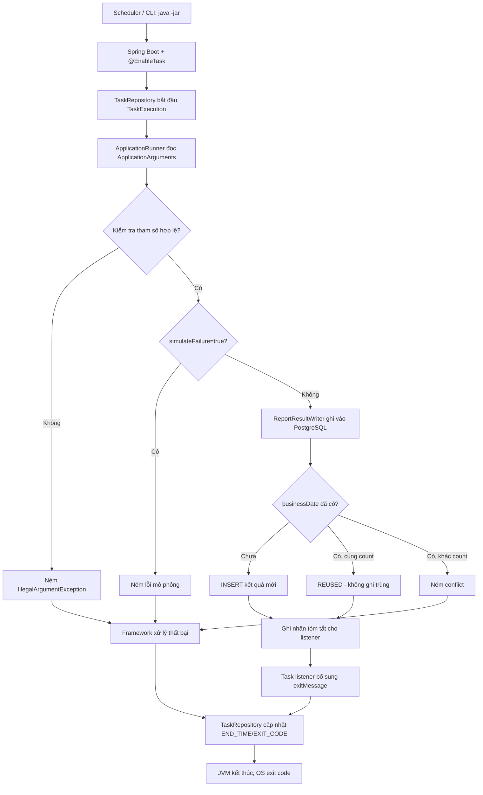
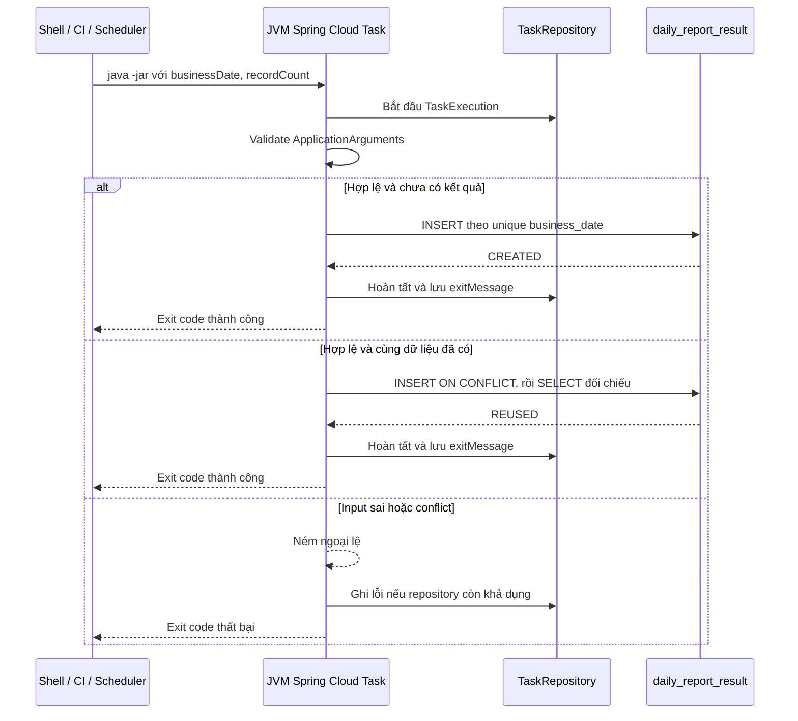

# Task kiểm tra tham số và ghi nhận kết quả hoàn tất

## Mục tiêu và sản phẩm thực hành

**SPRING_CLOUD_TASK (Spring Cloud Task)** là framework dành cho ứng dụng Spring Boot **có thời gian chạy hữu hạn**: khởi động theo yêu cầu hoặc lịch, xử lý công việc, ghi metadata của lượt chạy vào `TaskRepository` rồi kết thúc. Mỗi lần chạy có một `TaskExecution` riêng để tra thời gian bắt đầu/kết thúc, mã thoát và thông tin lỗi. Khi cần xử lý hàng loạt, cùng mô hình này có thể phối hợp Spring Batch.

Trong chương **Thực hành**, chúng ta xây dựng ứng dụng `report-summary-task` nhận tham số qua dòng lệnh, **từ chối dữ liệu không hợp lệ trước khi ghi**, tạo kết quả nghiệp vụ tối giản trong PostgreSQL và **ghi nhận kết quả hoàn tất** của lần Task thông qua cơ chế Spring Cloud Task.

Bài tập giải quyết ba câu hỏi thực tế:

1. Khi gọi `java -jar`, tham số `--businessDate` và `--recordCount` có đúng định dạng và miền giá trị không?
2. Nếu người vận hành chạy lại cùng ngày, Task có tạo kết quả trùng hoặc âm thầm ghi đè kết quả cũ không?
3. Sau khi JAR kết thúc, làm sao phân biệt **đã ghi kết quả nghiệp vụ**, **Task hoàn tất thành công** và **Task thất bại**?

### Tiêu chí hoàn thành

- Một lượt hợp lệ tạo bản ghi trong `daily_report_result`, có dòng `TASK_EXECUTION` tương ứng.
- Chạy lại cùng ngày và cùng số lượng không tạo bản ghi thứ hai; nếu số lượng khác, Task **thất bại rõ ràng** thay vì ghi đè.
- Thiếu ngày, sai ngày, số lượng âm/không phải số, hoặc flag sai định dạng đều thất bại **trước khi ghi nghiệp vụ**.
- Trường hợp lỗi mô phỏng không tạo kết quả mới; scheduler thấy mã thoát thất bại trên đường chạy đã kiểm chứng.
- `EXIT_MESSAGE` thể hiện tóm tắt kết quả nghiệp vụ khi chạy thành công; `ERROR_MESSAGE` giúp chẩn đoán khi Task thất bại.
- Biết đối chiếu log, PostgreSQL, mã thoát hệ điều hành và lịch chạy, thay vì dựa vào một tín hiệu đơn lẻ.

## 1. Bối cảnh và kiến trúc

Nhóm vận hành cần tổng hợp số bản ghi của một ngày kinh doanh, ví dụ `2026-11-23`. Để tập trung vào **kiểm tra tham số và hoàn tất Task**, ví dụ lấy số lượng từ tham số `recordCount` rồi lưu vào bảng tổng hợp; đây là **dữ liệu giả lập**, không phải pipeline đếm đơn hàng production.

Lệnh khởi chạy kỳ vọng:

```bash
java -jar target/report-summary-task.jar \
  --spring.profiles.active=local \
  --businessDate=2026-11-23 \
  --recordCount=125
```

Luồng xử lý:



**Hai loại bản ghi độc lập:**

| Đối tượng | Nơi lưu | Ý nghĩa |
| --- | --- | --- |
| `daily_report_result` | Bảng nghiệp vụ tự tạo. | Kết quả đã ghi cho `businessDate`, có unique key để tránh trùng. |
| `TaskExecution` | `TASK_EXECUTION` của Spring Cloud Task. | Mỗi lần JVM Task chạy, kể cả lần kiểm tra tham số thất bại nếu lifecycle đã bắt đầu. |
| `TaskExecution.exitMessage` | Cột `EXIT_MESSAGE` trong Task repository. | Thông điệp tóm tắt do listener bổ sung, **không phải bằng chứng giao dịch nghiệp vụ tự động**. |
| `TaskExecution.errorMessage` | Cột `ERROR_MESSAGE` khi framework ghi được. | Thông tin lỗi/stack trace của ngoại lệ chưa xử lý. |
| OS exit code | Giá trị trả về khi JVM kết thúc. | Scheduler quyết định báo động/retry; không nhất thiết bằng mọi trường metadata trong mọi lỗi. |

Với cùng `businessDate`, bạn có thể chạy nhiều `TaskExecution` nhưng vẫn chỉ có **một** kết quả nghiệp vụ. Đó là chủ ý: lịch sử thực thi và kết quả nghiệp vụ có cardinality khác nhau.

## 2. Chuẩn bị môi trường

**Yêu cầu tham khảo:** JDK 17 trở lên, Maven, PostgreSQL thử nghiệm và bộ Spring Boot/Spring Cloud Task tương thích. Spring Cloud Task hỗ trợ dùng H2 để học nhanh, nhưng ví dụ này dùng PostgreSQL để có **kết quả bền vững và kiểm chứng được giữa các lần `java -jar` khác nhau**.

Có thể tạo project Maven từ Spring Initializr với dependency Spring Cloud Task, Spring JDBC, PostgreSQL và Spring Boot Test. Xác định phiên bản Spring Boot trước, chọn **Spring Cloud release train/BOM tương thích**; không lấy đại một version Task riêng lẻ hoặc trộn API Spring Batch thuộc major version khác.

Đoạn `pom.xml` tham khảo (đặt trong project đã có parent Spring Boot và BOM Spring Cloud hợp lệ):

```xml
<dependencies>
    <dependency>
        <groupId>org.springframework.cloud</groupId>
        <artifactId>spring-cloud-starter-task</artifactId>
    </dependency>
    <dependency>
        <groupId>org.springframework.boot</groupId>
        <artifactId>spring-boot-starter-jdbc</artifactId>
    </dependency>
    <dependency>
        <groupId>org.postgresql</groupId>
        <artifactId>postgresql</artifactId>
        <scope>runtime</scope>
    </dependency>
    <dependency>
        <groupId>org.springframework.boot</groupId>
        <artifactId>spring-boot-starter-test</artifactId>
        <scope>test</scope>
    </dependency>
</dependencies>
```

Đây là **đoạn dependencies**, không phải POM hoàn chỉnh. Project phải quản lý version, có `spring-boot-maven-plugin` để tạo executable JAR và cấu hình test phù hợp. Khi dự án yêu cầu Spring Batch, dependency Batch được bổ sung riêng; không cần Batch cho bài thực hành đơn giản này.

### Cấu trúc project minh họa

```text
report-summary-task/
├── pom.xml
└── src/
    ├── main/
    │   ├── java/com/example/reporttask/
    │   │   ├── ReportTaskApplication.java
    │   │   ├── ReportRequest.java
    │   │   ├── ReportResult.java
    │   │   ├── ReportResultWriter.java
    │   │   ├── ReportRunner.java
    │   │   └── CompletionSummaryListener.java
    │   └── resources/
    │       └── application-local.yml
    └── test/
        └── java/com/example/reporttask/
            └── ReportRequestTest.java
```

Mỗi snippet Java dưới đây là **một file** đúng tên, cùng package `com.example.reporttask`. Với Maven, tên JAR cuối phụ thuộc `artifactId`/`version` và plugin; ví dụ sử dụng tên rút gọn `target/report-summary-task.jar` sau khi bạn cấu hình `finalName` hoặc đổi tên artifact đầu ra.

## 3. Tạo schema metadata và bảng kết quả

Spring Cloud Task dùng những bảng metadata riêng (`TASK_EXECUTION`, `TASK_EXECUTION_PARAMS`, đối tượng cấp ID và các bảng phụ tùy phiên bản). Trong môi trường dùng PostgreSQL và cần giữ lịch sử sau khi JVM kết thúc, nên quản lý các bảng này bằng DDL/migration **đúng version Spring Cloud Task**, không tự viết một bảng `TASK_EXECUTION` giản lược.

Ví dụ bảng **nghiệp vụ do chúng ta sở hữu**:

```sql
CREATE TABLE IF NOT EXISTS daily_report_result (
    business_date DATE PRIMARY KEY,
    record_count INTEGER NOT NULL CHECK (record_count >= 0),
    created_at TIMESTAMP NOT NULL DEFAULT CURRENT_TIMESTAMP
);
```

`business_date` là primary key: hai JVM không thể tạo hai bản ghi hợp lệ cho cùng một ngày, kể cả khi scheduler kích hoạt chồng nhau. Đây là khóa idempotency **theo ngày nghiệp vụ**, khác với `TASK_EXECUTION_ID` được tạo mới mỗi lần chạy.

**Cảnh báo môi trường:** chạy DDL trên PostgreSQL thử nghiệm; schema Task phải được cài từ script chính thức của phiên bản thư viện. Không đưa `CREATE TABLE IF NOT EXISTS` của bài thực hành thành chiến lược migration production duy nhất; về lâu dài dùng Flyway/Liquibase với tài khoản DDL riêng và review schema.

### application-local.yml

```yaml
spring:
  application:
    name: report-summary-task
  main:
    web-application-type: none
  datasource:
    url: ${TASK_DB_URL}
    username: ${TASK_DB_USER}
    password: ${TASK_DB_PASSWORD}
  cloud:
    task:
      name: report-summary-task
      initialize-enabled: false
      closecontextEnabled: true

logging:
  level:
    org.springframework.cloud.task: INFO
    com.example.reporttask: INFO
```

Giả định **cả Task metadata và kết quả nghiệp vụ cùng dùng một PostgreSQL DataSource** trong bài học để đơn giản hóa cấu hình. Trong production, `TaskConfigurer` có thể đưa `TaskRepository` sang database/schema riêng; khi đó phải xác định transaction manager, bảng liên kết và quyền của từng nguồn.

`initialize-enabled: false` có nghĩa bảng Task đã được migration **trước khi JAR chạy**. `closecontextEnabled: true` yêu cầu Spring Cloud Task đóng ApplicationContext khi công việc hoàn thành theo cơ chế framework; không thay thế việc đóng thread pool/resource do ứng dụng tự quản lý.

Không đặt password thật trong YAML hoặc command line: Spring Cloud Task có thể lưu arguments của tiến trình trong `TASK_EXECUTION_PARAMS`.

## 4. Ứng dụng Spring Boot kích hoạt Task

File `ReportTaskApplication.java`:

```java
package com.example.reporttask;

import org.springframework.boot.SpringApplication;
import org.springframework.boot.autoconfigure.SpringBootApplication;
import org.springframework.cloud.task.configuration.EnableTask;

@SpringBootApplication
@EnableTask
public class ReportTaskApplication {

    public static void main(String[] args) {
        SpringApplication.run(ReportTaskApplication.class, args);
    }
}
```

`@EnableTask` kích hoạt lifecycle của Spring Cloud Task. Spring Boot gọi các bean `ApplicationRunner`/`CommandLineRunner` sau khi context khởi tạo. Metadata Task thường được ghi nhận quanh vòng đời runner; logic thực hiện ở constructor hoặc `@PostConstruct` **không thuộc phạm vi công việc runner** theo cách Spring Cloud Task mô tả, nên tránh đặt xử lý nghiệp vụ ở đó.

**Không tạo controller HTTP hoặc `@Scheduled` giữ JVM sống** cho lab này; đây là JAR chạy xong rồi kết thúc. Nền tảng bên ngoài sẽ chịu trách nhiệm lên lịch/chạy lại.

## 5. Kiểm tra tham số trước khi ghi dữ liệu

Yêu cầu đầu vào:

| Tên tham số | Bắt buộc | Quy tắc | Ví dụ |
| --- | --- | --- | --- |
| `--businessDate` | Có | Một giá trị, ISO `yyyy-MM-dd`, là ngày hợp lệ. | `--businessDate=2026-11-23` |
| `--recordCount` | Có | Số nguyên từ `0` tới `100000`. | `--recordCount=125` |
| `--simulateFailure` | Không | Chỉ chấp nhận `true` hoặc `false`; mặc định `false`. | `--simulateFailure=true` |

`simulateFailure` chỉ dành cho môi trường học/test để tạo một lỗi nghiệp vụ có kiểm soát. Với hệ thống thật, bỏ flag này khỏi code production.

File `ReportRequest.java` dùng `ApplicationArguments` để lấy option rõ ràng:

```java
package com.example.reporttask;

import java.time.LocalDate;
import java.time.format.DateTimeParseException;
import java.util.List;
import org.springframework.boot.ApplicationArguments;

public record ReportRequest(
        LocalDate businessDate,
        int recordCount,
        boolean simulateFailure) {

    public static ReportRequest from(ApplicationArguments args) {
        String rawDate = required(args, "businessDate");
        String rawCount = required(args, "recordCount");

        LocalDate date;
        try {
            date = LocalDate.parse(rawDate);
        } catch (DateTimeParseException error) {
            throw new IllegalArgumentException(
                    "businessDate phải là ngày ISO yyyy-MM-dd hợp lệ",
                    error);
        }

        int count;
        try {
            count = Integer.parseInt(rawCount);
        } catch (NumberFormatException error) {
            throw new IllegalArgumentException(
                    "recordCount phải là số nguyên", error);
        }
        if (count < 0 || count > 100000) {
            throw new IllegalArgumentException(
                    "recordCount phải nằm trong khoảng 0..100000");
        }

        List<String> flags = args.getOptionValues("simulateFailure");
        boolean fail = false;
        if (flags != null) {
            if (flags.size() != 1 ||
                    (!"true".equalsIgnoreCase(flags.get(0)) &&
                     !"false".equalsIgnoreCase(flags.get(0)))) {
                throw new IllegalArgumentException(
                        "simulateFailure chỉ nhận true hoặc false");
            }
            fail = Boolean.parseBoolean(flags.get(0));
        }
        return new ReportRequest(date, count, fail);
    }

    private static String required(
            ApplicationArguments args, String option) {
        List<String> values = args.getOptionValues(option);
        if (values == null || values.size() != 1 ||
                values.get(0) == null || values.get(0).isBlank()) {
            throw new IllegalArgumentException(
                    "Thiếu hoặc trùng --" + option + "=...");
        }
        return values.get(0);
    }
}
```

Vì sao không dùng `Boolean.parseBoolean` trực tiếp trên text chưa kiểm tra? Java coi nhiều chuỗi không phải `"true"` là `false`, dễ biến typo thành hành vi chạy bình thường. Vì sao không tự mặc định `businessDate=LocalDate.now()`? Lịch chạy bù có thể diễn ra ngày khác; chọn ngày tường minh giúp retry/backfill không ghi nhầm.

**Đặt validation ở đầu runner**, trước bất kỳ lệnh ghi nghiệp vụ. Nếu kiểm tra tham số có lỗi, exception chưa xử lý đi qua cơ chế lỗi của Spring Boot/Spring Cloud Task, thay vì tạo một dòng kết quả sai rồi mới phát hiện.

## 6. Kết quả nghiệp vụ và ghi dữ liệu không trùng

File `ReportResult.java` mô tả kết quả của lời gọi service:

```java
package com.example.reporttask;

import java.time.LocalDate;

public record ReportResult(
        LocalDate businessDate,
        int recordCount,
        boolean reused) {

    public String summary() {
        return "result=" + (reused ? "REUSED" : "CREATED")
                + "; businessDate=" + businessDate
                + "; recordCount=" + recordCount;
    }
}
```

File `ReportResultWriter.java` sử dụng `JdbcTemplate` của Spring JDBC:

```java
package com.example.reporttask;

import java.sql.Date;
import java.util.Objects;
import org.springframework.jdbc.core.JdbcTemplate;
import org.springframework.stereotype.Service;

@Service
public class ReportResultWriter {

    private final JdbcTemplate jdbc;

    public ReportResultWriter(JdbcTemplate jdbc) {
        this.jdbc = jdbc;
    }

    public ReportResult write(ReportRequest request) {
        Date date = Date.valueOf(request.businessDate());

        int inserted = jdbc.update(
            "INSERT INTO daily_report_result " +
            "(business_date, record_count) VALUES (?, ?) " +
            "ON CONFLICT (business_date) DO NOTHING",
            date, request.recordCount());

        if (inserted == 1) {
            return new ReportResult(
                    request.businessDate(), request.recordCount(), false);
        }

        Integer existing = jdbc.queryForObject(
            "SELECT record_count FROM daily_report_result " +
            "WHERE business_date = ?",
            Integer.class, date);

        if (!Objects.equals(existing, request.recordCount())) {
            throw new IllegalStateException(
                "BUSINESS_DATE_CONFLICT: ngày đã có kết quả khác");
        }

        return new ReportResult(
                request.businessDate(), request.recordCount(), true);
    }
}
```

`ON CONFLICT DO NOTHING` là **cú pháp PostgreSQL**, không chạy nguyên trạng trên mọi database. Với hai tiến trình đồng thời, unique constraint giúp chỉ một `INSERT` thành công. Tiến trình còn lại đọc kết quả đã có: cùng `recordCount` thì trả `REUSED`; khác count thì báo conflict để tránh âm thầm thay đổi dữ liệu đã công bố.

**Giới hạn:** ví dụ dùng đúng **một câu INSERT** cộng bước đối chiếu, chưa xử lý báo cáo nhiều file/hàng nghìn giao dịch. Kết quả của câu INSERT được PostgreSQL commit theo cấu hình JDBC transaction hiện tại; nếu Task chết **sau khi commit nghiệp vụ nhưng trước khi TaskRepository ghi END_TIME**, có thể có bản ghi nghiệp vụ mà Task chưa hoàn tất trên metadata. Chính vì thế idempotency và đối chiếu sau lỗi là bắt buộc.

## 7. Ghi nhận thông điệp hoàn tất bằng TaskExecutionListener

Spring Cloud Task cung cấp `TaskExecutionListener` với các callback vòng đời:

| Callback | Khi nào | Có nên làm gì? |
| --- | --- | --- |
| `onTaskStartup(TaskExecution)` | Khi Task bắt đầu, trước bước lưu bản ghi bắt đầu theo tài liệu reference. | Reset trạng thái nội bộ, log ngắn nếu cần. |
| `onTaskFailed(TaskExecution, Throwable)` | Khi một lỗi chưa xử lý làm Task thất bại, trước `onTaskEnd`. | Đánh dấu đã thất bại; không nuốt ngoại lệ. |
| `onTaskEnd(TaskExecution)` | Trước khi repository cập nhật TaskExecution ở mốc kết thúc. | Chỉ bổ sung `exitMessage` đã tính sẵn, **không** thực hiện lại nghiệp vụ. |

Thay vì ghi thêm vào database từ listener, ta lưu một tóm tắt **trong bộ nhớ của một JVM Task**, rồi gắn nó vào `TaskExecution.exitMessage` khi framework kết thúc lượt chạy. Cách này cho thấy thông điệp hoàn tất là **metadata**, không phải kết quả tính toán độc lập.

File `CompletionSummaryListener.java`:

```java
package com.example.reporttask;

import java.util.concurrent.atomic.AtomicBoolean;
import java.util.concurrent.atomic.AtomicReference;
import org.springframework.cloud.task.listener.TaskExecutionListener;
import org.springframework.cloud.task.repository.TaskExecution;
import org.springframework.stereotype.Component;

@Component
public class CompletionSummaryListener
        implements TaskExecutionListener {

    private final AtomicReference<ReportResult> recorded =
            new AtomicReference<>();
    private final AtomicBoolean failed = new AtomicBoolean();

    public void markRecorded(ReportResult result) {
        recorded.set(result);
    }

    @Override
    public void onTaskStartup(TaskExecution execution) {
        recorded.set(null);
        failed.set(false);
    }

    @Override
    public void onTaskFailed(
            TaskExecution execution, Throwable error) {
        failed.set(true);
    }

    @Override
    public void onTaskEnd(TaskExecution execution) {
        ReportResult result = recorded.get();
        if (!failed.get() && result != null) {
            execution.setExitMessage(
                    "BUSINESS_RESULT_RECORDED; " + result.summary());
        }
    }
}
```

Đây là trạng thái nội bộ của **một tiến trình có một TaskExecution**, không phải bộ lưu kết quả bền vững và không dùng để giao tiếp giữa hai JVM. Phần `AtomicReference`/`AtomicBoolean` chỉ giúp code minh bạch về dữ liệu được chuyển từ runner sang listener; trong môi trường có nhiều lifecycle hoặc runner bất đồng bộ, phải thiết kế lại context/correlation.

**Tại sao không đặt `execution.setExitCode(0)` trong `onTaskEnd`?** Vì callback kết thúc có thể chạy cả khi Task lỗi. Việc tự ép mã `0` sẽ che mất thất bại. Để Spring Cloud Task/Spring Boot xác định exit code, chỉ gắn tóm tắt khi đường xử lý nghiệp vụ đã ghi xong và không có callback lỗi.

Tài liệu Spring Cloud Task cho biết các thông điệp được set ở `onTaskEnd` có mức ưu tiên cao hơn thông điệp từ các callback trước đó. Nếu nhiều listener cùng sửa `exitMessage`, giá trị cuối cùng còn phụ thuộc thứ tự; trong bài tập chỉ có một listener bổ sung thông điệp. **Đừng để listener ném ngoại lệ** do parse/log/gọi API phụ, vì lỗi listener có thể thay đổi đường xử lý kết thúc và mã thoát.

## 8. ApplicationRunner kết nối validation, xử lý và ghi nhận

File `ReportRunner.java`:

```java
package com.example.reporttask;

import org.slf4j.Logger;
import org.slf4j.LoggerFactory;
import org.springframework.boot.ApplicationArguments;
import org.springframework.boot.ApplicationRunner;
import org.springframework.stereotype.Component;

@Component
public class ReportRunner implements ApplicationRunner {

    private static final Logger log =
            LoggerFactory.getLogger(ReportRunner.class);

    private final ReportResultWriter writer;
    private final CompletionSummaryListener completion;

    public ReportRunner(
            ReportResultWriter writer,
            CompletionSummaryListener completion) {
        this.writer = writer;
        this.completion = completion;
    }

    @Override
    public void run(ApplicationArguments args) {
        // Kiểm tra xong mọi tham số trước khi ghi nghiệp vụ.
        ReportRequest request = ReportRequest.from(args);
        log.info("report.started businessDate={} recordCount={}",
                request.businessDate(), request.recordCount());

        if (request.simulateFailure()) {
            throw new IllegalStateException(
                    "SIMULATED_BUSINESS_FAILURE");
        }

        // SQL thực thi rồi mới công bố tóm tắt.
        ReportResult result = writer.write(request);
        completion.markRecorded(result);

        log.info("report.result {}", result.summary());
    }
}
```

**Thứ tự quan trọng:**

1. `ReportRequest.from(args)` kiểm tra ngày, số lượng và flag. Lỗi ở bước này không có SQL ghi nghiệp vụ.
2. `simulateFailure` mô phỏng một lỗi sau validation nhưng **trước** thao tác ghi.
3. `ReportResultWriter.write` quyết định `CREATED`, `REUSED` hoặc ném conflict.
4. Chỉ sau khi `write` trả về, `markRecorded` cung cấp thông tin cho listener.
5. Spring Boot hoàn tất runner; Spring Cloud Task chạy callback cuối và cố gắng cập nhật `TASK_EXECUTION`.

Một exception chưa xử lý từ runner sẽ khiến đường thất bại của Spring Boot/Spring Cloud Task được kích hoạt. Trên cấu hình thông thường, OS exit code khác `0` và `TaskExecution.exitCode` cũng phản ánh thất bại khi ghi được metadata; **mã cụ thể phải được kiểm chứng trên executable JAR và version sử dụng**, đặc biệt khi có custom `ExitCodeGenerator`/`ExitCodeExceptionMapper`.

### Vì sao không dùng try/catch chỉ để log rồi return?

Ví dụ **sai**:

```java
try {
    writer.write(request);
} catch (Exception error) {
    log.error("Lỗi ghi báo cáo", error);
    // Nguy hiểm: nuốt exception rồi kết thúc runner bình thường.
}
```

Nếu chỉ log rồi không ném lại exception/không ánh xạ trạng thái rõ ràng, framework có thể ghi `EXIT_CODE=0` dù báo cáo chưa được lưu. Chỉ bắt lỗi khi bạn **thực sự khôi phục được** hoặc cần đổi thành một exception có hợp đồng mã thoát, ví dụ `throw new ReportProcessingException(…)`.

## 9. Chạy JAR và kiểm tra từng kịch bản

**Bước chuẩn bị:** PostgreSQL thử nghiệm đang chạy, có bảng metadata Spring Cloud Task **đúng phiên bản** và bảng `daily_report_result`. Cấp biến môi trường `TASK_DB_URL`, `TASK_DB_USER`, `TASK_DB_PASSWORD` cho terminal/scheduler. Dùng secret manager hoặc file môi trường có quyền hạn chế; không lưu mật khẩu vào Git và không in nó ra log.

### 9.1. Build executable JAR

Với dự án Maven/Boot được tạo từ Initializr và đã cấu hình `spring-boot-maven-plugin`:

```bash
./mvnw -DskipTests package
```

Tên artifact do POM quyết định. Trong các lệnh tiếp theo, giả sử bạn đã cấu hình `finalName=report-summary-task` để có `target/report-summary-task.jar`, hoặc sửa đường dẫn thành tên JAR thật trong `target`.

Không coi một file `.jar` do `maven-jar-plugin` tạo mà thiếu Spring Boot launcher/dependencies là executable JAR tương đương. Kiểm tra `java -jar` trực tiếp **trước** khi đặt cron hoặc Kubernetes Job.

### 9.2. Lần chạy hợp lệ đầu tiên

```bash
java -jar target/report-summary-task.jar \
  --spring.profiles.active=local \
  --businessDate=2026-11-23 \
  --recordCount=125
code=$?
printf 'OS exit code: %s\n' "$code"
```

Kỳ vọng: log `report.started` và `report.result result=CREATED`, mã OS `0` trên đường chạy thành công, một dòng `daily_report_result` cho `2026-11-23`; `TaskRepository` có bản ghi TaskExecution hoàn tất.

**Quan trọng khi dùng shell:** lưu `$?` **ngay sau** lệnh Java. Nếu chạy thêm `echo` trước khi lưu, `$?` có thể đã trở thành mã của `echo`. Trên PowerShell, dùng `$LASTEXITCODE` ngay sau `java.exe`.

### 9.3. Chạy lại cùng ngày, cùng số lượng

```bash
java -jar target/report-summary-task.jar \
  --spring.profiles.active=local \
  --businessDate=2026-11-23 \
  --recordCount=125
```

Kỳ vọng: log `result=REUSED`; số dòng kết quả nghiệp vụ **không tăng**; có **TaskExecution mới**, vì đó là lần JVM Task chạy khác. `EXIT_MESSAGE` của lượt mới có thể ghi `BUSINESS_RESULT_RECORDED; result=REUSED; …`.

### 9.4. Chạy cùng ngày nhưng khác số lượng

```bash
java -jar target/report-summary-task.jar \
  --spring.profiles.active=local \
  --businessDate=2026-11-23 \
  --recordCount=126
code=$?
printf 'OS exit code: %s\n' "$code"
```

Kỳ vọng: service ném `BUSINESS_DATE_CONFLICT`, mã OS khác `0` theo đường xử lý lỗi thông thường, **bản ghi count=125 vẫn không thay đổi**. Đây là một lỗi nghiệp vụ có chủ đích: không được coi thay đổi số lượng như một retry giống hệt request cũ.

### 9.5. Kiểm tra lỗi tham số và lỗi xử lý

| Lệnh bổ sung cho JAR | Kết quả mong đợi | Có thêm kết quả nghiệp vụ không? |
| --- | --- | --- |
| Chỉ `--recordCount=20` | Báo thiếu `businessDate`. | Không. |
| `--businessDate=2026-02-30 --recordCount=20` | Báo ngày không tồn tại. | Không. |
| `--businessDate=2026-11-24 --recordCount=abc` | Báo số lượng không phải số nguyên. | Không. |
| `--businessDate=2026-11-24 --recordCount=-1` | Báo ngoài phạm vi. | Không. |
| `--businessDate=2026-11-24 --recordCount=15 --simulateFailure=maybe` | Báo flag không hợp lệ. | Không. |
| `--businessDate=2026-11-24 --recordCount=15 --simulateFailure=true` | Báo `SIMULATED_BUSINESS_FAILURE`. | Không, nếu chưa có bản ghi từ lượt trước. |
| `--businessDate=2026-11-24 --recordCount=0` | Hợp lệ, lưu kết quả bằng 0. | Có, nếu chưa tồn tại. |

**Thứ tự chạy test quan trọng:** nếu đã tạo kết quả của ngày `2026-11-24`, các phép thử sau có thể được trả `REUSED` hoặc conflict vì dữ liệu đã có. Dùng database/schema test sạch hoặc chọn một `businessDate` riêng cho từng bài thử cần xác minh số dòng tăng.

## 10. Quan sát TaskRepository bằng SQL

Spring Cloud Task tạo ID riêng cho mỗi execution, và thông tin này được lưu ở `TASK_EXECUTION` khi repository JDBC hoạt động.

Truy vấn tổng hợp:

```sql
SELECT TASK_EXECUTION_ID,
       TASK_NAME,
       START_TIME,
       END_TIME,
       EXIT_CODE,
       EXIT_MESSAGE,
       ERROR_MESSAGE
FROM TASK_EXECUTION
WHERE TASK_NAME = 'report-summary-task'
ORDER BY TASK_EXECUTION_ID DESC
LIMIT 20;
```

Tên bảng và cột áp dụng cho schema mặc định được tài liệu hóa; nếu ứng dụng dùng `tablePrefix` hoặc schema riêng, phải sửa truy vấn theo DDL thật. Dữ liệu `ERROR_MESSAGE` có thể chứa stack trace/thông tin cấu hình nhạy cảm; giới hạn quyền đọc và không đưa toàn bộ nội dung lên dashboard công khai.

Đối chiếu kết quả nghiệp vụ:

```sql
SELECT business_date, record_count, created_at
FROM daily_report_result
WHERE business_date = DATE '2026-11-23';

SELECT COUNT(*) AS result_rows_for_day
FROM daily_report_result
WHERE business_date = DATE '2026-11-23';
```

Kỳ vọng `result_rows_for_day=1` sau một lượt `CREATED` và mọi lượt `REUSED` cùng ngày. Với lỗi conflict, `record_count` phải giữ nguyên giá trị trước đó.

### Phân biệt EXIT_MESSAGE và ERROR_MESSAGE

| Trường hợp | `EXIT_CODE` | `EXIT_MESSAGE` | `ERROR_MESSAGE` |
| --- | --- | --- | --- |
| Tạo kết quả thành công | Thường `0`. | `BUSINESS_RESULT_RECORDED; result=CREATED; …`. | Thường rỗng/null. |
| Chạy lại, cùng kết quả | Thường `0`. | `BUSINESS_RESULT_RECORDED; result=REUSED; …`. | Thường rỗng/null. |
| Validation thất bại trong runner | Thường khác `0`. | Không có tóm tắt thành công do listener của bài không set. | Thông tin ngoại lệ nếu TaskRepository ghi được. |
| Conflict nghiệp vụ | Thường khác `0`. | Không có tóm tắt thành công. | Thông tin `BUSINESS_DATE_CONFLICT` nếu ghi được. |
| Lỗi bootstrap quá sớm | Có thể không có record. | Không áp dụng. | Không áp dụng; tìm trong log scheduler/process. |
| JVM bị kill giữa chừng | Mã OS tùy platform. | Có thể chưa cập nhật. | Có thể thiếu; `END_TIME` còn null. |

`onTaskEnd` được gọi **trước** khi cập nhật cuối vào `TaskRepository` theo tài liệu Spring Cloud Task. Vì vậy một thông điệp `BUSINESS_RESULT_RECORDED` chỉ mô tả bước nghiệp vụ đã ghi thành công ở mức service; nó **không khẳng định `END_TIME` đã commit**. Muốn xác nhận hoàn tất toàn bộ Task, chờ tiến trình kết thúc rồi tra metadata và kiểm tra đầu ra.

### Kiểm tra số Task theo kết quả

```sql
SELECT TASK_NAME,
       EXIT_CODE,
       COUNT(*) AS run_count
FROM TASK_EXECUTION
WHERE TASK_NAME = 'report-summary-task'
GROUP BY TASK_NAME, EXIT_CODE
ORDER BY EXIT_CODE NULLS FIRST;
```

`EXIT_CODE IS NULL` có thể là execution chưa hoàn tất, tạo trước hoặc cập nhật kết thúc thất bại; không tự động đếm tất cả bản ghi null thành “đang chạy”.

## 11. Đọc lại kết quả bằng TaskExplorer

Ngoài SQL, Spring Cloud Task cung cấp `TaskExplorer` để tra metadata theo API framework. Đây là lựa chọn phù hợp khi xây một dịch vụ giám sát **độc lập** hoặc một trang quản trị đã có `DataSource` tới Task repository.

Ví dụ method tra TaskExecution theo ID:

```java
import org.springframework.cloud.task.repository.TaskExecution;
import org.springframework.cloud.task.repository.TaskExplorer;

public TaskExecution findExecution(
        TaskExplorer taskExplorer, long executionId) {

    TaskExecution execution =
            taskExplorer.getTaskExecution(executionId);
    if (execution == null) {
        throw new IllegalArgumentException(
                "Không tồn tại TaskExecution " + executionId);
    }
    return execution;
}
```

Đây là **snippet API** để thêm vào service giám sát, không phải một method đứng độc lập ngoài class Java. `TaskExplorer` đọc metadata Task; nó không đọc được bảng `daily_report_result` do ứng dụng tự tạo, và không thay `JobExplorer` của Spring Batch.

Muốn tạo dashboard “Task đã hoàn tất chưa?”, nên dùng các thông tin:

1. `TaskExecution.executionId` để xác định đúng một lượt.
2. `endTime`, `exitCode` và `errorMessage` khi đã được repository lưu.
3. Trạng thái JVM/Pod/Job từ scheduler để phát hiện trường hợp Task chết trước khi cập nhật metadata.
4. Bản ghi `daily_report_result` để xác nhận **kết quả nghiệp vụ** cho ngày tương ứng.

Đừng suy `executionId` của một lần chạy từ `MAX(TASK_EXECUTION_ID)` nếu có nhiều process chạy cùng lúc. Trong thực tế nên mang `requestId`/external execution ID qua hệ điều phối, log theo ID được framework cấp hoặc dùng API tạo trước execution ID khi launcher hỗ trợ.

## 12. Unit test cho validation bằng JUnit 5

Phần có thể kiểm tra hoàn toàn **không cần database** là logic `ReportRequest.from`. Spring Boot cung cấp `DefaultApplicationArguments` để mô phỏng CLI options.

File `ReportRequestTest.java`:

```java
package com.example.reporttask;

import java.time.LocalDate;
import org.junit.jupiter.api.Test;
import org.springframework.boot.DefaultApplicationArguments;

import static org.junit.jupiter.api.Assertions.*;

class ReportRequestTest {

    @Test
    void acceptsValidRequest() {
        ReportRequest request = ReportRequest.from(
            new DefaultApplicationArguments(
                "--businessDate=2026-11-23",
                "--recordCount=125"));

        assertEquals(LocalDate.of(2026, 11, 23),
                request.businessDate());
        assertEquals(125, request.recordCount());
        assertFalse(request.simulateFailure());
    }

    @Test
    void supportsExplicitFailureSwitch() {
        ReportRequest request = ReportRequest.from(
            new DefaultApplicationArguments(
                "--businessDate=2026-11-24",
                "--recordCount=0",
                "--simulateFailure=true"));
        assertTrue(request.simulateFailure());
    }

    @Test
    void rejectsMissingDate() {
        assertThrows(IllegalArgumentException.class,
            () -> ReportRequest.from(
                new DefaultApplicationArguments(
                    "--recordCount=10")));
    }

    @Test
    void rejectsInvalidCalendarDate() {
        assertThrows(IllegalArgumentException.class,
            () -> ReportRequest.from(
                new DefaultApplicationArguments(
                    "--businessDate=2026-02-30",
                    "--recordCount=10")));
    }

    @Test
    void rejectsNegativeCount() {
        assertThrows(IllegalArgumentException.class,
            () -> ReportRequest.from(
                new DefaultApplicationArguments(
                    "--businessDate=2026-11-23",
                    "--recordCount=-2")));
    }

    @Test
    void rejectsBadFailureSwitch() {
        assertThrows(IllegalArgumentException.class,
            () -> ReportRequest.from(
                new DefaultApplicationArguments(
                    "--businessDate=2026-11-23",
                    "--recordCount=10",
                    "--simulateFailure=maybe")));
    }
}
```

Đây là **unit test**, chỉ kiểm tra quy tắc parse/validation. Nó **không** khởi động `ApplicationContext`, không thực thi `ReportResultWriter` và không chứng minh `TaskExecution.exitCode` hay mã OS của JAR. Cần test tích hợp mới xác nhận các tầng đó.

Kiểm tra unit test với Maven project đã cấu hình:

```bash
./mvnw test
```

Nếu một bộ test dùng `@SpringBootTest` để tự khởi động Task context, phải truyền tham số bắt buộc hoặc thay bean runner trong test, nếu không runner có thể ném lỗi ngoài ý định. Với class `ReportRequestTest` thuần túy như trên, không cần khởi động toàn bộ Spring Boot.

## 13. Kiểm thử tích hợp trên database và tiến trình độc lập

Một lần chạy có thể “xanh” trong unit test nhưng **hỏng khi đóng gói** vì thiếu PostgreSQL driver, schema sai hoặc lỗi lifecycle. Do đó nên kiểm tra bằng **JAR thật** ở môi trường test:



### Test case đề xuất

| Mã | Input/trạng thái trước | Kết quả nghiệp vụ | Kết quả Task cần xác minh |
| --- | --- | --- | --- |
| P01 | Ngày chưa có, count hợp lệ. | Tạo đúng một dòng. | Task mới, `END_TIME` có giá trị, code thành công, message `CREATED`. |
| P02 | Cùng ngày, cùng count. | Không thêm dòng, không update count. | TaskExecution mới, message `REUSED`. |
| P03 | Cùng ngày, khác count. | Dòng cũ giữ nguyên. | Task mới thất bại, có thông tin conflict. |
| P04 | Thiếu `businessDate`. | Không ghi. | Có lỗi validation; Task metadata nếu context đã khởi tạo. |
| P05 | `businessDate` không hợp lệ. | Không ghi. | Mã lỗi và log rõ nguyên nhân. |
| P06 | `recordCount=abc`. | Không ghi. | Lỗi parse, không bị chuyển thành `0`. |
| P07 | `recordCount=-1` hoặc quá giới hạn. | Không ghi. | Lỗi validation. |
| P08 | `simulateFailure=true` cho ngày mới. | Không ghi. | Lỗi từ runner, không có message hoàn tất giả. |
| P09 | Hai tiến trình cùng ngày/count. | Một bản ghi duy nhất nhờ unique key. | Hai TaskExecution riêng; kết quả có thể `CREATED`/`REUSED`. |
| P10 | Hai tiến trình cùng ngày nhưng count khác. | Không ghi đè bản ghi thắng cuộc. | Một lượt thành công, lượt còn lại báo conflict. |
| P11 | Cố ý sai DataSource/schema. | Không đủ điều kiện ghi kết quả. | Lỗi startup; có thể không có TaskExecution. |
| P12 | Kill JVM sau ghi nghiệp vụ, trước hoàn tất metadata. | Có thể đã có bản ghi. | `END_TIME` có thể null; retry an toàn nhờ idempotency. |

**Đo mã OS exit code thật:** trên Linux/macOS dùng `$?` ngay sau `java -jar`; trên PowerShell dùng `$LASTEXITCODE`. Nếu muốn tự động hóa, viết integration test JUnit dùng `ProcessBuilder` gọi executable JAR trong một JVM khác, chờ bằng `waitFor(timeout)` và redirect cả stdout/stderr ra file; không để test bị treo vì pipe đầy. Đừng chỉ assert `exitCode != 0`: JAR không tồn tại cũng trả nonzero dù logic validation không chạy. Kiểm tra marker log và metadata của đúng lượt.

### Dữ liệu test phải được cô lập

Sử dụng database/schema riêng cho test, hoặc một `businessDate` không trùng với các lượt đang chạy. Dọn dữ liệu ở môi trường thử nghiệm theo chính sách phù hợp; không dùng lệnh `TRUNCATE TASK_EXECUTION` hay xóa `TASK_SEQ` tùy tiện vì các bảng có quan hệ và cơ chế cấp ID riêng.

H2 in-memory ở **hai JVM khác nhau** không mặc nhiên chia sẻ database. Với `ProcessBuilder` và test JAR độc lập, PostgreSQL/Testcontainers có kết nối mạng là lựa chọn phù hợp để cả JVM test và JVM con cùng đối chiếu repository.

## 14. Xử lý lỗi, restart và idempotency

Bài tập dùng khóa `businessDate` để tránh **ghi trùng** ở tầng nghiệp vụ. Tuy nhiên, có nhiều lớp bảo vệ khác:

| Cơ chế | Bảo vệ điều gì? | Không thay thế điều gì? |
| --- | --- | --- |
| Validation `ReportRequest` | Không chạy với tham số thiếu/sai. | Không ngăn hai yêu cầu hợp lệ chạy đồng thời. |
| Unique key `business_date` | Không có hai dòng kết quả cùng ngày. | Không bảo đảm một pipeline nhiều bước không sinh side effect trùng. |
| `ON CONFLICT DO NOTHING` + so sánh count | Retry cùng dữ liệu thành `REUSED`, conflict khác dữ liệu thành lỗi. | Không tự giải quyết việc sửa báo cáo đã công bố. |
| `TaskRepository` | Lưu lịch sử mỗi lượt chạy, mã thoát và lỗi. | Không khóa nghiệp vụ hay quyết định retry. |
| `single-instance-enabled` của Spring Cloud Task | Có thể hạn chế cùng tên Task chạy chồng khi khóa JDBC được cấu hình đúng. | Không thay idempotency, và có thể quá rộng khi cần xử lý nhiều ngày song song. |
| Scheduler/queue | Quyết định lịch, retry, timeout và số tiến trình. | Không chứng minh transaction nghiệp vụ đã commit. |
| Spring Batch JobRepository | Lưu Job/Step, checkpoint và restart nếu dùng Batch. | Không thay TaskRepository hoặc unique key nghiệp vụ. |

### Trường hợp khó: mất kết nối sau khi đã ghi kết quả

Giả sử `ReportResultWriter` đã commit bản ghi ngày `2026-11-23`, nhưng trước khi Spring Cloud Task lưu `END_TIME` thì JVM bị kill. Người vận hành thấy Task metadata chưa hoàn tất, nhưng bảng `daily_report_result` **đã có count**.

**Quy trình xử lý đúng:**

1. Tra trạng thái process/Pod, không chỉ xem `END_TIME IS NULL`.
2. Đọc bản ghi `daily_report_result` theo ngày và xác minh count/đầu ra.
3. Nếu dữ liệu đã đúng, ghi nhận rằng lần trước có side effect đã commit; quyết định chạy lại theo chính sách.
4. Nếu chạy lại cùng tham số, code trả `REUSED`, không tạo thêm một bản ghi.
5. Nếu muốn sửa count đã lưu, dùng **quy trình sửa dữ liệu có phê duyệt**, không thay `ON CONFLICT DO NOTHING` thành `DO UPDATE` một cách tùy tiện.

**Không có atomic transaction mặc định giữa trạng thái `TaskExecution` và kết quả nghiệp vụ**, đặc biệt nếu hai repository sử dụng những datasource khác nhau. Khi nghiệp vụ yêu cầu bảo đảm mạnh hơn, cân nhắc transaction boundary, idempotency key theo yêu cầu, transactional outbox và cơ chế reconcile.

### Nếu thay recordCount bằng Spring Batch Job

Khi chuyển bài tập từ “lưu count giả lập” sang xử lý CSV/DB bằng Spring Batch:

- `TaskExecution` vẫn đại diện cho một lượt JVM Task.
- `JobInstance` phụ thuộc tên Job và identifying `JobParameters`; một `JobInstance` có thể được chạy/restart qua nhiều `JobExecution`.
- `BatchStatus.FAILED` có thể không tự dẫn đến mã thoát Task khác 0 trong mọi cách khởi chạy; phải kiểm tra `spring.cloud.task.batch.fail-on-job-failure` và đường chạy thực tế.
- `TaskBatchExecutionListener` có thể tạo liên kết trong `TASK_TASK_BATCH` khi tích hợp phù hợp.
- Checkpoint/restart không tự giải quyết idempotency của writer ngoài DB hay việc gửi message trùng.

Phần này là **hướng mở rộng**, không cần thêm dependency Spring Batch cho bài lab cơ bản.

## 15. Chẩn đoán các lỗi thường gặp

| Triệu chứng | Nguyên nhân khả dĩ | Cách xử lý |
| --- | --- | --- |
| `relation "task_execution" does not exist` | Chưa áp DDL Task hoặc sai schema/table prefix. | Kiểm tra datasource/profile và DDL đúng phiên bản; migrate trước chạy. |
| `relation "daily_report_result" does not exist` | Chưa tạo bảng nghiệp vụ. | Chạy SQL mục 3 trên đúng database thử nghiệm. |
| Không tạo được bean `JdbcTemplate` | Thiếu Spring JDBC/DataSource/driver hoặc cấu hình DB sai. | Kiểm tra dependency và `spring.datasource.*`. |
| Task chạy xong nhưng không thấy trong DB | Dùng H2 in-memory, sai database/profile hoặc repository chưa khởi tạo. | Kiểm tra JDBC URL thật, `TaskRepository` và log. |
| `EXIT_MESSAGE` trống dù runner thành công | Listener chưa được đăng ký, lỗi trước `markRecorded` hoặc listener khác sửa message. | Kiểm tra bean `CompletionSummaryListener`, lifecycle và phiên bản. |
| `ERROR_MESSAGE` có giá trị nhưng OS code bằng `0` | Exception bị nuốt hoặc đường exit code tùy biến. | Không che lỗi; đo mã bằng JVM thật, kiểm tra Boot exit mapping. |
| `BUSINESS_DATE_CONFLICT` | Cùng ngày nhưng tham số count không trùng kết quả đã lưu. | Đối chiếu dữ liệu gốc, không ghi đè tự động. |
| Lần chạy thứ hai có `TaskExecution` mới nhưng không có dòng kết quả mới | Đúng hành vi `REUSED`. | Không nhầm số lượt Task với số báo cáo nghiệp vụ. |
| `END_TIME` vẫn null dù process không còn chạy | JVM bị kill, lỗi DB lúc hoàn tất hoặc Task tạo trước. | Đối chiếu scheduler/process và bảng kết quả. |
| JAR không chịu thoát | Web server/thread pool/scheduler hoặc resource chưa đóng. | Bật non-web mode, đóng resource, kiểm thử timeout tiến trình. |
| Lỗi SQL ở PostgreSQL dù code biên dịch | Sai dialect hoặc bảng/constraint khác ví dụ. | Kiểm tra `ON CONFLICT`, schema thực tế và migration. |

**Không sửa lỗi bằng cách đặt `exitCode=0` trong listener hoặc xóa TaskExecution thất bại.** Lịch sử thất bại giúp phát hiện lỗi hệ thống và quyết định retry chính xác.

## 16. Bài tập mở rộng

Sau khi hoàn thành kịch bản chính, thực hiện lần lượt các thay đổi dưới đây:

1. **Kiểm tra ngày tương lai:** từ chối ngày lớn hơn ngày nghiệp vụ hiện tại. Dùng `Clock` được inject thay vì gọi `LocalDate.now()` cứng trong parser, để unit test không phụ thuộc thời gian.
2. **Chuẩn hóa mã lỗi:** phân biệt `INVALID_ARGUMENT`, `BUSINESS_DATE_CONFLICT` và `INFRASTRUCTURE_FAILURE`. Cân nhắc `ExitCodeExceptionMapper` hoặc `ExitCodeGenerator`, nhưng phải kiểm tra mã OS trên executable JAR.
3. **Đưa count vào service thật:** thay `--recordCount` bằng truy vấn tổng hợp đơn hàng. Khi đó chỉ `--businessDate` là input; count phải được tính từ nguồn dữ liệu đáng tin.
4. **Thêm requestId:** nhận `--requestId` từ scheduler, log có kiểm soát và lưu correlation ở bảng nghiệp vụ hoặc hệ điều phối. Không coi request ID là secret hay tự thay `TaskExecution ID`.
5. **Kiểm tra concurrency:** chạy hai JAR cho cùng ngày với cùng count và với count khác; chứng minh unique constraint chặn ghi đè.
6. **Đối chiếu kết thúc:** viết một công cụ quản trị lấy `TaskExecution` và `daily_report_result` theo ngày, phân biệt “result đã có” với “Task đã hoàn tất”.
7. **Đưa vào lịch:** dùng cron/systemd hoặc Kubernetes CronJob gọi JAR, lưu stdout/stderr và cảnh báo khi không có lượt thành công theo lịch.
8. **Thêm Spring Batch:** thay writer giả lập bằng Job chunk, kiểm tra `JobExecution`/`StepExecution` và các mã lỗi Task.

### Checklist nghiệm thu

- [ ] Parse đúng `businessDate`, `recordCount`, `simulateFailure`.
- [ ] Input sai không gọi `ReportResultWriter`.
- [ ] Chạy hợp lệ lần đầu có một kết quả `CREATED`.
- [ ] Chạy lại cùng dữ liệu trả `REUSED`, không tăng số dòng nghiệp vụ.
- [ ] Chạy khác count báo `BUSINESS_DATE_CONFLICT` và giữ dữ liệu cũ.
- [ ] Listener chỉ bổ sung `EXIT_MESSAGE` khi đã ghi kết quả và không có callback lỗi.
- [ ] Một JVM chạy tương ứng một `TaskExecution` mới khi lifecycle/repository hoạt động.
- [ ] Mã OS, `TASK_EXECUTION.EXIT_CODE` và đầu ra nghiệp vụ được kiểm tra độc lập.
- [ ] Có hướng xử lý khi JVM chết sau commit nghiệp vụ nhưng trước cập nhật metadata.
- [ ] Không có password/token trong command-line arguments, log hoặc file bài tập.

## 17. Tài liệu tham khảo

- [Spring Cloud Task — Getting Started](https://docs.spring.io/spring-cloud-task/reference/getting-started.html): `@EnableTask`, `ApplicationRunner`, lifecycle và repository.
- [Spring Cloud Task — Features](https://docs.spring.io/spring-cloud-task/reference/features.html): `TaskExecution`, exit code, listener, `exitMessage` và việc đóng `ApplicationContext`.
- [Spring Cloud Task — Repository Schema](https://docs.spring.io/spring-cloud-task/reference/appendix-task-repository-schema.html): DDL, `TASK_EXECUTION` và các bảng metadata liên quan.
- [Spring Cloud Task — Batch Integration](https://docs.spring.io/spring-cloud-task/reference/batch.html): `TaskBatchExecutionListener`, `fail-on-job-failure` và liên kết metadata.
- [Spring Boot — SpringApplication / Runners / Exit Codes](https://docs.spring.io/spring-boot/reference/features/spring-application.html): `ApplicationArguments`, `ApplicationRunner` và `ExitCodeGenerator`.
- [Spring Framework — JdbcTemplate](https://docs.spring.io/spring-framework/reference/data-access/jdbc/core.html): thực thi SQL và ánh xạ kết quả qua JDBC.
- [PostgreSQL — INSERT / ON CONFLICT](https://www.postgresql.org/docs/current/sql-insert.html): xử lý unique conflicts và hành vi `DO NOTHING`.
- [JUnit 5 — User Guide](https://junit.org/junit5/docs/current/user-guide/): kiểm thử parser và assertion.

Các ví dụ Java/SQL ở đây là tài liệu thực hành và **chưa được biên dịch/chạy trên database thật trong bước biên soạn**. Hãy chốt Spring Boot/Spring Cloud BOM tương thích, áp đúng schema Task và chạy thử trên môi trường riêng trước khi đưa vào vận hành.

## Ghi nhớ

- Một **Spring Cloud Task hữu hạn** nên kiểm tra tham số **trước khi ghi** và để lỗi chưa được xử lý đi qua framework, thay vì log rồi trả thành công giả.
- `TaskExecution` theo dõi **mỗi lần chạy ứng dụng**; bảng nghiệp vụ ghi **kết quả theo ngày**. Chạy lại cùng ngày có thể tạo TaskExecution mới mà không tạo dòng kết quả mới.
- `TaskExecutionListener.onTaskEnd` bổ sung `exitMessage` **trước khi metadata cuối được lưu**; không dùng callback này để chạy lại nghiệp vụ hoặc ép exit code bằng `0`.
- Unique key cùng logic `CREATED/REUSED/CONFLICT` là ví dụ idempotency đơn giản; không đồng nghĩa exactly-once cho mọi side effect.
- Luôn đối chiếu **mã thoát OS**, `TASK_EXECUTION` và **kết quả nghiệp vụ**. Nếu tiến trình bị kill hoặc DB hỏng trước startup, Task metadata có thể thiếu.
- Chạy thử input sai, chạy lại, conflict, đồng thời và lỗi khởi động trên JAR thật trước khi đặt lịch hoặc dùng trong production.
