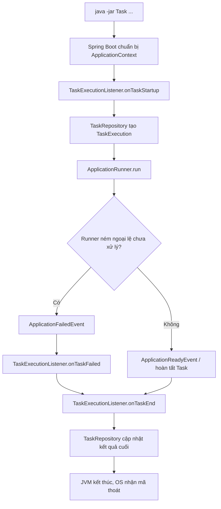

# Thử nghiệm mã thoát, ngoại lệ và listener trong Spring Cloud Task

## 1. Mục tiêu của bài thực hành

**Spring Cloud Task** giúp xây dựng ứng dụng Spring Boot có thời gian chạy hữu hạn: khởi động, nhận tham số, thực thi công việc, ghi metadata vào `TaskRepository`, rồi kết thúc. Một lần chạy được biểu diễn bởi `TaskExecution` với các thông tin như `executionId`, `taskName`, `startTime`, `endTime`, `exitCode`, `exitMessage` và `errorMessage`.

Khi một Task xử lý hóa đơn thất bại, ít nhất **ba nơi** có thể mô tả kết quả:

1. **Hệ điều hành/container** nhận *process exit code* của JVM.
2. **TaskRepository** ghi `TaskExecution.exitCode`, `exitMessage` và `errorMessage`.
3. **Listener** được gọi tại startup, failed hoặc end và có thể ghi thêm thông điệp hay tự gây lỗi.

Những giá trị này **liên quan nhưng không phải lúc nào cũng bằng nhau**. Ví dụ, Task có thể bắt rồi nuốt ngoại lệ khiến ứng dụng trả mã `0` dù nghiệp vụ không đạt yêu cầu; một listener ném ngoại lệ lại có quy tắc tính mã thoát khác ngoại lệ ném từ `ApplicationRunner`. Nếu Task còn gọi **Spring Batch**, `BatchStatus.FAILED` cũng không mặc định luôn được chuyển thành mã thoát Task khác `0`.

Sau bài học thuộc chương **Thực hành**, bạn sẽ tự chạy và đối chiếu được:

- Task thành công, lỗi input, lỗi phụ thuộc tạm thời và lỗi bất ngờ.
- `ExitCodeExceptionMapper`, ngoại lệ triển khai `ExitCodeGenerator` và mã thoát của process.
- Ba callback `onTaskStartup`, `onTaskFailed`, `onTaskEnd` của `TaskExecutionListener`.
- Cách `exitMessage` được ưu tiên và vì sao không được dùng nó để che lỗi.
- Ngoại lệ được **bắt và bỏ qua** so với ngoại lệ **không được xử lý**.
- Listener ném ngoại lệ ở từng pha và ảnh hưởng tới các listener khác.
- Truy vấn lịch sử Task trong database, thử lại an toàn và phân biệt mất metadata với lỗi thực thi.

**Phạm vi môi trường:** Java 17+, dự án có Spring Boot và Spring Cloud Task phiên bản **tương thích theo Spring Cloud BOM**, H2 file-based cho bài lab **chạy tuần tự trên một máy** hoặc PostgreSQL cho bài tập mở rộng. Ví dụ là mã thực hành, không phải kết quả đã được chạy build tại đây.

## 2. Sơ đồ vòng đời: ghi metadata ở những thời điểm nào?



Sơ đồ là mô hình điển hình theo tài liệu Spring Cloud Task; khi callback listener tự ném ngoại lệ, lỗi trong giai đoạn khởi tạo hoặc có shutdown bất thường, thứ tự và khả năng ghi metadata có thể khác. Không xem `onTaskEnd` là bằng chứng database đã commit, vì callback đó được gọi **trước** lần cập nhật trạng thái cuối.

| Thời điểm | Dấu hiệu quan sát | Điều không được suy luận |
| --- | --- | --- |
| `onTaskStartup` | Task chuẩn bị ghi metadata bắt đầu; có thể đặt `exitMessage` | Không chắc `executionId` đã là ID bền vững trong DB |
| Runner đang làm việc | `TaskExecution.exitCode` có thể còn `null` | `null` không có nghĩa thất bại |
| `onTaskFailed` | Framework đã phát hiện exception không được xử lý; nhận `Throwable` | Không được bảo đảm chạy khi lỗi bị ứng dụng bắt và nuốt |
| `onTaskEnd` | Có cơ hội thêm thông điệp trước khi hoàn tất | Không được coi là post-commit callback của repository |
| Cập nhật repository | `endTime`/`exitCode`/thông điệp cuối có thể được lưu | Nếu JVM bị kill, không đảm bảo bước này xảy ra |
| Process exit | Shell/Kubernetes nhận mã của container/JVM | Không có nghĩa mọi Batch Job bên trong thành công nếu app che lỗi |

## 3. Chuẩn bị dự án và kho TaskRepository

### 3.1. Các dependency tối thiểu

Trong một dự án **đã khai báo** Spring Boot parent/plugin và Spring Cloud BOM tương thích, cần starter Task và một JDBC driver. Ví dụ phần `dependencies` trong Maven:

```xml
<dependencies>
    <dependency>
        <groupId>org.springframework.cloud</groupId>
        <artifactId>spring-cloud-starter-task</artifactId>
    </dependency>
    <dependency>
        <groupId>com.h2database</groupId>
        <artifactId>h2</artifactId>
        <scope>runtime</scope>
    </dependency>
    <dependency>
        <groupId>org.springframework.boot</groupId>
        <artifactId>spring-boot-starter-test</artifactId>
        <scope>test</scope>
    </dependency>
</dependencies>
```

Ví dụ Gradle (Groovy DSL), giả sử BOM đã import bằng `platform(...)` hoặc dependency-management:

```groovy
dependencies {
    implementation 'org.springframework.cloud:spring-cloud-starter-task'
    runtimeOnly 'com.h2database:h2'
    testImplementation 'org.springframework.boot:spring-boot-starter-test'
}
```

Không tự ghép Spring Cloud Task, Spring Boot, H2 và Spring Batch tùy phiên bản. Hãy dùng compatibility matrix/BOM mà dự án đã chốt. Tài liệu hiện hành có thể tương ứng những thế hệ khác nhau, vì vậy bài cần được thử trên **đúng bản dependency thực tế** trước khi áp dụng cho CI/CD.

### 3.2. application.yml cho lab chạy tuần tự

Đặt `application.yml` vào `src/main/resources` của **dự án thực hành**:

```yaml
spring:
  application:
    name: task-exit-lab
  main:
    web-application-type: none
  datasource:
    driver-class-name: org.h2.Driver
    url: "jdbc:h2:file:./lab-data/taskdb"
    username: sa
    password: ""
  cloud:
    task:
      name: task-exit-lab
      initialize-enabled: true
```

**Tại sao dùng `jdbc:h2:file:...`?** Với `jdbc:h2:mem:taskdb`, database mất khi JVM dừng, khiến bạn không thể truy vấn lịch sử nhiều lần chạy từ một tiến trình mới. H2 file-based giữ dữ liệu trên disk khi bạn chạy lại tại **cùng working directory**. Tạo thư mục `lab-data` có quyền ghi trước lần đầu và chỉ chạy **một JVM Task tại một thời điểm**. Không chia sẻ cùng tệp H2 embedded giữa nhiều container/JVM đang hoạt động.

`spring.cloud.task.initialize-enabled=true` cho phép Spring Cloud Task thực hiện khởi tạo schema theo cơ chế hỗ trợ. Nếu dự án đã tạo bảng `TASK_*` bằng Flyway/Liquibase hoặc một migration riêng, chuyển sang `initialize-enabled=false` để framework không tự quản lý DDL. Trước lần chạy thứ hai, kiểm tra schema và cơ chế khởi tạo theo đúng version nếu bị báo bảng đã tồn tại; đừng xóa database chỉ để làm bài test “chạy lại”.

**Thay thế production:** dùng PostgreSQL hoặc database server được hỗ trợ, chuẩn bị schema trước bằng migration và cấp credential qua Secret manager. H2 file-based ở đây chỉ nhằm quan sát sự khác nhau giữa các lần chạy tuần tự.

### 3.3. Cấu trúc mã ví dụ

```text
src/main/java/com/example/tasklab/
  TaskExitLabApplication.java
  ProbeTaskExecutionListener.java
src/main/resources/
  application.yml

lab-data/
  taskdb.mv.db           # tạo bởi H2 sau lần chạy đầu
```

Mã bên dưới không cần web server hoặc Spring Batch. Khi đã hiểu vòng đời Task, bạn mới thêm bài mở rộng với Batch ở mục 11.

## 4. Ứng dụng mẫu: thành công và nhiều loại ngoại lệ

Tạo tệp `src/main/java/com/example/tasklab/TaskExitLabApplication.java`:

```java
package com.example.tasklab;

import org.slf4j.Logger;
import org.slf4j.LoggerFactory;
import org.springframework.boot.ApplicationArguments;
import org.springframework.boot.ApplicationRunner;
import org.springframework.boot.ExitCodeExceptionMapper;
import org.springframework.boot.ExitCodeGenerator;
import org.springframework.boot.SpringApplication;
import org.springframework.boot.autoconfigure.SpringBootApplication;
import org.springframework.cloud.task.configuration.EnableTask;
import org.springframework.context.annotation.Bean;

import java.util.List;

@SpringBootApplication
@EnableTask
public class TaskExitLabApplication {

    private static final Logger log =
        LoggerFactory.getLogger(TaskExitLabApplication.class);

    public static void main(String[] args) {
        // SpringApplication.exit đóng context và trả mã exit từ Boot.
        // Nếu run(...) ném lỗi, Boot xử lý startup failure trước khi
        // biểu thức này gọi được exit(...).
        System.exit(SpringApplication.exit(
            SpringApplication.run(TaskExitLabApplication.class, args)));
    }

    @Bean
    ApplicationRunner demoRunner() {
        return args -> {
            String mode = option(args, "lab.mode", "ok");
            log.info("RUNNER_START mode={}", mode);

            switch (mode) {
                case "ok" -> log.info("RUNNER_OK");

                case "input-error" ->
                    throw new InvalidInputException("INVALID_INVOICE_DATE");

                case "temporary-error" ->
                    throw new TemporaryDependencyException(
                        "DOWNSTREAM_UNAVAILABLE");

                case "generator-error" ->
                    throw new GeneratedExitException("SOURCE_REJECTED");

                case "unexpected-error" ->
                    throw new IllegalStateException("UNEXPECTED_FAILURE");

                case "caught-error" -> {
                    try {
                        throw new IllegalStateException(
                            "SIMULATED_INTERNAL_ERROR");
                    } catch (IllegalStateException ex) {
                        // CHỈ ĐỂ MINH HỌA MỘT ANTI-PATTERN.
                        log.warn("RUNNER_SWALLOWED_EXCEPTION");
                    }
                    // Trả về bình thường => Task có thể bị coi thành công!
                }

                default -> throw new InvalidInputException(
                    "UNSUPPORTED_LAB_MODE");
            }

            log.info("RUNNER_RETURNED_NORMALLY");
        };
    }

    @Bean
    ExitCodeExceptionMapper exceptionToExitCode() {
        return exception -> {
            // Spring Boot có thể bọc lỗi bằng exception gốc từ
            // ApplicationRunner; xem toàn bộ chuỗi nguyên nhân.
            Throwable current = exception;
            while (current != null) {
                if (current instanceof InvalidInputException) {
                    return 20;
                }
                if (current instanceof TemporaryDependencyException) {
                    return 30;
                }
                current = current.getCause();
            }
            // 0 = mapper này không ánh xạ; để các cơ chế Boot khác
            // (ExitCodeGenerator/default) quyết định.
            return 0;
        };
    }

    private static String option(
            ApplicationArguments args, String key, String defaultValue) {
        List<String> values = args.getOptionValues(key);
        if (values == null) {
            return defaultValue;
        }
        if (values.size() != 1 || values.get(0) == null
                || values.get(0).isBlank()) {
            throw new InvalidInputException("INVALID_LAB_OPTION");
        }
        return values.get(0);
    }

    static class InvalidInputException extends RuntimeException {
        InvalidInputException(String message) {
            super(message);
        }
    }

    static class TemporaryDependencyException extends RuntimeException {
        TemporaryDependencyException(String message) {
            super(message);
        }
    }

    static class GeneratedExitException
            extends RuntimeException implements ExitCodeGenerator {
        GeneratedExitException(String message) {
            super(message);
        }

        @Override
        public int getExitCode() {
            return 44;
        }
    }
}
```

### 4.1. Giải thích điểm đáng chú ý

- `lab.mode=ok` chạy bình thường và dự kiến mã thoát là `0`.
- `input-error` và `temporary-error` ném hai exception **khác loại** để kiểm tra `ExitCodeExceptionMapper` trả lần lượt mã `20` và `30`.
- `generator-error` dùng exception triển khai `ExitCodeGenerator`, dự kiến cơ chế Spring Boot chọn mã `44` khi không có mapper nào trả mã khác `0`.
- `unexpected-error` là một `IllegalStateException` không được mapper nhận diện; theo mặc định Spring Boot/Task coi đây là lỗi (thường `1`).
- `caught-error` cố tình **nuốt exception**, khiến Boot không có tín hiệu lỗi từ runner. Nếu không có nguồn lỗi khác, Task được ghi thành công dù log có cảnh báo. Đây là tình huống muốn bắt lỗi trong bài thực hành, **không phải mẫu code khuyến nghị**.
- `RUNNER_RETURNED_NORMALLY` không xuất hiện sau một nhánh ném exception, giúp nhận biết luồng chạy đã kết thúc sớm.

Mã thoát của exception có thể bị ảnh hưởng bởi thứ tự các `ExitCodeGenerator`, `ExitCodeExceptionMapper` và `ExitCodeEvent` khác được ứng dụng đăng ký. Bài lab chỉ định nghĩa **một mapper** và một exception generator để dễ quan sát; kết quả thực tế phải được đối chiếu với phiên bản Boot/Task và cấu hình deployment.

**Về `System.exit(...)`:** Spring Boot có ví dụ chính thức truyền mã từ `SpringApplication.exit(...)` tới `System.exit(...)`. Đó là cách phát mã thoát process khi `SpringApplication.run` trả context bình thường. Nếu `run` thất bại trong khởi tạo hoặc chạy runner, biểu thức không đến bước `System.exit`; Spring Boot có đường xử lý lỗi riêng. Vì vậy không được suy ra mã thoát của process chỉ bằng cách thấy câu lệnh `System.exit(...)` trong source: phải kiểm tra kết quả thực.

## 5. Listener mẫu: theo dõi startup, failed và end

Tạo `src/main/java/com/example/tasklab/ProbeTaskExecutionListener.java`:

```java
package com.example.tasklab;

import org.slf4j.Logger;
import org.slf4j.LoggerFactory;
import org.springframework.cloud.task.listener.TaskExecutionListener;
import org.springframework.cloud.task.repository.TaskExecution;
import org.springframework.core.env.Environment;
import org.springframework.stereotype.Component;

@Component
public class ProbeTaskExecutionListener implements TaskExecutionListener {

    private static final Logger log =
        LoggerFactory.getLogger(ProbeTaskExecutionListener.class);

    private final Environment environment;

    public ProbeTaskExecutionListener(Environment environment) {
        this.environment = environment;
    }

    private String throwPhase() {
        return environment.getProperty(
            "lab.listener.throw-phase", "none");
    }

    private boolean useEndMessage() {
        return environment.getProperty(
            "lab.listener.end-message", Boolean.class, false);
    }

    @Override
    public void onTaskStartup(TaskExecution task) {
        log.info("LISTENER_STARTUP taskName={} currentId={}",
            task.getTaskName(), task.getExecutionId());
        task.setExitMessage("STARTUP_MARK");

        if ("startup".equals(throwPhase())) {
            throw new IllegalStateException("LISTENER_STARTUP_EXCEPTION");
        }
    }

    @Override
    public void onTaskFailed(TaskExecution task, Throwable error) {
        log.error("LISTENER_FAILED errorType={}",
            error.getClass().getSimpleName());
        task.setExitMessage("FAILED_MARK");

        if ("failed".equals(throwPhase())) {
            throw new IllegalStateException("LISTENER_FAILED_EXCEPTION");
        }
    }

    @Override
    public void onTaskEnd(TaskExecution task) {
        log.info("LISTENER_END exitCodeAtCallback={}",
            task.getExitCode());

        if (useEndMessage()) {
            task.setExitMessage("END_MARK");
        }
        if ("end".equals(throwPhase())) {
            throw new IllegalStateException("LISTENER_END_EXCEPTION");
        }
    }
}
```

**Ý nghĩa thử nghiệm:**

- `onTaskStartup` ghi `STARTUP_MARK`; nó chạy **trước** việc TaskExecution được lưu ở repository theo mô tả lifecycle. ID tại đây có thể chưa phản ánh một bản ghi đã commit, không lấy log ID làm bằng chứng dữ liệu đã bền vững.
- `onTaskFailed` chỉ được gọi khi Task gặp lỗi chưa được xử lý theo cơ chế lifecycle; nhận cả `Throwable` để có thể phân loại. Nó đặt `FAILED_MARK`, không cố sửa mã thoát.
- `onTaskEnd` được gọi trước khi TaskRepository cập nhật kết quả cuối; nếu `lab.listener.end-message=true` sẽ đặt `END_MARK` để kiểm tra mức ưu tiên.
- `lab.listener.throw-phase` là **công tắc gây lỗi thử nghiệm**, không đưa vào ứng dụng production.
- Trường `exitCodeAtCallback` chỉ có giá trị **quan sát tại callback**, chưa chắc là trạng thái cuối sẽ được ghi. Khi listener tự ném exception, kết quả phải được kiểm tra trong DB và shell thay vì suy luận từ một dòng log.

### 5.1. Listener annotation và nhiều listener

Spring Cloud Task còn hỗ trợ annotation `@BeforeTask`, `@FailedTask`, `@AfterTask` trên method của bean. Chúng lần lượt tương ứng các mốc trước khi lưu TaskExecution, khi Task thất bại, và trước khi hoàn tất. Có thể dùng chúng thay vì implement `TaskExecutionListener`.

Ví dụ minh họa thêm một bean quan sát (chỉ thêm trong bài tập mở rộng):

```java
import org.springframework.cloud.task.listener.annotation.BeforeTask;
import org.springframework.cloud.task.listener.annotation.FailedTask;
import org.springframework.cloud.task.listener.annotation.AfterTask;
import org.springframework.cloud.task.repository.TaskExecution;
import org.springframework.stereotype.Component;

@Component
class ExtraTaskObserver {
    @BeforeTask
    public void before(TaskExecution task) {
        System.out.println("EXTRA_BEFORE");
    }

    @FailedTask
    public void failed(TaskExecution task, Throwable error) {
        System.out.println("EXTRA_FAILED");
    }

    @AfterTask
    public void after(TaskExecution task) {
        System.out.println("EXTRA_AFTER");
    }
}
```

**Không mặc định** thứ tự giữa nhiều bean listener dựa theo thứ tự dòng code hoặc tên class. Trong Spring Cloud Task có thể dùng `@Order`/`Ordered` tùy implementation, nhưng thứ tự callback startup và end/failed có thể khác nhau do cách framework duyệt danh sách. Trước khi phụ thuộc vào thứ tự, đọc implementation đúng phiên bản và viết integration test. Để tránh “callback này cần callback kia đã ghi DB”, thiết kế mỗi listener độc lập hoặc đưa logic có phụ thuộc vào một component điều phối tường minh.

## 6. Chạy các ca trên terminal

Đầu tiên chuẩn bị thư mục `lab-data`, build JAR từ một dự án Boot/Cloud BOM tương thích, và xác định đường dẫn JAR thật. Ví dụ sử dụng tên JAR `task-exit-lab.jar`. **Các lệnh dưới đây là hướng dẫn để người học chạy trong môi trường thử nghiệm; chưa được thực thi trong bài viết này.**

### 6.1. Linux/macOS (Bash)

```bash
mkdir -p lab-data

# Chỉ khi dự án đã cấu hình plugin/BOM và các class ở trên.
./mvnw -DskipTests package

# Đổi thành đường dẫn JAR thực tế trong target/.
java -jar target/task-exit-lab.jar --lab.mode=ok
echo "process_exit=$?"

java -jar target/task-exit-lab.jar --lab.mode=input-error
echo "process_exit=$?"

java -jar target/task-exit-lab.jar --lab.mode=temporary-error
echo "process_exit=$?"

java -jar target/task-exit-lab.jar --lab.mode=generator-error
echo "process_exit=$?"

java -jar target/task-exit-lab.jar --lab.mode=unexpected-error
echo "process_exit=$?"

java -jar target/task-exit-lab.jar --lab.mode=caught-error
echo "process_exit=$?"
```

`$?` phải được đọc **ngay sau `java`**, trước bất kỳ lệnh nào có thể ghi đè exit status. Đoạn `mvnw -DskipTests` chỉ minh họa bước package; một pipeline chuẩn phải chạy kiểm thử trước khi phát hành. Không cần thay mã nguồn giữa các ca, chỉ thay option.

### 6.2. Windows PowerShell

```powershell
New-Item -ItemType Directory -Force lab-data | Out-Null

java -jar .\target\task-exit-lab.jar --lab.mode=ok
$code = $LASTEXITCODE
Write-Host "process_exit=$code"

java -jar .\target\task-exit-lab.jar --lab.mode=input-error
$code = $LASTEXITCODE
Write-Host "process_exit=$code"
```

Trong PowerShell, dùng `$LASTEXITCODE` để đọc mã của tiến trình native `java`; `$?` là cờ thành công của lệnh PowerShell, không phải mã exit số cần so sánh. Với đường dẫn working directory khác, H2 file database cũng ở nơi khác; cố định thư mục khi chạy nhiều lần.

### 6.3. Ghi bằng chứng trong một bảng

Sau mỗi lần chạy, ghi:

| Cột ghi nhận | Nguồn |
| --- | --- |
| `scenario` | Giá trị `--lab.mode` và `--lab.listener.*` |
| `process_exit` | `$?` (Bash) hoặc `$LASTEXITCODE` (PowerShell) |
| `RUNNER_*` log | Stdout/log của ứng dụng |
| `LISTENER_STARTUP/FAILED/END` | Log từ `ProbeTaskExecutionListener` |
| `TaskExecutionId` | Truy vấn `TASK_EXECUTION` |
| `exitCode`, `exitMessage`, `hasError` | Cột từ TaskRepository |
| `startTime`, `endTime` | Database metadata để xác nhận lifecycle |

**Không chỉ xem “đã in RUNNER_OK” rồi kết luận thành công:** một listener `onTaskEnd` có thể ném ngoại lệ sau runner; log và repository mới cho thấy kết quả cuối.

## 7. Ma trận kỳ vọng: runner ném ngoại lệ có điều gì thay đổi?

Với cấu hình lab không có listener khác, không bật `lab.listener.throw-phase` và không bật `lab.listener.end-message`, dự đoán:

| Ca | Runner | Process exit dự kiến | `TaskExecution.exitCode` dự kiến | `exitMessage` dự kiến |
| --- | --- | ---: | ---: | --- |
| `ok` | Trả về bình thường | `0` | `0` | `STARTUP_MARK` |
| `input-error` | Ném `InvalidInputException` | `20` | `20` | `FAILED_MARK` |
| `temporary-error` | Ném `TemporaryDependencyException` | `30` | `30` | `FAILED_MARK` |
| `generator-error` | Ném exception triển khai `ExitCodeGenerator` | `44` | `44` | `FAILED_MARK` |
| `unexpected-error` | Ném exception không có mapper | Thường `1` | Thường `1` | `FAILED_MARK` |
| `caught-error` | Bắt lỗi rồi trả về | `0` | `0` | `STARTUP_MARK` |

Các mã `20`, `30`, `44` là **quy ước minh họa**, không phải mã mặc định của Spring Cloud Task. Bảng thể hiện *kết quả mong muốn của kịch bản*; framework version, đường xử lý lỗi và bean khác có thể làm thay đổi thực tế, đặc biệt trong các ca startup failure. **Bài tập yêu cầu ghi cả kết quả quan sát nếu khác bảng, không chỉnh số cho khớp kỳ vọng.**

Giải thích sâu:

1. **`ok`:** có `onTaskStartup` và `onTaskEnd`; không có `onTaskFailed`. Thông điệp `STARTUP_MARK` vẫn có thể được lưu vì không bị callback khác ghi đè.
2. **`input-error`:** exception không được xử lý dẫn đến `onTaskFailed` và `onTaskEnd`; mapper trả `20`. `errorMessage` có thể chứa stack trace của lỗi đầu vào.
3. **`generator-error`:** một exception tự trả `44` từ `ExitCodeGenerator` là **cơ chế khác** với mapper; chỉ so sánh sau khi đã xác nhận mapper trả `0` cho trường hợp này.
4. **`caught-error`:** runner cố ý log lỗi rồi kết thúc bình thường. Không có `ApplicationFailedEvent` cho lỗi bị nuốt, vì vậy Task bị coi là thành công. Đây là **anti-pattern** rất nguy hiểm nếu scheduler retry dựa trên process exit.

Nếu bắt exception để thêm ngữ cảnh, hãy **ném lại**, chuyển thành exception có mã phù hợp, hoặc chủ động báo thất bại theo quy tắc đã kiểm chứng. Đừng chỉ gọi `log.error(...)` rồi trả về `void`.

## 8. Thử ba pha của listener và thứ tự ưu tiên exitMessage

### 8.1. Pha startup, failed và end

| Pha | Khi nào được gọi | Mục đích điển hình | Rủi ro nếu ném exception |
| --- | --- | --- | --- |
| `onTaskStartup` | Trước khi TaskExecution được lưu | Chuẩn bị dữ liệu theo dõi, gắn mã mô tả | Có thể ngăn runner và khiến metadata chưa được lưu như mong đợi |
| `onTaskFailed` | Khi lỗi chưa được xử lý; trước end | Đánh dấu mã lỗi hoặc ghi thông tin quan sát | Có thể che lỗi gốc và chặn các listener khác ở cùng pha |
| `onTaskEnd` | Trước khi repository hoàn tất TaskExecution | Ghi exitMessage tổng hợp, cleanup nhẹ | Có thể ảnh hưởng kết quả cuối và khiến việc ghi hoàn tất phức tạp hơn |

Theo tài liệu Spring Cloud Task, **exitMessage** được ưu tiên theo pha:

1. `onTaskEnd` (ưu tiên cao nhất).
2. `onTaskFailed`.
3. `onTaskStartup`.

Đó là **thứ tự ưu tiên của thông điệp**, không có nghĩa ba callback đều chạy ở mọi ca. Nếu Task thành công thì không phải gọi `onTaskFailed`; nếu listener end không đặt thông điệp mới, thông điệp từ pha trước có thể còn.

### 8.2. Thử ghi đè exitMessage

```bash
# Trường hợp A: thành công, không ghi thông điệp mới ở end.
java -jar target/task-exit-lab.jar --lab.mode=ok

# Trường hợp B: end đặt END_MARK, ghi đè STARTUP_MARK.
java -jar target/task-exit-lab.jar \
  --lab.mode=ok \
  --lab.listener.end-message=true

# Trường hợp C: runner thất bại, end vẫn đặt END_MARK.
java -jar target/task-exit-lab.jar \
  --lab.mode=input-error \
  --lab.listener.end-message=true
```

Kỳ vọng:

| Ca | Callback đã đặt thông điệp | `exitMessage` cuối | Mã thoát |
| --- | --- | --- | --- |
| A | Startup = `STARTUP_MARK` | `STARTUP_MARK` | `0` |
| B | Startup = `STARTUP_MARK`; End = `END_MARK` | `END_MARK` | `0` |
| C | Startup = `STARTUP_MARK`; Failed = `FAILED_MARK`; End = `END_MARK` | `END_MARK` | **Vẫn là lỗi** (dự kiến `20`) |

**Quan trọng:** `exitMessage="END_MARK"` không tự làm `exitCode` trở thành `0`. Một dashboard hoặc composed task của **Spring Cloud Data Flow** có thể dùng `exitMessage` như *mã chuyển nhánh*, nên ghi `"COMPLETED"` vô điều kiện ở `onTaskEnd` trong ca lỗi có thể đánh lạc hướng điều phối. Trong sản xuất, chỉ đặt `exitMessage` phù hợp với trạng thái thực và dùng log/metric cho nội dung chi tiết.

## 9. Listener ném ngoại lệ: thí nghiệm có chủ đích

Tài liệu Spring Cloud Task mô tả: khi một callback của `TaskExecutionListener` ném exception, các listener còn lại của **cùng callback phase** sẽ ngừng được xử lý theo chuỗi callback đó; các callback khác (`onTaskFailed` hoặc `onTaskEnd`) vẫn có thể được gọi. Đặc biệt, `ExitCodeExceptionMapper` **không thể dùng để ghi đè exit code của lỗi do listener ném** như cách xử lý ngoại lệ runner thông thường.

### 9.1. Thử lỗi tại startup

```bash
java -jar target/task-exit-lab.jar \
  --lab.mode=ok \
  --lab.listener.throw-phase=startup
echo "process_exit=$?"
```

**Quan sát cần ghi:** có `LISTENER_STARTUP` không? Có `RUNNER_START` không? `onTaskFailed` và `onTaskEnd` có log nào? Có dòng mới trong `TASK_EXECUTION` không?

Theo mô tả tài liệu, ngoại lệ ở `onTaskStartup` thường khiến Task không chạy nghiệp vụ và mã thoát là **`1`**. Nhưng callback chạy **trước khi TaskExecution được lưu**, do đó **không nên khẳng định** luôn có một bản ghi TaskExecution hoàn chỉnh cho ca này. Nếu không có bản ghi, lỗi startup cần được truy qua log/scheduler.

### 9.2. Thử lỗi tại failed callback

```bash
java -jar target/task-exit-lab.jar \
  --lab.mode=input-error \
  --lab.listener.throw-phase=failed
echo "process_exit=$?"
```

Ở ca này có **hai lỗi**: runner ném `InvalidInputException` và listener `onTaskFailed` ném `IllegalStateException` trong khi xử lý lỗi đầu tiên. Không được suy luận rằng `ExitCodeExceptionMapper` chắc chắn vẫn trả `20` như ca runner thuần. Việc listener ném lỗi có đường tính exit code riêng; tài liệu Spring Cloud Task nêu code có thể đến từ `ExitCodeEvent`, `ExitCodeGenerator` hoặc mặc định `1`, chứ không thể ép bằng `ExitCodeExceptionMapper`.

Khi điều tra, giữ **ngoại lệ gốc** (`INVALID_INVOICE_DATE`) và **ngoại lệ thứ cấp** (`LISTENER_FAILED_EXCEPTION`) thành hai thông tin riêng. Trong production, listener dùng để phát audit/notification nên xử lý lỗi phụ có chủ đích (log, outbox, retry ngoài luồng), tránh làm mất lỗi nghiệp vụ.

### 9.3. Thử lỗi tại end callback

```bash
java -jar target/task-exit-lab.jar \
  --lab.mode=ok \
  --lab.listener.throw-phase=end
echo "process_exit=$?"
```

Runner đã in `RUNNER_OK` nhưng listener end ném `LISTENER_END_EXCEPTION`. Mã thoát **không nên được đoán chỉ từ kết quả runner**. Hãy so sánh process exit với TaskRepository; khi callback thất bại ở giai đoạn hoàn tất, bản ghi cuối có thể khác với ca thông thường. `ExitCodeExceptionMapper` không phải phương tiện để “chữa” ngoại lệ này.

### 9.4. Ma trận listener fault injection

| Ca | Kích hoạt lỗi | Cần chứng minh |
| --- | --- | --- |
| Startup error | `--lab.listener.throw-phase=startup` | Runner bị chặn, process lỗi, kiểm tra sự hiện diện metadata |
| Failed error | `--lab.mode=input-error --lab.listener.throw-phase=failed` | Listener có thể tạo lỗi thứ cấp; không mặc định mapper mã `20` |
| End error | `--lab.mode=ok --lab.listener.throw-phase=end` | Runner thành công **không đảm bảo** toàn Task thành công |
| Không có lỗi listener | `--lab.mode=input-error` | So sánh với lỗi runner thuần và mapper |
| End message override | `--lab.mode=input-error --lab.listener.end-message=true` | Thông điệp end có thể ghi đè thông điệp failed nhưng không được che trạng thái lỗi |

**Không chạy fault injection trên hệ thống thật.** Callback có thể được gọi trong chính lifecycle ghi trạng thái của Task; ném exception ở đây có thể làm hỏng khả năng quan sát và phát hiện lỗi gốc. Bài lab chỉ dùng data giả và repository thử nghiệm.

## 10. Đọc TaskRepository để đối chiếu kết quả

Với schema chuẩn, Spring Cloud Task lưu lịch sử tại `TASK_EXECUTION`. Trên H2 file-based của ví dụ, bạn có thể dùng một công cụ JDBC/H2 Shell **sau khi JVM Task dừng** hoặc đọc bằng một process đã cấu hình đúng database file. Với PostgreSQL, dùng `psql` hoặc công cụ SQL tương ứng.

### 10.1. Câu SQL tổng hợp cho từng lần chạy

```sql
SELECT
    TASK_EXECUTION_ID,
    TASK_NAME,
    START_TIME,
    END_TIME,
    EXIT_CODE,
    EXIT_MESSAGE,
    CASE
        WHEN ERROR_MESSAGE IS NULL THEN 'NO'
        ELSE 'YES'
    END AS HAS_ERROR_MESSAGE
FROM TASK_EXECUTION
WHERE TASK_NAME = 'task-exit-lab'
ORDER BY TASK_EXECUTION_ID DESC;
```

Lưu ý các cột:

- `EXIT_CODE`: một số nguyên, có thể `NULL` khi Task chưa hoàn tất; khác với mã `ExitStatus` **chuỗi** của Spring Batch.
- `EXIT_MESSAGE`: chuỗi do callback hoặc logic ứng dụng đặt. Giá trị có thể bị callback sau ghi đè.
- `ERROR_MESSAGE`: có thể chứa stack trace khi có `ApplicationFailedEvent`; không mặc định có với mọi kiểu lỗi và không nên in nguyên văn ra dashboard công khai.
- `START_TIME` / `END_TIME`: giúp nhận biết trạng thái ghi metadata; `END_TIME IS NULL` cũng có thể do JVM bị kill, không chứng minh tiến trình vẫn sống.

### 10.2. Xem một lần chạy cụ thể

```sql
SELECT
    TASK_EXECUTION_ID,
    TASK_NAME,
    START_TIME,
    END_TIME,
    EXIT_CODE,
    EXIT_MESSAGE
FROM TASK_EXECUTION
WHERE TASK_EXECUTION_ID = :taskExecutionId;
```

Ký hiệu `:taskExecutionId` là placeholder của SQL client/framework có hỗ trợ named parameter; H2 Shell thông thường có thể yêu cầu bạn thay bằng một số ID cụ thể. Không xây câu SQL từ giá trị đầu vào bằng phép nối chuỗi khi ứng dụng có tham số do người dùng điều khiển.

### 10.3. Phân biệt ba tình huống dễ gây hiểu nhầm

| Biểu hiện | Giải thích có thể | Cần kiểm tra thêm |
| --- | --- | --- |
| Process exit khác `0` nhưng **không có** dòng TaskExecution mới | Lỗi trước khi repository tạo bản ghi, callback startup lỗi, DataSource/schema không sẵn sàng | Log Spring Boot startup, cấu hình database, scheduler |
| Có dòng TaskExecution nhưng `END_TIME=NULL` | Process bị kill giữa chừng, hoàn tất metadata bị lỗi hoặc Task còn chạy | Pod/PID, log và thời gian |
| TaskExecution `EXIT_CODE=0` dù log có exception | Lỗi đã bị bắt và không lan ra lifecycle (như ca `caught-error`) | Mã runner, điều kiện nghiệp vụ, Spring Batch status |

Nếu dùng `jdbc:h2:mem:...`, JVM dừng thì toàn bộ database in-memory biến mất. Khi đó không thể so sánh history của các process trong SQL. H2 file-based chỉ phù hợp thử nghiệm tuần tự; với nhiều tiến trình hoặc CI, dùng PostgreSQL/bộ lưu trữ bền vững có schema và migration chính xác.

## 11. Bài mở rộng: Task gọi Spring Batch Job

Một `JobExecution` thuộc **Spring Batch** có `BatchStatus` (enum) và `ExitStatus` (mã chuỗi); bản thân Task có `TaskExecution.exitCode` (số nguyên). Nếu Batch Job trả `BatchStatus.FAILED` nhưng ứng dụng/runner chỉ nhận `JobExecution` rồi trả về bình thường, Task **có thể** kết thúc `0`.

Với tích hợp Spring Cloud Task Batch theo phiên bản tương thích, có thể cấu hình:

```yaml
spring:
  cloud:
    task:
      batch:
        fail-on-job-failure: true
```

Khi sử dụng cấu hình này cần có dependency tích hợp **`spring-cloud-task-batch`** và một Job được cơ chế hỗ trợ theo dõi; không mặc định nó xử lý mọi dạng `STOPPED`, `UNKNOWN`, custom `ExitStatus` hoặc Job chạy bất đồng bộ mà Task không đợi. Nếu ứng dụng chủ động chạy Batch Job, nên kiểm tra **`JobExecution.status`** rồi ánh xạ thành thất bại ở cấp Task theo chính sách riêng đã thử nghiệm.

### 11.1. Thử nghiệm Batch theo bốn bằng chứng

1. Tạo một Batch Job giả lập có một Step thành công và một Step thất bại có chủ đích.
2. Chạy khi **tắt** `fail-on-job-failure`, ghi `JobExecution.status`, `JobExecution.exitStatus`, Task exit code và process exit code.
3. Bật `fail-on-job-failure`, tạo JobInstance hợp lệ mới, so sánh cả bốn giá trị.
4. Ghi lại ID Job/Task và trạng thái Step ở `BATCH_STEP_EXECUTION`. Nếu cần restart, sử dụng `JobRepository` và identifying `JobParameters` ổn định, không tự tạo tham số ngẫu nhiên để né trạng thái lỗi.

Ví dụ truy vấn khi tích hợp Task–Batch đã tạo bảng liên kết tương ứng:

```sql
SELECT
    t.TASK_EXECUTION_ID,
    t.EXIT_CODE AS TASK_EXIT_CODE,
    b.JOB_EXECUTION_ID,
    j.STATUS AS JOB_BATCH_STATUS,
    j.EXIT_CODE AS JOB_EXIT_STATUS
FROM TASK_EXECUTION t
JOIN TASK_TASK_BATCH b
  ON b.TASK_EXECUTION_ID = t.TASK_EXECUTION_ID
JOIN BATCH_JOB_EXECUTION j
  ON j.JOB_EXECUTION_ID = b.JOB_EXECUTION_ID
WHERE t.TASK_EXECUTION_ID = :taskExecutionId;
```

`TASK_EXECUTION.EXIT_CODE` là **số**; `BATCH_JOB_EXECUTION.EXIT_CODE` là mã **chuỗi**. Bảng `TASK_TASK_BATCH` chỉ có quan hệ hợp lệ khi integration Batch–Task được cấu hình; không dùng tên bảng này để suy luận rằng mọi dự án đều có liên kết.

## 12. Vận hành an toàn: thông điệp, log và retry

Một Task chạy theo lịch hoặc Kubernetes Job có thể tự được khởi chạy lại khi process exit khác `0`. Vì vậy **không nên lạm dụng mã thoát**:

| Loại lỗi | Mã ví dụ | Retry tự động? | Cách xử lý |
| --- | ---: | --- | --- |
| Thành công | `0` | Không | Ghi metric thời lượng/đối soát kết quả |
| Lỗi input không hợp lệ | `20` | Thường không | Sửa dữ liệu hoặc tham số |
| Lỗi phụ thuộc tạm thời | `30` | Có thể, giới hạn lần | Backoff, timeout, idempotency |
| Lỗi bị bộ xử lý tổng quát bỏ sót | `1` | Tùy phân loại | Giữ log và điều tra nguyên nhân |
| Exception tự cung cấp mã | `44` | Theo định nghĩa nghiệp vụ | Công bố bảng mã cho scheduler |
| Lỗi listener | Không gán cố định như runner | Không retry mù | Sửa đường giám sát/callback, tìm lỗi gốc |

Các mã `20`, `30` và `44` là quy ước của bài lab, không phải HTTP status, `BatchStatus` hay mã do Spring Cloud Task mặc định cung cấp. Muốn scheduler phân loại retry theo mã, phải **cấu hình rõ** ở scheduler/container và kiểm thử thực tế việc truyền mã từ JVM ra hệ điều hành.

**Lưu ý dữ liệu nhạy cảm:**

- Không truyền password/token qua CLI vì Spring Cloud Task có thể lưu `arguments` vào `TASK_EXECUTION_PARAMS`.
- Không đưa stack trace chứa dữ liệu khách hàng vào `exitMessage`; dùng mã ngắn ổn định như `INVALID_INPUT` hoặc `DOWNSTREAM_UNAVAILABLE`.
- `errorMessage` có thể chứa stack trace; giới hạn quyền đọc TaskRepository và thời hạn lưu trữ.
- Không ghi `taskExecutionId` và business key có cardinality cao làm metric label; dùng log/trace để tìm lần chạy cụ thể.
- Đừng dùng listener gửi trực tiếp email hoặc ghi dữ liệu nghiệp vụ phức tạp nếu lỗi của phụ thuộc đó có thể làm Task thất bại không mong muốn. Với audit bắt buộc, dùng outbox hoặc luồng bền vững riêng.

**Retry không bảo đảm exactly-once.** Nếu runner đã commit một phần dữ liệu rồi ném lỗi, lần chạy sau có thể ghi trùng. Dùng transaction, checkpoint Spring Batch (nếu có), unique constraint và idempotency key theo ngày/đơn vị nghiệp vụ.

## 13. Ma trận kiểm tra và tiêu chí nghiệm thu

Để bài thực hành có thể được đánh giá, hãy lưu **bảng kết quả thật** cho ít nhất mười kịch bản:

| ID | Lệnh / tình huống | Assertion chính |
| --- | --- | --- |
| T01 | `--lab.mode=ok` | Runner bình thường; process exit `0`; không có callback failed |
| T02 | `--lab.mode=input-error` | Mapper được xét; phân biệt `20` và thông điệp/stack trace |
| T03 | `--lab.mode=temporary-error` | Phân biệt lỗi retryable và mã `30` |
| T04 | `--lab.mode=generator-error` | Kiểm tra `ExitCodeGenerator` trả `44` |
| T05 | `--lab.mode=unexpected-error` | Lỗi chưa được ánh xạ không bị ghi thành thành công |
| T06 | `--lab.mode=caught-error` | Chứng minh lỗi bị nuốt có thể khiến Task exit `0` |
| T07 | `--lab.mode=ok --lab.listener.end-message=true` | End message ưu tiên startup message |
| T08 | `--lab.mode=input-error --lab.listener.end-message=true` | End message ghi đè failed message nhưng không sửa lỗi thành thành công |
| T09 | `--lab.listener.throw-phase=startup` | Runner không bắt đầu; kiểm tra code và sự hiện diện metadata |
| T10 | `--lab.mode=input-error --lab.listener.throw-phase=failed` | Không khẳng định mapper xử lý listener error; kiểm tra lỗi gốc |
| T11 | `--lab.listener.throw-phase=end` | Runner OK nhưng hoàn tất Task có thể gặp lỗi |
| T12 | Lỗi kết nối H2/schema trước khi tạo TaskExecution | Có thể không có bản ghi; tra log startup |

### 13.1. Mẫu biên bản thực hành

```text
Thông tin môi trường:
  Java version         : ...
  Spring Boot version  : ...
  Spring Cloud Task    : ...
  Datasource URL mode  : jdbc:h2:file:...
  Số listener          : ...

Kịch bản T0N:
  Lệnh                  : ...
  Process exit code     : ...
  TaskExecutionId       : ... / KHÔNG CÓ
  TASK_EXIT_CODE        : ... / NULL
  TASK_EXIT_MESSAGE     : ... / NULL
  HAS_ERROR_MESSAGE     : YES / NO
  Callback được gọi     : ...
  Runner đã chạy?       : ...
  So với kỳ vọng        : KHỚP / KHÁC
  Giải thích khác biệt  : ...
```

**Đừng hợp thức hóa kết quả bằng cách sửa giả thiết sau khi chạy.** Nếu OS exit code khác `TASK_EXIT_CODE`, ghi cả hai, xem code `main`, xử lý exception của Spring Boot, listener và cách shell/container truyền exit code. Nếu metadata không có, tra đúng pha startup, datasource/schema và lifecycle.

### 13.2. Các bài tập tự nâng cao

**Bài 1 — Thêm một listener.** Đăng ký listener thứ hai, log rõ từng callback, rồi cố tình ném exception ở listener đầu. Quan sát listener nào cùng pha không được gọi. Thử `@Order` và giải thích vì sao cần kiểm chứng thứ tự trên implementation thực tế.

**Bài 2 — ExitCodeExceptionMapper theo nguyên nhân.** Bọc `InvalidInputException` trong một `IllegalStateException`, giữ `cause`; chứng minh mapper duyệt chuỗi nguyên nhân vẫn tìm được code `20`. Sau đó đổi mapper luôn trả `0` và xem cơ chế mặc định hoạt động thế nào.

**Bài 3 — Phân biệt log với kết quả Task.** Giữ lại ca `caught-error`, cho scheduler giả lập chỉ xem mã thoát. Đề xuất sửa sao cho lỗi nghiệp vụ luôn dẫn tới Task failed; kiểm chứng bằng TaskRepository.

**Bài 4 — Crash trước khi hoàn tất metadata.** Trong môi trường thử nghiệm dùng H2 file-based/PostgreSQL, cho runner ngủ đủ lâu rồi kill tiến trình. Đối chiếu `END_TIME`, exit code của OS/Kubernetes và log. Không giả định listener/finally luôn chạy khi `SIGKILL`.

**Bài 5 — Spring Batch.** Cho một Step thất bại trong Batch Job rồi so sánh status của Job, Task và container khi bật/tắt `fail-on-job-failure`. Giải thích tại sao mã `JobExecution.exitStatus` dạng chuỗi không thể dùng trực tiếp như process exit code số.

**Bài 6 — Thiết kế retry.** Dùng mã `20` cho lỗi input, `30` cho lỗi API tạm thời. Viết chính sách retry hữu hạn với backoff, xác nhận business key và idempotency để không tạo bản ghi trùng.

### 13.3. Câu hỏi tự đánh giá

1. Vì sao `exitMessage` và `exitCode` là hai trường khác nhau?
2. Khi nào `onTaskFailed` **không được gọi** dù có một exception được ghi trong log?
3. `ExitCodeExceptionMapper` có luôn được phép override mã khi listener ném exception không?
4. Vì sao `onTaskEnd` không thể được xem là sự kiện “TaskRepository đã commit”?
5. Vì sao `TaskExecution.exitCode` đang `null` không đồng nghĩa Task failed?
6. Một Task đã `RUNNER_OK` có thể vẫn có lỗi trong listener cuối không?
7. Vì sao Task sử dụng H2 `mem:` khó quan sát lịch sử giữa hai JVM khác nhau?
8. Nếu Spring Batch Job failed nhưng process exit `0`, lớp nào phải chuyển tín hiệu lỗi?
9. Điều gì xảy ra nếu retry không có idempotency sau khi Task đã ghi một phần dữ liệu?
10. Vì sao cần ghi rõ Java/Boot/Task versions trong biên bản kiểm thử?

**Tiêu chí hoàn thành:** Người học xây được ứng dụng Spring Cloud Task hữu hạn, quan sát được ba callback, phân loại lỗi qua mapper/generator, thu thập process exit và dữ liệu TaskRepository cho nhiều ca, nhận biết sự cố listener và chứng minh ít nhất một trường hợp log lỗi nhưng Task vẫn báo thành công. Kết quả phải được đối chiếu theo version thật, không chỉ đoán từ log.

## Tài liệu tham khảo chính thức

- [Spring Cloud Task — Features](https://docs.spring.io/spring-cloud-task/reference/features.html): `TaskExecution`, mapping exit code, listener, exception trong callback và ưu tiên exitMessage.
- [Spring Cloud Task — Repository Schema](https://docs.spring.io/spring-cloud-task/reference/appendix-task-repository-schema.html): `TASK_EXECUTION`, tham số và metadata lịch sử.
- [Spring Cloud Task — Batch Integration](https://docs.spring.io/spring-cloud-task/reference/batch.html): `fail-on-job-failure` khi Task chạy Spring Batch Job.
- [Spring Boot — SpringApplication / Application Exit](https://docs.spring.io/spring-boot/reference/features/spring-application.html): `SpringApplication.exit`, `ExitCodeGenerator` và exit code.
- [Spring Boot — ExitCodeExceptionMapper API](https://docs.spring.io/spring-boot/3.5/api/java/org/springframework/boot/ExitCodeExceptionMapper.html): mapping nguyên nhân exception thành mã số.
- [Spring Cloud Task — TaskExecutionListener API](https://docs.spring.io/spring-cloud-task/docs/current/apidocs/org/springframework/cloud/task/listener/TaskExecutionListener.html): ba callback và kiểu tham số.
- [Spring Batch — Reference Documentation](https://docs.spring.io/spring-batch/reference/): `BatchStatus`, `ExitStatus` và restart Job.
- [H2 Database — Features](https://h2database.com/html/features.html): H2 file-based, in-memory và vòng đời dữ liệu.
