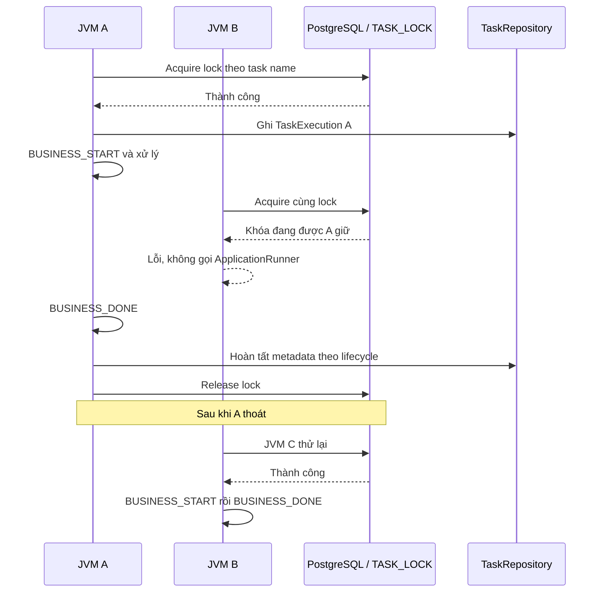

# Chạy hai tiến trình để kiểm chứng khóa một lần thực thi

## 1. Mục tiêu và tiêu chí hoàn thành

**Spring Cloud Task** được sử dụng để phát triển ứng dụng Spring Boot có thời gian chạy hữu hạn: khởi động, nhận tham số, thực hiện một công việc, lưu trạng thái qua `TaskRepository` rồi kết thúc. Một tác vụ có thể được kích hoạt bởi cron, Kubernetes CronJob, Spring Cloud Data Flow hoặc yêu cầu thủ công. Nếu lịch trước chưa xong mà lịch sau đã chạy, **hai JVM có thể xử lý cùng tài nguyên** và gây ghi trùng dữ liệu hoặc tranh chấp transaction.

Spring Cloud Task cung cấp tính năng `spring.cloud.task.single-instance-enabled=true` để hạn chế **hai instance cùng tên task** chạy đồng thời. Tính năng sử dụng `SingleInstanceTaskListener` và cơ chế khóa dựa trên Spring Integration JDBC; schema Spring Cloud Task có bảng `TASK_LOCK` phục vụ việc này. Mặc định `single-instance-enabled` là `false`.

Trong bài lab, bạn sẽ chạy **hai process Java độc lập**, cùng dùng một PostgreSQL. JVM A vào `ApplicationRunner` và giữ công việc trong 90 giây. Khi A còn chạy, JVM B cố chạy cùng tên task và **phải bị từ chối trước khi vào runner**. Sau khi A hoàn tất, JVM C dùng cùng tên và chạy thành công.

| Thời điểm | Thao tác | Bằng chứng mong đợi |
| --- | --- | --- |
| A khởi động | Chạy `locked-report-task` trong 90 giây | `BUSINESS_START attempt=A`; chưa `BUSINESS_DONE` |
| B khởi động khi A vẫn chạy | Cùng JAR, tên task, DB và cờ khóa | Lỗi khóa một instance; **không có `BUSINESS_START attempt=B`** |
| A giữ khóa | Quan sát `TASK_LOCK` và `TASK_EXECUTION` | Có dấu hiệu khóa và metadata cho lần chạy A |
| A hoàn tất | Đợi A kết thúc bình thường | `BUSINESS_DONE attempt=A`, process thoát |
| C khởi động sau A | Cùng tên task, DB và cờ khóa | `BUSINESS_START` rồi `BUSINESS_DONE` của C |

**Phạm vi bài thực hành:** kiểm chứng **không chồng lần chạy của một tên task**, không chứng minh `exactly-once` trong nghiệp vụ. A và C là hai lần chạy nối tiếp có thể cùng sửa một đơn hàng nếu thiếu unique constraint/idempotency. Vì vậy, sau bài lab bạn vẫn cần thiết kế khóa nghiệp vụ, checkpoint và retry phù hợp.

## 2. Phân biệt tên task, process và kho khóa dùng chung



Điều kiện cốt lõi:

1. A và B là **hai JVM/process độc lập**. Hai thread gọi cùng một method trong một `ApplicationContext` không đủ để kiểm chứng hành vi nhiều process.
2. Cả hai trỏ tới **cùng database PostgreSQL và schema khóa**, không phải hai `jdbc:h2:mem:...` khác nhau.
3. Cả hai dùng **đúng cùng `spring.cloud.task.name`** và đều bật `single-instance-enabled=true`.
4. Schema metadata và quyền SQL phải được chuẩn bị **trước khi thử đồng thời**, tránh tranh chấp DDL lúc startup.
5. Chỉ khởi động B **sau khi** thấy `BUSINESS_START` của A và **trước khi** A in `BUSINESS_DONE`.

`TASK_EXECUTION_ID` là định danh **một lần chạy** trong TaskRepository, không phải khóa nghiệp vụ. Khi thử lại, mỗi process có thể được cấp ID khác nhau; lần B bị từ chối có thể **không có một bản ghi TaskExecution hoàn tất** tùy thời điểm listener báo lỗi. Vì vậy bằng chứng gồm cả **log process, exit code, khóa và metadata**, không chỉ đếm dòng `TASK_EXECUTION`.

## 3. Chuẩn bị Java, Maven và PostgreSQL

Để làm lab, cần JDK tương thích với Spring Boot/Spring Cloud Task đã chọn (ví dụ Java 17+), Maven, một PostgreSQL có thể truy cập từ hai terminal và công cụ SQL như `psql`. Đừng dùng H2 in-memory trên hai JVM: mỗi `jdbc:h2:mem:lab` sống trong JVM riêng, nên hai process không chia sẻ `TASK_LOCK`.

| Thành phần | Giá trị **minh họa** |
| --- | --- |
| JDBC URL | `jdbc:postgresql://127.0.0.1:5432/task_lock_lab` |
| Database | `task_lock_lab` |
| Tên task | `locked-report-task` |
| JAR sau build | `target/task-lock-demo.jar` |
| Thời lượng runner A | `90` giây |
| Thời lượng runner B/C | `0` giây |

### 3.1. Tạo database và schema theo phiên bản

Ví dụ chạy lệnh sau **một lần** với quyền quản trị trong PostgreSQL lab:

```sql
CREATE DATABASE task_lock_lab;
```

Trong database mới, áp dụng **DDL chính thức của đúng phiên bản Spring Cloud Task** cho PostgreSQL, gồm `TASK_EXECUTION`, `TASK_EXECUTION_PARAMS`, bộ phát ID và `TASK_LOCK`. Lấy DDL từ tài liệu hoặc artifact Spring Cloud Task đã chốt phiên bản, quản lý bằng một migration có kiểm soát. **Không tự phỏng đoán DDL** cho `TASK_LOCK`: khóa chính, chỉ mục, `REGION`/`CLIENT_ID` và các kiểu cột có thể thay đổi giữa version.

Tài liệu schema hiện hành mô tả `TASK_LOCK` có các cột `LOCK_KEY`, `REGION`, `CLIENT_ID` và `CREATED_DATE`. Trước khi chạy hai JVM, dùng SQL client kiểm tra bảng đã tồn tại:

```sql
SELECT COUNT(*) AS existing_locks FROM TASK_LOCK;
SELECT COUNT(*) AS existing_executions FROM TASK_EXECUTION;
```

Nếu chưa có schema, một số phiên bản hỗ trợ `spring.cloud.task.initialize-enabled=true` để tạo bảng. Chỉ dùng cách đó **trong một lần setup riêng biệt trên DB trống**, sau đó chuyển về `false`; **không để A/B đồng thời tự chạy initializer**. Trong production nên dùng migration, không dựa vào hai pod tranh nhau tạo DDL.

### 3.2. Dependencies Maven

Giả sử dự án Maven đã quản lý version bằng **Spring Boot parent/BOM và Spring Cloud BOM tương thích**:

```xml
<dependencies>
    <dependency>
        <groupId>org.springframework.cloud</groupId>
        <artifactId>spring-cloud-starter-task</artifactId>
    </dependency>
    <dependency>
        <groupId>org.springframework.boot</groupId>
        <artifactId>spring-boot-starter-jdbc</artifactId>
    </dependency>
    <dependency>
        <groupId>org.springframework.integration</groupId>
        <artifactId>spring-integration-core</artifactId>
    </dependency>
    <dependency>
        <groupId>org.springframework.integration</groupId>
        <artifactId>spring-integration-jdbc</artifactId>
    </dependency>
    <dependency>
        <groupId>org.postgresql</groupId>
        <artifactId>postgresql</artifactId>
        <scope>runtime</scope>
    </dependency>
</dependencies>
```

Hai dependency `spring-integration-core` và `spring-integration-jdbc` là **điều kiện của tính năng single-instance** theo tài liệu Spring Cloud Task. Chỉ bật property nhưng thiếu dependency/schema cần thiết sẽ tạo lỗi cấu hình, không phải một phép thử khóa thành công.

## 4. Cấu hình cả hai tiến trình dùng một kho khóa

Tạo `src/main/resources/application.yml`:

```yaml
spring:
  application:
    name: task-lock-demo
  main:
    web-application-type: none
  datasource:
    url: ${TASK_DB_URL}
    username: ${TASK_DB_USER}
    password: ${TASK_DB_PASSWORD}
  cloud:
    task:
      name: locked-report-task
      single-instance-enabled: true
      initialize-enabled: false
      closecontext-enabled: true

app:
  hold-seconds: 0
  attempt: unknown
```

**Cần hiểu đúng các property:**

- `spring.cloud.task.name` là tên logic của task dùng để phân biệt **cùng loại công việc**. Cả A/B/C phải giống `locked-report-task`; đừng đặt tên khác nhau `locked-report-A` và `locked-report-B`.
- `single-instance-enabled: true` phải có ở **cả hai JVM**. Giá trị mặc định là `false` nên không được bỏ quên nó trong profile khác.
- `initialize-enabled: false` nghĩa là schema đã được tạo **trước**; không có nghĩa framework tự tạo bảng khi chạy.
- `closecontext-enabled: true` hướng đến đóng context khi task kết thúc (nếu version hỗ trợ), giúp tiến trình hữu hạn dừng và giải phóng tài nguyên. Nó **không thay thế** property khóa.
- `app.hold-seconds`, `app.attempt` là thuộc tính **tự đặt cho bài lab**, không thuộc API Spring Cloud Task.

Trong lần chạy đầu tiên, **không đặt TTL ngắn**. Tài liệu cấu hình còn có `spring.cloud.task.single-instance-lock-ttl` và `spring.cloud.task.single-instance-lock-check-interval` (đơn vị mili giây trong các version hỗ trợ). Một TTL ngắn hơn thời gian A còn làm việc có thể làm phép thử thiếu tin cậy; hiểu TTL và cơ chế reclaim trước khi tùy chỉnh.

## 5. Viết runner để giữ công việc 90 giây

Tạo `src/main/java/com/example/tasklock/TaskLockDemoApplication.java`:

```java
package com.example.tasklock;

import java.time.Instant;
import org.springframework.beans.factory.annotation.Value;
import org.springframework.boot.ApplicationRunner;
import org.springframework.boot.SpringApplication;
import org.springframework.boot.autoconfigure.SpringBootApplication;
import org.springframework.cloud.task.configuration.EnableTask;
import org.springframework.context.annotation.Bean;

@EnableTask
@SpringBootApplication
public class TaskLockDemoApplication {

    public static void main(String[] args) {
        SpringApplication.run(TaskLockDemoApplication.class, args);
    }

    @Bean
    ApplicationRunner runOnce(
            @Value("${app.hold-seconds:0}") int holdSeconds,
            @Value("${app.attempt:unknown}") String attempt) {

        return args -> {
            if (holdSeconds < 0 || holdSeconds > 300) {
                throw new IllegalArgumentException(
                        "app.hold-seconds phải trong khoảng 0..300");
            }

            long pid = ProcessHandle.current().pid();
            System.out.printf(
                    "BUSINESS_START attempt=%s pid=%d at=%s hold=%ds%n",
                    attempt, pid, Instant.now(), holdSeconds);

            // Chỉ mô phỏng công việc hữu hạn để tạo khoảng chồng lấn.
            Thread.sleep(holdSeconds * 1000L);

            System.out.printf(
                    "BUSINESS_DONE attempt=%s pid=%d at=%s%n",
                    attempt, pid, Instant.now());
        };
    }
}
```

`BUSINESS_START` có nghĩa `ApplicationRunner` đã **bắt đầu thực thi**. Nếu B bị chặn bởi listener trước khi vào runner thì log B **không có** `BUSINESS_START attempt=B`. `ProcessHandle.current().pid()` cho biết từng lần khởi chạy là JVM riêng. `Thread.sleep` chỉ giúp người học có thời gian chạy B; **không phải cơ chế khóa**.

Mã mẫu không cập nhật dữ liệu nghiệp vụ nên an toàn để luyện cách quan sát. Trong ứng dụng thật, thay đoạn sleep bằng business service với transaction, business key và idempotency riêng; khóa theo task name không bảo vệ tất cả thao tác ghi dữ liệu.

### 5.1. Build JAR

Với Spring Boot Maven plugin và cấu hình entry point phù hợp:

```bash
mvn -DskipTests package
```

Giả sử executable JAR sau build mang tên `target/task-lock-demo.jar`. Nếu Maven tạo file có tên khác, sử dụng **tên file thực tế**, không tự suy ra artifact đã được build. Nội dung bài này chỉ cung cấp hướng dẫn; **không build/chạy ứng dụng trên workspace ở bước viết tài liệu**.

## 6. Thực nghiệm chính: mở Terminal A và Terminal B

### 6.1. Cấp cùng thông tin PostgreSQL

Ở **cả hai terminal**, dùng cùng database, schema, username và password. Ví dụ trên Linux/macOS:

```bash
export TASK_DB_URL='jdbc:postgresql://127.0.0.1:5432/task_lock_lab'
export TASK_DB_USER='task_lab_user'
# TASK_DB_PASSWORD: cấp từ secret/environment của môi trường lab.
```

Trên Windows PowerShell:

```powershell
$env:TASK_DB_URL  = "jdbc:postgresql://127.0.0.1:5432/task_lock_lab"
$env:TASK_DB_USER = "task_lab_user"
# TASK_DB_PASSWORD: cấp từ môi trường bí mật đã được chuẩn bị.
```

Phải bảo đảm cả hai terminal đều nhận `TASK_DB_PASSWORD` trước khi chạy. Không đưa password thật vào lệnh sẽ được lưu trong shell history, file `application.yml` trong source hoặc screenshot. Nếu không được phép `INSERT/UPDATE/DELETE` trên `TASK_LOCK` hoặc ghi `TASK_EXECUTION`, startup có thể báo lỗi **permission**, không phải B bị chặn vì A đang chạy.

Nếu cần xác nhận **không nhầm database** giữa terminal A và B, dùng tài khoản SQL đọc metadata để chạy:

```sql
SELECT current_database(), current_schema(), current_user;
```

Lưu ý `current_schema()` có thể phụ thuộc `search_path`. Một tên database giống nhau trên **hai server PostgreSQL khác nhau** vẫn không bảo đảm dùng chung khóa; kiểm tra hostname/port và cấu hình network.

### 6.2. Terminal A — chạy lâu để giữ khóa

Tại terminal A, chạy:

```bash
java -jar target/task-lock-demo.jar \
  --app.attempt=A \
  --app.hold-seconds=90
```

Trong PowerShell có thể viết **một dòng** để không phải chuyển kiểu escape dấu xuống dòng:

```powershell
java -jar target/task-lock-demo.jar --app.attempt=A --app.hold-seconds=90
```

Chờ tới khi xuất hiện dòng tương tự:

```text
BUSINESS_START attempt=A pid=41234 at=... hold=90s
```

**Chưa xuất hiện** `BUSINESS_DONE attempt=A` nghĩa là công việc mô phỏng vẫn trong thời gian xử lý. Không chỉ dựa vào thời gian đồng hồ: nếu A chưa thật sự vào runner do lỗi bootstrap, không có căn cứ để test B.

### 6.3. Terminal B — cố chạy khi A vẫn đang xử lý

Trong lúc A đang giữ công việc, chạy tại **terminal B**:

```bash
java -jar target/task-lock-demo.jar \
  --app.attempt=B \
  --app.hold-seconds=0
```

PowerShell:

```powershell
java -jar target/task-lock-demo.jar --app.attempt=B --app.hold-seconds=0
```

**Kỳ vọng:** B bị từ chối vì instance cùng tên đang chạy. Tài liệu chính thức mô tả lỗi gần dạng:

```text
Task with name "locked-report-task" is already running.
```

`SingleInstanceTaskListener` có thể ném `TaskExecutionException` khi không lấy được khóa. Tài liệu tính năng nêu **exit code 1** cho ứng dụng bị từ chối do single-instance. Thực tế dòng log đầy đủ, stack trace và cách launcher truyền exit code phụ thuộc phiên bản/configuration. Để xem exit code:

```bash
# Linux/macOS: chạy ngay sau lệnh java của B.
echo $?
```

```powershell
# PowerShell: chạy ngay sau lệnh java của B.
$LASTEXITCODE
```

**Tiêu chí PASS quan trọng nhất:** B **không được in** `BUSINESS_START attempt=B`, đồng thời log phải nói rõ task cùng tên đang chạy hoặc đang bị giữ khóa. Chỉ thấy exit code `1` **không đủ**, vì B cũng có thể exit 1 do thiếu bảng `TASK_LOCK`, sai mật khẩu, sai classpath hoặc lỗi cấu hình.

### 6.4. Đợi A kết thúc rồi chạy C

Quay lại Terminal A, đợi:

```text
BUSINESS_DONE attempt=A pid=41234 at=...
```

Đảm bảo **process A đã thực sự thoát** chứ không chỉ đã in `BUSINESS_DONE`; các task listener, metadata update và cleanup có thể diễn ra sau khi runner trả về. Rồi từ terminal B chạy lại:

```bash
java -jar target/task-lock-demo.jar \
  --app.attempt=C \
  --app.hold-seconds=0
```

Kỳ vọng C chạy được:

```text
BUSINESS_START attempt=C pid=... at=... hold=0s
BUSINESS_DONE attempt=C pid=... at=...
```

Thành công của C chứng minh khóa không chặn **vĩnh viễn** một task cùng tên sau khi lần trước kết thúc bình thường. C vẫn là **một lần thực thi mới**, có thể có `TASK_EXECUTION_ID` khác A.

### 6.5. Bảng ghi nhận kết quả thực nghiệm

Điền giá trị thực vào bảng sau khi chạy; không sử dụng PID/ID minh họa như một kết quả đã đo:

| Attempt | PID | Có `BUSINESS_START`? | Có `BUSINESS_DONE`? | Exit code | Nhận định |
| --- | --- | --- | --- | --- | --- |
| A | Ghi PID thật | Có | Có sau 90 giây | Thường 0 | Giữ khóa và hoàn tất |
| B | Ghi PID/log thật nếu có | **Không** | Không | Theo docs là 1 khi bị khóa | Bị từ chối trong lúc A chạy |
| C | Ghi PID thật | Có | Có | Thường 0 | Chạy lại hợp lệ sau A |

Nếu B cũng in `BUSINESS_START` **trong khi A chưa xong**, kết quả là **FAIL** đối với mục tiêu bài lab. Kiểm tra tên task, cờ `single-instance-enabled` và việc dùng chung database trước khi thay đổi TTL hay thử xóa khóa.

## 7. Đối chiếu SQL trong lúc A đang giữ khóa

Các truy vấn sau giả định **schema mặc định** của Spring Cloud Task trong PostgreSQL. Nếu tổ chức cấu hình schema hoặc `table-prefix` khác, phải dùng tên bảng/cột thực tế của phiên bản đã triển khai.

### 7.1. Quan sát bảng `TASK_LOCK`

Trong một SQL session đọc metadata, chạy **sau `BUSINESS_START` của A nhưng trước `BUSINESS_DONE`**:

```sql
SELECT LOCK_KEY, REGION, CLIENT_ID, CREATED_DATE
FROM TASK_LOCK
ORDER BY CREATED_DATE DESC;
```

Thông thường, khi A đã lấy khóa, có thể thấy hàng khóa tương ứng trong `TASK_LOCK`. Tuy vậy, **không suy rằng `LOCK_KEY` luôn bằng chuỗi `locked-report-task`**, hoặc `CLIENT_ID` luôn bằng PID/JVM/task execution ID; cơ chế lưu khóa và region do implementation quản lý. Xem dữ liệu thực và DDL đúng phiên bản, không viết một câu `JOIN` phỏng đoán giữa `TASK_LOCK` và `TASK_EXECUTION`.

Sau khi A thoát và C đã chạy xong, thực hiện lại truy vấn. Các hàng khóa có thể được xóa/giải phóng theo hành vi của lock repository; quan sát **thay đổi trạng thái khóa** và **việc C lấy khóa thành công** thay vì chỉ áp đặt `COUNT(*) = 0` cho mọi loại implementation. Nếu bảng còn dữ liệu, cần hiểu TTL, cleanup và khóa của các ứng dụng khác trước khi đưa ra kết luận.

### 7.2. Quan sát lịch sử `TaskExecution`

```sql
SELECT TASK_EXECUTION_ID,
       TASK_NAME,
       START_TIME,
       END_TIME,
       EXIT_CODE,
       EXIT_MESSAGE,
       ERROR_MESSAGE
FROM TASK_EXECUTION
WHERE TASK_NAME = 'locked-report-task'
ORDER BY START_TIME DESC, TASK_EXECUTION_ID DESC;
```

Trong lúc A còn chạy, `END_TIME` của A có thể vẫn rỗng. Sau khi A hoàn tất, bản ghi của A được framework cập nhật theo lifecycle. C cũng thường có bản ghi thực thi mới. **Không áp đặt chắc chắn B phải có một hàng `TaskExecution`:** listener có thể phát hiện khóa và thất bại **trước hoặc trong** một bước lifecycle tạo/cập nhật metadata; số hàng/exit code cuối trong DB phụ thuộc implementation và thời điểm lỗi.

Để kiểm tra tổng số lần chạy thành công đã lưu mà không nhầm với log:

```sql
SELECT TASK_NAME,
       COUNT(*) AS recorded_executions,
       COUNT(*) FILTER (WHERE EXIT_CODE = 0 AND END_TIME IS NOT NULL)
           AS successful_executions
FROM TASK_EXECUTION
WHERE TASK_NAME = 'locked-report-task'
GROUP BY TASK_NAME;
```

`FILTER` là cú pháp PostgreSQL. Số `recorded_executions` có thể **không bằng số lệnh `java`** nếu một process lỗi trước khi `TaskRepository` hoạt động. Trong bài lab, A và C sẽ cung cấp bằng chứng hai lần thực thi thành công; B cần xem **log và exit code** để biết vì sao bị từ chối.

### 7.3. SQL cho biết gì và không cho biết gì?

| Bằng chứng | Có thể kết luận | Không được suy ra |
| --- | --- | --- |
| `BUSINESS_START A`, chưa `BUSINESS_DONE A` | Runner A đang xử lý trong thời gian quan sát | 100% dữ liệu nghiệp vụ đã commit |
| Log B báo cùng tên đang chạy, không có `BUSINESS_START B` | B chưa vào runner và bị cơ chế single-instance từ chối | Mọi loại lỗi exit 1 đều do lock |
| Có hàng trong `TASK_LOCK` | Có trạng thái khóa đang được repository ghi nhận | `LOCK_KEY` là task name dạng plain text hoặc client ID là PID |
| `TASK_EXECUTION` có A và C thành công | Framework ghi nhận hai lần thực thi | Hai lần chạy này không gây trùng side effect |
| C chạy được sau A | Khóa không cản trở lần chạy nối tiếp | Một khóa riêng cho từng `requestId` đã được thiết lập |

**Không bao giờ xóa hoặc sửa thủ công `TASK_LOCK`/`TASK_EXECUTION` chỉ để có kết quả demo đẹp.** Nếu một lock trông có vẻ còn tồn tại, cần xác minh không có process còn chạy, kiểm tra TTL và tài liệu implementation trước khi can thiệp.

## 8. Vì sao thí nghiệm này chứng minh được điều gì?

Để kết luận phép thử PASS, phải ghép **ba lớp bằng chứng**:

1. **Trùng thời gian:** log A có `BUSINESS_START` trước khi B bắt đầu, còn `BUSINESS_DONE` của A xuất hiện **sau** B bị từ chối. Nhờ đó xác nhận thực sự có overlap.
2. **Cùng danh tính và cùng repository:** config có `spring.cloud.task.name=locked-report-task` và `single-instance-enabled=true` ở cả A/B; DB URL/schema là một nguồn chung.
3. **Đường nghiệp vụ bị chặn:** A chạy, B không vào runner do khóa cùng tên, C chạy được sau A. `TASK_LOCK`/`TASK_EXECUTION` đóng vai trò đối chiếu, không thay những kiểm tra trên.

Ngược lại, nếu B bị lỗi `database connection refused`, `relation TASK_LOCK does not exist` hay `Access denied`, bài lab **chưa kiểm chứng được khóa một lần thực thi**. Cần sửa môi trường và thử lại trước khi tuyên bố thành công.

## 9. Thử nghiệm đối chứng và ranh giới của khóa

Sau khi hoàn thành kịch bản chính, có thể dùng các biến thể **trên môi trường lab** để hiểu tại sao một cấu hình sai khiến hai task cùng chạy. Mỗi biến thể nên trở về trạng thái baseline trước khi thử tiếp; đừng dùng dữ liệu production để cố tạo xung đột.

### 9.1. Đối chứng A/B với `single-instance-enabled=false`

Trên **hai process thử nghiệm khác**, đặt `spring.cloud.task.single-instance-enabled=false` cho cả hai lần chạy. Khi không có cơ chế single-instance, hai `ApplicationRunner` có thể chạy chồng nhau:

```bash
# Terminal A, chỉ dành cho lab đối chứng.
java -jar target/task-lock-demo.jar \
  --spring.cloud.task.single-instance-enabled=false \
  --app.attempt=CONTROL-A --app.hold-seconds=90

# Terminal B, chạy sau khi CONTROL-A đã in BUSINESS_START.
java -jar target/task-lock-demo.jar \
  --spring.cloud.task.single-instance-enabled=false \
  --app.attempt=CONTROL-B --app.hold-seconds=0
```

**Kỳ vọng:** thấy `BUSINESS_START` của cả hai khi thời gian xử lý A chưa kết thúc. Đây là **đối chứng âm tính**, giúp xác nhận hành vi bị từ chối trong kịch bản chính đến từ việc **bật** tính năng khóa, không phải vì máy chủ không thể chạy hai Java process.

Chỉ dùng mô phỏng `Thread.sleep` như bài lab; nếu runner thực hiện **tác động thật lên dữ liệu**, chạy hai bản không khóa có thể tạo giao dịch trùng hoặc gây hỏng dữ liệu.

### 9.2. Hai tên task khác nhau **không bị khóa chung**

Với `single-instance-enabled=true` ở cả hai JVM nhưng B ghi đè tên:

```bash
java -jar target/task-lock-demo.jar \
  --spring.cloud.task.name=another-report-task \
  --app.attempt=DIFFERENT-NAME --app.hold-seconds=0
```

Khi A vẫn chạy tên `locked-report-task`, B có **tên task khác**, nên khóa theo tên không chủ đích chặn B. Đây là điểm rất quan trọng khi chia ứng dụng thành `orders-import-task` và `orders-reconcile-task`: **hai tên khác nhau vẫn có thể cùng sửa một bảng nghiệp vụ**. Nếu phải tránh xung đột ở mức bảng/khách hàng/ngày xử lý, hãy dùng khóa nghiệp vụ hoặc khóa scheduler/workflow phù hợp.

### 9.3. Cùng tên nhưng **hai database riêng** cũng không chứng minh được distributed lock

Giả sử A trỏ đến PostgreSQL server X, B đến server Y; cả hai có bảng `TASK_LOCK` nhưng là hai bảng **độc lập**. Khi đó cả hai có thể cùng lấy khóa trong **kho riêng của mình** và chạy đồng thời. Thí nghiệm này chỉ phù hợp nếu đã chuẩn bị **hai database lab tách biệt**, không cần cố tình thay JDBC URL để trỏ nhầm production.

Một hệ thống nhiều môi trường (dev/staging/prod) nên có kho khóa/metadata riêng **theo ranh giới môi trường**, nhưng **các instance cần loại trừ lẫn nhau trong cùng môi trường** phải dùng cùng nguồn trạng thái khóa.

### 9.4. Một bên quên bật cờ khóa

Không nên kiểm tra an toàn chỉ bằng cách nhìn `application.yml` chung: profile, biến môi trường hoặc tham số dòng lệnh có thể ghi đè. Nếu A bật `true` còn B vô tình dùng `false`, **B không tham gia cơ chế loại trừ**, có thể chạy song song. Trong vận hành, ghi log tên task và các cờ cấu hình **không nhạy cảm** ở startup để phát hiện sai khác.

## 10. TTL, crash và phục hồi: phần khó của distributed lock

### 10.1. Phân biệt kết thúc bình thường và bị kill cưỡng bức

Trong kịch bản chính, A hoàn tất `ApplicationRunner` và lifecycle Spring Cloud Task có cơ hội nhả khóa. Nhưng khi container bị `SIGKILL`, hết RAM, node mất điện hoặc JVM chết trước callback kết thúc, **khóa hoặc metadata có thể không được dọn đúng như lần kết thúc bình thường**.

| Kịch bản | Điều có thể xảy ra | Cách xử lý |
| --- | --- | --- |
| A hoàn tất bình thường | Listener/registry có cơ hội release lock; C chạy được | Đối chiếu log, metadata, thực hiện lần C |
| A ném exception khi xử lý | Lifecycle lỗi có thể nhả lock nhưng nghiệp vụ đã commit một phần | Kiểm tra lỗi, TaskExecution, dữ liệu đã commit và cơ chế cleanup |
| A bị `kill -9`/`OOMKilled` | Không có shutdown callback bình thường; metadata có thể thiếu `END_TIME` | Kiểm tra Pod/process, lock lease và chính sách phục hồi |
| A còn chạy nhưng TTL quá ngắn | Lock có nguy cơ hết hạn trước khi công việc kết thúc | Điều chỉnh TTL theo thời gian thực thi lớn nhất có căn cứ |
| B bị từ chối sau một crash cũ | Có thể còn trạng thái khóa chưa được cleanup | Xác minh **không còn process cũ**, đọc DDL/log/TTL rồi mới khắc phục |

**Không thử `kill -9` trên dữ liệu thật.** Nếu muốn mô phỏng crash, chỉ thực hiện trên database lab riêng có thể xóa và tạo lại an toàn. Sau crash, tuyệt đối không dựa vào `END_TIME IS NULL` để khẳng định A vẫn sống; kiểm tra danh sách process, Pod/Job và audit dữ liệu nghiệp vụ.

### 10.2. TTL và khoảng kiểm tra

Một số phiên bản Spring Cloud Task công bố các thuộc tính:

| Property | Ý nghĩa | Lưu ý thực hành |
| --- | --- | --- |
| `spring.cloud.task.single-instance-lock-ttl` | Thời gian tối đa một execution giữ lock, **mili giây** | Không đặt ngắn hơn thời lượng task có thể xử lý; phải hiểu reclaim/cleanup |
| `spring.cloud.task.single-instance-lock-check-interval` | Khoảng chờ giữa các lần kiểm tra trạng thái khóa, **mili giây** | Không phải cron hay timeout của JDBC |

Tài liệu cấu hình phiên bản hiện hành mô tả `single-instance-lock-check-interval` mặc định **500 ms** và TTL mặc định rất lớn (`Integer.MAX_VALUE` mili giây trong phần mô tả property). Tuy nhiên, **cơ chế kiểm tra/reclaim của lock cụ thể còn phụ thuộc phiên bản Spring Cloud Task và Spring Integration**, không được tự suy ra hàng `TASK_LOCK` chắc chắn biến mất đúng ở mili giây hết hạn.

**Sai lầm nghiêm trọng:** A có thể chạy 15 phút nhưng bạn cấu hình TTL chỉ 30 giây. Khi lock hết hiệu lực hoặc được thu hồi theo implementation, JVM khác có nguy cơ giành khóa trong khi A vẫn sửa dữ liệu. Vì vậy, không dùng TTL như một cách “tăng tốc” cho bài lab; hãy xác định thời gian tối đa, khả năng gia hạn lease, cơ chế shutdown và chiến lược phục hồi phù hợp.

Khi gặp khóa tồn đọng, quy trình tối thiểu là: xác minh process cũ không còn sống; kiểm tra `TASK_LOCK`, time zone/`CREATED_DATE`, cấu hình TTL; kiểm tra dữ liệu đã commit và side effect bên ngoài; sau đó mới thực hiện thủ tục cleanup theo tài liệu/điều phối vận hành. **Không tùy tiện `DELETE FROM TASK_LOCK`** khi chưa hiểu ai còn giữ khóa.

### 10.3. Single-instance không phải idempotency

Giả sử một task nhập 1.000 đơn hàng:

1. A lấy khóa và commit được 700 đơn.
2. A bị dừng trước khi hoàn tất.
3. Sau khi được phép chạy lại, C lấy khóa và bắt đầu lại cùng input.

Khóa single-instance **chỉ ngăn A và C cùng chạy tại một thời điểm**, không bảo đảm 700 đơn đã commit không bị nhập lại. Ứng dụng vẫn cần khóa nghiệp vụ như `(source_system, external_order_id)`, phép ghi idempotent, checkpoint và đối soát số lượng/tập ID thực tế. Khi kết hợp **Spring Batch**, phải giữ đúng Job name và **identifying JobParameters** để restart cùng Job instance và checkpoint, không dùng một `run.id` ngẫu nhiên để bỏ qua lỗi.

## 11. Tích hợp vào lịch chạy và hệ điều phối

Trong môi trường production, một scheduler có thể tạo hai process vì cron overlap, retry sau timeout, Kubernetes CronJob tạo Job mới, hoặc người dùng bấm chạy thủ công. Cơ chế single-instance là **một lớp phòng vệ tại ứng dụng**, không thay thế chính sách điều phối.

| Lớp kiểm soát | Bảo vệ cái gì? | Không bảo vệ cái gì? |
| --- | --- | --- |
| Kubernetes CronJob `concurrencyPolicy: Forbid` | Tránh Job chồng từ **chính CronJob đó** | Launch thủ công hoặc CronJob khác cùng chạy task |
| Spring Cloud Task `single-instance-enabled` | Ngăn các instance **cùng task name**, cùng cấu hình kho khóa | Các task name khác nhau nhưng sửa cùng dữ liệu |
| Spring Batch JobRepository | Job instance, checkpoint và restart theo identifying parameters | Mọi side effect bên ngoài transaction |
| Unique business key + transaction | Giảm ghi trùng cùng đối tượng nghiệp vụ | Không tự quản lý lịch khởi process |
| Idempotency key với provider/outbox | Giảm tác động trùng khi gọi API/message | Không thay khóa single-instance cho JVM |

**Một lựa chọn thực tế:** scheduler hạn chế overlap; Spring Cloud Task từ chối instance cùng tên khi vẫn có overlap ngoài ý muốn; business service bảo vệ dữ liệu ngay cả khi retry hoặc khóa hết hạn. Các lớp bổ sung cho nhau, không nên chọn một lớp và bỏ toàn bộ lớp khác.

Khi scheduler thấy B thất bại vì khóa đang được giữ, không tự kết luận “task thất bại nghiệp vụ” và lập tức retry liên tục không giới hạn. Có thể bỏ qua lần kích hoạt trùng, đặt retry có backoff hoặc đưa vào hàng chờ theo **yêu cầu nghiệp vụ**. Phải xác minh A đã hoàn tất và dữ liệu đã đạt tiêu chí trước khi quyết định một lần mới có cần thực thi hay không.

## 12. Khắc phục sự cố khi thí nghiệm không đạt

| Triệu chứng | Nguyên nhân có thể | Cách xác minh và sửa |
| --- | --- | --- |
| A không in `BUSINESS_START` | Lỗi JDBC, thiếu schema, không resolve được dependency hoặc lỗi bootstrap | Đọc stack trace, JDBC URL, quyền và schema trước khi thử B |
| B chạy nghiệp vụ song song với A | B thiếu `single-instance-enabled=true`, tên task khác hoặc DB/region khác | In effective config không nhạy cảm, xác nhận hai process dùng cùng DB |
| B thoát mã 1 nhưng log là `TASK_LOCK does not exist` | Chưa migration bảng lock | Tạo **schema chính thức** đúng version, không coi đó là PASS |
| B thoát mã 1 vì `permission denied` | Tài khoản thiếu quyền ghi khóa/TaskRepository | Kiểm tra quyền `SELECT/INSERT/UPDATE/DELETE` cần thiết, role và schema |
| B không lỗi nhưng A đã `BUSINESS_DONE` | Hai lệnh không thật sự chồng thời gian | Kéo dài A, khởi B ngay khi thấy `BUSINESS_START` |
| `TASK_LOCK` trống dù A đang chạy | Đọc nhầm DB/schema, khoảng quan sát sai hoặc khác implementation | Kiểm tra connection, timestamp, `TaskNameResolver`, log của listener |
| `TASK_EXECUTION` không có B | B bị từ chối trước giai đoạn metadata | Kiểm tra **log B** và exit code; không áp đặt có hàng B |
| C vẫn bị từ chối sau khi A đã thoát | Lock chưa cleanup hoặc TTL/recovery chưa xử lý | Xác minh không còn JVM/Pod; xem lock registry, TTL và quy trình khôi phục |
| Hai lần chạy cùng task nhưng khác tên trên DB | `spring.application.name` hoặc CLI override `spring.cloud.task.name` | Dùng tên cố định, truy vấn `TASK_EXECUTION.TASK_NAME` |
| H2 `mem:` cho phép hai JVM chạy đồng thời | Hai database H2 riêng, không có khóa phân tán chung | Dùng PostgreSQL/shared RDBMS |
| Retry làm đơn hàng trùng dù không chồng process | Single-instance không bảo đảm exactly-once | Khóa nghiệp vụ, idempotent writer, checkpoint và đối soát |
| JVM không thoát sau `BUSINESS_DONE` | Context còn thread không-daemon hoặc chưa đóng đúng | Xem thread dump, `closecontext-enabled`, driver/pool và launcher |

### Runbook kiểm tra nhanh

1. Ghi lại **taskName**, thời điểm hai lệnh, PID, exit code và log ``BUSINESS_START``/``BUSINESS_DONE``.
2. Kiểm tra hai JVM cùng `TASK_DB_URL`/schema và `single-instance-enabled=true`; tránh in password.
3. Truy vấn `TASK_LOCK` đúng lúc A còn chạy; kiểm tra quyền bảng và DDL đúng phiên bản.
4. Truy vấn `TASK_EXECUTION` theo task name; đối chiếu với log, không suy số lệnh Java từ số hàng.
5. Nếu B bị từ chối hợp lệ, đợi A thoát rồi chạy C. Nếu C lỗi, điều tra lock stale/TTL và tình trạng process cũ.
6. Nếu trong ứng dụng thật có dữ liệu nghiệp vụ, đối soát **dữ liệu đích** và các side effect trước khi quyết định chạy lại.

## 13. Bài thực hành tự kiểm tra

1. Chạy A 90 giây, B 0 giây khi A chưa xong, rồi C 0 giây sau A. Lưu bảng PID, exit code, thời điểm `BUSINESS_START`/`BUSINESS_DONE` và kết luận PASS/FAIL có bằng chứng.
2. Giải thích vì sao B exit code 1 **chưa đủ** chứng minh cơ chế khóa đã hoạt động. Nêu ít nhất ba lỗi cấu hình khác cũng khiến exit code khác 0.
3. Kiểm tra `TASK_LOCK` trong lúc A đang chạy và sau khi A/C kết thúc. Bạn có thể suy ra tên task trực tiếp từ `LOCK_KEY` hay `CLIENT_ID` không? Vì sao phải xem schema/implementation?
4. So sánh `TASK_EXECUTION` với số lệnh `java -jar` đã gọi. Vì sao một process lỗi trước TaskRepository có thể không có execution được lưu?
5. Lặp lại phép thử **chỉ trong lab** với `single-instance-enabled=false` ở cả hai process. Dấu hiệu nào cho thấy runner thực thi chồng nhau?
6. Giữ cờ khóa bật nhưng đổi tên task ở JVM B thành `another-report-task`. Vì sao hai task khác tên không nhất thiết ngăn nhau dù dùng chung DB?
7. Mô tả kết quả nếu A/B trỏ tới hai PostgreSQL khác nhau nhưng database cùng tên. Làm sao phát hiện sai lầm bằng `current_database()`, host/port và JDBC URL?
8. Thiết kế một bài thử crash **trên database lab độc lập**: A bị kill sau khi đã commit một phần dữ liệu; cần kiểm tra gì trước khi thử lại? Tại sao không `DELETE` khóa ngay?
9. Một công việc thường chạy 20 phút, nhưng ai đó đặt TTL 30 giây. Hãy phân tích rủi ro và xây dựng tiêu chí chọn TTL/check interval phù hợp với phiên bản thực tế.
10. Khi dùng Spring Batch để nhập đơn hàng, giải thích khác nhau giữa khóa theo task name, Job instance/identifying `JobParameters`, checkpoint và unique business key.
11. Trong Kubernetes, so sánh `concurrencyPolicy: Forbid`, `spring.cloud.task.single-instance-enabled` và idempotency ở DB. Cơ chế nào vẫn hiệu quả khi có người tạo Job thủ công ngoài CronJob?
12. Đề xuất cách chạy một task mỗi ngày với `requestKey` ổn định; nếu lịch ngày hôm sau khởi khi ngày trước chưa xong, hệ thống nên bỏ qua, chờ hay báo lỗi? Nêu cách quan sát để quyết định.

**Tự đánh giá:** bài thực hành chỉ được coi là thành công khi bạn chứng minh có **overlap thực sự**, A vào runner, B **không vào runner vì khóa cùng tên**, C có thể chạy sau A và mọi đối tượng cùng trỏ một kho khóa. Nếu thiếu các bằng chứng đó, chỉ có một mã thoát khác 0 chưa đủ để kết luận.

## 14. Tài liệu tham khảo

- [Spring Cloud Task Reference — Restricting Spring Cloud Task Instances](https://docs.spring.io/spring-cloud-task/reference/features.html): `single-instance-enabled`, dependency Spring Integration và hành vi từ chối instance trùng.
- [Spring Cloud Task Javadoc — SingleInstanceTaskListener](https://docs.spring.io/spring-cloud-task/docs/current/apidocs/org/springframework/cloud/task/configuration/SingleInstanceTaskListener.html): listener lấy khóa theo tên task và báo `TaskExecutionException` khi khóa đã có.
- [Spring Cloud Task — Task Repository Schema](https://docs.spring.io/spring-cloud-task/reference/appendix-task-repository-schema.html): cấu trúc metadata `TASK_EXECUTION`/`TASK_LOCK`.
- [Spring Cloud — Configuration Properties](https://docs.spring.io/spring-cloud/docs/current/reference/html/configprops.html): `single-instance-lock-ttl`, `single-instance-lock-check-interval` và mặc định của các thuộc tính.
- [Spring Integration — JDBC Lock Registry](https://docs.spring.io/spring-integration/reference/jdbc/lock-registry.html): khái niệm shared DB lock, TTL và hành vi registry.
- [Spring Batch Reference](https://docs.spring.io/spring-batch/reference/): Job instance, JobRepository, StepExecution và restart an toàn nếu task phối hợp Batch.

**Giới hạn:** tài liệu là **hướng dẫn thử nghiệm**, không phải tuyên bố rằng các lệnh đã được chạy hoặc thời gian/exit code đã được quan sát trên một hệ thống thật. Khi thực hành, chọn bộ phiên bản Spring Boot/Spring Cloud Task/Spring Integration tương thích, chạy trên database thử nghiệm, lưu bằng chứng thực tế và không điều chỉnh/xóa hàng khóa của production để kiểm chứng.
