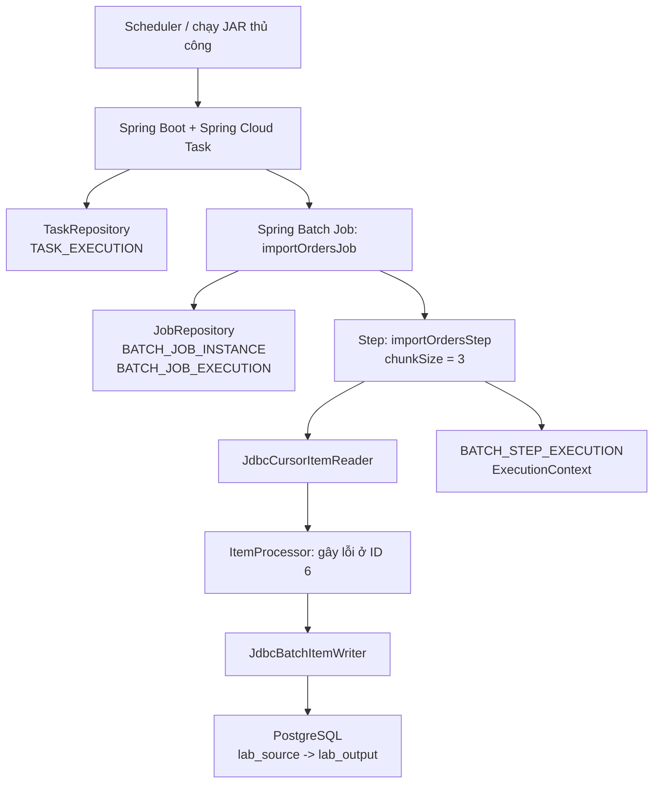
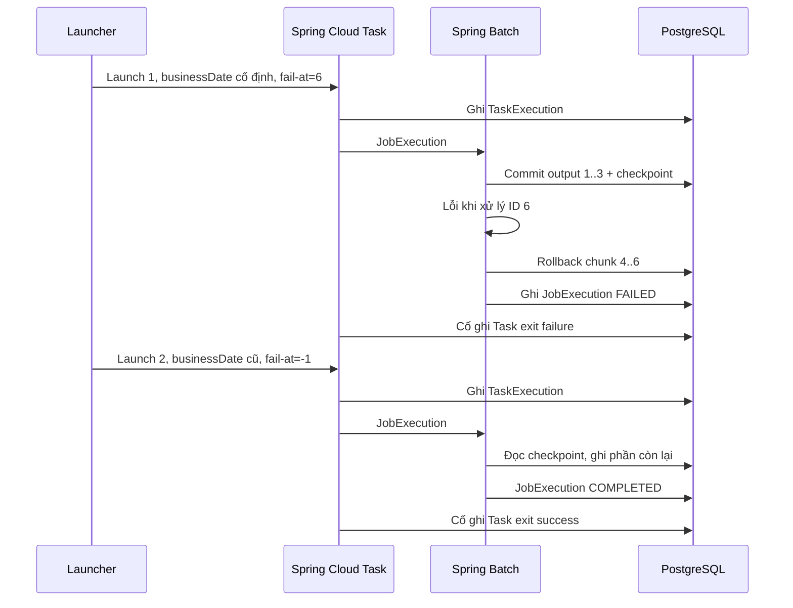

# Tích hợp Job Batch lỗi rồi khởi chạy lại có kiểm soát

## 1. Bài thực hành giải quyết vấn đề gì?

**Spring Cloud Task** dành cho ứng dụng Spring Boot có thời gian chạy hữu hạn: khởi động, thực hiện công việc, ghi nhận `TaskExecution` trong `TaskRepository` và kết thúc. Khi Task chứa **Spring Batch**, phần xử lý dữ liệu có thêm `Job`, `Step`, transaction theo chunk, `JobRepository` và metadata phục vụ restart. Hai lớp trạng thái này giúp vận hành những công việc nhập liệu, đối soát, tổng hợp hoặc đồng bộ theo lịch.

Trong thực tế, một Batch Job có thể thất bại sau khi đã ghi một phần dữ liệu. Scheduler chỉ thấy process exit code khác 0; người vận hành phải biết **có cần chạy lại không, chạy lại từ đâu và làm sao tránh ghi trùng**. Nếu không phân biệt `JobInstance` với `JobExecution`, một lệnh chạy lại tưởng như vô hại có thể tạo một JobInstance mới, xử lý lại từ đầu và làm kết quả sai.

Bài thực hành này dựng một ứng dụng **Spring Cloud Task + Spring Batch + PostgreSQL** với một Job có một Step:

1. Đọc 10 đơn hàng từ bảng nguồn bằng `JdbcCursorItemReader`.
2. Xử lý theo chunk có kích thước **3**.
3. Cố ý ném lỗi ở bản ghi ID **6**, sau khi chunk đầu tiên đã commit.
4. Quan sát `JobExecution=FAILED` và dữ liệu đã commit.
5. Tắt cờ gây lỗi, khởi chạy **cùng tên Job và cùng identifying JobParameters**.
6. Kiểm chứng Batch restart đúng `JobInstance`, tiếp tục từ checkpoint và hoàn thành 10 bản ghi **không trùng**.
7. Đối chiếu kết quả của Batch với `TaskExecution` và exit code của tiến trình.

### 1.1. Kết quả mong đợi

| Quan sát | Lần 1: lỗi ID 6 | Lần 2: restart |
| --- | --- | --- |
| `TaskExecution` | Một lần chạy Task, thường ghi kết quả lỗi khi tích hợp đúng | Một `TaskExecution` mới |
| `JobInstance` | Được tạo với `businessDate=2026-11-23` | **Giữ nguyên JobInstance ID** |
| `JobExecution` | `FAILED` | `JobExecution` **mới**, `COMPLETED` |
| `StepExecution` | `FAILED`, có checkpoint chunk trước | StepExecution mới, phục hồi trạng thái reader |
| Số dòng đích `lab_output` | **3** dòng, nếu lỗi đúng tại ID 6 | **10** dòng, không trùng |
| Mã thoát process | Dự kiến khác 0 khi bật cơ chế lan truyền lỗi Batch | Dự kiến 0 khi thành công |

Con số 3 và 10 trong bảng là **kỳ vọng của thiết kế lab**, không phải kết quả đã được chạy và xác minh trong môi trường của người học. `READ_COUNT`/`ROLLBACK_COUNT` ở Step có thể thể hiện chi tiết khác nhau tùy thời điểm lỗi và cơ chế retry nội bộ; chúng không nhất thiết bằng số dòng đã tồn tại ở bảng đích.

### 1.2. Kiến thức nền cần nắm

- Java 17+ và Spring Boot 3.x/Spring Batch 5.x với **Spring Cloud release train tương thích**. Mã Java ở bài dùng API builder của **Spring Batch 5**; Batch 6 có một số API/package khác và cần chỉnh trước khi biên dịch.
- Maven, PostgreSQL và khả năng kết nối bằng `psql` hoặc công cụ SQL.
- `@EnableTask`, `TaskRepository`, `ApplicationRunner`/Batch auto-launch, `JobParameters`, `JobRepository`.
- JDBC transaction, unique constraint, nguyên tắc **idempotency** khi chạy lại.
- Môi trường **test riêng**; tuyệt đối không mô phỏng lỗi trên bảng production.

> **Giới hạn bài học:** Đây là một lab xây dựng từ các API và hành vi được tài liệu Spring Cloud Task/Spring Batch mô tả, không phải một lần chạy build/test thực tế. Số version phải được chốt theo BOM và môi trường cụ thể trước khi triển khai. Không chạy trực tiếp các câu SQL tạo/xóa dữ liệu trên database đang phục vụ người dùng.

## 2. Ba lớp trạng thái: Task, Batch và kết quả nghiệp vụ



| Khái niệm | Định danh | Trong lab |
| --- | --- | --- |
| **TaskExecution** | `TASK_EXECUTION_ID` do Spring Cloud Task tạo cho từng lần chạy process | Hai lần launch thường tạo **hai** TaskExecution |
| **JobInstance** | Job name + bộ **identifying JobParameters** | Cả hai lần đều là `importOrdersJob` với `businessDate=2026-11-23` |
| **JobExecution** | ID của một lần thử thực thi JobInstance | Lần đầu FAILED, lần sau COMPLETED |
| **StepExecution** | Lần thực thi một Step trong JobExecution | Có thống kê, `ExecutionContext` và trạng thái checkpoint |
| **Bản ghi nghiệp vụ** | `(business_date, source_id)` | Được bảo vệ bằng primary key/unique constraint |

**Một TaskExecution mới không bắt buộc kéo theo một JobInstance mới.** Restart của Spring Batch nghĩa là **JobExecution mới thuộc JobInstance cũ**. TaskRepository và JobRepository là hai kho metadata khác nhau, dù trong lab dùng chung PostgreSQL để đơn giản hóa transaction và truy vấn.

## 3. Thiết kế lỗi có chủ đích và checkpoint

Nguồn có các ID `1..10`, sắp xếp tăng dần; chunk size **3**:

```text
Chunk 1: [1, 2, 3]   -> writer ghi -> COMMIT
Chunk 2: [4, 5, 6]   -> processor gặp ID 6 -> lỗi, ROLLBACK
Chunk 3: [7, 8, 9]   -> chưa chạy
Chunk 4: [10]        -> chưa chạy

Lần đầu sau failure:
  lab_output = {1,2,3}

Restart cùng JobInstance, tắt lỗi:
  checkpoint sau chunk 1
  đọc tiếp 4,5,6,7,8,9,10
  lab_output = {1,2,3,4,5,6,7,8,9,10}
```

Trong một Step dùng reader có `saveState=true`, Spring Batch lưu tiến độ ở `ExecutionContext` theo chu kỳ checkpoint. Với cùng JobInstance và Step restartable, JobRepository hỗ trợ xây dựng lần thực thi mới từ trạng thái đã lưu.

**Điều kiện bắt buộc:** Query nguồn phải có thứ tự ổn định (`ORDER BY source_id`) và tập dữ liệu không bị thay đổi theo cách làm vị trí cursor dịch chuyển giữa hai lần chạy. Nếu dữ liệu nguồn bị thêm/xóa trước checkpoint, việc resume theo vị trí có thể đọc thiếu hoặc đọc trùng; ở production cần snapshot/watermark hoặc reader dựa trên khóa tiến độ thích hợp.



Các ID `#A`/`#B`/`#1`/`#2` là tên minh họa; database cấp ID thật. Sơ đồ mô tả đường đi khi framework đóng lifecycle bình thường, không bảo đảm ghi được metadata cuối nếu process bị kill cứng hoặc kết nối DB đứt.

## 4. Chuẩn bị môi trường PostgreSQL riêng

### 4.1. Yêu cầu database

Sử dụng một database mới tên `tasklab`, ví dụ PostgreSQL 16, chỉ cho bài lab. Tài khoản thử nghiệm cần quyền tạo schema **chỉ ở giai đoạn khởi tạo**; production nên phân tách tài khoản migration và runtime.

Bạn có thể dùng PostgreSQL đã có trên máy hoặc một container PostgreSQL cục bộ. Nếu dùng Docker, tạo DB `tasklab` và role `tasklab_user` theo quy trình local. Kết nối JDBC dạng:

```text
jdbc:postgresql://localhost:5432/tasklab
```

Đặt thông tin kết nối qua biến môi trường:

```bash
# Các giá trị chỉ là tên biến; không ghi mật khẩu thật vào lịch sử CLI.
export LAB_JDBC_URL="jdbc:postgresql://localhost:5432/tasklab"
export LAB_JDBC_USER="tasklab_user"
# LAB_JDBC_PASSWORD được cấp từ môi trường thử nghiệm/secret store.
```

Đoạn trên dùng Bash/Unix; với Windows PowerShell cần `$env:LAB_JDBC_URL=...` và tương tự cho username/password. Không đưa password production vào bài thực hành, file Git hoặc đối số `--spring.datasource.password`.

### 4.2. Tạo hai bảng nghiệp vụ

Kết nối vào **đúng database thử nghiệm** rồi thực hiện:

```sql
CREATE TABLE IF NOT EXISTS lab_source (
    business_date DATE NOT NULL,
    source_id BIGINT NOT NULL,
    amount NUMERIC(12, 2) NOT NULL,
    PRIMARY KEY (business_date, source_id)
);

CREATE TABLE IF NOT EXISTS lab_output (
    business_date DATE NOT NULL,
    source_id BIGINT NOT NULL,
    imported_at TIMESTAMPTZ NOT NULL DEFAULT CURRENT_TIMESTAMP,
    PRIMARY KEY (business_date, source_id)
);

INSERT INTO lab_source (business_date, source_id, amount)
SELECT DATE '2026-11-23', n, n * 100.00
FROM generate_series(1, 10) AS ids(n)
ON CONFLICT (business_date, source_id) DO NOTHING;
```

Bảng `lab_source` là input, `lab_output` là output. Khóa chính `(business_date, source_id)` giúp phát hiện hoặc ngăn duplicate khi chạy lại cùng ngày. Không dùng `TRUNCATE` trên database có dữ liệu thật.

Kiểm tra đầu vào:

```sql
SELECT business_date,
       COUNT(*) AS source_rows,
       MIN(source_id) AS min_id,
       MAX(source_id) AS max_id
FROM lab_source
GROUP BY business_date;
```

Kỳ vọng cho ngày `2026-11-23` là `source_rows=10`, `min_id=1` và `max_id=10`. Nếu database của bạn đã có dữ liệu bài test cũ, phải sử dụng **database/schema mới** hoặc một `businessDate` mới và sửa dữ liệu seed tương ứng, tránh trộn các lần thử.

### 4.3. Schema metadata Task và Batch

Cần hai nhóm bảng độc lập:

| Schema | Ví dụ bảng | Chức năng |
| --- | --- | --- |
| Spring Cloud Task | `TASK_EXECUTION`, `TASK_EXECUTION_PARAMS`, `TASK_TASK_BATCH` | Lịch sử process, liên kết Task–Batch |
| Spring Batch | `BATCH_JOB_INSTANCE`, `BATCH_JOB_EXECUTION`, `BATCH_STEP_EXECUTION`, `BATCH_STEP_EXECUTION_CONTEXT` | Định danh JobInstance, trạng thái lần chạy, checkpoint |

Trong bài lab với **database hoàn toàn mới**, có thể để framework tạo schema metadata **một lần ở lần launch đầu**:

```properties
spring.cloud.task.initialize-enabled=true
spring.batch.jdbc.initialize-schema=always
```

Ở **lần chạy thứ hai**, đổi thành:

```properties
spring.cloud.task.initialize-enabled=false
spring.batch.jdbc.initialize-schema=never
```

Vì Spring Batch init script dùng các lệnh `CREATE TABLE` theo DDL vendor, cố chạy lại với `always` trên schema đã có có thể khiến startup thất bại. Đây là **mẹo bootstrap lab**, không phải mô hình production. Production nên dùng Flyway/Liquibase/migration job riêng, với DDL **đúng release** của Spring Cloud Task và Spring Batch; tất cả lần chạy ứng dụng sau đó đặt auto-initialize là tắt.

Nếu database metadata đã có từ lần thử trước, **không bật `initialize-schema=always`**. Hãy kiểm tra schema/migration thay vì xóa dữ liệu checkpoint rồi vô tình biến “restart” thành “chạy mới”.

## 5. Tạo dự án Spring Boot và dependency

Tạo dự án Maven Java với **Spring Boot 3.x**, **Spring Batch 5.x** và **Spring Cloud Task 3.x tương thích** (chọn đúng release train/BOM theo tài liệu của Spring Cloud tại thời điểm tạo dự án). Không trộn API ví dụ của Spring Batch 6/Boot 4 với mã Batch 5 bên dưới.

Những dependency quan trọng trong `pom.xml`:

```xml
<dependencies>
    <dependency>
        <groupId>org.springframework.cloud</groupId>
        <artifactId>spring-cloud-starter-task</artifactId>
    </dependency>
    <dependency>
        <groupId>org.springframework.cloud</groupId>
        <artifactId>spring-cloud-task-batch</artifactId>
    </dependency>
    <dependency>
        <groupId>org.springframework.boot</groupId>
        <artifactId>spring-boot-starter-batch</artifactId>
    </dependency>
    <dependency>
        <groupId>org.postgresql</groupId>
        <artifactId>postgresql</artifactId>
        <scope>runtime</scope>
    </dependency>
</dependencies>
```

Đây là **đoạn phụ thuộc bổ sung**, chưa phải `pom.xml` hoàn chỉnh: dự án cần Spring Boot parent/`spring-boot-dependencies`, Spring Cloud BOM phù hợp và plugin build executable JAR. Nếu Maven báo version của dependency Spring Cloud chưa xác định, BOM chưa được import đúng; đừng tự gắn một phiên bản Task mới vào dự án Boot cũ để qua lỗi build.

**Không thêm `@EnableBatchProcessing`** vào ví dụ này: Spring Boot auto-configures Batch và tự launch `Job` duy nhất. Việc thêm `@EnableBatchProcessing`/`DefaultBatchConfiguration` trong Boot 3.x có thể khiến Boot Batch auto-configuration, bao gồm auto schema initialization, **back off**. Chỉ dùng khi chủ động cấu hình hạ tầng Batch thủ công.

### 5.1. Cấu trúc dự án

```text
batch-retry-task/
  pom.xml
  src/main/java/com/example/tasklab/
    BatchRetryTaskApplication.java
    ImportBatchConfiguration.java
  src/main/resources/
    application.yml
```

Bài tập sẽ viết hai file Java, một file cấu hình, dùng PostgreSQL chứa cả metadata và bảng nghiệp vụ.

## 6. Cấu hình application.yml

```yaml
spring:
  application:
    name: batch-retry-task
  main:
    web-application-type: none
  datasource:
    url: ${LAB_JDBC_URL:jdbc:postgresql://localhost:5432/tasklab}
    username: ${LAB_JDBC_USER:tasklab_user}
    password: ${LAB_JDBC_PASSWORD}
  cloud:
    task:
      name: batch-retry-task
      initialize-enabled: false
      closecontextEnabled: true
      batch:
        fail-on-job-failure: true
  batch:
    jdbc:
      initialize-schema: never
    job:
      enabled: true
      name: importOrdersJob

lab:
  fail-at: -1
```

Giải thích:

- `web-application-type: none`: ứng dụng chỉ xử lý batch, không mở HTTP server.
- `spring.cloud.task.name`: tên logic dùng trong `TASK_EXECUTION`.
- `closecontextEnabled: true`: yêu cầu Task đóng context sau khi hoàn tất; thuộc tính và hành vi cần kiểm tra theo release Spring Cloud Task thực tế.
- `fail-on-job-failure: true`: bật hỗ trợ Spring Cloud Task phản ánh Batch Job `FAILED` thành exit code khác 0 thay vì báo thành công giả.
- `spring.batch.job.enabled: true`: cho Spring Boot auto-launch Job tìm thấy khi startup.
- `spring.batch.job.name: importOrdersJob`: chọn Job được chạy; dự án này chỉ có một Job, nhưng đặt tên giúp ý định rõ ràng.
- `lab.fail-at`: property **chỉ dùng trong lab** để gây lỗi; không phải JobParameter.
- `initialize-enabled: false` và `initialize-schema: never`: mặc định an toàn sau khi metadata schema đã tồn tại. **Lần đầu ở DB mới** sẽ override hai giá trị trên bằng CLI trong phần chạy thử.

Spring Cloud Task có thể dùng `TaskBatchExecutionListener` để liên kết JobExecution với TaskExecution khi `spring-cloud-task-batch` có trên classpath và listener được cấu hình đúng. Nếu `TASK_TASK_BATCH` không có dòng sau lab, kiểm tra classpath, auto-configuration và từng version trước khi kết luận Job không chạy.

## 7. Entry point của ứng dụng

File `BatchRetryTaskApplication.java`:

```java
package com.example.tasklab;

import org.springframework.boot.SpringApplication;
import org.springframework.boot.autoconfigure.SpringBootApplication;
import org.springframework.cloud.task.configuration.EnableTask;

@SpringBootApplication
@EnableTask
public class BatchRetryTaskApplication {

    public static void main(String[] args) {
        SpringApplication.run(BatchRetryTaskApplication.class, args);
    }
}
```

Với starter và một số phiên bản Spring Cloud Task, auto-configuration đã bật hạ tầng Task; `@EnableTask` được dùng ở đây để minh họa rõ ý định. **Không viết thêm một `ApplicationRunner` tự gọi `jobLauncher.run(...)`**, vì Boot/Spring Cloud Task đã có runner launch Job khi cấu hình như phần 6. Gọi Job lần thứ hai trong Runner tùy chỉnh có thể tạo lỗi `JobExecutionAlreadyRunningException` hoặc làm kết quả khó kiểm soát.

## 8. Spring Batch Job có lỗi chủ đích

File `ImportBatchConfiguration.java` sau dùng API **Spring Batch 5.x**.

### 8.1. Mã Java hoàn chỉnh

```java
package com.example.tasklab;

import java.time.LocalDate;
import javax.sql.DataSource;

import org.springframework.batch.core.Job;
import org.springframework.batch.core.Step;
import org.springframework.batch.core.configuration.annotation.StepScope;
import org.springframework.batch.core.job.builder.JobBuilder;
import org.springframework.batch.core.repository.JobRepository;
import org.springframework.batch.core.step.builder.StepBuilder;
import org.springframework.batch.item.ItemProcessor;
import org.springframework.batch.item.database.JdbcBatchItemWriter;
import org.springframework.batch.item.database.JdbcCursorItemReader;
import org.springframework.batch.item.database.builder.JdbcBatchItemWriterBuilder;
import org.springframework.batch.item.database.builder.JdbcCursorItemReaderBuilder;
import org.springframework.beans.factory.annotation.Value;
import org.springframework.context.annotation.Bean;
import org.springframework.context.annotation.Configuration;
import org.springframework.transaction.PlatformTransactionManager;

@Configuration
public class ImportBatchConfiguration {

    @Bean
    Job importOrdersJob(JobRepository jobRepository,
                        Step importOrdersStep) {
        return new JobBuilder("importOrdersJob", jobRepository)
                .start(importOrdersStep)
                .build();
    }

    @Bean
    Step importOrdersStep(
            JobRepository jobRepository,
            PlatformTransactionManager transactionManager,
            JdbcCursorItemReader<Long> sourceReader,
            ItemProcessor<Long, Long> failureProcessor,
            JdbcBatchItemWriter<Long> outputWriter) {

        return new StepBuilder("importOrdersStep", jobRepository)
                .<Long, Long>chunk(3, transactionManager)
                .reader(sourceReader)
                .processor(failureProcessor)
                .writer(outputWriter)
                .build();
    }

    @Bean
    @StepScope
    JdbcCursorItemReader<Long> sourceReader(
            DataSource dataSource,
            @Value("#{jobParameters['businessDate']}")
            String businessDate) {

        LocalDate date = LocalDate.parse(businessDate);

        return new JdbcCursorItemReaderBuilder<Long>()
                .name("sourceOrderIdCursor")
                .dataSource(dataSource)
                .sql(
                    "SELECT source_id " +
                    "FROM lab_source " +
                    "WHERE business_date = ? " +
                    "ORDER BY source_id"
                )
                .preparedStatementSetter(
                    ps -> ps.setObject(1, date))
                .rowMapper(
                    (rs, rowNum) -> rs.getLong("source_id"))
                .saveState(true)
                .build();
    }

    @Bean
    @StepScope
    ItemProcessor<Long, Long> failureProcessor(
            @Value("${lab.fail-at:-1}") long failAt) {
        return sourceId -> {
            if (sourceId == failAt) {
                throw new IllegalStateException(
                    "LAB_EXPECTED_FAILURE_AT_ID=" + sourceId);
            }
            return sourceId;
        };
    }

    @Bean
    @StepScope
    JdbcBatchItemWriter<Long> outputWriter(
            DataSource dataSource,
            @Value("#{jobParameters['businessDate']}")
            String businessDate) {

        LocalDate date = LocalDate.parse(businessDate);

        return new JdbcBatchItemWriterBuilder<Long>()
                .dataSource(dataSource)
                .sql(
                    "INSERT INTO lab_output " +
                    "(business_date, source_id) " +
                    "VALUES (?, ?) " +
                    "ON CONFLICT (business_date, source_id) " +
                    "DO NOTHING"
                )
                .itemPreparedStatementSetter(
                    (sourceId, ps) -> {
                        ps.setObject(1, date);
                        ps.setLong(2, sourceId);
                    })
                .assertUpdates(false)
                .build();
    }
}
```

### 8.2. Các phần của Job

| Thành phần | Vai trò trong lab | Lưu ý |
| --- | --- | --- |
| `JobBuilder("importOrdersJob")` | Định nghĩa Job name ổn định | Tên này cùng JobParameters xác định JobInstance |
| `StepBuilder("importOrdersStep")` | Tạo một Step xử lý chunk | Step này có thể restart nếu Job và state cho phép |
| `chunk(3, transactionManager)` | Commit theo nhóm 3 item | Dùng transaction manager phù hợp datasource |
| `@StepScope` | Chỉ tạo reader/processor/writer theo lần chạy Step | Cho phép đọc JobParameters/ExecutionContext |
| `JdbcCursorItemReader` | Đọc các source_id theo thứ tự | `name` và `saveState(true)` hỗ trợ checkpoint |
| `failureProcessor` | Ném lỗi có chủ đích ở ID 6 | `lab.fail-at` là property, **không** là JobParameter |
| `JdbcBatchItemWriter` | Chèn các ID vào bảng kết quả | Upsert PostgreSQL và unique key hạn chế trùng |

**Tại sao dùng `.assertUpdates(false)`?** `JdbcBatchItemWriter` mặc định có thể yêu cầu mỗi statement thay đổi ít nhất một dòng. `INSERT ... ON CONFLICT DO NOTHING` trả `0` dòng khi input đã được nhập trước đó; trong lab ta cho phép trường hợp này để minh họa writer idempotent. Tuy nhiên, `WRITE_COUNT` của Spring Batch đếm những **item chuyển tới writer**, không đảm bảo bằng số dòng SQL thực sự được tạo mới. Production phải bổ sung đối soát nghiệp vụ và chỉ sử dụng `DO NOTHING` nếu đó là chính sách đúng cho bản ghi đã tồn tại.

**Không đồng nghĩa mọi thứ exactly-once:** Nếu writer gửi email/HTTP/Kafka thay vì SQL cùng transaction, `@StepScope` và `saveState(true)` không tự bảo vệ được side effect đã gửi trước khi checkpoint. Cần idempotency key, outbox hoặc chính sách deduplication ở đích.

### 8.3. Vì sao lỗi ở ID 6 khiến chunk thứ hai rollback?

Spring Batch thực hiện reader → processor → writer cho một chunk. Chunk đầu `[1,2,3]` được ghi và commit. Khi đọc/processor chạm ID 6 của chunk `[4,5,6]`, `IllegalStateException` được ném **trước khi writer nhận chunk thứ hai**; Step đi vào đường lỗi/rollback theo cấu hình mặc định, nên chỉ ba dòng đầu đã commit.

Không cấu hình `.skip(...)` hay `.retry(...)` trong lab này: mục đích là để Job thực sự `FAILED` ở lần đầu. Trong ứng dụng thật, retry một số lỗi tạm thời trong Step có thể phù hợp, nhưng chỉ nên xử lý exception được phân loại là **có thể phục hồi**, với giới hạn và backoff.

## 9. Tham số: lỗi thường gặp nhất khi restart

### 9.1. Khác biệt giữa JobParameters và Spring application properties

Trong **Spring Boot Batch auto-launch**, cách truyền ở dòng lệnh có ý nghĩa đặc biệt:

| Đối số | Cách hiểu | Ảnh hưởng JobInstance? |
| --- | --- | --- |
| `businessDate=2026-11-23` | Batch `JobParameter` (không có `--`) | **Có** nếu identifying |
| `--lab.fail-at=6` | Spring Boot application property | **Không** được tự đưa vào JobParameters |
| `--lab.fail-at=-1` | Property bỏ lỗi cho lần sau | Không đổi JobInstance |
| `--spring.batch.job.name=importOrdersJob` | Chọn Job để launch | Không phải identifying JobParameter |
| `--spring.datasource.password=...` | Property chứa secret trong argv | **Không được dùng** |
| `run.id=1234` | Batch JobParameter mới | **Có thể tạo JobInstance mới** |

Theo tài liệu Spring Boot cho dòng 3.x, tham số Batch đặt theo dạng `name=value` **không có `--`**. Spring Boot xử lý các đối số bắt đầu bằng `--` như application properties và không chuyển chúng vào JobParameters theo đường tự chạy Job thông thường.

**Bẫy lớn:** Nếu truyền `--businessDate=2026-11-23`, code đọc `jobParameters['businessDate']` có thể nhận `null`. Khi đó reader tạo bean theo `@StepScope` sẽ lỗi vì `LocalDate.parse(null)` và bài lab không còn thử đúng điểm lỗi ID 6.

### 9.2. Nhận diện bằng JobInstance

Spring Batch dùng **Job name + identifying JobParameters** để tìm JobInstance. Với lab:

```text
Job name: importOrdersJob
Identifying JobParameters:
  businessDate = 2026-11-23

Lần 1: --lab.fail-at=6
Lần 2: --lab.fail-at=-1

=> Identifying JobParameters KHÔNG thay đổi
=> Restart cùng JobInstance
```

Không thêm timestamp hoặc `run.id` mới vào identifying JobParameters chỉ để “bypass” lỗi đã chạy. Điều đó có thể tạo JobInstance khác và **xử lý lại từ đầu**, khác với restart theo checkpoint.

### 9.3. Trường hợp có non-identifying parameters

Spring Batch hỗ trợ tham số không tham gia định danh `JobInstance`; nhưng phải khai báo và chuyển đổi đúng cú pháp theo `JobParametersConverter`/phiên bản framework. Tài liệu Spring Batch mô tả dạng `name=value,type,identifying` và `false` cho tham số không định danh.

Đối với lab, ta **không cần** thêm `fail-at` vào JobParameters, nên dùng application property `--lab.fail-at` là rõ ràng hơn. Nếu dự án có custom JobLauncher/JobOperator, phải kiểm tra converter để không nhầm cách parse của Boot auto-run với cách launch thủ công.

## 10. Build và khởi chạy lần đầu: cố ý FAILED

### 10.1. Chuẩn bị trước khi chạy

- Database `tasklab` phải còn trống **đối với các bảng metadata `BATCH_*`/`TASK_*`** nếu muốn dùng auto-initialize của lần đầu.
- Bảng `lab_source` đã seed đúng 10 dòng ngày `2026-11-23`; `lab_output` đang rỗng.
- `LAB_JDBC_URL`, `LAB_JDBC_USER`, `LAB_JDBC_PASSWORD` có giá trị hợp lệ tại tiến trình Java.
- Ứng dụng chỉ định nghĩa một Job `importOrdersJob` và không có Runner khác tự gọi JobLauncher.

Build executable JAR qua Maven (đây là lệnh **người học tự thực hiện**, bài viết không chạy thay):

```bash
./mvnw clean package -DskipTests
```

Tên artifact sau build phụ thuộc `artifactId`/`version` của dự án. Trong các lệnh tiếp theo, giả định đã đổi tên/copy JAR thành `target/batch-retry-task.jar`; nếu khác hãy thay đúng đường dẫn.

### 10.2. Launch 1: bật lỗi ID 6 và khởi tạo schema metadata một lần

```bash
java -jar target/batch-retry-task.jar \
  businessDate=2026-11-23 \
  --lab.fail-at=6 \
  --spring.cloud.task.initialize-enabled=true \
  --spring.batch.jdbc.initialize-schema=always
```

Đây là **lần đầu trên database metadata mới hoàn toàn**. Không chạy lại lệnh này với `initialize-schema=always` khi metadata đã tồn tại; nó có thể lỗi ở quá trình tạo bảng trước khi tới Step.

Điều quan trọng của lệnh:

- `businessDate=...` là Batch JobParameter định danh.
- `--lab.fail-at=6` chỉ điều khiển lần thử đầu.
- Các property schema chỉ phục vụ **bootstrap một lần**.
- `fail-on-job-failure=true` đã ở `application.yml`; nếu Job `FAILED`, Task/process phải báo lỗi theo khả năng tích hợp của phiên bản.

### 10.3. Log kỳ vọng

Thông tin minh họa:

```text
TaskExecution started: batch-retry-task
Job importOrdersJob started
Step importOrdersStep started
... chunk đầu được ghi thành công ...
LAB_EXPECTED_FAILURE_AT_ID=6
Step importOrdersStep status=FAILED
Job importOrdersJob status=FAILED
... Task exit code non-zero khi Batch failure mapping hoạt động ...
```

Đây là **log diễn giải**, không phải chuỗi log chính xác mà Spring Boot/Spring Cloud Task luôn phát ra. Không dựa vào log text như API ổn định; dùng metadata Batch/Task và exit code của process để kiểm chứng.

Trong POSIX shell, xem ngay exit code của lệnh Java:

```bash
echo $?
```

Với PowerShell dùng `$LASTEXITCODE`. Nếu nhận mã `0` dù `BATCH_JOB_EXECUTION.STATUS=FAILED`, kiểm tra `spring.cloud.task.batch.fail-on-job-failure`, classpath `spring-cloud-task-batch`, Job launcher đã thực sự được Spring Cloud Task thay thế hay chưa, và cấu hình process shutdown của phiên bản. **Không tự tuyên bố Job thành công dựa trên exit code 0**.

## 11. Đọc kết quả ngay sau lần đầu

### 11.1. Dữ liệu nghiệp vụ: chỉ ba dòng đã commit

```sql
SELECT business_date, source_id
FROM lab_output
WHERE business_date = DATE '2026-11-23'
ORDER BY source_id;
```

Kỳ vọng:

```text
business_date | source_id
--------------+----------
2026-11-23    | 1
2026-11-23    | 2
2026-11-23    | 3
```

Nếu thấy `0` dòng, có thể Job lỗi trước chunk đầu hoặc kết nối nhầm DB. Nếu thấy `5` hoặc `6` dòng, hãy kiểm tra cấu hình chunk/transaction và vị trí ném lỗi; có thể code không giống ví dụ. **Không ép bảng kết quả về kỳ vọng bằng cách sửa dữ liệu**, cần tìm nguyên nhân.

### 11.2. JobInstance và JobExecution

```sql
SELECT ji.JOB_INSTANCE_ID,
       ji.JOB_NAME,
       je.JOB_EXECUTION_ID,
       je.STATUS,
       je.EXIT_CODE,
       je.CREATE_TIME,
       je.END_TIME
FROM BATCH_JOB_INSTANCE ji
JOIN BATCH_JOB_EXECUTION je
  ON je.JOB_INSTANCE_ID = ji.JOB_INSTANCE_ID
WHERE ji.JOB_NAME = 'importOrdersJob'
ORDER BY je.JOB_EXECUTION_ID;
```

Kỳ vọng lúc này có **một JobInstance** và **một JobExecution** với trạng thái `FAILED`. Nếu `JobExecution` vẫn `STARTED` sau khi JVM thực sự thoát, phải điều tra transaction/metadata, crash hoặc repository mất kết nối; restart mù quáng có thể bị Spring Batch từ chối.

### 11.3. StepExecution

```sql
SELECT STEP_EXECUTION_ID,
       JOB_EXECUTION_ID,
       STEP_NAME,
       STATUS,
       READ_COUNT,
       WRITE_COUNT,
       COMMIT_COUNT,
       ROLLBACK_COUNT,
       START_TIME,
       END_TIME
FROM BATCH_STEP_EXECUTION
WHERE STEP_NAME = 'importOrdersStep'
ORDER BY STEP_EXECUTION_ID;
```

Kỳ vọng Step `FAILED`, có số lần commit/rollback. **Không khẳng định chính xác mọi count** dựa trên số dòng bảng đích: việc cập nhật `StepExecution` diễn ra quanh các điểm commit; lỗi trước khi flush metadata và cách rollback có thể ảnh hưởng giá trị báo cáo.

### 11.4. Kiểm tra Batch JobParameters

Với schema Spring Batch 5 JDBC phổ biến:

```sql
SELECT p.JOB_EXECUTION_ID,
       p.PARAMETER_NAME,
       p.PARAMETER_TYPE,
       p.PARAMETER_VALUE,
       p.IDENTIFYING
FROM BATCH_JOB_EXECUTION_PARAMS p
WHERE p.PARAMETER_NAME = 'businessDate'
ORDER BY p.JOB_EXECUTION_ID;
```

Kỳ vọng tham số `businessDate` được lưu với giá trị `2026-11-23`, `IDENTIFYING` được đặt theo converter mặc định. Spring Batch 4 có schema lưu tham số theo các cột khác; không chạy nguyên truy vấn của Batch 5 lên schema cũ và coi lỗi SQL là Job đã hỏng.

### 11.5. TaskExecution và liên kết Task–Batch

```sql
SELECT TASK_EXECUTION_ID,
       TASK_NAME,
       START_TIME,
       END_TIME,
       EXIT_CODE,
       ERROR_MESSAGE
FROM TASK_EXECUTION
WHERE TASK_NAME = 'batch-retry-task'
ORDER BY TASK_EXECUTION_ID;
```

Nếu module tích hợp Task–Batch đã hoạt động, xem liên kết:

```sql
SELECT TASK_EXECUTION_ID, JOB_EXECUTION_ID
FROM TASK_TASK_BATCH
ORDER BY TASK_EXECUTION_ID, JOB_EXECUTION_ID;
```

Không tự suy ra `TASK_EXECUTION_ID = JOB_EXECUTION_ID`: hai repository cấp ID độc lập. Không có dòng `TASK_TASK_BATCH` có thể do listener/bộ tích hợp chưa được kích hoạt, không chứng minh Batch không thực thi.

## 12. Kiểm tra điều kiện cho phép restart

Trước khi chạy lần hai, xác minh ít nhất sáu điều kiện:

1. **JobExecution lần đầu là `FAILED` hoặc `STOPPED`** và Job được cho phép restart; không có execution còn chạy.
2. **Process/Pod cũ đã dừng thật sự**, không có worker khác cùng khóa dữ liệu đang ghi output.
3. `lab_source` cho ngày `2026-11-23` **không bị thêm/xóa/sắp xếp lại** giữa hai lần chạy.
4. **Metadata `BATCH_*` còn nguyên**: không xóa/reinit JobRepository hoặc ExecutionContext.
5. `JdbcCursorItemReader` có `name` ổn định và `saveState(true)`; Step/Job name vẫn giữ nguyên.
6. Writer có ràng buộc chống trùng và đã đối chiếu phần dữ liệu được commit, không chỉ dựa trên `READ_COUNT`.

Nếu lần đầu lỗi do schema/secret/JDBC trước khi `JobRepository` tạo được execution, nó **không phải** một lần restart Batch theo checkpoint. Phải chẩn đoán startup/repository và xác định bản ghi nào tồn tại thực tế.

### 12.1. Vì sao không chỉnh sửa bảng BATCH_* bằng SQL?

`JobRepository` lưu trạng thái và `ExecutionContext` để bảo toàn restart. Nếu xóa `BATCH_JOB_INSTANCE`, sửa `BATCH_JOB_EXECUTION.STATUS` thủ công hoặc reset `BATCH_STEP_EXECUTION_CONTEXT`, Batch có thể mất checkpoint hoặc coi dữ liệu cũ là chưa từng xử lý.

Khi gặp execution `STARTED` nhưng process đã bị kill, cần quy trình xử lý **stale execution** bằng API/công cụ quản trị phù hợp phiên bản, sau khi xác minh không còn worker cũ và đã đối soát dữ liệu. Không sửa `STARTED → FAILED` bằng SQL theo bản năng.

## 13. Launch 2: bỏ lỗi, giữ nguyên JobInstance

Ở lần thứ hai, ta chỉ đổi application property `lab.fail-at` và giữ nguyên `businessDate`.

```bash
java -jar target/batch-retry-task.jar \
  businessDate=2026-11-23 \
  --lab.fail-at=-1 \
  --spring.cloud.task.initialize-enabled=false \
  --spring.batch.jdbc.initialize-schema=never
```

**Không được** thêm `run.id` mới. **Không được** thay `businessDate`. **Không được** xóa `BATCH_*` giữa hai lần. Hai property `initialize-*` ở đây chỉ bảo đảm framework **tái sử dụng** schema cũ.

Nếu mọi điều kiện đáp ứng, Spring Batch tìm thấy JobInstance trước đó qua tên Job và identifying parameters, tạo `JobExecution` mới và mở reader với `ExecutionContext` đã checkpoint. Reader tiếp tục từ vị trí sau ba dòng đã commit; processor không còn ném lỗi tại ID 6; writer hoàn thành phần còn lại.

### 13.1. Số liệu kỳ vọng sau restart

```sql
SELECT COUNT(*) AS imported_rows,
       COUNT(DISTINCT source_id) AS distinct_ids,
       MIN(source_id) AS min_id,
       MAX(source_id) AS max_id
FROM lab_output
WHERE business_date = DATE '2026-11-23';
```

Kỳ vọng:

```text
imported_rows = 10
distinct_ids  = 10
min_id        = 1
max_id        = 10
```

Kiểm tra đủ tập ID, không chỉ count:

```sql
SELECT s.source_id
FROM lab_source s
LEFT JOIN lab_output o
  ON o.business_date = s.business_date
 AND o.source_id = s.source_id
WHERE s.business_date = DATE '2026-11-23'
  AND o.source_id IS NULL
ORDER BY s.source_id;
```

Kết quả kỳ vọng **0 dòng**, tức không thiếu ID nguồn trong output. Nếu count là 10 nhưng có ID sai (ví dụ từ ngày khác), phép so khớp theo khóa nghiệp vụ vẫn phát hiện khác biệt.

### 13.2. Metadata kỳ vọng

Chạy lại truy vấn ở phần 11.2. Bây giờ:

```text
JobInstance #X
   +-- JobExecution #Y: FAILED
   |      +-- StepExecution: FAILED
   |
   +-- JobExecution #Z: COMPLETED
          +-- StepExecution: COMPLETED

TaskExecution #A: lần launch 1, thất bại
TaskExecution #B: lần launch 2, thành công
```

ID thực tế không cố định. Tiêu chí mạnh nhất:

- Có **một `JOB_INSTANCE_ID`** cho cặp `importOrdersJob` + `businessDate` được thử.
- Có **hai `JOB_EXECUTION_ID`** gắn với JobInstance đó.
- JobExecution đầu `FAILED`, JobExecution sau `COMPLETED`.
- Có TaskExecution mới cho mỗi lần chạy JAR (khi TaskRepository hoạt động).
- Bảng output có đúng 10 khóa nguồn và không trùng.

### 13.3. Chạy lại lần thứ ba với cùng JobParameters sẽ ra sao?

Sau khi JobInstance đã `COMPLETED`, chạy tiếp:

```bash
java -jar target/batch-retry-task.jar \
  businessDate=2026-11-23 \
  --lab.fail-at=-1 \
  --spring.cloud.task.initialize-enabled=false \
  --spring.batch.jdbc.initialize-schema=never
```

Theo quy tắc Spring Batch, khi cố chạy **JobInstance đã completed** với cùng identifying parameters, framework thường ném `JobInstanceAlreadyCompleteException` thay vì chạy lại Step như một JobExecution mới bình thường. Không coi đây là dữ liệu bị hỏng: đó là bảo vệ chống chạy lại tự phát. Nếu nghiệp vụ cần **tính lại** ngày đã hoàn tất, phải tạo quy trình replay/revision có định danh riêng và chính sách ghi đè/idempotency rõ ràng.

## 14. Exit code: Batch FAILED chưa chắc process FAILED nếu thiếu cấu hình

### 14.1. Vì sao cần fail-on-job-failure?

Tài liệu Spring Cloud Task lưu ý: khi Spring Boot auto-launch một Spring Batch Job, mặc định có thể có tình huống `JobExecution.STATUS=FAILED` nhưng Task/process vẫn trả mã **0**. Scheduler như Kubernetes Job thường dựa vào mã process để quyết định thành công/thất bại, nên có nguy cơ báo **thành công giả**.

Vì vậy cấu hình:

```yaml
spring:
  cloud:
    task:
      batch:
        fail-on-job-failure: true
```

Ở phiên bản hỗ trợ, Spring Cloud Task thay Batch launch runner bằng runner có kiểm tra trạng thái Job để truyền lỗi Batch thành exit code khác 0 (thường là `1` mặc định). Thuộc tính này khác với `spring.batch.job.enabled` và không phải công tắc restart.

### 14.2. Bảng đối chiếu ba kết quả

| Nguồn | Sau lần 1 | Sau lần 2 |
| --- | --- | --- |
| `BATCH_JOB_EXECUTION.STATUS` | `FAILED` | `COMPLETED` |
| `TASK_EXECUTION.EXIT_CODE` | Dự kiến khác 0 nếu tích hợp và cập nhật metadata hoạt động | Dự kiến 0 |
| OS/container exit code | Dự kiến khác 0 theo cấu hình tích hợp | Dự kiến 0 |

**Không giả định cả ba luôn khớp** khi JVM bị kill, context fail trước Task lifecycle hoặc database không nhận được kết quả cuối. TaskRepository, JobRepository và OS có các thời điểm cập nhật khác nhau.

Nếu Batch báo `FAILED` mà OS exit code vẫn `0`, hãy điều tra **lỗi cấu hình runner**, không khắc phục bằng cách giả lập một `TaskExecution` lỗi bằng SQL. Với scheduler, chỉ bật retry tự động sau khi đã xác minh quy tắc idempotency của Task.

## 15. Kiểm tra cùng JobInstance bằng SQL

### 15.1. Số JobInstance và số JobExecution

```sql
SELECT ji.JOB_INSTANCE_ID,
       ji.JOB_NAME,
       COUNT(je.JOB_EXECUTION_ID) AS executions,
       STRING_AGG(
           je.STATUS,
           ', ' ORDER BY je.JOB_EXECUTION_ID
       ) AS execution_statuses
FROM BATCH_JOB_INSTANCE ji
JOIN BATCH_JOB_EXECUTION je
  ON je.JOB_INSTANCE_ID = ji.JOB_INSTANCE_ID
WHERE ji.JOB_NAME = 'importOrdersJob'
GROUP BY ji.JOB_INSTANCE_ID, ji.JOB_NAME
ORDER BY ji.JOB_INSTANCE_ID;
```

Với database mới chỉ chạy một ngày hai lần, kỳ vọng `executions=2` và danh sách trạng thái `FAILED, COMPLETED`. Nếu bạn chạy nhiều businessDate hoặc nhiều vòng test, query có thể ra nhiều JobInstance; cần lọc/đối chiếu `BATCH_JOB_EXECUTION_PARAMS` để xác định đúng ngày.

### 15.2. Quan hệ Task và Job

```sql
SELECT t.TASK_EXECUTION_ID,
       t.TASK_NAME,
       t.EXIT_CODE AS task_exit_code,
       b.JOB_EXECUTION_ID,
       j.STATUS AS batch_status
FROM TASK_TASK_BATCH b
JOIN TASK_EXECUTION t
  ON t.TASK_EXECUTION_ID = b.TASK_EXECUTION_ID
JOIN BATCH_JOB_EXECUTION j
  ON j.JOB_EXECUTION_ID = b.JOB_EXECUTION_ID
ORDER BY t.TASK_EXECUTION_ID, b.JOB_EXECUTION_ID;
```

Truy vấn giả định bảng liên kết `TASK_TASK_BATCH` được khởi tạo và `TaskBatchExecutionListener` đang hoạt động. Nếu không có liên kết, vẫn có thể dùng các truy vấn Task và Batch riêng để xác minh; không tự chèn link giả.

### 15.3. Nguyên tắc kiểm chứng

**Một kết luận restart thành công phải có cả ba bằng chứng:** metadata Batch cho thấy JobInstance cũ được tiếp tục; output nghiệp vụ đúng và không trùng; Task/process báo kết quả phù hợp. Chỉ xem log `Job completed` hoặc chỉ xem bảng output sẽ bỏ lỡ một phần tình huống sai.

## 16. Transaction và giới hạn của idempotency

### 16.1. Chunk commit, không phải giao dịch cho cả Job

Với `chunkSize=3`, framework thường tạo transaction cho từng chunk. Khi chunk 1 commit, các record của nó **không tự rollback** chỉ vì chunk 2 thất bại. Đây là chủ ý của Batch để xử lý dữ liệu lớn mà không giữ một transaction khổng lồ cho cả Job.

| Chunk | ID | Lần 1 | Lần 2 |
| --- | --- | --- | --- |
| 1 | 1–3 | Commit | Được bỏ qua nhờ checkpoint phù hợp |
| 2 | 4–6 | Lỗi/rollback | Commit khi không còn lỗi |
| 3 | 7–9 | Chưa thực hiện | Commit |
| 4 | 10 | Chưa thực hiện | Commit |

Tại thời điểm một Job bị `FAILED`, **dữ liệu đã commit vẫn tồn tại**. Vì vậy các thao tác phục hồi phải xem bảng output và đối soát thay vì coi thất bại là “không có gì xảy ra”.

### 16.2. Tại sao dùng chung DataSource trong lab?

Lab sử dụng cùng PostgreSQL cho source, output, `TaskRepository` và `JobRepository` để giảm cấu hình đa datasource. Spring Batch Step được gắn `PlatformTransactionManager` của datasource này; checkpoint và writer JDBC có cơ hội phối hợp trong ranh giới transaction thích hợp.

Nếu JobRepository ở **DB A** nhưng writer ở **DB B**, mỗi hệ có thể commit riêng; lỗi giữa commit nghiệp vụ và commit metadata có thể khiến Batch restart từ checkpoint cũ và ghi lại dữ liệu. Spring Batch documentation nêu rõ cần xử lý bằng **idempotency** hoặc distributed transaction nếu yêu cầu nghiêm ngặt.

### 16.3. Một unique constraint chưa bảo vệ mọi lỗi

`PRIMARY KEY (business_date, source_id)` ngăn việc ghi hai dòng giống khóa vào `lab_output`. Tuy nhiên:

- `ON CONFLICT DO NOTHING` có thể che giấu việc nguồn đã thay đổi giá trị nhưng writer không update.
- Batch `WRITE_COUNT` có thể lớn hơn số dòng mới do lệnh `DO NOTHING`.
- Gửi HTTP/email/Kafka không tham gia transaction SQL theo mặc định.
- Hai JobInstance khác nhau vẫn có thể đọc một ngày dữ liệu nếu scheduler không quản lý khóa nghiệp vụ.
- Một worker cũ có thể tiếp tục ghi sau timeout nếu không có ownership/fencing phù hợp.

Production cần định nghĩa rõ: bản ghi mới thì tạo; bản ghi đã có thì bỏ qua, cập nhật hay báo lỗi? Cùng với đó là checkpoint, run ledger và chính sách retry.

### 16.4. Khi cần chạy lại từ đầu

Nếu nghiệp vụ muốn tính lại kết quả của ngày đã `COMPLETED`, không thể cứ gọi “restart” rồi mong Batch xử lý lại tất cả. Hãy thiết kế **reprocessing/revision** tách biệt:

1. Chọn revision của kỳ dữ liệu hoặc một JobInstance định danh mới.
2. Chốt dữ liệu đầu vào và chính sách cập nhật output cũ.
3. Kiểm tra không có Job cùng khóa đang chạy.
4. Ghi audit: ai yêu cầu, lý do, version code và dữ liệu.
5. Chạy trong transaction/partition thích hợp, đối soát và công bố kết quả mới.

Đây là **luồng chạy lại nghiệp vụ**, không phải cơ chế resume checkpoint của một Job `FAILED`.

## 17. Khi nào nên dùng JobOperator.restart thay vì launch cùng tham số?

Spring Batch có `JobOperator` để quản lý Job, bao gồm các thao tác như start, stop, restart và truy vấn execution. Với một execution `FAILED` có ID cụ thể, API `restart(jobExecutionId)` có thể phù hợp trong hệ thống điều phối có quyền thực thi.

Sơ đồ khái niệm:

```java
// Chỉ minh họa API; không phải một controller REST hoàn chỉnh.
long failedExecutionId = 123L; // Lấy từ JobRepository.
long newExecutionId = jobOperator.restart(failedExecutionId);
```

Chi tiết chữ ký/mức đồng bộ và quyền của `JobOperator` cần kiểm tra theo Spring Batch version. Nếu dùng Boot auto-launch từ JAR như trong lab, việc chạy **cùng identifying JobParameters** thường đơn giản và đủ cho bài học. Không dùng cả `JobOperator.restart(...)` **và** Boot auto-launch đồng thời cho cùng execution.

Đối với môi trường production, API restart phải kiểm tra:

- Caller được xác thực và có quyền restart đúng Job.
- Execution trước ở trạng thái cho phép và không còn worker đang chạy.
- Có chính sách giới hạn số lần retry và backoff.
- Dữ liệu đã commit/idempotency được đối soát.
- JobParameters và artifact version phù hợp lần trước.

Một nút “Retry Job” trên dashboard **không nên** chỉ tạo Kubernetes Pod mới với một `run.id` ngẫu nhiên.

## 18. Điều phối an toàn từ Kubernetes Job hoặc scheduler

### 18.1. Đóng gói Task thành process hữu hạn

Một Kubernetes Job có thể chạy JAR theo entrypoint của image và truyền:

```yaml
apiVersion: batch/v1
kind: Job
metadata:
  name: batch-retry-lab-20261123-a1
  namespace: batch-jobs
spec:
  backoffLimit: 0
  activeDeadlineSeconds: 1800
  template:
    spec:
      restartPolicy: Never
      serviceAccountName: batch-lab-runner
      containers:
        - name: task
          image: registry.example.com/lab/batch-retry-task:1.0.0
          args:
            - "businessDate=2026-11-23"
            - "--lab.fail-at=6"
          env:
            - name: LAB_JDBC_URL
              value: "jdbc:postgresql://postgres:5432/tasklab"
            - name: LAB_JDBC_USER
              value: "tasklab_user"
            - name: LAB_JDBC_PASSWORD
              valueFrom:
                secretKeyRef:
                  name: tasklab-db
                  key: password
          resources:
            requests:
              cpu: "250m"
              memory: "256Mi"
            limits:
              memory: "768Mi"
```

Đây là manifest **minh họa**, chưa đầy đủ điều kiện triển khai: namespace, Secret, ServiceAccount, registry, network, schema và image entrypoint phải tồn tại. Schema metadata đã được migrate trước khi chạy Job trong Kubernetes; không bật auto-initialization đồng thời ở nhiều Pod.

`backoffLimit: 0` giúp lab quan sát thất bại đầu tiên mà không để Kubernetes tự restart process trước khi người học đối chiếu metadata. Trong production, số lần retry phải được quyết định dựa trên chính sách nghiệp vụ và khả năng idempotency.

### 18.2. Nếu cần launch lại cùng ngày

Kubernetes Job resource name thường cần tên mới cho mỗi yêu cầu launch, nhưng **tên Kubernetes Job không phải identifying Batch JobParameter**:

```text
Kubernetes Job: batch-retry-lab-20261123-a1
Batch JobInstance: importOrdersJob + businessDate=2026-11-23

Kubernetes Job: batch-retry-lab-20261123-a2
Batch JobInstance: vẫn là importOrdersJob + businessDate=2026-11-23
```

Đây là trường hợp mong muốn: **mỗi process có tên triển khai mới nhưng cùng JobInstance để restart**. Phải bảo đảm không có Job `a1` còn hoạt động khi tạo `a2`; nếu cả hai cùng chạy, có thể phát sinh tranh chấp `JobExecutionAlreadyRunningException` hoặc ghi dữ liệu đồng thời.

### 18.3. Tránh retry vô hạn

Một quy tắc vận hành có thể là:

```text
Khóa công việc: source=marketplace, businessDate=2026-11-23
Attempt 1: FAILED do lỗi nghiệp vụ đã biết
Attempt 2: sau khi sửa và xác nhận worker cũ dừng
Attempt 3: chỉ khi lỗi tạm thời có thể phục hồi
Nếu vẫn lỗi: dừng tự động, gửi cảnh báo, điều tra thủ công
```

Không retry liên tục lỗi `IllegalStateException` có chủ đích của lab. Production nên phân loại lỗi cấu hình/schema/credential (cần sửa) với lỗi tạm thời như timeout mạng (có thể retry giới hạn), và ghi lại attempt count theo khóa nghiệp vụ.

## 19. Failure matrix: dữ liệu và metadata không luôn đồng bộ

| Thời điểm lỗi | `TaskExecution` | `JobExecution` | Dữ liệu đích | Có nên tự restart? |
| --- | --- | --- | --- | --- |
| Maven/JAR/image không tải được | Chưa có | Chưa có | Chưa chạy | Sửa deploy rồi chạy lại |
| Context bootstrap lỗi trước Task start | Có thể không có | Có thể không có | Có thể có side effect sớm nếu thiết kế sai | Đối soát rồi mới retry |
| TaskRepository không ghi được start | Có thể không có | Chưa chắc | Chưa chắc | Kiểm tra DB/schema/quyền |
| Batch Job fail ở ID 6 | Thường có start/end | `FAILED` | Chunk 1 đã commit | Restart cùng JobInstance sau khi sửa |
| Process bị `SIGKILL` giữa chunk | Có thể thiếu end | Có thể kẹt `STARTED` | Một số chunk đã commit | Không restart ngay; xác minh stale execution |
| Writer commit nhưng checkpoint DB khác chưa kịp commit | Có thể thiếu kết thúc | Có thể chưa ghi tiến độ mới | Đã có side effect | Cần idempotency/đối soát |
| Batch Job đã `COMPLETED` | Thường completed | `COMPLETED` | Đủ kết quả | Không restart cùng JobInstance |
| Lỗi exit-code mapping | Task/process có thể báo 0 sai | `FAILED` | Có thể dở dang | Sửa cấu hình lan truyền lỗi |

**Quan trọng:** `TASK_EXECUTION.END_TIME IS NULL` không tự chứng minh Task còn đang chạy. Ngược lại, không có TaskExecution cũng không bảo đảm chưa có thay đổi dữ liệu. Khi thông tin không rõ, ưu tiên trạng thái **unknown + điều tra**, không tự ép sang success/failure bằng SQL.

## 20. Kiểm tra tự động và tiêu chí nghiệm thu

### 20.1. Các assertion chức năng

Với một **database test mới** và cùng ngày `2026-11-23`:

| Assertion | Sau launch 1 | Sau launch 2 |
| --- | --- | --- |
| Output count | 3 | 10 |
| Output IDs | 1–3 | 1–10 |
| JobInstance count cho ngày | 1 | 1 |
| JobExecution count cho ngày | 1 | 2 |
| JobExecution cuối | FAILED | COMPLETED |
| TaskExecution count | 1 | 2 |
| Process exit code | Khác 0 nếu mapping hoạt động | 0 nếu hoàn tất |
| Duplicate source keys ở output | 0 | 0 |

Đếm hai lần TaskExecution chỉ đúng khi môi trường test không có các lần chạy khác và TaskRepository vẫn ghi được metadata. Trong test chạy song song, nên dùng request correlation ID, khoảng thời gian và liên kết `TASK_TASK_BATCH` để nhận diện đúng hai lần.

### 20.2. Query kiểm tra dữ liệu thiếu hoặc trùng

Tìm ID nguồn chưa vào output:

```sql
SELECT s.source_id
FROM lab_source s
LEFT JOIN lab_output o
  ON o.business_date = s.business_date
 AND o.source_id = s.source_id
WHERE s.business_date = DATE '2026-11-23'
  AND o.source_id IS NULL
ORDER BY s.source_id;
```

Tìm trùng theo khóa (primary key sẽ không cho phép trùng, nên kỳ vọng luôn 0):

```sql
SELECT business_date, source_id, COUNT(*) AS duplicate_count
FROM lab_output
GROUP BY business_date, source_id
HAVING COUNT(*) > 1;
```

Trong production, nên thêm kiểm tra tổng tiền/ checksum, trạng thái nhận message ở hệ thống ngoài và business SLA. `COUNT(*)` bằng số mong đợi không tự chứng minh dữ liệu đầy đủ về nội dung.

### 20.3. Kiểm thử tùy chọn

1. Đổi `--lab.fail-at=2`: lỗi xảy ra trong **chunk đầu**, output dự kiến 0 dòng; sau restart phải có đủ 10.
2. Đổi `--lab.fail-at=10`: ba chunk đầu commit (1–9), chunk cuối lỗi; restart chỉ hoàn tất phần còn lại.
3. Chạy lại `businessDate=2026-11-23` sau khi `COMPLETED`: quan sát `JobInstanceAlreadyCompleteException`.
4. Thử `businessDate=2026-11-24` nhưng **chưa seed nguồn**: Job có thể `COMPLETED` với 0 item; hãy xác định đó có phải kết quả hợp lệ của nghiệp vụ.
5. Thay `ON CONFLICT DO NOTHING` bằng `INSERT` không xử lý trùng: phân tích tại sao unique constraint nên làm lỗi rõ khi checkpoint và dữ liệu lệch nhau.
6. Tắt `fail-on-job-failure` ở môi trường test: so exit code process và `BATCH_JOB_EXECUTION.STATUS`.
7. Trong test riêng, ngắt kết nối metadata DB sau một chunk: kiểm tra trường hợp writer và checkpoint không thể commit đồng thời theo kiến trúc.

Không thực hiện các bài thử kill/JDBC outage trên hệ thống đang phục vụ người dùng.

## 21. Troubleshooting cho bài lab

| Triệu chứng | Khả năng nguyên nhân | Cách xử lý |
| --- | --- | --- |
| `No qualifying bean of JobRepository` | Thiếu Batch starter/configuration hoặc auto-config bị tắt | Kiểm tra dependency BOM và `@EnableBatchProcessing` tự thêm |
| `relation BATCH_JOB_INSTANCE does not exist` | Chưa init `BATCH_*` | Chạy migration/first-run init trên DB sạch |
| `relation TASK_EXECUTION does not exist` | Chưa init `TASK_*` | Kiểm tra Task DDL và `initialize-enabled` |
| `table already exists` khi chạy lần hai | Vẫn bật `spring.batch.jdbc.initialize-schema=always` | Tắt schema init ở restart |
| `LocalDate.parse(null)` | Truyền `--businessDate` thay vì JobParameter `businessDate=...` | Bỏ `--` cho identifying JobParameter |
| Job chạy lần hai từ đầu | Đổi JobParameters/tên Job hoặc mất metadata | Khôi phục đúng định danh, tránh reset JobRepository |
| `JobInstanceAlreadyCompleteException` ở lần hai | Lần đầu đã COMPLETED hoặc lỗi không kích hoạt | Kiểm tra `--lab.fail-at` và SQL JobExecution |
| Output có 10 dòng ngay lần đầu | Processor không được gọi/flag sai/chunk đã được thử từ trước | Kiểm tra Step wiring, profile, metadata và ngày input |
| Output 0 sau lần đầu | Lỗi trước chunk 1 hoặc app startup | Xem log, DB/schema và vị trí exception |
| Task exit code 0 nhưng Job FAILED | Chưa bật/không tương thích `fail-on-job-failure` | Kiểm tra task-batch integration và runner |
| Không có `TASK_TASK_BATCH` link | Thiếu hoặc chưa chạy `TaskBatchExecutionListener` | Kiểm tra `spring-cloud-task-batch` và cấu hình |
| `JobExecutionAlreadyRunningException` | Lần cũ vẫn STARTED hoặc hai process chạy chồng | Xác minh tiến trình/metadata, dừng retry mù |
| `JobExecution` kẹt `STARTED` sau kill | Process không cập nhật trạng thái cuối | Recovery có kiểm soát, không sửa SQL bừa |
| Dữ liệu đầu ra thiếu sau restart | Source bị đổi, reader không lưu state, checkpoint lệch | Đối chiếu source snapshot và `ExecutionContext` |
| Duplicate bị bỏ qua âm thầm | `ON CONFLICT DO NOTHING` + `assertUpdates(false)` | Kiểm tra count/ checksum, chọn policy xử lý dữ liệu thay đổi |
| SQLState auth/TLS error | Secret hoặc cấu hình JDBC sai | Kiểm tra Secret/cert/role mà không in password |

## 22. Runbook khởi chạy lại có kiểm soát trong production

**Bước 1 — Tạm dừng retry không kiểm soát.** Xác minh scheduler, Kubernetes Job/Pod và worker cũ đã kết thúc hoặc được dừng an toàn; không tạo hai process cho cùng khóa nghiệp vụ.

**Bước 2 — Lấy định danh.** Ghi Job name, identifying JobParameters, JobInstance ID, JobExecution ID, StepExecution ID, TaskExecution ID, image digest và thời điểm lỗi. Không dùng chỉ TaskExecution ID để quyết định JobInstance.

**Bước 3 — Phân loại lỗi.** Code bug, input sai, DB/auth/schema, timeout mạng, crash process, lỗi hạ tầng hay commit không rõ kết quả? Lỗi vĩnh viễn cần sửa trước; lỗi tạm có thể retry giới hạn.

**Bước 4 — Đối soát phần đã commit.** Kiểm tra output/checkpoint, số bản ghi và hiệu ứng ngoài database. Không coi cả Job đã rollback vì một Step FAILED.

**Bước 5 — Kiểm tra tính restartable.** Job trước `FAILED`/`STOPPED` hợp lệ, metadata còn nguyên, Step có state và resource đầu vào ổn định. Với execution stale `STARTED`, điều tra qua `JobOperator` và quy trình được version hỗ trợ.

**Bước 6 — Xác định policy.** Restart **cùng JobInstance** để resume, hay cố ý recompute như một **JobInstance mới**? Hai thao tác khác nhau và có quyền phê duyệt khác nhau.

**Bước 7 — Giữ identifying parameters.** Khi restart, giữ `businessDate`/source định danh. Không tạo `run.id` ngẫu nhiên. Ghim artifact version để bảo đảm reader/writer, serializer và SQL xử lý tương thích metadata cũ.

**Bước 8 — Launch một lần có giới hạn.** Dùng JobOperator hoặc một Task process mới, nhưng không trộn hai cơ chế cùng lúc. Ghi request correlation ID, thời điểm và người thực hiện.

**Bước 9 — Quan sát cả ba lớp.** Kiểm tra `TASK_EXECUTION`, `BATCH_JOB_EXECUTION`/`BATCH_STEP_EXECUTION` và output nghiệp vụ. Xác nhận process exit code đúng.

**Bước 10 — Đóng sự cố.** Khi dữ liệu đủ và không trùng, đánh dấu kỳ xử lý thành công theo hợp đồng nghiệp vụ; lưu runbook, kết quả và bài học phòng ngừa.

### 22.1. Những hành động không được xem là “restart”

- Xóa dữ liệu `BATCH_*` rồi chạy lại một Job giống tên.
- Thêm timestamp để tạo JobInstance mới nhưng không kiểm soát trùng.
- Sửa trực tiếp `STATUS='COMPLETED'` để dashboard hết báo lỗi.
- Dùng `kubectl delete pod` rồi tin rằng transaction của Job tự rollback toàn bộ.
- Tạo Job mới trong lúc worker cũ còn xử lý cùng businessDate.
- Bỏ qua `JobExecution=FAILED` vì Task/process trả exit code 0.

## 23. Bài tập mở rộng

**Bài tập 1 — Đổi điểm gây lỗi.** Thử `fail-at=2` và `fail-at=10` trong hai database test độc lập. Dự đoán số dòng output đã commit và giải thích theo chunk size 3.

**Bài tập 2 — JobInstance vs JobExecution.** Vẽ quan hệ một JobInstance với hai JobExecution sau restart; nêu SQL chứng minh cùng `JOB_INSTANCE_ID` nhưng khác `JOB_EXECUTION_ID`.

**Bài tập 3 — Tham số định danh.** So sánh `businessDate=2026-11-23`, `--businessDate=2026-11-23` và `run.id=123` khi Boot auto-launch. Giải thích tại sao một ký hiệu `--` thay đổi ý nghĩa.

**Bài tập 4 — Exit code.** Tắt `spring.cloud.task.batch.fail-on-job-failure` trong lab riêng, làm Job FAILED, đối chiếu Batch status với process exit code; sau đó bật lại và thử lần nữa.

**Bài tập 5 — JdbcCursorItemReader restart.** Sửa reader thành `saveState(false)` và phân tích nguy cơ xử lý lại từ đầu. Nêu lúc nào writer idempotent có thể làm kết quả vẫn đủ nhưng số liệu Step không phản ánh phần đã ghi.

**Bài tập 6 — Unique key.** Thay writer bằng `INSERT` không có `ON CONFLICT`. Nếu checkpoint bị lệch với dữ liệu đã commit, dự đoán loại lỗi và đề xuất cách phát hiện/truy hồi.

**Bài tập 7 — DataSource tách biệt.** Chuyển JobRepository sang DB A, output sang DB B. Phân tích điều gì xảy ra nếu writer commit ở DB B rồi mất kết nối DB A trước khi lưu checkpoint.

**Bài tập 8 — Scheduler.** Thiết kế Kubernetes CronJob chạy Task mỗi đêm và quy tắc không để hai Job cho cùng businessDate chạy chồng, kể cả khi có Job thủ công.

**Bài tập 9 — Incident.** Một Task bị OOMKilled, StepExecution còn `STARTED`, output đã có 5 dòng. Thiết kế quy trình khôi phục mà không sửa bảng Batch thủ công và không khởi chạy trùng worker.

**Bài tập 10 — Migrate version.** Job lỗi được tạo ở phiên bản Batch A nhưng deploy mới dùng Batch B. Lập checklist kiểm tra schema `BATCH_*`, serializer `ExecutionContext`, Job/Step names, source query và artifact version trước khi restart.

**Bài tập 11 — Dữ liệu đầu vào đổi.** Trong thời gian Job FAILED, người khác thêm source_id 0 hoặc xóa source_id 2. Giải thích vì sao một cursor lưu vị trí có thể resume sai và đề xuất snapshot nguồn.

**Bài tập 12 — Nghiệm thu nghiệp vụ.** Ngoài `COUNT(*)=10`, đề xuất kiểm tra tập ID, tổng `amount`, checksum và số request API ngoài, rồi định nghĩa điều kiện `COMPLETED` thật sự cho kỳ dữ liệu.

## 24. Tổng kết

1. **Spring Cloud Task theo dõi vòng đời process; Spring Batch theo dõi Job/Step và checkpoint.** Hai bộ metadata giải quyết hai câu hỏi khác nhau.
2. **JobInstance = Job name + identifying JobParameters.** Restart tạo JobExecution mới cho cùng JobInstance, không phải một JobInstance mới.
3. **Chunk thành công đã commit không tự rollback** khi chunk sau thất bại; phải đối soát kết quả đã ghi trước khi retry.
4. **Giữ `businessDate` ổn định**, thay cờ gây lỗi bằng **application property** để không vô tình thay đổi JobInstance.
5. **Reader restartable cần tên, state và dữ liệu nguồn ổn định.** `ExecutionContext` không tự bảo đảm đúng khi nguồn thay đổi.
6. **`fail-on-job-failure=true` giúp lan truyền Batch FAILED ra mã thoát Task/process** trong những phiên bản hỗ trợ; luôn kiểm chứng thực tế.
7. **Unique key và idempotent writer là lớp phòng vệ bổ sung**, không thay thế checkpoint hoặc quy tắc nghiệp vụ khi dữ liệu nguồn thay đổi.
8. **Không tự sửa `BATCH_*` để ép restart.** Với execution stale/unknown, điều tra và dùng API/quy trình phù hợp.
9. **Mọi lần khởi chạy lại production cần giới hạn concurrency, retry, quyền truy cập và audit.**
10. **Tiêu chí thành công gồm metadata đúng, process đúng và dữ liệu nghiệp vụ đúng**, không phải chỉ một dòng log `COMPLETED`.

## Tài liệu tham khảo

- [Spring Cloud Task — Batch Integration](https://docs.spring.io/spring-cloud-task/reference/batch.html): `TaskBatchExecutionListener`, liên kết Task–Batch và `spring.cloud.task.batch.fail-on-job-failure`.
- [Spring Cloud Task — Features](https://docs.spring.io/spring-cloud-task/reference/features.html): `TaskExecution`, `TaskRepository`, vòng đời Task và exit code.
- [Spring Cloud Task — Task Repository Schema](https://docs.spring.io/spring-cloud-task/reference/appendix-task-repository-schema.html): các bảng `TASK_EXECUTION`/`TASK_TASK_BATCH` và metadata.
- [Spring Boot 3.4 — Batch Applications](https://docs.spring.io/spring-boot/3.4/how-to/batch.html): Batch auto-launch, JobParameters không có `--` và restart với cùng tham số.
- [Spring Boot — Database Initialization](https://docs.spring.io/spring-boot/how-to/data-initialization.html): `spring.batch.jdbc.initialize-schema` và migration riêng.
- [Spring Batch — Chunk-oriented Processing](https://docs.spring.io/spring-batch/reference/step/chunk-oriented-processing.html): transaction theo chunk, Reader/Processor/Writer.
- [Spring Batch — Configuring a Step for Restart](https://docs.spring.io/spring-batch/reference/step/chunk-oriented-processing/restart.html): checkpoint, skip completed Step và restart.
- [Spring Batch — Configuring a Job](https://docs.spring.io/spring-batch/reference/job/configuring-job.html): JobInstance, restartable và `preventRestart()`.
- [Spring Batch — Running a Job](https://docs.spring.io/spring-batch/reference/job/running.html): JobOperator, JobParameters và trạng thái exit code.
- [Spring Batch 5.2.6 — JdbcCursorItemReader API](https://docs.spring.io/spring-batch/docs/5.2.x/api/org/springframework/batch/item/database/JdbcCursorItemReader.html): JDBC cursor, state, SQL và `PreparedStatementSetter`.
- [Spring Batch 5.2.6 — JdbcBatchItemWriterBuilder API](https://docs.spring.io/spring-batch/docs/5.2.x/api/org/springframework/batch/item/database/builder/JdbcBatchItemWriterBuilder.html): `assertUpdates`, item setter và builder.
- [Spring Cloud — Release Train Compatibility](https://spring.io/projects/spring-cloud): chọn Spring Cloud BOM tương thích với Spring Boot.
- [Kubernetes — Job](https://kubernetes.io/docs/concepts/workloads/controllers/job/): retry, backoff, deadline và trạng thái tiến trình.
