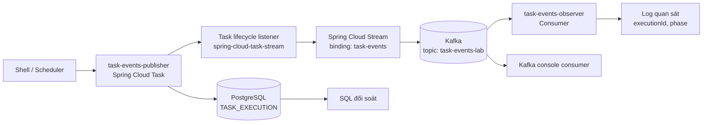
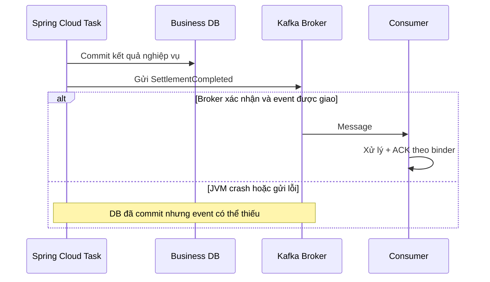

# Phát sự kiện thực thi qua broker

## 1. Mục tiêu và sản phẩm của bài thực hành

Trong bài này, bạn sẽ xây dựng một ứng dụng **Spring Cloud Task** chạy hữu hạn, phát sự kiện vòng đời `TaskExecution` qua **Apache Kafka** bằng **Spring Cloud Stream**, rồi viết một ứng dụng **consumer** nhận và phân loại các sự kiện đó. Cuối bài, bạn sẽ đối chiếu thông điệp với database `TaskRepository` và kiểm thử lỗi gửi, giao lại thông điệp, chạy lại Task.

Sau khi thực hành, bạn có thể:

1. Phân biệt sự kiện **Task bắt đầu**, **Task kết thúc** và **sự kiện nghiệp vụ** tự định nghĩa.
2. Thêm các dependency `spring-cloud-starter-task`, `spring-cloud-task-stream` và `spring-cloud-stream-binder-kafka` để kích hoạt cơ chế phát sự kiện Task trong nhánh hỗ trợ.
3. Cấu hình binding nguồn `task-events` trỏ đến topic Kafka `task-events-lab`.
4. Tạo một `ApplicationRunner` chạy hữu hạn, ghi log có tham số ngày nghiệp vụ, đồng thời giữ `TaskRepository` hoạt động.
5. Tạo ứng dụng consumer dùng **functional model** (`Consumer<...>`) để nhận message và xác định giai đoạn START/END theo dữ liệu `TaskExecution`.
6. Đọc thông điệp bằng Kafka CLI, truy vấn `TASK_EXECUTION` bằng SQL và xác định **executionId** tương ứng.
7. Chạy các kịch bản thành công, tham số sai, tắt event, broker ngừng hoạt động và consumer nhận lại thông điệp.
8. Giải thích giới hạn giao nhận và cách bổ sung inbox/outbox khi thông điệp có ảnh hưởng nghiệp vụ quan trọng.

> **Phạm vi:** Đây là bài trong chương **Thực hành** của module **SPRING_CLOUD_TASK**. Spring Cloud Task hỗ trợ ứng dụng Spring Boot có thời gian chạy hữu hạn, ghi trạng thái và kết quả vào cơ sở dữ liệu, chạy theo lịch hoặc theo yêu cầu, kết hợp Spring Batch. Bài tập sẽ dùng **sự kiện vòng đời Task**, không giả định mỗi lần chạy là một Spring Batch Job. Phần mở rộng Batch ở cuối bài chỉ kích hoạt khi bạn thực sự có `Job` và `JobRepository`.

### Kết quả cần đạt

| Thành phần | Đầu ra cần quan sát |
| --- | --- |
| Task publisher | Ứng dụng `task-events-publisher` chạy xong, có `TaskExecution.executionId` mới. |
| Kafka | Topic `task-events-lab` nhận các thông điệp biểu diễn vòng đời của Task. |
| Observer/consumer | Ứng dụng `task-events-observer` đọc message và log execution ID, tên Task, pha và mã thoát khi có. |
| PostgreSQL | Bảng `TASK_EXECUTION` có start/end time, exit code tương ứng sau khi Task kết thúc và ghi metadata thành công. |
| Kiểm thử lỗi | Hiểu trường hợp nào không có event, có event lặp và tại sao không thể xem broker là nguồn sự thật duy nhất. |

Sơ đồ lab:



**Nguyên tắc quan trọng:** Spring Cloud Task phát `TaskExecution` khi Task bắt đầu và kết thúc, thông qua cơ chế listener của module tích hợp. Hai sự kiện có thể cùng `executionId` nhưng biểu diễn **hai thời điểm khác nhau**. Đừng xóa sự kiện END chỉ vì đã nhìn thấy START có cùng ID.

## 2. Chốt stack tương thích trước khi bắt đầu

Lab dùng **Java 17+**, **Maven**, **Docker**, **PostgreSQL** và **Apache Kafka**. Để ví dụ Java/Jackson ở bài có một đường biên rõ ràng, có thể chọn:

| Thành phần | Mốc minh họa | Ghi chú |
| --- | --- | --- |
| Spring Boot | `3.5.x` | Dùng dependency management từ `spring-boot-starter-parent`. |
| Spring Cloud release train | `2025.0.x` | Tương thích với Spring Boot 3.5.x; ví dụ đã công bố `2025.0.3`. |
| Spring Cloud Task | `3.3.x` | Được quản lý bởi Spring Cloud BOM tương ứng. |
| Spring Cloud Stream | `4.3.x` | Được quản lý bởi Spring Cloud BOM tương ứng. |
| Java | `17` trở lên | Các snippet sử dụng record ở phần mở rộng và API Java hiện đại. |
| Kafka local | Image Apache Kafka `4.1.2` | Broker demo một node, không bật security; **chỉ dùng trên máy test**. |
| PostgreSQL local | Image `postgres:16` | Database dành riêng cho Task metadata. |

**Lưu ý tuổi đời phiên bản:** Mốc Boot 3.5/Cloud 2025.0 dùng trong bài để trình bày một tổ hợp cụ thể, không phải tuyên bố đây là release train còn được hỗ trợ tại thời điểm bạn học. Khi làm dự án production, chọn release train còn được hỗ trợ theo [bảng tương thích Spring Cloud](https://spring.io/projects/spring-cloud/), cập nhật bản vá bảo mật và đối chiếu API của `spring-cloud-task-stream`/binder đang dùng. Với Spring Boot 4 hoặc Spring Cloud Task 5.x, cần kiểm tra lại package, dependencies và thư viện JSON trước khi sao chép.

Mốc Maven minh họa trong hai `pom.xml`:

```xml
<properties>
    <java.version>17</java.version>
    <spring-cloud.version>2025.0.3</spring-cloud.version>
</properties>
```

Đặt `spring-boot-starter-parent` ở dòng `3.5.15` tương thích với train ví dụ. **Không tự đặt** version riêng cho Task, Stream và binder khi đã có BOM; tránh trộn Spring Cloud Task 3.x với Spring Cloud Stream 5.x.

### Điều kiện hoàn thành

Bạn cần quyền chạy Docker local, JDK/Maven và các cổng **5432** (PostgreSQL), **9092** (Kafka) chưa bị chiếm. Không cần triển khai Kubernetes hay Spring Cloud Data Flow trong lab cơ bản.

## 3. Chuẩn bị Kafka và PostgreSQL bằng Docker

Các câu lệnh dưới đây **chỉ để người học thực hành**, không được chạy trong quy trình viết bài. Chúng dùng credential giả định ở môi trường local; **không sử dụng password mẫu trong hệ thống thật**.

### 3.1. Khởi chạy broker Kafka

Theo hướng dẫn Docker của Apache Kafka, image JVM có thể khởi chạy với cấu hình mặc định cho môi trường thử nghiệm:

```bash
docker run -d \
  --name task-events-kafka \
  -p 9092:9092 \
  apache/kafka:4.1.2
```

Kiểm tra broker:

```bash
docker logs task-events-kafka
docker ps --filter name=task-events-kafka
```

Sau khi broker sẵn sàng, tạo topic rõ ràng để tránh phụ thuộc vào việc binder tự tạo topic:

```bash
docker exec task-events-kafka \
  /opt/kafka/bin/kafka-topics.sh \
  --bootstrap-server localhost:9092 \
  --create \
  --topic task-events-lab \
  --partitions 1 \
  --replication-factor 1
```

Đọc mô tả topic:

```bash
docker exec task-events-kafka \
  /opt/kafka/bin/kafka-topics.sh \
  --bootstrap-server localhost:9092 \
  --describe \
  --topic task-events-lab
```

Trong lab, `localhost:9092` là điểm kết nối **từ ứng dụng chạy trên máy host**, còn `docker exec` chạy Kafka CLI bên trong container Kafka. Nếu đưa publisher vào **container khác**, `localhost` sẽ chỉ container của publisher: khi đó cần Docker network/advertised listeners phù hợp, không giữ nguyên URL mẫu.

### 3.2. Khởi chạy PostgreSQL chứa Task metadata

```bash
docker run -d \
  --name task-events-postgres \
  -p 5432:5432 \
  -e POSTGRES_DB=task_demo \
  -e POSTGRES_USER=task_demo \
  -e POSTGRES_PASSWORD=local_demo_only \
  postgres:16
```

Kiểm tra:

```bash
docker logs task-events-postgres
docker exec task-events-postgres \
  pg_isready -U task_demo -d task_demo
```

Đây là một database riêng để quan sát `TASK_EXECUTION`. Trong bước đầu, có thể để Spring Cloud Task **tự khởi tạo schema trong lab** bằng `spring.cloud.task.initialize-enabled=true`. Trong sản xuất, cần migration chính thức đúng version/dialect và thường đặt `initialize-enabled=false`.

**Cảnh báo:** Dữ liệu trong container sẽ không tự tồn tại vĩnh viễn nếu xóa container mà không gắn volume. Với lab, điều đó có thể chấp nhận. Không dùng `docker rm -v` nếu có dữ liệu cần giữ.

### 3.3. Hai nguồn sự thật khác nhau

- **PostgreSQL/TaskRepository**: ghi nhận TaskExecution ở ứng dụng chạy hữu hạn.
- **Kafka broker**: vận chuyển thông điệp sự kiện đến observer.

Chúng không tham gia một transaction nguyên tử mặc định. Khi Task đã ghi database nhưng gửi broker thất bại, bạn vẫn có thể thấy metadata Task mà không thấy thông điệp.

## 4. Tổ chức hai ứng dụng

Tạo **hai dự án Spring Boot Maven riêng**, tránh trường hợp consumer vô tình có `spring-cloud-starter-task` và cũng kết thúc sau khi chạy:

```text
task-events-lab/
  publisher/
    pom.xml
    src/main/java/com/example/taskevents/TaskEventsPublisherApplication.java
    src/main/resources/application.yml
  observer/
    pom.xml
    src/main/java/com/example/taskevents/TaskEventsObserverApplication.java
    src/main/resources/application.yml
```

Tất cả đường dẫn là **gợi ý cấu trúc khi người học tạo dự án**, không phải tệp được tự động tạo bởi bài viết này.

| Ứng dụng | Vai trò | Vòng đời |
| --- | --- | --- |
| `publisher` | Chạy một `ApplicationRunner` rồi kết thúc; Spring Cloud Task ghi metadata và phát event. | **Hữu hạn**. |
| `observer` | `Consumer` đọc topic, log những event đã nhận. | **Chạy liên tục** trong lab đến khi operator dừng. |

Bạn có thể tạo skeleton tại [Spring Initializr](https://start.spring.io/) hoặc dựng `pom.xml` như các mục sau. Nếu dùng Initializr, cần bảo đảm hai dự án cùng Boot/Cloud BOM phù hợp.

## 5. Tạo Maven `publisher`

`publisher/pom.xml`:

```xml
<?xml version="1.0" encoding="UTF-8"?>
<project xmlns="http://maven.apache.org/POM/4.0.0"
         xmlns:xsi="http://www.w3.org/2001/XMLSchema-instance"
         xsi:schemaLocation="http://maven.apache.org/POM/4.0.0
         https://maven.apache.org/xsd/maven-4.0.0.xsd">
    <modelVersion>4.0.0</modelVersion>

    <parent>
        <groupId>org.springframework.boot</groupId>
        <artifactId>spring-boot-starter-parent</artifactId>
        <version>3.5.15</version>
        <relativePath/>
    </parent>

    <groupId>com.example</groupId>
    <artifactId>task-events-publisher</artifactId>
    <version>1.0.0-SNAPSHOT</version>

    <properties>
        <java.version>17</java.version>
        <spring-cloud.version>2025.0.3</spring-cloud.version>
    </properties>

    <dependencyManagement>
        <dependencies>
            <dependency>
                <groupId>org.springframework.cloud</groupId>
                <artifactId>spring-cloud-dependencies</artifactId>
                <version>${spring-cloud.version}</version>
                <type>pom</type>
                <scope>import</scope>
            </dependency>
        </dependencies>
    </dependencyManagement>

    <dependencies>
        <dependency>
            <groupId>org.springframework.cloud</groupId>
            <artifactId>spring-cloud-starter-task</artifactId>
        </dependency>
        <dependency>
            <groupId>org.springframework.cloud</groupId>
            <artifactId>spring-cloud-task-stream</artifactId>
        </dependency>
        <dependency>
            <groupId>org.springframework.cloud</groupId>
            <artifactId>spring-cloud-stream-binder-kafka</artifactId>
        </dependency>
        <dependency>
            <groupId>org.springframework.boot</groupId>
            <artifactId>spring-boot-starter-jdbc</artifactId>
        </dependency>
        <dependency>
            <groupId>org.postgresql</groupId>
            <artifactId>postgresql</artifactId>
            <scope>runtime</scope>
        </dependency>
        <dependency>
            <groupId>org.springframework.boot</groupId>
            <artifactId>spring-boot-starter-test</artifactId>
            <scope>test</scope>
        </dependency>
    </dependencies>

    <build>
        <plugins>
            <plugin>
                <groupId>org.springframework.boot</groupId>
                <artifactId>spring-boot-maven-plugin</artifactId>
            </plugin>
        </plugins>
    </build>
</project>
```

### Vì sao cần cả ba module Spring Cloud?

- `spring-cloud-starter-task`: kích hoạt Task lifecycle và các bean TaskRepository/TaskExplorer theo cấu hình.
- `spring-cloud-task-stream`: tích hợp **listener phát TaskExecution** qua Spring Cloud Stream trong những nhánh hỗ trợ.
- `spring-cloud-stream-binder-kafka`: kết nối binding Stream tới **Kafka**.

Có `spring-cloud-stream` nhưng **không có Kafka binder** thì không tự có đường vận chuyển tới Kafka. Ngược lại, có binder mà thiếu module listener `spring-cloud-task-stream` có thể khiến `task-events` không được phát như mong đợi.

Không tự thêm `Spring Cloud Function Supplier<TaskExecution>` nếu mục tiêu là sử dụng listener `task-events` tích hợp của Spring Cloud Task. Một supplier định kỳ có thể phát nhiều thông điệp không tương ứng một TaskExecution mới và không thay thế được vòng đời Task.

## 6. Cấu hình `publisher` và binding `task-events`

`publisher/src/main/resources/application.yml`:

```yaml
spring:
  application:
    name: task-events-publisher
  main:
    web-application-type: none

  datasource:
    url: jdbc:postgresql://localhost:5432/task_demo
    username: task_demo
    password: local_demo_only

  cloud:
    task:
      initialize-enabled: true
      events:
        enabled: true

    stream:
      bindings:
        task-events:
          destination: task-events-lab
          content-type: application/json

      kafka:
        binder:
          brokers:
            - localhost:9092
          auto-create-topics: false

logging:
  level:
    org.springframework.cloud.task: INFO
```

Chú ý cấp indentation:

- `spring.cloud.task.events.enabled=true` là **cờ bật phát sự kiện vòng đời Task**; tài liệu Spring Cloud Task mô tả cách tắt bằng `false`. Cờ này không biến một `ApplicationRunner` bất kỳ thành consumer.
- `spring.cloud.stream.bindings.task-events.destination=task-events-lab` đặt **destination broker** cho **binding nguồn có tên `task-events`**. Trong tài liệu Data Flow, binding mặc định này có thể được đổi sang destination tùy ý.
- `spring.cloud.stream.kafka.binder.brokers` xác định broker Kafka.
- `auto-create-topics=false` yêu cầu topic đã được tạo bởi bước 3.
- `initialize-enabled=true` chỉ phù hợp **môi trường lab** với database được phép khởi tạo schema. Nếu schema đã được migration, đổi sang `false` để tránh xung đột.
- `web-application-type=none` làm ứng dụng Task không mở web server vô thời hạn.
- Không đưa password thật vào tệp cấu hình đã commit; trong production dùng Secret/biến môi trường với quyền phù hợp.

**Khác tên binding:** Trong functional model, `observeTask-in-0` là tên input binding của `Consumer` mà bạn sẽ tự viết ở observer. Còn **`task-events` là tên binding được listener của Spring Cloud Task sử dụng**; không tự đổi thành `taskEvents-out-0` rồi kỳ vọng listener mặc định phát vào đó.

## 7. Viết ứng dụng Task publisher

`publisher/src/main/java/com/example/taskevents/TaskEventsPublisherApplication.java`:

```java
package com.example.taskevents;

import java.time.LocalDate;
import java.util.List;

import org.springframework.boot.ApplicationArguments;
import org.springframework.boot.ApplicationRunner;
import org.springframework.boot.SpringApplication;
import org.springframework.boot.autoconfigure.SpringBootApplication;
import org.springframework.cloud.task.configuration.EnableTask;
import org.springframework.context.ConfigurableApplicationContext;
import org.springframework.context.annotation.Bean;

@SpringBootApplication
@EnableTask
public class TaskEventsPublisherApplication {

    public static void main(String[] args) {
        ConfigurableApplicationContext context =
                SpringApplication.run(
                        TaskEventsPublisherApplication.class, args);

        int exitCode = SpringApplication.exit(context);
        System.exit(exitCode);
    }

    @Bean
    ApplicationRunner settlementDemoRunner() {
        return args -> {
            String dateArgument = exactlyOneOption(
                    args, "business-date");
            LocalDate date = LocalDate.parse(dateArgument);

            System.out.println("Starting settlement demo, date=" + date);

            // Mô phỏng xử lý không gây tác động nghiệp vụ.
            // Không truy cập DB thanh toán, không gửi email thật.
            System.out.println("Demo work completed, date=" + date);
        };
    }

    private static String exactlyOneOption(
            ApplicationArguments args, String name) {
        List<String> values = args.getOptionValues(name);
        if (values == null
                || values.size() != 1
                || values.get(0).isBlank()) {
            throw new IllegalArgumentException(
                    "Expected --" + name + "=yyyy-MM-dd");
        }
        return values.get(0);
    }
}
```

### Tại sao code không gọi Kafka producer trực tiếp?

Trong kịch bản chính, **Spring Cloud Task listener** có trách nhiệm gửi `TaskExecution`. Runner chỉ thực hiện công việc hữu hạn. Khi listener tích hợp hoạt động:

1. Framework ghi nhận Task khởi động với một `executionId`.
2. Listener phát dữ liệu `TaskExecution` giai đoạn khởi động qua `task-events`.
3. `ApplicationRunner` xử lý công việc.
4. Khi Task kết thúc, framework cập nhật metadata cuối và listener cố gắng phát sự kiện kết thúc.

Thời điểm chính xác giữa cập nhật repository, callback listener và shutdown binder phụ thuộc version. **Không tự suy ra sự kiện END đã được broker lưu bền vững chỉ vì `SpringApplication.exit(...)` trả về.**

### Mã thoát và đường lỗi

`SpringApplication.exit(context)` thu thập mã thoát do Spring Boot cung cấp và đóng context; `System.exit(exitCode)` truyền mã đó ra JVM/hệ điều hành. Khi `SpringApplication.run(...)` ném exception trước khi trả context, hai dòng sau không chạy theo đường bình thường; Spring Boot có xử lý startup failure riêng.

Khi option không hợp lệ, `LocalDate.parse(...)` sẽ ném exception. Không bắt rồi bỏ qua, vì điều đó dễ khiến scheduler coi Task thành công dù nghiệp vụ chưa xử lý.

**Mô hình học tập:** Bài không yêu cầu gọi `TaskRepository` trực tiếp trong runner. Framework thực hiện lưu `TaskExecution`, nên logic nghiệp vụ có thể được kiểm thử độc lập với broker.

## 8. Tạo Maven `observer`

`observer` là ứng dụng **Consumer liên tục**, không phải Spring Cloud Task. Nó cần binder Kafka, không cần `spring-cloud-task-stream` hay `spring-cloud-starter-task`.

`observer/pom.xml`:

```xml
<?xml version="1.0" encoding="UTF-8"?>
<project xmlns="http://maven.apache.org/POM/4.0.0"
         xmlns:xsi="http://www.w3.org/2001/XMLSchema-instance"
         xsi:schemaLocation="http://maven.apache.org/POM/4.0.0
         https://maven.apache.org/xsd/maven-4.0.0.xsd">
    <modelVersion>4.0.0</modelVersion>

    <parent>
        <groupId>org.springframework.boot</groupId>
        <artifactId>spring-boot-starter-parent</artifactId>
        <version>3.5.15</version>
        <relativePath/>
    </parent>

    <groupId>com.example</groupId>
    <artifactId>task-events-observer</artifactId>
    <version>1.0.0-SNAPSHOT</version>

    <properties>
        <java.version>17</java.version>
        <spring-cloud.version>2025.0.3</spring-cloud.version>
    </properties>

    <dependencyManagement>
        <dependencies>
            <dependency>
                <groupId>org.springframework.cloud</groupId>
                <artifactId>spring-cloud-dependencies</artifactId>
                <version>${spring-cloud.version}</version>
                <type>pom</type>
                <scope>import</scope>
            </dependency>
        </dependencies>
    </dependencyManagement>

    <dependencies>
        <dependency>
            <groupId>org.springframework.boot</groupId>
            <artifactId>spring-boot-starter</artifactId>
        </dependency>
        <dependency>
            <groupId>org.springframework.boot</groupId>
            <artifactId>spring-boot-starter-json</artifactId>
        </dependency>
        <dependency>
            <groupId>org.springframework.cloud</groupId>
            <artifactId>spring-cloud-stream-binder-kafka</artifactId>
        </dependency>
    </dependencies>

    <build>
        <plugins>
            <plugin>
                <groupId>org.springframework.boot</groupId>
                <artifactId>spring-boot-maven-plugin</artifactId>
            </plugin>
        </plugins>
    </build>
</project>
```

`spring-boot-starter-json` trong ví dụ Boot 3.x cung cấp hỗ trợ Jackson cho payload JSON. Nếu bạn học bằng Boot 4.x, package/bộ JSON có thể khác; cần cập nhật ví dụ theo stack được chọn.

## 9. Cấu hình observer đọc topic

`observer/src/main/resources/application.yml`:

```yaml
spring:
  application:
    name: task-events-observer
  main:
    web-application-type: none

  cloud:
    function:
      definition: observeTask

    stream:
      bindings:
        observeTask-in-0:
          destination: task-events-lab
          group: task-events-lab-observer
          content-type: application/json
          consumer:
            max-attempts: 3

      kafka:
        binder:
          brokers:
            - localhost:9092
          auto-create-topics: false

logging:
  level:
    com.example.taskevents: INFO
```

Diễn giải:

- `observeTask` là **tên bean function** Java. Input binding mặc định là `observeTask-in-0`.
- `destination` phải trùng topic mà publisher gửi: `task-events-lab`.
- `group` cố định giúp observer giữ offset/trạng thái tiêu thụ theo consumer group; khác với một consumer group mới mỗi lần khởi động.
- `max-attempts` áp dụng cho xử lý message theo cơ chế binder hỗ trợ; **không tự tạo DLQ**.
- `web-application-type=none` không có nghĩa observer phải tự thoát. Consumer binding giữ ứng dụng hoạt động trong quá trình quan sát.

Nếu consumer chỉ dùng để quan sát live, có thể cấu hình riêng consumer group cho môi trường test. Khi muốn đọc lại lịch sử cũ, Kafka CLI dùng `--from-beginning` hoặc tạo group mới theo chính sách retention của topic; không giả định một consumer group cũ sẽ tự đọc lại các record đã commit.

## 10. Viết consumer có thể phân biệt START và END

`observer/src/main/java/com/example/taskevents/TaskEventsObserverApplication.java`:

```java
package com.example.taskevents;

import java.util.function.Consumer;

import com.fasterxml.jackson.databind.JsonNode;
import org.slf4j.Logger;
import org.slf4j.LoggerFactory;
import org.springframework.boot.SpringApplication;
import org.springframework.boot.autoconfigure.SpringBootApplication;
import org.springframework.context.annotation.Bean;

@SpringBootApplication
public class TaskEventsObserverApplication {

    private static final Logger log =
            LoggerFactory.getLogger(
                    TaskEventsObserverApplication.class);

    public static void main(String[] args) {
        SpringApplication.run(
                TaskEventsObserverApplication.class, args);
    }

    @Bean
    Consumer<JsonNode> observeTask() {
        return event -> {
            String executionId =
                    event.path("executionId").asText("missing");
            String taskName =
                    event.path("taskName").asText("unknown");

            JsonNode endTime = event.path("endTime");
            boolean hasEndTime =
                    !endTime.isMissingNode()
                    && !endTime.isNull()
                    && !endTime.asText().isBlank();

            String phase = hasEndTime
                    ? "END"
                    : "START_OR_INCOMPLETE";

            String exitCode = event.path("exitCode")
                    .asText("not-reported");

            log.info(
                    "Task event: executionId={}, taskName={}, "
                            + "phase={}, exitCode={}",
                    executionId,
                    taskName,
                    phase,
                    exitCode);
        };
    }
}
```

**Vì sao dùng `JsonNode` thay vì `TaskExecution` trên consumer?**

- Observer chỉ cần đọc một vài trường từ payload; nó không cần phụ thuộc vào class `TaskExecution` của publisher.
- Payload tích hợp là dữ liệu TaskExecution **theo serializer của release**, không phải một schema nghiệp vụ có version do bạn kiểm soát.
- JSON tree giúp demo ít phụ thuộc vào constructor/serialization của class TaskExecution khi hai ứng dụng đóng gói độc lập.
- Nếu muốn contract ổn định, hãy tự định nghĩa **event envelope** có `eventId`, `eventType` và `eventVersion` ở tầng ứng dụng riêng.

**Không hiểu `START_OR_INCOMPLETE` là sự kiện START được bảo đảm.** Một Task bị kill, lỗi serialization hoặc dữ liệu chưa cập nhật có thể thiếu `endTime`. Với mục đích lab, hai thông điệp thường tương ứng “bắt đầu” và “kết thúc”, nhưng không dùng chỉ mỗi `endTime` để xây state machine production.

### Không log toàn bộ payload vào production

`TaskExecution` có thể chứa arguments hoặc thông điệp lỗi. Trong ứng dụng thực, chúng có thể mang thông tin nhạy cảm. Observer trên chỉ log một số trường được chọn. Tránh `log.info("{}", event)` ở môi trường có dữ liệu thật.

## 11. Chạy lab theo thứ tự và quan sát kết quả

### 11.1. Kiểm tra hạ tầng đã sẵn sàng

```bash
docker ps --filter name=task-events-kafka
docker ps --filter name=task-events-postgres

docker exec task-events-postgres \
  pg_isready -U task_demo -d task_demo
```

Kafka topic `task-events-lab` phải tồn tại. Nếu broker vẫn khởi động, kiểm tra log, không ngay lập tức kết luận cấu hình binder sai.

### 11.2. Build hai JAR

Trong thư mục `publisher`:

```bash
mvn -DskipTests package
```

Trong thư mục `observer`:

```bash
mvn -DskipTests package
```

Dùng `mvnw` thay cho `mvn` nếu dự án có Maven Wrapper. Các lệnh trên **người học tự thực hiện**; bài biên soạn này không chạy Maven hay Docker.

### 11.3. Khởi động observer trước

Ở terminal A, từ thư mục `observer`:

```bash
java -jar target/task-events-observer-1.0.0-SNAPSHOT.jar
```

Giữ terminal này mở. Consumer thường không nhận được dữ liệu quá khứ nếu group đã commit offset; khởi động trước publisher giúp dễ thấy cả thông điệp START và END.

### 11.4. Chạy publisher một lần

Ở terminal B, từ thư mục `publisher`:

```bash
java -jar target/task-events-publisher-1.0.0-SNAPSHOT.jar \
  --business-date=2026-11-24
```

Kết quả ứng dụng cần có hai log nghiệp vụ:

```text
Starting settlement demo, date=2026-11-24
Demo work completed, date=2026-11-24
```

Observer có thể hiển thị các dòng theo tinh thần:

```text
Task event: executionId=1, taskName=task-events-publisher,
            phase=START_OR_INCOMPLETE, exitCode=...

Task event: executionId=1, taskName=task-events-publisher,
            phase=END, exitCode=0
```

Đây là **minh họa diễn giải**, không phải output cố định: ID thực tế do TaskRepository cấp, JSON field format/exitCode lúc START tùy version, message có thể đến muộn hoặc bị thiếu nếu send failure. Quan sát log Kafka binder nếu không thấy sự kiện.

### 11.5. Đọc message trực tiếp từ Kafka

Ở terminal C:

```bash
docker exec -it task-events-kafka \
  /opt/kafka/bin/kafka-console-consumer.sh \
  --bootstrap-server localhost:9092 \
  --topic task-events-lab \
  --from-beginning
```

Dùng `Ctrl+C` để ngắt console consumer sau khi đã quan sát dữ liệu. Với serializer JSON, bạn thường thấy payload chứa trường như `executionId`, `taskName`, `startTime`, `endTime` và `exitCode`. **Không giả định mọi field hoặc định dạng timestamp giống hoàn toàn ví dụ**.

Nếu Kafka CLI hiển thị dữ liệu mà ứng dụng observer không log:

- Kiểm tra `spring.cloud.function.definition` và tên bean `observeTask`.
- Kiểm tra binding `observeTask-in-0`, topic, group, offset.
- Kiểm tra consumer có lỗi deserialization/JSON conversion hay không.
- Kiểm tra Kafka binder của observer có kết nối đúng broker hay không.

Nếu **cả Kafka CLI lẫn observer** không có event, cần kiểm tra dependency `spring-cloud-task-stream`, binding nguồn `task-events` và log publisher.

## 12. Đối chiếu với bảng `TASK_EXECUTION`

Lệnh PostgreSQL:

```bash
docker exec -it task-events-postgres \
  psql -U task_demo -d task_demo
```

Trong `psql`:

```sql
SELECT
    TASK_EXECUTION_ID,
    TASK_NAME,
    START_TIME,
    END_TIME,
    EXIT_CODE,
    EXIT_MESSAGE,
    ERROR_MESSAGE
FROM TASK_EXECUTION
ORDER BY TASK_EXECUTION_ID DESC;
```

Với Task chạy xong bình thường, bản ghi mới thường có:

| Cột | Giá trị minh họa | Ý nghĩa |
| --- | --- | --- |
| `TASK_EXECUTION_ID` | `1` | Mã lần chạy Task, tương ứng `executionId` trong payload. |
| `TASK_NAME` | `task-events-publisher` | Tên Task đã đăng ký. |
| `START_TIME` | Có giá trị | Thời điểm framework bắt đầu ghi Task. |
| `END_TIME` | Có giá trị | Thời điểm Task kết thúc và cập nhật thành công. |
| `EXIT_CODE` | `0` trong đường thành công | Kết quả framework ghi lại. |
| `ERROR_MESSAGE` | Thường rỗng khi thành công | Thông tin lỗi nếu có. |

Nếu thông điệp bị mất nhưng metadata đã có, đừng tự suy diễn “Task chưa chạy”. Một Topic Kafka và `TASK_EXECUTION` khác nhau về mục đích và retention.

### Truy vấn tham số Task

```sql
SELECT TASK_EXECUTION_ID, TASK_PARAM
FROM TASK_EXECUTION_PARAMS
ORDER BY TASK_EXECUTION_ID DESC;
```

Tham số `--business-date=2026-11-24` có thể được lưu trong metadata Task. **Không chuyển password/token vào CLI arguments**, vì chúng có thể tồn tại trong `TASK_EXECUTION_PARAMS` và event payload/log tùy cấu hình.

### Tạo thêm một lượt chạy

Ở terminal B, chạy lại cùng ngày:

```bash
java -jar target/task-events-publisher-1.0.0-SNAPSHOT.jar \
  --business-date=2026-11-24
```

Bạn kỳ vọng một **TaskExecution ID mới**, dù `businessDate` giống lần trước. Với bài demo không ghi nghiệp vụ, điều đó an toàn. Trong production, công việc đối soát thật cần business key/idempotency để không xử lý giao dịch trùng.

**Không dùng `executionId` để suy ra đây là một đợt dữ liệu nghiệp vụ khác.** Nó chỉ định danh *một lần chạy tiến trình*.

## 13. Phân biệt hai sự kiện hợp lệ với thông điệp trùng

Giả sử observer thấy ba message:

```text
executionId=41, phase=START
executionId=41, phase=END
executionId=41, phase=END
```

Có hai khái niệm:

- **START và END cùng executionId:** hai sự kiện **khác nhau**, đại diện hai thời điểm vòng đời.
- **END được nhận hai lần:** có thể do broker redelivery, consumer restart, retry/offset chưa commit hoặc publisher gửi lại.

Không thể chỉ dùng `executionId` làm khóa dedup của mọi event. Với consumer dashboard, tối thiểu phải có `(taskRepositoryIdentity, executionId, phase)`; nếu nhiều lần thay đổi trạng thái hoặc nhiều event cùng pha có ý nghĩa, cần thêm **event ID / event version** do ứng dụng định nghĩa.

Ví dụ mô hình bảng tiếp nhận của **ứng dụng quan sát tùy biến**:

```sql
CREATE TABLE task_event_receipt (
    source_repository VARCHAR(100) NOT NULL,
    task_execution_id BIGINT NOT NULL,
    phase VARCHAR(30) NOT NULL,
    received_at TIMESTAMPTZ NOT NULL DEFAULT CURRENT_TIMESTAMP,
    PRIMARY KEY (source_repository, task_execution_id, phase)
);
```

Đây **không phải bảng chuẩn** của Spring Cloud Task, chỉ là gợi ý để xây consumer idempotent. Với PostgreSQL, thao tác ghi nhận:

```sql
INSERT INTO task_event_receipt (
    source_repository, task_execution_id, phase)
VALUES ('task-demo-local', 41, 'END')
ON CONFLICT (
    source_repository, task_execution_id, phase)
DO NOTHING;
```

Nếu consumer vừa lưu receipt vừa cập nhật projection, hai thao tác nên nằm trong **cùng transaction database** để tránh ghi receipt thành công nhưng projection thất bại. Mẫu trên chưa xử lý event ngoài thứ tự; dashboard cũng phải kiểm tra thứ tự chuyển trạng thái.

**Không coi `TaskExecution.exitCode=0` là bằng chứng mọi tác động nghiệp vụ đều hoàn tất đúng.** Runner có thể nuốt exception hoặc Batch Job có thể `FAILED` nhưng không được lan truyền đến kết quả Task.

## 14. Kịch bản kiểm thử 1: tắt phát sự kiện nhưng giữ lịch sử Task

Đặt trong `publisher/application.yml`:

```yaml
spring:
  cloud:
    task:
      events:
        enabled: false
```

Đây là **đoạn thay đổi cấu hình**, không phải một file YAML hoàn chỉnh thay thế cấu hình mục 6. Sau khi build/chạy lại publisher:

- `TaskRepository` vẫn phải ghi `TASK_EXECUTION` nếu JDBC/schema hoạt động.
- Listener tích hợp **không phát** Task lifecycle events qua `task-events`.
- Observer không nhận thêm event vòng đời cho lần chạy đó (nếu không có producer khác cùng topic).
- Sự kiện cũ vẫn có thể xuất hiện từ broker nếu consumer đọc lại offset; đừng nhầm message cũ với event mới.

Để tránh sửa file, bạn cũng có thể override khi chạy:

```bash
java -jar target/task-events-publisher-1.0.0-SNAPSHOT.jar \
  --spring.cloud.task.events.enabled=false \
  --business-date=2026-11-25
```

Sau kiểm thử, bật lại `spring.cloud.task.events.enabled=true`. Giá trị `false` chỉ tắt **sự kiện qua broker**, không có nghĩa tắt `TaskRepository` hay ứng dụng Task.

## 15. Kịch bản kiểm thử 2: tham số sai và Task thất bại

Chạy:

```bash
java -jar target/task-events-publisher-1.0.0-SNAPSHOT.jar \
  --business-date=invalid-date
```

Trong code publisher, `LocalDate.parse(...)` ném lỗi. Cần ghi lại:

1. Exit status **của tiến trình Java**, không phải exit code của một lệnh Docker CLI khác.
2. Log exception/stack trace.
3. Bản ghi `TASK_EXECUTION` mới có được tạo không và `EXIT_CODE`/`END_TIME` ra sao.
4. Broker có nhận thông điệp START/END nào không.
5. Observer có hiển thị giai đoạn và kết quả lỗi không.

Ví dụ Bash:

```bash
java -jar target/task-events-publisher-1.0.0-SNAPSHOT.jar \
  --business-date=invalid-date
echo $?
```

Với PowerShell:

```powershell
java -jar target/task-events-publisher-1.0.0-SNAPSHOT.jar --business-date=invalid-date
$LASTEXITCODE
```

Đường startup failure không có cùng bảo đảm như đường thành công: exception có thể xảy ra trước khi context khởi tạo xong, repository hoặc broker chưa sẵn sàng, và sự kiện cuối có thể không gửi được. **Không viết assertion bắt buộc luôn có đúng hai event cho mọi lỗi.** Kiểm chứng từng layer thực tế.

Nếu lỗi bị bắt trong runner rồi chỉ `log.error` mà không ném tiếp, Task có thể bị coi là thành công. Hãy test trường hợp này trên bản thử nghiệm để hiểu lý do cần lan truyền lỗi.

## 16. Kịch bản kiểm thử 3: broker ngừng hoạt động

Trên môi trường local test, trước khi chạy publisher:

```bash
docker stop task-events-kafka
```

Sau đó chạy publisher với ngày hợp lệ, quan sát kết quả trong một phiên chạy test riêng. Bạn có thể thấy:

- Binder lỗi kết nối ngay khi khởi động hoặc khi gửi.
- Producer/consumer retry hoặc chờ timeout theo cấu hình.
- `TaskRepository` vẫn có row nếu database còn kết nối, nhưng thông điệp không đến consumer.
- Ứng dụng có thể thất bại sớm hoặc không thể hoàn tất tùy module/binder/exception policy của phiên bản.

**Không giả định Task luôn trả mã khác `0` khi broker down.** Tùy thời điểm/lifecycle, thông điệp có thể chỉ lỗi bất đồng bộ hoặc binder bị tắt trước khi nhận acknowledgment. Muốn bảo đảm event bắt buộc gửi, cần thiết kế publisher bền vững như outbox và đo kết quả broker thực tế.

Khởi động lại broker:

```bash
docker start task-events-kafka
```

Sau khi broker phục hồi:

1. Kiểm tra Kafka CLI/observer nhận event mới khi chạy Task **mới**.
2. Kiểm tra lịch sử Task cũ trong PostgreSQL.
3. Xác định có sự kiện nào bị thiếu và thiết kế **reconciliation** thay vì kỳ vọng broker tự tái tạo những message chưa hề được lưu.
4. Không tự replay nghiệp vụ thanh toán thật chỉ để tạo lại một thông báo thiếu.

### Vì sao retry producer không tự giải quyết mọi trường hợp?

Một event có thể đã vào broker nhưng producer **không nhận được ack** vì timeout/network. Retry có thể gửi **bản sao**. Ngược lại, nếu JVM đã chết trước khi tạo record broker, retry của Kafka producer không tự hoạt động sau khi process kết thúc. Phải có lưu ý định phát (ví dụ outbox) hoặc cơ chế tái tạo event từ repository đáng tin cậy.

## 17. Kịch bản kiểm thử 4: observer nhận lại message

Giữ publisher/metadata như cũ, dừng observer rồi khởi động lại. Tùy consumer group và offset đã commit, có thể **không nhận lại** các thông điệp cũ. Để chủ động quan sát replay:

- Dùng Kafka CLI `--from-beginning`.
- Hoặc tạo một consumer group mới trên môi trường test với chính sách bắt đầu đọc phù hợp.
- Hoặc dùng công cụ quản trị offset theo quy trình được phép và **chỉ trên topic/group test**.

Nếu consumer đã thực hiện side effect (gửi email, cập nhật projection) rồi bị crash trước khi commit offset, bản ghi có thể được giao lại và gây side effect lặp.

### Ma trận replay

| Tình huống | Điều có thể xảy ra | Thiết kế xử lý |
| --- | --- | --- |
| Nhận START rồi END cùng ID | Hai event hợp lệ. | Key có phase. |
| Nhận END lần thứ hai | Broker/consumer replay. | Inbox/dedup. |
| END đến trước START | Retry/partition hoặc thứ tự quan sát khác. | State machine không cho START đến muộn ghi đè trạng thái cuối. |
| Task chạy lại cùng `businessDate` | `executionId` mới. | Idempotency theo business key, không theo TaskExecution ID. |
| Consumer lỗi parse payload | Retry/DLQ tùy binder. | Version/schema validation, alert. |
| Kafka retention xóa record | Không thể đọc lại quá retention. | Retention đủ nhu cầu; reconciliation từ TaskRepository. |

**Mục tiêu bài:** Thấy rõ giới hạn “sự kiện đã được phát” khác “mọi consumer đã xử lý chính xác một lần”. Với nghiệp vụ quan trọng, cần consumer idempotent, giám sát độ trễ, DLQ và kiểm thử lỗi thật.

## 18. Phần mở rộng: Spring Batch Job/Step events

Nếu publisher được mở rộng để chạy Spring Batch Job, Spring Cloud Task có cơ chế phát các event theo listeners khi tích hợp Task–Batch/Stream hỗ trợ:

| Loại sự kiện | Channel/destination mặc định được tài liệu mô tả |
| --- | --- |
| Task lifecycle | `task-events` |
| `JobExecutionListener` | `job-execution-events` |
| `StepExecutionListener` | `step-execution-events` |
| `ChunkListener` | `chunk-events` |
| `ItemReadListener` | `item-read-events` |
| `ItemProcessListener` | `item-process-events` |
| `ItemWriteListener` | `item-write-events` |
| `SkipListener` | `skip-events` |

Đây là **nhánh mở rộng**, không có các event Batch chỉ nhờ cấu hình topic nếu ứng dụng **không có Spring Batch Job**. Cần:

- Dependency và auto-configuration tích hợp tương thích.
- `Job` thực sự được khởi chạy và `JobRepository` đã migration.
- Binding/broker cho từng event channel cần quan sát.
- Quản lý lưu lượng: sự kiện item/chunk có thể nhiều hơn số TaskExecution rất lớn.
- Xem xét dữ liệu nhạy cảm trong payload `ExecutionContext`, arguments hoặc thông điệp lỗi.

Ví dụ cấu hình đổi tên destination của Job event:

```yaml
spring:
  cloud:
    stream:
      bindings:
        job-execution-events:
          destination: batch-job-events-lab
```

Không nhầm `spring.cloud.task.batch.events.enabled=false` (tắt phát sự kiện Batch qua Stream theo khả năng release) với cấu hình `spring.cloud.task.batch.listener.enabled=false` (liên kết metadata Task–Batch): hai tính năng có nhiệm vụ khác nhau.

Nếu một Task có nhiều JobExecution, cùng một TaskExecution ID có thể liên quan nhiều JobExecution ID và nhiều sự kiện Batch; consumer phải chọn khóa duy nhất theo **cấp metadata**, không dùng chung `executionId` cho mọi record.

## 19. Thử thêm sự kiện nghiệp vụ bằng `StreamBridge` (tùy chọn)

`task-events` là **sự kiện kỹ thuật vòng đời Task**, còn ứng dụng có thể cần phát `SettlementCompleted` sau khi xác nhận giao dịch. Đây là loại sự kiện **do bạn định nghĩa**, không có sẵn chỉ vì bật `spring.cloud.task.events.enabled`.

Một cách trong Spring Cloud Stream functional model là `StreamBridge`:

```java
package com.example.taskevents;

public record SettlementCompleted(
        String eventId,
        String businessDate,
        long processedCount
) {}
```

Service publisher minh họa:

```java
package com.example.taskevents;

import org.springframework.cloud.stream.function.StreamBridge;
import org.springframework.stereotype.Component;

@Component
public class BusinessEventPublisher {

    private final StreamBridge streamBridge;

    public BusinessEventPublisher(StreamBridge streamBridge) {
        this.streamBridge = streamBridge;
    }

    public void publish(SettlementCompleted event) {
        boolean accepted =
                streamBridge.send("settlement-out-0", event);

        if (!accepted) {
            throw new IllegalStateException(
                    "Message not accepted by stream binding");
        }
    }
}
```

Với binding:

```yaml
spring:
  cloud:
    stream:
      output-bindings: settlement-out-0
      bindings:
        settlement-out-0:
          destination: settlement-business-events-lab
          content-type: application/json
```

Ví dụ này **chưa có transactional outbox**, vì vậy **không tự bảo đảm event tồn tại trên broker** sau commit JDBC hoặc sau crash. Kết quả boolean `send` chỉ phản ánh contract của lời gọi gửi trong Spring Cloud Stream; chưa phải bằng chứng mọi consumer đã xử lý.

Đừng dùng `StreamBridge` để phát thủ công một `TaskExecution` **lần thứ ba** lên chính topic `task-events-lab` nếu không chủ ý xây thêm cơ chế và quy tắc dedup. Phần mở rộng này minh họa sự khác nhau giữa **event vòng đời** và **event nghiệp vụ**.

## 20. Nếu event không được phép mất: outbox và đối soát

Có một cửa sổ lỗi phổ biến:



Với sự kiện nghiệp vụ quan trọng, có thể dùng **transactional outbox**:

1. Trong **cùng transaction database** với kết quả nghiệp vụ, insert một `outbox_event` mang `eventId` ổn định.
2. Một dispatcher riêng (Task theo lịch hoặc service liên tục) đọc các row chưa gửi.
3. Dispatcher gửi qua broker, nhận xác nhận theo binder, rồi đánh dấu đã gửi.
4. Nếu dispatcher crash sau gửi nhưng trước đánh dấu, nó có thể gửi **trùng**; consumer phải có inbox/dedup.
5. Có giám sát backlog, retry giới hạn, DLQ/reconciliation và quy trình can thiệp.

Đối với event `TaskExecution` tích hợp sẵn, bạn **không tự động có outbox** chỉ bằng cách thêm dependency Stream. Nếu cần bảo đảm truy vết chặt chẽ, có thể xây một dịch vụ **đọc TaskRepository và đối soát receipt** để phát event tổng hợp có dấu kiểm chứng, hoặc tự thiết kế cơ chế phát sự kiện bền vững có contract riêng.

### Nguồn dữ liệu nào đáng tin hơn?

| Câu hỏi | Nguồn cần ưu tiên |
| --- | --- |
| Task nào được framework ghi nhận đã khởi chạy? | `TASK_EXECUTION` trong đúng `TaskRepository`. |
| Kafka đã lưu record nào? | Topic/offset trong broker; lưu ý retention. |
| Consumer đã áp dụng event chưa? | Inbox/projection hoặc trạng thái ứng dụng consumer. |
| Spring Batch Job/Step đã hoàn tất chưa? | `BATCH_JOB_EXECUTION`, `BATCH_STEP_EXECUTION` trong `JobRepository`. |
| Dữ liệu nghiệp vụ đã được commit đúng chưa? | Database nghiệp vụ/đối soát với hệ thống đích. |
| Scheduler thấy Task thành công hay thất bại? | Exit code JVM/container và trạng thái Job/Task của platform. |

Không có nguồn nào trong bảng tự thay thế mọi nguồn còn lại.

## 21. Chẩn đoán nhanh các lỗi lab thường gặp

| Triệu chứng | Nguyên nhân cần kiểm tra | Hành động |
| --- | --- | --- |
| Publisher fail vì `relation task_execution does not exist` | Chưa tạo schema Task, sai database/schema hoặc `initialize-enabled=false`. | Xác minh JDBC URL, tablePrefix, quyền DB và migration đúng version. |
| Kafka CLI không có message | Thiếu `spring-cloud-task-stream`, thiếu binder, tắt events, sai binding nguồn hoặc broker lỗi. | Kiểm tra dependency tree, `task-events` destination, startup logs và Kafka topic. |
| Observer không nhận nhưng Kafka CLI có | Sai `observeTask-in-0`, function definition, group offset hoặc JSON conversion. | Đọc log binding/consumer, xác minh topic và cấu hình. |
| `TaskExecution` có nhưng event thiếu | Broker down, gửi bất đồng bộ lỗi, listener không khởi tạo hoặc process dừng sớm. | Đối chiếu SQL, log publisher và trạng thái broker. |
| Một lần chạy nhận hai message cùng executionId | START/END là hai sự kiện khác nhau. | Phân biệt bằng phase/trạng thái thay vì chỉ dedup ID. |
| END bị nhận lại | Kafka redelivery, group replay hoặc consumer crash trước ack. | Idempotent consumer/inbox, không tạo side effect lần hai. |
| Task bị `SIGKILL` | JVM không kịp ghi END hoặc gửi event. | Kiểm tra container exit, `END_TIME`, log, dữ liệu nghiệp vụ. |
| Task return `0` dù Job/logic lỗi | Exception bị nuốt, Batch Job status không được lan truyền. | Kiểm tra runner, JobExecution và `System.exit`. |
| Broker local kết nối được từ host, không được từ Pod | `localhost` trong container/Pod trỏ sai; advertised listeners/DNS/network. | Cấu hình broker address có thể truy cập từ ứng dụng. |
| Không thể tạo topic | Quyền broker hoặc `auto-create-topics=false` mà chưa tạo topic. | Tạo topic trước bằng công cụ hạ tầng, cấp ACL cần thiết. |
| Message có trường JSON khác ví dụ | Payload của release/serializer khác nhau. | Quan sát raw payload và điều chỉnh adapter theo contract thật. |
| Consumer sau restart không thấy event cũ | Group đã commit offset hoặc retention/offset policy. | Tạo group test mới hay dùng Kafka CLI `--from-beginning`. |

### Bộ bước điều tra ưu tiên

1. Kiểm tra **publisher thực sự đã chạy** và repository có ghi `TASK_EXECUTION` chưa.
2. Xác minh module tích hợp `spring-cloud-task-stream` có trong classpath, listener không bị tắt.
3. Xác minh **binding `task-events`** được tạo và trỏ tới topic `task-events-lab`.
4. Xem Kafka topic bằng CLI thay vì chỉ nhìn observer.
5. Nếu có record, kiểm tra function `observeTask`, binding name, group offset, JSON conversion.
6. Nếu không có record, xem log publisher, broker, kết nối và chính sách retry/ack.
7. Với Batch, kiểm tra `JobRepository` và cấu hình phát event Job/Step riêng.

Đừng sửa lỗi theo cách tắt TLS/ACL trên môi trường production, đổi danh tính consumer group liên tục để che lỗi offset hoặc xóa topic có dữ liệu chỉ vì muốn thử lại.

## 22. Ma trận kiểm thử và tiêu chí chấm bài

| Thử nghiệm | `TASK_EXECUTION` | Kafka `task-events-lab` | Observer | Đánh giá |
| --- | --- | --- | --- | --- |
| Chạy với ngày hợp lệ | Có lượt mới; thường exit code `0`. | Dự kiến có event START/END nếu listener/broker thành công. | Log được ID và phase. | Đạt nếu đối chiếu cùng ID. |
| Chạy lại cùng ngày | Có `executionId` mới. | Event mới cho lượt mới. | Không nhầm với duplicate của lượt trước. | Đạt nếu phân biệt execution/business key. |
| `events.enabled=false` | Vẫn có metadata. | Không có event mới do listener Task này phát. | Không có log mới tương ứng. | Đạt nếu hiểu cờ chỉ tắt event. |
| Ngày không hợp lệ | Có thể có metadata lỗi hoặc thiếu nếu fail rất sớm. | Không bảo đảm đủ hai event. | Quan sát tùy đường lỗi. | Đạt nếu ghi đúng bằng chứng. |
| Broker dừng | DB có thể vẫn ghi Task. | Có thể thiếu event. | Không nhận event mới. | Đạt nếu nhận diện giới hạn bảo đảm. |
| Consumer replay | Không tạo TaskExecution mới. | Record cũ vẫn có thể còn. | Có thể nhận lại. | Đạt nếu biết chống trùng. |
| Task bị kill giữa chừng (test cô lập) | `END_TIME` có thể rỗng. | END có thể thiếu. | Không tự suy thành công. | Đạt nếu đối chiếu container/log/DB. |

### Bằng chứng người học cần nộp

- Cấu hình Maven và YAML của publisher/observer, đã **ẩn credential thật**.
- Ảnh/log observer thể hiện ít nhất một TaskExecution ID tương ứng với SQL.
- Output truy vấn `TASK_EXECUTION` sau một lần chạy thành công.
- Kết quả thử `events.enabled=false` và giải thích vì sao dữ liệu TaskRepository vẫn còn.
- Một kịch bản lỗi có ghi exit status process, log, trạng thái broker và metadata thực tế.
- Giải thích vì sao START/END cùng `executionId` không phải thông điệp trùng và cách thiết kế idempotency consumer.

## 23. Bài tập nâng cao

**Bài 1 — Đổi destination:** Thay `spring.cloud.stream.bindings.task-events.destination` thành `operational-task-events` và đổi observer tương ứng; tạo topic mới trước nếu tắt auto-create. Chứng minh dữ liệu TaskRepository không đổi theo tên topic.

**Bài 2 — Hai consumer group:** Tạo hai observer với hai group khác nhau đọc cùng topic. Giải thích vì sao mỗi group có thể nhận cùng event một cách hợp lệ, không phải broker bị lỗi.

**Bài 3 — Thống kê thất bại:** Viết consumer lưu `(repositoryIdentity, executionId, phase, exitCode)` và xuất tổng số Task kết thúc lỗi. Chống START đến muộn làm ghi đè END.

**Bài 4 — Trình tự lỗi:** Giả lập Kafka dừng ngay trước Task kết thúc. Kiểm tra SQL, log và event còn thiếu; đề xuất cơ chế reconciliation phù hợp cho dashboard.

**Bài 5 — Spring Batch:** Mở rộng publisher chạy một Job có một Step, bật các event Batch phù hợp, đối chiếu `TASK_TASK_BATCH` với `BATCH_JOB_EXECUTION` và các topic tương ứng. Không dựa riêng vào `job-execution-events` để xác nhận Job đã commit dữ liệu.

**Bài 6 — Outbox:** Định nghĩa event nghiệp vụ `SettlementCompleted` với eventId ổn định. Ghi event vào outbox trong cùng transaction với kết quả nghiệp vụ, tạo dispatcher và consumer inbox. Mô phỏng crash sau publish trước mark SENT, xác nhận consumer không áp dụng tác động lần hai.

**Bài 7 — Môi trường production:** Chuyển broker local sang Kafka có TLS/SASL/ACL và database dùng secret. Thiết kế xác thực hostname, quyền topic tối thiểu, retention và alert khi publisher không phát được event. Không sao chép username/password thật vào bài nộp.

## 24. Dọn dẹp môi trường lab

Dừng observer bằng `Ctrl+C`. Nếu không cần dữ liệu thử nghiệm nữa và không có ứng dụng khác dùng các container:

```bash
docker stop task-events-kafka task-events-postgres
docker rm task-events-kafka task-events-postgres
```

**Cảnh báo dữ liệu:** Xóa container database có thể làm mất metadata Task đã tạo trong lab nếu không dùng persistent volume. Trước khi xóa, lưu những output SQL/log cần nộp. Không áp dụng những lệnh này cho broker hay database chia sẻ, staging hoặc production.

## Ghi nhớ

- Spring Cloud Task có thể phát `TaskExecution` trên binding **`task-events`** tại **đầu và cuối** lần chạy khi có module tích hợp Stream, binder và cấu hình phù hợp.
- Binding của listener `task-events` **khác** input binding `observeTask-in-0` của consumer functional, nhưng **cùng destination Kafka**.
- `TaskRepository` ghi metadata, Kafka vận chuyển sự kiện, observer xử lý message: ba thành phần cần được kiểm tra **độc lập và đối chiếu**.
- Một `executionId` có thể xuất hiện trong hai event hợp lệ START/END. **Redelivery** là trường hợp có thể nhận lại cùng một sự kiện, cần idempotency theo hợp đồng.
- Broker không khả dụng hoặc tiến trình bị kill có thể làm event thiếu trong khi dữ liệu nghiệp vụ/Task metadata đã có; **không mặc định exactly-once** chỉ vì dùng Spring Cloud Stream.
- Khi sự kiện nghiệp vụ bắt buộc được phát đáng tin cậy, cân nhắc **transactional outbox + inbox**, nhưng vẫn phải xử lý duplicate và retention.
- Với Spring Batch, `job-execution-events` và `step-execution-events` phục vụ theo dõi Job/Step, không thay thế repository Batch hay mã thoát tiến trình.

## Tài liệu tham khảo

- [Spring Cloud Task — Spring Cloud Stream Integration](https://docs.spring.io/spring-cloud-task/reference/3.3/stream.html)
- [Spring Cloud Task — Features / TaskRepository](https://docs.spring.io/spring-cloud-task/reference/3.3/features.html)
- [Spring Cloud Stream — Programming Model, Functions và StreamBridge](https://docs.spring.io/spring-cloud-stream/reference/spring-cloud-stream/producing-and-consuming-messages.html)
- [Spring Cloud Stream — Binding Properties](https://docs.spring.io/spring-cloud-stream/reference/spring-cloud-stream/binding-properties.html)
- [Spring Cloud Stream — Kafka Binder](https://docs.spring.io/spring-cloud-stream/reference/kafka/kafka-binder/index.html)
- [Spring Cloud Data Flow — Subscribing to Task and Batch Events](https://docs.spring.io/spring-cloud-dataflow/docs/current/reference/htmlsingle/)
- [Spring Cloud — Release Train / Spring Boot Compatibility](https://spring.io/projects/spring-cloud/)
- [Apache Kafka — Docker Quick Start](https://kafka.apache.org/41/getting-started/docker/)
- [Spring Batch — Metadata Schema](https://docs.spring.io/spring-batch/reference/schema-appendix.html)
