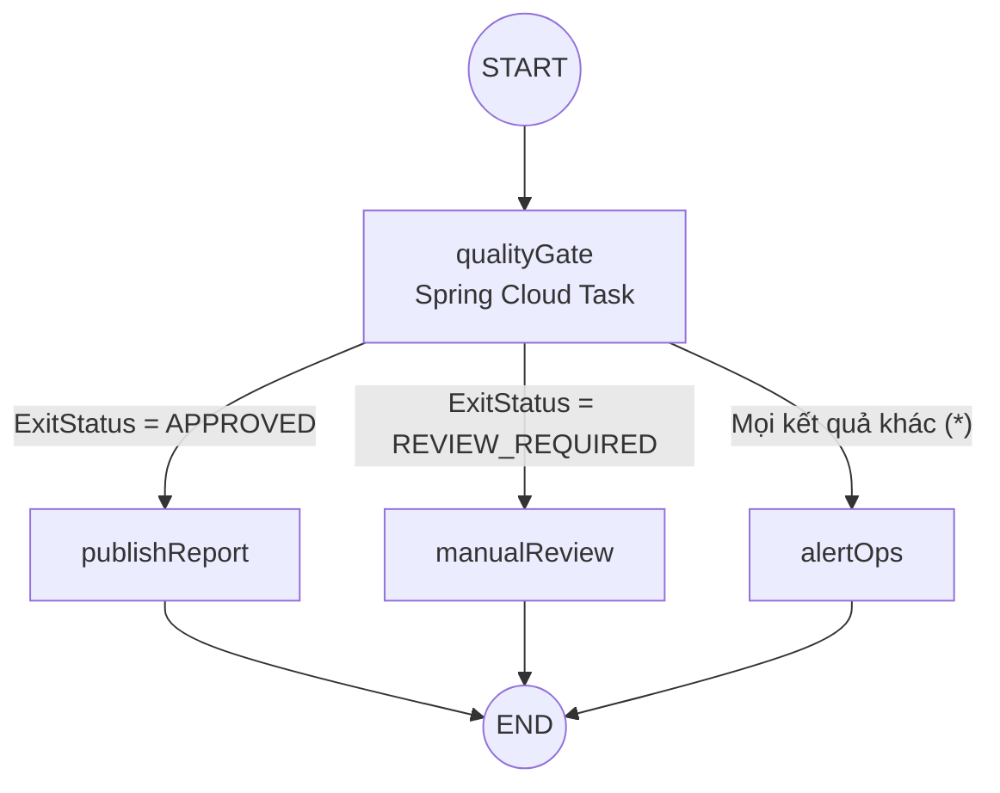
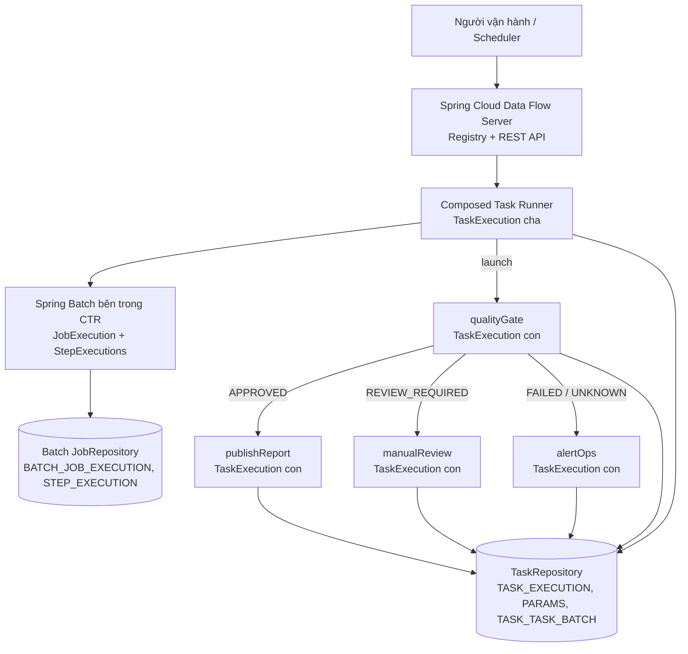
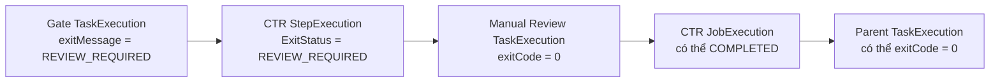

# Xây dựng luồng Data Flow có điều kiện và đối soát các lần chạy

## Mục tiêu thực hành

Trong chương **Thực hành** của mô-đun **Spring Cloud Task**, chúng ta xây dựng một bài lab hoàn chỉnh về **Spring Cloud Data Flow (SCDF)** và **Composed Task Runner (CTR)**: khởi chạy các ứng dụng Spring Cloud Task hữu hạn, rẽ nhánh theo kết quả của bước kiểm tra, rồi **đối soát từng lượt chạy ở cả cấp TaskExecution và Batch JobExecution**.

Khi hoàn thành, bạn sẽ biết:

- Xây dựng ứng dụng Spring Boot + Spring Cloud Task có `ApplicationRunner` và `@AfterTask` để phát **`exitMessage` có kiểm soát**.
- Tạo luồng **transition** có điều kiện bằng Data Flow Task DSL: `'APPROVED' ->`, `'REVIEW_REQUIRED' ->` và `'*' ->`.
- Phân biệt điều kiện `&&` (chỉ đi tiếp khi bước trước thành công) với transition `->` và split song song `<A || B>`.
- Đăng ký ứng dụng Task, tạo **một composed task definition** và thử nhiều lần chạy với các kết quả khác nhau.
- Dùng **SCDF Shell/UI**, `TaskRepository` và `Batch JobRepository` để tìm quan hệ **parent CTR → child TaskExecutions → CTR JobExecution → StepExecutions**.
- Chứng minh nhánh **không được chọn không khởi chạy**, nhận diện một lỗi được chuyển sang nhánh cảnh báo nhưng **chưa được sửa về mặt nghiệp vụ**.
- So sánh launch mới với **restart Job CTR thất bại**, kiểm soát định danh lần chạy và tránh xử lý dữ liệu trùng.
- Lập bảng đối soát kỳ vọng/thực tế, kiểm tra sự cố thiếu metadata, exit code, timeout, dữ liệu nghiệp vụ, bảo mật và idempotency.

> **Phạm vi:** Đây là bài lab xây dựng trên **một ứng dụng Task mẫu không ghi giao dịch thật**. Để thực hiện với dữ liệu tiền/đơn hàng của tổ chức, phải thay logic giả lập bằng kiểm tra dữ liệu và writer có transaction, idempotency, quyền truy cập và giám sát phù hợp.

## 1. Kịch bản: đóng sổ giao dịch cho thuê

Giả sử một hệ thống cho thuê phải quyết định có phát hành báo cáo thanh toán cho ngày nghiệp vụ `2026-11-23` không. Quy trình gồm:

1. **`qualityGate`:** kiểm tra số dòng, checksum và chênh lệch đối soát của đợt dữ liệu.
2. Nếu kết quả `APPROVED` → **`publishReport`**, phát hành báo cáo.
3. Nếu kết quả `REVIEW_REQUIRED` → **`manualReview`**, tạo yêu cầu rà soát.
4. Nếu lỗi kỹ thuật `FAILED` hoặc kết quả lạ → **`alertOps`**, báo cho nhóm vận hành.



Luồng được mô tả bằng **Composed Task DSL**:

```text
qualityGate 'APPROVED' -> publishReport
            'REVIEW_REQUIRED' -> manualReview
            '*' -> alertOps
```

Đây là một **DSL duy nhất**, được xuống dòng để dễ đọc. Trong các lệnh Shell ở phần sau, viết nó thành **một chuỗi** trong dấu ngoặc kép.

### 1.1. Ma trận kết quả phải kiểm chứng

| Ca chạy | Kết quả của `qualityGate` | Child tiếp theo phải chạy | Child không được chạy |
| --- | --- | --- | --- |
| A — Phê duyệt | `exitCode=0`, `exitMessage=APPROVED` | `publishReport` | `manualReview`, `alertOps` |
| B — Cần kiểm tra | `exitCode=0`, `exitMessage=REVIEW_REQUIRED` | `manualReview` | `publishReport`, `alertOps` |
| C — Lỗi kỹ thuật | `exitCode != 0`, không có custom exit message | `alertOps` qua wildcard nếu CTR ánh xạ lỗi thành `FAILED` | `publishReport`, `manualReview` |
| D — Trạng thái lạ | `exitCode=0`, `exitMessage=UNKNOWN` | `alertOps` qua wildcard | `publishReport`, `manualReview` |

**Phân biệt hai điều rất quan trọng:**

- `REVIEW_REQUIRED` **không nhất thiết là lỗi tiến trình**. Một Task có thể hoàn thành bình thường (`exitCode=0`) nhưng phát kết quả nghiệp vụ cần con người xem xét.
- Một **child Task thất bại được bắt bởi transition** có thể dẫn tới nhánh cảnh báo chạy thành công, và Job điều phối có thể kết thúc theo đường đã xử lý. Điều đó **không có nghĩa tác vụ đối soát đã thành công**.

Ở bài lab, `manualReview` và `alertOps` chỉ ghi log để bạn nhìn thấy nhánh được chọn. **Trong production, cần lưu ticket hoặc event cảnh báo bền vững**, không coi một dòng log là đã xử lý sự cố.

## 2. Kiến trúc và các loại ID cần đối soát



Một lần `task launch rentalCloseFlow` thường tạo:

- **Một TaskExecution cha** của tiến trình CTR.
- **Một Spring Batch JobExecution** bên trong CTR. Các node trong đồ thị tương ứng những Step của Job điều phối.
- **Một TaskExecution con** của `qualityGate`.
- **Một TaskExecution con** của **nhánh thực sự được chọn**.

Như vậy, với mỗi ca trong ma trận, **thường có 3 TaskExecution của lần chạy** (1 cha + 2 con); số lượng thực tế có thể khác khi launch thất bại trước khi tạo metadata, có retry, hoặc cấu hình SCDF phát sinh các bước bổ trợ. Không được suy số lượng chỉ từ log mà phải **đếm các record có cùng `parentExecutionId`**.

### 2.1. Đừng đánh đồng các lớp trạng thái

| Thuộc tính | Nơi lưu | Ví dụ | Chỉ ra điều gì? |
| --- | --- | --- | --- |
| `TaskExecution.exitCode` | `TASK_EXECUTION.EXIT_CODE` | `0` hoặc khác `0` | Kết quả một tiến trình Task |
| `TaskExecution.exitMessage` | `TASK_EXECUTION.EXIT_MESSAGE` | `APPROVED`, `REVIEW_REQUIRED` | Thông điệp mà CTR có thể dùng làm `ExitStatus` |
| `Batch StepExecution.exitStatus` | `BATCH_STEP_EXECUTION.EXIT_CODE` | `APPROVED`, `FAILED` | Kết quả chuyển nhánh trong Job CTR |
| `Batch JobExecution.status` | `BATCH_JOB_EXECUTION.STATUS` | `COMPLETED`, `FAILED` | Trạng thái **Job điều phối** |
| `TaskExecution.parentExecutionId` | `TASK_EXECUTION.PARENT_TASK_EXECUTION_ID` | `1200` | Liên kết child Task với parent CTR |
| `TaskExecutionId` | `TASK_EXECUTION.TASK_EXECUTION_ID` | `1201` | ID **một lượt** Task, khác JobExecutionId |

Nếu `qualityGate` ghi `exitMessage=REVIEW_REQUIRED`, **`exitCode` vẫn có thể bằng `0`**. Đây là trường hợp **kết quả nghiệp vụ có điều kiện**, không phải thất bại hạ tầng.

## 3. Điều kiện tiên quyết

Để thực hiện lab, cần có môi trường:

1. **SCDF Server** đang chạy, có Task platform hoạt động (Local, Cloud Foundry hoặc Kubernetes) và truy cập được từ SCDF Shell/UI.
2. **Composed Task Runner artifact/image** được SCDF cấu hình đúng phiên bản; CTR cần gọi được **SCDF REST API** từ chính JVM/container của nó.
3. **Database bền vững dùng chung cho metadata**, hoặc cấu hình kho phù hợp để SCDF/CTR nhìn thấy các `TaskExecution` mà child ghi. Dùng PostgreSQL/MariaDB/MySQL theo dialect/script được hỗ trợ; **không dùng H2 in-memory độc lập trong từng child** để kiểm chứng parent–child.
4. Schema Spring Cloud Task (`TASK_`), Spring Batch (`BATCH_`) và SCDF đã được khởi tạo/migration theo **đúng version**. Tài khoản runtime có quyền tối thiểu.
5. Java/Maven/registry để build và publish **một artifact Task** mà mọi node của đồ thị có thể tải.
6. Quyền xem `Tasks / Executions`, `Jobs / Executions` và quyền đọc **chỉ đọc** trên các bảng metadata cho phần đối soát.

### 3.1. Phiên bản nào?

Các ví dụ Java dùng phong cách **Java 17 + Spring Boot 3.x + Spring Cloud Task 3.x** với BOM tương thích; cú pháp Composed Task DSL và Shell dựa trên **Spring Cloud Data Flow 2.11.x**. **Không mặc định mọi bản Spring Boot/Task 3.x đều được deploy vào mọi bản SCDF 2.11.x**: chọn đúng release train/CTR/task app được môi trường hỗ trợ. Nếu SCDF đang dùng dòng cũ, phải chọn phiên bản app/JDK tương thích với platform đó và điều chỉnh API/package.

Lệnh `task launch` trong phần thực hành sử dụng **SCDF Shell**, không phải Bash, PowerShell hay `kubectl`. Các dòng như `dataflow:>` là prompt minh họa; khi copy lệnh vào Shell, **bỏ prompt**.

### 3.2. Những biến hệ thống cần thống nhất

| Biến/khái niệm | Giá trị minh họa | Mục đích |
| --- | --- | --- |
| `businessDate` | `2026-11-23` | Định danh kỳ nghiệp vụ |
| `runKey` | `rental-close-2026-11-23` | Khóa tương quan/idempotency nghiệp vụ |
| `flowName` | `rentalCloseFlow` | Tên composed task definition |
| `parentTaskExecutionId` | Giá trị SCDF tạo khi launch | Đối soát toàn bộ tiến trình CTR |
| `jobExecutionId` | Giá trị Spring Batch tạo cho CTR | Xem Step nào đi qua nhánh nào |
| `childTaskExecutionIds` | Giá trị TaskRepository tạo | Kiểm chứng các ứng dụng con thực sự chạy |

`runKey` **không phải** `TaskExecutionId` và không nên phụ thuộc vào tên Pod. Một kỳ nghiệp vụ có thể được chạy lại, nhưng mỗi lần Task khởi chạy nhận TaskExecutionId riêng. Cần xác định rõ khi nào muốn “chạy lại cùng nghiệp vụ” và khi nào muốn “tạo một đợt nghiệp vụ mới”.

## 4. Tạo một ứng dụng Child Task dùng lại cho bốn node

Để tập trung vào Data Flow, chúng ta dùng **một JAR Spring Cloud Task** và đăng ký nó **bốn lần với bốn tên ứng dụng khác nhau**. Mỗi node truyền property `lab.action` để JAR biết nhiệm vụ của mình.

Các giá trị action:

| `lab.action` | Vai trò của node | Trạng thái/side effect demo |
| --- | --- | --- |
| `gate` | Đánh giá điều kiện | Phát `APPROVED`, `REVIEW_REQUIRED`, `UNKNOWN` hoặc giả lập exception |
| `publish` | Xuất báo cáo | Chỉ ghi log `REPORT_PUBLISHED_DEMO` |
| `review` | Đưa vào hàng chờ rà soát | Chỉ ghi log `MANUAL_REVIEW_REQUESTED_DEMO` |
| `alert` | Thông báo lỗi | Chỉ ghi log `OPS_ALERT_DEMO` |

Ứng dụng mẫu không ghi file hay dữ liệu thực, vì **mục đích là chứng minh đường rẽ nhánh và metadata**.

### 4.1. Các dependencies

Tạo project Java 17 bằng Spring Initializr hoặc Maven, dùng Spring Boot parent và **Spring Cloud BOM** phù hợp. Phần dependencies cốt lõi:

```xml
<dependencies>
    <dependency>
        <groupId>org.springframework.cloud</groupId>
        <artifactId>spring-cloud-starter-task</artifactId>
    </dependency>
    <dependency>
        <groupId>org.springframework.boot</groupId>
        <artifactId>spring-boot-starter-jdbc</artifactId>
    </dependency>
    <dependency>
        <groupId>org.postgresql</groupId>
        <artifactId>postgresql</artifactId>
        <scope>runtime</scope>
    </dependency>
    <dependency>
        <groupId>org.springframework.boot</groupId>
        <artifactId>spring-boot-starter-test</artifactId>
        <scope>test</scope>
    </dependency>
</dependencies>
```

Đây là đoạn **dependencies**, không phải một `pom.xml` hoàn chỉnh. Với các platform không dùng PostgreSQL, thay driver/dialect bằng loại được môi trường hỗ trợ. **Không thêm Spring Batch vào child chỉ để CTR hoạt động**: CTR mới là ứng dụng dùng Spring Batch để điều phối đồ thị. Một child có thể dùng Batch riêng nếu bài toán cần, nhưng đó là tầng JobExecution khác.

### 4.2. Lớp khởi động

Tệp `src/main/java/com/example/flowlab/FlowLabApplication.java`:

```java
package com.example.flowlab;

import org.springframework.boot.SpringApplication;
import org.springframework.boot.autoconfigure.SpringBootApplication;
import org.springframework.cloud.task.configuration.EnableTask;

@SpringBootApplication
@EnableTask
public class FlowLabApplication {

    public static void main(String[] args) {
        SpringApplication.run(FlowLabApplication.class, args);
    }
}
```

Ứng dụng **không chạy web server**; `@EnableTask` kích hoạt vòng đời Task. Trong lab, **không tạo `ApplicationRunner` thứ hai** vì có thể khiến quá trình xử lý phát ra nhiều side effect mà người học không dự kiến.

### 4.3. State holder cho exit message

Tệp `src/main/java/com/example/flowlab/LabOutcome.java`:

```java
package com.example.flowlab;

import org.springframework.stereotype.Component;

@Component
public class LabOutcome {

    private volatile String exitMessage;

    public void setExitMessage(String message) {
        this.exitMessage = message;
    }

    public String getExitMessage() {
        return exitMessage;
    }
}
```

Mỗi child được SCDF chạy trong **JVM/container riêng**; state holder này chỉ giữ kết quả tạm thời của **một lần Task**, không được dùng làm kho lưu dữ liệu nghiệp vụ. Dùng `volatile` để tránh vấn đề hiển thị giữa các thread nếu sau này chuyển logic thành async, nhưng lab hiện tại chạy đồng bộ trong runner.

### 4.4. Runner mô phỏng kiểm tra chất lượng và các nhánh

Tệp `src/main/java/com/example/flowlab/FlowLabRunner.java`:

```java
package com.example.flowlab;

import org.slf4j.Logger;
import org.slf4j.LoggerFactory;
import org.springframework.boot.ApplicationArguments;
import org.springframework.boot.ApplicationRunner;
import org.springframework.core.env.Environment;
import org.springframework.stereotype.Component;

@Component
public class FlowLabRunner implements ApplicationRunner {

    private static final Logger log =
            LoggerFactory.getLogger(FlowLabRunner.class);

    private final Environment environment;
    private final LabOutcome outcome;

    public FlowLabRunner(Environment environment, LabOutcome outcome) {
        this.environment = environment;
        this.outcome = outcome;
    }

    @Override
    public void run(ApplicationArguments args) {
        String action = environment.getProperty(
                "lab.action", "gate");
        String runKey = environment.getProperty(
                "lab.run-key", "rental-close-2026-11-23");

        log.info("NODE_START action={} runKey={}", action, runKey);

        switch (action) {
            case "gate" -> runGate(runKey);
            case "publish" -> log.info(
                    "REPORT_PUBLISHED_DEMO runKey={}", runKey);
            case "review" -> log.info(
                    "MANUAL_REVIEW_REQUESTED_DEMO runKey={}", runKey);
            case "alert" -> log.warn(
                    "OPS_ALERT_DEMO runKey={}", runKey);
            default -> throw new IllegalArgumentException(
                    "Unknown lab.action");
        }

        log.info("NODE_END action={} runKey={}", action, runKey);
    }

    private void runGate(String runKey) {
        String selected = environment.getProperty(
                "lab.outcome", "APPROVED");

        if ("CRASH".equals(selected)) {
            throw new IllegalStateException(
                    "Simulated technical failure in quality gate");
        }

        if (!"APPROVED".equals(selected)
                && !"REVIEW_REQUIRED".equals(selected)
                && !"UNKNOWN".equals(selected)) {
            throw new IllegalArgumentException(
                    "Unsupported lab.outcome");
        }

        // Lab: đặt nhãn kết quả. Thực tế: xác minh row count,
        // checksum, businessDate và dữ liệu nguồn/đích trước.
        outcome.setExitMessage(selected);
        log.info("QUALITY_GATE_RESULT runKey={} result={}",
                runKey, selected);
    }
}
```

**Tính chất của ví dụ:**

- Khi `lab.action=gate` và `lab.outcome=APPROVED`, runner chạy xong bình thường và lưu tạm exit message `APPROVED`.
- Khi `lab.outcome=REVIEW_REQUIRED`, runner cũng chạy xong bình thường nhưng kết quả nghiệp vụ là cần rà soát.
- Khi `lab.outcome=UNKNOWN`, runner kết thúc bình thường nhưng DSL sẽ dùng wildcard để chuyển sang cảnh báo.
- Khi `lab.outcome=CRASH`, runner **ném exception trước khi set exit message**. Khi không có custom exit message và runtime ghi `exitCode` khác `0`, CTR có thể ánh xạ `ExitStatus=FAILED`.
- Các action `publish/review/alert` **không đặt custom exit message**; khi thành công, CTR thường nhận `COMPLETED` từ `exitCode=0`.

**Lưu ý:** Các chuỗi `REPORT_PUBLISHED_DEMO` hay `MANUAL_REVIEW_REQUESTED_DEMO` chỉ phục vụ kiểm chứng log. Một ứng dụng production phải **ghi báo cáo/ticket theo khóa idempotency** và chỉ hoàn thành sau khi dữ liệu đã commit.

### 4.5. Dùng `@AfterTask` để đặt exit message cho CTR

Tệp `src/main/java/com/example/flowlab/OutcomeTaskListener.java`:

```java
package com.example.flowlab;

import org.springframework.cloud.task.listener.annotation.AfterTask;
import org.springframework.cloud.task.repository.TaskExecution;
import org.springframework.stereotype.Component;

@Component
public class OutcomeTaskListener {

    private final LabOutcome outcome;

    public OutcomeTaskListener(LabOutcome outcome) {
        this.outcome = outcome;
    }

    @AfterTask
    public void beforeTaskRecordIsFinalized(TaskExecution execution) {
        String message = outcome.getExitMessage();
        if (message != null) {
            execution.setExitMessage(message);
        }
    }
}
```

Theo tài liệu Spring Cloud Task, `@AfterTask` được gọi **trước khi cập nhật trạng thái cuối của TaskExecution vào TaskRepository**. Ở đây, `@AfterTask` không được dùng để sửa `exitCode`: nó chỉ ghi **nhãn kết quả có điều kiện**.

Một sai lầm phổ biến là đặt `taskExecution.setExitMessage("APPROVED")` trong **mọi** lượt `@AfterTask`, kể cả khi runner đã thất bại. Điều đó có thể làm CTR nhận trạng thái sai và đi vào nhánh phát hành báo cáo. Trong lab, `LabOutcome` chỉ có giá trị sau khi `runGate` vượt qua kiểm tra; `CRASH` hoặc exception trước đó không ghi nhãn thành công.

**Ghi nhớ:** Spring Cloud Task ưu tiên các exit message listener theo vòng đời; `@AfterTask` có thể ghi đè message của callback trước. Khi có nhiều listener, cần làm rõ thứ tự và không để listener khác vô tình thay kết quả.

### 4.6. Cấu hình application

Tệp `src/main/resources/application.yml`:

```yaml
spring:
  main:
    web-application-type: none
  cloud:
    task:
      closecontext-enabled: true
      initialize-enabled: false
  datasource:
    url: "${LAB_TASK_DB_URL}"
    username: "${LAB_TASK_DB_USERNAME}"
    password: "${LAB_TASK_DB_PASSWORD}"
    driver-class-name: org.postgresql.Driver

lab:
  action: gate
  outcome: APPROVED
  run-key: rental-close-2026-11-23
```

Các biến `LAB_TASK_DB_*` phải được **platform/secret store** cấp cho mọi child. `initialize-enabled=false` giả định schema Task đã được chuẩn bị bằng migration phù hợp. **Không dùng giá trị password thật trong Task DSL/`app.*` properties** vì nó có thể xuất hiện trong metadata và log của scheduler.

SCDF/CTR cũng phải dùng kho metadata mà **nó có thể đọc các child executions**, cùng phương thức phân quyền phù hợp. Nếu từng child chạy với H2 in-memory riêng, việc đối soát parent–child và polling của CTR sẽ không đáng tin cậy.

### 4.7. Unit test nhỏ cho kết quả của gate

Trong JUnit 5, có thể kiểm tra logic một cách độc lập bằng `MockEnvironment`. Ví dụ kiểm tra `APPROVED` và `CRASH`:

```java
package com.example.flowlab;

import org.junit.jupiter.api.Test;
import org.springframework.boot.DefaultApplicationArguments;
import org.springframework.mock.env.MockEnvironment;

import static org.junit.jupiter.api.Assertions.*;

class FlowLabRunnerTest {

    @Test
    void approvedSetsExitMessage() {
        LabOutcome outcome = new LabOutcome();
        MockEnvironment env = new MockEnvironment()
                .withProperty("lab.action", "gate")
                .withProperty("lab.outcome", "APPROVED");

        new FlowLabRunner(env, outcome).run(
                new DefaultApplicationArguments());

        assertEquals("APPROVED", outcome.getExitMessage());
    }

    @Test
    void crashDoesNotForgeApprovedMessage() {
        LabOutcome outcome = new LabOutcome();
        MockEnvironment env = new MockEnvironment()
                .withProperty("lab.action", "gate")
                .withProperty("lab.outcome", "CRASH");

        assertThrows(IllegalStateException.class,
                () -> new FlowLabRunner(env, outcome).run(
                        new DefaultApplicationArguments()));

        assertNull(outcome.getExitMessage());
    }
}
```

Unit test chỉ chứng minh state/exception của Java; **chưa xác minh SCDF đã launch nhánh nào**. Bằng chứng thực tế phải đến từ các bước launch và truy vấn metadata phía sau.

## 5. Build và đăng ký ứng dụng vào SCDF

Build JAR tại dự án mẫu của bạn (không phải trong repository bài học):

```bash
./mvnw clean verify
./mvnw package
```

Lệnh chỉ là hướng dẫn thực hành; cần **Maven project hoàn chỉnh**, các dependency version được BOM quản lý và test chạy thành công. Publish artifact vào registry mà **SCDF Server/Task platform thực sự truy cập được**. `mvn install` trên laptop của một người chưa chắc làm artifact có sẵn cho SCDF chạy ở container/cluster khác.

### 5.1. Đăng ký cùng JAR dưới bốn tên

Ví dụ dùng Maven artifact đã publish là `com.example:flow-lab-task:1.0.0`:

```text
dataflow:> app register --name qualityGate --type task --uri maven://com.example:flow-lab-task:1.0.0
dataflow:> app register --name publishReport --type task --uri maven://com.example:flow-lab-task:1.0.0
dataflow:> app register --name manualReview --type task --uri maven://com.example:flow-lab-task:1.0.0
dataflow:> app register --name alertOps --type task --uri maven://com.example:flow-lab-task:1.0.0
```

Cả bốn tên chỉ về **một artifact**, nhưng mỗi node có **cấu hình `lab.action` khác nhau** trong DSL. Trong hệ thống thật, bạn có thể thay chúng bằng bốn ứng dụng Task hoàn toàn khác nhau mà không đổi nguyên tắc transition.

Nếu platform dùng Kubernetes và chỉ hỗ trợ Docker/OCI image theo thiết kế của môi trường, đăng ký URI kiểu `docker:registry.example.com/flow-lab-task:1.0.0` thay cho Maven URI. Cần đảm bảo image tag, JDK, registry credentials và entrypoint phù hợp.

### 5.2. Không cần tạo bốn task definition thủ công trước

SCDF có thể tạo **child task definitions** tương ứng các node khi tạo composed task. Ví dụ với composed task tên `rentalCloseFlow`, tên child thường có dạng `rentalCloseFlow-qualityGate` và `rentalCloseFlow-publishReport`. Tên chính xác phụ thuộc DSL/label và phiên bản; kiểm tra `task list` thay vì hardcode.

**Phân biệt:**

- `app register` đăng ký **ứng dụng** (`qualityGate`, `publishReport`...).
- `task create rentalCloseFlow --definition "...DSL..."` tạo **đồ thị** và các child definitions tương ứng.
- `task launch rentalCloseFlow` tạo **lượt chạy** và các `TaskExecution`.

Nếu đã tạo các task definition khác trùng tên, hãy kiểm tra trước khi tạo composed task; không tự xóa definition hoặc lịch sử của người khác.

## 6. Tạo luồng có điều kiện bằng DSL

Lệnh chính trong **SCDF Shell**:

```text
dataflow:> task create rentalCloseFlow --definition "qualityGate --lab.action=gate --lab.outcome=APPROVED 'APPROVED' -> publishReport --lab.action=publish 'REVIEW_REQUIRED' -> manualReview --lab.action=review '*' -> alertOps --lab.action=alert"
```

Chuỗi DSL này có **một node đầu vào** `qualityGate` và **ba transition đi ra từ chính node ấy**.

| Đoạn DSL | Ý nghĩa |
| --- | --- |
| `qualityGate --lab.action=gate` | Chạy cùng JAR ở chế độ kiểm tra |
| `--lab.outcome=APPROVED` | Giá trị mặc định để thử lần đầu |
| `'APPROVED' -> publishReport` | Nhánh phê duyệt |
| `'REVIEW_REQUIRED' -> manualReview` | Nhánh cần rà soát |
| `'*' -> alertOps` | Nhánh bắt mọi ExitStatus khác hai nhánh trước |
| `--lab.action=publish/review/alert` | Cấu hình vai trò của từng node đích |

**Đừng đọc DSL như chuỗi tuần tự** `qualityGate -> publishReport -> manualReview -> alertOps`. Đây là **ba cạnh rẽ nhánh** từ một điểm quyết định; trong mỗi lượt của lab, chỉ có **một node đích** được khởi chạy.

### 6.1. Kiểm tra đồ thị trước khi launch

Trong SCDF Shell:

```text
dataflow:> task list
dataflow:> task validate rentalCloseFlow
```

Trên Dashboard, mở **Tasks → Definitions → rentalCloseFlow → Details** (tên menu thay đổi theo phiên bản), xem đồ thị được render có đúng ba cạnh transition và đúng một Start/End. Nếu `task validate` hoặc màn hình hiển thị lỗi, kiểm tra ứng dụng đã đăng ký, URI có thể resolve, kiểu app là `task` và phiên bản DSL/CTR.

**Không launch cho đến khi đã xác nhận đúng sơ đồ**, đặc biệt với nhánh có khả năng gửi thông báo hoặc ghi dữ liệu thật.

### 6.2. Vì sao không dùng `&&` cho cả ba nhánh?

Sai nếu mục tiêu là rẽ nhánh:

```text
qualityGate && publishReport && manualReview && alertOps
```

`&&` có nghĩa bước tiếp theo chỉ được chạy nếu bước trước hoàn tất thành công; nó **không xem `APPROVED` và `REVIEW_REQUIRED` như các nhãn nghiệp vụ riêng**. Với DSL đó, bạn có thể vô tình chạy cả ba hoạt động sau gate.

`||` trong `<A || B>` lại có nghĩa **chạy song song**, không phải fallback khi A thất bại. Luồng học ở đây **chọn một nhánh** bằng transition `'STATUS' -> task`.

### 6.3. Điều kiện fallback an toàn

Trong lab, `'*' -> alertOps` bắt các giá trị bất ngờ. Nếu bỏ wildcard và gate trả `UNKNOWN`, CTR có thể **kết thúc flow mà không launch nhánh xử lý nào**. Vì vậy, một cổng kiểm soát quan trọng nên có đường xử lý **default/unknown** hoặc cơ chế fail-fast rõ ràng.

Tuy nhiên, `alertOps` thành công **không sửa lỗi**. Báo cáo đối soát phải lưu kết quả cuối của gate và trạng thái ticket/cảnh báo, không được đánh dấu `APPROVED` chỉ vì Job CTR kết thúc `COMPLETED`.

## 7. Launch một composed task nhiều lần để kiểm chứng các nhánh

SCDF hỗ trợ **truyền application properties cho từng child khi launch** bằng tiền tố `app.<child-app-name>.<property>`. Các properties tại launch có ưu tiên cao hơn giá trị tương ứng trong task definition theo tài liệu SCDF 2.x.

Trong bài lab, ta giữ **một composed task definition `rentalCloseFlow`** và thay property `app.qualityGate.lab.outcome` qua mỗi lần launch. Các đối số `--arguments` dưới đây được truyền cho **CTR**, khác với `--properties` gắn cho child.

### 7.1. Ca A — Đạt kiểm tra và phát hành báo cáo

```text
dataflow:> task launch rentalCloseFlow --arguments "--increment-instance-enabled=true --interval-time-between-checks=1000 --max-wait-time=120000" --properties "app.qualityGate.lab.outcome=APPROVED"
```

Kỳ vọng sau khi các child kết thúc:

```text
rentalCloseFlow (CTR parent)
  qualityGate       exitCode=0, exitMessage=APPROVED
  publishReport     exitCode=0, exitMessage=null
  manualReview      KHÔNG CÓ TaskExecution của lần này
  alertOps          KHÔNG CÓ TaskExecution của lần này
```

Ở log `publishReport`, tìm `REPORT_PUBLISHED_DEMO`. Nếu không thấy child `publishReport`, cần đối chiếu `TASK_EXECUTION.EXIT_MESSAGE` của gate và `ExitStatus` Step CTR, không chỉ tìm log `NODE_END`.

### 7.2. Ca B — Cần rà soát thủ công

```text
dataflow:> task launch rentalCloseFlow --arguments "--increment-instance-enabled=true --interval-time-between-checks=1000 --max-wait-time=120000" --properties "app.qualityGate.lab.outcome=REVIEW_REQUIRED"
```

Kỳ vọng:

```text
rentalCloseFlow (CTR parent, lần chạy khác)
  qualityGate       exitCode=0, exitMessage=REVIEW_REQUIRED
  manualReview      exitCode=0, exitMessage=null
  publishReport     KHÔNG CHẠY
  alertOps          KHÔNG CHẠY
```

`manualReview` in `MANUAL_REVIEW_REQUESTED_DEMO`. **Lượt này không được coi là đã phát hành báo cáo**, dù cả hai child đã hoàn tất kỹ thuật.

### 7.3. Ca C — Gate lỗi kỹ thuật

```text
dataflow:> task launch rentalCloseFlow --arguments "--increment-instance-enabled=true --interval-time-between-checks=1000 --max-wait-time=120000" --properties "app.qualityGate.lab.outcome=CRASH"
```

Kỳ vọng khi Spring Cloud Task ghi được lỗi và CTR vẫn xử lý transition:

```text
rentalCloseFlow (CTR parent, lần chạy khác)
  qualityGate       exitCode != 0
                    exitMessage=null (không set tùy chỉnh)
                    errorMessage có thông tin exception
  alertOps          exitCode=0, exitMessage=null
  publishReport     KHÔNG CHẠY
  manualReview      KHÔNG CHẠY
```

Theo quy tắc CTR của tài liệu SCDF 2.11, **nếu child không có `ExitMessage`**, `ExitCode=0` ánh xạ `COMPLETED`, còn **mã khác `0`** ánh xạ `FAILED`. Wildcard bắt nhánh này nếu CTR có thể đọc kết quả và tiếp tục graph. Nếu child không tạo được TaskExecution hoặc SCDF launch lỗi trước khi có metadata, CTR có thể **không đi theo wildcard bình thường**; khi đó kiểm tra log CTR, `max-wait-time` và lỗi platform.

**Đây là lỗi cần điều tra thật**, dù `alertOps` chạy. Nếu cảnh báo thất bại hoặc không ghi ticket bền vững, không được “coi như đã xử lý sự cố”.

### 7.4. Ca D — Kết quả chưa biết

```text
dataflow:> task launch rentalCloseFlow --arguments "--increment-instance-enabled=true --interval-time-between-checks=1000 --max-wait-time=120000" --properties "app.qualityGate.lab.outcome=UNKNOWN"
```

Kỳ vọng:

```text
rentalCloseFlow (CTR parent, lần chạy khác)
  qualityGate       exitCode=0, exitMessage=UNKNOWN
  alertOps          exitCode=0
  publishReport     KHÔNG CHẠY
  manualReview      KHÔNG CHẠY
```

`UNKNOWN` minh họa **giá trị nghiệp vụ lạ nhưng Task không lỗi kỹ thuật**. Wildcard vẫn phải chọn `alertOps`. Không dùng mã thoát `0` đơn độc để suy ra “được phê duyệt”.

### 7.5. Cách nhận ID của từng lần chạy

Sau **mỗi lệnh launch**, ghi lại **parent TaskExecutionId** từ:

```text
dataflow:> task execution list
```

Hoặc mở Dashboard **Tasks → Executions** và tìm composed task `rentalCloseFlow` theo thời gian. Ghi ID thực tế vào bảng:

| Ca | Parent TaskExecutionId | Gate child ID | Child được chọn ID | CTR JobExecutionId |
| --- | --- | --- | --- | --- |
| A | *điền sau khi chạy* | *điền* | *điền* | *điền* |
| B | *điền sau khi chạy* | *điền* | *điền* | *điền* |
| C | *điền sau khi chạy* | *điền* | *điền* | *điền* |
| D | *điền sau khi chạy* | *điền* | *điền* | *điền* |

**Không tự suy ID từ số thứ tự launch**. Các nền tảng có thể có nhiều Task chạy đồng thời, retry và sequence đã dùng trước đó. ID thật phải đọc từ repository/SCDF response.

## 8. Đối soát cấp 1: TaskExecution cha và các child

Mỗi composed task chạy trong một CTR process, còn mỗi node được chọn là **process/container riêng**. Spring Cloud Task ghi metadata trong `TASK_EXECUTION`; SCDF truyền **parent execution ID** cho child khi tích hợp đúng.

### 8.1. Liệt kê parent và các child bằng SQL

Ví dụ SQL (schema mặc định; sửa tên schema/prefix theo hệ thống):

```sql
SELECT
    p.TASK_EXECUTION_ID AS PARENT_ID,
    p.TASK_NAME AS FLOW_NAME,
    p.START_TIME AS FLOW_START,
    p.END_TIME AS FLOW_END,
    p.EXIT_CODE AS FLOW_EXIT_CODE,
    c.TASK_EXECUTION_ID AS CHILD_ID,
    c.TASK_NAME AS CHILD_NAME,
    c.START_TIME AS CHILD_START,
    c.END_TIME AS CHILD_END,
    c.EXIT_CODE AS CHILD_EXIT_CODE,
    c.EXIT_MESSAGE AS CHILD_EXIT_MESSAGE
FROM TASK_EXECUTION p
LEFT JOIN TASK_EXECUTION c
    ON c.PARENT_TASK_EXECUTION_ID = p.TASK_EXECUTION_ID
WHERE p.TASK_EXECUTION_ID = 1200
ORDER BY c.START_TIME, c.TASK_EXECUTION_ID;
```

`1200` là **ID minh họa**, thay bằng ID parent của ca A/B/C/D. Truy vấn dùng `LEFT JOIN` để vẫn thấy parent nếu child chưa được launch hoặc metadata child bị thiếu.

**Cách đọc kết quả:**

1. Có **một parent** và hai child thực sự được launch theo nhánh.
2. Child `qualityGate` có giá trị `EXIT_MESSAGE` đúng với ca chạy.
3. Nhánh được chọn có `END_TIME` và `EXIT_CODE` phù hợp.
4. Không có child của hai nhánh còn lại **với cùng PARENT_ID**.
5. `FLOW_END` chỉ có giá trị khi CTR đã kết thúc và ghi được metadata.

**Không tra child bằng điều kiện `TASK_NAME LIKE '%qualityGate%'` trên toàn database mà không lọc parent**: như vậy sẽ trộn nhiều lần chạy của một composed task.

### 8.2. Kiểm tra số lượng node của từng lượt

```sql
SELECT
    p.TASK_EXECUTION_ID AS PARENT_ID,
    p.TASK_NAME,
    COUNT(c.TASK_EXECUTION_ID) AS CHILD_COUNT,
    SUM(CASE
        WHEN c.TASK_EXECUTION_ID IS NOT NULL
             AND c.END_TIME IS NULL THEN 1 ELSE 0
    END) AS UNFINISHED_CHILD_COUNT,
    SUM(CASE
        WHEN c.EXIT_CODE IS NOT NULL AND c.EXIT_CODE <> 0
        THEN 1 ELSE 0
    END) AS FAILED_CHILD_COUNT
FROM TASK_EXECUTION p
LEFT JOIN TASK_EXECUTION c
    ON c.PARENT_TASK_EXECUTION_ID = p.TASK_EXECUTION_ID
WHERE p.TASK_NAME = 'rentalCloseFlow'
GROUP BY p.TASK_EXECUTION_ID, p.TASK_NAME
ORDER BY p.TASK_EXECUTION_ID DESC;
```

| Ca | `CHILD_COUNT` mong đợi | `FAILED_CHILD_COUNT` mong đợi | Giải thích |
| --- | ---: | ---: | --- |
| A | 2 | 0 | Gate + publish |
| B | 2 | 0 | Gate + review |
| C | 2 | 1 | Gate crash + alert (nếu transition thành công) |
| D | 2 | 0 | Gate UNKNOWN + alert |

Các con số là **mục tiêu kiểm chứng cho lab không retry**, không phải chuẩn bất biến của SCDF. Nếu có hơn hai child, cần điều tra duplicate launch/retry. Nếu ít hơn, xem TaskExecution còn đang chạy, metadata sai kho hoặc CTR đã dừng ở bước trước.

### 8.3. Dùng exit message để kiểm tra đúng nhánh

Nếu muốn một báo cáo gọn cho các lượt:

```sql
SELECT
    p.TASK_EXECUTION_ID AS PARENT_ID,
    p.EXIT_CODE AS PARENT_EXIT,
    MAX(CASE
        WHEN c.TASK_NAME LIKE '%qualityGate%'
        THEN c.EXIT_MESSAGE
    END) AS GATE_RESULT,
    MAX(CASE
        WHEN c.TASK_NAME LIKE '%publishReport%'
        THEN 1 ELSE 0
    END) AS HAS_PUBLISH,
    MAX(CASE
        WHEN c.TASK_NAME LIKE '%manualReview%'
        THEN 1 ELSE 0
    END) AS HAS_REVIEW,
    MAX(CASE
        WHEN c.TASK_NAME LIKE '%alertOps%'
        THEN 1 ELSE 0
    END) AS HAS_ALERT
FROM TASK_EXECUTION p
LEFT JOIN TASK_EXECUTION c
    ON c.PARENT_TASK_EXECUTION_ID = p.TASK_EXECUTION_ID
WHERE p.TASK_NAME = 'rentalCloseFlow'
GROUP BY p.TASK_EXECUTION_ID, p.EXIT_CODE
ORDER BY p.TASK_EXECUTION_ID DESC;
```

**Chỉ dùng `LIKE` như một tiện ích cho bài lab có tên node cố định.** Trong hệ thống thật, SCDF có thể gắn prefix/label; nếu tên ứng dụng đổi, hoặc `flow` có các node tên gần nhau, cần một bảng mapping node rõ ràng thay vì dùng substring làm khóa nghiệp vụ.

**Dạng đối soát mong muốn**:

| `GATE_RESULT` | `HAS_PUBLISH` | `HAS_REVIEW` | `HAS_ALERT` | Đánh giá nghiệp vụ |
| --- | ---: | ---: | ---: | --- |
| `APPROVED` | 1 | 0 | 0 | Đã đi vào đường phát hành |
| `REVIEW_REQUIRED` | 0 | 1 | 0 | **Chưa** phê duyệt; đã yêu cầu rà soát |
| `NULL` kèm child gate lỗi | 0 | 0 | 1 | Lỗi kỹ thuật đã đi đến cảnh báo |
| `UNKNOWN` | 0 | 0 | 1 | Trạng thái bất thường đã đi đến cảnh báo |

Nếu thấy `GATE_RESULT=APPROVED` **và** `HAS_REVIEW=1` cùng parent, đó là sai lệch đáng điều tra. Không tự cập nhật SQL để “sửa” biểu đồ; phải xem DSL thực tế, luồng tạo child, logs và lịch sử retry.

## 9. Đối soát cấp 2: Spring Batch JobExecution của CTR

CTR sử dụng Spring Batch để biểu diễn các node trong đồ thị bằng `StepExecution`. Khi tích hợp `spring-cloud-task-batch`/`TaskBatchExecutionListener` đúng cách, bảng `TASK_TASK_BATCH` liên kết **TaskExecution cha** với `JobExecution` của CTR.

### 9.1. Tra parent đến JobExecution

```sql
SELECT
    t.TASK_EXECUTION_ID AS CTR_TASK_ID,
    t.TASK_NAME AS COMPOSED_TASK_NAME,
    t.EXIT_CODE AS CTR_TASK_EXIT_CODE,
    j.JOB_EXEC_ID AS CTR_JOB_EXECUTION_ID,
    j.JOB_INST_ID,
    j.STATUS AS CTR_JOB_STATUS,
    j.EXIT_CODE AS CTR_JOB_EXIT_STATUS
FROM TASK_EXECUTION t
JOIN TASK_TASK_BATCH bridge
    ON bridge.TASK_EXECUTION_ID = t.TASK_EXECUTION_ID
JOIN BATCH_JOB_EXECUTION j
    ON j.JOB_EXEC_ID = bridge.JOB_EXECUTION_ID
WHERE t.TASK_EXECUTION_ID = 1200
ORDER BY j.JOB_EXEC_ID;
```

Thay `1200` bằng parent ID. `CTR_TASK_EXIT_CODE` là số nguyên, còn `CTR_JOB_EXIT_STATUS` là chuỗi do Spring Batch cung cấp. **Không ghép hai thuộc tính thành một cột số trong dashboard**.

Nếu query không trả dòng nào nhưng trong UI vẫn có JobExecution, kiểm tra:

- `spring-cloud-task-batch` và `TaskBatchExecutionListener` có hoạt động không.
- SCDF/CTR và child đã dùng **đúng datasource và schema**.
- Bảng Task có prefix khác mặc định không.
- Job của CTR được lưu trong kho Batch khác không; SQL ở trên chỉ dùng được khi hai bộ bảng có thể JOIN trực tiếp.

### 9.2. Xem Step nào đã thực thi

```sql
SELECT
    j.JOB_EXEC_ID,
    j.STATUS AS JOB_STATUS,
    j.EXIT_CODE AS JOB_EXIT_STATUS,
    s.STEP_EXEC_ID,
    s.STEP_NAME,
    s.STATUS AS STEP_STATUS,
    s.EXIT_CODE AS STEP_EXIT_STATUS,
    s.START_TIME,
    s.END_TIME
FROM BATCH_JOB_EXECUTION j
JOIN BATCH_STEP_EXECUTION s
    ON s.JOB_EXEC_ID = j.JOB_EXEC_ID
WHERE j.JOB_EXEC_ID = 501
ORDER BY s.STEP_EXEC_ID;
```

`501` là **JobExecution ID minh họa** lấy từ truy vấn trước. Đối chiếu:

- Step gắn với `qualityGate` có `STEP_EXIT_STATUS` phản ánh nhãn `APPROVED`/`REVIEW_REQUIRED` hoặc `FAILED`.
- Step tương ứng **nhánh được chọn** xuất hiện và được ghi nhận hoàn tất phù hợp.
- Những Step của nhánh **không được chọn** có thể không có StepExecution cho lần JobExecution đó.
- Khi lỗi giữa chừng hoặc restart, số StepExecution có thể khác, và cùng một tên Step có thể có nhiều StepExecution qua những lần thử.

Không suy luận `JobExecution.status=COMPLETED` là **báo cáo kinh doanh đã được phê duyệt**. Với nhánh `manualReview` hoặc `alertOps`, Job điều phối có thể đã chạy thành công đúng flow nhưng nghiệp vụ vẫn cần hành động tiếp theo.

### 9.3. Trạng thái mong đợi của từng cấp



Sơ đồ nêu một **trường hợp kỹ thuật hợp lệ**, không phải quy tắc dữ liệu của mọi version: *flow điều phối hoàn thành* khác với *đợt thanh toán đã được chấp nhận*. Hệ thống quan sát phải có **business status** độc lập như `APPROVED` / `REVIEW_REQUIRED` / `REJECTED`.

## 10. Thử một lỗi không có transition để phân biệt fail-fast

Để so sánh **lỗi được xử lý qua nhánh `alertOps`** với **lỗi khiến Job CTR thất bại**, tạo thêm **một composed task khác**, chỉ chạy trong môi trường lab:

```text
dataflow:> task create rentalCloseFailFast --definition "qualityGate --lab.action=gate --lab.outcome=CRASH && publishReport --lab.action=publish"
dataflow:> task launch rentalCloseFailFast --arguments "--increment-instance-enabled=true --max-wait-time=120000"
```

Ở đây:

- `qualityGate` cố ý ném exception.
- Không có transition `'FAILED' -> ...` hay wildcard để xử lý lỗi.
- `publishReport` **không được khởi chạy**.
- Spring Batch Job của CTR thường được đánh dấu `FAILED` vì Step trước không thành công.
- Kiểm tra riêng mã thoát của CTR Task/JVM; có những nhánh mặc định không tự chuyển `JobExecution=FAILED` thành process exit code khác `0`.

Tích hợp Spring Cloud Task/Batch có property:

```yaml
spring:
  cloud:
    task:
      batch:
        fail-on-job-failure: true
```

Property này cần đặt trong **CTR runtime**, không chỉ trong child `qualityGate`, để phản ánh Job điều phối thất bại ra kết quả Task/process theo behavior phiên bản. Cần đo **thực tế** `JobExecution.status`, `TaskExecution.exitCode` và mã thoát container trước khi lập chính sách retry.

### 10.1. Báo cáo so sánh hai loại thất bại

| Kịch bản | Gate child | Nhánh cảnh báo | Batch CTR Job | Ý nghĩa nghiệp vụ |
| --- | --- | --- | --- | --- |
| `rentalCloseFlow` với `CRASH` | Lỗi | Có thể chạy `alertOps` qua `'*'` | Có thể hoàn thành luồng đã xử lý | **Sự cố vẫn tồn tại**, cần ticket |
| `rentalCloseFailFast` | Lỗi | Không có | Thường `FAILED` | Cần sửa lỗi trước khi retry |

**Không có một trạng thái thành công duy nhất đủ cho mọi mục đích.** Đối soát cần lưu cả **technical status**, **selected branch**, **business status** và **hành động tiếp theo**.

## 11. Launch mới khác restart một composed task thất bại

Giả sử một luồng thực tế có:

```text
extractSnapshot && qualityGate && publishReport
```

Sau khi `extractSnapshot` hoàn tất, `qualityGate` thất bại. Có hai lựa chọn:

| Lựa chọn | Tác động |
| --- | --- |
| **Launch lại composed task definition** | CTR có thể tạo **JobInstance/đợt điều phối mới**; những bước trước có thể chạy lại |
| **Restart Spring Batch JobExecution của CTR đã `FAILED`** | Dựa trên JobRepository, có thể bỏ qua các Step đã hoàn tất và chạy lại từ Step lỗi |

Tài liệu SCDF hướng dẫn restart từ **Jobs → Executions → Restart** đối với Job CTR thất bại. Khi restart, hệ thống có thể tạo **TaskExecution cha mới** cho tiến trình CTR mới và **JobExecution mới** trong cùng JobInstance, trong khi các child được launch cho nhánh chạy lại nhận TaskExecution ID mới.

### 11.1. Điều kiện tiên quyết để restart có ý nghĩa

1. **Kho Batch bền vững**, chưa xóa `BATCH_JOB_EXECUTION_CONTEXT` / Step context.
2. **Identifying JobParameters** dùng để khôi phục đúng JobInstance.
3. Chính sách restart của các Step trong CTR phù hợp; không giả định mọi Step đều được chạy lại.
4. Child bị launch lại phải **idempotent** đối với cùng `runKey`/`businessDate`.
5. Không chạy chồng nhiều CTR cho cùng đợt dữ liệu nếu chúng có thể ghi đè nhau.

Trong lab, các action chỉ in log nên chạy lại không tạo bản ghi nghiệp vụ. Trong production, `publishReport` phải kiểm tra idempotency trước khi xuất bản, ví dụ tạo báo cáo theo `(businessDate, reportVersion)` và dùng atomic publish.

### 11.2. Tại sao `--increment-instance-enabled=true` có hai mặt?

Ở các lệnh launch trong mục 7, tham số CTR này giúp tạo **instance mới cho lần launch mới**, hữu ích khi thử nhiều kết quả và không muốn va chạm JobInstance đã hoàn thành. Nhưng khi cần **restart một JobInstance lỗi**, bạn phải dùng đường restart thích hợp trong **Jobs** và giữ nguyên định danh của công việc logic.

**Đừng dùng một `run.id` identifying mới để “restart” Spring Batch Job của child.** Điều đó có thể tạo JobInstance mới, bỏ qua checkpoint và làm lặp dữ liệu.

## 12. Đối soát kết quả nghiệp vụ, không chỉ metadata

Đến đây ta đã xác định được **đồ thị nào chạy**. Với hệ thống thật, bước tiếp theo là đối chiếu **nội dung xử lý**.

Một bản ghi nghiệp vụ tối thiểu cho đợt đóng sổ có thể chứa:

| Trường | Ví dụ | Vì sao cần? |
| --- | --- | --- |
| `runKey` | `rental-close-2026-11-23` | Khóa nghiệp vụ/idempotency |
| `businessDate` | `2026-11-23` | Tập dữ liệu cần xử lý |
| `snapshotId` | `snap-20261123-v1` | Xác nhận các Task dùng cùng snapshot |
| `sourceRowCount` | `150000` | Số dòng nguồn |
| `processedRowCount` | `150000` | Số dòng đã xử lý |
| `sourceChecksum` / `resultChecksum` | Hash/kiểm soát riêng | Phát hiện thiếu/lặp dữ liệu |
| `gateOutcome` | `APPROVED` hoặc `REVIEW_REQUIRED` | Kết quả nghiệp vụ của gate |
| `parentTaskExecutionId` | ID SCDF tạo | Truy vết lượt điều phối |
| `gateTaskExecutionId` | ID Task con | Truy vết lần đánh giá cụ thể |
| `publishedAt` / `ticketId` | Timestamp hoặc ID | Bằng chứng nhánh đã hoàn tất |

Với `APPROVED`, đối soát cần xác nhận:

1. Chỉ có **một báo cáo chính thức** được công bố cho `runKey`/`reportVersion`.
2. Các số liệu/chênh lệch đạt chuẩn kiểm soát.
3. `publishReport` đã **commit** kết quả, không chỉ ghi log.

Với `REVIEW_REQUIRED`:

1. **Không có báo cáo chính thức** được công bố từ nhánh đó.
2. Có ticket/record trong hệ thống rà soát với khóa duy nhất.
3. Ticket trỏ về `runKey`, parent/child TaskExecution IDs và nguyên nhân đã làm sạch.

Với `CRASH`/`UNKNOWN`:

1. Có cảnh báo bền vững hoặc event được consumer xác nhận, theo chính sách vận hành.
2. Không phát hành báo cáo.
3. Có kế hoạch retry/sửa lỗi; không âm thầm đánh dấu hoàn tất nghiệp vụ chỉ vì CTR chạy hết graph.

### 12.1. Vì sao không dùng một transaction chung cho cả đồ thị?

Các node là **những JVM/containers độc lập**. CTR chỉ điều phối thứ tự/nhánh, không tự tạo distributed transaction xuyên các child, database và broker. Một child có thể đã commit trước khi child khác lỗi.

Vì vậy, cần idempotent upsert, unique constraints, staging tables, outbox, reconciliation manifest hoặc cơ chế compensation phù hợp. **Exactly-once không tự xuất hiện** khi dùng Spring Cloud Task hoặc Composed Task Runner.

### 12.2. Một bảng báo cáo đối soát tổng hợp

| Parent ID | Gate result | Nhánh thực tế | CTR Job | Dữ liệu nghiệp vụ | Quyết định |
| --- | --- | --- | --- | --- | --- |
| *ID A* | `APPROVED` | `publishReport` | Đối chiếu từ DB | Đủ counts/checksum | Cho phép công bố |
| *ID B* | `REVIEW_REQUIRED` | `manualReview` | Đối chiếu từ DB | Có ticket, chưa publish | Chờ phê duyệt |
| *ID C* | `FAILED` theo CTR | `alertOps` hoặc không launch | Đối chiếu từ DB | Có incident | Sửa và retry |
| *ID D* | `UNKNOWN` | `alertOps` | Đối chiếu từ DB | Có incident | Kiểm tra hợp đồng trạng thái |

*Các ID và kết quả trong bảng là nhãn/tiêu chí kiểm tra, không phải dữ liệu thực được công cụ tạo ra.* Hãy điền bằng dữ liệu thu được sau mỗi lần chạy.

## 13. Kiểm thử tự động và các tiêu chí PASS/FAIL

### 13.1. Ma trận kiểm chứng cuối bài

| Test | Dữ liệu/cách chạy | Điều kiện PASS |
| --- | --- | --- |
| T1 | `APPROVED` | Parent + gate + publish; không có review/alert |
| T2 | `REVIEW_REQUIRED` | Parent + gate + review; không có publish/alert |
| T3 | `UNKNOWN` | Parent + gate + alert; không có publish/review |
| T4 | `CRASH` với wildcard | Gate báo lỗi; alert được launch nếu có metadata/transition; không publish |
| T5 | `CRASH` với `rentalCloseFailFast` | CTR Job `FAILED`; publish không chạy |
| T6 | Rerun `APPROVED` với instance mới | Parent ID và child IDs **khác** lần trước; dữ liệu nghiệp vụ không trùng |
| T7 | Restart CTR Job thất bại | Chỉ những Step cần restart được chạy lại theo metadata, không ghi trùng output |
| T8 | Child bị kill trước khi ghi `END_TIME` | Có cảnh báo/timeouts; không đánh dấu giả `APPROVED` |
| T9 | SCDF/CTR không nhìn thấy DB Task của child | Phát hiện đúng lỗi datasource/polling, không ghi kết quả thành công giả |
| T10 | Nhánh cảnh báo in log nhưng chưa ghi ticket | Đánh giá nghiệp vụ vẫn **FAIL/PENDING** chứ không thành công |

### 13.2. Kiểm tra một lần launch khác cùng định nghĩa

Launch lại ca A:

```text
dataflow:> task launch rentalCloseFlow --arguments "--increment-instance-enabled=true --max-wait-time=120000" --properties "app.qualityGate.lab.outcome=APPROVED"
```

So sánh với lần A trước:

1. **Parent TaskExecutionId** phải là ID lượt mới, không tái sử dụng ID cũ.
2. **Gate và Publish child IDs** mới.
3. `TASK_EXECUTION.PARENT_TASK_EXECUTION_ID` trỏ về parent mới.
4. Dữ liệu nghiệp vụ, nếu có, phải có **cơ chế chống tạo báo cáo trùng** theo `runKey`.
5. Đừng chỉ đếm TaskExecution của toàn database; lọc **theo parent ID**.

### 13.3. Xử lý tính không đồng bộ

Lệnh `task launch` trả về thành công nghĩa là **SCDF đã chấp nhận yêu cầu launch**, không phải các child chắc chắn đã hoàn thành. Test runner hoặc CI phải chờ trạng thái cuối có **timeout** và kiểm tra:

```text
SCDF launch accepted
  != Parent TaskExecution END_TIME != NULL
  != CTR JobExecution COMPLETED
  != Business report approved
```

Polling nên có timeout đủ lớn cho startup và child runtime, nhưng không vô hạn. Khi quá hạn, thu TaskExecution IDs, logs, Pod/container states và Job status trước khi quyết định retry. **Không cập nhật SQL `END_TIME` hoặc `EXIT_CODE` bằng tay chỉ để test PASS**.

## 14. Các lỗi thường gặp trong lab

| Triệu chứng | Khả năng nguyên nhân | Cách xác minh/xử lý |
| --- | --- | --- |
| `task create` báo ứng dụng không tồn tại | Chưa `app register` hoặc sai tên | Xem app registry; dùng đúng `qualityGate`/các node |
| CTR không launch được child | CTR không truy cập SCDF REST API, platform/quota lỗi | Xem logs CTR/SCDF, server URI, quyền và network |
| Child chạy nhưng CTR chờ mãi | Child ghi `TASK_EXECUTION` vào DB/schema khác | So sánh datasource, TaskRepository và `PARENT_TASK_EXECUTION_ID` |
| `APPROVED` nhưng không publish | Exit message không được `@AfterTask` set, property override không vào child | Xem `TASK_EXECUTION.EXIT_MESSAGE` và app properties thực tế |
| `REVIEW_REQUIRED` đi vào alert | Gõ sai trạng thái hoặc DSL thiếu transition | So sánh chuỗi chính xác và Step ExitStatus |
| `CRASH` đi vào publish | Listener khác ghi đè `APPROVED` sau lỗi hoặc dữ liệu kiểm chứng lẫn parent | Xem thứ tự listener, gate execution ID và DSL |
| Không có `alertOps` khi child bị crash | Lỗi xảy ra trước khi ghi TaskExecution, CTR không nhận kết quả | Xem error/timeout của CTR; không mặc định wildcard luôn chạy |
| `task launch` trả thành công nhưng Job chưa xong | Launch là bất đồng bộ | Poll Job/Task status, chờ hoàn tất trong timeout |
| Có hơn hai child cho một parent | Retry, duplicate launch hoặc graph khác dự định | Kiểm tra child IDs, start times và CTR Step executions |
| Một nhánh có `exitCode=0` nhưng không phải `APPROVED` | Business result được mã hóa bằng `exitMessage` | Đối chiếu exit message/bảng nghiệp vụ |
| CTR Job `COMPLETED` dù gate từng lỗi | Lỗi đã đi vào nhánh xử lý thành công | Giữ technical/business status riêng; incident chưa giải quyết |
| CTR Job `FAILED` nhưng JVM exit `0` | Chưa ánh xạ Batch failure → Task/process | Kiểm tra `fail-on-job-failure` trên CTR |
| Restart chạy lại toàn bộ flow | Launch instance mới thay vì restart Job, hoặc mất Batch metadata | Phân biệt Job restart và new launch; xem JobInstance |
| Child có dữ liệu trùng | Thiếu unique key/upsert, scheduler retry | Áp idempotency theo `runKey`/businessDate |
| Không tìm thấy `TASK_TASK_BATCH` mapping | Thiếu listener tích hợp hoặc schema khác | Kiểm tra TaskBatchExecutionListener và DB/prefix |
| Log lỗi lộ secrets | Truyền token qua CLI/`app.*` | Dùng secret store; giới hạn truy cập logs/metadata |
| Đã xóa parent/Batch history | Retention/cleanup xóa dữ liệu sớm | Khôi phục backup được phép, kiểm tra chính sách retention |

## 15. Mở rộng: kết hợp điều kiện và chạy song song

Sau khi lab chính chạy ổn định, thử một đồ thị nghiệp vụ phức tạp hơn:

```text
<extractRentals || extractPayments>
    && qualityGate 'APPROVED' -> publishReport
                   'REVIEW_REQUIRED' -> manualReview
                   '*' -> alertOps
```

Đây là **cấu trúc DSL minh họa**, chưa phải lệnh tạo hoàn chỉnh vì bạn cần đăng ký thêm hai ứng dụng `extractRentals` và `extractPayments`. Theo tài liệu SCDF:

- `<A || B>` yêu cầu hai nhánh chạy song song.
- Bước `qualityGate` chỉ chạy sau khi cả hai nhánh của split thành công, theo flow mặc định.
- Các transition của `qualityGate` chọn nhánh cuối dựa trên ExitStatus.
- CTR cần đủ `split-thread-core-pool-size` và platform cần đủ quota để hai child chạy đồng thời.

**Cảnh báo khi split:** tài liệu SCDF nêu child có `ExitMessage` khác `COMPLETED` trong split có thể khiến split trở thành `FAILED`. Nếu vẫn muốn giữ exit message riêng trong một child split, xem cấu hình `ignoreExitMessage=true` cho app đó, với điều kiện vẫn kiểm tra `exitCode` và business status đúng. Không áp property này bừa bãi vì có thể che thông tin cảnh báo.

Đối soát mở rộng cần xác nhận **cả hai extractor cùng `businessDate`, `snapshotId` và hoàn tất** trước khi gate kiểm tra số liệu; tránh biến “cùng ngày” thành “cùng snapshot” nếu dữ liệu nguồn còn thay đổi.

## 16. Checklist bàn giao một bài lab hoàn chỉnh

1. **Môi trường:** SCDF Server, CTR và task platform tương thích, có chung metadata store bền vững.
2. **Ứng dụng:** có `@EnableTask`, runner hữu hạn, `@AfterTask` chỉ set exit message khi có kết quả hợp lệ.
3. **Đăng ký:** bốn tên app được đăng ký và trỏ tới artifact/image có thể truy cập.
4. **DSL:** flow có đúng ba nhánh `APPROVED`, `REVIEW_REQUIRED`, `*`; không nhầm sequence với transition.
5. **Launch:** chạy ít nhất bốn ca A/B/C/D và một ca fail-fast.
6. **Bằng chứng:** lưu parent ID, child IDs, CTR JobExecutionId, StepExecution statuses, logs và thời gian của từng ca.
7. **Đối soát:** đúng nhánh có TaskExecution; các nhánh không chọn không có TaskExecution dưới **cùng parent ID**.
8. **Business correctness:** không coi nhánh review/alert là đã phát hành; có record nghiệp vụ/ticket bền vững nếu dùng thực tế.
9. **Lặp lại:** chạy hai lượt cùng composed task definition, xác minh ID mới nhưng output không trùng.
10. **Khả năng khôi phục:** thử Job restart đúng cách, tách khỏi launch instance mới.
11. **An toàn:** credentials trong secret store, dữ liệu lỗi được làm sạch, quyền DB/SCDF tối thiểu và logs có retention.
12. **Giới hạn thời gian:** có timeout cho CTR polling, I/O ở child và tiến trình/container; không để test chạy vô hạn.

## 17. Câu hỏi tự đánh giá

**1. Vì sao `exitCode=0` của `qualityGate` chưa chắc có nghĩa được phát hành báo cáo?**

> Vì kết quả nghiệp vụ có thể là `exitMessage=REVIEW_REQUIRED` hoặc `UNKNOWN`. CTR dùng `ExitStatus` để chọn nhánh, còn `exitCode=0` chỉ cho biết child kết thúc kỹ thuật bình thường.

**2. DSL `qualityGate 'APPROVED' -> publishReport 'REVIEW_REQUIRED' -> manualReview` có chạy cả hai node đích không?**

> Không. Hai transition đều xuất phát từ `qualityGate`; CTR chọn đường dựa trên ExitStatus tương ứng. Muốn xử lý trạng thái lạ, nên bổ sung wildcard.

**3. Vì sao các child cần cùng metadata repository mà CTR có thể nhìn thấy?**

> CTR gọi SCDF để launch child rồi theo dõi trạng thái child TaskExecution. Nếu các child ghi vào DB riêng không thể truy vấn, CTR không xác nhận được kết quả và có thể timeout.

**4. Một lượt `rentalCloseFlow` thường có bao nhiêu TaskExecution trong lab không retry?**

> Một parent CTR và hai child được launch (gate + nhánh được chọn), tổng cộng ba. Con số này có thể thay đổi khi launch lỗi, có retry hoặc flow khác; kiểm chứng bằng parent ID.

**5. Vì sao Job CTR có thể báo `COMPLETED` trong khi gate đã vào nhánh `alertOps`?**

> Vì flow có thể xử lý lỗi bằng transition và chạy hoàn tất bước cảnh báo. Trạng thái điều phối không đồng nghĩa nghiệp vụ đã thành công hoặc sự cố đã được giải quyết.

**6. `TaskExecutionId` có tái sử dụng khi chạy lại composed task definition không?**

> Không. Mỗi lượt Task có ID mới. Nếu restart một JobInstance thất bại, JobExecutionId mới cũng xuất hiện, còn JobInstanceId có thể được giữ nguyên.

**7. Muốn kiểm tra Step nào đã được thực thi sau transition, tra ở đâu?**

> Từ parent TaskExecution qua `TASK_TASK_BATCH` tới `BATCH_JOB_EXECUTION` và `BATCH_STEP_EXECUTION`, hoặc dùng trang Jobs/Executions của SCDF khi đã tích hợp đúng.

**8. Có nên trả mã `0` cho mọi ngoại lệ rồi ghi `exitMessage=APPROVED` để workflow không bị dừng?**

> Không. Điều đó làm sai kết quả và có thể phát hành dữ liệu không hợp lệ. Lỗi kỹ thuật phải giữ trạng thái lỗi, còn nhãn nghiệp vụ chỉ được set sau khi validation thật sự hoàn tất.

**9. Khi nào nên dùng `&&` thay vì transition?**

> Dùng `&&` khi bước sau chỉ cần chạy nếu bước trước thành công, không có các nhánh dựa trên nhãn kết quả riêng. Dùng transition khi muốn phân biệt `APPROVED`/`REVIEW_REQUIRED`/`FAILED`/wildcard.

**10. Nếu chạy hai lần cho cùng `runKey`, làm sao ngăn phát hành hai báo cáo?**

> Dùng khóa duy nhất theo `(runKey, reportVersion)`, upsert/atomic publish, kiểm tra snapshot và cơ chế idempotency. CTR không tự cung cấp exactly-once cho dữ liệu nghiệp vụ.

## Ghi nhớ

- **Composed Task Runner điều phối đồ thị Spring Cloud Task bằng Spring Batch**; mỗi child là một TaskExecution riêng, mỗi lần CTR chạy có TaskExecution cha và JobExecution điều phối.
- **Transition `'STATUS' -> task`** chọn nhánh theo `ExitStatus`; CTR có thể lấy nhãn này từ `TaskExecution.exitMessage`.
- **`@AfterTask` cho phép set exit message có kiểm soát** trước khi cập nhật TaskRepository; đừng set “APPROVED” sau khi code đã lỗi.
- **Đối soát phải dựa vào parent ID**: kiểm tra child được chọn và child không được chọn, rồi đối chiếu Step của Job CTR và dữ liệu nghiệp vụ.
- **Technical completion khác business approval**. Một nhánh cảnh báo chạy xong vẫn có thể tương ứng sự cố chưa được giải quyết.
- **Restart CTR khác launch instance mới**; idempotency và metadata bền vững quyết định hệ thống có thể chạy lại an toàn hay không.

## Tài liệu tham khảo

1. [Spring Cloud Data Flow — Composed Task Feature Guide: conditional, transition, wildcard, split, restart](https://dataflow.spring.io/docs/feature-guides/batch/composed-task/)
2. [Spring Cloud Data Flow 2.11.3 Reference — Composed Task DSL](https://docs.spring.io/spring-cloud-dataflow/docs/2.11.3/reference/htmlsingle/#_composed_tasks_dsl)
3. [Spring Cloud Data Flow 2.11.3 Reference — Launch và Passing Properties to Child Tasks](https://docs.spring.io/spring-cloud-dataflow/docs/2.11.3/reference/htmlsingle/#_composed_tasks)
4. [Composed Task Runner App Starter — Graph, ExitStatus, maxWaitTime](https://docs.spring.io/spring-cloud-task-app-starters/docs/current/reference/html/_composed_task_runner.html)
5. [Spring Cloud Task 3.x — TaskExecution và exit messages](https://docs.spring.io/spring-cloud-task/reference/3.2/features.html)
6. [Spring Cloud Task Javadoc — `@AfterTask` annotation](https://docs.spring.io/spring-cloud-task/docs/current/apidocs/org/springframework/cloud/task/listener/annotation/AfterTask.html)
7. [Spring Cloud Task — Task Repository Schema: TASK_EXECUTION / TASK_TASK_BATCH](https://docs.spring.io/spring-cloud-task/docs/current/reference/html/appendix-task-repository-schema.html)
8. [Spring Cloud Task — Batch integration: TaskBatchExecutionListener và fail-on-job-failure](https://docs.spring.io/spring-cloud-task/reference/batch.html)
9. [Spring Batch — Domain Language: JobInstance, JobExecution, StepExecution](https://docs.spring.io/spring-batch/reference/domain.html)
