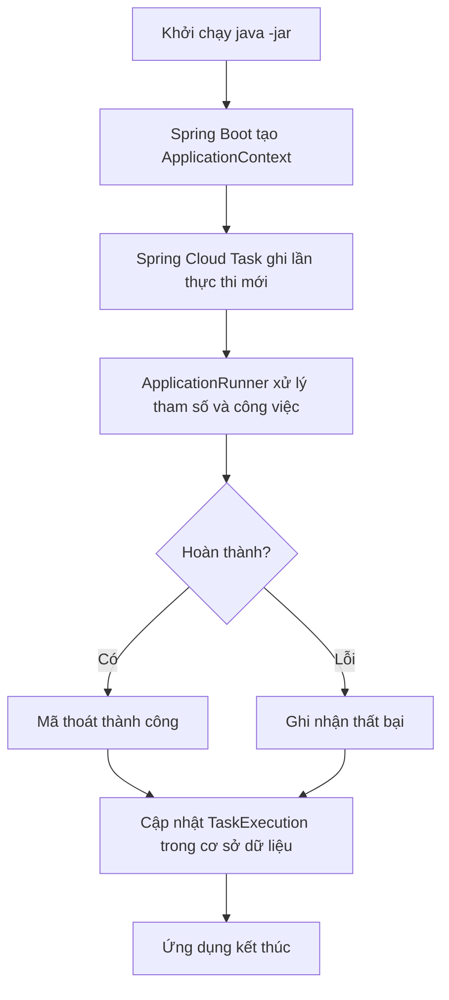

# Tạo ứng dụng Spring Boot có Spring Cloud Task

## 1. Mục tiêu của bài học

Sau bài này, bạn có thể tạo và chạy một ứng dụng **Spring Boot dạng tác vụ hữu hạn** bằng **Spring Cloud Task**, truyền tham số từ dòng lệnh, quan sát trạng thái thực thi được lưu trong cơ sở dữ liệu và thử một lần chạy thất bại. Đây là nền tảng để xây dựng tác vụ nhập dữ liệu, gửi báo cáo, đồng bộ định kỳ hoặc các quy trình chạy theo yêu cầu.

Ứng dụng ví dụ có tên `first-task`. Mỗi lần khởi chạy, nó nhận tham số `--name`, in một lời chào rồi kết thúc. Spring Cloud Task ghi lại **một bản ghi `TaskExecution` cho mỗi lần chạy**, bao gồm thời gian bắt đầu, thời gian kết thúc, tên tác vụ và mã thoát.

> **Phạm vi:** Bài học tập trung vào việc tạo và xác minh tác vụ đầu tiên. H2 được dùng để thực hành tại máy cá nhân; khi triển khai thực tế, nên dùng cơ sở dữ liệu bền vững do nhiều lần chạy có thể truy cập. Spring Cloud Task theo dõi vòng đời ứng dụng, còn dữ liệu kết quả nghiệp vụ cần được lưu bằng cơ chế riêng nếu có.

## 2. Spring Cloud Task bổ sung gì cho Spring Boot?

Một ứng dụng Spring Boot thông thường có thể chạy mã trong `CommandLineRunner` hoặc `ApplicationRunner` rồi thoát. Thư viện **Spring Cloud Task** bổ sung khả năng theo dõi **từng lần thực thi** đó:

| Thành phần | Vai trò |
| --- | --- |
| `@EnableTask` | Bật hạ tầng Spring Cloud Task cho ứng dụng. |
| `ApplicationRunner` | Chứa công việc cần thực hiện một lần khi ứng dụng khởi động. |
| `TaskLifecycleListener` | Theo dõi thời điểm bắt đầu, kết thúc hoặc lỗi của một lần chạy. |
| `TaskRepository` | Ghi và đọc thông tin `TaskExecution` trong cơ sở dữ liệu. |
| `TaskExecution` | Đại diện cho **một lần chạy**, không phải định nghĩa chung của tác vụ. |

Luồng xử lý khái quát:



Spring Cloud Task **không tự tạo lịch chạy**. Tác vụ vẫn cần được gọi bằng lệnh, bộ lập lịch như `cron`/Kubernetes `CronJob`, hoặc một hệ thống điều phối. Một lần khởi chạy thành công không đồng nghĩa công việc nghiệp vụ đã được lưu trữ: `TaskRepository` chủ yếu lưu **siêu dữ liệu thực thi**.

## 3. Chuẩn bị dự án

Cần có **JDK 17 trở lên**, Maven và khả năng chạy ứng dụng Spring Boot. Ví dụ dưới đây dùng **Spring Boot 3.4.5** cùng **Spring Cloud 2024.0.2** để minh họa một cặp phiên bản cùng thế hệ. Khi tạo dự án mới với phiên bản khác, cần chọn Spring Cloud release train tương thích với phiên bản Spring Boot đó; không ghép tùy ý các phiên bản.

Tạo dự án Maven có `groupId` là `com.example`, `artifactId` là `first-task`, sau đó sử dụng cấu trúc:

```text
first-task/
├── pom.xml
└── src/
    └── main/
        ├── java/com/example/firsttask/
        │   ├── FirstTaskApplication.java
        │   └── GreetingTask.java
        └── resources/
            └── application.yml
```

### 3.1. Khai báo các dependency trong `pom.xml`

```xml
<?xml version="1.0" encoding="UTF-8"?>
<project xmlns="http://maven.apache.org/POM/4.0.0"
         xmlns:xsi="http://www.w3.org/2001/XMLSchema-instance"
         xsi:schemaLocation="http://maven.apache.org/POM/4.0.0 https://maven.apache.org/xsd/maven-4.0.0.xsd">
    <modelVersion>4.0.0</modelVersion>

    <parent>
        <groupId>org.springframework.boot</groupId>
        <artifactId>spring-boot-starter-parent</artifactId>
        <version>3.4.5</version>
        <relativePath/>
    </parent>

    <groupId>com.example</groupId>
    <artifactId>first-task</artifactId>
    <version>0.0.1-SNAPSHOT</version>

    <properties>
        <java.version>17</java.version>
        <spring-cloud.version>2024.0.2</spring-cloud.version>
    </properties>

    <dependencyManagement>
        <dependencies>
            <dependency>
                <groupId>org.springframework.cloud</groupId>
                <artifactId>spring-cloud-dependencies</artifactId>
                <version>${spring-cloud.version}</version>
                <type>pom</type>
                <scope>import</scope>
            </dependency>
        </dependencies>
    </dependencyManagement>

    <dependencies>
        <dependency>
            <groupId>org.springframework.cloud</groupId>
            <artifactId>spring-cloud-starter-task</artifactId>
        </dependency>
        <dependency>
            <groupId>org.springframework.boot</groupId>
            <artifactId>spring-boot-starter-jdbc</artifactId>
        </dependency>
        <dependency>
            <groupId>com.h2database</groupId>
            <artifactId>h2</artifactId>
            <scope>runtime</scope>
        </dependency>
    </dependencies>

    <build>
        <plugins>
            <plugin>
                <groupId>org.springframework.boot</groupId>
                <artifactId>spring-boot-maven-plugin</artifactId>
            </plugin>
        </plugins>
    </build>
</project>
```

Ba dependency có trách nhiệm riêng: `spring-cloud-starter-task` cung cấp hạ tầng Task; `spring-boot-starter-jdbc` tạo kết nối và các tiện ích JDBC; H2 là cơ sở dữ liệu nhẹ để quan sát các lần chạy. Maven BOM `spring-cloud-dependencies` quản lý phiên bản các thư viện Spring Cloud tương thích với nhau.

### 3.2. Cấu hình `application.yml`

```yaml
spring:
  application:
    name: first-task
  main:
    web-application-type: none
  datasource:
    url: jdbc:h2:file:./data/taskdb;DB_CLOSE_ON_EXIT=FALSE
    driver-class-name: org.h2.Driver
    username: sa
    password: ""
  cloud:
    task:
      name: first-task
      initialize-enabled: true
      closecontext-enabled: true
```

Giải thích các thiết lập:

- `web-application-type: none`: không tạo máy chủ HTTP; chương trình chỉ chạy công việc rồi kết thúc.
- `datasource`: dùng H2 ở chế độ **lưu ra tệp** `./data/taskdb`, để lịch sử còn tồn tại sau khi Java process dừng. Đường dẫn `./data` được tính từ **thư mục hiện hành khi chạy lệnh**.
- `spring.cloud.task.name`: đặt tên dễ nhận diện cho các bản ghi `TaskExecution`.
- `initialize-enabled: true`: yêu cầu Spring Cloud Task khởi tạo bảng metadata cho bài thực hành. Trong môi trường triển khai thật, nên quản lý schema bằng migration và phân quyền cơ sở dữ liệu thay vì để ứng dụng tự tạo bảng.
- `closecontext-enabled: true`: đóng Spring application context khi tác vụ kết thúc, giải phóng tài nguyên kết nối cơ sở dữ liệu.

**Vì sao không dùng `jdbc:h2:mem:...`?** H2 in-memory sẽ mất dữ liệu khi tiến trình kết thúc. Dùng H2 file giúp mở cơ sở dữ liệu sau đó và truy vấn `TASK_EXECUTION`. Không nên cho nhiều tiến trình cùng sử dụng H2 file này đồng thời; nếu có nhiều tác vụ song song hoặc nhiều máy chủ, dùng PostgreSQL/MySQL và quản lý schema phù hợp.

## 4. Viết ứng dụng Task đầu tiên

### 4.1. Kích hoạt Spring Cloud Task

Tạo `src/main/java/com/example/firsttask/FirstTaskApplication.java`:

```java
package com.example.firsttask;

import org.springframework.boot.SpringApplication;
import org.springframework.boot.autoconfigure.SpringBootApplication;
import org.springframework.cloud.task.configuration.EnableTask;

@SpringBootApplication
@EnableTask
public class FirstTaskApplication {

    public static void main(String[] args) {
        SpringApplication.run(FirstTaskApplication.class, args);
    }
}
```

`@SpringBootApplication` bật auto-configuration và quét bean trong package. `@EnableTask` kích hoạt cấu hình Spring Cloud Task, bao gồm theo dõi vòng đời và lưu thông tin qua `TaskRepository`. Điểm vào `main()` vẫn là điểm vào Spring Boot thông thường.

### 4.2. Cài đặt một `ApplicationRunner`

Tạo `src/main/java/com/example/firsttask/GreetingTask.java`:

```java
package com.example.firsttask;

import java.util.List;

import org.springframework.boot.ApplicationArguments;
import org.springframework.boot.ApplicationRunner;
import org.springframework.stereotype.Component;

@Component
public class GreetingTask implements ApplicationRunner {

    @Override
    public void run(ApplicationArguments args) {
        List<String> names = args.getOptionValues("name");
        String name = (names == null || names.isEmpty())
                ? "bạn"
                : names.get(0).trim();

        if (name.isBlank()) {
            throw new IllegalArgumentException("Tham số --name không được rỗng");
        }

        System.out.printf("Xin chào, %s!%n", name);
    }
}
```

`ApplicationRunner` nhận `ApplicationArguments` để đọc tùy chọn dạng `--name=Lan`. Nếu không truyền tham số, ứng dụng dùng giá trị mặc định `bạn`. Nếu truyền `--name=` rỗng, runner ném một ngoại lệ để minh họa lần chạy thất bại. Đây là **thất bại có chủ đích** trong ví dụ; ứng dụng thực tế nên kiểm tra dữ liệu đầu vào và thông báo nguyên nhân phù hợp.

Mỗi lần Spring Boot khởi động thành công và gọi runner, Spring Cloud Task tạo thông tin theo dõi cho lần chạy đó. Runner có thể thay bằng xử lý file, truy vấn API hoặc đồng bộ dữ liệu, nhưng nên giữ công việc **hữu hạn** và có điểm kết thúc rõ ràng.

## 5. Đóng gói, chạy và quan sát kết quả

Đứng trong thư mục `first-task` rồi đóng gói:

```bash
mvn clean package
```

Chạy lần thứ nhất với tham số `name`:

```bash
java -jar target/first-task-0.0.1-SNAPSHOT.jar --name=Lan
```

Phần kết quả do runner tạo ra:

```text
Xin chào, Lan!
```

Chạy lần thứ hai không có tham số:

```bash
java -jar target/first-task-0.0.1-SNAPSHOT.jar
```

```text
Xin chào, bạn!
```

Hai lần chạy phải tạo **hai `TaskExecution` riêng biệt**, dù cùng một tệp JAR và cùng tên tác vụ. Cả hai kết thúc bình thường sẽ có mã thoát thành công, thường là `0`.

### 5.1. Kiểm tra bản ghi trong cơ sở dữ liệu

Sau khi chương trình kết thúc, dùng công cụ quản trị H2 hoặc JDBC client để kết nối đến URL `jdbc:h2:file:./data/taskdb`, người dùng `sa`, mật khẩu rỗng. Mở đúng thư mục đã dùng khi chạy ứng dụng. Truy vấn:

```sql
SELECT TASK_EXECUTION_ID,
       TASK_NAME,
       START_TIME,
       END_TIME,
       EXIT_CODE,
       EXIT_MESSAGE
FROM TASK_EXECUTION
ORDER BY TASK_EXECUTION_ID DESC;
```

Kết quả minh họa (ID và thời gian thực tế sẽ khác):

| TASK_EXECUTION_ID | TASK_NAME | END_TIME | EXIT_CODE |
| ---: | --- | --- | ---: |
| 2 | first-task | Có giá trị | 0 |
| 1 | first-task | Có giá trị | 0 |

Để xem các tham số mà Spring Cloud Task ghi nhận cho từng lần chạy, truy vấn:

```sql
SELECT TASK_EXECUTION_ID, TASK_PARAM
FROM TASK_EXECUTION_PARAMS
ORDER BY TASK_EXECUTION_ID;
```

Thông thường lần chạy với `--name=Lan` sẽ có tham số tương ứng; lần không truyền tham số sẽ không có tham số đó. **Không đưa mật khẩu, token hoặc dữ liệu bí mật vào tham số dòng lệnh**, vì tham số có thể được lưu trong bảng metadata và xuất hiện trong nhật ký hoặc danh sách tiến trình.

### 5.2. Thử một lần chạy thất bại

Chạy:

```bash
java -jar target/first-task-0.0.1-SNAPSHOT.jar --name=
```

Runner phát sinh `IllegalArgumentException`. Spring Boot thông báo lỗi khởi động hoặc chạy runner và tiến trình thường kết thúc bằng mã khác `0`. Hãy mở lại cơ sở dữ liệu rồi truy vấn `TASK_EXECUTION`: lần chạy mới phải có `EXIT_CODE` thể hiện thất bại; metadata lỗi có thể được ghi trong `ERROR_MESSAGE` tùy phiên bản và điểm phát sinh lỗi.

```sql
SELECT TASK_EXECUTION_ID, TASK_NAME, EXIT_CODE, ERROR_MESSAGE
FROM TASK_EXECUTION
ORDER BY TASK_EXECUTION_ID DESC;
```

Đây là khác biệt quan trọng giữa **in ra một thông báo lỗi** và **để framework biết tác vụ đã thất bại**. Khi mã xử lý bắt ngoại lệ mà không phát lại hoặc không đặt trạng thái thất bại thích hợp, hệ thống bên ngoài có thể hiểu nhầm lần chạy là thành công.

## 6. Quan sát vòng đời bằng `TaskExecutionListener` (mở rộng)

Ngoài truy vấn cơ sở dữ liệu, có thể đăng ký bean `TaskExecutionListener` để ghi log hoặc đo lường tại các mốc vòng đời. Ví dụ sau là **tùy chọn**, không bắt buộc để chạy bài thực hành:

```java
package com.example.firsttask;

import org.springframework.cloud.task.listener.TaskExecutionListener;
import org.springframework.cloud.task.repository.TaskExecution;
import org.springframework.stereotype.Component;

@Component
public class TaskLogListener implements TaskExecutionListener {

    @Override
    public void onTaskStartup(TaskExecution execution) {
        System.out.println("Bắt đầu TaskExecution #" + execution.getExecutionId());
    }

    @Override
    public void onTaskEnd(TaskExecution execution) {
        System.out.println("Kết thúc TaskExecution #" + execution.getExecutionId());
    }

    @Override
    public void onTaskFailed(TaskExecution execution, Throwable throwable) {
        System.err.println("Task thất bại: " + throwable.getMessage());
    }
}
```

Các callback giúp quan sát vòng đời của **cả ứng dụng task**. `TaskRepository` là nguồn thông tin để tra lại lịch sử các lần thực thi; còn callback thích hợp để ghi log, phát metric hoặc đẩy sự kiện giám sát. Trong ứng dụng thực tế, nên để việc ghi log trong listener ngắn gọn và tránh tạo thêm lỗi che khuất nguyên nhân thất bại ban đầu.

## 7. Những lỗi thường gặp

| Triệu chứng | Nguyên nhân thường gặp | Hướng xử lý |
| --- | --- | --- |
| Không tìm thấy `@EnableTask` hoặc dependency | Thiếu `spring-cloud-starter-task`, hoặc Maven chưa tải dependency | Kiểm tra POM, BOM và tải lại Maven dependencies. |
| Ứng dụng lỗi vì phiên bản không tương thích | Spring Boot và Spring Cloud thuộc release train khác nhau | Dùng cặp phiên bản tương thích, không tự ép riêng phiên bản các dependency Spring Cloud. |
| Lỗi `Table ... not found` khi tạo `TaskExecution` | Chưa khởi tạo schema Task | Kiểm tra datasource và `initialize-enabled`; với DB bên ngoài, tạo schema đúng phiên bản trước khi chạy. |
| Không thấy lịch sử sau khi tắt ứng dụng | Dùng H2 in-memory hoặc kết nối nhầm đường dẫn file | Dùng H2 file và URL trỏ đúng thư mục hiện hành. |
| Chạy xong mà tiến trình không thoát | Có web server, scheduler hoặc luồng nền vẫn hoạt động | Đặt `web-application-type: none`, đóng tài nguyên và bảo đảm công việc có điểm kết thúc. |
| `EXIT_CODE` vẫn thành công dù nghiệp vụ lỗi | Ngoại lệ bị bắt và bỏ qua | Ghi log ngữ cảnh rồi truyền lỗi ra ngoài, hoặc dùng cơ chế exit code phù hợp. |

Khi gặp lỗi kết nối hoặc schema, hãy kiểm tra log khởi động **trước** khi kiểm tra logic runner: Spring Cloud Task cần có nơi lưu metadata để quản lý vòng đời. Nếu một bước nghiệp vụ có thể chạy lại, nên thiết kế thao tác có tính *idempotent* để tránh tạo dữ liệu trùng khi bộ điều phối thử lại.

## 8. Từ tác vụ đầu tiên đến tác vụ chạy thực tế

Ví dụ lời chào có thể được thay bằng lệnh nhập dữ liệu hoặc đồng bộ hệ thống. Khi mở rộng, hãy phân biệt các lớp trách nhiệm:

1. **Tham số và cấu hình:** Nhận tham số an toàn, kiểm tra tính hợp lệ, dùng secret manager hoặc biến môi trường cho thông tin bí mật.
2. **Xử lý nghiệp vụ:** Giữ công việc hữu hạn, trả lỗi rõ ràng khi không hoàn thành, hỗ trợ chạy lại an toàn nếu có thể.
3. **Theo dõi thực thi:** Dùng `TaskRepository` để biết task bắt đầu/kết thúc khi nào, có thành công không; lưu kết quả nghiệp vụ vào bảng hoặc dịch vụ riêng.
4. **Điều phối:** Dùng lịch `cron`, Kubernetes `Job`/`CronJob`, hoặc một hệ thống gọi task theo yêu cầu; quy định thời gian chờ, thử lại và tránh chạy chồng.
5. **Xử lý khối lượng lớn:** Khi cần đọc, xử lý, ghi dữ liệu theo chunk, checkpoint, restart ở mức bước, có thể tích hợp **Spring Batch** bên trong một ứng dụng **Spring Cloud Task**. `TaskRepository` theo dõi lần chạy ứng dụng, còn `JobRepository` của Spring Batch theo dõi `JobExecution`/`StepExecution`; chúng giải quyết hai cấp độ khác nhau.

Với môi trường nhiều máy hoặc cần giữ lịch sử dài hạn, thay H2 bằng cơ sở dữ liệu dùng chung (ví dụ PostgreSQL), quản lý cấu trúc bảng bằng migration, giới hạn quyền truy cập metadata và giám sát mã thoát của tiến trình. Không dùng `spring.cloud.task.initialize-enabled: true` như một chiến lược migration production.

## 9. Tự kiểm tra sau bài học

- [ ] Dự án Maven biên dịch và tạo được JAR thực thi.
- [ ] Chạy `--name=Lan` in đúng lời chào và ứng dụng tự kết thúc.
- [ ] Chạy lại không có tham số tạo thêm một bản ghi `TaskExecution`.
- [ ] Truy vấn `TASK_EXECUTION` thấy thời gian bắt đầu, kết thúc và mã thoát.
- [ ] Truyền `--name=` làm runner báo lỗi, lần chạy mới được ghi nhận thất bại.
- [ ] Giải thích được vì sao Task không tự lên lịch và vì sao không lưu secret trong tham số dòng lệnh.

**Ghi nhớ:** `ApplicationRunner` định nghĩa *công việc*; `@EnableTask` và `TaskRepository` bổ sung *khả năng theo dõi mỗi lần công việc được chạy*. Khi đã hiểu luồng này, bạn có thể mở rộng thành tác vụ chạy theo yêu cầu, theo lịch hoặc phối hợp với Spring Batch.
