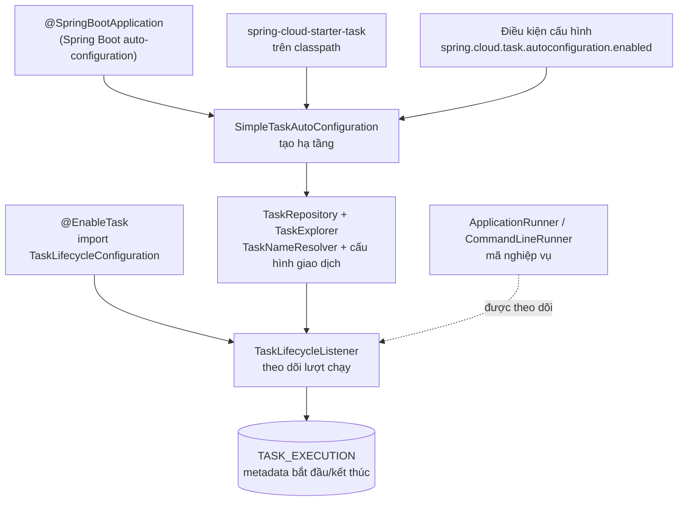

# Điều kiện tự cấu hình và vai trò của `@EnableTask` theo phiên bản

## Mục tiêu bài học

Trong chương **Task đầu tiên** của mô-đun **Spring Cloud Task**, bài này giải thích tại sao ứng dụng Spring Boot có thể chạy tác vụ thành công nhưng lại không có bản ghi `TaskExecution`, cũng như cách phân biệt hạ tầng tự cấu hình với thành phần theo dõi vòng đời. Học xong, bạn có thể:

- Giải thích sự khác nhau giữa **auto-configuration** của Spring Boot và **kích hoạt lifecycle** của Spring Cloud Task.
- Hiểu vai trò của `@SpringBootApplication`, `SimpleTaskAutoConfiguration`, `@EnableTask`, `TaskLifecycleListener` và `TaskRepository`.
- Nhận diện bước ngoặt từ **Spring Cloud Task 2.1 GA**, tránh dùng hướng dẫn cũ cho ứng dụng mới.
- Chạy tác vụ với `ApplicationRunner`, kiểm tra tham số và xác minh metadata trong cơ sở dữ liệu.
- Chẩn đoán việc thiếu annotation, vô hiệu hóa cấu hình tự động, thiếu schema, lỗi DataSource và sai bộ phiên bản.

## 1. Vấn đề: có starter Task nhưng không có lịch sử thực thi

Giả sử bạn cần triển khai một chương trình tổng hợp tồn kho theo ngày. Chương trình đọc `--businessDate`, thực hiện công việc rồi thoát. Bạn thêm starter:

```xml
<dependency>
    <groupId>org.springframework.cloud</groupId>
    <artifactId>spring-cloud-starter-task</artifactId>
</dependency>
```

Và tạo một `ApplicationRunner`. Khi chạy, chương trình in “Tổng hợp hoàn tất”, nhưng bảng `TASK_EXECUTION` không có lượt chạy mới. Nguyên nhân thường gặp là nhầm lẫn giữa **hạ tầng Task được Spring tạo ra** và **vòng đời của tiến trình đang được ghi lại**.

Đối với các bản Spring Cloud Task hiện đại, có hai tầng riêng:

1. **Hạ tầng:** Spring Boot auto-configuration chuẩn bị các bean như `TaskRepository` (ghi metadata), `TaskExplorer` (đọc metadata), `TaskNameResolver` và các cấu hình giao dịch cần thiết.
2. **Lifecycle:** `@EnableTask` bật `TaskLifecycleListener`, thành phần theo dõi lúc ứng dụng bắt đầu/kết thúc và ghi một `TaskExecution` cho lượt chạy.

Điều đó giải thích vì sao **runner chạy được không chứng minh Spring Cloud Task đang theo dõi lượt chạy**. `ApplicationRunner` thuộc Spring Boot; runner vẫn được gọi nếu bạn không thêm `@EnableTask`.

Thông báo phát hành chính thức **Spring Cloud Task 2.1.0 GA ngày 22/01/2019** mô tả rõ việc tách hai tầng này: các bean hạ tầng được auto-configure, còn `TaskLifecycleListener` được tạo khi ứng dụng thêm `@EnableTask`.

## 2. Hai cơ chế bổ trợ nhau



Đây là sơ đồ **mô hình khái niệm** cho các nhánh từ 2.1 trở đi, không phải mô tả tất cả các bean và điều kiện nội bộ của mọi bản phát hành.

### 2.1. `@SpringBootApplication` và `SimpleTaskAutoConfiguration`

`@SpringBootApplication` bao gồm cơ chế `@EnableAutoConfiguration` của **Spring Boot**. Khi starter Task nằm trong classpath và các điều kiện phù hợp, Spring Boot có thể tạo hạ tầng Task mà lập trình viên không cần khai báo từng bean.

Một điều kiện quan trọng của `SimpleTaskAutoConfiguration` được Javadoc mô tả là:

```java
@ConditionalOnProperty(
    prefix = "spring.cloud.task.autoconfiguration",
    name = "enabled",
    havingValue = "true",
    matchIfMissing = true
)
```

Hàm ý thực tế:

- **Không khai báo thuộc tính:** mặc định cho phép tự cấu hình vì `matchIfMissing = true`.
- **Đặt `spring.cloud.task.autoconfiguration.enabled=false`:** tắt cấu hình hạ tầng Task tự động này.
- **Thuộc tính bật:** mới cho phép cấu hình được xét đến; các điều kiện phụ thuộc và tài nguyên cần thiết vẫn phải hợp lệ.

Auto-configuration không có nghĩa database chắc chắn kết nối được. Datasource, driver, schema và transaction manager phải được cấu hình phù hợp. Nếu có nhiều DataSource, có thể cần `TaskConfigurer` riêng để Task dùng đúng kho metadata.

### 2.2. `@EnableTask` và `TaskLifecycleListener`

`@EnableTask` là annotation của Spring Cloud Task:

```java
import org.springframework.cloud.task.configuration.EnableTask;
```

Trong API Spring Cloud Task 2.3/3.x được công bố, annotation này dùng `@Import(TaskLifecycleConfiguration.class)` để kích hoạt `TaskLifecycleListener`. Listener tham gia vòng đời Spring Boot: tạo bản ghi khi Task bắt đầu, cập nhật thời gian kết thúc và thông tin kết quả khi các runner hoàn tất hoặc xảy ra lỗi được ghi nhận.

Chỉ cần đặt `@EnableTask` **một lần trên một lớp cấu hình Spring**, thường là lớp có `@SpringBootApplication`; không đặt lên mọi `ApplicationRunner`.

**Lưu ý:** `@EnableTask` **không** cung cấp cron, không tự xử lý dữ liệu, không cấp đầy đủ hạ tầng khi bạn đã vô hiệu hóa auto-configuration và không tự bảo đảm chạy đúng một lần.

| Thành phần | Vai trò |
| --- | --- |
| `@SpringBootApplication` | Khởi tạo ứng dụng Spring Boot và kích hoạt cơ chế tự cấu hình |
| `SimpleTaskAutoConfiguration` | Cung cấp các bean hạ tầng Task khi điều kiện cho phép |
| `TaskRepository` | Ghi và cập nhật dữ liệu về một lượt thực thi |
| `TaskExplorer` | Tra cứu lịch sử các lượt thực thi đã ghi |
| `@EnableTask` | Bật cấu hình lifecycle cho tiến trình Task |
| `TaskLifecycleListener` | Theo dõi bắt đầu/kết thúc, tương tác với repository |
| `ApplicationRunner` / `CommandLineRunner` | Chạy logic nghiệp vụ do ứng dụng định nghĩa |
| `@EnableScheduling` | Bật `@Scheduled` của Spring Framework; không thay `@EnableTask` |

## 3. Thay đổi hành vi theo các phiên bản

Đây là phần dễ gây nhầm lẫn nhất nếu bạn đọc nhiều tài liệu Spring Cloud Task ở các thời điểm khác nhau.

| Nhánh | Cách tài liệu mô tả bật Task | Kết luận khi xây dựng ứng dụng |
| --- | --- | --- |
| **1.x** | `@EnableTask` import `SimpleTaskConfiguration`, qua đó khởi tạo phần hạ tầng và lifecycle | Annotation là điểm bật chức năng Task trong thiết kế cũ |
| **2.0.x** | Tài liệu Getting Started tiếp tục mô tả `@EnableTask` như cơ chế bootstrap Task | Không suy diễn rằng starter tự tạo đủ mọi thứ |
| **2.1.0 GA** | Auto-configuration tạo `TaskRepository`/`TaskExplorer`; `@EnableTask` tạo `TaskLifecycleListener` | **Phân biệt tạo hạ tầng với ghi vòng đời** |
| **2.2.x–2.3.x** | Tách hạ tầng/lifecycle; Javadoc `@EnableTask` chỉ rõ phần listener | Dùng starter và bật `@EnableTask` trong ứng dụng chạy Task |
| **3.x, 5.x** | Getting Started chính thức vẫn minh họa `@SpringBootApplication` + `@EnableTask`; hạ tầng được auto-configure | Kiểm tra chính xác bản đang sử dụng; tiếp tục khai báo `@EnableTask` cho ứng dụng cần ghi một lượt Task |

### Vì sao thông tin về bản 2.1 có vẻ mâu thuẫn?

Thông báo **2.1.0.M1** tháng 11/2018 từng giới thiệu auto-configuration với khẩu hiệu “Goodbye to `@EnableTask`”. Nhưng công bố **2.1.0 GA** tháng 01/2019 giải thích rõ **auto-configuration không tạo `TaskLifecycleListener`**. Listener chỉ có khi khai báo `@EnableTask`. Khi có khác biệt giữa bài giới thiệu milestone và hành vi đã phát hành, hãy ưu tiên **GA release notes, reference guide và Javadoc đúng phiên bản**.

### Chọn phiên bản Spring Boot và Spring Cloud

`spring-cloud-starter-task` cần tương thích với bộ Spring Boot và Spring Cloud release train. Ví dụ những mối liên hệ nhánh được mô tả trong ma trận Spring Cloud:

| Spring Boot | Spring Cloud release train | Spring Cloud Task |
| --- | --- | --- |
| 3.2.x–3.3.x | 2023.0.x | 3.1.x |
| 3.4.x | 2024.0.x | 3.2.x |
| 3.5.x | 2025.0.x | 3.3.x |
| 4.0.x–4.1.x | 2025.1.x, theo patch hỗ trợ | 5.0.x |

Bảng nêu **quan hệ nhánh**, không bảo đảm mọi cặp patch đều tương thích. Các nhánh và trạng thái hỗ trợ có thể thay đổi theo thời gian. Nên tạo dự án bằng [Spring Initializr](https://start.spring.io/) hoặc chọn release train từ [Spring Cloud](https://spring.io/projects/spring-cloud/) và để **Spring Cloud BOM** quản lý version dependency. Với phiên bản mới hơn bảng ví dụ, đối chiếu lại [Supported Versions](https://github.com/spring-cloud/spring-cloud-release/wiki/Supported-Versions).

## 4. Điều kiện để Task đầu tiên được ghi nhận

Có thể dùng năm lớp kiểm tra sau:

| Lớp kiểm tra | Cần có | Dấu hiệu khi thiếu |
| --- | --- | --- |
| **Classpath** | Starter Task và bộ version tương thích | Thiếu class/bean hoặc ứng dụng lỗi khởi động |
| **Auto-configuration** | Boot nạp cấu hình Task, property không bị tắt | Có thể thiếu repository/explorer |
| **Lifecycle** | `@EnableTask` trên lớp cấu hình của ứng dụng | Runner chạy nhưng không có listener ghi `TaskExecution` |
| **Metadata store** | DataSource/repository/schema phù hợp | Lỗi kết nối DB, câu SQL thất bại hoặc metadata không bền vững |
| **Runner và kết thúc** | Logic trả về hoặc báo lỗi rõ ràng; tiến trình kết thúc | Tác vụ chạy mãi, nuốt exception hoặc không ghi được thời điểm kết thúc |

Danh sách trên là **checklist thực tế**, không phải một biểu thức `@ConditionalOnProperty` duy nhất.

Hai cảnh báo quan trọng:

- Có bean `TaskRepository` không đồng nghĩa đã có một `TaskExecution` mới. Một dịch vụ chỉ **đọc lịch sử Task** có thể cần repository/explorer nhưng không cần listener ghi lại chính dịch vụ đó.
- Nếu `ApplicationContext` thất bại **trước khi lifecycle Task khởi động**, có thể không có bản ghi trong repository. Khi đó phải dựa vào log JVM và trạng thái của scheduler/container.

## 5. Thực hành: ứng dụng `inventory-snapshot`

Ta tạo một ứng dụng hữu hạn nhận ngày nghiệp vụ `--businessDate=yyyy-MM-dd`, thực hiện thao tác minh họa và kết thúc. Chủ đích là quan sát quan hệ giữa **starter**, **`@EnableTask`** và **lưu trữ metadata**, không phải xây dựng hệ thống tồn kho hoàn chỉnh.

### 5.1. Tạo dependencies

Tạo dự án Maven Spring Boot phù hợp với Spring Cloud BOM bằng Spring Initializr, chọn **Task (Spring Cloud)** và **H2 Database**. Nếu sử dụng dự án đã có cấu hình parent/BOM, dependencies tương ứng:

```xml
<dependencies>
    <dependency>
        <groupId>org.springframework.cloud</groupId>
        <artifactId>spring-cloud-starter-task</artifactId>
    </dependency>
    <dependency>
        <groupId>com.h2database</groupId>
        <artifactId>h2</artifactId>
        <scope>runtime</scope>
    </dependency>
</dependencies>
```

Đây chỉ là **đoạn dependencies**, không phải toàn bộ `pom.xml`. Không đặt version starter độc lập với Spring Cloud BOM.

### 5.2. Viết ứng dụng

Tệp `src/main/java/com/example/task/InventorySnapshotApplication.java`:

```java
package com.example.task;

import java.time.LocalDate;
import java.util.List;

import org.springframework.boot.ApplicationArguments;
import org.springframework.boot.ApplicationRunner;
import org.springframework.boot.SpringApplication;
import org.springframework.boot.autoconfigure.SpringBootApplication;
import org.springframework.cloud.task.configuration.EnableTask;
import org.springframework.context.annotation.Bean;

@SpringBootApplication
@EnableTask
public class InventorySnapshotApplication {

    public static void main(String[] args) {
        SpringApplication.run(InventorySnapshotApplication.class, args);
    }

    @Bean
    ApplicationRunner snapshotRunner() {
        return (ApplicationArguments arguments) -> {
            List<String> dates = arguments.getOptionValues("businessDate");
            if (dates == null || dates.size() != 1) {
                throw new IllegalArgumentException(
                    "Cần đúng một --businessDate=yyyy-MM-dd"
                );
            }

            LocalDate businessDate = LocalDate.parse(dates.get(0));
            System.out.println("Bắt đầu tổng hợp " + businessDate);

            // Ứng dụng thật: đọc tồn kho, tính toán, lưu kết quả.
            // Phải thiết kế idempotency khi chạy lại cùng businessDate.

            System.out.println("Tổng hợp hoàn tất " + businessDate);
        };
    }
}
```

Giải thích:

1. `@SpringBootApplication` bật cơ chế tự cấu hình của Boot.
2. Starter Task đưa các class/cấu hình Spring Cloud Task vào classpath.
3. `@EnableTask` kích hoạt listener theo dõi lần chạy.
4. `ApplicationRunner` nhận `businessDate`, chuyển thành `LocalDate` và thực thi nghiệp vụ.
5. Nếu thiếu/sai ngày, exception được phát ra thay vì âm thầm đánh dấu nghiệp vụ thành công.

### 5.3. Cấu hình local

Tệp `src/main/resources/application.yml`:

```yaml
spring:
  application:
    name: inventory-snapshot
  main:
    web-application-type: none
  datasource:
    url: jdbc:h2:file:./data/task-metadata
    driver-class-name: org.h2.Driver
    username: sa
    password: ""
  cloud:
    task:
      autoconfiguration:
        enabled: true

logging:
  level:
    org.springframework.cloud.task: DEBUG
```

Trong bài thực hành, `autoconfiguration.enabled: true` được viết tường minh để dễ quan sát; mặc định thuộc tính này đã bật. H2 **dạng file** giữ metadata qua những lần JVM thoát nếu bạn chạy ở cùng thư mục làm việc, khác với H2 in-memory sẽ mất dữ liệu khi tiến trình kết thúc.

`web-application-type: none` tránh mở web server không cần thiết. Nếu muốn chủ động đóng Spring `ApplicationContext` ngay sau khi runner hoàn thành, có thể dùng thuộc tính `spring.cloud.task.closecontextEnabled=true` được mô tả trong tài liệu phiên bản và kiểm tra cấu hình binding theo nhánh đang dùng.

Khi đưa lên production, dùng cơ sở dữ liệu bền vững, migration các bảng metadata, quyền DB phù hợp và giám sát độc lập với log của tác vụ.

### 5.4. Chạy và kiểm chứng

```bash
./mvnw package
java -jar target/inventory-snapshot-0.0.1-SNAPSHOT.jar --businessDate=2026-11-23
```

Nếu dự án dùng artifactId hoặc version khác, thay tên JAR trong lệnh theo tệp thật được tạo sau khi build. Hai dòng log nghiệp vụ mong đợi:

```text
Bắt đầu tổng hợp 2026-11-23
Tổng hợp hoàn tất 2026-11-23
```

Để xác minh **lifecycle thực sự hoạt động**, dùng công cụ SQL kết nối đúng H2 file và truy vấn metadata Task:

```sql
SELECT
    TASK_EXECUTION_ID,
    TASK_NAME,
    START_TIME,
    END_TIME,
    EXIT_CODE
FROM TASK_EXECUTION
ORDER BY TASK_EXECUTION_ID DESC;
```

Trong cấu hình mặc định có bảng schema phù hợp, mỗi lượt chạy thành công sẽ có `TASK_EXECUTION_ID` mới, tên Task và thời điểm bắt đầu/kết thúc. Các giá trị truyền vào được lưu ở metadata tham số (chẳng hạn bảng `TASK_EXECUTION_PARAMS`). **Dữ liệu nghiệp vụ tổng hợp tồn kho không được Spring Cloud Task tự lưu**, bạn phải thiết kế bảng/service riêng.

Nếu bảng không tồn tại, hãy kiểm tra datasource và quá trình tạo schema. Nếu bảng đã tồn tại nhưng không có lượt chạy mới, quay lại kiểm tra `@EnableTask` và listener trước khi kiểm tra mã nghiệp vụ.

## 6. Thí nghiệm phân biệt bốn tình huống

Thực hiện trong môi trường phát triển với cùng cấu hình H2, so sánh số dòng `TASK_EXECUTION` trước và sau mỗi lần chạy:

| Kịch bản | Thay đổi | Dự đoán và cách đọc |
| --- | --- | --- |
| **A. Chuẩn** | Có starter + `@EnableTask` + auto-configuration bật | Runner chạy; listener ghi bản ghi mới |
| **B. Thiếu `@EnableTask`** | Bỏ annotation khỏi lớp ứng dụng, giữ starter | Runner **vẫn có thể chạy**; repository/explorer có thể vẫn tồn tại, nhưng không có listener tự ghi lượt Task |
| **C. Tắt auto-configuration** | Giữ annotation, đặt `spring.cloud.task.autoconfiguration.enabled=false` | Cấu hình hạ tầng mặc định không được áp dụng; nếu không có bean thay thế, lifecycle có thể lỗi startup |
| **D. DataSource/schema sai** | Giữ annotation, dùng DB không truy cập được hoặc thiếu bảng | Lỗi khởi động hoặc ghi metadata; chưa thể kết luận lịch sử ghi đúng |

Không dùng những thí nghiệm vô hiệu hóa cấu hình hoặc làm hỏng DB trên môi trường production.

### Hai trường hợp thường bị hiểu sai

**B: Runner in “hoàn tất” nhưng Task không có bản ghi.** Đây là hành vi dễ gây nhầm lẫn nhất. `ApplicationRunner` do Spring Boot gọi độc lập với Spring Cloud Task. Để chứng minh Task hoạt động, cần có `TaskExecution` hoặc xác minh bean `TaskLifecycleListener`.

**C: Thêm `@EnableTask` nhưng tắt auto-configuration.** Annotation lifecycle **không tự tạo lại** mọi bean hạ tầng đã bị tắt. Nếu thật sự cần tắt `SimpleTaskAutoConfiguration`, phải cung cấp cấu hình thay thế có đủ repository, explorer và các phụ thuộc cần thiết. Ngược lại, với một ứng dụng chỉ dùng `TaskExplorer` để tra cứu lịch sử, có thể giữ auto-configuration nhưng **không khai báo `@EnableTask`** để nó không theo dõi chính lượt chạy của mình.

## 7. Chẩn đoán theo thứ tự rõ ràng

### 7.1. Kiểm tra điều kiện của Spring Boot

Chạy ở môi trường phát triển:

```bash
java -jar target/inventory-snapshot-0.0.1-SNAPSHOT.jar --debug --businessDate=2026-11-23
```

`--debug` của Spring Boot giúp hiển thị **Condition Evaluation Report**. Tìm `SimpleTaskAutoConfiguration` và phần điều kiện matched/did not match; từ đó kiểm tra property, dependency và cấu hình xung đột. Một cấu hình auto-configuration “matched” **chưa chứng minh** listener đã được bật.

### 7.2. Kiểm tra bean và kết quả

Trong debugger hoặc Spring Context, xác minh các bean quan trọng:

- `TaskRepository` / `TaskExplorer`: hạ tầng.
- `TaskLifecycleListener`: phần ghi nhận vòng đời.
- `TaskConfigurer`: chiến lược hạ tầng tùy chỉnh, đặc biệt khi có nhiều DataSource.

Nếu đã có Spring Boot Actuator và endpoint `beans` được bảo vệ phù hợp, có thể dùng ở môi trường phát triển để quan sát bean. Không nên mở công khai `/actuator/beans` cho sản phẩm chỉ vì mục đích chẩn đoán.

Sau đó truy vấn `TASK_EXECUTION` trong DB. Cần phân biệt ba câu hỏi: **bean đã có?**, **có lượt chạy mới?**, và **kết quả nghiệp vụ có đúng?**. Trả lời được cả ba mới đủ để kết luận ứng dụng hoạt động như mong đợi.

### 7.3. Bảng lỗi phổ biến

| Triệu chứng | Nguyên nhân khả dĩ | Hướng xử lý |
| --- | --- | --- |
| In log nghiệp vụ, không ghi `TaskExecution` | Thiếu `@EnableTask` | Xác minh annotation ở một lớp cấu hình và có `TaskLifecycleListener` |
| Không tìm thấy `EnableTask` hoặc `SimpleTaskAutoConfiguration` | Thiếu starter hoặc lệch version | Kiểm tra dependency tree, Spring Cloud BOM và Javadoc đúng nhánh |
| Lỗi khởi tạo context khi đặt `autoconfiguration.enabled=false` | Không có hạ tầng thay thế | Bật lại auto-configuration hoặc cung cấp bean đầy đủ |
| Có listener nhưng báo lỗi SQL | Datasource hoặc schema Task sai; thiếu quyền | Kiểm tra cấu hình kết nối, migration, các bảng `TASK_` |
| `TASK_NAME` không như ý | Tên Task được resolve khác cấu hình dự định | Kiểm tra `spring.application.name`, `spring.cloud.task.name`, `TaskNameResolver` |
| Logic nghiệp vụ lỗi nhưng Task báo thành công | Exception bị bắt rồi nuốt, không báo lỗi ra ngoài | Chuyển lỗi thành exception/mã thoát có ý nghĩa |
| Khởi động thất bại trước khi có metadata | Context chưa khởi tạo xong, chưa có lifecycle Task | Xem log JVM và trạng thái nền tảng chạy tác vụ |
| Bản ghi có `END_TIME = NULL` mãi | Tiến trình bị kill hoặc không cập nhật được kết quả | Đối chiếu trạng thái scheduler/container, không đoán là thành công |

## 8. Giới hạn của `@EnableTask` và hướng vận hành đúng

`@EnableTask` giúp theo dõi **một lần chạy của ứng dụng hữu hạn**. Nó không quản lý lịch, không tự retry tác vụ, không ngăn xử lý trùng và không lưu dữ liệu nghiệp vụ. Với ứng dụng triển khai thật, cần thêm:

1. **Tham số hợp lệ:** ví dụ `--businessDate` phải là ngày hợp lệ. Không đưa mật khẩu/token vào CLI vì tham số có thể được lưu trong metadata và log.
2. **Báo lỗi đáng tin cậy:** không nuốt exception; quy định exit code và ghi nhận lý do thất bại.
3. **Lịch chạy hoặc trigger:** cron, Kubernetes CronJob, yêu cầu người dùng hoặc Spring Cloud Data Flow.
4. **Idempotency:** một yêu cầu chạy hai lần với cùng ngày có thể tạo **hai `TaskExecution`**; dữ liệu đích phải có khóa nghiệp vụ/unique constraint hoặc cơ chế chống ghi trùng.
5. **Spring Batch khi cần:** nếu có chunk, checkpoint, restart step hay retry chi tiết, dùng Spring Batch để xử lý dữ liệu; Spring Cloud Task theo dõi toàn bộ tiến trình.
6. **Metadata bền vững:** dùng DB production, quản lý schema, theo dõi tiến trình treo và cảnh báo khi không xuất hiện lượt chạy dự kiến.

Ví dụ: CronJob chạy tác vụ đối soát lúc 02:00 và có retry lúc 02:05. Spring Cloud Task lưu được hai lượt chạy; việc không tạo hai báo cáo giống nhau là trách nhiệm của mã nghiệp vụ và cơ sở dữ liệu, không phải của `@EnableTask`.

## 9. Tự đánh giá

**Câu 1.** Có starter và `ApplicationRunner` nhưng không có `@EnableTask`. Runner có chạy không?

> Có thể chạy bình thường vì runner do Spring Boot quản lý. Với các nhánh mới, chỉ có hạ tầng repository chưa chắc có lifecycle listener để ghi TaskExecution.

**Câu 2.** Spring Cloud Task 2.1 GA thay đổi điều gì?

> Các bean như TaskRepository/TaskExplorer được tạo qua auto-configuration, trong khi TaskLifecycleListener được bật khi có @EnableTask.

**Câu 3.** Đặt `spring.cloud.task.autoconfiguration.enabled=false` nhưng vẫn giữ `@EnableTask` có luôn an toàn không?

> Không. Lifecycle có thể thiếu repository và những bean phụ thuộc, dẫn tới lỗi khởi động nếu không tự cấu hình thay thế.

**Câu 4.** Thấy log “Tổng hợp hoàn tất” đã đủ chứng minh metadata Task tồn tại chưa?

> Chưa. Cần xác minh đúng datasource, schema và TaskExecution mới đã được ghi và lưu bền vững.

**Câu 5.** Nâng cấp ứng dụng từ Task 2.0 lên 5.x cần làm gì trước khi sửa annotation?

> Chọn bộ Spring Boot/Spring Cloud tương thích, đọc tài liệu đúng nhánh, kiểm tra cơ chế auto-configuration và lifecycle, rồi chạy thử và đối chiếu TaskExecution.

## Ghi nhớ

**Starter mang các thành phần Task vào ứng dụng; auto-configuration tạo hạ tầng khi đủ điều kiện; `@EnableTask` bật listener ghi vòng đời của tiến trình.** Đây là phân biệt cốt lõi từ **Spring Cloud Task 2.1 GA**. Khi chẩn đoán Task đầu tiên, kiểm tra theo thứ tự: **version → auto-configuration → lifecycle listener → TaskRepository/DataSource → kết quả nghiệp vụ**.

## Tài liệu tham khảo

1. [Spring Cloud Task 2.1.0 GA — thay đổi auto-configuration và vai trò của @EnableTask](https://spring.io/blog/2019/01/22/spring-cloud-task-2-1-0-ga-is-now-available/)
2. [Spring Cloud Task 1.3 — @EnableTask trong tài liệu cũ](https://docs.spring.io/spring-cloud-task/docs/1.3.0.RELEASE/reference/htmlsingle/)
3. [Spring Cloud Task 2.0 — hướng dẫn lịch sử](https://docs.spring.io/spring-cloud-task/docs/2.0.0.RELEASE/reference/htmlsingle/)
4. [Spring Cloud Task — Getting Started](https://docs.spring.io/spring-cloud-task/reference/getting-started.html)
5. [Spring Cloud Task — Features](https://docs.spring.io/spring-cloud-task/reference/features.html)
6. [Javadoc EnableTask](https://docs.spring.io/spring-cloud-task/docs/current/apidocs/org/springframework/cloud/task/configuration/EnableTask.html)
7. [Javadoc SimpleTaskAutoConfiguration](https://docs.spring.io/spring-cloud-task/docs/current/apidocs/org/springframework/cloud/task/configuration/SimpleTaskAutoConfiguration.html)
8. [Spring Cloud — Supported Versions](https://github.com/spring-cloud/spring-cloud-release/wiki/Supported-Versions)
