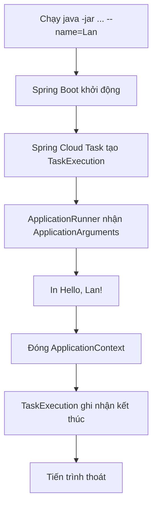

# Viết tác vụ Hello World bằng ApplicationRunner

Trong chương **Task đầu tiên** của module **SPRING_CLOUD_TASK**, chúng ta sẽ xây dựng một ứng dụng Spring Boot thực hiện đúng một công việc: in lời chào rồi kết thúc. Ví dụ nhỏ này giúp làm rõ mô hình ứng dụng **có thời gian chạy hữu hạn** của Spring Cloud Task trước khi chuyển sang các tác vụ cần tham số phức tạp, xử lý lỗi, thực thi theo lịch hoặc yêu cầu và phối hợp với Spring Batch.

Điểm khác với một REST API là ứng dụng không cần giữ cổng HTTP để chờ yêu cầu mới. Khi `ApplicationRunner` hoàn thành, ứng dụng đóng tài nguyên và tiến trình có thể thoát. Spring Cloud Task bổ sung khả năng ghi nhận **mỗi lần thực thi** vào `TaskRepository`, nhờ đó có thể theo dõi trạng thái, thời gian và kết quả khi cấu hình cơ sở dữ liệu thích hợp.

## 1. Mục tiêu học tập

Sau bài này, bạn có thể:

- Tạo một dự án Spring Boot dùng Spring Cloud Task và `ApplicationRunner`.
- Giải thích vì sao `ApplicationRunner` phù hợp với tác vụ thực thi một lần.
- Truyền và đọc tham số `--name` bằng `ApplicationArguments`.
- Đóng ứng dụng sau khi xử lý xong, đọc kết quả qua log và mã thoát.
- Hiểu vai trò của `TaskExecution`, `TaskRepository` và cấu hình JDBC trong ví dụ Hello World.
- Nhận biết các lỗi cấu hình thường gặp và giới hạn của cơ sở dữ liệu H2 trong bộ nhớ.

## 2. Chúng ta sẽ xây dựng gì?

Giả sử hệ thống cần gửi một lời chào theo yêu cầu của người vận hành. Mỗi lần chạy là một công việc độc lập:

1. Khởi động ứng dụng bằng lệnh `java -jar`.
2. Spring Boot tạo `ApplicationContext`; Spring Cloud Task ghi nhận một lần thực thi.
3. `ApplicationRunner` đọc tham số `--name`, mặc định là `World`.
4. Tác vụ in `Hello, World!` hoặc `Hello, Lan!`.
5. Ứng dụng đóng context và kết thúc tiến trình.



Sơ đồ mô tả luồng **thành công**. Nếu runner ném exception, ứng dụng có thể kết thúc lỗi và cơ chế vòng đời của Spring Cloud Task ghi nhận lỗi trong phạm vi tài nguyên còn khả dụng. Một tiến trình bị dừng cưỡng bức hoặc mất kết nối cơ sở dữ liệu không bảo đảm metadata được cập nhật hoàn chỉnh.

## 3. Chuẩn bị dự án

### 3.1. Công cụ và phiên bản

Cần có:

- **JDK** phù hợp với phiên bản Spring Boot đã chọn (ví dụ Java 17 trở lên với Spring Boot 3.x).
- **Maven** hoặc Maven Wrapper (`mvnw`) đi kèm dự án.
- Một dự án **Spring Boot** đã thiết lập phiên bản Spring Cloud tương thích. Không chọn ngẫu nhiên phiên bản Spring Boot và Spring Cloud: hãy dùng cặp phiên bản được hỗ trợ cùng nhau.

Có thể bắt đầu từ một ứng dụng Maven Spring Boot thông thường. Ví dụ dùng package `com.example.task` và tên ứng dụng `hello-task`.

### 3.2. Thêm các dependency Maven

Trong phần `<dependencies>` của `pom.xml`, bổ sung:

```xml
<dependency>
    <groupId>org.springframework.boot</groupId>
    <artifactId>spring-boot-starter</artifactId>
</dependency>

<dependency>
    <groupId>org.springframework.cloud</groupId>
    <artifactId>spring-cloud-starter-task</artifactId>
</dependency>

<dependency>
    <groupId>org.springframework.boot</groupId>
    <artifactId>spring-boot-starter-jdbc</artifactId>
</dependency>

<dependency>
    <groupId>com.h2database</groupId>
    <artifactId>h2</artifactId>
    <scope>runtime</scope>
</dependency>
```

Dự án cần có cơ chế quản lý phiên bản tương ứng: thông thường `spring-boot-starter-parent` (hoặc Spring Boot BOM) quản lý thư viện Boot và một **Spring Cloud BOM** quản lý `spring-cloud-starter-task`. Nếu dự án chưa có Spring Cloud BOM, thêm phần tương tự dưới đây vào `pom.xml` và khai báo property `spring-cloud.version` bằng release train **tương thích với Spring Boot của dự án**:

```xml
<dependencyManagement>
    <dependencies>
        <dependency>
            <groupId>org.springframework.cloud</groupId>
            <artifactId>spring-cloud-dependencies</artifactId>
            <version>${spring-cloud.version}</version>
            <type>pom</type>
            <scope>import</scope>
        </dependency>
    </dependencies>
</dependencyManagement>
```

Để lệnh đóng gói tạo được **JAR thực thi** (có thể chạy bằng `java -jar`), bảo đảm dự án có Spring Boot Maven Plugin trong phần `build` của `pom.xml`:

```xml
<build>
    <plugins>
        <plugin>
            <groupId>org.springframework.boot</groupId>
            <artifactId>spring-boot-maven-plugin</artifactId>
        </plugin>
    </plugins>
</build>
```

Ví dụ dùng H2 để khởi động nhanh mà không cần cài máy chủ cơ sở dữ liệu. `spring-boot-starter-jdbc` cung cấp tích hợp JDBC, còn Spring Cloud Task sử dụng nguồn dữ liệu đã cấu hình để lưu metadata thực thi.

Cấu trúc phần mã sẽ là:

```text
hello-task/
├── pom.xml
└── src/
    └── main/
        ├── java/com/example/task/HelloTaskApplication.java
        └── resources/application.yml
```

## 4. Viết tác vụ bằng ApplicationRunner

Tạo `src/main/java/com/example/task/HelloTaskApplication.java`:

```java
package com.example.task;

import java.util.List;

import org.springframework.boot.ApplicationRunner;
import org.springframework.boot.SpringApplication;
import org.springframework.boot.autoconfigure.SpringBootApplication;
import org.springframework.cloud.task.configuration.EnableTask;
import org.springframework.context.ConfigurableApplicationContext;
import org.springframework.context.annotation.Bean;

@SpringBootApplication
@EnableTask
public class HelloTaskApplication {

    public static void main(String[] args) {
        ConfigurableApplicationContext context =
                SpringApplication.run(HelloTaskApplication.class, args);

        int exitCode = SpringApplication.exit(context);
        System.exit(exitCode);
    }

    @Bean
    ApplicationRunner helloRunner() {
        return arguments -> {
            String name = "World";

            if (arguments.containsOption("name")) {
                List<String> names = arguments.getOptionValues("name");

                if (names == null || names.size() != 1
                        || names.get(0).isBlank()) {
                    throw new IllegalArgumentException(
                            "Tham số --name phải có đúng một giá trị không rỗng");
                }

                name = names.get(0).trim();
            }

            System.out.println("Hello, " + name + "!");
        };
    }
}
```

### Giải thích từng thành phần

| Thành phần | Chức năng |
| --- | --- |
| `@SpringBootApplication` | Khai báo điểm khởi động ứng dụng và bật các cơ chế cấu hình tự động của Spring Boot. |
| `@EnableTask` | Kích hoạt hạ tầng Spring Cloud Task để theo dõi vòng đời thực thi. |
| `@Bean ApplicationRunner` | Đăng ký đoạn công việc được Spring Boot gọi khi ứng dụng đã khởi tạo context. |
| `ApplicationArguments` | Cho phép đọc các option `--key=value` và đối số dòng lệnh mà không phải tự tách chuỗi. |
| `SpringApplication.exit(context)` | Đóng context và lấy mã thoát từ cơ chế exit code của Spring Boot. |
| `System.exit(exitCode)` | Kết thúc tiến trình JVM, chuyển mã thoát cho shell/container hoặc bộ điều phối. |

**Tại sao dùng `ApplicationRunner`?** Spring Boot gọi các bean `ApplicationRunner` sau khi context đã được khởi tạo. Phương thức `run(ApplicationArguments args)` là một vị trí thuận tiện để đặt công việc hữu hạn cần xử lý tham số. Trong ví dụ, chỉ có một runner và không có vòng lặp chờ yêu cầu mới.

**Tại sao phải kết thúc rõ ràng?** Với ứng dụng tác vụ, đích đến là trạng thái “đã xử lý xong”, không phải duy trì một server hoạt động. `SpringApplication.exit` giúp đóng các bean/tài nguyên do context quản lý; `System.exit` đảm bảo tiến trình JVM thoát và trả exit code. Nếu lỗi xảy ra ngay trong `SpringApplication.run` (chẳng hạn runner ném exception), lệnh `SpringApplication.exit` phía sau sẽ không được thực thi; Spring Boot xử lý thất bại khởi động và lỗi sẽ được đưa ra cho tiến trình.

**Lưu ý:** Một ứng dụng có nhiều bean `ApplicationRunner` hoặc `CommandLineRunner` có thể chạy nhiều đoạn khởi tạo. Khi cần thứ tự, có thể dùng `@Order` hoặc `Ordered`; tránh dựa vào thứ tự đăng ký bean một cách ngầm định.

## 5. Cấu hình Spring Cloud Task và H2

Tạo `src/main/resources/application.yml`:

```yaml
spring:
  application:
    name: hello-task
  main:
    web-application-type: none

  datasource:
    url: jdbc:h2:mem:taskdb
    driver-class-name: org.h2.Driver
    username: sa
    password: ""

  cloud:
    task:
      name: hello-world-task
      initialize-enabled: true
```

Ý nghĩa:

- `spring.main.web-application-type: none` xác định đây là tiến trình **không khởi chạy web server**.
- `spring.datasource.*` khai báo kết nối H2 dành cho ví dụ thực hành.
- `spring.cloud.task.name` gắn tên dễ nhận diện cho các bản ghi thực thi.
- `spring.cloud.task.initialize-enabled` cho phép khởi tạo schema Spring Cloud Task trong môi trường thử nghiệm theo cơ chế của phiên bản thư viện được sử dụng.

**Giới hạn cần hiểu:** `jdbc:h2:mem:taskdb` là **cơ sở dữ liệu trong bộ nhớ**. Sau khi JVM kết thúc, dữ liệu H2 của lần chạy đó biến mất. Cấu hình này phù hợp để thử tác vụ đầu tiên, nhưng **không đáp ứng mục tiêu tra cứu lịch sử qua nhiều lần chạy**. Trong hệ thống thật, cấu hình một cơ sở dữ liệu lưu bền vững (chẳng hạn PostgreSQL), cấp quyền truy cập phù hợp và quản lý schema bằng migration theo đúng phiên bản Spring Cloud Task.

Không đưa mật khẩu thật hoặc thông tin nhạy cảm vào tệp cấu hình được commit; dùng biến môi trường hoặc hệ thống quản lý bí mật trong môi trường triển khai.

## 6. Đóng gói và chạy Hello World

Tại thư mục gốc của dự án, đóng gói:

```bash
# Linux / macOS
./mvnw clean package

# Windows PowerShell: dùng lệnh tương ứng
# .\mvnw.cmd clean package
```

Giả sử artifact tạo ra là `target/hello-task-0.0.1-SNAPSHOT.jar` (tên thực tế phụ thuộc cấu hình `pom.xml`), thực thi lần đầu:

```bash
java -jar target/hello-task-0.0.1-SNAPSHOT.jar
```

Dòng kết quả nghiệp vụ mong đợi:

```text
Hello, World!
```

Thử truyền tham số:

```bash
java -jar target/hello-task-0.0.1-SNAPSHOT.jar --name=Lan
```

Dòng kết quả nghiệp vụ:

```text
Hello, Lan!
```

Khi chạy, console còn có log khởi động Spring Boot và hoạt động của Spring Cloud Task/JDBC, tùy cấu hình mức log và phiên bản. Không nên kiểm thử bằng cách yêu cầu toàn bộ log khớp từng ký tự; hãy quan tâm lời chào, lỗi có/không, tiến trình có thoát và exit code.

**Kiểm tra exit code:** ngay sau khi lệnh `java -jar` kết thúc, trên Linux/macOS dùng `echo $?`, còn trên PowerShell dùng `$LASTEXITCODE`. Với lần chạy thành công thông thường, mã thoát là `0`. Mã khác `0` báo lỗi ở mức tiến trình; nguyên nhân cụ thể phải xem log và thông tin thực thi.

### Kiểm tra tham số không hợp lệ

Thử chạy:

```bash
java -jar target/hello-task-0.0.1-SNAPSHOT.jar --name=
```

Vì `name` rỗng, runner ném `IllegalArgumentException`. Spring Boot báo lỗi và tiến trình thất bại. Đây là hành vi có chủ ý: khi đầu vào không hợp lệ, tác vụ không được âm thầm in “Hello, World!” rồi báo thành công.

Một điểm cần nhớ: `--name=Lan` là **tham số ứng dụng** được `ApplicationArguments` phân tích; nó không đồng nghĩa với một tham số được Spring Cloud Task tự động dùng để quyết định nghiệp vụ. Bạn phải tự đọc, kiểm tra và áp dụng đầu vào bên trong mã.

## 7. Spring Cloud Task ghi nhận những gì?

Ngay cả khi công việc chỉ là in một dòng, Spring Cloud Task vẫn có ý nghĩa: mỗi lần chạy ứng dụng hữu hạn có một **`TaskExecution`** riêng. Khi kết nối JDBC và schema hoạt động, `TaskRepository` lưu metadata của lần thực thi.

| Thành phần | Ví dụ thông tin hoặc công dụng |
| --- | --- |
| `TaskExecution` | Định danh lần chạy, tên task, thời điểm bắt đầu/kết thúc, exit code và thông tin lỗi liên quan. |
| `TaskRepository` | Ghi/cập nhật metadata thực thi vào nguồn lưu trữ đã cấu hình. |
| `TaskExplorer` | Đọc thông tin những lần thực thi đã lưu để phục vụ tra cứu hoặc giám sát. |
| `TASK_EXECUTION` | Bảng metadata thông dụng trong schema JDBC của Spring Cloud Task. |

Ví dụ, sau khi triển khai lên cơ sở dữ liệu **lưu bền vững** và khởi tạo đúng schema, có thể truy vấn lịch sử bằng SQL:

```sql
SELECT TASK_EXECUTION_ID,
       TASK_NAME,
       START_TIME,
       END_TIME,
       EXIT_CODE
FROM TASK_EXECUTION
ORDER BY TASK_EXECUTION_ID DESC;
```

Hãy phân biệt ba kết quả:

1. **Kết quả nghiệp vụ:** console in `Hello, Lan!`.
2. **Kết quả tiến trình:** JVM thoát với mã `0` hoặc mã lỗi.
3. **Metadata thực thi:** `TaskRepository` ghi nhận một `TaskExecution` có thời gian và trạng thái của lần chạy.

Với H2 `mem:` trong ví dụ, bạn **không thể thoát ứng dụng rồi mở một tiến trình H2 khác để tra cứu lịch sử đã mất**. Muốn quan sát nhiều lần chạy, hãy dùng database lưu bền vững cùng schema thích hợp.

Nếu chuyển sang PostgreSQL, cần bổ sung JDBC driver PostgreSQL, cấu hình `spring.datasource.url`, username/password an toàn và chuẩn bị các bảng Spring Cloud Task bằng script/migration tương ứng. Trong production, nên tắt việc tự động tạo schema lúc mỗi lần khởi động sau khi đã quản lý schema bằng migration. Các bước này thuộc phần cấu hình `TaskRepository` chuyên sâu hơn.

## 8. Điều gì xảy ra khi runner thất bại?

Xét hai trường hợp:

- **Đầu vào sai:** `--name=` gây exception ngay trong runner; tác vụ thất bại và người gọi phải xem mã thoát/log.
- **Mất kết nối cơ sở dữ liệu:** việc tạo/cập nhật metadata có thể thất bại, khiến tác vụ không khởi động hoặc không ghi nhận được trạng thái cuối. Khi đó cần phân tích cả log ứng dụng lẫn trạng thái của process/container.

Không dùng cách xử lý sau khi lỗi đáng ra phải làm tác vụ thất bại:

```java
try {
    // Thực hiện công việc chính
} catch (Exception exception) {
    System.err.println(exception.getMessage());
    // Nuốt lỗi: runner vẫn có thể kết thúc như thể công việc thành công!
}
```

Với lỗi không thể tự xử lý, hãy ghi đủ ngữ cảnh và để exception được truyền ra ngoài (hoặc biểu diễn exit code thất bại bằng cơ chế của Spring Boot). Làm như vậy giúp scheduler, Kubernetes Job hoặc hệ thống gọi tác vụ nhận biết lần chạy thất bại và áp dụng chính sách retry thích hợp.

**Đừng nhầm retry với chạy lại an toàn:** ở ví dụ Hello World, in nhiều lần không gây tác động nghiêm trọng. Với tác vụ gửi email, chuyển tiền hay cập nhật dữ liệu, cần khóa nghiệp vụ, idempotency và quy tắc tránh xử lý trùng trước khi bật retry.

## 9. ApplicationRunner khác gì CommandLineRunner?

Spring Boot hỗ trợ cả hai cơ chế để chạy mã khi ứng dụng khởi động:

| Tiêu chí | `ApplicationRunner` | `CommandLineRunner` |
| --- | --- | --- |
| Chữ ký | `run(ApplicationArguments args)` | `run(String... args)` |
| Cách đọc tham số | Có sẵn `containsOption`, `getOptionValues`, `getNonOptionArgs` | Nhận trực tiếp mảng chuỗi, tự phân tích nếu cần |
| Khi nên dùng | Tác vụ có nhiều option dạng `--key=value` | Tác vụ đơn giản, chỉ cần vài đối số dạng chuỗi |
| Vòng đời | Được gọi khi Spring Boot chạy các runner | Tương tự, được gọi khi Spring Boot chạy các runner |

Hai interface **không tự biến ứng dụng thành Spring Cloud Task**: phần ghi metadata đến từ hạ tầng Spring Cloud Task đã bật và cấu hình. Ngược lại, Spring Cloud Task cũng không bắt buộc mọi nghiệp vụ phải viết dưới dạng `ApplicationRunner`; đây chỉ là cách bắt đầu dễ hiểu, phù hợp với bài đầu tiên.

## 10. Các lỗi thường gặp và cách kiểm tra

| Hiện tượng | Nguyên nhân có thể | Hướng kiểm tra |
| --- | --- | --- |
| `ClassNotFoundException` hoặc không tải được dependency | Chưa thêm starter, BOM không phù hợp, Maven chưa tải được thư viện | Kiểm tra dependency, cấu hình BOM và kết quả Maven |
| Không xuất hiện `Hello, World!` | Runner chưa đăng ký bean hoặc ứng dụng lỗi trước khi chạy đến runner | Kiểm tra `@Bean`, package, stack trace và datasource |
| Ứng dụng không thoát | Đã vô tình bật web server, có vòng lặp vô hạn hoặc luồng không kết thúc | Kiểm tra `web-application-type: none`, runner và các thành phần nền |
| Không có bảng `TASK_EXECUTION` | Schema Spring Cloud Task chưa được khởi tạo hoặc kết nối sai database | Kiểm tra cấu hình JDBC, quyền tạo bảng, migration và phiên bản |
| Không thấy lịch sử sau khi chạy lần hai | Dùng `jdbc:h2:mem:` nên dữ liệu mất khi JVM dừng | Chuyển sang database lưu bền vững |
| Lệnh `--name=` gây lỗi | Đúng với quy tắc kiểm tra tham số trong ví dụ | Truyền `--name=Lan` hoặc bỏ option để dùng giá trị mặc định |
| Process báo thành công nhưng nghiệp vụ thiếu dữ liệu | Exception bị nuốt hoặc điều kiện thành công chưa được kiểm tra | Bổ sung xác nhận nghiệp vụ và trả trạng thái thất bại khi cần |

## 11. Bài tập thực hành

**Bài 1 — Cá nhân hóa lời chào.** Thêm option `--language=vi` hoặc `--language=en`. Với `vi`, in `Xin chào, Lan!`; với `en`, in `Hello, Lan!`. Từ chối giá trị ngôn ngữ không được hỗ trợ.

**Bài 2 — Đo thời gian.** In thời điểm bắt đầu và kết thúc công việc bằng `Instant.now()`. So sánh khoảng thời gian do ứng dụng tự đo với `START_TIME`/`END_TIME` trong `TaskExecution`: thời gian nghiệp vụ và thời gian toàn bộ lần chạy không nhất thiết bằng nhau.

**Bài 3 — Thử thất bại.** Thêm option `--fail=true`, cho runner ném `IllegalStateException` khi option này được bật. Quan sát log, exit code và metadata khi dùng database lưu bền vững.

**Bài 4 — Lưu lịch sử thực thi.** Thay H2 trong bộ nhớ bằng PostgreSQL hoặc một database JDBC lưu bền vững đã chuẩn bị schema. Chạy cùng ứng dụng hai lần với tên khác nhau, sau đó dùng câu SQL ở mục 7 để xem hai lần thực thi. Chỉ tạo schema một lần bằng quy trình phù hợp.

### Câu hỏi tự kiểm tra

1. Tại sao chương trình dùng `ApplicationRunner` có thể thoát sau khi in lời chào, còn REST API thường tiếp tục chạy?
2. Khi chạy `--name=Lan`, thành phần nào đọc option này và kiểm tra hợp lệ?
3. Vì sao không nên dùng H2 `mem:` để giám sát lịch sử các lần chạy trong production?
4. Tại sao in được lời chào chưa đủ để khẳng định rằng metadata `TaskExecution` đã lưu bền vững?
5. Nếu runner ném exception, tại sao không nên bắt lỗi rồi bỏ qua?

## 12. Tổng kết

- `ApplicationRunner` là cách rõ ràng để triển khai **một công việc hữu hạn** ngay sau khi Spring Boot khởi động.
- `@EnableTask` và hạ tầng Spring Cloud Task bổ sung metadata về **mỗi lần thực thi** thông qua `TaskRepository`; bản thân `ApplicationRunner` chỉ thực hiện logic nghiệp vụ.
- Cấu hình `web-application-type: none` và chủ động đóng context giúp ứng dụng hoàn thành rồi thoát.
- `ApplicationArguments` hỗ trợ đọc tham số như `--name=Lan`; đầu vào phải được kiểm tra thay vì tin tưởng mặc định.
- H2 trong bộ nhớ đủ để thử lần chạy đầu tiên. Muốn theo dõi lịch sử và kết quả **qua nhiều lần chạy**, cần cơ sở dữ liệu lưu bền vững và schema Spring Cloud Task chính xác.
- Đây là nền tảng để xây dựng tác vụ thực tế có tham số, kiểm soát lỗi, chạy theo lịch hoặc yêu cầu, đồng thời có thể kết hợp Spring Batch khi cần xử lý dữ liệu theo lô.
