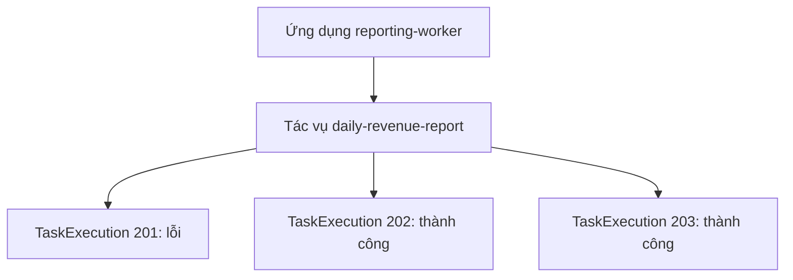

# Đặt tên ứng dụng và tên tác vụ trong Spring Cloud Task

## 1. Mục tiêu của bài học

Khi xây dựng **task đầu tiên** bằng Spring Cloud Task, một quyết định nhỏ nhưng ảnh hưởng lâu dài đến vận hành là **đặt tên**. Ứng dụng chạy trong thời gian hữu hạn, kết thúc sau khi xử lý, còn thông tin về lần chạy được lưu lại trong cơ sở dữ liệu. Nếu tên không ổn định hoặc bị nhầm lẫn, người vận hành sẽ khó tìm lịch sử, thống kê lỗi, xác định tác vụ nào cần chạy lại và liên kết với lịch chạy hay Spring Batch.

Sau bài này, bạn có thể:

- Phân biệt tên ứng dụng Spring Boot, tên tác vụ Spring Cloud Task, tên bản đóng gói và định danh lần thực thi.
- Cấu hình rõ ràng `spring.application.name` và `spring.cloud.task.name`.
- Giải thích vì sao nhiều lần chạy của cùng một tác vụ có chung tên nhưng có `executionId` khác nhau.
- Chọn quy ước đặt tên dễ tra cứu, phù hợp khi chạy thủ công, theo lịch hoặc qua bộ điều phối.
- Tránh các lỗi đặt tên khiến lịch sử trong `TaskRepository` khó sử dụng.

## 2. Vì sao phải phân biệt tên ứng dụng và tên tác vụ?

Giả sử nhóm phát triển có một chương trình lấy dữ liệu đơn hàng, tổng hợp doanh thu rồi kết thúc. Chương trình được triển khai hằng ngày dưới dạng `reporting-worker.jar`. Người vận hành cần trả lời hai câu hỏi:

1. **Ứng dụng Spring Boot nào đã được triển khai?** Đây là thông tin về chương trình, cấu hình và đơn vị triển khai.
2. **Tác vụ nghiệp vụ nào đã chạy?** Đây là thông tin về loại công việc cần tìm trong lịch sử các lần thực thi.

Hai câu hỏi có thể có cùng câu trả lời trong ứng dụng đơn giản, nhưng hai tên phục vụ những mục đích khác nhau:

| Thành phần | Ví dụ | Ý nghĩa chính |
| --- | --- | --- |
| `spring.application.name` | `reporting-worker` | Tên ứng dụng Spring Boot, thường được dùng trong cấu hình và hệ thống quan sát ứng dụng. |
| `spring.cloud.task.name` | `daily-revenue-report` | Tên logic của tác vụ được Spring Cloud Task dùng khi ghi nhận `TaskExecution`. |
| Tệp JAR hoặc container image | `reporting-worker.jar`, `reporting-worker:1.2.0` | Tạo phẩm triển khai; có thể đổi tên hoặc phiên bản mà không đổi ý nghĩa tác vụ. |
| `TaskExecution.executionId` | `42` | Định danh duy nhất cho **một lần chạy** do kho lưu trữ cấp. |
| Tham số nghiệp vụ | `businessDate=2026-11-23` | Đầu vào xác định dữ liệu được xử lý trong lần chạy. |

**Tên ứng dụng không phải là mã định danh của từng lần chạy.** Ngược lại, **tên tác vụ không phải đường dẫn JAR hay tên container**. Một ứng dụng có thể chạy đi chạy lại; mỗi lần chạy tạo một bản ghi riêng dù tên tác vụ không thay đổi.

Trong Spring Cloud Task, lớp quản lý vòng đời là `TaskRepository`. Nó lưu các bản ghi `TaskExecution` để theo dõi lúc bắt đầu, lúc kết thúc và kết quả của từng lần thực thi. Thuộc tính `taskName` trên các bản ghi này là lý do tên tác vụ cần được đặt có chủ đích.

## 3. Hai thuộc tính cấu hình cần biết

### 3.1. `spring.application.name`: tên ứng dụng Spring Boot

Đây là thuộc tính thuộc Spring Boot. Ví dụ:

```yaml
spring:
  application:
    name: reporting-worker
```

Tên này giúp những công cụ sử dụng metadata ứng dụng nhận biết chương trình đang chạy. Trong một hệ thống lớn, nó có thể được dùng để nhóm cấu hình, log, metric hoặc trace tùy vào các công cụ được tích hợp.

Nó **không phải** một khóa nghiệp vụ cho báo cáo hay một định danh thực thi. Không nên dựa vào riêng thuộc tính này để quyết định cách nhóm lịch sử của một loại công việc trong `TaskRepository`.

### 3.2. `spring.cloud.task.name`: tên logic của Spring Cloud Task

Đây là thuộc tính cấu hình của Spring Cloud Task. Ví dụ:

```yaml
spring:
  cloud:
    task:
      name: daily-revenue-report
```

Khi tác vụ được khởi chạy và bản ghi thực thi được tạo, tên đã cấu hình dùng để nhận diện loại tác vụ. Những lần khởi chạy tiếp theo với cùng tên sẽ tạo **các bản ghi thực thi mới** nhưng vẫn có thể được tìm chung qua `taskName`.

Spring Cloud Task có cơ chế xác định tên khi bạn không khai báo `spring.cloud.task.name`, tùy vào cấu hình và phiên bản thư viện. Đối với một bài thực hành hoặc ứng dụng dùng trong sản xuất, **nên cấu hình tên tác vụ tường minh** thay vì phụ thuộc vào tên mặc định. Điều này cũng giúp tránh thay đổi ngoài ý muốn khi đổi cách khởi động hoặc tổ chức mã.

### 3.3. Khi nào hai tên nên giống nhau?

Nếu một ứng dụng Spring Boot thực hiện đúng một tác vụ, bạn có thể chọn:

```yaml
spring:
  application:
    name: daily-revenue-report
  cloud:
    task:
      name: daily-revenue-report
```

Đây là một lựa chọn dễ hiểu, nhất là ở **task đầu tiên**. Tuy nhiên, hai thuộc tính vẫn độc lập về mục đích. Với ứng dụng chung thực hiện nhóm công việc báo cáo, có thể dùng `reporting-worker` làm tên ứng dụng và `daily-revenue-report` làm tên tác vụ. Quy tắc thực tế là **chọn tên phản ánh đúng đối tượng cần nhận diện**, không phải bắt buộc hai thuộc tính giống hoặc khác nhau.

## 4. Ví dụ cấu hình hoàn chỉnh cho task đầu tiên

Ta tạo ứng dụng Spring Boot tên `reporting-worker`, có tác vụ `daily-revenue-report`. Chương trình sẽ nhận `businessDate` từ dòng lệnh, thực hiện logic báo cáo và kết thúc. Đây là ví dụ tối giản để quan sát cách đặt tên; phần ghi báo cáo vào hệ thống nghiệp vụ được thay bằng thông báo minh họa.

### 4.1. Cấu hình `application.yml`

```yaml
spring:
  application:
    name: reporting-worker
  main:
    web-application-type: none
  cloud:
    task:
      name: daily-revenue-report
  datasource:
    url: ${TASK_DB_URL}
    username: ${TASK_DB_USER}
    password: ${TASK_DB_PASSWORD}
```

Ý nghĩa của các nhóm cấu hình:

- `spring.application.name` nhận diện ứng dụng Spring Boot trong các hệ thống tích hợp sử dụng tên ứng dụng.
- `spring.cloud.task.name` đặt tên cho tác vụ được theo dõi bởi Spring Cloud Task.
- `spring.main.web-application-type: none` thể hiện chương trình không cần chạy một HTTP server khi công việc hoàn tất.
- `spring.datasource` cấu hình kết nối đến cơ sở dữ liệu để lưu metadata thực thi qua `TaskRepository`.

Các giá trị `TASK_DB_URL`, `TASK_DB_USER`, `TASK_DB_PASSWORD` phải được cung cấp từ môi trường triển khai. Ứng dụng cũng cần các dependency Spring Boot phù hợp, `spring-cloud-starter-task`, JDBC driver của cơ sở dữ liệu đang dùng và **lược đồ bảng Spring Cloud Task đúng với phiên bản thư viện**. Nên quản lý lược đồ bằng migration được kiểm soát, đặc biệt trong môi trường sản xuất.

### 4.2. Viết điểm vào xử lý bằng `ApplicationRunner`

```java
import java.time.LocalDate;
import java.util.List;

import org.springframework.boot.ApplicationRunner;
import org.springframework.boot.SpringApplication;
import org.springframework.boot.autoconfigure.SpringBootApplication;
import org.springframework.cloud.task.configuration.EnableTask;
import org.springframework.context.annotation.Bean;

@SpringBootApplication
@EnableTask
public class ReportingWorkerApplication {

    public static void main(String[] args) {
        SpringApplication.run(ReportingWorkerApplication.class, args);
    }

    @Bean
    ApplicationRunner dailyRevenueReport() {
        return args -> {
            List<String> values = args.getOptionValues("businessDate");
            if (values == null || values.size() != 1) {
                throw new IllegalArgumentException(
                    "Phải truyền --businessDate=yyyy-MM-dd"
                );
            }

            LocalDate businessDate = LocalDate.parse(values.get(0));
            System.out.println("Đang tổng hợp doanh thu ngày " + businessDate);

            // Ví dụ: gọi dịch vụ tổng hợp và ghi báo cáo.
            // Khi xử lý thất bại, truyền lỗi ra ngoài để ghi nhận trạng thái lỗi.

            System.out.println("Hoàn tất báo cáo ngày " + businessDate);
        };
    }
}
```

`@EnableTask` kích hoạt hỗ trợ vòng đời tác vụ. `ApplicationRunner` chứa logic nghiệp vụ cần thực hiện sau khi ứng dụng khởi tạo. Lớp `ReportingWorkerApplication` là tên lớp Java; nó **không cần** trùng tên Spring Boot hoặc tên tác vụ. Với ví dụ này, cấu hình quyết định tên được ghi nhận trong metadata, không phải tên phương thức `dailyRevenueReport()`.

### 4.3. Khởi chạy ứng dụng

```bash
java -jar reporting-worker.jar --businessDate=2026-11-23
```

Khi ứng dụng được tạo thành công và kết nối `TaskRepository` hoạt động, Spring Cloud Task ghi nhận một `TaskExecution` có `taskName` là `daily-revenue-report`. Mã chương trình sử dụng `businessDate` làm đầu vào nghiệp vụ. Khi công việc kết thúc bình thường, hạ tầng ghi nhận thông tin kết thúc của lần chạy.

Chạy lại cùng câu lệnh sẽ tạo **một lần thực thi mới**. `businessDate` giống nhau không có nghĩa hệ thống tự ngăn chạy trùng hoặc tự bảo đảm dữ liệu báo cáo không bị ghi lặp. Logic nghiệp vụ cần được thiết kế cho việc chạy lại an toàn.

## 5. Quan hệ giữa tên và lịch sử thực thi

Giả sử chương trình được khởi chạy ba lần. Bảng dưới đây là dữ liệu minh họa, không phải kết quả thực tế từ máy của bạn:

| Lần chạy | `spring.application.name` | `taskName` | `businessDate` | `executionId` | Kết quả |
| --- | --- | --- | --- | --- | --- |
| 08:00 | `reporting-worker` | `daily-revenue-report` | `2026-11-23` | `201` | Thất bại |
| 08:10 | `reporting-worker` | `daily-revenue-report` | `2026-11-23` | `202` | Thành công |
| 08:00 ngày sau | `reporting-worker` | `daily-revenue-report` | `2026-11-24` | `203` | Thành công |

Ở đây:

- Cùng **ứng dụng** thực hiện công việc qua các lần khởi chạy khác nhau.
- Cùng **tên tác vụ** giúp gom lịch sử của loại công việc `daily-revenue-report`.
- `executionId` khác nhau xác định từng **lần chạy riêng biệt**.
- Tham số `businessDate` có thể giống hoặc khác giữa những lần chạy.



Trong cơ sở dữ liệu JDBC sử dụng lược đồ Spring Cloud Task thông dụng, lịch sử được lưu ở bảng `TASK_EXECUTION`. Chẳng hạn, có thể tra cứu theo tên tác vụ bằng SQL:

```sql
SELECT TASK_EXECUTION_ID,
       TASK_NAME,
       START_TIME,
       END_TIME,
       EXIT_CODE,
       EXIT_MESSAGE
FROM TASK_EXECUTION
WHERE TASK_NAME = 'daily-revenue-report'
ORDER BY TASK_EXECUTION_ID DESC;
```

Tên cột và bảng cần đối chiếu với phiên bản schema được triển khai. Trong ứng dụng Java, `TaskExplorer` cung cấp API truy vấn lịch sử mà không yêu cầu mọi thành phần tự viết SQL. Dù tra cứu bằng cách nào, tên tác vụ ổn định sẽ giúp tìm đúng nhóm bản ghi.

**Lưu ý về kết quả:** một `TaskExecution` được đánh dấu hoàn tất không tự chứng minh báo cáo được tính chính xác. `TaskRepository` ghi metadata vòng đời; dữ liệu báo cáo nằm trong nơi lưu nghiệp vụ và cần được kiểm tra riêng.

## 6. Quy ước đặt tên phù hợp khi vận hành

Spring Cloud Task không yêu cầu bạn dùng một cụm từ tiếng Anh cố định. Tuy vậy, nên thống nhất quy ước **ngắn, rõ nghĩa và ổn định** giữa mã nguồn, lịch chạy, cảnh báo, dashboard và tài liệu vận hành.

Một lựa chọn dễ áp dụng là dùng chữ thường, các từ cách nhau bởi dấu gạch ngang và diễn tả **đối tượng + hành động hoặc tần suất**:

| Mục đích | Tên nên cân nhắc | Lý do |
| --- | --- | --- |
| Tổng hợp doanh thu mỗi ngày | `daily-revenue-report` | Cho biết loại báo cáo và chu kỳ nghiệp vụ. |
| Đồng bộ danh mục sản phẩm | `product-catalog-sync` | Nêu đối tượng dữ liệu và công việc. |
| Đối soát giao dịch | `payment-reconciliation` | Gắn với khái niệm nghiệp vụ dễ tìm trong log và lịch sử. |
| Nhập dữ liệu khách hàng | `customer-data-import` | Phân biệt với tác vụ xuất dữ liệu. |
| Dọn dữ liệu hết hạn | `expired-record-cleanup` | Nêu điều kiện và thao tác xử lý. |

Tránh đặt tên chung chung như `task`, `job`, `app`, `process-data`, hoặc chỉ dùng số phiên bản như `task-v2`. Những tên đó không cho biết bản ghi lịch sử liên quan đến công việc gì.

Một số nguyên tắc thực tế:

1. **Tên tác vụ mô tả chức năng ổn định.** Không gắn ngày chạy, ID khách hàng, UUID hay timestamp vào tên. Các giá trị thay đổi theo mỗi lần chạy nên được đưa vào tham số nghiệp vụ hoặc hệ thống truy vết thích hợp.
2. **Tên ứng dụng mô tả đơn vị triển khai.** Nếu ứng dụng chỉ làm một việc, có thể dùng chung tên với tác vụ; nếu dùng chung mã triển khai cho nhiều công việc, cần xác định rõ cách chọn và ghi tên của từng công việc.
3. **Tách tên logic khỏi phiên bản phần mềm.** Có thể triển khai image `reporting-worker:2.0.0` mà vẫn giữ `daily-revenue-report` nếu ý nghĩa công việc không thay đổi. Chỉ đổi tên tác vụ khi có lý do về nghiệp vụ hoặc cách phân loại lịch sử.
4. **Tôn trọng giới hạn của môi trường lưu trữ.** Đặt tên ngắn vừa đủ để nằm trong giới hạn trường dữ liệu của schema và tương thích với công cụ điều phối, tìm kiếm, metric và dashboard.
5. **Không đưa bí mật hoặc thông tin cá nhân vào tên.** Tên có thể xuất hiện trong bảng dữ liệu, log và giao diện vận hành.

### Một ứng dụng có nhiều tác vụ thì sao?

Giả sử `reporting-worker` có thể tạo cả báo cáo doanh thu và báo cáo tồn kho. Có hai hướng thiết kế:

- **Tách ứng dụng/tác vụ riêng** nếu cần triển khai, lập lịch, quyền truy cập hoặc cơ chế chạy lại độc lập. Mỗi ứng dụng có `spring.cloud.task.name` cố định phù hợp.
- **Dùng một chương trình hỗ trợ nhiều chế độ** nếu thật sự cần dùng chung mã. Khi đó phải bảo đảm tên tác vụ phản ánh đúng chế độ được chạy, được xác định trước khi metadata `TaskExecution` được tạo và nhất quán với lịch chạy.

Không nên luôn ghi tất cả các lần thực thi đa chức năng thành một tên chung nếu mục tiêu là theo dõi từng loại công việc. Đồng thời, cũng không nên tạo một tên mới cho từng `businessDate`, vì sẽ làm mất khả năng tìm toàn bộ lịch sử của cùng một loại tác vụ.

## 7. Cấu hình tên khi triển khai theo môi trường

Spring Boot cho phép nhận cấu hình từ nhiều nguồn, bao gồm file YAML, biến môi trường và tham số dòng lệnh. Chẳng hạn, khi một môi trường triển khai cần đặt tên khác, có thể truyền thuộc tính Spring Cloud Task khi khởi chạy:

```bash
java -jar reporting-worker.jar \
  --spring.cloud.task.name=daily-revenue-report \
  --businessDate=2026-11-23
```

Hoặc cấu hình tương ứng bằng biến môi trường theo cơ chế ánh xạ thuộc tính của Spring Boot:

```bash
export SPRING_CLOUD_TASK_NAME=daily-revenue-report
java -jar reporting-worker.jar --businessDate=2026-11-23
```

Hai cách trên chỉ minh họa **nguồn cung cấp cấu hình**. Trong sản xuất, nên quản lý tên tác vụ qua cấu hình triển khai đã được kiểm soát. Tránh để từng lần chạy tự sinh tên từ tham số đầu vào, vì lịch sử sẽ bị phân mảnh thành nhiều nhóm không cần thiết.

Nếu một hệ thống có môi trường `dev`, `staging`, `prod`, việc thêm tiền tố môi trường vào tên tác vụ hay không cần dựa trên cách cô lập database và hệ thống theo dõi. Ví dụ, khi mỗi môi trường có `TaskRepository` riêng, có thể giữ cùng tên logic `daily-revenue-report` ở mọi môi trường. Nếu nhiều môi trường cùng ghi vào một nơi lưu, cần có quy tắc định danh và cô lập rõ ràng để tránh nhầm lịch sử. Không nên dựa riêng vào tên để giải quyết vấn đề phân quyền hay cách ly dữ liệu.

## 8. Tên tác vụ trong chạy theo lịch, chạy lại và Spring Batch

Tên ổn định giúp bộ điều phối và người vận hành liên kết các lần chạy nhưng **không tự cung cấp lịch chạy**. Spring Cloud Task theo dõi một lần khởi chạy ứng dụng; việc khởi chạy vào 02:00 hằng ngày, chạy khi có sự kiện hoặc chạy thủ công thường do cron, Kubernetes CronJob hoặc hệ thống orchestration đảm nhiệm.

Ví dụ scheduler chạy `daily-revenue-report` với `businessDate=2026-11-23` nhưng tiến trình gặp lỗi mạng. Scheduler quyết định thử lại cùng tham số. Lần thử lại vẫn có tên `daily-revenue-report`, nhưng nhận `executionId` mới. Muốn không tạo báo cáo trùng, phần xử lý phải có cơ chế **idempotency** và ràng buộc nghiệp vụ tương ứng; tên tác vụ không ngăn hai lần chạy đồng thời.

Nếu ứng dụng còn tích hợp **Spring Batch**, sẽ xuất hiện thêm tên job và định danh job:

| Khái niệm | Ví dụ | Trách nhiệm |
| --- | --- | --- |
| Spring Cloud Task `taskName` | `daily-revenue-report` | Phân loại lịch sử khởi chạy ứng dụng hữu hạn. |
| Spring Batch `jobName` | `aggregateRevenueJob` | Phân loại job gồm các bước xử lý batch. |
| Spring Cloud Task `executionId` | `202` | Định danh lần thực thi ứng dụng. |
| Spring Batch `jobExecutionId` | `876` | Định danh lần thực thi job trong Batch repository. |

Một ứng dụng tác vụ có thể chứa một hoặc nhiều job Batch tùy thiết kế. Tên và ID của Spring Cloud Task và Spring Batch thuộc **hai tầng theo dõi khác nhau**. Không nên mặc định chúng phải giống nhau hoặc các ID phải bằng nhau; nếu cần truy vết liên tầng, hãy cấu hình cơ chế liên kết rõ ràng.

## 9. Xử lý các sự cố thường gặp về tên

| Biểu hiện | Nguyên nhân cần kiểm tra | Cách xử lý |
| --- | --- | --- |
| Không tìm thấy lần chạy theo tên mong đợi | Chỉ đặt `spring.application.name` hoặc cấu hình `spring.cloud.task.name` không được nạp. | Kiểm tra cấu hình hữu hiệu khi khởi chạy; đặt tên tác vụ tường minh và tra cứu lại `TASK_NAME`. |
| Một tác vụ xuất hiện dưới nhiều tên | Đổi tên giữa các phiên bản hoặc sinh tên từ ngày/tham số. | Thống nhất tên logic, dùng tham số cho dữ liệu biến đổi và ghi nhận thay đổi tên có chủ đích. |
| Nhiều loại công việc bị gom chung trong lịch sử | Các chế độ xử lý dùng chung một tên tác vụ. | Phân tách ứng dụng hoặc chọn tên theo chế độ trước khi bắt đầu thực thi. |
| Cùng tên xuất hiện trong nhiều bản ghi | Ứng dụng đã được khởi chạy nhiều lần. | Đây là hành vi bình thường; phân biệt các lần chạy bằng `executionId` và thời gian. |
| Lịch sử có bản ghi chưa có `endTime` | Tiến trình có thể bị dừng đột ngột hoặc không cập nhật được repository. | Đối chiếu thêm log, trạng thái tiến trình/container và bộ điều phối. |
| Truy vấn không thấy bản ghi nào | Cơ sở dữ liệu, schema, tên tác vụ hoặc quá trình khởi tạo không như mong đợi. | Kiểm tra kết nối `DataSource`, bảng metadata, lỗi khởi tạo và kho dữ liệu đang truy vấn. |

Chú ý rằng việc đổi `spring.cloud.task.name` chỉ thay đổi cách phân loại các lần thực thi **mới**; các bản ghi đã có trong cơ sở dữ liệu không tự động được đổi tên. Vì vậy, thay đổi tên cần được xem là một quyết định ảnh hưởng đến khả năng liên tục của lịch sử giám sát.

## 10. Checklist cho task đầu tiên

Trước khi đưa ứng dụng vào lịch chạy, hãy kiểm tra:

- [ ] Đã chọn `spring.application.name` phù hợp với đơn vị triển khai.
- [ ] Đã đặt `spring.cloud.task.name` tường minh, có ý nghĩa nghiệp vụ và ổn định.
- [ ] `@EnableTask`, `TaskRepository`, `DataSource` và schema metadata được cấu hình phù hợp.
- [ ] Ứng dụng thực sự kết thúc sau khi hoàn thành công việc; không cần giữ HTTP server hoạt động.
- [ ] Những dữ liệu biến đổi theo lần chạy được truyền qua tham số, không chèn vào tên tác vụ.
- [ ] Đã thử khởi chạy và tra cứu `TaskExecution` theo đúng `taskName`.
- [ ] Có chiến lược xử lý lỗi, retry, chống chạy trùng và kiểm tra kết quả nghiệp vụ.

### Tự kiểm tra

**Câu 1.** Ứng dụng có `spring.application.name=reporting-worker` và `spring.cloud.task.name=daily-revenue-report`. Muốn lọc lịch sử `TaskExecution`, nên tìm theo tên nào?

**Câu 2.** Hai lần khởi chạy có cùng `--businessDate=2026-11-23`. Liệu chúng có cùng `executionId` không? Tên tác vụ có cần thêm ngày để phân biệt hai lần chạy không?

**Câu 3.** Nâng cấp image từ `reporting-worker:1.0` lên `reporting-worker:2.0` nhưng vẫn làm cùng công việc. Có bắt buộc đổi `spring.cloud.task.name` không?

**Gợi ý trả lời:** (1) Tìm theo `daily-revenue-report`, là tên tác vụ được ghi vào metadata; (2) mỗi lần chạy có định danh thực thi riêng, không cần nhúng ngày vào tên; (3) không, có thể giữ nguyên tên logic để duy trì lịch sử cùng loại công việc.

**Điểm cần nhớ:** `spring.application.name` mô tả **ứng dụng Spring Boot**; `spring.cloud.task.name` mô tả **loại tác vụ trong Spring Cloud Task**; `executionId` mô tả **một lần thực thi cụ thể**. Tách bạch ba khái niệm này là nền tảng để theo dõi kết quả tác vụ trong cơ sở dữ liệu và vận hành an toàn khi chạy theo lịch, theo yêu cầu hoặc cùng Spring Batch.
