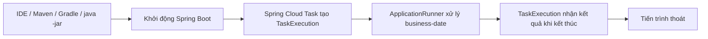

# Chạy Spring Cloud Task từ IDE, Maven hoặc Gradle

## 1. Mục tiêu

Trong chương **Task đầu tiên**, chúng ta sẽ chạy một ứng dụng **Spring Cloud Task** hoàn chỉnh bằng ba cách: nút **Run** trong IDE, lệnh **Maven** và lệnh **Gradle**. Bài tập dùng cùng một chương trình để chứng minh rằng công cụ khởi chạy có thể khác nhau, nhưng logic xử lý và vòng đời của task về cơ bản vẫn như nhau.

Sau bài học, bạn có thể:

- Cấu hình một ứng dụng **Spring Boot** chạy hữu hạn và để **Spring Cloud Task** ghi nhận lần thực thi vào cơ sở dữ liệu.
- Chạy lớp `main` từ IntelliJ IDEA/Eclipse/VS Code, truyền tham số qua Run Configuration.
- Khởi chạy qua `spring-boot:run` của Maven hoặc `bootRun` của Gradle và chạy file JAR đóng gói.
- Đọc kết quả ở console và trong `TaskRepository`, kiểm tra các lỗi khởi động thường gặp.
- Biết khi nào dùng IDE để phát triển, build tool để kiểm thử và JAR/container để triển khai theo lịch hoặc theo yêu cầu.

> **Phạm vi:** Đây là ứng dụng có thời gian chạy hữu hạn: khởi động, thực hiện một tác vụ, ghi nhận kết quả và kết thúc. Spring Cloud Task không tự lập lịch hay tự biến ứng dụng thành Spring Batch job. Chúng ta chỉ chuẩn bị cách chạy có thể dùng lại khi tích hợp Batch và hệ thống điều phối ở các bài sau.

## 2. Điều kiện trước khi chạy

Bạn cần có **JDK tương thích với phiên bản Spring Boot của dự án**, một IDE có hỗ trợ Java, và **Maven hoặc Gradle**. Nếu dự án có Maven Wrapper (`mvnw`, `mvnw.cmd`) hay Gradle Wrapper (`gradlew`, `gradlew.bat`), hãy ưu tiên dùng wrapper để đúng phiên bản build tool đã chọn. Bạn chỉ cần **một trong hai** cấu hình Maven/Gradle, không phải duy trì song song.

Dự án Spring Boot cần các thành phần sau:

| Thành phần | Mục đích |
| --- | --- |
| `spring-boot-starter` | Tạo và khởi động ứng dụng Boot không cần web server. |
| `spring-cloud-starter-task` | Quản lý vòng đời `TaskExecution` bằng Spring Cloud Task. |
| JDBC driver, ví dụ PostgreSQL | Kết nối database chứa các bảng của `TaskRepository`. |
| Spring Boot Maven Plugin hoặc Spring Boot Gradle Plugin | Hỗ trợ chạy trực tiếp và tạo executable JAR. |
| Spring Cloud dependency management/BOM tương thích | Quản lý phiên bản thư viện Spring Cloud theo phiên bản Boot đang dùng. |

Ví dụ các dependency **Maven** bên trong một `pom.xml` đã được quản lý phiên bản Spring Boot và Spring Cloud:

```xml
<dependencies>
    <dependency>
        <groupId>org.springframework.boot</groupId>
        <artifactId>spring-boot-starter</artifactId>
    </dependency>
    <dependency>
        <groupId>org.springframework.cloud</groupId>
        <artifactId>spring-cloud-starter-task</artifactId>
    </dependency>
    <dependency>
        <groupId>org.postgresql</groupId>
        <artifactId>postgresql</artifactId>
        <scope>runtime</scope>
    </dependency>
</dependencies>

<build>
    <plugins>
        <plugin>
            <groupId>org.springframework.boot</groupId>
            <artifactId>spring-boot-maven-plugin</artifactId>
        </plugin>
    </plugins>
</build>
```

Với dự án **Gradle** dùng Spring Boot Gradle Plugin và đã nhập Spring Cloud BOM tương thích, các dependency tương ứng có thể là:

```groovy
dependencies {
    implementation 'org.springframework.boot:spring-boot-starter'
    implementation 'org.springframework.cloud:spring-cloud-starter-task'
    runtimeOnly 'org.postgresql:postgresql'
}
```

Các đoạn trên là **phần cần bổ sung trong dự án đã có cấu hình build hợp lệ**, không phải toàn bộ `pom.xml` hay `build.gradle`. Không chọn ngẫu nhiên phiên bản mới nhất của từng thư viện: cần kiểm tra ma trận tương thích giữa Spring Boot, Spring Cloud và Spring Cloud Task. Một dự án Maven có thể nhập BOM qua `dependencyManagement`; dự án Gradle có thể nhập BOM bằng cơ chế dependency management tương ứng.

Để quan sát lịch sử task **sau khi ứng dụng kết thúc**, bài học dùng PostgreSQL tồn tại lâu dài. Bạn có thể dùng database nhúng khi thực hành nhanh, nhưng database chạy trong bộ nhớ sẽ mất các bản ghi khi tiến trình tắt. Trước khi khởi chạy, hãy bảo đảm database đã tồn tại, tài khoản có quyền phù hợp và schema metadata Task đã được khởi tạo theo phiên bản Spring Cloud Task được sử dụng.

## 3. Xây dựng một task dùng chung cho cả ba cách chạy

### 3.1. Lớp khởi động

Tạo file `src/main/java/com/example/task/FirstTaskApplication.java`:

```java
package com.example.task;

import java.time.LocalDate;
import java.util.List;

import org.springframework.boot.ApplicationRunner;
import org.springframework.boot.SpringApplication;
import org.springframework.boot.autoconfigure.SpringBootApplication;
import org.springframework.cloud.task.configuration.EnableTask;
import org.springframework.context.annotation.Bean;

@SpringBootApplication
@EnableTask
public class FirstTaskApplication {

    public static void main(String[] args) {
        SpringApplication.run(FirstTaskApplication.class, args);
    }

    @Bean
    ApplicationRunner processBusinessDate() {
        return args -> {
            List<String> dates = args.getOptionValues("business-date");
            if (dates == null || dates.size() != 1) {
                throw new IllegalArgumentException(
                    "Cần truyền đúng một --business-date=yyyy-MM-dd");
            }

            LocalDate date = LocalDate.parse(dates.get(0));
            System.out.println("Bắt đầu xử lý ngày: " + date);

            // Thay bằng việc xuất báo cáo, đồng bộ dữ liệu hoặc gọi service thực tế.
            System.out.println("Hoàn tất xử lý ngày: " + date);
        };
    }
}
```

**Các điểm cần hiểu trong ví dụ:**

1. `@SpringBootApplication` khởi tạo ứng dụng Boot. `@EnableTask` bật cơ chế theo dõi vòng đời Spring Cloud Task trong ứng dụng.
2. `ApplicationRunner` chạy sau khi Spring khởi tạo context. Nó nhận `ApplicationArguments`, trong đó giá trị `--business-date=2026-11-24` có thể được đọc bằng `getOptionValues("business-date")`.
3. `LocalDate.parse` kiểm tra giá trị ngày ISO (`yyyy-MM-dd`); thiếu hoặc sai định dạng sẽ gây lỗi thay vì làm như task đã thành công.
4. Sau khi runner hoàn tất và không còn thành phần giữ tiến trình chạy, ứng dụng không-web có thể kết thúc. Spring Cloud Task ghi metadata của lần chạy vào `TaskRepository` nếu cấu hình lưu trữ hoạt động đúng.

Đây là tác vụ mẫu, chưa có thao tác thay đổi dữ liệu nghiệp vụ. Trong ứng dụng thật, hãy gọi một service được Spring quản lý từ runner, tách phần xử lý khỏi lớp khởi động và ghi log bằng logger phù hợp.

### 3.2. Cấu hình ứng dụng không-web và TaskRepository

Ví dụ `src/main/resources/application.yml`:

```yaml
spring:
  application:
    name: first-task
  main:
    web-application-type: none
  datasource:
    url: jdbc:postgresql://localhost:5432/task_demo
    username: task_user
    password: ${TASK_DB_PASSWORD}
  cloud:
    task:
      name: first-task-demo
```

`spring.main.web-application-type: none` giúp Boot không mở HTTP server. `spring.datasource.*` cung cấp kết nối JDBC cho metadata task. `spring.cloud.task.name` đặt tên có ý nghĩa để dễ phân biệt các task trong lịch sử. Với PostgreSQL, bạn cần cài driver, tạo database/tài khoản và chuẩn bị bảng Task Repository; chính sách tự khởi tạo bảng có thể khác nhau theo phiên bản và môi trường nên không mặc định rằng production đã được migrate sẵn.

Ví dụ cung cấp mật khẩu qua biến môi trường:

```bash
export TASK_DB_PASSWORD='your-local-password'
```

Trong **PowerShell** trên Windows:

```powershell
$env:TASK_DB_PASSWORD = 'your-local-password'
```

Giá trị ở trên chỉ minh họa cho máy phát triển. Với môi trường triển khai, đưa thông tin đăng nhập vào cơ chế quản lý secret phù hợp; tránh commit mật khẩu vào repository hoặc in mật khẩu ra log.

**Chu trình mong đợi của mỗi lần chạy:**



Vòng đời trên là mô hình **thành công điển hình**. Nếu cấu hình kết nối hoặc khởi tạo context lỗi quá sớm, có thể chưa tạo được `TaskExecution`; nếu tiến trình bị buộc dừng đột ngột, metadata cũng có thể chưa ghi nhận đầy đủ thời điểm kết thúc.

## 4. Cách 1 — Chạy từ IDE

Trong IntelliJ IDEA, Eclipse hoặc VS Code có Java Extension Pack, thao tác chung là:

1. Mở project và để IDE import dependency Maven/Gradle; chọn đúng JDK mà dự án yêu cầu.
2. Mở `FirstTaskApplication.java`, chọn **Run** ở phương thức `main` hoặc tạo một cấu hình chạy kiểu **Java Application/Spring Boot**.
3. Đặt **Main class** thành `com.example.task.FirstTaskApplication`.
4. Trong **Program arguments**, nhập `--business-date=2026-11-24`. Đây là tham số gửi cho ứng dụng, không phải VM option của JVM.
5. Trong **Environment variables**, cấu hình `TASK_DB_PASSWORD` để ứng dụng kết nối database. Kiểm tra working directory và active profile nếu dự án có cấu hình theo môi trường.
6. Nhấn **Run**, xem console. Task sẽ in ngày được xử lý, sau đó kết thúc khi hoàn thành. Chạy lại cùng cấu hình sẽ là một **lần khởi chạy ứng dụng mới**.

Ví dụ kết quả nghiệp vụ mong đợi trong console:

```text
Bắt đầu xử lý ngày: 2026-11-24
Hoàn tất xử lý ngày: 2026-11-24
```

Các dòng log khởi động của Spring và thông báo metadata Task phụ thuộc cấu hình logging. Chỉ nhìn hai dòng in trên **chưa đủ** để kết luận rằng việc ghi `TaskExecution` vào database đã thành công; hãy kiểm tra mục 7.

**Debug:** đặt breakpoint trong lambda `ApplicationRunner`, chạy bằng **Debug** rồi quan sát `args.getOptionValues("business-date")` và biến `date`. Khi nhấn **Stop** hoặc kill tiến trình, kết quả khác với một lần chạy kết thúc tự nhiên: callback kết thúc, transaction và cập nhật metadata có thể không được thực thi đầy đủ.

## 5. Cách 2 — Chạy từ Maven

Nếu dự án dùng `pom.xml` và Spring Boot Maven Plugin, dùng goal **`spring-boot:run`** để biên dịch và chạy ứng dụng mà không cần tự tìm JAR đầu ra.

Trên macOS/Linux (ở thư mục gốc chứa `mvnw`):

```bash
./mvnw spring-boot:run -Dspring-boot.run.arguments="--business-date=2026-11-24"
```

Trên Windows PowerShell (ở thư mục gốc chứa `mvnw.cmd`):

```powershell
.\mvnw.cmd spring-boot:run "-Dspring-boot.run.arguments=--business-date=2026-11-24"
```

Nếu dự án không có Maven Wrapper, thay `./mvnw` hoặc `.\mvnw.cmd` bằng lệnh `mvn` đã được cài đặt. Tham số `spring-boot.run.arguments` truyền các giá trị sau `--` tới **Spring Boot application**. Nó khác với các system property `-D...` của JVM, và khác cả tham số trực tiếp của Maven.

Ví dụ truyền hai tham số để ứng dụng hoặc service về sau sử dụng:

```bash
./mvnw spring-boot:run -Dspring-boot.run.arguments="--business-date=2026-11-24 --request-id=req-001"
```

Trong ví dụ Java ở mục 3, `request-id` chưa được xử lý nên chỉ `business-date` ảnh hưởng kết quả. Không nên hiểu rằng thêm một tham số CLI tự động làm thay đổi metadata nghiệp vụ hay tự tạo một Spring Batch `JobParameters`.

### Đóng gói rồi chạy bằng Java

Bạn cũng có thể tạo **executable JAR** bằng Spring Boot Maven Plugin:

```bash
./mvnw clean package
java -jar target/first-task-0.0.1-SNAPSHOT.jar --business-date=2026-11-24
```

Tên JAR `first-task-0.0.1-SNAPSHOT.jar` chỉ là ví dụ; thay bằng file thực tế trong `target/`. Trên PowerShell, dùng `.\mvnw.cmd clean package` cho lệnh build; câu lệnh `java -jar` giữ nguyên nếu tên file tương ứng.

`spring-boot:run` và `java -jar` đều khởi chạy ứng dụng Boot, nhưng khác cách cung cấp classpath và artifact. Chạy JAR giúp xác minh gói phân phối sẽ dùng cho môi trường production; `spring-boot:run` thuận tiện khi phát triển. Khi cần giới hạn thời gian và tài nguyên, bộ điều phối bên ngoài có thể chạy chính JAR này trong một tiến trình hoặc container riêng.

## 6. Cách 3 — Chạy từ Gradle

Nếu dự án dùng `build.gradle` hoặc `build.gradle.kts` cùng Spring Boot Gradle Plugin, tác vụ **`bootRun`** chạy ứng dụng trên classpath phát triển. Ở thư mục gốc có Gradle Wrapper:

Trên macOS/Linux:

```bash
./gradlew bootRun --args='--business-date=2026-11-24'
```

Trên Windows PowerShell:

```powershell
.\gradlew.bat bootRun --args="--business-date=2026-11-24"
```

`--args` là tùy chọn truyền **application arguments** đến tiến trình Java do Gradle chạy. Với nhiều tham số, đặt chúng trong một chuỗi:

```bash
./gradlew bootRun --args='--business-date=2026-11-24 --request-id=req-001'
```

Ví dụ trên giả định phiên bản Gradle/Boot plugin hỗ trợ cách truyền `--args` này. Nếu hệ thống build có cấu hình `bootRun` riêng (như `mainClass`, profile hoặc JVM options), hãy xem cấu hình project để biết các giá trị được áp dụng.

### Đóng gói rồi chạy bằng Java

```bash
./gradlew bootJar
java -jar build/libs/first-task-0.0.1-SNAPSHOT.jar --business-date=2026-11-24
```

Trên Windows, dùng `.\gradlew.bat bootJar` khi build. Tên file trong `build/libs/` tùy `project.name`, `version` và cấu hình artifact của dự án. Nếu dùng Gradle cài sẵn, thay `./gradlew` bằng `gradle`.

`bootRun` không phải một `TaskExecution` độc lập ở tầng Spring Cloud Task. Đó chỉ là **Gradle task dùng để khởi chạy tiến trình ứng dụng**. Khi ứng dụng chạy, Spring Cloud Task mới tạo `TaskExecution` thuộc về lần chạy đó. Đừng nhầm Gradle task (`bootRun`) với tác vụ nghiệp vụ Spring Cloud Task.

## 7. Đối chiếu kết quả giữa ba cách chạy

| Tiêu chí | IDE | Maven (`spring-boot:run`) | Gradle (`bootRun`) |
| --- | --- | --- | --- |
| Điểm vào | Phương thức `main` | Spring Boot Maven Plugin | Spring Boot Gradle Plugin |
| Nơi truyền `--business-date` | Program arguments | `spring-boot.run.arguments` | `--args` |
| Biên dịch/chạy | IDE quản lý | Maven trên classpath phát triển | Gradle trên classpath phát triển |
| Debug | Thuận tiện nhất qua breakpoint | Có thể cấu hình debug JVM/plugin | Có thể cấu hình debug JVM/plugin |
| Bản ghi TaskRepository | Có, nếu cấu hình đúng | Có, nếu cấu hình đúng | Có, nếu cấu hình đúng |
| Dùng trực tiếp để triển khai | Thường dành cho local | Thường dành cho local | Thường dành cho local |

Để xác minh task thật sự ghi nhận trong database, mở SQL client và thực hiện truy vấn sau trên PostgreSQL đã cấu hình:

```sql
SELECT TASK_EXECUTION_ID,
       TASK_NAME,
       START_TIME,
       END_TIME,
       EXIT_CODE
FROM TASK_EXECUTION
ORDER BY TASK_EXECUTION_ID DESC;
```

Với schema mặc định của Spring Cloud Task, bảng `TASK_EXECUTION` lưu thông tin nền tảng về mỗi lần chạy. Tên bảng và chi tiết cột có thể được cấu hình hoặc thay đổi theo phiên bản/schema; khi sử dụng schema tùy chỉnh, cần điều chỉnh câu truy vấn tương ứng.

Hãy lần lượt chạy cùng ngày bằng IDE, Maven và Gradle trong **cùng cơ sở dữ liệu**. Bạn thường thấy ba `TASK_EXECUTION_ID` khác nhau nếu cả ba lần khởi chạy và ghi metadata thành công. Giá trị `TASK_NAME` có thể giống nhau vì cấu hình `spring.cloud.task.name: first-task-demo`; thời gian chạy và ID giúp phân biệt các lượt. Nếu ứng dụng chạy thành công nhưng bảng không có dữ liệu, kiểm tra lại datasource, user/schema thực tế và quá trình khởi tạo Task.

`EXIT_CODE` và trạng thái kết thúc trong repository là thông tin ở **cấp task**; trong production còn cần kiểm tra mã thoát thật của tiến trình (và, nếu tích hợp Spring Batch, kết quả của job). Không suy luận rằng log nghiệp vụ đã in “Hoàn tất” thì mọi bước lưu trạng thái, flush và đóng ứng dụng đều thành công.

## 8. Khi thiếu tham số hoặc xử lý gặp lỗi

Thử chạy ứng dụng mà **không có** `--business-date`, hoặc truyền một ngày không hợp lệ:

```bash
./mvnw spring-boot:run -Dspring-boot.run.arguments="--business-date=not-a-date"
```

`ApplicationRunner` sẽ ném `IllegalArgumentException` hoặc lỗi parse ngày. Spring Boot thường ghi stack trace khởi động thất bại và xử lý kết thúc không thành công. Nếu Spring Cloud Task đã khởi tạo repository, metadata của task có thể ghi nhận lỗi; nếu lỗi xảy ra quá sớm trong startup hoặc việc ghi repository cũng thất bại thì không nên kỳ vọng luôn có một dòng lịch sử hoàn chỉnh.

Trong ứng dụng nghiệp vụ, đừng `catch` mọi exception rồi chỉ `System.out.println("Lỗi")` và để runner trả về bình thường: như vậy bên ngoài có thể nhìn thấy một lần chạy thành công giả. Khi cần quy định mã thoát rõ ràng, dùng cơ chế của Spring Boot như `ExitCodeGenerator` hoặc chính sách xử lý lỗi/thoát ứng dụng nhất quán; sau đó kiểm thử mã thoát thực tế của IDE, Maven, Gradle và JAR trong môi trường sử dụng.

**Lưu ý về phép thử lỗi:** khi chạy qua Maven hay Gradle, shell nhận kết quả của công cụ build chứ không phải lúc nào cũng trực tiếp nhận `EXIT_CODE` do Spring Cloud Task lưu. Build tool có thể thêm thông báo và mã lỗi riêng. Với `java -jar`, shell quan sát trực tiếp mã thoát tiến trình Java. Vì vậy hãy đối chiếu console, mã thoát và database trước khi thiết lập cơ chế retry tự động.

## 9. Khắc phục sự cố thường gặp

| Hiện tượng | Nguyên nhân có thể | Cách kiểm tra và xử lý |
| --- | --- | --- |
| `Could not find or load main class` | Tên package/lớp khởi động hoặc cấu hình `mainClass` sai | Mở `FirstTaskApplication`, kiểm tra package và cấu hình Run/Boot plugin. |
| `Failed to configure a DataSource` hoặc lỗi kết nối JDBC | Thiếu driver, URL/user/password sai, DB chưa chạy | Kiểm tra dependency driver, biến `TASK_DB_PASSWORD`, network và quyền DB. |
| `relation ... does not exist`, `Table ... not found` | Chưa khởi tạo schema metadata Spring Cloud Task | Khởi tạo/migrate schema đúng phiên bản và schema đang kết nối. |
| Task không tự dừng | Ứng dụng vẫn mở HTTP server, listener hoặc luồng nền không kết thúc | Dùng `web-application-type: none`, kiểm tra thread và các thành phần chạy nền. |
| IDE chạy được nhưng Maven/Gradle lỗi | Khác JDK, environment variable, profile hoặc cấu hình build | Đối chiếu Java version, working directory, plugin và environment của từng cách chạy. |
| Console báo đã hoàn tất nhưng không thấy TaskExecution | Kết nối nhầm DB/schema, chưa bật Task hoặc ghi metadata lỗi | Kiểm tra `@EnableTask`, cấu hình datasource và log repository/transaction. |
| Lần chạy bị dừng cưỡng bức vẫn có `END_TIME` rỗng | Tiến trình bị kill trước lúc cập nhật kết thúc | Xem log hệ thống, tình trạng container, timeout; xây dựng cơ chế nhận diện lần chạy treo. |
| Chạy hai lần cùng ngày gây tác dụng phụ lặp | Logic nghiệp vụ chưa idempotent | Dùng khóa nghiệp vụ, transaction/upsert hoặc cơ chế chống trùng phù hợp. |

Trong môi trường chạy theo lịch hoặc theo yêu cầu, cần đặc biệt quan tâm đến **tính lặp an toàn (idempotency)**. Spring Cloud Task có thể ghi nhận nhiều lần khởi chạy cùng một bộ tham số; nó không tự ngăn hai runner cùng ghi trùng dữ liệu. Nếu logic phải chạy một lần cho mỗi ngày nghiệp vụ, bạn phải đặt chính sách chống trùng ở scheduler, database hoặc tầng nghiệp vụ. Nếu sau này đưa Spring Batch vào bên trong task, chính `JobRepository`, `JobInstance` và `JobParameters` của Batch mới quản lý danh tính và khả năng restart của job.

## 10. Checklist thực hành và bài tập mở rộng

Hãy hoàn thành bài thực hành theo thứ tự sau:

1. Tạo một project Spring Boot với dependency Spring Cloud Task và JDBC driver; dùng các phiên bản tương thích.
2. Thêm `FirstTaskApplication.java`, cấu hình `application.yml`, database và bảng metadata Task.
3. Trong IDE, chạy với `--business-date=2026-11-24`, kiểm tra hai dòng console và một `TaskExecution` trong database.
4. Dừng bình thường rồi chạy lại từ Maven **hoặc** Gradle. Xác nhận xuất hiện một `TaskExecution` mới.
5. Build executable JAR và chạy `java -jar` với cùng tham số; so sánh kết quả với lần chạy trực tiếp.
6. Thử thiếu tham số hoặc truyền `--business-date=invalid`, quan sát exception, kết quả build/tiến trình và bản ghi metadata (nếu được tạo).
7. Thử chạy lại cùng ngày, phân tích vì sao lịch sử thực thi tăng nhưng nghiệp vụ thực tế vẫn cần cơ chế chống trùng.

**Bài tập mở rộng:** sửa runner để nhận thêm `--request-id=<mã-yêu-cầu>`, in mã yêu cầu vào log và truyền tới service nghiệp vụ. Chạy task từ IDE, Maven/Gradle và JAR với cùng bộ tham số, sau đó xác định các nơi cần lưu `request-id` nếu hệ thống phải đối chiếu yêu cầu bên ngoài với từng `TaskExecution`.

## 11. Tổng kết

**IDE**, **Maven** và **Gradle** là những cách **khởi chạy cùng một ứng dụng Spring Boot**: IDE thích hợp khi phát triển/debug, `spring-boot:run` và `bootRun` thuận tiện khi làm việc với build tool, còn executable JAR phù hợp để chạy bằng hệ thống điều phối hoặc container. **Spring Cloud Task** ghi lịch sử lần chạy ứng dụng qua `TaskRepository` khi được cấu hình chính xác, cho phép theo dõi thời gian và kết quả. Để chạy theo lịch hoặc theo yêu cầu, bộ điều phối chịu trách nhiệm **kích hoạt tiến trình**; còn task cần kết thúc rõ ràng, báo lỗi chính xác và xử lý an toàn khi được gọi lại.
