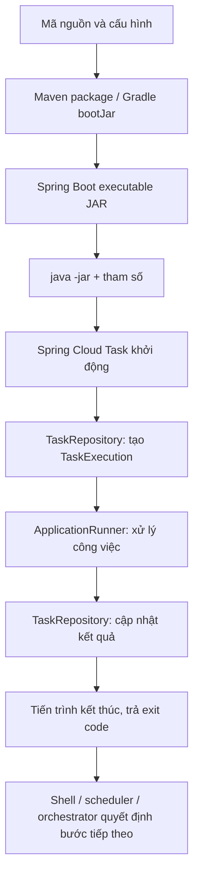

# Đóng gói JAR và khởi chạy bằng `java -jar`

Trong chương **Task đầu tiên**, mục tiêu của bài này là biến một ứng dụng **Spring Cloud Task** thành tệp JAR có thể triển khai, khởi chạy từ dòng lệnh và xác minh kết quả của mỗi lần thực thi. Khác với dịch vụ web hoạt động liên tục, một Spring Cloud Task thường **khởi động → xử lý công việc hữu hạn → ghi trạng thái thực thi vào cơ sở dữ liệu → kết thúc tiến trình**. Vì vậy, đóng gói đúng và truyền tham số đúng quyết định việc tác vụ có thể chạy ổn định trên máy phát triển, máy chủ hoặc nền tảng điều phối hay không.

Sau bài học, bạn có thể:

- Phân biệt JAR Java thông thường với **Spring Boot executable JAR** chạy được bằng `java -jar`.
- Cấu hình một tác vụ Spring Cloud Task đơn giản, nhận tham số ngày nghiệp vụ và ghi metadata qua `TaskRepository`.
- Tạo JAR bằng Maven hoặc Gradle, chạy trên terminal và đọc mã thoát của tiến trình.
- Kiểm tra lịch sử `TaskExecution` trong cơ sở dữ liệu và xử lý những lỗi triển khai phổ biến.
- Đưa cùng JAR vào quy trình chạy theo yêu cầu, theo lịch hoặc qua Spring Batch/launcher bên ngoài.

## 1. `java -jar` thực sự chạy cái gì?

JAR (Java ARchive) đóng gói mã biên dịch, tài nguyên cấu hình và metadata. Để JVM chạy tệp bằng `java -jar app.jar`, JAR phải có manifest trỏ đến lớp khởi động thích hợp, đồng thời có cách nạp các thư viện phụ thuộc.

Với **Spring Boot executable JAR**, plugin đóng gói của Spring Boot chuẩn bị cấu trúc đặc thù: mã ứng dụng trong `BOOT-INF/classes/`, thư viện trong `BOOT-INF/lib/` và bộ launcher của Spring Boot. Manifest chứa thông tin để launcher tìm lớp ứng dụng có phương thức `main`. Không cần chép riêng hàng chục JAR thư viện lên classpath khi chạy theo cách này.

| Loại artifact | Cách tạo phổ biến | Chạy bằng `java -jar` |
| --- | --- | --- |
| JAR Java thuần | Maven `jar` hoặc Gradle `jar`, chưa cấu hình manifest và dependency | Có thể lỗi thiếu `Main-Class` hoặc thiếu dependency. |
| Spring Boot executable JAR | Maven `spring-boot:repackage` hoặc Gradle `bootJar` | Chạy trực tiếp khi có Java tương thích và cấu hình cần thiết. |
| Docker/container image | Đóng gói ứng dụng cùng Java runtime trong image | Container chạy lệnh entrypoint; có thể dùng `java -jar` bên trong. |

**Điểm cần nhớ:** Đóng gói thành công **không đồng nghĩa** tác vụ chạy thành công. Khi chạy, ứng dụng còn phải kết nối được cơ sở dữ liệu metadata, nhận tham số hợp lệ và kết thúc với mã thoát phù hợp.

## 2. Chuẩn bị ứng dụng Spring Cloud Task đầu tiên

Ví dụ xuyên suốt: một tác vụ `dailyRevenueTask` xử lý số liệu doanh thu của ngày được truyền vào bằng `--business-date=YYYY-MM-DD`. Phần xử lý bên dưới chỉ in thông tin minh họa; trong ứng dụng thật, đây có thể là bước đọc dữ liệu, tính toán và lưu kết quả vào cơ sở dữ liệu nghiệp vụ.

### 2.1. Tạo dự án và thêm dependency

Tạo dự án **Spring Boot** dùng Java 17 trở lên, Maven, mã nguồn tại package ví dụ `com.example.taskdemo`. Chọn phiên bản Spring Boot và **Spring Cloud release train tương thích** theo ma trận hỗ trợ của bộ phiên bản đang sử dụng. Đừng tự ghép ngẫu nhiên các phiên bản Boot và Cloud.

Trong `pom.xml` do Spring Initializr tạo, thêm các dependency cần thiết:

```xml
<dependencies>
    <!-- Ghi nhận vòng đời và lịch sử thực thi Spring Cloud Task -->
    <dependency>
        <groupId>org.springframework.cloud</groupId>
        <artifactId>spring-cloud-starter-task</artifactId>
    </dependency>

    <!-- DataSource và khả năng truy cập CSDL bằng JDBC -->
    <dependency>
        <groupId>org.springframework.boot</groupId>
        <artifactId>spring-boot-starter-jdbc</artifactId>
    </dependency>

    <!-- CSDL file cục bộ, chỉ dùng cho bài thực hành -->
    <dependency>
        <groupId>com.h2database</groupId>
        <artifactId>h2</artifactId>
        <scope>runtime</scope>
    </dependency>
</dependencies>
```

Nếu dự án chưa khai báo Spring Cloud BOM, cần import BOM trong `dependencyManagement`; giá trị `spring-cloud.version` phải được đặt thành **phiên bản Spring Cloud tương thích với Spring Boot** đã chọn:

```xml
<dependencyManagement>
    <dependencies>
        <dependency>
            <groupId>org.springframework.cloud</groupId>
            <artifactId>spring-cloud-dependencies</artifactId>
            <version>${spring-cloud.version}</version>
            <type>pom</type>
            <scope>import</scope>
        </dependency>
    </dependencies>
</dependencyManagement>
```

Giữ `spring-boot-maven-plugin` trong phần `build.plugins` của `pom.xml` để tạo JAR có thể thực thi:

```xml
<build>
    <plugins>
        <plugin>
            <groupId>org.springframework.boot</groupId>
            <artifactId>spring-boot-maven-plugin</artifactId>
        </plugin>
    </plugins>
</build>
```

Các đoạn trên là **phần cần ghép vào POM nền có sẵn**, không phải toàn bộ `pom.xml`. POM nền phải có `groupId`, `artifactId`, `version`, Spring Boot parent hoặc cơ chế quản lý dependency tương đương và định nghĩa giá trị `spring-cloud.version`. Ví dụ bên dưới giả sử `artifactId=first-cloud-task` và `version=0.0.1-SNAPSHOT`.

### 2.2. Viết điểm khởi động và nghiệp vụ

Tạo `src/main/java/com/example/taskdemo/FirstCloudTaskApplication.java`:

```java
package com.example.taskdemo;

import java.time.LocalDate;
import java.util.List;

import org.springframework.boot.ApplicationArguments;
import org.springframework.boot.ApplicationRunner;
import org.springframework.boot.SpringApplication;
import org.springframework.boot.autoconfigure.SpringBootApplication;
import org.springframework.cloud.task.configuration.EnableTask;
import org.springframework.context.annotation.Bean;

@SpringBootApplication
@EnableTask
public class FirstCloudTaskApplication {

    public static void main(String[] args) {
        SpringApplication.run(FirstCloudTaskApplication.class, args);
    }

    @Bean
    ApplicationRunner runDailyRevenue() {
        return args -> {
            LocalDate businessDate = LocalDate.parse(
                requiredOption(args, "business-date")
            );

            System.out.printf(
                "Dang xu ly doanh thu ngay %s%n", businessDate
            );

            // TODO: Thay bằng logic nghiệp vụ thực tế.
            // Cờ sau chỉ dùng để luyện tập tình huống thất bại.
            if (args.containsOption("simulate-error")) {
                throw new IllegalStateException("Loi mo phong khi xu ly");
            }

            System.out.println("Hoan tat xu ly doanh thu");
        };
    }

    private static String requiredOption(ApplicationArguments args, String name) {
        List<String> values = args.getOptionValues(name);
        if (values == null || values.size() != 1
                || values.get(0) == null || values.get(0).isBlank()) {
            throw new IllegalArgumentException(
                "Can truyen dung mot --" + name + "=YYYY-MM-DD"
            );
        }
        return values.get(0);
    }
}
```

Trong ví dụ này:

- `@SpringBootApplication` bật cấu hình tự động của Spring Boot; `main` khởi động ngữ cảnh ứng dụng.
- `@EnableTask` kích hoạt cơ chế Spring Cloud Task ghi nhận vòng đời thực thi.
- `ApplicationRunner` chạy sau khi Spring khởi tạo ứng dụng, lấy tham số qua `ApplicationArguments` và thực hiện công việc.
- `LocalDate.parse` kiểm tra ngày hợp lệ theo định dạng ISO như `2026-11-24`; sai định dạng hoặc thiếu tham số sẽ gây lỗi.
- Nếu không có dịch vụ nền giữ tiến trình sống, ứng dụng hữu hạn sẽ hoàn tất, đóng ngữ cảnh theo cơ chế của Spring Cloud Task và kết thúc. Không cần thêm vòng lặp vô hạn để “giữ task chạy”.

Khi xây dựng tác vụ thực tế, **không nuốt ngoại lệ rồi in “thành công”**. Hãy để lỗi phản ánh chính xác vào cơ chế kết thúc và mã thoát; nếu có xử lý lỗi riêng, cần chủ động trả về trạng thái thất bại phù hợp.

### 2.3. Cấu hình kho metadata cục bộ

Tạo `src/main/resources/application.yml`:

```yaml
spring:
  application:
    name: first-cloud-task
  main:
    web-application-type: none
  datasource:
    url: jdbc:h2:file:./task-metadata
    driver-class-name: org.h2.Driver
    username: sa
    password: ""
  cloud:
    task:
      name: dailyRevenueTask
      initialize-enabled: true
```

Giải thích từng quyết định:

- `web-application-type: none` giúp ứng dụng được coi là tác vụ dòng lệnh, không mở web server.
- `jdbc:h2:file:./task-metadata` dùng **H2 lưu trên đĩa** để giữ lịch sử thực thi qua nhiều lần chạy. Nếu dùng `jdbc:h2:mem:...`, dữ liệu chỉ tồn tại trong vòng đời database in-memory và thường không còn khi tiến trình dừng.
- `spring.cloud.task.name` đặt tên logic cho các lần chạy; mỗi lần chạy vẫn có `TaskExecution` và ID riêng.
- `initialize-enabled` cho phép cơ chế khởi tạo bảng metadata theo hỗ trợ của phiên bản thư viện trong môi trường thực hành. Ở production, hãy quản lý schema qua migration đã kiểm tra tương thích và hạn chế tự tạo bảng khi triển khai.

**Lưu ý đường dẫn:** `./task-metadata` được hiểu tương đối theo *thư mục làm việc hiện tại của tiến trình*, không phải theo vị trí đặt JAR. Nếu chạy JAR từ thư mục khác, H2 có thể tạo một database khác, khiến bạn tưởng lịch sử bị mất. H2 file phù hợp cho thực hành một máy; khi nhiều tác vụ chạy song song hoặc chạy trên nhiều container, hãy dùng CSDL được hỗ trợ và vận hành tập trung như PostgreSQL hoặc MySQL, với schema và cấu hình phù hợp.

## 3. Đóng gói thành executable JAR

### 3.1. Maven

Tại thư mục gốc có `pom.xml`, chạy:

```bash
./mvnw clean package
```

Trên Windows PowerShell, dùng Maven Wrapper tương ứng:

```powershell
.\mvnw.cmd clean package
```

Lệnh sẽ biên dịch mã, chạy các bước kiểm tra được cấu hình và tạo artifact trong `target/`. Với tên và phiên bản ví dụ đã chọn, file đầu ra thường là:

```text
target/first-cloud-task-0.0.1-SNAPSHOT.jar
```

Trong dự án dùng Spring Boot Maven Plugin, pha `package` thường gọi bước `repackage` theo cấu hình plugin để tạo executable JAR. Nếu dự án không kế thừa cấu hình mặc định của Spring Boot parent, bạn cần bảo đảm goal `repackage` được liên kết với pha đóng gói. Đừng nhầm JAR gốc có hậu tố như `.jar.original` với JAR Spring Boot đã đóng gói.

### 3.2. Gradle

Nếu dự án dùng Gradle và đã cấu hình Spring Boot Gradle Plugin cùng phiên bản dependency tương thích, phần dependency tương đương có thể viết:

```groovy
dependencies {
    implementation 'org.springframework.cloud:spring-cloud-starter-task'
    implementation 'org.springframework.boot:spring-boot-starter-jdbc'
    runtimeOnly 'com.h2database:h2'
}
```

Sau khi cấu hình Spring Cloud BOM hoặc dependency management tương ứng, đóng gói bằng:

```bash
./gradlew clean bootJar
```

Artifact thường nằm trong `build/libs/`. Trên Windows, dùng `.\gradlew.bat clean bootJar`. Chọn **`bootJar`** khi cần JAR thực thi đầy đủ dependency; `jar` thuần thường không đủ cho cách triển khai bằng `java -jar` của Spring Boot.

### 3.3. Kiểm tra kết quả đóng gói

Kiểm tra Java trên máy chạy và danh sách nội dung JAR:

```bash
java -version
jar tf target/first-cloud-task-0.0.1-SNAPSHOT.jar
```

Với JAR Spring Boot hợp lệ, trong danh sách thường có `BOOT-INF/classes/`, `BOOT-INF/lib/` và các lớp launcher; nội dung cụ thể phụ thuộc phiên bản Spring Boot. Nếu file không có thư viện và manifest khởi động phù hợp, hãy kiểm tra cấu hình plugin thay vì chỉ đổi tên thành `.jar`.

## 4. Khởi chạy bằng `java -jar`

### 4.1. Lần chạy thành công

Từ **thư mục gốc dự án** (để đường dẫn H2 trong ví dụ nhất quán), chạy:

```bash
java -jar target/first-cloud-task-0.0.1-SNAPSHOT.jar \
  --business-date=2026-11-24
echo $?
```

Trên Windows PowerShell:

```powershell
java -jar .\target\first-cloud-task-0.0.1-SNAPSHOT.jar --business-date=2026-11-24
$LASTEXITCODE
```

Spring Boot chuyển đối số bắt đầu bằng `--` vào hệ thống cấu hình/`ApplicationArguments`. Trong ví dụ, `--business-date` là **tham số nghiệp vụ do ứng dụng tự định nghĩa**, còn `--spring.cloud.task.name` là **thuộc tính cấu hình Spring Cloud Task**. Có thể ghi đè tên tác vụ cho một lần chạy nếu thực sự cần:

```bash
java -jar target/first-cloud-task-0.0.1-SNAPSHOT.jar \
  --business-date=2026-11-24 \
  --spring.cloud.task.name=manualDailyRevenueTask
```

Kỳ vọng quan sát được: ứng dụng in thông báo đang xử lý và hoàn tất, rồi trả quyền điều khiển cho terminal. Trong cách chạy bình thường, mã thoát tiến trình thường là **`0`**. Log của Spring Boot/Spring Cloud Task có thể hiển thị thông tin khởi động, tạo và kết thúc bản ghi task, tùy phiên bản và mức log.

Lệnh `echo $?` phải được thực hiện **ngay sau** `java -jar` trong shell Bash để phản ánh mã thoát của chính tiến trình Java. Trong PowerShell dùng `$LASTEXITCODE`. Thông điệp “Hoan tat xu ly” trong stdout chỉ là log minh họa; **mã thoát và metadata thực thi** mới là căn cứ chính để theo dõi trạng thái.

### 4.2. Lần chạy thất bại có chủ đích

Thử cùng JAR với cờ `--simulate-error`:

```bash
java -jar target/first-cloud-task-0.0.1-SNAPSHOT.jar \
  --business-date=2026-11-24 \
  --simulate-error
echo $?
```

`ApplicationRunner` sẽ ném `IllegalStateException`. Nếu runtime và cơ sở dữ liệu metadata hoạt động, ứng dụng ghi nhận lần chạy lỗi theo cơ chế Spring Cloud Task; tiến trình sẽ kết thúc không thành công. Mã thoát chính xác tùy cách ứng dụng và nền tảng xử lý lỗi, nhưng trong một CLI thông thường **mã khác `0`** báo thất bại. Cờ mô phỏng chỉ dùng để học và nên bỏ khỏi ứng dụng sản xuất.

Nếu gặp lỗi trước khi kho metadata khởi tạo, có thể không có bản ghi `TaskExecution` tương ứng. Đó là lý do không được kết luận “không có metadata” đồng nghĩa “chưa từng có yêu cầu khởi chạy”.

### 4.3. Cấu hình theo môi trường

Một JAR có thể chạy ở nhiều môi trường với cấu hình phù hợp:

```bash
java -jar target/first-cloud-task-0.0.1-SNAPSHOT.jar \
  --spring.profiles.active=prod \
  --business-date=2026-11-24
```

Ví dụ trên chỉ có tác dụng khi dự án đã định nghĩa cấu hình `prod` (chẳng hạn `application-prod.yml` hoặc cấu hình được cấp từ môi trường). Trong sản xuất, thường truyền URL CSDL, tài khoản hoặc secret bằng biến môi trường, secret manager và cấu hình triển khai được kiểm soát. **Không đưa mật khẩu/token vào đối số dòng lệnh** vì chúng có thể xuất hiện trong process list, log hoặc metadata.

## 5. Xác minh lịch sử thực thi trong `TaskRepository`

Khi ứng dụng đã kết nối CSDL, Spring Cloud Task quản lý một bản ghi `TaskExecution` cho mỗi lần chạy. Một bảng metadata thường gặp là `TASK_EXECUTION`. Có thể kết nối đến H2 file sau khi ứng dụng dừng và truy vấn (tùy schema của phiên bản):

```sql
SELECT
    TASK_EXECUTION_ID,
    TASK_NAME,
    START_TIME,
    END_TIME,
    EXIT_CODE
FROM TASK_EXECUTION
ORDER BY TASK_EXECUTION_ID DESC;
```

Một lần chạy thành công và một lần chạy thất bại **không ghi đè nhau**. Chúng có thể cùng `TASK_NAME` nhưng có `TASK_EXECUTION_ID` khác nhau, thời điểm riêng và mã thoát riêng.

| Dữ liệu quan sát | Ý nghĩa thực tế |
| --- | --- |
| `START_TIME` có giá trị | Ứng dụng đã kịp ghi nhận thời điểm bắt đầu. |
| `END_TIME` có giá trị | Framework đã kịp cập nhật kết thúc; cần kiểm tra cùng `EXIT_CODE`. |
| `EXIT_CODE = 0` | Thường thể hiện kết thúc thành công theo quy ước của ứng dụng. |
| `EXIT_CODE != 0` | Thường thể hiện lỗi; nên đối chiếu thông báo lỗi và log. |
| Không có bản ghi hoặc `END_TIME` trống | Có thể chưa chạy, không kết nối được DB, bị dừng đột ngột hoặc metadata chưa kịp cập nhật. |

**Phân biệt rõ:** `TaskRepository` lưu **metadata về lần chạy**, không tự lưu kết quả kinh doanh như số tiền đã đối soát hay file báo cáo tạo ra. Kết quả nghiệp vụ phải được lưu tại đích riêng; có thể liên kết với lần chạy bằng `TASK_EXECUTION_ID`, mã yêu cầu hoặc correlation ID. Để truy vấn lịch sử trong mã Java, dùng khả năng đọc của `TaskExplorer`; không cập nhật tùy tiện bảng metadata bằng SQL ứng dụng.



Trong một lần chạy bị crash hoặc không kết nối được CSDL, luồng có thể dừng trước khi metadata được ghi đầy đủ; sơ đồ trên mô tả **đường chạy thông thường**.

## 6. Xử lý sự cố khi đóng gói và khởi chạy

| Triệu chứng | Nguyên nhân thường gặp | Kiểm tra và cách khắc phục |
| --- | --- | --- |
| `no main manifest attribute` | Đang chạy JAR thường, chưa được Spring Boot repackage. | Dùng `spring-boot-maven-plugin`/`bootJar`; kiểm tra đúng artifact. |
| `ClassNotFoundException`, `NoClassDefFoundError` | Thiếu dependency hoặc JAR không chứa thư viện cần thiết. | Kiểm tra `BOOT-INF/lib/`, dependency và plugin đóng gói. |
| `UnsupportedClassVersionError` | Java runtime cũ hơn phiên bản biên dịch. | So sánh `java -version` với Java target của dự án. |
| Không tìm thấy JAR | Sai tên `artifactId`, version hoặc thư mục làm việc. | Xem nội dung `target/` hoặc `build/libs/`, dùng đúng đường dẫn. |
| Task không tự kết thúc | Có web server, scheduler, listener hoặc luồng non-daemon vẫn sống. | Xác định thành phần giữ JVM chạy; với tác vụ hữu hạn, tránh khởi tạo dịch vụ nền không cần thiết. |
| Không tạo được bảng/ghi `TaskExecution` | Thiếu driver, sai URL, thiếu quyền hoặc schema không khớp. | Xem stack trace và cấu hình DataSource; tạo schema/migration đúng phiên bản. |
| Cứ chạy lại thấy kho dữ liệu trống | H2 in-memory hoặc thay đổi thư mục làm việc/đường dẫn file. | Dùng H2 file theo đường dẫn nhất quán hoặc CSDL tập trung. |
| Lệnh trả mã khác `0` | Thiếu tham số, ngày không hợp lệ hoặc lỗi xử lý. | Kiểm tra stdout/stderr, log, `EXIT_CODE` và thông báo lỗi trong metadata. |
| Task chạy hai lần cho cùng ngày | Lịch hoặc retry gọi lại ứng dụng. | Thiết kế idempotency theo khóa nghiệp vụ, kiểm soát đồng thời và lịch retry. |

Khi cần phân tích lỗi, hãy lần theo thứ tự: **tệp JAR → phiên bản Java → tham số/biến môi trường → kết nối metadata → log nghiệp vụ → mã thoát → trạng thái hạ tầng**. Không xem một dòng log đơn lẻ là bằng chứng đầy đủ về kết quả thực thi.

## 7. Từ `java -jar` thủ công đến vận hành theo lịch hoặc theo yêu cầu

Lệnh `java -jar` là đơn vị triển khai cơ bản mà các hệ thống bên ngoài có thể tự động hóa:

| Hình thức khởi chạy | Ai quyết định thời điểm? | Ai tạo tiến trình? |
| --- | --- | --- |
| Nhân viên vận hành chạy CLI | Người vận hành | Shell trên máy đích. |
| Chạy định kỳ qua cron hoặc Kubernetes CronJob | Bộ lập lịch | Cron/container platform. |
| Chạy từ API hoặc workflow | Backend/orchestrator | Launcher hoặc nền tảng thực thi. |
| Spring Cloud Data Flow | Lịch, yêu cầu hay workflow được cấu hình trong Data Flow | TaskLauncher phù hợp với hạ tầng triển khai. |

Mỗi lần tạo tiến trình mới sẽ là **một lần thực thi Spring Cloud Task mới** nếu ứng dụng khởi động và ghi metadata thành công. Bộ điều phối cần áp dụng timeout, giới hạn retry, cảnh báo và kiểm soát số lần chạy đồng thời. Kho `TaskRepository` cung cấp lịch sử, **không tự tạo lịch, không tự tái chạy task và không thay thế hệ thống điều phối**.

**Khi phối hợp với Spring Batch:** một executable JAR vẫn có thể chứa ứng dụng Spring Cloud Task khởi chạy Batch `Job`. Khi đó:

- `TaskExecution` ghi nhận vòng đời **tiến trình ứng dụng**.
- `JobExecution`/`StepExecution` của Spring Batch phản ánh trạng thái **công việc theo lô**.
- `JobLauncher` của Spring Batch chạy Batch Job *bên trong ứng dụng*; launcher của nền tảng chạy *toàn bộ JAR/container*.

Không mặc định coi một retry của Spring Cloud Task là restart an toàn của Spring Batch Job. Cần xét đúng `JobParameters`, trạng thái JobRepository và khả năng xử lý lặp an toàn ở từng bước nghiệp vụ.

### Gợi ý vận hành an toàn

1. **Xác định phiên bản:** cùng artifact và cùng cấu hình phải tái hiện được hành vi; lưu phiên bản image/JAR với mã yêu cầu.
2. **Truy vết đầu vào:** truyền ngày nghiệp vụ, request ID và correlation ID; tránh truyền secret qua tham số.
3. **Phân biệt các mức thành công:** launcher tạo được Job chưa chứng minh nghiệp vụ thành công; kết hợp exit code, TaskExecution và log.
4. **Đảm bảo idempotency:** cùng `business-date` có thể được chạy nhiều lần do người dùng bấm lại hoặc orchestrator retry.
5. **Giữ metadata ổn định:** dùng database phù hợp, schema đúng phiên bản, quyền tối thiểu và migration/backup trong production.

## 8. Bài thực hành tự kiểm tra

Thực hiện tuần tự với project minh họa:

1. Tạo executable JAR bằng `./mvnw clean package` hoặc `./gradlew clean bootJar`; kiểm tra `BOOT-INF/lib` trong artifact.
2. Chạy lần thứ nhất với `--business-date=2026-11-24`; xác nhận tiến trình kết thúc và ghi lại mã thoát.
3. Chạy lần thứ hai với `--business-date=2026-11-25`; xem hai lần chạy độc lập trong bảng `TASK_EXECUTION`.
4. Chạy với `--business-date=2026-11-24 --simulate-error`; so sánh log, mã thoát và metadata với lần thành công.
5. Thử bỏ `--business-date` hoặc truyền một ngày sai định dạng; xác định lỗi nằm ở lớp kiểm tra tham số, không phải ở bước đóng gói.
6. Chạy cùng JAR từ một thư mục làm việc khác; giải thích vì sao đường dẫn H2 tương đối có thể dẫn đến kho metadata khác, sau đó khôi phục cách chạy nhất quán.

**Câu hỏi ôn tập:** Vì sao cả hai lần chạy cùng tên `dailyRevenueTask` vẫn có ID thực thi khác nhau? Vì sao JAR build thành công vẫn có thể thất bại lúc chạy? Trong trường hợp scheduler khởi chạy lại sau timeout, tầng nào chịu trách nhiệm phát hiện tác vụ cũ còn sống và ngăn dữ liệu bị xử lý trùng?

**Kết quả cần đạt:** Bạn có một JAR Spring Cloud Task có thể chạy bằng `java -jar`, biết cách truyền tham số nghiệp vụ, nhận diện mã thoát và kiểm tra bản ghi `TaskExecution`. Đây là nền tảng để triển khai cùng ứng dụng dưới dạng job chạy theo lịch, chạy theo yêu cầu hoặc kết hợp Spring Batch mà vẫn giám sát được từng lần thực thi.
