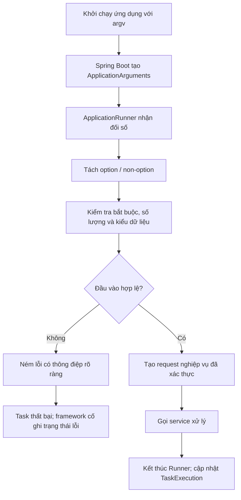

# Đọc tham số có tên và không có tên bằng ApplicationArguments

## 1. Vai trò của tham số trong luồng xử lý Spring Cloud Task

**Spring Cloud Task** dùng để xây dựng ứng dụng Spring Boot chạy trong một khoảng thời gian hữu hạn: khởi động, nhận đầu vào, xử lý công việc, ghi nhận trạng thái thực thi vào cơ sở dữ liệu qua `TaskRepository` rồi kết thúc. Một tác vụ có thể được gọi thủ công, từ lịch chạy hoặc bởi hệ thống điều phối; mỗi lần chạy thường cần một bộ đầu vào khác nhau.

Ví dụ, cùng một chương trình nhập dữ liệu có thể được gọi như sau:

```bash
java -jar import-task.jar --source=orders --batch-size=250 --dry-run north south
```

Trong lệnh trên:

- `--source=orders` chỉ định nguồn dữ liệu.
- `--batch-size=250` giới hạn số bản ghi xử lý trong một đợt.
- `--dry-run` yêu cầu chế độ mô phỏng, không ghi thay đổi nghiệp vụ.
- `north` và `south` là tên hai vùng dữ liệu cần xử lý; chúng là **đối số không có tên**.

`ApplicationArguments` của Spring Boot cung cấp API để tách các nhóm này và kiểm tra chúng. Nắm vững cơ chế này giúp tránh đọc sai đầu vào, tránh chạy nhầm dữ liệu và bảo đảm lỗi tham số được phát hiện **trước** khi tác vụ thực hiện các thay đổi không thể đảo ngược.

Sau bài học, bạn sẽ biết cách dùng `ApplicationRunner`, `containsOption()`, `getOptionValues()`, `getNonOptionArgs()`, `getOptionNames()` và `getSourceArgs()`; phân biệt tham số có tên với tham số vị trí; áp dụng xác thực đầu vào; và liên hệ kết quả xác thực với vòng đời Spring Cloud Task.

## 2. Spring Boot phân loại tham số như thế nào?

### 2.1. Tham số có tên (option arguments)

Trong cách phân tích đối số chuẩn của Spring Boot, tham số có tên bắt đầu bằng **hai dấu gạch ngang** `--`:

```text
--source=orders
--batch-size=250
--dry-run
--tag=urgent
--tag=nightly
```

Có hai dạng chính:

1. **Option có giá trị:** `--key=value`, chẳng hạn `--source=orders`.
2. **Option không có giá trị:** `--flag`, chẳng hạn `--dry-run`. Thích hợp cho công tắc mà sự xuất hiện có nghĩa là bật.

Một tên option có thể xuất hiện nhiều lần, ví dụ `--tag=urgent --tag=nightly`. Khi đó `getOptionValues("tag")` trả về danh sách hai giá trị; chương trình cần xác định rõ trường hợp lặp là **hợp lệ** hay **lỗi**.

**Điểm dễ nhầm:** Với bộ phân tích đối số tiêu chuẩn của Spring Boot, cú pháp `--source orders` không tương đương `--source=orders`. `--source` được nhận là option **không có giá trị**, còn `orders` trở thành đối số **không có tên**. Hãy sử dụng `--source=orders` khi truyền giá trị option qua dòng lệnh.

### 2.2. Tham số không có tên (non-option arguments)

Các đối số không được phân loại là option được đưa vào danh sách **non-option**, thường dùng làm tham số vị trí:

```bash
java -jar import-task.jar north south
```

Ở đây `getNonOptionArgs()` là danh sách `["north", "south"]`. Chương trình tự quyết định ngữ nghĩa: đối số thứ nhất có thể là tên nguồn dữ liệu, hoặc cả hai có thể là danh sách vùng cần nhập.

`-v` chỉ có **một** dấu gạch ngang, nên với cơ chế parse mặc định của `ApplicationArguments`, nó không trở thành option `v` theo quy ước `--name`. Nếu muốn hỗ trợ các cờ kiểu `-v` hoặc cú pháp CLI phức tạp hơn, hãy tự định nghĩa lớp chuyển đổi hoặc dùng một thư viện CLI thích hợp.

### 2.3. Bảng phân biệt cú pháp

| Đối số truyền vào sau tên JAR | Kết quả phân loại | Ý nghĩa cần lưu ý |
| --- | --- | --- |
| `--source=orders` | Option `source`, một giá trị `orders` | Dạng khuyến nghị cho option có giá trị |
| `--dry-run` | Option `dry-run`, không có giá trị | Phù hợp với cờ bật theo sự hiện diện |
| `--tag=A --tag=B` | Option `tag` có hai giá trị | Phải xử lý danh sách hoặc từ chối lặp |
| `north` | Non-option `north` | Đối số vị trí |
| `--source orders` | Option `source` không có giá trị; non-option `orders` | Không phải cặp key/value |
| `--source=` | Option `source` với giá trị chuỗi rỗng | Có tên nhưng thường không đủ hợp lệ |
| `-v` | Non-option `-v` | Không phải option `v` trong parser mặc định |

**Lưu ý về dấu cách:** Nếu giá trị chứa dấu cách, shell cần truyền nó như **một đối số**. Ví dụ với shell hỗ trợ dấu ngoặc kép:

```bash
java -jar import-task.jar "--source=orders archive" "north region"
```

Khi đó `source` nhận `"orders archive"` và `getNonOptionArgs()` có một phần tử `"north region"`. Cách escape cụ thể phụ thuộc shell hoặc nền tảng khởi chạy; Java chỉ thấy mảng đối số đã được chương trình gọi cung cấp.

## 3. ApplicationRunner và ApplicationArguments

### 3.1. Vì sao dùng ApplicationRunner?

Spring Boot hỗ trợ hai giao diện chạy logic sau khi ứng dụng khởi động:

| Giao diện | Phương thức | Kiểu tham số nhận được |
| --- | --- | --- |
| `CommandLineRunner` | `run(String... args)` | Mảng chuỗi nguyên bản |
| `ApplicationRunner` | `run(ApplicationArguments args)` | API đã phân loại option và non-option |

Nếu cần phân tích tham số có tên và không có tên, `ApplicationRunner` giúp giảm xử lý chuỗi thủ công. Cả hai đều chạy trong giai đoạn khởi động ứng dụng; với Spring Cloud Task, logic của Runner thường là nội dung chính của một lần thực thi.

Ví dụ tối giản:

```java
import org.springframework.boot.ApplicationArguments;
import org.springframework.boot.ApplicationRunner;
import org.springframework.stereotype.Component;

@Component
public class InspectArgumentsRunner implements ApplicationRunner {
    @Override
    public void run(ApplicationArguments args) {
        System.out.println("Option names: " + args.getOptionNames());
        System.out.println("Non-option args: " + args.getNonOptionArgs());
        System.out.println("Source args: "
                + java.util.Arrays.toString(args.getSourceArgs()));
    }
}
```

Giả sử khởi chạy:

```bash
java -jar import-task.jar --source=orders --dry-run north south
```

Bạn sẽ quan sát được:

```text
Option names: [source, dry-run]
Non-option args: [north, south]
Source args: [--source=orders, --dry-run, north, south]
```

Thứ tự hiển thị tập hợp `getOptionNames()` không nên được dùng làm quy tắc nghiệp vụ. Ví dụ chỉ minh họa dạng dữ liệu trả về.

### 3.2. API quan trọng của ApplicationArguments

| Phương thức | Kiểu kết quả | Cách sử dụng |
| --- | --- | --- |
| `containsOption("source")` | `boolean` | Kiểm tra **sự xuất hiện** của option, không kiểm tra giá trị hợp lệ |
| `getOptionValues("source")` | `List<String>` hoặc `null` | Đọc một hay nhiều giá trị của option |
| `getOptionNames()` | `Set<String>` | Liệt kê các tên option đã nhận |
| `getNonOptionArgs()` | `List<String>` | Lấy đối số không có tên |
| `getSourceArgs()` | `String[]` | Lấy mảng đối số nguồn nguyên gốc do ứng dụng nhận |

Đặc biệt, cần phân biệt ba trạng thái khi gọi `getOptionValues(name)`:

| Đầu vào | `containsOption("source")` | `getOptionValues("source")` |
| --- | --- | --- |
| Không có `--source` | `false` | `null` |
| `--source` | `true` | Danh sách **rỗng** |
| `--source=orders` | `true` | `["orders"]` |
| `--source=` | `true` | `[""]` |
| `--source=A --source=B` | `true` | `["A", "B"]` |

Các trường hợp này không thể được xử lý chính xác chỉ bằng `containsOption()`. Chẳng hạn, nếu `source` bắt buộc có đúng một giá trị, cả `--source`, `--source=` và `--source=A --source=B` đều phải bị từ chối.

Khi truy xuất giá trị, tên option truyền vào phương thức **không bao gồm tiền tố** `--`:

```java
boolean found = args.containsOption("source");
java.util.List<String> values = args.getOptionValues("source");
```

`getSourceArgs()` hữu ích khi cần tái hiện cách gọi chương trình, nhưng không nên ghi toàn bộ mảng vào log nếu tham số có thể chứa token, mật khẩu hoặc dữ liệu cá nhân.

## 4. Luồng xử lý tham số an toàn cho Spring Cloud Task

Một quy trình đầu vào rõ ràng nên thực hiện theo thứ tự:



**Nguyên tắc:** Xác thực toàn bộ cấu trúc và ràng buộc đầu vào **trước** khi gọi service ghi dữ liệu. Nếu có lỗi tham số, hãy làm cho lần chạy thất bại rõ ràng; không tự chuyển sang giá trị mặc định có thể gây xử lý sai dữ liệu.

### 4.1. Quy ước tham số cho ví dụ xuyên suốt

Ta chọn hợp đồng CLI cho tác vụ nhập đơn hàng:

| Tham số | Loại | Quy tắc |
| --- | --- | --- |
| `--source=<tên nguồn>` | Option bắt buộc | Chính xác một giá trị khác rỗng |
| `--batch-size=<số>` | Option tùy chọn | Số nguyên trong khoảng 1–10.000, mặc định 100 |
| `--dry-run` | Option dạng cờ | Có mặt nghĩa là chạy mô phỏng; không kèm giá trị |
| `north south ...` | Non-option | Ít nhất một tên vùng dữ liệu |

Ví dụ hợp lệ:

```bash
java -jar import-task.jar --source=orders --batch-size=250 --dry-run north south
```

Ví dụ không hợp lệ:

```bash
# Thiếu nguồn
java -jar import-task.jar --batch-size=250 north

# Option source không có giá trị
java -jar import-task.jar --source north

# Lặp source hai lần, trong khi hợp đồng yêu cầu đúng một
java -jar import-task.jar --source=A --source=B north

# Giá trị batch-size sai kiểu
java -jar import-task.jar --source=orders --batch-size=many north

# Cờ dry-run được truyền giá trị sai quy ước
java -jar import-task.jar --source=orders --dry-run=false north
```

### 4.2. Tạo lớp yêu cầu nghiệp vụ đã xác thực

Ví dụ Java dưới đây dùng `record` (Java 17+) để giữ dữ liệu đã parse; `ApplicationArguments` chỉ tồn tại ở lớp tiếp nhận đầu vào, còn service nghiệp vụ nhận kiểu dữ liệu có ý nghĩa rõ ràng.

```java
import java.util.List;
import org.springframework.boot.ApplicationArguments;

record ImportRequest(
        String source,
        int batchSize,
        boolean dryRun,
        List<String> regions) {

    static ImportRequest from(ApplicationArguments args) {
        String source = requiredSingle(args, "source");
        String sizeText = optionalSingle(args, "batch-size", "100");

        int batchSize;
        try {
            batchSize = Integer.parseInt(sizeText);
        } catch (NumberFormatException ex) {
            throw new IllegalArgumentException(
                    "--batch-size phải là số nguyên", ex);
        }
        if (batchSize < 1 || batchSize > 10_000) {
            throw new IllegalArgumentException(
                    "--batch-size phải nằm trong khoảng 1..10000");
        }

        boolean dryRun = args.containsOption("dry-run");
        if (dryRun && !args.getOptionValues("dry-run").isEmpty()) {
            throw new IllegalArgumentException(
                    "--dry-run là cờ không nhận giá trị");
        }

        List<String> regions = args.getNonOptionArgs();
        if (regions.isEmpty() || regions.stream().anyMatch(String::isBlank)) {
            throw new IllegalArgumentException(
                    "Cần ít nhất một tên vùng khác rỗng");
        }

        return new ImportRequest(
                source, batchSize, dryRun, List.copyOf(regions));
    }

    private static String requiredSingle(
            ApplicationArguments args, String name) {
        if (!args.containsOption(name)) {
            throw new IllegalArgumentException(
                    "Thiếu option bắt buộc --" + name + "=...");
        }
        List<String> values = args.getOptionValues(name);
        if (values == null || values.size() != 1
                || values.get(0).isBlank()) {
            throw new IllegalArgumentException(
                    "Option --" + name + " cần đúng một giá trị khác rỗng");
        }
        return values.get(0);
    }

    private static String optionalSingle(
            ApplicationArguments args, String name, String defaultValue) {
        if (!args.containsOption(name)) {
            return defaultValue;
        }
        List<String> values = args.getOptionValues(name);
        if (values == null || values.size() != 1
                || values.get(0).isBlank()) {
            throw new IllegalArgumentException(
                    "Option --" + name + " cần đúng một giá trị khác rỗng");
        }
        return values.get(0);
    }
}
```

Vì `requiredSingle` kiểm tra cả số lượng lẫn nội dung nên nó không vô tình lấy phần tử đầu tiên khi người dùng truyền option nhiều lần. `optionalSingle` chỉ áp dụng mặc định khi option **vắng mặt**; việc truyền option sai cú pháp vẫn là lỗi. `List.copyOf(regions)` giúp lớp xử lý không chỉnh sửa ngẫu nhiên danh sách đầu vào.

Các kiểm tra trên mới xác thực **hình thức** và ràng buộc cơ bản. Trong ứng dụng thực tế, cần kiểm tra thêm tên vùng có thuộc danh mục được phép hay không, `source` có quyền truy cập không, và giá trị có phù hợp với môi trường đang chạy không.

### 4.3. Gắn parser vào ApplicationRunner

Sau đây là lớp khởi động tối thiểu; `ImportRequest` ở phần 4.2 có thể được đặt trong cùng package. `ImportService` chỉ mô phỏng xử lý để tập trung vào cơ chế đọc tham số.

```java
import org.springframework.boot.ApplicationRunner;
import org.springframework.boot.SpringApplication;
import org.springframework.boot.autoconfigure.SpringBootApplication;
import org.springframework.cloud.task.configuration.EnableTask;
import org.springframework.context.annotation.Bean;
import org.springframework.stereotype.Service;

@SpringBootApplication
@EnableTask
public class ImportTaskApplication {
    public static void main(String[] args) {
        SpringApplication.run(ImportTaskApplication.class, args);
    }

    @Bean
    ApplicationRunner importRunner(ImportService service) {
        return args -> {
            ImportRequest request = ImportRequest.from(args);
            service.execute(request);
        };
    }
}

@Service
class ImportService {
    void execute(ImportRequest request) {
        if (request.dryRun()) {
            System.out.println("[DRY RUN] Chỉ kiểm tra đầu vào");
        }
        for (String region : request.regions()) {
            System.out.printf(
                    "source=%s, region=%s, batchSize=%d, dryRun=%s%n",
                    request.source(),
                    region,
                    request.batchSize(),
                    request.dryRun());
            // Thay bằng xử lý dữ liệu thật khi xây dựng ứng dụng.
        }
    }
}
```

Để cấu hình ứng dụng như một tiến trình không phục vụ HTTP, có thể khai báo:

```yaml
spring:
  main:
    web-application-type: none
  cloud:
    task:
      closecontextEnabled: true
```

Ví dụ này giả định dự án đã thêm starter Spring Cloud Task, có cấu hình `DataSource`/`TaskRepository` phù hợp và đã khởi tạo bảng metadata theo đúng phiên bản đang dùng. Nếu dùng database lưu bền vững, mỗi lần chạy có thể được tra cứu qua `TaskExecution`. Tên property và điều kiện tự cấu hình cần kiểm tra theo phiên bản Spring Cloud Task cụ thể của dự án.

Khi chạy ví dụ hợp lệ, service nhận một đối tượng tương đương:

```text
ImportRequest[
  source=orders,
  batchSize=250,
  dryRun=true,
  regions=[north, south]
]
```

Việc dịch tham số thành `ImportRequest` được thực hiện **một lần** trước khi gọi nghiệp vụ. Service không cần tự đọc `System.getProperty(...)` hay trích chuỗi từ `String[]`, giúp code dễ kiểm thử và tránh các quy ước phân tích khác nhau giữa nhiều lớp.

**Lưu ý cho production:** Trong mã ví dụ `ImportService` chỉ in thông tin, không có thao tác ghi dữ liệu. Khi triển khai thật, nhánh `dryRun()` phải ngăn các thao tác ghi ở mọi đường xử lý; chỉ in nhãn `DRY RUN` nhưng vẫn gọi API ghi dữ liệu là một lỗi nghiêm trọng.

## 5. Các trường hợp biên cần xử lý chủ động

### 5.1. Không phân biệt được “không có” và “không có giá trị”

Hai lệnh sau mang ý nghĩa khác nhau:

```bash
java -jar import-task.jar north
java -jar import-task.jar --source north
```

Lệnh đầu không có option `source`. Lệnh sau có option `source` nhưng không chứa giá trị; chữ `north` nằm trong danh sách non-option. Vì vậy, cách kiểm tra sau là **không đủ**:

```java
if (args.containsOption("source")) {
    // Chưa thể kết luận option có giá trị hợp lệ.
}
```

Thay vào đó phải kiểm tra `getOptionValues("source")`, số phần tử và chuỗi rỗng.

### 5.2. Option được truyền nhiều lần

Một số tham số được phép lặp, ví dụ `--tag=A --tag=B`. Nhưng một số khác chỉ nên có một giá trị, ví dụ `--source` hay `--batch-size`. Nếu bất cẩn lấy `values.get(0)` hoặc `values.get(values.size() - 1)`, hành vi sẽ phụ thuộc thứ tự dòng lệnh và dễ che giấu lỗi cấu hình.

Hãy xác định **quy ước trước khi code**: option lặp để tạo danh sách hay bị từ chối? Với option lặp thành danh sách, kiểm tra từng phần tử, số lượng tối đa và giá trị trùng. Với option chỉ nhận một giá trị, kiểm tra `values.size() == 1`.

### 5.3. Giá trị số, ngày tháng và kiểu dữ liệu

`ApplicationArguments` chỉ cung cấp **chuỗi**, không tự biến `--batch-size=250` thành số nguyên. Lớp parse phải xác thực kiểu và miền giá trị.

Ví dụ ngày chạy `--date=2026-11-24`:

```java
import java.time.LocalDate;
import java.time.format.DateTimeParseException;

String dateText = requiredSingle(args, "date"); // helper ở phần 4.2
LocalDate runDate;
try {
    runDate = LocalDate.parse(dateText); // Dạng ISO yyyy-MM-dd
} catch (DateTimeParseException ex) {
    throw new IllegalArgumentException(
            "--date phải có dạng yyyy-MM-dd", ex);
}
```

Đoạn minh họa này phải được đặt bên trong logic parser, nơi có thể gọi helper `requiredSingle`; để tái sử dụng từ lớp khác, hãy điều chỉnh phạm vi truy cập của helper phù hợp. Với giá trị thời gian, cần quy định rõ timezone và cách diễn giải ngày nghiệp vụ; một ngày không tự xác định múi giờ.

### 5.4. Công tắc dạng boolean

Có hai quy ước phổ biến:

- **Cờ hiện diện:** `--dry-run` là bật, không truyền là tắt. Khi đó `--dry-run=false` phải bị từ chối vì chuỗi `"false"` không có nghĩa là tắt theo quy ước này.
- **Option boolean có giá trị:** `--dry-run=true` hoặc `--dry-run=false`. Khi đó phải lấy chính xác một giá trị và parse `true/false`; không chỉ dùng `containsOption()`.

**Không trộn hai quy ước** trong cùng API mà không định nghĩa rõ ưu tiên. Ví dụ phần 4 áp dụng quy ước cờ hiện diện.

### 5.5. Tham số từ nhiều nguồn cấu hình

Spring Boot có `Environment` và cơ chế externalized configuration cho file YAML, biến môi trường, Java system properties và tham số dòng lệnh. Chúng phục vụ nhu cầu khác `ApplicationArguments`:

| Mục đích | Cơ chế phù hợp |
| --- | --- |
| Đọc chính xác những gì truyền vào chương trình ở lần chạy này | `ApplicationArguments` |
| Nhận giá trị cấu hình có thể đến từ nhiều nguồn và theo độ ưu tiên | `Environment` / `@ConfigurationProperties` |
| Đọc tham số hệ thống JVM như `-Dapp.mode=test` | `System.getProperty(...)` hoặc `Environment` |
| Đọc biến môi trường như `TASK_DB_PASSWORD` | Cơ chế cấu hình Boot / biến môi trường |

Ví dụ:

```bash
java -Dapp.mode=test -jar import-task.jar --source=orders north
```

`-Dapp.mode=test` là tùy chọn JVM **đặt trước `-jar`**, nên không nằm trong `getSourceArgs()` của ứng dụng. Ngược lại, `--source=orders` là đối số ứng dụng và cũng có thể trở thành thuộc tính trong `Environment` theo cơ chế Boot. Cần phân biệt **nguồn cấu hình** với **đầu vào công việc**, tránh trộn metadata hạ tầng vào request nghiệp vụ.

## 6. Liên hệ với TaskRepository, lỗi và việc chạy lại

### 6.1. Vị trí của ApplicationArguments trong vòng đời Task

Spring Boot tạo `ApplicationArguments` từ mảng đầu vào khi khởi động. Sau khi hạ tầng ứng dụng sẵn sàng, `ApplicationRunner` nhận đối tượng này và gọi phần xử lý.

Khi tích hợp Spring Cloud Task, framework theo dõi một lần thực thi qua `TaskExecution` và `TaskRepository`. Trong trường hợp repository sẵn sàng, metadata thực thi thường gồm thời điểm chạy, trạng thái/mã thoát và thông tin liên quan đến tham số. **Một lần khởi chạy ứng dụng** là một lần thực thi Task; nó không tự tạo Task riêng cho từng non-option hoặc từng vùng dữ liệu.

Nếu `ImportRequest.from(args)` ném `IllegalArgumentException` và Runner không nuốt lỗi, lần chạy được coi là thất bại; Spring Cloud Task cố ghi nhận lỗi vào repository và Spring Boot có thể kết thúc tiến trình với mã lỗi. Nếu lỗi xảy ra trước khi repository khởi tạo, có thể chưa có bản ghi `TaskExecution` để tra cứu. Vì vậy hệ thống điều phối cũng cần theo dõi log và exit code của tiến trình.

### 6.2. Không tự xử lý sai tham số thành “thành công”

Đây là cách dễ gây sai lệch giám sát:

```java
try {
    ImportRequest request = ImportRequest.from(args);
    service.execute(request);
} catch (IllegalArgumentException ex) {
    System.err.println("Sai tham số: " + ex.getMessage());
    // Runner trở về bình thường: task có thể bị ghi là thành công.
}
```

Với lỗi đầu vào khiến công việc không thể thực hiện, nên để exception lan lên hoặc áp dụng chiến lược đánh dấu thất bại/mã thoát rõ ràng. Chỉ bỏ qua một vùng dữ liệu khi **quy định nghiệp vụ cho phép** và kết quả bỏ qua được ghi nhận minh bạch.

Thông điệp lỗi nên nêu tên option và quy tắc hợp lệ, ví dụ `--batch-size phải nằm trong khoảng 1..10000`. Không đưa dữ liệu bí mật vào thông báo lỗi.

### 6.3. Tham số không tự bảo đảm tính idempotent

Giả sử hệ thống điều phối retry lệnh:

```bash
java -jar import-task.jar --source=orders north
```

Lần chạy thứ hai có **cùng** `ApplicationArguments` nhưng vẫn là lần khởi chạy mới. Nếu lần đầu đã commit dữ liệu và lỗi trước khi ghi metadata hoàn tất, chạy lại có nguy cơ xử lý trùng.

Do đó ứng dụng cần định nghĩa khóa nghiệp vụ, ví dụ `source + region + businessDate`, ràng buộc unique/đánh dấu đã xử lý hoặc cơ chế khác phù hợp. `TaskRepository` giúp theo dõi vòng đời nhưng không thay thế cơ chế chống trùng và transaction nghiệp vụ. Nếu cùng task kết hợp với **Spring Batch**, cần phân biệt `ApplicationArguments` của Boot với `JobParameters` của Batch: hai kiểu dữ liệu này phục vụ mục đích khác nhau, và khi tự gọi `JobLauncher` cần chuyển đổi các tham số cần thiết một cách có chủ đích.

### 6.4. Bảo mật đối số dòng lệnh

Tham số dòng lệnh có thể hiện trong công cụ quản lý tiến trình, log khởi động hoặc metadata lưu trữ của ứng dụng/task. Không truyền mật khẩu database, API key, token hoặc dữ liệu nhạy cảm qua `--password=...`. Hãy đặt bí mật trong secret manager hay biến môi trường phù hợp và giới hạn người có quyền xem log/metadata.

## 7. Truyền đối số khi chạy theo lịch hoặc theo yêu cầu

`ApplicationArguments` không quan tâm ai khởi chạy chương trình. Trong mọi trường hợp, cơ chế Boot vẫn đọc **mảng đối số ứng dụng thực tế**:

| Cách chạy | Ví dụ truyền tham số | Điểm cần chú ý |
| --- | --- | --- |
| Thủ công | `java -jar import-task.jar --source=orders north` | Shell xử lý quoting trước khi Java nhận |
| Cron / scheduler | Chạy cùng lệnh JAR tại giờ định sẵn | Lịch chạy thuộc scheduler, không do `ApplicationArguments` quyết định |
| Kubernetes Job | Khai báo `args` cho container | Mỗi phần tử YAML là một phần tử của mảng đối số |
| API / hệ thống điều phối | Xây dựng mảng tham số khi tạo process/job | Validate tham số tại ứng dụng ngay cả khi bên gọi đã kiểm tra |

Ví dụ phần `args` của Kubernetes Job/container:

```yaml
args:
  - "--source=orders"
  - "--batch-size=250"
  - "--dry-run"
  - "north"
  - "south"
```

Ví dụ giả định image/container đã cấu hình `ENTRYPOINT` hoặc `command` phù hợp để thực thi JAR. Phần tử `"--source=orders"` phải giữ nguyên dấu bằng; nếu chia thành hai phần tử `"--source"` và `"orders"` thì `ApplicationArguments` sẽ phân loại chúng khác đi.

Để chạy lại an toàn, hệ thống điều phối nên ghi nhận cấu hình đã chọn, định danh đợt chạy và trạng thái cuối cùng. Cấu hình kết nối, quyền truy cập và phạm vi dữ liệu phải được kiểm soát độc lập với tham số do người gọi cung cấp.

## 8. Kiểm thử và khắc phục lỗi

### 8.1. Kiểm thử parser mà không cần khởi chạy database

`DefaultApplicationArguments` của Spring Boot có thể được tạo trực tiếp trong unit test. Nhờ parser tách riêng ở `ImportRequest.from(...)`, bạn có thể kiểm tra logic đầu vào mà không chạy `TaskRepository`:

```java
import static org.junit.jupiter.api.Assertions.*;

import java.util.List;
import org.junit.jupiter.api.Test;
import org.springframework.boot.DefaultApplicationArguments;

class ImportRequestTest {
    @Test
    void parsesNamedAndUnnamedArguments() {
        var args = new DefaultApplicationArguments(
            "--source=orders", "--batch-size=250",
            "--dry-run", "north", "south");

        ImportRequest request = ImportRequest.from(args);

        assertEquals("orders", request.source());
        assertEquals(250, request.batchSize());
        assertTrue(request.dryRun());
        assertEquals(List.of("north", "south"), request.regions());
    }

    @Test
    void rejectsMissingOptionValue() {
        var args = new DefaultApplicationArguments("--source", "north");
        assertThrows(IllegalArgumentException.class,
                () -> ImportRequest.from(args));
    }

    @Test
    void rejectsRepeatedSingleValueOption() {
        var args = new DefaultApplicationArguments(
            "--source=A", "--source=B", "north");
        assertThrows(IllegalArgumentException.class,
                () -> ImportRequest.from(args));
    }
}
```

Ví dụ sử dụng **JUnit 5** và giả định module test có dependency phù hợp. Kiểm thử parser chỉ chứng minh logic phân tích tham số; nếu muốn xác nhận việc ghi `TaskExecution` và exit code, cần kiểm thử tích hợp với hạ tầng Spring Cloud Task và database.

### 8.2. Bảng chẩn đoán nhanh

| Triệu chứng | Nguyên nhân thường gặp | Cách sửa |
| --- | --- | --- |
| `getOptionValues("source")` trả `null` | Không truyền `--source` | Kiểm tra tên option và lệnh khởi chạy |
| Danh sách giá trị rỗng dù đã nhập tên nguồn | Dùng `--source orders` | Chuyển sang `--source=orders` |
| Giá trị nguồn là chuỗi rỗng | Dùng `--source=` | Bắt buộc kiểm tra `isBlank()` |
| Có nhiều giá trị cho option đơn | Truyền `--source=A --source=B` | Từ chối hoặc định nghĩa cách xử lý lặp rõ ràng |
| `--dry-run=false` vẫn bật dry-run | Chỉ dùng `containsOption("dry-run")` | Dùng quy ước cờ hiện diện và từ chối giá trị; hoặc parse boolean |
| `batch-size` gây `NumberFormatException` | Giá trị không phải số nguyên | Xác thực kiểu và trả lỗi có ngữ cảnh |
| Positional args không như mong đợi | Shell tách chuỗi có khoảng trắng | Kiểm tra quoting và mảng đối số nhận được |
| Task báo thành công dù tham số sai | Runner bắt lỗi rồi kết thúc bình thường | Để exception lan lên hoặc báo mã lỗi thích hợp |

## 9. Bài tập thực hành

1. **Phân loại đối số:** Với `--source=orders --tag=A --tag=B --dry-run north south`, hãy liệt kê `getOptionNames()`, `getOptionValues("tag")` và `getNonOptionArgs()`. Giải thích vì sao `getOptionValues("dry-run")` không phải `["true"]`.
2. **Xác thực tham số:** Mở rộng `ImportRequest` với option bắt buộc `--business-date=yyyy-MM-dd`. Hãy từ chối ngày sai định dạng và ngày vượt quá hôm nay nếu yêu cầu nghiệp vụ cấm xử lý dữ liệu tương lai.
3. **Kiểm tra lỗi:** Thêm unit test cho `--source=`, `--batch-size=-1`, `--batch-size=0`, `--batch-size=10001` và `--dry-run=false`.
4. **Tích hợp:** Chạy tác vụ với PostgreSQL lưu metadata, cố tình truyền `--source` thiếu giá trị và đối chiếu log, exit code, trạng thái `TaskExecution` (nếu hạ tầng repository khởi tạo thành công).
5. **Vận hành:** Thiết kế Kubernetes Job nhận `--source=orders` và hai vùng `north`/`south`. Hãy mô tả cách lưu tham số vận hành mà không đưa mật khẩu vào CLI.

**Tự kiểm tra:** Bạn hoàn thành chủ đề khi có thể giải thích rõ sự khác nhau giữa `--name=value`, `--flag` và đối số vị trí; biết trạng thái `null`/danh sách rỗng của `getOptionValues()`; viết parser có xác thực; và biết vì sao lỗi đầu vào phải ảnh hưởng tới trạng thái thực thi của Spring Cloud Task.

## Tài liệu tham khảo

- [Spring Boot — ApplicationRunner và CommandLineRunner](https://docs.spring.io/spring-boot/reference/features/spring-application.html): điểm chạy sau khi ứng dụng khởi động và các kiểu Runner.
- [Spring Boot API — ApplicationArguments](https://docs.spring.io/spring-boot/api/java/org/springframework/boot/ApplicationArguments.html): định nghĩa các phương thức và kiểu dữ liệu trả về.
- [Spring Boot API — DefaultApplicationArguments](https://docs.spring.io/spring-boot/api/java/org/springframework/boot/DefaultApplicationArguments.html): lớp cài đặt thường dùng khi kiểm thử.
- [Spring Cloud Task — Reference](https://docs.spring.io/spring-cloud-task/reference/): vòng đời Task, repository, tham số và theo dõi thực thi.
- [Spring Boot — Externalized Configuration](https://docs.spring.io/spring-boot/reference/features/external-config.html): phân biệt tham số chương trình với cấu hình từ nhiều nguồn.
