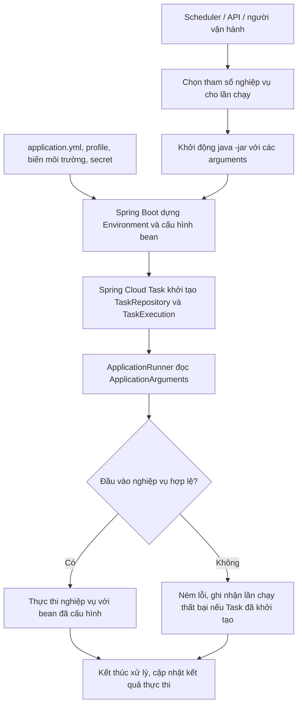
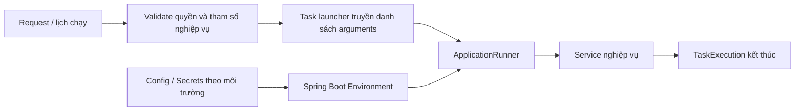

# Phân biệt tham số nghiệp vụ với thuộc tính cấu hình Spring Boot

## Mục tiêu và bối cảnh

Ứng dụng **Spring Cloud Task** được thiết kế cho công việc có thời gian chạy hữu hạn: nhận yêu cầu, xử lý, cập nhật kết quả thực thi trong `TaskRepository` rồi kết thúc. Một tác vụ đối soát giao dịch, chẳng hạn, có thể được gọi mỗi đêm với **ngày cần đối soát** khác nhau nhưng vẫn dùng cùng cấu hình kết nối cơ sở dữ liệu, chính sách retry và kích thước lô xử lý.

Khi xây dựng luồng này, cần phân biệt hai câu hỏi:

- **Tác vụ cần xử lý dữ liệu nào trong lần chạy này?** Đây là **tham số nghiệp vụ** (*business parameters*), thường do hệ thống gọi tác vụ cung cấp và được kiểm tra trong mã xử lý.
- **Ứng dụng cần khởi động và vận hành bằng cách nào?** Đây là **thuộc tính cấu hình** (*configuration properties*), được Spring Boot và Spring Cloud sử dụng để tạo bean, chọn môi trường, kết nối dịch vụ và điều khiển hạ tầng.

Sau bài học, bạn sẽ biết cách thiết kế đầu vào của một Spring Cloud Task, sử dụng `ApplicationArguments` và `@ConfigurationProperties` đúng vai trò, hiểu tác động của thứ tự ưu tiên cấu hình, xử lý lỗi đầu vào và tránh làm lộ thông tin nhạy cảm trong lịch sử thực thi.

## 1. Phân loại từ ý nghĩa, không phải hình thức cú pháp

| Tiêu chí | Tham số nghiệp vụ | Thuộc tính cấu hình Spring Boot/Spring Cloud |
| --- | --- | --- |
| Câu hỏi cần trả lời | *Lần chạy này làm gì, với dữ liệu nào?* | *Ứng dụng chạy ở đâu, với thiết lập nào?* |
| Ví dụ | `business-date`, `tenant-id`, `dry-run`, `reconcile-id` | `spring.datasource.url`, `spring.profiles.active`, `spring.cloud.task.initialize-enabled`, `task.worker.chunk-size` |
| Ai quyết định? | Scheduler, người dùng có quyền, API kích hoạt hoặc hệ thống điều phối | Nhóm vận hành, cấu hình triển khai, quản trị hạ tầng |
| Tần suất thay đổi | Có thể thay đổi ở **mỗi lần thực thi** | Thường giữ ổn định cho một môi trường/phiên bản triển khai |
| Cách đọc thông dụng | `ApplicationArguments` trong `ApplicationRunner`; DTO đầu vào được kiểm tra | `@ConfigurationProperties`, `Environment`, đôi khi `@Value` |
| Cần xác thực gì? | Đúng định dạng, phạm vi ngày, quyền tenant, tính trùng lặp/idempotency | Giá trị hợp lệ, kết nối được, schema, timeout, quyền truy cập tài nguyên |
| Vai trò trong theo dõi | Giúp giải thích **vì sao và xử lý gì** ở lần chạy đó | Giúp tái hiện **môi trường và cách vận hành** của lần chạy đó |

Ví dụ với tác vụ `statement-close-task`:

```text
java -jar statement-close-task.jar \
  --business-date=2026-11-23 \
  --tenant-id=shop-42 \
  --dry-run \
  --spring.profiles.active=prod
```

Trong đó, `business-date`, `tenant-id` và `dry-run` diễn tả **yêu cầu nghiệp vụ của lần chạy**; `spring.profiles.active=prod` chọn **profile cấu hình ứng dụng**. Tên có tiền tố `spring.*` thường biểu thị thuộc tính framework; thuộc tính do nhóm tự tạo nên đặt trong một namespace riêng, ví dụ `task.worker.chunk-size`.

> **Điểm dễ nhầm:** Hai nhóm không được tách biệt tuyệt đối bởi ký tự `--`. Theo mặc định, **mọi option dòng lệnh `--tên=giá-trị`** đều được Spring Boot thêm vào `Environment`, bất kể tên đó là `business-date` hay `spring.datasource.url`. Vì vậy, việc tách nhóm chủ yếu do **thiết kế giao diện đầu vào và mã xử lý**. Đừng coi `--` là dấu hiệu chắc chắn của tham số nghiệp vụ.

## 2. Luồng xử lý trong ứng dụng Spring Cloud Task



Các bước về bản chất khác nhau:

1. **Trước khi chạy:** hệ thống kích hoạt chọn ngày xử lý, mã tenant và chế độ mô phỏng. Cấu hình hạ tầng được cấp qua file, profile, biến môi trường hoặc hệ thống quản lý secret.
2. **Trong quá trình khởi động:** Spring Boot hợp nhất các nguồn cấu hình và bind thành các bean. Spring Cloud Task bắt đầu theo dõi `TaskExecution` qua `TaskRepository` nếu ứng dụng khởi tạo thành công phần hạ tầng cần thiết.
3. **Khi thực hiện:** `ApplicationRunner` đọc tham số nghiệp vụ, xác thực và gọi service. Các bean như `DataSource`, transaction manager hoặc policy xử lý đã được cấu hình qua Spring Boot.
4. **Khi kết thúc:** Spring Cloud Task cập nhật metadata của lần thực thi. Lỗi lúc `ApplicationRunner` chạy có thể được ghi nhận trong `TaskExecution`; **lỗi quá sớm khiến `ApplicationContext` không khởi tạo được thì có thể chưa có bản ghi Task**. Bộ điều phối vẫn phải theo dõi log và mã thoát tiến trình.

Đây là sự khác biệt quan trọng giữa **lịch sử một lần chạy** với **cấu hình của môi trường**: chạy lại cùng ngày với một cấu hình timeout mới vẫn là một yêu cầu nghiệp vụ giống nhau, nhưng môi trường thực thi đã thay đổi.

## 3. Đọc tham số nghiệp vụ bằng `ApplicationArguments`

Spring Boot truyền `ApplicationArguments` vào phương thức `ApplicationRunner.run(...)`. API này phân biệt:

- **Option arguments:** `--business-date=2026-11-23`, `--dry-run`; lấy tên bằng `getOptionNames()`, kiểm tra sự hiện diện qua `containsOption(...)`, lấy giá trị bằng `getOptionValues(...)`.
- **Non-option arguments:** chuỗi không bắt đầu bằng `--`, chẳng hạn `import`; lấy qua `getNonOptionArgs()`.
- **Toàn bộ đối số nguyên gốc:** `getSourceArgs()`. Tránh in nguyên mảng này vào log vì có thể chứa thông tin nhạy cảm.

Phản hồi của `getOptionValues("business-date")` phải được xử lý có chủ đích:

| Đối số truyền vào | Kết quả | Cần làm gì? |
| --- | --- | --- |
| Không có `--business-date` | `null` | Báo thiếu tham số bắt buộc |
| `--business-date` (không có `=`) | Danh sách rỗng `[]` | Báo chưa có giá trị |
| `--business-date=2026-11-23` | `['2026-11-23']` | Parse và kiểm tra ngày |
| `--business-date=2026-11-23 --business-date=2026-11-24` | Danh sách hai giá trị | Từ chối nếu nghiệp vụ chỉ cho phép một ngày |

### Ví dụ xử lý đầu vào chặt chẽ

Ứng dụng minh họa dưới đây thực hiện tác vụ chốt sổ. Cần có `spring-cloud-starter-task`, driver JDBC phù hợp và bộ phiên bản Spring Boot/Spring Cloud tương thích trong cấu hình build. Mã tập trung vào việc đọc đầu vào và cho thấy ranh giới giữa các loại tham số; phần ghi giao dịch nghiệp vụ được thay bằng thông báo để dễ quan sát.

Đặt tại `src/main/java/com/example/task/StatementCloseTaskApplication.java`:

```java
package com.example.task;

import java.time.LocalDate;
import java.time.format.DateTimeParseException;
import java.util.List;

import org.springframework.boot.ApplicationArguments;
import org.springframework.boot.ApplicationRunner;
import org.springframework.boot.SpringApplication;
import org.springframework.boot.autoconfigure.SpringBootApplication;
import org.springframework.boot.context.properties.ConfigurationProperties;
import org.springframework.boot.context.properties.EnableConfigurationProperties;
import org.springframework.context.annotation.Bean;

@SpringBootApplication
@EnableConfigurationProperties(StatementCloseTaskApplication.WorkerSettings.class)
public class StatementCloseTaskApplication {

    public static void main(String[] args) {
        SpringApplication.run(StatementCloseTaskApplication.class, args);
    }

    // Cấu hình vận hành: bind từ application.yml, env hoặc nguồn cấu hình khác.
    @ConfigurationProperties(prefix = "task.worker")
    public record WorkerSettings(int chunkSize) {
        public WorkerSettings {
            if (chunkSize <= 0) {
                throw new IllegalArgumentException("task.worker.chunk-size phải > 0");
            }
        }
    }

    @Bean
    ApplicationRunner closeStatements(WorkerSettings settings) {
        return args -> {
            // Đầu vào nghiệp vụ: thay đổi theo từng lần gọi Task.
            LocalDate businessDate = requiredDate(args);
            String tenantId = requiredSingleValue(args, "tenant-id");
            boolean dryRun = flagPresent(args, "dry-run");

            if (!args.getNonOptionArgs().isEmpty()) {
                throw new IllegalArgumentException("Không hỗ trợ đối số không có tên");
            }

            // Ví dụ thật phải kiểm tra tenantId có thuộc phạm vi được phép.
            System.out.printf("tenant=%s date=%s dryRun=%s chunkSize=%d%n",
                    tenantId, businessDate, dryRun, settings.chunkSize());

            if (dryRun) {
                System.out.println("Chỉ mô phỏng, không ghi kết quả nghiệp vụ");
            } else {
                System.out.println("Tại đây gọi service chốt sổ có giao dịch/idempotency");
            }
        };
    }

    private static LocalDate requiredDate(ApplicationArguments args) {
        String value = requiredSingleValue(args, "business-date");
        try {
            return LocalDate.parse(value); // ISO-8601: YYYY-MM-DD
        } catch (DateTimeParseException ex) {
            throw new IllegalArgumentException(
                    "--business-date phải có dạng YYYY-MM-DD", ex);
        }
    }

    private static String requiredSingleValue(ApplicationArguments args, String name) {
        List<String> values = args.getOptionValues(name);
        if (values == null || values.size() != 1 || values.get(0).isBlank()) {
            throw new IllegalArgumentException(
                    "Cần đúng một giá trị cho --" + name + "=<giá-trị>");
        }
        return values.get(0);
    }

    private static boolean flagPresent(ApplicationArguments args, String name) {
        if (!args.containsOption(name)) {
            return false;
        }
        // Quy ước --dry-run là cờ không nhận giá trị.
        if (!args.getOptionValues(name).isEmpty()) {
            throw new IllegalArgumentException("--" + name + " không nhận giá trị");
        }
        return true;
    }
}
```

Ba quyết định trong ví dụ là có chủ đích:

1. `business-date` và `tenant-id` được parse/kiểm tra **tại `ApplicationRunner`**, nơi hiểu yêu cầu của từng lần chạy. Thiếu, trùng hoặc sai định dạng dẫn đến lỗi có thể truy vết.
2. `dry-run` là **cờ hiện diện**; `--dry-run` nghĩa là bật, không truyền nghĩa `false`. Ví dụ từ chối `--dry-run=false` để tránh hiểu sai. Nếu cần một boolean có hai giá trị trên CLI, hãy định nghĩa rõ hợp đồng và parse `true/false`.
3. `chunkSize` đến từ `WorkerSettings` do `@ConfigurationProperties` bind. Không phải đọc `chunk-size` thủ công từ `ApplicationArguments` vì đó là **chính sách vận hành**, không phải ngày hay đối tượng xử lý.

**Phạm vi ví dụ:** mã chưa thực hiện kiểm tra phân quyền tenant, giới hạn ngày, idempotency hay truy vấn cơ sở dữ liệu nghiệp vụ. Trong sản phẩm thật, các kiểm tra này thuộc lớp service/validation và cần được bổ sung trước khi xử lý dữ liệu.

## 4. Đọc thuộc tính cấu hình qua Spring Boot

Đặt `src/main/resources/application.yml`:

```yaml
spring:
  application:
    name: statement-close-task
  main:
    web-application-type: none
  datasource:
    url: jdbc:h2:mem:task_demo;DB_CLOSE_DELAY=-1
    username: sa
    password: ""
  cloud:
    task:
      initialize-enabled: true  # Chỉ minh họa với database thử nghiệm
      closecontext-enabled: true

task:
  worker:
    chunk-size: 500
```

Giả sử chạy JAR đã build:

```bash
java -jar target/statement-close-task.jar \
  --business-date=2026-11-23 \
  --tenant-id=shop-42 \
  --dry-run
```

Kết quả logic mong đợi: `businessDate=2026-11-23`, `tenantId=shop-42`, `dryRun=true`, `settings.chunkSize()=500`. Ví dụ sử dụng H2 trong bộ nhớ nên thông tin `TaskExecution` chỉ có trong vòng đời JVM; để theo dõi lịch sử qua nhiều lần chạy, dùng cơ sở dữ liệu bền vững và cấu hình schema Task phù hợp. Trong production, nên để migration quản lý schema và đặt `spring.cloud.task.initialize-enabled=false` nếu bạn đã chủ động tạo các bảng cần thiết.

Bạn có thể thay đổi chính sách xử lý tạm thời bằng **thuộc tính cấu hình dòng lệnh**:

```bash
java -jar target/statement-close-task.jar \
  --business-date=2026-11-23 \
  --tenant-id=shop-42 \
  --task.worker.chunk-size=1000
```

Khi đó `settings.chunkSize()` bằng `1000`, mặc dù `application.yml` ghi `500`: option `--task.worker.chunk-size=1000` được Boot thêm vào `Environment` và có độ ưu tiên cao hơn cấu hình file thông thường. **Phân loại vẫn là cấu hình**, vì nó thay đổi cách xử lý chứ không chọn dữ liệu nghiệp vụ. Tuy nhiên, tổ chức nên hạn chế để scheduler/người gọi tự ý thay đổi các thuộc tính vận hành nhạy cảm.

### So sánh ba cách truy xuất cấu hình

| API | Ví dụ | Nên dùng khi |
| --- | --- | --- |
| `@ConfigurationProperties` | Bind `task.worker.chunk-size` thành `WorkerSettings.chunkSize` | Có nhóm thuộc tính cấu trúc, cần kiểu dữ liệu rõ ràng và validation |
| `@Value` | `@Value("${task.worker.chunk-size:500}") int chunkSize` | Một thuộc tính nhỏ, độc lập; không cần cả object cấu hình |
| `Environment` | `env.getProperty("task.worker.chunk-size", Integer.class)` | Cần kiểm tra thuộc tính động hoặc xây thành phần hạ tầng đọc property |

Với Spring Cloud Task, các key như `spring.application.name`, `spring.datasource.*`, `spring.cloud.task.initialize-enabled`, `spring.cloud.task.closecontext-enabled` là **cấu hình framework**. Chúng ảnh hưởng đến tên tác vụ, repository, kết nối cơ sở dữ liệu và đóng `ApplicationContext`; không dùng chúng làm tên tham số nghiệp vụ.

## 5. Cơ chế ưu tiên nguồn cấu hình và bẫy thường gặp

Spring Boot hỗ trợ file `application.yml`, file theo profile như `application-prod.yml`, biến môi trường, Java system properties, command-line options và các nguồn khác. Trong tình huống phổ biến, có thể nhớ quan hệ ưu tiên như sau (nguồn bên phải có thể ghi đè nguồn bên trái):

```text
application.yml trong JAR
    -> application-prod.yml đang kích hoạt / file cấu hình ngoài JAR
    -> biến môi trường hệ điều hành
    -> Java system properties (-D...)
    -> command-line options (--...)
```

Đây là **mô hình rút gọn** cho các nguồn thường gặp; thứ tự chi tiết còn phụ thuộc vị trí file, profile, `spring.config.import`, test properties và các loại `PropertySource` khác. Muốn chẩn đoán một giá trị cụ thể, phải kiểm tra nguồn cấu hình thực tế; tránh dựa vào mô hình rút gọn như một quy luật không ngoại lệ.

Ví dụ ba cách ghi đè `task.worker.chunk-size`:

```yaml
# application.yml
task:
  worker:
    chunk-size: 500
```

```bash
# Linux/macOS: biến môi trường, dùng quy tắc relaxed binding của Spring Boot.
export TASK_WORKER_CHUNKSIZE=800
java -jar target/statement-close-task.jar \
  --business-date=2026-11-23 --tenant-id=shop-42

# Option dòng lệnh có độ ưu tiên cao hơn biến môi trường thông thường:
java -jar target/statement-close-task.jar \
  --business-date=2026-11-23 --tenant-id=shop-42 \
  --task.worker.chunk-size=1000
```

Trong môi trường này, `settings.chunkSize()` lần lượt là `800` và `1000`. Tên biến môi trường đúng theo quy tắc Spring Boot là **`TASK_WORKER_CHUNKSIZE`**: thay dấu chấm bằng `_`, **bỏ dấu gạch nối** rồi viết hoa. Không tự suy ra rằng `TASK_WORKER_CHUNK_SIZE` luôn bind vào cùng thuộc tính.

### `--key=value` và `-Dkey=value` khác nhau

```bash
# --spring.profiles.active=prod là argument của ứng dụng:
java -jar target/statement-close-task.jar \
  --spring.profiles.active=prod \
  --business-date=2026-11-23 --tenant-id=shop-42

# -Dspring.profiles.active=prod là Java system property,
# phải nằm TRƯỚC -jar:
java -Dspring.profiles.active=prod -jar target/statement-close-task.jar \
  --business-date=2026-11-23 --tenant-id=shop-42
```

`ApplicationArguments` nhìn thấy các argument đặt **sau tên JAR**, bao gồm các option `--...`; `-D...` trước `-jar` được JVM xử lý riêng, không phải option `ApplicationArguments`. Nếu chạy trong Kubernetes, secret và cấu hình hạ tầng thường được cấp bằng volume, biến môi trường do nền tảng quản lý hoặc secret manager, thay vì nối vào danh sách đối số của lệnh chạy.

### Có thể loại command-line options khỏi `Environment` không?

Có. Spring Boot cho phép gọi `SpringApplication.setAddCommandLineProperties(false)`:

```java
public static void main(String[] args) {
    SpringApplication app = new SpringApplication(StatementCloseTaskApplication.class);
    app.setAddCommandLineProperties(false);
    app.run(args);
}
```

Lựa chọn này vẫn cho phép `ApplicationRunner` nhận `ApplicationArguments`, nhưng **không** tự thêm các option `--...` vào `Environment`. Do đó, `--task.worker.chunk-size=1000` và `--spring.profiles.active=prod` cũng **không còn hoạt động như nguồn cấu hình dòng lệnh**. Chỉ bật khi bạn chủ ý chặn việc override cấu hình bằng CLI và đã chuyển tất cả thuộc tính hạ tầng sang nguồn được hỗ trợ khác. Mã `main` trên là một **phương án thay thế**, không đặt đồng thời với `main` mặc định trong ví dụ trước.

## 6. TaskRepository lưu thông tin gì về các đối số?

Theo cơ chế Spring Cloud Task, `TaskExecution` chứa dữ liệu như mã lần chạy, tên task, thời điểm bắt đầu/kết thúc, mã thoát và **danh sách chuỗi đối số dòng lệnh gốc**. Cơ sở dữ liệu Task thường có bảng `TASK_EXECUTION` và `TASK_EXECUTION_PARAMS` để phục vụ truy vấn lịch sử. Đây là dữ liệu phục vụ vận hành, **không phải bộ nhớ chính thức cho tất cả cấu hình đã resolve** từ profile, environment hay secret manager.

Giả sử hai lần gọi:

```text
Lần A: --business-date=2026-11-23 --tenant-id=shop-42 --dry-run
Lần B: --business-date=2026-11-23 --tenant-id=shop-42
```

Hệ thống vận hành có thể dựa vào danh sách argument để phân biệt lần chạy mô phỏng và lần chạy thật. Cần bổ sung một **business execution key** hoặc cơ chế idempotency riêng nếu yêu cầu không xử lý trùng một tenant/ngày; mã `TaskExecution` chỉ nhận diện mỗi lần JVM chạy, **không tự ngăn nghiệp vụ xử lý lặp**.

**Lưu ý bảo mật:** cả tham số nghiệp vụ và cấu hình được truyền qua CLI đều có nguy cơ xuất hiện trong danh sách tiến trình, log, hệ thống điều phối và bảng tham số của TaskRepository. Không truyền `--password=...`, `--api-token=...`, `--spring.datasource.password=...` hoặc dữ liệu cá nhân nhạy cảm theo kiểu này. Với thông tin cần bảo mật, dùng cơ chế secret của nền tảng và tránh log giá trị. Nếu phải ghi thông tin điều tra sự cố, ưu tiên mã tham chiếu an toàn, có kiểm soát quyền truy cập và chính sách lưu giữ.

## 7. Các sai lầm thiết kế và cách khắc phục

| Sai lầm | Hậu quả | Cách thiết kế phù hợp |
| --- | --- | --- |
| Dùng `@Value("${business-date}")` làm đầu vào cho toàn bộ quy trình | Biến yêu cầu từng lần chạy thành cấu hình bean; khó phát hiện tham số trùng, thiếu hoặc sai định dạng | Parse qua `ApplicationArguments`, gói thành DTO `BusinessRequest`, validate trước khi gọi service |
| Cho người dùng chỉnh `spring.datasource.*` qua API gọi task | Rủi ro chuyển hướng DB hoặc dùng sai môi trường | API chỉ nhận allowlist tham số nghiệp vụ; hệ thống triển khai cấp cấu hình và secret riêng |
| Đọc `--dry-run=false` bằng `containsOption("dry-run")` | Vẫn nhận `true` dù người gọi tưởng là tắt | Định nghĩa cờ chỉ có mặt/vắng mặt, hoặc parse boolean có giá trị và validate |
| Dùng biến môi trường `BUSINESS_DATE` cho từng yêu cầu mà không ghi nhận đầu vào | Khó tái hiện lần chạy, giá trị có thể bị dùng lại ngoài ý muốn | Truyền tham số theo mỗi lần gọi, ghi metadata đã được làm sạch và kiểm soát quyền |
| Tự nối mật khẩu vào `--spring.datasource.password` | Có thể bị lộ ở metadata Task và lịch sử lệnh | Lấy secret từ hạ tầng, hạn chế log và quyền truy vấn repository |
| Tin rằng mọi lỗi đều có bản ghi `TaskExecution` | Lỗi khởi động rất sớm có thể không được ghi vào TaskRepository | Theo dõi thêm mã thoát, stdout/stderr và trạng thái scheduler/container |
| Đồng nhất tham số Task với `JobParameters` của Spring Batch | Dễ sai logic nhận diện job instance và restart | Xây cơ chế mapping rõ ràng, kiểm tra loại/giá trị/khả năng restart theo Batch |

### Khi tác vụ chạy theo lịch hoặc theo yêu cầu

Với lịch chạy hằng ngày, scheduler nên tính ngày nghiệp vụ theo timezone được thỏa thuận, kiểm tra logic ngày và truyền một argument cụ thể, chẳng hạn `--business-date=2026-11-23`. Với API kích hoạt thủ công, server nhận request, xác thực quyền tenant và tham số, sau đó gọi task launcher qua **mảng argument** của process/deployer. Tránh ghép chuỗi lệnh shell từ dữ liệu người dùng.

Tách biệt luồng điều khiển:



Khi phối hợp với **Spring Batch**, một tác vụ Cloud Task có thể bao bọc một `Job`. Tuy nhiên, `TaskExecution` và `JobExecution` là hai khái niệm khác nhau; `JobParameters` có quy tắc về định danh job instance và khả năng restart. Dù một cơ chế auto-launch có thể chuyển một số đối số thành `JobParameters` theo phiên bản/cấu hình Boot, đừng mặc định mọi option của Task đều là tham số định danh của Batch Job. Hãy xác định rõ mapping và thử kịch bản chạy lại thất bại.

## 8. Tự kiểm tra với bốn kịch bản

Giả sử cấu hình đang có `task.worker.chunk-size: 500` và ví dụ `ApplicationRunner` phía trên.

**Kịch bản 1 — Hợp lệ:**

```bash
java -jar target/statement-close-task.jar \
  --business-date=2026-11-23 --tenant-id=shop-42 --dry-run
```

Kỳ vọng: parse được ngày ISO, tenant, `dryRun=true`, kích thước lô `500`; nhánh mô phỏng không thực hiện ghi nghiệp vụ.

**Kịch bản 2 — Thiếu dữ liệu:**

```bash
java -jar target/statement-close-task.jar --tenant-id=shop-42
```

Kỳ vọng: phương thức `requiredSingleValue` phát hiện thiếu `business-date`, ném `IllegalArgumentException`; hệ thống gọi task phải nhận biết lỗi qua trạng thái tiến trình và log. Nếu hạ tầng Task đã khởi tạo, thất bại có thể xuất hiện trong lịch sử Task.

**Kịch bản 3 — Trùng tham số:**

```bash
java -jar target/statement-close-task.jar \
  --business-date=2026-11-23 --business-date=2026-11-24 \
  --tenant-id=shop-42
```

Kỳ vọng: danh sách có hai giá trị, ứng dụng từ chối. Không tự chọn ngày cuối hay ngày đầu nếu hợp đồng yêu cầu đúng một giá trị.

**Kịch bản 4 — Cấu hình bị ghi đè:**

```bash
java -jar target/statement-close-task.jar \
  --business-date=2026-11-23 --tenant-id=shop-42 \
  --task.worker.chunk-size=1000
```

Kỳ vọng: yêu cầu nghiệp vụ không đổi nhưng `chunkSize=1000`. Điều này chứng minh ranh giới nằm ở **ý nghĩa thuộc tính và trách nhiệm kiểm soát**, không nằm ở việc cả hai cùng dùng cú pháp `--...`.

## 9. Checklist thiết kế cho production

- [ ] Định nghĩa tài liệu hợp đồng đầu vào: tên, kiểu dữ liệu, bắt buộc/tùy chọn, giá trị mặc định, quy tắc ngày giờ, tenant, phạm vi hợp lệ.
- [ ] Dành `ApplicationArguments`/DTO riêng cho yêu cầu mỗi lần chạy; xử lý trùng, thiếu, cờ boolean sai dạng và quyền truy cập trước khi tác động dữ liệu.
- [ ] Dành `@ConfigurationProperties` và các nguồn cấu hình Spring Boot cho kết nối, retry, chunk size, TaskRepository, profile và logging.
- [ ] Có allowlist cho API/scheduler để không vô tình nhận các key `spring.*`, `management.*` hoặc cấu hình ngoài dự kiến từ người gọi.
- [ ] Không đưa password/token/PII vào command-line arguments hoặc log; giới hạn quyền đọc metadata Task.
- [ ] Lưu TaskRepository trên database bền vững và có migration schema; theo dõi cả mã thoát của tiến trình cho lỗi khởi động sớm.
- [ ] Có cơ chế idempotency với các tổ hợp như `tenant-id` + `business-date` để lần retry không sinh tác động trùng.
- [ ] Nếu dùng Spring Batch, phân biệt argument của Task với `JobParameters` và thử restart bằng một job instance có định danh chính xác.

## Câu hỏi ôn tập

1. Vì sao `--business-date=2026-11-23` vẫn có thể xuất hiện trong Spring `Environment` dù được thiết kế là tham số nghiệp vụ?
2. Điều gì xảy ra nếu đặt `--dry-run=false` khi ứng dụng chỉ kiểm tra `containsOption("dry-run")`?
3. Nếu `application.yml` đặt `task.worker.chunk-size=500`, biến môi trường đặt `800`, CLI đặt `1000`, giá trị nào thường được bind vào `@ConfigurationProperties`?
4. Vì sao không nên truyền mật khẩu JDBC qua `--spring.datasource.password` đối với một ứng dụng Spring Cloud Task?
5. Trong trường hợp `ApplicationContext` lỗi trước khi TaskRepository sẵn sàng, hệ thống điều phối dựa vào thông tin nào để nhận biết thất bại?

**Đáp án ngắn:** (1) Spring Boot mặc định thêm option `--...` vào `Environment`; (2) `containsOption` vẫn trả `true`; (3) `1000` nếu không có nguồn ưu tiên cao hơn trong bối cảnh đó; (4) arguments có thể được lưu vào metadata Task hoặc lộ qua process/log; (5) log, trạng thái container và mã thoát tiến trình.

## Tài liệu tham khảo

- [Spring Boot — Externalized Configuration](https://docs.spring.io/spring-boot/reference/features/external-config.html): nguồn cấu hình, độ ưu tiên, `@ConfigurationProperties`, cách xử lý command-line options và biến môi trường.
- [Spring Boot — ApplicationArguments API](https://docs.spring.io/spring-boot/3.5/api/java/org/springframework/boot/ApplicationArguments.html): `containsOption`, `getOptionValues`, `getNonOptionArgs`, `getSourceArgs`.
- [Spring Cloud Task — Features](https://docs.spring.io/spring-cloud-task/reference/features.html): vòng đời task, `TaskExecution`, mã thoát, `DataSource` và cấu hình.
- [Spring Cloud Task — Reference](https://docs.spring.io/spring-cloud-task/reference/): hướng dẫn tích hợp với Spring Boot, TaskRepository và Spring Batch.

**Nguyên tắc ghi nhớ:** *tham số nghiệp vụ mô tả lần chạy; thuộc tính cấu hình mô tả môi trường và chính sách chạy*. Cả hai có thể cùng xuất hiện trên dòng lệnh, vì thế ứng dụng phải tự đặt hợp đồng rõ ràng, xác thực đầu vào và bảo vệ metadata của Task.
