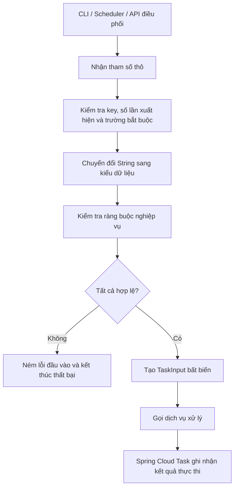

# Kiểm tra và chuyển đổi tham số đầu vào trong Spring Cloud Task

## 1. Vì sao phải kiểm tra tham số trước khi thực thi?

**Spring Cloud Task** dùng để xây dựng ứng dụng Spring Boot có thời gian chạy hữu hạn: ứng dụng khởi động, xử lý một công việc rồi kết thúc. `TaskRepository` lưu thông tin thực thi như thời điểm bắt đầu/kết thúc, mã thoát và đối số dòng lệnh trong `TaskExecution`. Một Task có thể được gọi trực tiếp, theo lịch hoặc bởi một hệ thống điều phối; cùng một chương trình thường phải xử lý nhiều bộ tham số khác nhau.

Ví dụ, tác vụ tổng hợp báo cáo có thể nhận ngày cần xử lý, mã khách hàng, chế độ chạy và giới hạn bản ghi:

```bash
java -jar report-task.jar \
  --task.run-date=2026-11-24 \
  --task.tenant=tenant_01 \
  --task.mode=DELTA \
  --task.max-items=500 \
  --task.dry-run=false
```

Nếu `run-date` sai định dạng, `max-items` âm hoặc `tenant` không hợp lệ, việc phát hiện lỗi **sau khi đã ghi dữ liệu** có thể gây kết quả dở dang, chạy lại khó kiểm soát hoặc ghi nhầm dữ liệu của khách hàng khác. Vì vậy, thiết kế tốt là chuyển đầu vào thô thành đối tượng có kiểu dữ liệu rõ ràng và xác thực xong **trước khi gọi logic nghiệp vụ**.

Sau bài này, bạn sẽ biết:

- Nhận tham số với `ApplicationRunner` / `ApplicationArguments` và phân biệt chúng với cấu hình từ `Environment`.
- Chuyển đổi `String` thành `LocalDate`, `enum`, số nguyên và boolean theo quy tắc xác định.
- Kiểm tra trường bắt buộc, giá trị mặc định, miền giá trị, tham số trùng hoặc không được hỗ trợ.
- Báo lỗi nhất quán để bộ lập lịch hoặc hệ thống điều phối có thể quyết định có chạy lại hay không.
- Tránh lộ bí mật khi đối số có thể được lưu trong `TaskRepository`.

## 2. Thiết kế hợp đồng đầu vào

Trước khi viết parser, hãy xác định **hợp đồng đầu vào** (*input contract*). Ví dụ sau dùng tiền tố `task.` để tách tham số nghiệp vụ khỏi các thuộc tính cấu hình của Spring Boot như `spring.profiles.active`.

| Tham số | Bắt buộc | Kiểu sau chuyển đổi | Quy tắc |
| --- | --- | --- | --- |
| `--task.run-date=YYYY-MM-DD` | Có | `LocalDate` | Ngày ISO, ví dụ `2026-11-24`; không chấp nhận `24/11/2026` hoặc ngày không tồn tại |
| `--task.tenant=tenant_01` | Có | `String` | Từ 2–32 ký tự; chữ thường ASCII đầu tiên, sau đó chữ thường, số, `_` hoặc `-` |
| `--task.mode=DELTA` | Không | `Mode` (`FULL` hoặc `DELTA`) | Mặc định `DELTA`; không phân biệt chữ hoa/chữ thường khi nhập |
| `--task.max-items=500` | Không | `int` | Số nguyên trong khoảng 1–10.000; mặc định `1000` |
| `--task.dry-run=false` | Không | `boolean` | Chỉ nhận đúng `true` hoặc `false`; mặc định `false` |

Ở hợp đồng này, **mọi tham số đều dùng dạng `--key=value`**. Nếu truyền `--task.dry-run` mà không có giá trị, parser sẽ báo lỗi, tránh hiểu ngầm thành `true`. Đây là quyết định thiết kế cho ví dụ, không phải hạn chế chung của Spring Boot.

Hợp đồng cũng cần định nghĩa đầu ra khi dữ liệu sai: tác vụ phải dừng trước khi gọi dịch vụ nghiệp vụ, chỉ ra trường lỗi một cách an toàn và trả về mã lỗi khác 0. Không tự sửa ngày hoặc rút ngắn mã tenant để cố chạy.

### Luồng xử lý đề xuất



Có ba lớp kiểm tra khác nhau:

1. **Cú pháp:** Có thiếu tham số, truyền không có giá trị hoặc lặp lại cùng một tùy chọn?
2. **Kiểu dữ liệu:** Chuỗi có chuyển được thành ngày, số nguyên, boolean hoặc enum?
3. **Nghiệp vụ:** Giới hạn bản ghi có an toàn, tenant có được phép xử lý, ngày báo cáo có nằm trong khoảng dữ liệu hỗ trợ?

Kiểm tra cú pháp và kiểu dữ liệu diễn ra cục bộ. Những ràng buộc phụ thuộc cơ sở dữ liệu hoặc quyền truy cập tenant nên được kiểm tra ngay tại ranh giới dịch vụ, trước khi tạo tác động bên ngoài.

## 3. `ApplicationArguments` nhận tham số như thế nào?

Spring Boot cung cấp `ApplicationRunner` để chạy logic sau khi ứng dụng khởi tạo. Phương thức `run(ApplicationArguments args)` nhận các tham số khi chạy chương trình. So với `CommandLineRunner` (nhận `String... args`), `ApplicationArguments` có sẵn API phân biệt tùy chọn và đối số tự do:

| Phương thức | Ý nghĩa |
| --- | --- |
| `getOptionNames()` | Tập tên tùy chọn, ví dụ `task.run-date`, `task.tenant` |
| `containsOption("task.dry-run")` | Có truyền tùy chọn đó hay không |
| `getOptionValues("task.max-items")` | Danh sách giá trị của một tùy chọn |
| `getNonOptionArgs()` | Danh sách đối số không bắt đầu bằng cú pháp tùy chọn |
| `getSourceArgs()` | Mảng đối số nguyên gốc; cần thận trọng khi log vì có thể chứa dữ liệu nhạy cảm |

Điểm dễ nhầm nhất là kết quả của `getOptionValues(name)`:

| Đầu vào | Kết quả |
| --- | --- |
| Không có `--task.mode` | `null` |
| `--task.mode` | Danh sách rỗng `[]` |
| `--task.mode=DELTA` | Danh sách chứa một phần tử `["DELTA"]` |
| `--task.mode=FULL --task.mode=DELTA` | Danh sách `["FULL", "DELTA"]` |

Không nên lấy phần tử đầu tiên rồi bỏ qua phần còn lại. Các tham số lặp lại có thể khiến hệ thống điều phối và ứng dụng hiểu khác nhau. Trong bài, parser yêu cầu **đúng một giá trị** nếu tùy chọn xuất hiện.

## 4. Ví dụ Java: parse, chuyển đổi và kiểm tra một lần

Giả sử dự án đã có `spring-cloud-starter-task` và database phù hợp cho `TaskRepository`. Đoạn mã sau là một ứng dụng minh họa dùng Java 17 trở lên. `ApplicationRunner` chỉ bàn giao dữ liệu đã hợp lệ; nơi in ra thông báo là vị trí bạn thay bằng lời gọi dịch vụ báo cáo thực tế.

```java
package com.example.report;

import java.time.LocalDate;
import java.time.format.DateTimeFormatter;
import java.time.format.DateTimeParseException;
import java.util.List;
import java.util.Locale;
import java.util.Set;
import java.util.regex.Pattern;

import org.springframework.boot.ApplicationArguments;
import org.springframework.boot.ApplicationRunner;
import org.springframework.boot.ExitCodeExceptionMapper;
import org.springframework.boot.SpringApplication;
import org.springframework.boot.autoconfigure.SpringBootApplication;
import org.springframework.cloud.task.configuration.EnableTask;
import org.springframework.context.annotation.Bean;

@SpringBootApplication
@EnableTask
public class ReportTaskApplication {

    private static final Set<String> ALLOWED = Set.of(
        "task.run-date",
        "task.tenant",
        "task.mode",
        "task.max-items",
        "task.dry-run"
    );
    private static final Pattern TENANT =
        Pattern.compile("[a-z][a-z0-9_-]{1,31}");

    public static void main(String[] args) {
        SpringApplication.run(ReportTaskApplication.class, args);
    }

    @Bean
    ApplicationRunner reportRunner() {
        return arguments -> {
            TaskInput input = parse(arguments);

            if (input.dryRun()) {
                System.out.println("Dry run: đã xác thực cấu hình.");
                return;
            }

            // Trong ứng dụng thật: reportService.generate(input);
            System.out.printf(
                "Xử lý tenant=%s, date=%s, mode=%s, maxItems=%d%n",
                input.tenant(),
                input.runDate(),
                input.mode(),
                input.maxItems()
            );
        };
    }

    static TaskInput parse(ApplicationArguments args) {
        if (!args.getNonOptionArgs().isEmpty()) {
            throw invalid("Không hỗ trợ đối số không có tên");
        }
        for (String name : args.getOptionNames()) {
            if (name.startsWith("task.") && !ALLOWED.contains(name)) {
                throw invalid("Tham số không được hỗ trợ: " + name);
            }
        }

        String runDateText = option(args, "task.run-date", true, null);
        LocalDate runDate;
        try {
            runDate = LocalDate.parse(
                runDateText, DateTimeFormatter.ISO_LOCAL_DATE
            );
        } catch (DateTimeParseException ex) {
            throw invalid("task.run-date phải có dạng YYYY-MM-DD");
        }

        String tenant = option(args, "task.tenant", true, null);
        if (!TENANT.matcher(tenant).matches()) {
            throw invalid("task.tenant không đúng định dạng");
        }

        String modeText = option(args, "task.mode", false, "DELTA");
        Mode mode;
        try {
            mode = Mode.valueOf(modeText.toUpperCase(Locale.ROOT));
        } catch (IllegalArgumentException ex) {
            throw invalid("task.mode chỉ nhận FULL hoặc DELTA");
        }

        String maxText = option(args, "task.max-items", false, "1000");
        int maxItems;
        try {
            maxItems = Integer.parseInt(maxText);
        } catch (NumberFormatException ex) {
            throw invalid("task.max-items phải là số nguyên");
        }
        if (maxItems < 1 || maxItems > 10_000) {
            throw invalid("task.max-items phải từ 1 đến 10000");
        }

        String dryRunText = option(args, "task.dry-run", false, "false")
            .toLowerCase(Locale.ROOT);
        if (!dryRunText.equals("true") && !dryRunText.equals("false")) {
            throw invalid("task.dry-run chỉ nhận true hoặc false");
        }

        return new TaskInput(
            runDate,
            tenant,
            mode,
            maxItems,
            Boolean.parseBoolean(dryRunText)
        );
    }

    private static String option(
        ApplicationArguments args,
        String name,
        boolean required,
        String defaultValue
    ) {
        List<String> values = args.getOptionValues(name);
        if (values == null) {
            if (required) {
                throw invalid("Thiếu tham số bắt buộc: " + name);
            }
            return defaultValue;
        }
        if (values.size() != 1
            || values.get(0) == null
            || values.get(0).trim().isEmpty()) {
            throw invalid(name + " phải xuất hiện đúng một lần và có giá trị");
        }
        return values.get(0).trim();
    }

    private static InvalidTaskInputException invalid(String message) {
        return new InvalidTaskInputException(message);
    }

    @Bean
    ExitCodeExceptionMapper exitCodeExceptionMapper() {
        return error -> {
            for (Throwable cause = error;
                 cause != null;
                 cause = cause.getCause()) {
                if (cause instanceof InvalidTaskInputException) {
                    return 2; // Lỗi hợp đồng đầu vào
                }
            }
            return 1; // Lỗi khác
        };
    }

    enum Mode {
        FULL, DELTA
    }

    record TaskInput(
        LocalDate runDate,
        String tenant,
        Mode mode,
        int maxItems,
        boolean dryRun
    ) {}

    static class InvalidTaskInputException
            extends IllegalArgumentException {
        InvalidTaskInputException(String message) {
            super(message);
        }
    }
}
```

### Giải thích các quyết định trong ví dụ

- **Chỉ kiểm tra tên bắt đầu bằng `task.`:** ứng dụng vẫn có thể nhận tùy chọn Spring Boot như `--spring.profiles.active=prod`. Nếu muốn chặn tất cả tùy chọn lạ, cần thiết kế whitelist bao gồm cả những tùy chọn vận hành cho phép.
- **Không dùng `Boolean.parseBoolean(...)` ngay:** Java trả về `false` cho mọi chuỗi khác `"true"`, kể cả `"yes"` hay `"tru"`. Parser kiểm tra chính xác tập `true/false` trước khi chuyển đổi.
- **Kiểm tra trùng:** `getOptionValues` là danh sách; truyền hai `--task.tenant` sẽ bị từ chối thay vì âm thầm chọn một giá trị.
- **Kiểu bất biến:** `record TaskInput` giúp tầng nghiệp vụ nhận dữ liệu đã chuẩn hóa, không cần phân tích lại chuỗi.
- **Mã thoát:** `ExitCodeExceptionMapper` ánh xạ lỗi hợp đồng đầu vào thành mã `2`; lỗi khác thành `1`. Mã `2` là quy ước do ứng dụng ví dụ chọn, không phải mã mặc định dành riêng cho tham số sai của Spring Cloud Task.
- **Phạm vi minh họa:** ví dụ không triển khai câu lệnh SQL hoặc gửi báo cáo; `dry-run` chỉ xác thực và mô phỏng. Trong hệ thống thật cần bảo đảm các dịch vụ được gọi sau bước `parse`.

Chạy thử:

```bash
# Hợp lệ: dùng mặc định mode=DELTA, max-items=1000, dry-run=false
java -jar report-task.jar \
  --task.run-date=2026-11-24 \
  --task.tenant=tenant_01

# Hợp lệ: chỉ kiểm tra và mô phỏng, không xử lý nghiệp vụ
java -jar report-task.jar \
  --task.run-date=2026-11-24 \
  --task.tenant=tenant_01 \
  --task.dry-run=true

# Không hợp lệ: ngày không tồn tại
java -jar report-task.jar \
  --task.run-date=2026-02-30 \
  --task.tenant=tenant_01

# Không hợp lệ: max-items vượt ngưỡng
java -jar report-task.jar \
  --task.run-date=2026-11-24 \
  --task.tenant=tenant_01 \
  --task.max-items=50000
```

## 5. Khi đầu vào đến từ biến môi trường hoặc file cấu hình

`ApplicationArguments` phản ánh **đối số lúc chạy ứng dụng**. Nếu scheduler hoặc nền tảng triển khai truyền tham số bằng **biến môi trường**, chúng không tự xuất hiện trong `getOptionValues`. Khi muốn dùng chung giá trị từ `application.yml`, biến môi trường và CLI, Spring Boot hỗ trợ `@ConfigurationProperties` với *relaxed binding*, chuyển đổi kiểu và Bean Validation.

Ví dụ cấu hình cho một phương án **thay thế parser thủ công**, sử dụng record:

```java
package com.example.report;

import java.time.LocalDate;

import jakarta.validation.constraints.Max;
import jakarta.validation.constraints.Min;
import jakarta.validation.constraints.NotBlank;
import jakarta.validation.constraints.NotNull;
import jakarta.validation.constraints.Pattern;
import org.springframework.boot.context.properties.ConfigurationProperties;
import org.springframework.boot.context.properties.bind.DefaultValue;
import org.springframework.validation.annotation.Validated;

@Validated
@ConfigurationProperties(prefix = "task")
public record TaskProperties(
    @NotNull LocalDate runDate,
    @NotBlank
    @Pattern(regexp = "[a-z][a-z0-9_-]{1,31}")
    String tenant,
    @DefaultValue("DELTA") Mode mode,
    @Min(1) @Max(10000)
    @DefaultValue("1000") int maxItems,
    @DefaultValue("false") boolean dryRun
) {
    public enum Mode { FULL, DELTA }
}
```

Để dùng kiểu này, ứng dụng cần có dependency hỗ trợ Bean Validation (thường là `spring-boot-starter-validation`), đồng thời bật quét cấu hình bằng `@ConfigurationPropertiesScan` trên lớp `@SpringBootApplication` hoặc khai báo `@EnableConfigurationProperties(TaskProperties.class)`. Sau đó có thể inject `TaskProperties` vào `ApplicationRunner` hoặc dịch vụ nghiệp vụ. Khi dùng cách này, không cần chạy song song parser `ApplicationArguments` ở mục 4; hãy chọn một nguồn đối tượng đầu vào có hiệu lực.

Ví dụ `application.yml`:

```yaml
spring:
  main:
    web-application-type: none

task:
  mode: DELTA
  max-items: 1000
  dry-run: false
```

Bạn có thể bổ sung `--task.run-date=2026-11-24 --task.tenant=tenant_01` khi gọi chương trình, hoặc truyền biến môi trường `TASK_RUNDATE=2026-11-24` và `TASK_TENANT=tenant_01`. Quy tắc đặt tên biến môi trường của Spring Boot: thay dấu chấm bằng `_`, bỏ dấu gạch nối `-` và viết hoa; vì vậy `task.run-date` tương ứng với **`TASK_RUNDATE`**, không phải `TASK_RUN_DATE`. Giá trị cấu hình truyền bằng CLI có thứ tự ưu tiên cao hơn các giá trị trong file `application.yml` theo thứ tự cấu hình mặc định của Spring Boot.

**Khi nào dùng cách nào?** `ApplicationArguments` phù hợp nếu hợp đồng chỉ nhận đúng tham số mỗi lần chạy, cần phát hiện tham số lặp hoặc phân biệt tùy chọn vắng mặt với tùy chọn không có giá trị. `@ConfigurationProperties` phù hợp khi cùng một tham số có thể lấy từ nhiều nguồn, cần cấu hình theo môi trường và muốn tận dụng việc bind/validate tự động. Với cả hai cách, những điều kiện nghiệp vụ liên quan quyền truy cập, khoảng ngày hỗ trợ hoặc trạng thái dữ liệu vẫn phải do dịch vụ kiểm tra.

## 6. Kiểm tra ràng buộc nghiệp vụ sau khi parse

Đúng định dạng không đồng nghĩa được phép thực thi. Ví dụ `tenant_01` đúng regex nhưng có thể không tồn tại hoặc không được phép chạy tại môi trường production. Ngày ISO hợp lệ nhưng có thể nằm ngoài khoảng dữ liệu cần tổng hợp.

Giả sử dịch vụ báo cáo chỉ cho phép xử lý dữ liệu đến ngày hôm qua theo múi giờ nghiệp vụ. Ràng buộc đó nên dùng `Clock` có múi giờ rõ ràng:

```java
LocalDate today = LocalDate.now(
    clock.withZone(java.time.ZoneId.of("Asia/Ho_Chi_Minh"))
);
if (!input.runDate().isBefore(today)) {
    throw new InvalidTaskInputException(
        "task.run-date phải trước ngày hiện tại theo múi giờ nghiệp vụ"
    );
}
```

Ở đây `clock` được inject vào dịch vụ và cấu hình cho môi trường thực tế, để kiểm thử có thể dùng clock cố định. Quy tắc “chỉ đến ngày hôm qua” **chỉ là ví dụ nghiệp vụ**, không phải quy tắc mặc định của Spring Cloud Task. Nếu hệ thống cho phép lên lịch tương lai hoặc chạy lại dữ liệu lịch sử, phải định nghĩa phạm vi ngày theo đúng yêu cầu đó.

Với tác vụ có nhiều tenant, hãy kiểm tra quyền truy cập theo nguồn yêu cầu có xác thực và dữ liệu được ủy quyền. Không dùng mỗi chuỗi `tenant` do người gọi tự truyền để quyết định quyền truy cập. Với tác vụ chạy theo lịch, thông tin tenant có thể được đối chiếu với cấu hình đã cấp cho job hoặc tài khoản dịch vụ.

## 7. Lỗi đầu vào, trạng thái Task và chiến lược chạy lại

Spring Cloud Task lưu `TaskExecution` và các đối số dòng lệnh được truyền vào quá trình chạy. Nếu ứng dụng khởi tạo được context và sau đó xảy ra lỗi trong runner, quá trình thất bại có thể được ghi nhận cùng mã thoát và thông tin lỗi. Nếu `ApplicationContext` **không khởi tạo thành công**, bản ghi Task có thể không được tạo; cần xem thêm log của bộ lập lịch hoặc môi trường chạy.

Không nên bắt mọi ngoại lệ rồi chỉ in lỗi và tiếp tục bình thường:

```java
// Không nên: scheduler có thể tưởng Task thành công.
try {
    TaskInput input = parse(arguments);
    reportService.generate(input);
} catch (Exception ex) {
    System.err.println("Lỗi: " + ex.getMessage());
    // Không ném lỗi trở lại; luồng hoàn tất bình thường.
}
```

Thay vào đó, ném ngoại lệ tương ứng để cơ chế lifecycle của Spring Boot/Spring Cloud Task nhận biết thất bại. Nếu sử dụng `ExitCodeExceptionMapper`, quy ước mã thoát phải nhất quán với scheduler:

| Mã thoát đề xuất | Ý nghĩa ở ví dụ | Scheduler nên làm gì? |
| --- | --- | --- |
| `0` | Hoàn thành thành công | Ghi nhận thành công |
| `2` | Đầu vào không hợp lệ | Không tự retry cùng bộ tham số; cần sửa yêu cầu |
| `1` | Thất bại khác | Kiểm tra nguyên nhân; chỉ retry nếu xác định có thể phục hồi |

Đừng coi mọi lỗi `1` là tạm thời. Ví dụ lỗi xác thực tenant, schema database không tương thích hoặc bug lập trình sẽ không tự hết bằng việc chạy lại. Ngược lại, mất kết nối mạng trong thời gian ngắn có thể cần retry với backoff. Mã thoát là một tín hiệu; quyết định retry còn cần loại lỗi, số lần thử, trạng thái dữ liệu và tính idempotent.

### Tính idempotent và tham số chạy lại

Chạy lại Task với cùng `run-date`/`tenant` thường tạo **một lần thực thi Task mới** trong repository; điều đó không bảo đảm kết quả nghiệp vụ chỉ được ghi một lần. Ví dụ, nếu báo cáo tháng được chèn thêm mỗi lần chạy lại, bạn có thể có hai bản ghi giống nhau.

Tùy trường hợp, có thể thiết kế khóa nghiệp vụ như `(tenant, run_date, mode)`, dùng upsert hoặc một cơ chế lock/checkpoint phù hợp, và xử lý giao dịch rõ ràng. Với `dry-run=true`, không ghi thay đổi nghiệp vụ; có thể vẫn có bản ghi `TaskExecution` vì đó là một lần chạy Task hợp lệ.

Nếu Task phối hợp **Spring Batch**, cần phân biệt tham số ở cấp Task và `JobParameters` ở cấp Job. Hãy chuyển `TaskInput` đã xác thực thành `JobParameters` theo chủ đích; tránh đưa mọi đối số thô vào Job vì những tham số như mức log hoặc `dry-run` có thể không phải thành phần định danh JobInstance. Việc chọn tham số định danh ảnh hưởng hành vi chạy lại/restart của Spring Batch.

## 8. Bảo mật, quan sát và kiểm thử

### Không truyền bí mật qua tham số CLI

Lịch sử `TaskExecution` có thể chứa danh sách đối số chạy chương trình. Ngoài ra, tham số dòng lệnh có thể xuất hiện trong lịch sử shell, công cụ giám sát tiến trình hoặc log của scheduler. Vì vậy:

- Chỉ truyền thông tin điều khiển không nhạy cảm như `run-date`, `max-items` và mã định danh nghiệp vụ đã được phép công khai trong hệ thống.
- Không truyền password, access token, private key hay chuỗi kết nối chứa mật khẩu qua `--task.*`.
- Lấy bí mật từ cơ chế quản lý secrets của môi trường và kiểm soát quyền truy cập `TaskRepository`.
- Khi báo lỗi, ưu tiên hiển thị **tên trường và quy tắc bị vi phạm**; không in toàn bộ `getSourceArgs()` hoặc dữ liệu người dùng nhập.

Một log an toàn có thể bao gồm `taskExecutionId` (nếu có), thời điểm xử lý, tenant đã được cho phép log, loại lỗi, số bản ghi và thời gian chạy. Giới hạn log theo chính sách dữ liệu và không coi `TaskRepository` là nơi lưu toàn bộ payload đầu vào.

### Bảng ca kiểm thử quan trọng

| Đầu vào rút gọn | Kết quả mong đợi |
| --- | --- |
| `--task.run-date=2026-11-24 --task.tenant=tenant_01` | Hợp lệ; nhận giá trị mặc định |
| Thiếu `task.run-date` | Báo lỗi thiếu tham số, không chạy nghiệp vụ |
| `--task.run-date=2026-02-30` | Báo lỗi ngày không tồn tại |
| `--task.run-date=24/11/2026` | Báo lỗi ngày không đúng ISO |
| `--task.max-items=0` | Báo lỗi ngoài phạm vi |
| `--task.max-items=abc` | Báo lỗi số nguyên |
| `--task.dry-run=yes` | Báo lỗi boolean thay vì ngầm xem là `false` |
| `--task.mode=full` | Hợp lệ; chuẩn hóa thành `FULL` |
| `--task.mode=UNKNOWN` | Báo lỗi enum |
| Lặp `--task.tenant=tenant_01 --task.tenant=tenant_02` | Báo lỗi trùng tùy chọn |
| `--task.dry-run` không có giá trị | Báo lỗi theo hợp đồng `--key=value` |
| `--task.unknwon=x` | Báo lỗi tham số không hỗ trợ (phát hiện lỗi gõ sai) |
| `--spring.profiles.active=dev` cùng các tham số `task.*` hợp lệ | Cho phép tùy chọn vận hành của Spring Boot |

Nên có các bài kiểm thử đơn vị cho parser với `new DefaultApplicationArguments(...)`, kiểm thử tích hợp xác nhận `ApplicationRunner` không gọi nghiệp vụ khi parse lỗi, và một bài kiểm thử chạy thực có repository để xác minh mã thoát và metadata được ghi. Không cần khởi động cơ sở dữ liệu cho mọi ca parse chuỗi; chỉ những bài test liên quan lifecycle mới cần hệ thống Task hoàn chỉnh.

### Checklist trước khi đưa vào lịch chạy

1. Tài liệu hợp đồng đầu vào có ví dụ hợp lệ, mặc định, khoảng giá trị, múi giờ và quy tắc cho giá trị lặp.
2. Parser/binder tạo dữ liệu có kiểu và chặn mọi trường hợp không hợp lệ trước khi có tác động nghiệp vụ.
3. Tham số lấy từ CLI, biến môi trường hoặc cấu hình được sử dụng nhất quán; không nhầm `ApplicationArguments` với `Environment`.
4. Lỗi đầu vào có mã thất bại và thông điệp đủ để sửa yêu cầu, nhưng không rò rỉ bí mật.
5. Có chiến lược retry, idempotency và quyền truy cập tenant.
6. Đã thử trong môi trường gần production với `TaskRepository`, scheduler và (nếu có) Spring Batch.

## Tài liệu tham khảo

- [Spring Boot — `ApplicationArguments` API](https://docs.spring.io/spring-boot/api/java/org/springframework/boot/ApplicationArguments.html): phân biệt tùy chọn thiếu, rỗng và có nhiều giá trị.
- [Spring Boot — Externalized Configuration](https://docs.spring.io/spring-boot/reference/features/external-config.html): thứ tự nguồn cấu hình, relaxed binding, `@ConfigurationProperties` và Bean Validation.
- [Spring Cloud Task — Reference Guide](https://docs.spring.io/spring-cloud-task/docs/current/reference/htmlsingle/): `TaskExecution`, lưu đối số, mã thoát và vòng đời.
- [Spring Boot — `ExitCodeExceptionMapper` API](https://docs.spring.io/spring-boot/api/java/org/springframework/boot/ExitCodeExceptionMapper.html): quy tắc ánh xạ lỗi sang exit code.

