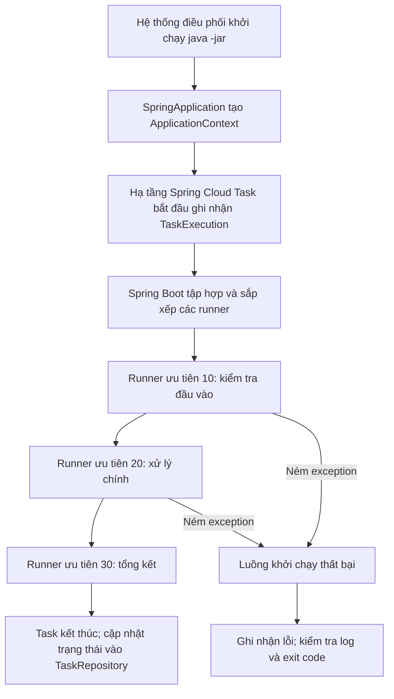
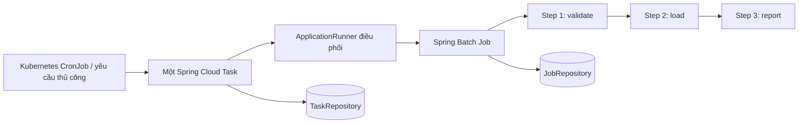

# Sắp xếp nhiều bộ chạy bằng `Ordered` và `@Order`

## Mục tiêu học tập

Sau bài này, bạn có thể:

- Giải thích Spring Boot gọi các `ApplicationRunner` và `CommandLineRunner` như thế nào trong một ứng dụng Spring Cloud Task.
- Dùng `@Order` và interface `Ordered` để quy định thứ tự giữa nhiều bộ chạy, kể cả khi chúng thuộc hai loại runner khác nhau.
- Hiểu ý nghĩa của **giá trị order nhỏ chạy trước**, trường hợp trùng mức ưu tiên và giới hạn của thứ tự gọi.
- Xử lý lỗi để bước sau không chạy khi bước trước thất bại, đồng thời theo dõi kết quả Task qua `TaskRepository`.
- Biết lúc nào nên dùng thứ tự runner và lúc nào nên chuyển sang một bộ điều phối có quan hệ phụ thuộc rõ ràng hoặc Spring Batch.

> **Ngữ cảnh:** Đây là bài thuộc chương **Luồng xử lý** của module **SPRING_CLOUD_TASK**. Spring Cloud Task dùng cho ứng dụng Spring Boot có thời gian chạy hữu hạn, ghi thông tin một lần thực thi vào cơ sở dữ liệu qua `TaskRepository`. Khi có nhiều bước khởi chạy bằng runner, việc sắp xếp thứ tự rõ ràng giúp tác vụ chạy theo quy trình dự kiến, báo lỗi đúng và thuận tiện vận hành theo yêu cầu hoặc theo lịch bên ngoài.

## 1. Vì sao phải sắp xếp nhiều runner?

Giả sử một tiến trình được khởi chạy lúc cuối ngày để đối soát giao dịch. Luồng nghiệp vụ có ba việc:

1. Kiểm tra tham số ngày xử lý và cấu hình nguồn dữ liệu.
2. Đọc dữ liệu cần đối soát và chạy tác vụ chính.
3. Tổng hợp số liệu, ghi báo cáo kết quả.

Ta có thể cài đặt ba việc trên dưới dạng ba bean `ApplicationRunner`/`CommandLineRunner` riêng biệt. Nếu không chỉ định thứ tự, việc dựa vào tên lớp, tên bean, vị trí file Java hoặc thứ tự component scan là **không an toàn**. Hai bước có quan hệ phụ thuộc có thể được gọi theo thứ tự không đúng kỳ vọng.

Spring Boot cho phép sắp xếp các runner bằng cơ chế `Ordered` và `@Order`. Đặt một mức ưu tiên cho từng runner giúp thể hiện ý định: xác thực trước, xử lý sau, cuối cùng mới tổng kết.

**Cần phân biệt:** Spring Cloud Task chịu trách nhiệm quản lý vòng đời và lịch sử Task; còn việc tìm và gọi các runner là hành vi của `SpringApplication` trong Spring Boot. `@Order` không phải tính năng riêng do Spring Cloud Task tạo ra.

## 2. Hai loại runner được gọi như thế nào?

| Loại runner | Phương thức chính | Cách nhận tham số | Cách dùng điển hình |
| --- | --- | --- | --- |
| `ApplicationRunner` | `run(ApplicationArguments args)` | Đối tượng đã phân tích tùy chọn `--key=value`, tham số không phải tùy chọn và tên option. | Kiểm tra tham số, chọn chế độ chạy, xử lý tùy chọn đặt tên. |
| `CommandLineRunner` | `run(String... args)` | Mảng đối số chuỗi gốc được chuyển cho `SpringApplication`. | Thực thi logic đơn giản hoặc chuyển nguyên đối số cho thư viện hiện có. |

Sau khi ứng dụng tạo xong `ApplicationContext`, Spring Boot thu thập các bean triển khai hai interface trên, **sắp xếp chúng trong cùng một tập runner** theo thứ tự ưu tiên và lần lượt gọi phương thức `run` tương ứng. Một `ApplicationRunner` có thể được gọi trước một `CommandLineRunner` hoặc ngược lại, tùy giá trị order, chứ không có quy tắc “chạy hết loại này rồi đến loại kia”.

Thứ tự tổng quát của một ứng dụng Task:



Sơ đồ mô tả trình tự **logic**. Các hook vòng đời của Spring Cloud Task hoạt động qua hạ tầng riêng; thời điểm cụ thể của listener phụ thuộc phiên bản và cấu hình. Không dùng `@Order` trên runner để suy ra thứ tự tạo bean hoặc thứ tự tất cả sự kiện vòng đời framework.

## 3. `@Order`: khai báo mức ưu tiên cố định

`@Order` là annotation của Spring Framework:

```java
import org.springframework.core.annotation.Order;
```

Gắn nó trực tiếp lên **lớp runner** để chỉ định mức ưu tiên, ví dụ:

```java
import org.springframework.boot.ApplicationArguments;
import org.springframework.boot.ApplicationRunner;
import org.springframework.core.annotation.Order;
import org.springframework.stereotype.Component;

@Component
@Order(10)
class ValidateInputRunner implements ApplicationRunner {

    @Override
    public void run(ApplicationArguments args) {
        System.out.println("1. Kiểm tra tham số");
    }
}
```

Nguyên tắc quan trọng:

- **Số càng nhỏ, ưu tiên càng cao, được gọi càng sớm.** `@Order(10)` đứng trước `@Order(20)`.
- Giá trị âm được phép: `@Order(-100)` đứng trước `@Order(0)`.
- `Ordered.HIGHEST_PRECEDENCE` là hằng số ưu tiên cao nhất; `Ordered.LOWEST_PRECEDENCE` là mức thấp nhất.
- Runner không khai báo mức ưu tiên thường được xem như có `Ordered.LOWEST_PRECEDENCE`. Vì vậy, nên chỉ định rõ order cho các runner quan trọng.
- Khi **nhiều runner có cùng order**, không dựa vào thứ tự giữa chúng để xác định quy trình nghiệp vụ. Dùng các giá trị phân biệt nếu thứ tự thực sự quan trọng.

Có thể dành khoảng cách `10`, `20`, `30` để về sau chèn thêm bước `15` mà không phải đánh số lại toàn bộ.

## 4. `Ordered`: định nghĩa mức ưu tiên qua interface

Thay vì annotation, một runner có thể triển khai `org.springframework.core.Ordered`:

```java
import org.springframework.boot.CommandLineRunner;
import org.springframework.core.Ordered;
import org.springframework.stereotype.Component;

@Component
class ImportDataRunner implements CommandLineRunner, Ordered {

    @Override
    public int getOrder() {
        return 20;
    }

    @Override
    public void run(String... args) {
        System.out.println("2. Nạp và xử lý dữ liệu");
    }
}
```

`Ordered#getOrder()` trả về giá trị để Spring Boot dùng lúc sắp xếp các runner. Cách này hữu ích khi muốn đưa quy tắc ưu tiên vào chính hợp đồng của lớp hoặc tính ra mức ưu tiên lúc khởi tạo bean. Tuy nhiên, **đừng thay đổi order trong lúc các runner đang chạy** rồi kỳ vọng Spring Boot sắp xếp lại danh sách: việc sắp xếp đã diễn ra trước khi gọi chúng.

### So sánh nhanh

| Tiêu chí | `@Order` | `Ordered` |
| --- | --- | --- |
| Cách khai báo | Annotation, ví dụ `@Order(10)` | Interface và `getOrder()` |
| Đặc trưng | Gọn, mức ưu tiên tĩnh. | Mức ưu tiên do phương thức của đối tượng trả về. |
| Khi dùng | Lớp runner có thứ tự cố định. | Runner cần tự mang thông tin priority hoặc tính priority từ cấu hình khi tạo bean. |
| Được Spring Boot sử dụng | Có. | Có. |
| Quy tắc so sánh | Số nhỏ chạy trước. | Số nhỏ chạy trước. |

Nếu cùng một đối tượng **vừa triển khai `Ordered` vừa có `@Order`**, bộ so sánh của Spring thường ưu tiên kết quả của `getOrder()`. Tránh khai báo cả hai với hai giá trị khác nhau vì sẽ gây khó hiểu.

> **Lưu ý với `@Bean` và lambda:** Khi trả về một `ApplicationRunner`/`CommandLineRunner` dưới dạng lambda từ một phương thức `@Bean`, đừng mặc định rằng `@Order` đặt ở **phương thức factory** sẽ được nhận ra khi Spring Boot sắp xếp danh sách các **đối tượng runner**. Cách rõ ràng và dễ kiểm chứng là dùng lớp runner có `@Order` trên lớp hoặc một đối tượng triển khai `Ordered`.

## 5. Ví dụ hoàn chỉnh: ba runner của một Spring Cloud Task

### 5.1. Cấu hình phụ thuộc

Ứng dụng cần Spring Boot, `spring-cloud-starter-task` và một nguồn dữ liệu để lưu metadata. Ví dụ các phần phụ thuộc Maven chính:

```xml
<dependencies>
    <dependency>
        <groupId>org.springframework.cloud</groupId>
        <artifactId>spring-cloud-starter-task</artifactId>
    </dependency>

    <!-- Chỉ để thử nghiệm cục bộ với database nhúng. -->
    <dependency>
        <groupId>com.h2database</groupId>
        <artifactId>h2</artifactId>
        <scope>runtime</scope>
    </dependency>
</dependencies>
```

Dự án phải có parent/BOM Spring Boot và Spring Cloud **tương thích**. Không tự gắn một version độc lập vào `spring-cloud-starter-task` khi đang dùng Spring Cloud BOM quản lý phiên bản.

### 5.2. Định nghĩa ứng dụng và ba runner

Các lớp dưới đây có thể được đặt trong cùng package với lớp ứng dụng. Ví dụ gom chúng trong một đoạn để dễ quan sát; trong dự án thực tế có thể chia thành các file Java riêng.

```java
package com.example.task;

import java.time.LocalDate;
import java.util.List;
import java.util.concurrent.CopyOnWriteArrayList;

import org.springframework.boot.ApplicationArguments;
import org.springframework.boot.ApplicationRunner;
import org.springframework.boot.CommandLineRunner;
import org.springframework.boot.SpringApplication;
import org.springframework.boot.autoconfigure.SpringBootApplication;
import org.springframework.cloud.task.configuration.EnableTask;
import org.springframework.core.Ordered;
import org.springframework.core.annotation.Order;
import org.springframework.stereotype.Component;

@SpringBootApplication
@EnableTask
public class DailyReconciliationApplication {

    public static void main(String[] args) {
        SpringApplication.run(DailyReconciliationApplication.class, args);
    }
}

// Dùng để ghi lại thứ tự trong ví dụ và trong kiểm thử.
@Component
class RunTrace {
    private final List<String> events = new CopyOnWriteArrayList<>();

    void record(String event) {
        events.add(event);
        System.out.println(event);
    }

    List<String> snapshot() {
        return List.copyOf(events);
    }
}

// Chạy trước: dùng @Order.
@Component
@Order(10)
class ValidateDateRunner implements ApplicationRunner {

    private final RunTrace trace;

    ValidateDateRunner(RunTrace trace) {
        this.trace = trace;
    }

    @Override
    public void run(ApplicationArguments args) {
        List<String> values = args.getOptionValues("business-date");
        if (values == null || values.size() != 1) {
            throw new IllegalArgumentException(
                "Cần đúng một --business-date=yyyy-MM-dd");
        }

        LocalDate.parse(values.get(0));
        trace.record("10 - validate");
    }
}

// Chạy thứ hai: cùng tập runner nhưng dùng Ordered và CommandLineRunner.
@Component
class LoadTransactionsRunner implements CommandLineRunner, Ordered {

    private final RunTrace trace;

    LoadTransactionsRunner(RunTrace trace) {
        this.trace = trace;
    }

    @Override
    public int getOrder() {
        return 20;
    }

    @Override
    public void run(String... args) {
        // Thực tế: gọi service nghiệp vụ và chờ xử lý hoàn tất.
        trace.record("20 - load");
    }
}

// Chạy cuối: dùng ApplicationRunner với @Order khác.
@Component
@Order(30)
class SummarizeRunner implements ApplicationRunner {

    private final RunTrace trace;

    SummarizeRunner(RunTrace trace) {
        this.trace = trace;
    }

    @Override
    public void run(ApplicationArguments args) {
        // Thực tế: kết xuất báo cáo sau bước nạp thành công.
        trace.record("30 - summary");
    }
}
```

Tác dụng của ví dụ:

- `ValidateDateRunner` là `ApplicationRunner`, đọc `--business-date` thông qua `ApplicationArguments` và kiểm tra ngày hợp lệ.
- `LoadTransactionsRunner` là `CommandLineRunner`, khai báo `Ordered#getOrder() = 20` nên chạy **sau** bước kiểm tra ngày.
- `SummarizeRunner` là `ApplicationRunner` với `@Order(30)`, chạy **sau** cả hai runner còn lại.
- `RunTrace` chỉ để kiểm chứng thứ tự. Trong ứng dụng thực, mỗi runner nên gọi một service có trách nhiệm rõ ràng; đừng dùng danh sách trace như nơi trao đổi dữ liệu nghiệp vụ.

Các phương thức `run` của ví dụ chạy tuần tự, không khởi chạy luồng nền. Nếu có xử lý bất đồng bộ, cần chờ công việc kết thúc trước khi phương thức `run` trả về để ý nghĩa “bước trước hoàn tất trước bước sau” được bảo toàn.

### 5.3. Cấu hình và chạy thử

Ví dụ `application.yml` cho môi trường học tập:

```yaml
spring:
  application:
    name: daily-reconciliation-task
  main:
    web-application-type: none
  datasource:
    url: jdbc:h2:mem:taskdemo;DB_CLOSE_DELAY=-1
    username: sa
    password: ""
  cloud:
    task:
      initialize-enabled: true
```

Database H2 nhúng tiện chạy thử nhưng **không lưu lịch sử giữa các lần khởi chạy tiến trình khác nhau**. Trong production, dùng database bền vững và schema Task được quản lý bằng migration.

Chạy sau khi đóng gói ứng dụng:

```bash
java -jar daily-reconciliation.jar --business-date=2026-11-24
```

Dòng log do ba runner ghi ra phải theo thứ tự:

```text
10 - validate
20 - load
30 - summary
```

Các thông báo framework khác có thể xuất hiện xen giữa. Điều cần kiểm chứng là **tương quan thứ tự của ba dòng do ứng dụng ghi**. Đảo thứ tự khai báo class hoặc đổi tên bean không phải cách hợp lệ để thay thứ tự thực thi; hãy đổi giá trị `@Order`/`getOrder()`.

## 6. Nếu runner đầu tiên thất bại thì sao?

Thử truyền ngày không hợp lệ:

```bash
java -jar daily-reconciliation.jar --business-date=not-a-date
```

`ValidateDateRunner` sẽ phát sinh lỗi khi `LocalDate.parse(...)`. Vì Spring Boot gọi runner tuần tự, nếu exception được ném ra khỏi `run` và không bị nuốt, bước `load` và `summary` sẽ **không được gọi**. Quy trình khởi chạy báo thất bại thay vì tiếp tục chạy trên dữ liệu chưa được xác nhận.

Ngược lại, nếu một runner bắt ngoại lệ rồi chỉ ghi log:

```java
try {
    processTransactions();
} catch (Exception ex) {
    log.error("Xử lý thất bại", ex);
    // Không ném lại lỗi: runner sau vẫn có thể được gọi.
}
```

Spring Boot có thể xem runner đó là đã hoàn tất và chuyển sang runner tiếp theo. Khi lỗi là lỗi nghiêm trọng, cần **ném lại ngoại lệ** hoặc có cơ chế truyền trạng thái lỗi rõ ràng để bảo vệ tính đúng đắn của quy trình.

Trong Spring Cloud Task:

1. Kiểm tra log để xác định runner nào phát sinh lỗi.
2. Tra `TASK_EXECUTION` / `TaskExplorer` để xem lần chạy, thời gian, mã thoát và thông tin lỗi (nếu Task đã bắt đầu và repository ghi được).
3. Kiểm tra **exit code của tiến trình** vì hệ thống điều phối như Kubernetes Job/CronJob thường dựa vào nó để xác định thành công/thất bại.
4. Nếu có Spring Batch Job bên trong, xem thêm `BATCH_JOB_EXECUTION` và `BATCH_STEP_EXECUTION`; trạng thái Job và trạng thái Task là hai lớp metadata riêng.

Không phải mọi lỗi đều tạo ra bản ghi Task: ví dụ lỗi khởi tạo `ApplicationContext` trước khi hạ tầng Task được thiết lập có thể xảy ra quá sớm để ghi `TASK_EXECUTION`. Vì vậy, vẫn cần thu thập stderr và log khởi động.

## 7. Kiểm thử thứ tự runner

Một kiểm thử tích hợp cần xác minh **thứ tự chạy thực tế**, không chỉ xem từng class có annotation gì. Dùng `RunTrace` từ ví dụ và JUnit 5:

```java
package com.example.task;

import java.util.List;

import org.junit.jupiter.api.Test;
import org.springframework.beans.factory.annotation.Autowired;
import org.springframework.boot.test.context.SpringBootTest;

import static org.junit.jupiter.api.Assertions.assertEquals;

@SpringBootTest(args = "--business-date=2026-11-24")
class RunnerOrderingIntegrationTest {

    @Autowired
    private RunTrace trace;

    @Test
    void shouldRunAllRunnersInExpectedOrder() {
        assertEquals(
            List.of("10 - validate", "20 - load", "30 - summary"),
            trace.snapshot()
        );
    }
}
```

Kiểm thử cần có `spring-boot-starter-test` trên test classpath và cấu hình database/schema Task thích hợp; ví dụ H2 bên trên phù hợp cho thử nghiệm nhỏ. Khi bật chức năng tự đóng Spring context của Task, cần kiểm tra cách test framework khởi tạo/giữ context theo phiên bản và có thể dùng profile test để điều chỉnh việc đóng context nếu cần.

Ngoài đường đi thành công, hãy thử các tình huống:

| Ca thử | Kỳ vọng |
| --- | --- |
| `--business-date` hợp lệ | Ba sự kiện đúng thứ tự `validate → load → summary`. |
| Thiếu `--business-date` | `validate` ném exception; không xuất hiện `load`/`summary`. |
| Giá trị ngày sai định dạng | Lỗi được ghi log, không chạy xử lý nghiệp vụ. |
| Thay `@Order(30)` thành `@Order(5)` ở Summary | Summary được gọi trước Validate — cho thấy giá trị nhỏ hơn được ưu tiên. |
| Hai runner cùng `@Order(10)` | Không sử dụng thứ tự quan sát được làm cam kết nghiệp vụ; gán mức ưu tiên khác nhau. |
| Runner `load` trả về trước khi thread nền xong | `summary` có thể bắt đầu sớm; cần chờ kết quả hoặc đổi thiết kế. |

## 8. Giới hạn của `@Order` và `Ordered`

### Thứ tự gọi không đồng nghĩa thứ tự hoàn tất khi có bất đồng bộ

Ví dụ nguy hiểm:

```java
@Order(20)
@Component
class AsyncLoadRunner implements ApplicationRunner {

    private final ImportService importService;

    AsyncLoadRunner(ImportService importService) {
        this.importService = importService;
    }

    @Override
    public void run(ApplicationArguments args) {
        importService.startAsyncImport(); // Trả về ngay.
    }
}
```

Mặc dù runner ưu tiên `20` được **gọi** trước runner `30`, bước tổng kết có thể chạy khi import vẫn chưa kết thúc. Nếu cần đảm bảo điều kiện hoàn tất, hãy chờ `CompletableFuture`/task handle hoặc gọi đồng bộ service nghiệp vụ, kèm timeout và xử lý lỗi. Không dùng thứ tự runner để thay thế đồng bộ hóa giữa các luồng.

### `@Order` không phải quan hệ phụ thuộc bean

Thứ tự **khởi tạo bean**, **gọi runner** và **thực thi nghiệp vụ** là các vấn đề khác nhau:

| Nhu cầu | Công cụ phù hợp |
| --- | --- |
| Xếp thứ tự gọi `ApplicationRunner`/`CommandLineRunner` | `@Order` hoặc `Ordered`. |
| Cần bean A được khởi tạo trước bean B | Quan hệ injection; `@DependsOn` khi có lý do rõ ràng. |
| Cần bước B chỉ thực hiện sau khi bước A cam kết thành công | Điều phối bằng service, state machine hoặc Job/Step của Spring Batch. |
| Cần lịch chạy 1 giờ sáng hằng ngày | Bộ lập lịch ngoài Task (CronJob, scheduler, orchestrator). |
| Cần rollback hoặc retry có checkpoint | Transaction/retry ở service, hoặc Spring Batch `JobRepository` và `Step`. |

Không nên gắn `@DependsOn` lên runner chỉ để ép thứ tự `run`. Annotation này chủ yếu nói về phụ thuộc khởi tạo bean và không thay thế hợp đồng sắp xếp runner của Spring Boot.

### Thứ tự runner không tạo một transaction chung

Giả sử `load` đã ghi 10.000 giao dịch thành công rồi `summary` bị lỗi: việc xếp thứ tự `20` trước `30` không tự hoàn tác tác động của `load`. Vì thế cần xác định rõ:

- Ranh giới transaction của từng service, điểm commit và cách phục hồi.
- Khả năng idempotent khi scheduler chạy lại cùng `business-date`.
- Cách nhận biết dữ liệu đã hoàn tất, chưa hoàn tất hoặc đã xử lý một phần.
- Khi nào lỗi phải dừng Task và khi nào được retry.

## 9. Phối hợp với Spring Batch và hệ thống điều phối

Spring Cloud Task lưu lịch sử **lần chạy ứng dụng**; Spring Batch lưu lịch sử **Job/Step** và các cơ chế phục hồi từng bước. Khi quy trình có nhiều bước phụ thuộc chặt chẽ, checkpoint, skip/retry hoặc restart, một `Job` Spring Batch với các `Step` nối tiếp thường diễn tả yêu cầu tốt hơn việc rải logic trên nhiều runner.

Ví dụ:



Ở thiết kế này, runner có thể đóng vai trò **điểm vào duy nhất** để điều phối Job. Các bước Batch quyết định thứ tự nghiệp vụ, còn `TaskRepository` ghi vòng đời toàn bộ tiến trình. Khi có dependency tích hợp `spring-cloud-task-batch` và listener được kích hoạt, metadata liên kết `TaskExecution` với `JobExecution` giúp truy vết lỗi.

**Cẩn thận với Batch auto-runner:** Khi thêm `spring-boot-starter-batch`, Spring Boot có thể tự tạo runner để khởi chạy `Job`. Runner này cùng tham gia cơ chế sắp xếp của Spring Boot và có thứ tự do framework quy định. Đừng suy đoán nó sẽ luôn chạy trước/sau các runner của ứng dụng dựa vào tên loại runner. Nếu phải bảo đảm Job chỉ chạy sau validate và trước báo cáo, có thể tắt tự chạy bằng:

```properties
spring.batch.job.enabled=false
```

Sau đó dùng **một runner điều phối** gọi `JobLauncher` theo đúng thứ tự và kiểm tra `JobExecution`. Nếu tự gọi `JobLauncher`, hãy truyền `JobParameters` phù hợp, chờ kết quả, xử lý `BatchStatus` thất bại và kết nối exit code Task/process để scheduler nhận biết lỗi. Điều này cũng tránh tình trạng một Job bị gọi hai lần bởi cả auto-runner và mã ứng dụng.

Các lần Task được hệ thống gọi theo lịch hoặc theo yêu cầu là **các lần khởi chạy tiến trình khác nhau**. `@Order` chỉ sắp xếp các runner **bên trong một lần chạy**, không sắp xếp thứ tự giữa hai Pod, hai tiến trình hay hai lịch chạy đồng thời. Nếu phải tránh chạy trùng, cần khóa/idempotency/điều phối phù hợp.

## 10. Sai sót thường gặp và cách khắc phục

| Biểu hiện | Lý do có thể xảy ra | Cách kiểm tra/khắc phục |
| --- | --- | --- |
| Runner B chạy trước A | Chưa có order rõ ràng; số của B nhỏ hơn A. | Gắn `@Order` trên lớp hoặc triển khai `Ordered`, kiểm tra log. |
| `@Order` có vẻ không tác dụng | Annotation đặt lên phương thức `@Bean` trả về lambda, hoặc instance có `Ordered#getOrder()` khác. | Kiểm tra loại bean runtime; dùng lớp runner có annotation trực tiếp hay `Ordered` nhất quán. |
| Hai runner đổi chỗ giữa các môi trường | Cùng mức order hoặc dựa vào trình tự đăng ký bean. | Gán order khác nhau; tạo integration test. |
| Runner sau chạy dù bước trước vẫn đang xử lý | Runner trước khởi động công việc bất đồng bộ rồi trả về. | Chờ xử lý hoàn tất; lan truyền exception và timeout. |
| Runner sau vẫn chạy khi bước trước thất bại | Exception đã bị bắt và nuốt, hoặc API chỉ trả trạng thái lỗi. | Ném lại lỗi, kiểm tra kết quả nghiệp vụ rõ ràng. |
| Batch Job chạy ngoài thứ tự mong muốn | Auto-runner Batch tham gia luồng khởi động. | Kiểm tra cấu hình Batch và dùng runner điều phối khi cần kiểm soát chặt. |
| Scheduler báo Task thành công dù dữ liệu lỗi | Logic không báo thất bại qua exception/exit code, hoặc Batch Job failure chưa được lan truyền. | So sánh log, `TaskExecution`, `JobExecution` và exit code hệ điều hành. |

## 11. Bài tập thực hành

**Bài tập 1 — Khảo sát thứ tự:** Tạo ba runner với giá trị `@Order(50)`, `@Order(10)` và `Ordered#getOrder() = 30`. Trộn `ApplicationRunner` với `CommandLineRunner`. Dự đoán và xác minh thứ tự in log. Giải thích tại sao loại interface không quyết định thứ tự.

**Bài tập 2 — Xử lý lỗi:** Thêm runner kiểm tra tham số `--business-date` ở mức `10`. Khi thiếu tham số, ném `IllegalArgumentException`. Chạy ứng dụng và xác minh runner mức `20`, `30` không thực thi; kiểm tra log, Task metadata và exit code tiến trình.

**Bài tập 3 — Lỗi bất đồng bộ:** Đổi runner mức `20` để tạo một `CompletableFuture` rồi trả về ngay. Quan sát bước mức `30` có thể chạy trước khi Future xong. Sửa bằng cách chờ kết quả có timeout, truyền exception và kiểm tra thứ tự hoàn tất.

**Bài tập 4 — Chọn cấu trúc:** Với luồng đối soát có ba bước, mỗi bước cần checkpoint/retry riêng và có thể restart từ bước lỗi, so sánh thiết kế “ba runner với `@Order`” với “một runner chạy Spring Batch Job gồm ba Step”. Nêu vai trò của `TaskRepository` và `JobRepository` trong phương án bạn chọn.

## Ghi nhớ

- Spring Boot sắp xếp **chung** tất cả `ApplicationRunner` và `CommandLineRunner` bằng thứ tự ưu tiên; giá trị order **nhỏ hơn chạy trước**.
- `@Order` phù hợp với ưu tiên cố định của lớp; `Ordered#getOrder()` đưa mức ưu tiên vào chính đối tượng.
- Đặt giá trị khác nhau cho các runner có phụ thuộc, kiểm tra hành vi bằng log và integration test.
- `@Order` chỉ quyết định **thứ tự gọi** runner; nó không bảo đảm hoàn tất công việc bất đồng bộ, không điều khiển tạo bean và không tạo giao dịch chung.
- Trong Spring Cloud Task, để vận hành an toàn cần kiểm tra trạng thái `TaskExecution`, exit code, idempotency và khả năng chạy lại. Dùng Spring Batch khi cần quản lý Job/Step với retry, restart và checkpoint.

## Tài liệu tham khảo

- [Spring Boot — Using the ApplicationRunner or CommandLineRunner](https://docs.spring.io/spring-boot/reference/features/spring-application.html#features.spring-application.command-line-runner)
- [Spring Framework — `Ordered` interface](https://docs.spring.io/spring-framework/docs/current/javadoc-api/org/springframework/core/Ordered.html)
- [Spring Framework — `@Order` annotation](https://docs.spring.io/spring-framework/docs/current/javadoc-api/org/springframework/core/annotation/Order.html)
- [Spring Framework — `AnnotationAwareOrderComparator`](https://docs.spring.io/spring-framework/docs/current/javadoc-api/org/springframework/core/annotation/AnnotationAwareOrderComparator.html)
- [Spring Cloud Task — Features](https://docs.spring.io/spring-cloud-task/reference/features.html)
- [Spring Cloud Task — Batch integration](https://docs.spring.io/spring-cloud-task/reference/batch.html)
