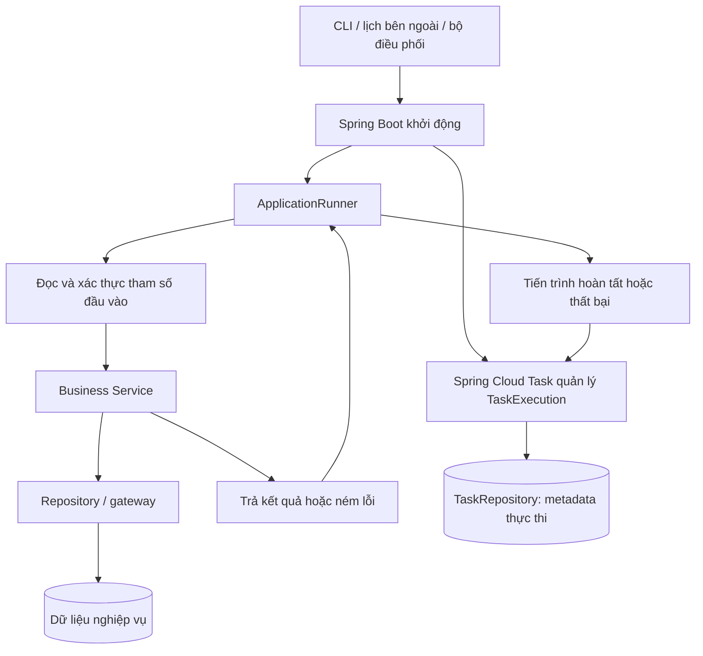

# Tách bộ chạy khỏi dịch vụ nghiệp vụ

## 1. Mục tiêu của việc tách lớp

Trong **Spring Cloud Task**, ứng dụng Spring Boot thực hiện một công việc có thời gian chạy hữu hạn rồi kết thúc. Công việc có thể được kích hoạt bằng lệnh thủ công, một lịch chạy bên ngoài, hệ thống điều phối hoặc yêu cầu từ hệ thống khác. Spring Cloud Task theo dõi mỗi lần thực thi qua `TaskRepository`, nhưng **nội dung nghiệp vụ** vẫn do mã ứng dụng quyết định.

Một thiết kế thường gặp là đặt toàn bộ xử lý vào `CommandLineRunner` hoặc `ApplicationRunner`: đọc tham số, truy vấn dữ liệu, biến đổi bản ghi, ghi cơ sở dữ liệu, gọi API, xử lý ngoại lệ. Cách này nhanh khi thử nghiệm nhưng làm bộ chạy khó kiểm thử, khó dùng lại và gắn chặt quy tắc nghiệp vụ với cách kích hoạt tác vụ.

**Tách bộ chạy khỏi dịch vụ nghiệp vụ** nghĩa là:

- **Runner** là điểm vào (entry point) của một lần chạy: đọc và kiểm tra hình thức tham số, chuyển chúng thành đối tượng yêu cầu, gọi dịch vụ, ghi thông tin tổng kết, để lỗi được phản ánh ở mức lần chạy.
- **Service** triển khai quy tắc nghiệp vụ: kiểm tra điều kiện, quyết định thứ tự thao tác, phối hợp các repository/gateway, quản lý giao dịch nghiệp vụ và trả kết quả có ý nghĩa.
- **Repository/gateway** đảm nhiệm truy cập cơ sở dữ liệu, tệp hoặc dịch vụ ngoài; không chứa chính sách chạy task theo lịch hay quyết định mã thoát tiến trình.
- **Spring Cloud Task và `TaskRepository`** theo dõi vòng đời lần chạy, thời điểm bắt đầu/kết thúc, mã thoát và lỗi; dữ liệu này khác với kết quả nghiệp vụ mà service lưu.

Mục tiêu là có thể gọi cùng một service từ task chạy theo yêu cầu, từ một luồng xử lý khác hoặc trong kiểm thử, trong khi runner vẫn nhỏ và chỉ tập trung vào việc **khởi động một lần xử lý**.

## 2. Luồng xử lý và ranh giới trách nhiệm



| Thành phần | Nên phụ trách | Không nên ôm đồm |
| --- | --- | --- |
| `ApplicationRunner` / `CommandLineRunner` | Đọc `--option`, kiểm tra định dạng/sự hiện diện, gọi một use case, log tóm tắt | SQL, thuật toán tính toán, quy tắc nghiệp vụ phức tạp |
| `@Service` | Quy tắc, giao dịch nghiệp vụ, phối hợp lưu/đọc, trả kết quả hoặc thông báo lỗi rõ nghĩa | Phụ thuộc vào `ApplicationArguments`, biết lệnh `java -jar`, tự khởi động lại JVM |
| Repository / gateway | Thao tác SQL, API hoặc tệp cụ thể | Quyết định lịch, retry toàn bộ task hoặc định nghĩa mã thoát |
| `TaskRepository` | Metadata `TaskExecution` do framework quản lý | Lưu thay bảng nghiệp vụ hoặc bảo đảm exactly-once |
| Scheduler / orchestrator | Quyết định khi nào chạy, số lần thử lại, cấp tài nguyên, theo dõi tiến trình | Thay thế các ràng buộc dữ liệu và giao dịch của service |

Ví dụ dưới đây là task **tổng hợp số đơn hàng đang chờ theo ngày**. Runner nhận `--report.date` và `--report.request-id`; service đếm các đơn `PENDING` rồi lưu kết quả vào bảng nghiệp vụ. Spring Cloud Task ghi riêng metadata của chính lần chạy đó.

## 3. Thiết kế hợp đồng giữa runner và service

Thay vì truyền thẳng `ApplicationArguments` vào service, tạo một yêu cầu có kiểu dữ liệu rõ ràng:

```java
// ReportRequest.java
import java.time.LocalDate;

public record ReportRequest(String requestId, LocalDate reportDate) {
}
```

```java
// ReportResult.java
import java.time.LocalDate;

public record ReportResult(
        String requestId,
        LocalDate reportDate,
        long pendingOrders) {
}
```

`ReportRequest` thể hiện **đầu vào có ý nghĩa nghiệp vụ**. `ReportResult` là kết quả đã xử lý, phù hợp để hiển thị trên log, đưa vào một API hoặc lưu dưới dạng bản ghi riêng. Không bắt service biết tên cờ CLI hay định dạng chuỗi truyền qua terminal.

Ở đây `requestId` đóng vai trò khóa định danh yêu cầu nghiệp vụ. **Nó không phải** `TASK_EXECUTION_ID`: một yêu cầu có thể được kích hoạt thử lại và phát sinh nhiều `TaskExecution`, trong khi hệ thống vẫn cần phát hiện xử lý trùng theo cùng một `requestId`.

## 4. Ví dụ triển khai từ runner đến cơ sở dữ liệu

### 4.1. Dependency và cấu hình

Trong dự án Spring Boot đã sử dụng **BOM Spring Cloud tương thích với phiên bản Spring Boot**, bổ sung các dependency Maven chính:

```xml
<dependencies>
    <dependency>
        <groupId>org.springframework.cloud</groupId>
        <artifactId>spring-cloud-starter-task</artifactId>
    </dependency>
    <dependency>
        <groupId>org.springframework.boot</groupId>
        <artifactId>spring-boot-starter-jdbc</artifactId>
    </dependency>
    <dependency>
        <groupId>com.h2database</groupId>
        <artifactId>h2</artifactId>
        <scope>runtime</scope>
    </dependency>
</dependencies>
```

Ví dụ dùng Java 17 trở lên để sử dụng `record` và một ứng dụng Spring Boot **không khởi động web server**. Cấu hình tại `src/main/resources/application.yml`:

```yaml
spring:
  application:
    name: daily-report-task
  main:
    web-application-type: none
  datasource:
    driver-class-name: org.h2.Driver
    url: jdbc:h2:file:./data/daily-report;DB_CLOSE_ON_EXIT=FALSE
    username: sa
    password: ""
  sql:
    init:
      mode: always
  cloud:
    task:
      name: daily-report-task
      initialize-enabled: true
```

H2 lưu tệp cho phép kiểm tra lịch sử qua các lần chạy từ **cùng thư mục làm việc**. `spring.sql.init.mode: always` yêu cầu Spring Boot chạy script `schema.sql` của phần dữ liệu nghiệp vụ. `spring.cloud.task.initialize-enabled: true` dành cho schema metadata của Spring Cloud Task; hai bộ bảng có vai trò khác nhau và phải được quản lý phù hợp với phiên bản thư viện. `sa` và mật khẩu rỗng chỉ phù hợp môi trường học tập cục bộ.

Tại `src/main/resources/schema.sql`, tạo dữ liệu nghiệp vụ của ví dụ:

```sql
CREATE TABLE IF NOT EXISTS business_orders (
    id BIGINT PRIMARY KEY,
    order_date DATE NOT NULL,
    status VARCHAR(20) NOT NULL
);

CREATE TABLE IF NOT EXISTS daily_report_results (
    request_id VARCHAR(80) PRIMARY KEY,
    report_date DATE NOT NULL,
    pending_orders BIGINT NOT NULL,
    created_at TIMESTAMP DEFAULT CURRENT_TIMESTAMP NOT NULL
);
```

Không tự viết `CREATE TABLE TASK_EXECUTION` trong script này. `TASK_EXECUTION` thuộc metadata framework, còn `business_orders` và `daily_report_results` thuộc nghiệp vụ. Trong dự án thực tế, chuyển các script tạo bảng sang migration có kiểm soát và dùng PostgreSQL hoặc một cơ sở dữ liệu máy chủ phù hợp khi nhiều tiến trình cùng truy cập.

### 4.2. Khởi động ứng dụng

```java
// DailyReportTaskApplication.java
import org.springframework.boot.SpringApplication;
import org.springframework.boot.autoconfigure.SpringBootApplication;
import org.springframework.cloud.task.configuration.EnableTask;

@SpringBootApplication
@EnableTask
public class DailyReportTaskApplication {
    public static void main(String[] args) {
        SpringApplication.run(DailyReportTaskApplication.class, args);
    }
}
```

`@EnableTask` kích hoạt cấu hình Spring Cloud Task cho ví dụ. Framework quản lý bản ghi thực thi trong quá trình khởi động/kết thúc ứng dụng; runner không cần tự thêm bản ghi vào `TaskRepository` cho mỗi lần gọi service.

### 4.3. Runner chỉ nhận tham số và gọi use case

```java
// DailyReportRunner.java
import java.time.LocalDate;
import java.time.format.DateTimeParseException;
import java.util.List;

import org.springframework.boot.ApplicationArguments;
import org.springframework.boot.ApplicationRunner;
import org.springframework.stereotype.Component;

@Component
public class DailyReportRunner implements ApplicationRunner {

    private final DailyReportService reportService;

    public DailyReportRunner(DailyReportService reportService) {
        this.reportService = reportService;
    }

    @Override
    public void run(ApplicationArguments args) {
        String dateText = requiredOption(args, "report.date");
        String requestId = requiredOption(args, "report.request-id");

        LocalDate reportDate;
        try {
            reportDate = LocalDate.parse(dateText);
        } catch (DateTimeParseException ex) {
            throw new IllegalArgumentException(
                    "--report.date phải có định dạng yyyy-MM-dd", ex);
        }

        ReportRequest request = new ReportRequest(requestId, reportDate);
        ReportResult result = reportService.create(request);

        System.out.printf(
                "Hoàn tất requestId=%s, date=%s, pending=%d%n",
                result.requestId(), result.reportDate(), result.pendingOrders());
    }

    private static String requiredOption(ApplicationArguments args, String name) {
        List<String> values = args.getOptionValues(name);
        if (values == null || values.size() != 1 ||
                values.get(0) == null || values.get(0).isBlank()) {
            throw new IllegalArgumentException(
                    "Cần truyền đúng một giá trị cho --" + name);
        }
        return values.get(0);
    }
}
```

Runner kiểm tra đầu vào **ở lớp giao tiếp**: thiếu tham số, truyền trùng cờ hoặc ngày sai cú pháp. Sau khi tạo `ReportRequest`, runner không còn biết cách đếm đơn hàng hay cách ghi kết quả. Ngoại lệ được để lan ra ngoài `ApplicationRunner` thay vì nuốt lỗi và in mỗi dòng thông báo rồi trả về thành công.

`CommandLineRunner` cũng có thể làm vai trò tương tự, nhưng nhận `String... args`. `ApplicationRunner` thuận tiện hơn khi cần lấy các option `--key=value` qua `ApplicationArguments`. Chỉ cần chọn **một** cơ chế cho tác vụ ví dụ; không tạo nhiều runner có nghiệp vụ trùng nhau.

### 4.4. Service xử lý quy tắc nghiệp vụ và giao dịch

```java
// DailyReportService.java
import java.time.LocalDate;

import org.springframework.stereotype.Service;
import org.springframework.transaction.annotation.Transactional;

@Service
public class DailyReportService {

    private final DailyReportRepository repository;

    public DailyReportService(DailyReportRepository repository) {
        this.repository = repository;
    }

    @Transactional
    public ReportResult create(ReportRequest request) {
        if (request.requestId() == null || request.requestId().isBlank()
                || request.requestId().length() > 80) {
            throw new IllegalArgumentException("requestId phải có 1-80 ký tự");
        }
        if (request.reportDate() == null ||
                request.reportDate().isAfter(LocalDate.now())) {
            throw new IllegalArgumentException("Ngày báo cáo không hợp lệ");
        }

        long pendingOrders = repository.countPendingOrders(request.reportDate());
        repository.saveResult(request, pendingOrders);

        return new ReportResult(
                request.requestId(), request.reportDate(), pendingOrders);
    }
}
```

Service sở hữu điều kiện **có ý nghĩa nghiệp vụ**: độ dài mã yêu cầu, ngày báo cáo không ở tương lai, đếm đúng trạng thái `PENDING` và lưu bản tổng hợp. Ở hệ thống thực, quy ước múi giờ của ngày nghiệp vụ cần được xác định nhất quán; `LocalDate.now()` ở đây dùng múi giờ mặc định JVM để giữ ví dụ gọn.

`@Transactional` đặt ở service vì đây là ranh giới của một đơn vị nghiệp vụ: đọc số liệu rồi ghi kết quả. Nếu câu lệnh ghi thất bại, transaction nghiệp vụ sẽ rollback theo quy tắc Spring (mặc định rollback với runtime exception). Một task thực tế có thể cần điều chỉnh mức cô lập giao dịch hoặc xử lý dữ liệu lớn theo nhiều đợt; tránh mở một giao dịch kéo dài hàng giờ chỉ để bao trọn cả task.

### 4.5. Repository sở hữu SQL

```java
// DailyReportRepository.java
import java.sql.Date;
import java.time.LocalDate;

import org.springframework.jdbc.core.JdbcTemplate;
import org.springframework.stereotype.Repository;

@Repository
public class DailyReportRepository {

    private final JdbcTemplate jdbc;

    public DailyReportRepository(JdbcTemplate jdbc) {
        this.jdbc = jdbc;
    }

    public long countPendingOrders(LocalDate date) {
        Long count = jdbc.queryForObject(
                "SELECT COUNT(*) FROM business_orders " +
                "WHERE order_date = ? AND status = 'PENDING'",
                Long.class,
                Date.valueOf(date));
        return count == null ? 0L : count;
    }

    public void saveResult(ReportRequest request, long pendingOrders) {
        jdbc.update(
                "INSERT INTO daily_report_results " +
                "(request_id, report_date, pending_orders) VALUES (?, ?, ?)",
                request.requestId(),
                Date.valueOf(request.reportDate()),
                pendingOrders);
    }
}
```

Repository không biết task đến từ CLI hay lịch chạy. Nếu chuyển H2 sang PostgreSQL, thay đổi SQL hoặc adapter có thể được cô lập ở lớp này. Service vẫn sử dụng các thao tác `countPendingOrders` và `saveResult`.

Ví dụ chủ ý để `request_id` là **khóa chính**: hai lần lưu cùng `requestId` sẽ bị từ chối. Điều đó giúp **phát hiện trùng**, nhưng chưa phải xử lý retry idempotent hoàn chỉnh. Với tác vụ cần chạy lại an toàn, service phải định nghĩa hành vi khi gặp `requestId` cũ: trả kết quả đã ghi, từ chối do dữ liệu đầu vào thay đổi, hoặc tái xử lý có kiểm soát. Phải xử lý trường hợp nhiều tiến trình cùng nhận một mã trong điều kiện đồng thời, dựa trên ràng buộc duy nhất của cơ sở dữ liệu.

## 5. Chạy và quan sát hai lớp kết quả

Tạo thư mục dữ liệu tại working directory trước khi chạy:

```bash
mkdir data
java -jar target/daily-report-task.jar --report.date=2024-01-15 --report.request-id=report-001
```

`target/daily-report-task.jar` chỉ là tên minh họa; thay bằng tên executable JAR thực tế do dự án build. Nếu bảng `business_orders` chưa có dòng nào cho ngày đó, `pendingOrders = 0` là **kết quả nghiệp vụ hợp lệ**, không phải lỗi.

Khi tiến trình đã kết thúc, kết nối đến file H2 ở cùng working directory (ví dụ `jdbc:h2:file:./data/daily-report;IFEXISTS=TRUE`) và chạy:

```sql
-- Kết quả nghiệp vụ do service lưu
SELECT request_id, report_date, pending_orders, created_at
FROM daily_report_results
ORDER BY created_at DESC;

-- Metadata lần chạy do Spring Cloud Task quản lý
SELECT TASK_EXECUTION_ID, TASK_NAME, START_TIME, END_TIME,
       EXIT_CODE, EXIT_MESSAGE
FROM TASK_EXECUTION
ORDER BY TASK_EXECUTION_ID DESC;
```

Hai truy vấn trả lời hai câu hỏi khác nhau:

| Câu hỏi | Nguồn dữ liệu |
| --- | --- |
| Task nào chạy, khi nào bắt đầu và kết thúc, có lỗi không? | `TASK_EXECUTION` của Spring Cloud Task |
| Yêu cầu `report-001` đã tính ra bao nhiêu đơn đang chờ? | `daily_report_results` do service ghi |
| Task được thử lại bao nhiêu lần? | Số bản ghi `TaskExecution` và cơ chế tương quan với `requestId` |
| Một yêu cầu đã xử lý đúng một lần về mặt nghiệp vụ chưa? | Khóa và quy tắc idempotency do ứng dụng thiết kế; không thể kết luận chỉ từ metadata |

Để kiểm tra dữ liệu khác 0, sau khi dừng task hãy dùng công cụ SQL chèn dữ liệu thử (chỉ chèn một lần):

```sql
INSERT INTO business_orders (id, order_date, status) VALUES
    (1, DATE '2024-01-15', 'PENDING'),
    (2, DATE '2024-01-15', 'DONE'),
    (3, DATE '2024-01-15', 'PENDING');
```

Sau đó đóng kết nối SQL nếu H2 bị khóa tệp và chạy lại bằng **mã yêu cầu mới**:

```bash
java -jar target/daily-report-task.jar --report.date=2024-01-15 --report.request-id=report-002
```

Kết quả nghiệp vụ kỳ vọng cho `report-002` là `pendingOrders = 2`, trong khi `TASK_EXECUTION` có thêm một lần chạy. Nếu dùng lại `report-001`, ví dụ sẽ gặp lỗi khóa trùng trong bảng `daily_report_results`; đây là tín hiệu cần định nghĩa chính sách retry hoặc tái chạy, không phải lỗi của `TaskRepository`.

## 6. Xử lý ngoại lệ theo đúng lớp

Không nên chuyển mọi tình huống thành `System.out.println("Lỗi")` rồi kết thúc bình thường. Nếu runner bắt ngoại lệ, chỉ log và không ném lại hoặc không báo lỗi qua mã thoát, hệ điều phối có thể nhìn thấy một lần chạy **thành công giả**.

| Tình huống | Lớp phát hiện | Hành động nên làm |
| --- | --- | --- |
| Thiếu `--report.date` hoặc sai định dạng ISO | Runner | Ném `IllegalArgumentException` với thông báo rõ tên tham số |
| Ngày báo cáo vi phạm quy tắc nghiệp vụ | Service | Từ chối yêu cầu với lỗi nghiệp vụ cụ thể |
| CSDL không truy cập được hoặc khóa `requestId` trùng | Repository/driver; service quyết định chính sách | Để lỗi lan ra hoặc xử lý theo chính sách idempotency đã thiết kế |
| Không có đơn `PENDING` | Service | Trả `ReportResult` có `pendingOrders = 0` nếu đó là tình huống hợp lệ |
| Tiến trình bị dừng cưỡng bức | Hệ điều hành/orchestrator | Quan sát log, trạng thái tiến trình và metadata chưa hoàn tất để đánh giá, sau đó quyết định retry |

Khi một `ApplicationRunner` ném exception chưa được xử lý, quá trình khởi động Spring Boot thất bại; Spring Cloud Task có cơ chế ghi nhận kết thúc/lỗi theo vòng đời framework. Mã thoát thực tế tùy cấu hình, phiên bản và cách ánh xạ exception; cần kiểm tra cả **exit status của tiến trình** và metadata được ghi trong CSDL. Không nên tự suy luận rằng mọi lỗi đều có cùng `EXIT_CODE`.

`@Transactional` bảo vệ các thao tác CSDL trong phạm vi service, nhưng **không thể tự rollback một email đã gửi, một lệnh gọi API ngoài hoặc tệp đã xuất**. Những trường hợp có side effect cần idempotency key, outbox, lưu checkpoint hoặc cơ chế bù trừ tùy đặc thù nghiệp vụ. Metadata `TaskRepository` không thay thế các cơ chế đó; cũng không nên mặc định giao dịch metadata và giao dịch nghiệp vụ luôn được commit nguyên tử.

## 7. Một service, nhiều cách kích hoạt

Với thiết kế đã tách, nghiệp vụ `DailyReportService.create(ReportRequest)` không phụ thuộc phương thức kích hoạt. Tuy nhiên, **cách gọi service ảnh hưởng việc có một `TaskExecution` mới hay không**.

### Chạy theo yêu cầu

Một hệ thống điều phối có thể chạy executable JAR với các tham số đầu vào riêng. Mỗi lần khởi động ứng dụng Spring Cloud Task là một lần chạy mới để framework theo dõi.

### Chạy theo lịch

Các thành phần như cron, Kubernetes CronJob hoặc một scheduler bên ngoài có thể lên lịch tạo **tiến trình task mới** vào thời điểm định sẵn. Runner vẫn là điểm nhận tham số; service không cần biết lịch chạy. Tránh dùng vòng lặp vô hạn hoặc `@Scheduled` trong chính tiến trình chỉ nhằm giữ nó sống mãi nếu mục tiêu là một Spring Cloud Task hữu hạn.

### Dùng lại service từ nơi khác

Một ứng dụng web hoặc message consumer cũng có thể gọi `DailyReportService` sau khi chuyển request thành `ReportRequest`. Lúc đó, lời gọi service **không tự tạo một bản ghi `TaskExecution` mới**; metadata task là kết quả của vòng đời Spring Cloud Task, không phải mỗi lần một method service được gọi. Nếu yêu cầu cần theo dõi như một lần chạy độc lập, hãy kích hoạt một task instance hoặc thiết kế cơ chế theo dõi tương ứng.

### Kết hợp Spring Batch

Nếu khối xử lý cần đọc/ghi hàng triệu bản ghi, chia chunk, restart theo checkpoint hoặc retry từng bước, có thể chuyển phần xử lý sang **Spring Batch job/step** và dùng runner hoặc cơ chế tích hợp phù hợp để khởi chạy job. Lúc đó, `TaskRepository` theo dõi lần chạy ứng dụng Spring Cloud Task, còn `JobRepository` của Spring Batch theo dõi job và step; hai lớp metadata khác nhau, cần schema và chiến lược vận hành riêng.

## 8. Nguyên tắc vận hành an toàn

1. **Giữ runner mỏng:** đọc tham số, chuyển thành request, gọi service, ghi kết quả tổng quát; hạn chế SQL, vòng lặp nghiệp vụ và tự tạo transaction trong runner.
2. **Đặt ranh giới giao dịch ở service:** transaction bao lấy một phần nghiệp vụ có thể commit/rollback; chia nhỏ khi xử lý dài, tránh giữ khóa DB hoặc connection quá lâu.
3. **Thiết kế chạy lại an toàn:** phân biệt `TaskExecution` với `requestId`, dùng ràng buộc duy nhất và chính sách retry rõ ràng. Scheduler có thể phát lại yêu cầu sau timeout, kể cả khi nghiệp vụ đã thực thi một phần.
4. **Truy vết kết quả hai chiều:** log kèm `requestId` và thông tin lần chạy khi cần, nhưng không ghi token/mật khẩu vào CLI hoặc metadata. Dùng công cụ quản lý bí mật và hạn chế dữ liệu nhạy cảm trong log.
5. **Tách trách nhiệm lỗi:** định dạng tham số ở runner, quy tắc nghiệp vụ ở service, lỗi hạ tầng ở adapter, chính sách retry ở tầng điều phối phối hợp với service. Không nuốt exception làm task có vẻ thành công.
6. **Giám sát sự cố:** kiểm tra lỗi thoát tiến trình, bản ghi `TASK_EXECUTION` thiếu `END_TIME`, thời gian chạy kéo dài và trạng thái kết quả nghiệp vụ. Trường hợp JVM bị dừng cưỡng bức có thể không ghi được trạng thái cuối.
7. **Quản lý schema độc lập:** `TASK_*` là metadata framework, bảng nghiệp vụ là kết quả do service quản lý; khi sử dụng Spring Batch còn có `BATCH_*`. Mỗi bộ cần migration và quyền truy cập phù hợp.

## 9. Bài thực hành và câu hỏi tự kiểm tra

Thực hiện theo thứ tự sau:

1. Chạy ví dụ với `--report.date=2024-01-15 --report.request-id=report-001`. Truy vấn riêng `TASK_EXECUTION` và `daily_report_results`; giải thích vì sao một lần chạy có hai góc nhìn về kết quả.
2. Thêm ba đơn mẫu như phần trên rồi chạy `report-002`. Quan sát `pendingOrders = 2` và xác nhận runner không có SQL.
3. Thử bỏ `--report.date`, truyền ngày không hợp lệ và ngày trong tương lai. Xác định lỗi nằm ở runner hay service và xem metadata lần chạy thực tế.
4. Dùng lại `report-002` để gây trùng khóa. Đề xuất hành vi mong muốn khi người vận hành retry: trả kết quả cũ, xử lý lại hay từ chối? Phác thảo quy tắc kiểm tra dữ liệu đầu vào và đồng thời.
5. Giả sử chuyển từ CLI sang lịch chạy mỗi đêm hoặc Spring Batch: chỉ ra lớp nào cần đổi, lớp nào nên giữ nguyên, và những metadata nào phải giám sát riêng.

Khi hoàn thành, bạn cần mô tả được **đường đi của một lần thực thi**, phân biệt **runner, service, repository và `TaskRepository`**, xác định nơi xử lý tham số/lỗi/giao dịch, đồng thời giải thích vì sao một dịch vụ nghiệp vụ độc lập giúp Spring Cloud Task dễ kiểm thử, tái sử dụng, chạy theo lịch và vận hành an toàn hơn.
