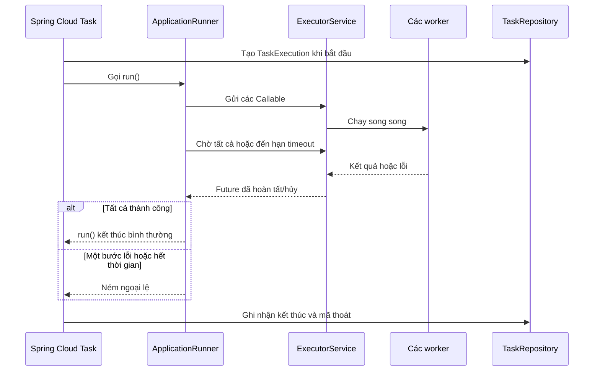

# Chờ công việc bất đồng bộ hoàn tất trước khi trả về

## 1. Mục tiêu và tình huống thực tế

Trong **Spring Cloud Task**, ứng dụng thường khởi động, thực hiện một công việc hữu hạn rồi kết thúc. Tuy nhiên, một bước xử lý có thể cần gọi nhiều dịch vụ độc lập, đọc nhiều tệp hoặc tính toán đồng thời để rút ngắn tổng thời gian. Những công việc con đó thường chạy trên các luồng khác với luồng đang thực thi `ApplicationRunner`.

Vấn đề quan trọng: **tạo công việc bất đồng bộ không đồng nghĩa công việc đã hoàn tất**. Nếu phương thức `run()` trả về khi các luồng con còn đang hoạt động, quy trình có thể tiếp tục kết thúc ứng dụng hoặc ghi trạng thái hoàn thành trong khi dữ liệu vẫn chưa được xử lý xong. Điều này dẫn đến lịch sử thực thi sai lệch, dữ liệu thiếu, lỗi bị bỏ sót hoặc công việc bị ngắt giữa chừng.

Sau bài học, bạn sẽ có thể:

- Phân biệt *đã gửi công việc*, *đã hoàn tất* và *đã hoàn tất thành công*.
- Chờ **mọi công việc con bắt buộc** xong trước khi `ApplicationRunner.run()` trả về.
- Giới hạn thời gian chờ, nhận diện timeout, xử lý ngắt luồng và lan truyền lỗi về luồng chính.
- Quan sát kết quả của từng lần chạy qua `TaskRepository` của Spring Cloud Task.
- Lựa chọn giữa `ExecutorService`, `CompletableFuture`, `@Async`; hiểu lưu ý khi tích hợp **Spring Batch**.

Ví dụ xuyên suốt là một **tác vụ tổng hợp dữ liệu từ ba nguồn**: `customers`, `orders` và `payments`. Mỗi nguồn chạy song song. Tác vụ chỉ báo thành công sau khi **cả ba nguồn trả kết quả hợp lệ**.

> Trong bài này, “trả về” nghĩa là **trả quyền điều khiển từ `ApplicationRunner.run()`** về chu trình khởi động/hoàn tất của ứng dụng Spring Boot. Đây không phải phản hồi của một HTTP controller. Spring Cloud Task theo dõi vòng đời một lần chạy ứng dụng; nó không tự đợi mọi thread hoặc tác vụ ngoài mà ứng dụng đã khởi tạo.

## 2. Vì sao phải chờ các tác vụ bất đồng bộ?

Giả sử runner viết như sau:

```java
@Override
public void run(ApplicationArguments args) {
    CompletableFuture.runAsync(() -> importCustomers());
    CompletableFuture.runAsync(() -> importOrders());
    System.out.println("Đã gửi hai công việc");
}
```

Đoạn mã trên chỉ **khởi tạo** hai công việc. `run()` có thể kết thúc ngay sau lệnh `println`. Không có đoạn nào kiểm tra liệu `importCustomers()` hoặc `importOrders()` thành công. Lỗi bên trong `CompletableFuture` có thể nằm trong future mà không được truyền cho runner.

Trong ứng dụng Spring Cloud Task, trạng thái `TaskExecution` được framework quản lý theo vòng đời của ứng dụng và các runner. Nếu runner kết thúc quá sớm, quá trình hoàn tất có thể diễn ra trước khi các thao tác thực tế kết thúc. Dựa vào việc một thread còn sống để “giữ” tiến trình Java là không đáng tin cậy: thời điểm cập nhật metadata, thời điểm đóng Spring context và thời điểm JVM thoát không nhất thiết trùng nhau.

Ba trạng thái cần phân biệt:

| Trạng thái | Ý nghĩa | Runner có được báo thành công? |
| --- | --- | --- |
| Đã gửi (`submitted`) | Công việc đã vào hàng đợi hoặc đã được lên lịch chạy | Chưa |
| Đã hoàn tất (`completed`) | Công việc đã dừng, nhưng có thể thành công hoặc thất bại | Chỉ sau khi kiểm tra kết quả |
| Hoàn tất thành công (`succeeded`) | Tất cả công việc bắt buộc đã hoàn thành và không có lỗi | Có |

Luồng xử lý mong muốn:



**Nguyên tắc:** `ApplicationRunner` phải đại diện cho **toàn bộ phạm vi công việc bắt buộc**. Nếu có công việc con nằm ngoài phạm vi chờ, trạng thái cuối của `TaskExecution` không thể hiện đầy đủ kết quả nghiệp vụ đó.

## 3. Tạo dự án Spring Cloud Task cho ví dụ

Ví dụ sử dụng **JDK 17**, **Spring Boot 3.4.5** và **Spring Cloud 2024.0.2** trong cùng thế hệ tương thích. Với dự án dùng phiên bản khác, cần kiểm tra ma trận tương thích Boot–Cloud trước khi đổi release train.

Cấu trúc tệp:

```text
async-wait-task/
├── pom.xml
└── src/main/
    ├── java/com/example/asyncwait/
    │   ├── AsyncWaitTaskApplication.java
    │   └── AggregateRunner.java
    └── resources/
        └── application.yml
```

### 3.1. `pom.xml`

```xml
<?xml version="1.0" encoding="UTF-8"?>
<project xmlns="http://maven.apache.org/POM/4.0.0"
         xmlns:xsi="http://www.w3.org/2001/XMLSchema-instance"
         xsi:schemaLocation="http://maven.apache.org/POM/4.0.0 https://maven.apache.org/xsd/maven-4.0.0.xsd">
    <modelVersion>4.0.0</modelVersion>

    <parent>
        <groupId>org.springframework.boot</groupId>
        <artifactId>spring-boot-starter-parent</artifactId>
        <version>3.4.5</version>
        <relativePath/>
    </parent>

    <groupId>com.example</groupId>
    <artifactId>async-wait-task</artifactId>
    <version>0.0.1-SNAPSHOT</version>

    <properties>
        <java.version>17</java.version>
    </properties>

    <dependencyManagement>
        <dependencies>
            <dependency>
                <groupId>org.springframework.cloud</groupId>
                <artifactId>spring-cloud-dependencies</artifactId>
                <version>2024.0.2</version>
                <type>pom</type>
                <scope>import</scope>
            </dependency>
        </dependencies>
    </dependencyManagement>

    <dependencies>
        <dependency>
            <groupId>org.springframework.cloud</groupId>
            <artifactId>spring-cloud-starter-task</artifactId>
        </dependency>
        <dependency>
            <groupId>org.springframework.boot</groupId>
            <artifactId>spring-boot-starter-jdbc</artifactId>
        </dependency>
        <dependency>
            <groupId>com.h2database</groupId>
            <artifactId>h2</artifactId>
            <scope>runtime</scope>
        </dependency>
    </dependencies>

    <build>
        <plugins>
            <plugin>
                <groupId>org.springframework.boot</groupId>
                <artifactId>spring-boot-maven-plugin</artifactId>
            </plugin>
        </plugins>
    </build>
</project>
```

`spring-cloud-starter-task` tạo cơ chế theo dõi `TaskExecution`. JDBC và H2 cung cấp nơi lưu metadata chạy thử. `ExecutorService` và `Future` thuộc Java chuẩn, không cần thêm thư viện cho phần xử lý song song.

### 3.2. `application.yml`

```yaml
spring:
  application:
    name: async-wait-task
  main:
    web-application-type: none
  datasource:
    url: jdbc:h2:file:./data/async-task-db;DB_CLOSE_ON_EXIT=FALSE
    driver-class-name: org.h2.Driver
    username: sa
    password: ""
  cloud:
    task:
      name: async-wait-task
      initialize-enabled: true
      closecontext-enabled: true
```

`web-application-type: none` giúp ứng dụng hoạt động như một tác vụ hữu hạn, không mở máy chủ HTTP. H2 ở chế độ lưu file để lịch sử không mất khi tiến trình dừng. `initialize-enabled` phù hợp cho thực hành; trong production hãy dùng cơ sở dữ liệu bền vững và quản lý schema bằng migration. `closecontext-enabled` cho phép đóng Spring context sau khi task kết thúc; vì vậy runner phải chờ công việc bắt buộc hoàn tất **trước khi trả về**.

## 4. Cài đặt đúng: gửi song song, chờ đủ kết quả, rồi trả về

### 4.1. Lớp khởi động

Tạo `AsyncWaitTaskApplication.java`:

```java
package com.example.asyncwait;

import org.springframework.boot.SpringApplication;
import org.springframework.boot.autoconfigure.SpringBootApplication;
import org.springframework.cloud.task.configuration.EnableTask;

@SpringBootApplication
@EnableTask
public class AsyncWaitTaskApplication {

    public static void main(String[] args) {
        SpringApplication.run(AsyncWaitTaskApplication.class, args);
    }
}
```

### 4.2. Runner có thời hạn chờ và truyền lỗi

Tạo `AggregateRunner.java`:

```java
package com.example.asyncwait;

import java.util.ArrayList;
import java.util.List;
import java.util.concurrent.Callable;
import java.util.concurrent.ExecutionException;
import java.util.concurrent.ExecutorService;
import java.util.concurrent.Executors;
import java.util.concurrent.Future;
import java.util.concurrent.TimeUnit;
import java.util.concurrent.TimeoutException;

import org.springframework.boot.ApplicationArguments;
import org.springframework.boot.ApplicationRunner;
import org.springframework.stereotype.Component;

@Component
public class AggregateRunner implements ApplicationRunner {

    private static final List<String> SOURCES =
            List.of("customers", "orders", "payments");

    @Override
    public void run(ApplicationArguments args) throws Exception {
        String failSource = option(args, "fail", "");
        long timeoutSeconds = Long.parseLong(
                option(args, "timeout-seconds", "10"));

        if (timeoutSeconds <= 0) {
            throw new IllegalArgumentException(
                    "--timeout-seconds phải lớn hơn 0");
        }

        ExecutorService executor = Executors.newFixedThreadPool(3);
        try {
            List<Callable<String>> jobs = new ArrayList<>();
            for (String source : SOURCES) {
                jobs.add(() -> fetchSource(source, failSource));
            }

            System.out.println("Bắt đầu " + jobs.size() + " công việc");

            // Chờ tất cả công việc hoàn tất hoặc hết thời gian cho phép.
            // invokeAll(timeout) sẽ hủy các Future chưa xong khi hết hạn.
            List<Future<String>> futures =
                    executor.invokeAll(jobs, timeoutSeconds, TimeUnit.SECONDS);

            List<String> results = new ArrayList<>();
            for (int i = 0; i < futures.size(); i++) {
                Future<String> future = futures.get(i);
                String source = SOURCES.get(i);

                if (future.isCancelled()) {
                    throw new TimeoutException(
                            "Hết thời gian chờ nguồn " + source);
                }

                try {
                    // Future đã xong, get() lấy kết quả hoặc lỗi.
                    results.add(future.get());
                } catch (ExecutionException ex) {
                    throw new IllegalStateException(
                            "Xử lý nguồn " + source + " thất bại",
                            ex.getCause());
                }
            }

            // Chỉ chạy khi TẤT CẢ kết quả đã được lấy thành công.
            System.out.println("Tổng hợp hoàn tất: "
                    + String.join(", ", results));

        } catch (InterruptedException ex) {
            Thread.currentThread().interrupt();
            throw ex;
        } finally {
            // Gửi yêu cầu ngừng worker còn chạy trước khi runner kết thúc.
            executor.shutdownNow();
        }
    }

    private String fetchSource(String source, String failSource)
            throws InterruptedException {
        // Mô phỏng gọi API hoặc đọc dữ liệu từ một nguồn.
        TimeUnit.MILLISECONDS.sleep(1_200);

        if (source.equals(failSource)) {
            throw new IllegalStateException("Giả lập lỗi tại " + source);
        }

        return source + "=OK";
    }

    private String option(ApplicationArguments args,
                          String name, String defaultValue) {
        List<String> values = args.getOptionValues(name);
        return values == null || values.isEmpty()
                ? defaultValue : values.get(0);
    }
}
```

Mã trên có một số quyết định quan trọng:

1. **`newFixedThreadPool(3)`:** giới hạn tối đa ba công việc cùng chạy. Không tạo một thread mới không giới hạn cho mỗi bản ghi dữ liệu.
2. **`invokeAll(jobs, timeout, unit)`:** đợi toàn bộ `Callable` kết thúc hoặc đến thời hạn; khi quá hạn, các `Future` chưa xong sẽ bị hủy.
3. **`future.isCancelled()`:** nhận biết kết quả bị hủy do timeout; không coi là thành công.
4. **`future.get()`:** lấy kết quả và đưa lỗi ở worker về runner qua `ExecutionException`. Nếu chỉ kiểm tra `isDone()` thì vẫn có thể bỏ qua một kết quả thất bại.
5. **`catch (InterruptedException)`:** giữ lại cờ interrupt trước khi truyền lỗi để mã gọi bên ngoài có thể nhận biết việc hủy.
6. **`finally`:** luôn yêu cầu dừng executor, kể cả khi một nguồn lỗi, hết thời gian chờ hoặc runner bị interrupt.

`invokeAll` phù hợp khi các tác vụ độc lập và bạn muốn **nhận một tập hợp kết quả đầy đủ**. Nó đợi mọi công việc hoàn tất hoặc đến hạn, nên nếu một công việc lỗi sớm nhưng những công việc khác vẫn chạy, runner có thể tiếp tục chờ đến khi chúng hoàn tất hoặc hết thời hạn. Với yêu cầu dừng ngay khi có lỗi đầu tiên, có thể chọn `ExecutorCompletionService` hoặc thiết kế điều phối khác, kèm hủy những việc còn lại và dọn tài nguyên.

### 4.3. Vì sao không dùng mỗi `executor.shutdown()`?

`shutdown()` chỉ **ngừng nhận công việc mới**, không tự đợi toàn bộ việc đang chạy xong. Tương tự, `CompletableFuture.runAsync(...)` chỉ trả về một đối tượng theo dõi. Để có bảo đảm về kết quả, runner phải **đợi** và **kiểm tra trạng thái**.

`shutdownNow()` gửi yêu cầu ngắt tới các worker còn chạy; nó **không bảo đảm** có thể dừng lập tức thao tác I/O đang bị treo hoặc thư viện không hỗ trợ interrupt. Vì vậy production còn cần thời hạn ở HTTP client, database driver, cơ chế hủy phù hợp, `awaitTermination` khi dọn tài nguyên và cảnh báo nếu pool không dừng. Ví dụ dùng `sleep` có phản ứng với interrupt để minh họa hành vi hủy.

## 5. Chạy thử ba kịch bản

Đứng trong thư mục dự án và đóng gói:

```bash
mvn clean package
```

### 5.1. Tất cả thành công

```bash
java -jar target/async-wait-task-0.0.1-SNAPSHOT.jar
```

Đầu ra nghiệp vụ minh họa:

```text
Bắt đầu 3 công việc
Tổng hợp hoàn tất: customers=OK, orders=OK, payments=OK
```

Ba tác vụ con được gửi song song nên thời gian xử lý của ví dụ thường gần với thời gian xử lý của **một** nguồn, cộng chi phí khởi động ứng dụng; không cần chờ ba nguồn theo thứ tự tuần tự. Dù kết thúc theo thứ tự nào, runner vẫn lấy kết quả theo thứ tự `SOURCES` để dễ so sánh.

### 5.2. Một nguồn thất bại

```bash
java -jar target/async-wait-task-0.0.1-SNAPSHOT.jar --fail=orders
```

Nguồn `orders` ném ngoại lệ. `future.get()` làm lộ lỗi đó thông qua `ExecutionException`; runner chuyển nó thành `IllegalStateException` có ngữ cảnh nguồn bị lỗi. Spring Boot xử lý lỗi chạy runner, tác vụ được coi là thất bại và tiến trình thường trả mã thoát khác `0`. Bài học ở đây là **không bắt ngoại lệ rồi chỉ in log và trả về bình thường**, vì như vậy có thể làm hệ thống điều phối hiểu sai kết quả.

### 5.3. Hết thời gian chờ

```bash
java -jar target/async-wait-task-0.0.1-SNAPSHOT.jar --timeout-seconds=1
```

Mỗi nguồn mất khoảng 1,2 giây, vì vậy thời hạn 1 giây được thiết kế để tạo lỗi timeout. `invokeAll` hủy các `Future` chưa hoàn thành; runner ném `TimeoutException`, và trạng thái lần chạy phải phản ánh thất bại. Trên máy quá tải, thời điểm thực tế có thể dao động; đừng viết kiểm thử phụ thuộc chính xác vào số mili giây.

Lưu ý rằng việc hủy chỉ ngăn bạn coi công việc là thành công; **không đảo ngược thao tác đã ghi vào database hay lời gọi bên ngoài đã xảy ra**. Muốn chạy lại an toàn, cần thiết kế công việc có tính idempotent hoặc cơ chế bù trừ phù hợp.

## 6. Đối chiếu với `TaskRepository`

Spring Cloud Task lưu metadata mỗi lần khởi chạy trong bảng `TASK_EXECUTION`, ví dụ `TASK_EXECUTION_ID`, `TASK_NAME`, `START_TIME`, `END_TIME`, `EXIT_CODE` và thông tin lỗi. Với H2 file trong cấu hình trên, sau khi ứng dụng dừng, kết nối bằng công cụ H2/JDBC đến `jdbc:h2:file:./data/async-task-db` tại **đúng thư mục đã chạy lệnh Java** với tài khoản `sa`, mật khẩu rỗng.

```sql
SELECT TASK_EXECUTION_ID,
       TASK_NAME,
       START_TIME,
       END_TIME,
       EXIT_CODE,
       ERROR_MESSAGE
FROM TASK_EXECUTION
ORDER BY TASK_EXECUTION_ID DESC;
```

Kỳ vọng sau ba lần chạy:

| Lần chạy | Kết quả nghiệp vụ | Ý nghĩa mã thoát |
| --- | --- | --- |
| Không tham số | Cả ba nguồn trả `OK` | Thành công, thông thường `0` |
| `--fail=orders` | `orders` báo lỗi | Thất bại, khác `0` |
| `--timeout-seconds=1` | Chưa đủ ba kết quả trước hạn | Thất bại, khác `0` |

`TaskRepository` theo dõi **lần thực thi ứng dụng**, không lưu các chuỗi kết quả `customers=OK` hoặc tự lưu toàn bộ dữ liệu nghiệp vụ. Nếu cần kết quả tổng hợp phục vụ các hệ thống khác, hãy ghi vào bảng hoặc kho dữ liệu riêng **trước khi runner trả về**; quyết định thành công chỉ sau khi dữ liệu cần thiết được xác nhận đã lưu.

Spring Cloud Task cũng có thể lưu tham số truyền vào chương trình. Không đưa mật khẩu, API token hoặc dữ liệu nhạy cảm vào tham số dòng lệnh hay metadata có thể bị ghi log.

## 7. Phương án khác: `CompletableFuture.allOf`

Nếu các API đã trả về `CompletableFuture`, không cần chuyển sang `Callable` chỉ để đợi. Sử dụng `allOf` để tạo một future đại diện cho **cả nhóm**:

```java
CompletableFuture<String> customers =
        customerService.fetchAsync();
CompletableFuture<String> orders =
        orderService.fetchAsync();
CompletableFuture<String> payments =
        paymentService.fetchAsync();

CompletableFuture<Void> all =
        CompletableFuture.allOf(customers, orders, payments);

// Đợi toàn bộ hoặc nhận lỗi/timeout; đặt trong run() của runner.
all.get(30, TimeUnit.SECONDS);

// Chỉ đọc kết quả sau khi all đã thành công.
String result = customers.join() + ", "
              + orders.join() + ", "
              + payments.join();
saveResult(result);
```

Đoạn mã trên minh họa **cách phối hợp** các API đã có; các `fetchAsync()` và `saveResult()` là phương thức nghiệp vụ cần tự cài đặt. `allOf` hoàn thành thành công khi mọi future thành công; nếu một future thất bại, future tổng sẽ thất bại và `get()` ném `ExecutionException`. `get(timeout, unit)` có thể ném `TimeoutException` hoặc `InterruptedException`. Khi dùng trong runner thực tế, cần xử lý/lan truyền các ngoại lệ này, khôi phục cờ interrupt và hủy hoặc dừng công việc còn lại theo cơ chế của executor.

Hai sai lầm phổ biến:

```java
// Sai: chỉ đăng ký callback, runner có thể thoát trước callback.
CompletableFuture.allOf(customers, orders, payments)
        .thenRun(() -> saveResult("done"));

// Sai: join một future rồi bỏ qua các future còn lại.
customers.join();
// orders, payments vẫn có thể đang xử lý hoặc đã thất bại.
```

`join()` sẽ chờ một future nhưng không có tham số timeout và bọc lỗi trong `CompletionException`. `get()` hỗ trợ timeout và trả ngoại lệ dạng checked. Cả hai đều cần được gọi **trước khi runner kết thúc** nếu muốn giữ cho trạng thái cuối phản ánh đúng việc xử lý.

**Cẩn trọng khi hủy:** Gọi `CompletableFuture.cancel(true)` không bảo đảm ngắt trực tiếp mã đang chạy trong một executor. Với API HTTP/database, cần cấu hình timeout và cơ chế hủy ở tầng thư viện, kết hợp kiểm soát số lượng công việc.

## 8. Nếu sử dụng Spring `@Async`

`@Async` là lựa chọn tự nhiên khi ứng dụng đã dùng Spring-managed executor. Nguyên tắc chờ không thay đổi:

1. Kích hoạt `@EnableAsync` và khai báo executor có giới hạn thread/hàng đợi.
2. Đặt phương thức `@Async` trong **một Spring bean khác**, được runner gọi qua proxy Spring. Gọi `this.someAsyncMethod()` trong cùng bean thường bỏ qua cơ chế proxy nên phương thức có thể chạy đồng bộ.
3. Cho phương thức trả về `CompletableFuture<T>` để người gọi có thể đợi và nhận lỗi. Tránh chỉ dùng `@Async void` cho công việc ảnh hưởng đến thành công/thất bại của task.
4. Runner gọi `CompletableFuture.allOf(...).get(...)` hoặc một cơ chế chờ tương đương, kiểm tra mọi kết quả và xử lý ngoại lệ trước khi trả về.

Ví dụ khai báo executor có giới hạn:

```java
@Configuration
@EnableAsync
public class AsyncConfig {

    @Bean("importExecutor")
    public ThreadPoolTaskExecutor importExecutor() {
        ThreadPoolTaskExecutor executor = new ThreadPoolTaskExecutor();
        executor.setCorePoolSize(3);
        executor.setMaxPoolSize(3);
        executor.setQueueCapacity(20);
        executor.setThreadNamePrefix("import-worker-");
        executor.initialize();
        return executor;
    }
}
```

Cần import các lớp `Configuration`, `Bean`, `EnableAsync` và `ThreadPoolTaskExecutor` tương ứng từ Spring. Phương thức chạy bất đồng bộ có thể dùng `@Async("importExecutor")` và trả `CompletableFuture<Result>`. Spring quản lý vòng đời executor; dù vậy ứng dụng vẫn cần chờ kết quả nghiệp vụ trước khi task kết thúc. Một thread pool có cấu hình tốt **không thay thế** bước `await`.

Ngoài ra, ngữ cảnh `ThreadLocal`, transaction và một số thông tin bảo mật **không tự động được truyền đầy đủ** sang worker. Không giả định rằng `@Transactional` của runner sẽ bao phủ dữ liệu ghi từ các thread khác. Thiết kế ranh giới transaction riêng cho từng worker và điểm hợp nhất kết quả.

## 9. Khi kết hợp với Spring Batch

**Spring Cloud Task** và **Spring Batch** theo dõi hai cấp độ khác nhau:

| Thành phần | Theo dõi |
| --- | --- |
| `TaskRepository` | Lần chạy của ứng dụng Spring Cloud Task (`TaskExecution`) |
| `JobRepository` của Spring Batch | Lần chạy job và step (`JobExecution`, `StepExecution`) |

Khi một Spring Cloud Task khởi chạy Spring Batch job, cần quan tâm launcher chạy **đồng bộ hay bất đồng bộ**. Một `JobLauncher` cấu hình executor bất đồng bộ có thể trả về `JobExecution` **khi job còn đang chạy**. Nếu runner coi việc nhận `JobExecution` là hoàn tất rồi trả về, task ngoài có thể kết thúc trong khi Batch job chưa hoàn thành.

Để trạng thái task phản ánh toàn bộ công việc cần thực hiện, có hai hướng:

- **Đơn giản:** chạy Batch job bằng launcher đồng bộ để lời gọi chỉ kết thúc khi job hoàn tất; kiểm tra `BatchStatus` và `ExitStatus` trước khi cho runner thành công.
- **Cần bất đồng bộ:** giữ lại `JobExecution`, theo dõi trạng thái kết thúc qua cơ chế thích hợp và kiểm tra kết quả cuối; giới hạn thời gian chờ, xử lý lỗi và tránh truy vấn `JobRepository` liên tục không có khoảng nghỉ.

Không giả định rằng `TaskExecution` thành công đồng nghĩa một `JobExecution` chạy bất đồng bộ đã thành công. Cũng cần tránh tình huống cùng một Batch job bị khởi chạy hai lần khi bộ điều phối retry task.

## 10. Những lỗi thường gặp và cách vận hành an toàn

| Hiện tượng | Nguyên nhân | Cách xử lý |
| --- | --- | --- |
| Task báo thành công nhưng thiếu dữ liệu | Runner chỉ submit future rồi trả về | Chờ toàn bộ công việc và xác nhận đầu ra trước khi kết thúc. |
| Exception của worker không làm Task thất bại | Không gọi `get()`/`join()`, hoặc bắt rồi bỏ qua lỗi | Thu thập kết quả và truyền lỗi về runner; mã thoát phải phản ánh thất bại. |
| Process không thoát sau timeout | I/O bị treo hoặc worker không hỗ trợ interrupt | Đặt timeout tại tầng I/O, hỗ trợ hủy hợp tác, dọn và giám sát executor. |
| Chạy song song làm quá tải dịch vụ | Thread pool/hàng đợi không bị giới hạn | Giới hạn concurrency, queue, kết nối và số lần retry. |
| Bản ghi nghiệp vụ trùng khi chạy lại | Một số worker đã ghi thành công trước khi nguồn khác lỗi | Thiết kế idempotency key, upsert hoặc thao tác bù trừ. |
| Tác vụ Batch còn chạy khi Task đã kết thúc | Launcher bất đồng bộ trả về sớm | Đợi `JobExecution` kết thúc và đánh giá status cuối. |
| Trạng thái lỗi bị che khuất | Callback hoặc `finally` gây ngoại lệ khác | Ghi lại lỗi gốc, dọn tài nguyên có kiểm soát và giữ chuỗi nguyên nhân. |

Trong production, cần phân biệt **timeout toàn tác vụ** với **timeout từng lời gọi I/O**. Timeout của `invokeAll` chỉ giới hạn thời gian *chờ kết quả*; nó không tự đặt giới hạn cho HTTP request, câu truy vấn SQL hay giao dịch đang chạy. Với công việc có ghi dữ liệu, xây dựng cơ chế *at-least-once* an toàn khi retry và giám sát cả `TaskExecution` lẫn kết quả nghiệp vụ.

Khi cần chạy theo lịch, có thể gọi cùng JAR từ `cron`, Kubernetes `Job`/`CronJob` hoặc một hệ thống điều phối. Spring Cloud Task **ghi nhận lần chạy**; nó không tự cung cấp lịch thực thi. Nếu có khả năng các lần chạy chồng nhau, hãy đặt chính sách đồng thời và khóa/định danh xử lý phù hợp.

## 11. Tự kiểm tra

- [ ] Giải thích được vì sao `runAsync()` hoặc `submit()` không đủ để xác nhận kết quả.
- [ ] Chạy thành công ví dụ và thấy kết quả của cả ba nguồn trước khi tác vụ kết thúc.
- [ ] Tạo lỗi bằng `--fail=orders` và quan sát `TaskExecution` thất bại.
- [ ] Tạo timeout bằng `--timeout-seconds=1` và xác minh không in thông báo tổng hợp thành công.
- [ ] Mô tả sự khác nhau giữa `shutdown()`, `shutdownNow()` và việc **chờ** `Future`.
- [ ] Nêu cách lan truyền lỗi từ `CompletableFuture` hoặc `@Async` về runner.
- [ ] Giải thích vì sao `TaskRepository` và `JobRepository` không thể thay thế nhau khi tích hợp Spring Batch.
- [ ] Chỉ ra cách ngăn dữ liệu trùng, xử lý timeout ở tầng I/O và giảm nguy cơ chạy chồng.

**Ghi nhớ:** Với một Spring Cloud Task có công việc bất đồng bộ, điểm hoàn tất của runner phải nằm **sau** thời điểm tất cả công việc bắt buộc đã hoàn thành, được kiểm tra lỗi và lưu đầu ra cần thiết. Chỉ khi đó trạng thái của lần chạy mới có ý nghĩa để vận hành, retry và điều phối.
