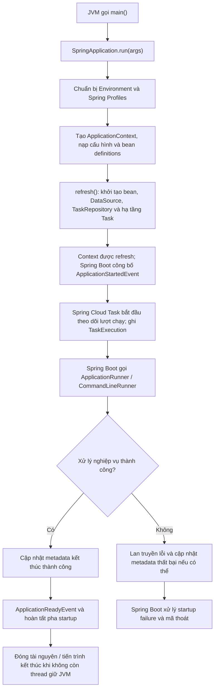
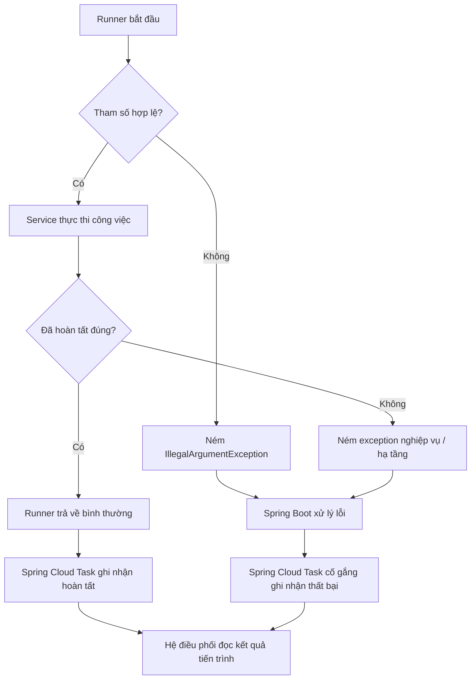

# Trình tự khởi tạo ApplicationContext và bắt đầu tác vụ

## Mục tiêu bài học

**Spring Cloud Task (SPRING_CLOUD_TASK)** giúp xây dựng ứng dụng Spring Boot có **thời gian chạy hữu hạn**: tiến trình được khởi động, thực hiện một công việc và kết thúc. Framework ghi lại thông tin từng lần chạy trong cơ sở dữ liệu qua `TaskRepository` để theo dõi thời điểm, kết quả và lỗi. Đây là nền tảng cho tác vụ chạy theo lịch hoặc theo yêu cầu, cũng như những quy trình có phối hợp với Spring Batch.

Trong chương **Vòng đời**, bài học này giải thích chi tiết **trình tự khởi tạo `ApplicationContext` và thời điểm tác vụ bắt đầu**. Sau khi học, bạn có thể:

- Phân biệt giai đoạn chuẩn bị môi trường, tạo và `refresh` `ApplicationContext` với giai đoạn thực thi nghiệp vụ.
- Xác định vai trò của `DataSource`, `TaskRepository`, `TaskExecution` và thành phần theo dõi vòng đời Spring Cloud Task.
- Hiểu vị trí của `ApplicationRunner`/`CommandLineRunner` trong vòng đời khởi động Spring Boot.
- Biết lỗi nào xảy ra trước hoặc sau khi metadata tác vụ được lưu và vì sao cơ sở dữ liệu đôi khi không có dấu vết của một tiến trình thất bại.
- Bố trí mã, tham số, log và chính sách thoát tiến trình để tác vụ hoạt động an toàn.

## 1. Bốn khái niệm cần tách biệt

| Khái niệm | Vai trò | Thời điểm liên quan |
| --- | --- | --- |
| `ApplicationContext` | Container quản lý bean, dependency injection, cấu hình và sự kiện Spring. | Được tạo và khởi tạo trong `SpringApplication.run(…)`. |
| `TaskRepository` | Thành phần truy cập kho metadata của Spring Cloud Task. | Được cấu hình cùng các bean hạ tầng khi application context khởi tạo; cần `DataSource` và schema thích hợp. |
| `TaskExecution` | Bản ghi đại diện cho **một lần chạy** của một tác vụ: tên, ID, thời gian, mã thoát, lỗi, v.v. | Được tạo khi vòng đời Task bắt đầu và cập nhật khi hoàn tất/thất bại nếu kho metadata còn truy cập được. |
| `ApplicationRunner` / `CommandLineRunner` | Điểm thực thi logic sau khi Spring Boot đã khởi tạo context. | Được Spring Boot gọi **sau khi context refresh**, trước sự kiện `ApplicationReadyEvent`. |

Điều quan trọng: **khởi tạo được `ApplicationContext` chưa đồng nghĩa tác vụ nghiệp vụ đã chạy**. Tương tự, có bean `TaskRepository` chưa có nghĩa đã tồn tại bản ghi `TaskExecution` cho lượt khởi động hiện tại.

Ví dụ: ứng dụng xuất báo cáo đơn hàng hằng ngày. Một lần khởi động lúc 02:00 và một lần chạy lại thủ công lúc 09:00 có thể dùng cùng tên Task, cùng JAR và cùng profile production; chúng phải có hai `TaskExecution` riêng. Tác vụ chỉ thành công khi phần xử lý báo cáo chạy xong theo đúng tiêu chí nghiệp vụ.

## 2. Nhìn toàn cảnh trình tự khởi động

Sơ đồ sau thể hiện **thứ tự logic** thường gặp trong ứng dụng Spring Boot có bật Spring Cloud Task. Chi tiết callback nội bộ và thứ tự listener có thể khác theo phiên bản; không nên dựa vào sơ đồ để ràng buộc thời điểm ở mức từng phương thức nội bộ.



Sơ đồ chủ ý đặt bước **ghi nhận Task** trước **thực thi runner**. Framework cần có thời điểm bắt đầu để tính thời lượng và ghi nhận kết quả của công việc. Tuy nhiên, không được suy ra rằng mọi callback tùy biến trên `ApplicationStartedEvent` hoặc `ApplicationReadyEvent` đều thấy metadata Task ở một trạng thái cố định; listener có thể chạy theo thứ tự riêng.

Một cách nhìn khác dưới dạng timeline:

| Giai đoạn | Điều Spring Boot/Spring Cloud Task thực hiện | Điều mã ứng dụng nên làm |
| --- | --- | --- |
| 1. Tiến trình bắt đầu | JVM tải lớp main, gọi `SpringApplication.run`. | Chỉ khởi động ứng dụng; không thực hiện công việc nghiệp vụ trực tiếp trong `main` trước lời gọi này. |
| 2. Chuẩn bị cấu hình | Nạp property sources, biến môi trường, profile và tham số dòng lệnh. | Khai báo thông số kết nối và profile qua cấu hình bên ngoài. |
| 3. Tạo context | Đăng ký bean definitions, auto-configuration và các dependency. | Khai báo bean, cấu hình service/repository; không đặt tác dụng phụ dài hạn trong constructor. |
| 4. Refresh context | Tạo các singleton cần thiết, khởi tạo kết nối/bean hạ tầng và công bố `ContextRefreshedEvent`. | Bảo đảm `DataSource`, schema và các bean bắt buộc có thể khởi tạo thành công. |
| 5. Bắt đầu vòng đời Task | Spring Cloud Task tạo `TaskExecution` khi cơ chế theo dõi đã sẵn sàng, trước khi runner nghiệp vụ được gọi. | Để framework quản lý metadata thay vì chèn SQL trực tiếp vào bảng Task. |
| 6. Chạy nghiệp vụ | Spring Boot lần lượt gọi các runner theo thứ tự đã xác định. | Kiểm tra tham số, gọi service và cho lỗi nghiêm trọng lan truyền. |
| 7. Hoàn tất hoặc thất bại | Framework ghi nhận thời gian, trạng thái/mã thoát và thông tin lỗi nếu kết nối metadata khả dụng. | Trả về bình thường khi thành công; truyền tín hiệu thất bại đúng khi có lỗi. |
| 8. Kết thúc tiến trình | Spring Boot hoàn thành pha chạy; tiến trình JVM có thể thoát khi không còn thread không-daemon. | Không giữ vòng lặp vô hạn, web server hoặc thread nền không cần thiết. |

## 3. Giai đoạn chuẩn bị `Environment` và profile

Khi `SpringApplication.run(args)` bắt đầu, Spring Boot xử lý cấu hình trước khi tạo đầy đủ bean nghiệp vụ:

1. Chuẩn bị `Environment` và các nguồn property phù hợp.
2. Xác định active profiles (ví dụ `local`, `test`, `prod`).
3. Nạp cấu hình ứng dụng và áp dụng các giá trị ghi đè theo thứ tự ưu tiên của Spring Boot.
4. Chuẩn bị context theo loại ứng dụng (`none`, servlet hoặc reactive).

Ví dụ một ứng dụng tác vụ không cần HTTP server:

```yaml
# src/main/resources/application.yml
spring:
  application:
    name: daily-report-task
  main:
    web-application-type: none
  cloud:
    task:
      name: daily-report-task
```

Kích hoạt profile khi chạy:

```bash
java -jar daily-report-task.jar \
  --spring.profiles.active=local \
  --businessDate=2026-11-23
```

Hai đối số có mục đích khác nhau: `spring.profiles.active` chọn **cấu hình hạ tầng**; `businessDate` là **đầu vào cho một lượt nghiệp vụ**. Nếu database URL hoặc credentials bị sai, lỗi có thể xuất hiện ngay trong lúc khởi tạo bean `DataSource`/`TaskRepository`, trước khi runner bắt đầu.

**Không nên** đặt công việc xuất báo cáo trong mã static của lớp main, constructor của `@Configuration` hoặc trong logic chọn profile: các vị trí này có thể chạy trước khi Spring Cloud Task bắt đầu quản lý metadata của lượt chạy.

## 4. Tạo và `refresh` `ApplicationContext` diễn ra thế nào?

`ApplicationContext` là phần lõi quản lý object và phụ thuộc của ứng dụng. `SpringApplication` sẽ tạo một context thích hợp, nạp bean definitions từ `@SpringBootApplication`, component scanning và auto-configuration, rồi gọi giai đoạn `refresh()`.

Trong quá trình đó, Spring có thể:

- Phân tích các cấu hình `@Configuration` và điều kiện auto-configuration.
- Khởi tạo các bean singleton cần thiết và tiêm phụ thuộc vào nhau.
- Gọi lifecycle callback như `@PostConstruct` cho bean khi bean được khởi tạo.
- Khởi tạo `DataSource`, các thành phần JDBC và infrastructure do Spring Cloud Task cung cấp.
- Thực thi các callback liên quan đến refresh context và phát `ContextRefreshedEvent`.

Nếu một bean bắt buộc không tạo được, pha refresh có thể dừng. Ví dụ ứng dụng có `DataSource` trỏ đến địa chỉ không thể truy cập hoặc phụ thuộc bị thiếu; khi ấy runner chưa được gọi.

### Vì sao không xử lý nghiệp vụ trong `@PostConstruct`?

Xét ví dụ **không nên áp dụng**:

```java
@Service
class BadReportService {
    @PostConstruct
    void generateReportImmediately() {
        // Không nên: chạy nghiệp vụ tại thời điểm bean được khởi tạo.
    }
}
```

`@PostConstruct` gắn với vòng đời **bean**, không phải vòng đời **một lượt Task**. Method có thể được gọi trước khi Spring Boot hoàn tất refresh, trước khi toàn bộ hạ tầng sẵn sàng hoặc trước khi `TaskExecution` hiện tại được ghi nhận. Hơn nữa, lỗi ở đây là lỗi tạo bean, khác với lỗi trong một runner đang được theo dõi.

Hãy để constructor và `@PostConstruct` chỉ thực hiện khởi tạo trạng thái cục bộ, nhẹ và cần thiết. Phần xuất báo cáo, gọi API, cập nhật dữ liệu, gửi sự kiện hoặc ghi file nên bắt đầu từ runner rồi chuyển vào service riêng.

## 5. Khi nào `TaskRepository` sẵn sàng?

Khi bật tích hợp Spring Cloud Task, framework bổ sung các bean quản lý vòng đời và kho thực thi Task. `TaskRepository` cần `DataSource` cùng các bảng metadata phù hợp với phiên bản Spring Cloud Task. Việc tạo một bean repository thành công không bảo đảm mọi câu lệnh SQL sau đó đều thành công: schema, quyền và kết nối thực vẫn phải hợp lệ.

Ví dụ cấu hình thử nghiệm cho profile local với H2:

```yaml
# src/main/resources/application-local.yml
spring:
  datasource:
    url: jdbc:h2:mem:taskdb;DB_CLOSE_DELAY=-1
    driver-class-name: org.h2.Driver
    username: sa
    password: ""
  cloud:
    task:
      initialize-enabled: true
```

Ví dụ giả định dự án có starter Spring Cloud Task, JDBC và driver H2, đồng thời đang dùng bản Spring Cloud Task hỗ trợ tùy chọn khởi tạo schema tương ứng. **Cần xác nhận property và DDL với phiên bản thực tế**. Một database H2 trong bộ nhớ giúp thử một lần chạy nhưng không giữ lịch sử sau khi tiến trình kết thúc.

Ở production, nên cấp một database/schema metadata bền vững, triển khai DDL qua quy trình migration được kiểm soát, và thường tắt tự động tạo bảng:

```yaml
# src/main/resources/application-prod.yml
spring:
  datasource:
    url: ${TASK_DB_URL}
    username: ${TASK_DB_USER}
    password: ${TASK_DB_PASSWORD}
  cloud:
    task:
      initialize-enabled: false
```

Khi context đã được refresh, Spring Boot tiếp tục xử lý các bước sau refresh. Thành phần theo dõi vòng đời Spring Cloud Task sẽ ghi một bản ghi `TaskExecution` cho lần chạy hiện tại **trước khi các runner thực hiện nghiệp vụ**. Nếu việc ghi metadata đầu tiên thất bại, runner thường không thể thực hiện bình thường dưới cơ chế theo dõi, và có thể **không có** bản ghi nào cho lượt khởi động đó trong database.

Thông tin thường được lưu gồm `TASK_EXECUTION_ID`, tên Task, thời điểm bắt đầu, thời điểm kết thúc và mã thoát. Nếu ứng dụng tích hợp Spring Batch, có thể bổ sung liên kết Task–Batch, nhưng `JobRepository` của Batch là thành phần riêng, không thay thế `TaskRepository`.

## 6. Từ context đã khởi tạo sang runner nghiệp vụ

Spring Boot gọi `ApplicationRunner` và `CommandLineRunner` **sau khi ApplicationContext refresh thành công**. Đây là điểm bắt đầu thích hợp cho nghiệp vụ hữu hạn. Sự khác nhau chính:

| Loại runner | Đầu vào | Dùng khi |
| --- | --- | --- |
| `ApplicationRunner` | `ApplicationArguments`, hỗ trợ lấy các option `--key=value`. | Cần phân biệt tham số dạng option với tham số thường, kiểm tra danh sách đối số. |
| `CommandLineRunner` | Mảng `String... args`. | Muốn xử lý trực tiếp danh sách argument nguyên bản. |

Nếu có nhiều runner, có thể thiết lập `@Order` hoặc giao diện `Ordered` để chỉ rõ thứ tự chạy. Dù vậy, không nên tạo phụ thuộc nghiệp vụ phức tạp bằng cách xếp nhiều runner. Một runner điều phối một service hoặc một luồng xử lý thường dễ bảo trì và dễ kiểm tra trạng thái hơn.

### Ví dụ đầy đủ: một lượt Task tạo báo cáo

```java
package com.example.task;

import java.time.LocalDate;
import java.util.List;

import org.springframework.boot.ApplicationRunner;
import org.springframework.boot.SpringApplication;
import org.springframework.boot.autoconfigure.SpringBootApplication;
import org.springframework.cloud.task.configuration.EnableTask;
import org.springframework.context.annotation.Bean;
import org.springframework.stereotype.Service;

@SpringBootApplication
@EnableTask
public class DailyReportTaskApplication {

    public static void main(String[] args) {
        SpringApplication.run(DailyReportTaskApplication.class, args);
    }

    @Bean
    ApplicationRunner reportRunner(DailyReportService reportService) {
        return args -> {
            List<String> values = args.getOptionValues("businessDate");
            if (values == null || values.size() != 1) {
                throw new IllegalArgumentException(
                    "Bắt buộc truyền một --businessDate=yyyy-MM-dd");
            }

            LocalDate businessDate = LocalDate.parse(values.get(0));
            reportService.generate(businessDate);
        };
    }
}

@Service
class DailyReportService {
    void generate(LocalDate businessDate) {
        // Minh họa: thay bằng truy vấn, tạo file và kiểm tra kết quả thật.
        System.out.println("Đã tạo báo cáo cho " + businessDate);
    }
}
```

**Diễn giải theo thứ tự:**

1. JVM gọi `main` và Spring Boot khởi động `ApplicationContext`.
2. Component scanning phát hiện `DailyReportService`; bean runner được tạo cùng các bean ứng dụng.
3. Spring Cloud Task chuẩn bị kho metadata và bắt đầu ghi nhận lần thực thi.
4. Spring Boot gọi `reportRunner`. Runner kiểm tra `businessDate` rồi gọi `DailyReportService.generate()`.
5. Khi method hoàn thành bình thường, vòng đời Task có thể kết thúc thành công và lưu thông tin hoàn tất; nếu method ném lỗi và không bị nuốt, quá trình xử lý thất bại được kích hoạt.

Đoạn code này **chỉ minh họa** việc gọi service, không thực hiện xuất báo cáo thật. Đối với hệ thống sản xuất, service cần kiểm tra đầu ra, quản lý giao dịch và đảm bảo chạy lại an toàn; in ra `Đã tạo báo cáo` không tự chứng minh nghiệp vụ thành công.

## 7. Các sự kiện Spring Boot thường gặp

Một số sự kiện hỗ trợ quan sát tiến trình khởi động:

| Sự kiện/callback | Thời điểm tương đối | Lưu ý với Spring Cloud Task |
| --- | --- | --- |
| `ApplicationEnvironmentPreparedEvent` | `Environment` được chuẩn bị, trước khi context hoàn tất. | Phù hợp để hiểu giai đoạn cấu hình, chưa chạy nghiệp vụ. |
| `ApplicationPreparedEvent` | Context đã được tạo và chuẩn bị, trước giai đoạn refresh hoàn tất. | Hạ tầng và các bean có thể chưa sẵn sàng. |
| `ContextRefreshedEvent` | Context đã hoàn thành refresh. | Không đồng nghĩa runner đã chạy. |
| `ApplicationStartedEvent` | Sau refresh, **trước** runner. | Dùng để quan sát mốc khởi động; tránh phụ thuộc thứ tự chạy giữa các listener. |
| `ApplicationRunner` / `CommandLineRunner` | Sau `ApplicationStartedEvent`, trước `ApplicationReadyEvent`. | Vị trí chính cho logic nghiệp vụ hữu hạn. |
| `ApplicationReadyEvent` | Khi các runner hoàn thành và ứng dụng được coi là sẵn sàng. | Được phát **sau** runner; không nên đưa tác vụ chính vào đây rồi giả định nó vẫn được đo thời lượng đúng như runner. |
| `ApplicationFailedEvent` | Spring Boot gặp lỗi trong quá trình khởi động, bao gồm các lỗi runner khiến `run` thất bại. | Có thể được dùng để quan sát thất bại; metadata Task chỉ cập nhật được nếu hạ tầng đã sẵn sàng và database còn truy cập được. |

**Thận trọng:** Sự kiện Spring Boot mô tả lifecycle của **ứng dụng**, còn `TaskExecution` mô tả lifecycle của **một lượt Task**. Đừng xem `ApplicationReadyEvent` là dấu hiệu duy nhất chứng minh nghiệp vụ đã tạo kết quả chính xác, cũng đừng dựa vào thứ tự callback của các listener khác nhau nếu không có hợp đồng thứ tự rõ ràng.

Đối với ứng dụng Task không có web server, việc Spring Boot phát `ApplicationReadyEvent` vẫn có thể diễn ra; điều đó **không** có nghĩa phải mở cổng HTTP hay giữ tiến trình sống để tiếp tục xử lý yêu cầu.

## 8. Tác vụ kết thúc thành công hoặc bị lỗi ra sao?

Kết quả của runner được phản ánh qua cơ chế hoàn tất vòng đời. Nếu không có lỗi, framework có thể cập nhật thời điểm kết thúc và mã thoát thành công trong `TaskExecution`. Nếu có exception, framework cố gắng lưu thông tin thất bại. Mã thoát tiến trình nhìn thấy bởi scheduler và mã thoát trong metadata cần được kiểm tra cùng nhau vì chúng có thể bị ảnh hưởng bởi lỗi hạ tầng hoặc cách ứng dụng kết thúc.



| Tình huống | Runner đã chạy? | Metadata Task có thể có gì? | Cách xử lý |
| --- | --- | --- | --- |
| Thiếu bean hoặc cấu hình sai trong pha refresh | Chưa | Có thể chưa có bản ghi cho lượt chạy. | Sửa cấu hình/bean, xem log khởi động. |
| Database Task không truy cập được lúc bắt đầu | Thường chưa chạy bình thường | Có thể không có bản ghi vì không thể INSERT. | Kiểm tra kết nối, schema, quyền và quan sát lỗi từ scheduler. |
| Tham số nghiệp vụ sai, runner ném exception | Có, nhưng chưa chạy công việc chính | Nếu ghi metadata thành công, có thể lưu kết quả lỗi. | Xác thực và trả lỗi rõ ràng; tránh retry tự động vô hạn. |
| Dịch vụ nghiệp vụ thất bại trong runner | Có | Có thể lưu thời gian kết thúc, mã thoát và thông tin lỗi. | Để lỗi lan truyền; có chính sách retry và kiểm soát trùng lặp. |
| Tiến trình bị `kill -9`, mất máy hoặc container bị xóa đột ngột | Có thể có | Bản ghi có thể còn thiếu thời gian kết thúc/mã thoát cuối cùng. | Đối chiếu trạng thái scheduler, timeout và xử lý bản ghi bị bỏ dở. |
| Runner xong nhưng thread nền vẫn hoạt động | Có, có thể hoàn tất | Metadata có thể đã kết thúc trong khi JVM vẫn chạy. | Đóng thread pool và tài nguyên; kiểm tra tiến trình sau khi runner trả về. |

### Vì sao không bắt lỗi rồi bỏ qua?

Đoạn code sau khiến hệ thống **dễ báo thành công sai**:

```java
return args -> {
    try {
        reportService.generate(LocalDate.now());
    } catch (Exception ex) {
        logger.error("Xuất báo cáo thất bại", ex);
        // Sai: runner trở về bình thường dù nghiệp vụ đã lỗi.
    }
};
```

Trong một Task, nếu lỗi là nghiêm trọng và cần hệ điều phối biết, hãy cho exception lan ra hoặc chuyển thành tín hiệu thất bại tương ứng. Chỉ bắt và xử lý lỗi tại chỗ khi có cách **khôi phục thật sự** và công việc đạt điều kiện hoàn thành.

Mặt khác, đừng gọi `System.exit(0)` từ bên trong runner ngay sau bước nghiệp vụ: kết thúc JVM quá sớm có thể chặn cơ chế framework ghi trạng thái cuối, đóng tài nguyên hoặc xuất log. Nếu cần mã thoát hệ điều hành cụ thể, hãy thiết kế việc ánh xạ exit code theo cơ chế Spring Boot và xác minh nó bằng một lần chạy hoàn chỉnh.

## 9. Ghi log và theo dõi đúng mốc vòng đời

Nên ghi log có cấu trúc tại các mốc **bắt đầu nghiệp vụ**, **kết thúc nghiệp vụ** và **ngoại lệ**, kèm tên Task, ngày xử lý, correlation ID và số liệu kết quả. Không dùng log trong constructor như bằng chứng duy nhất rằng task đã bắt đầu được theo dõi.

Ví dụ timeline **minh họa**, không phải chuỗi log mặc định bắt buộc của Spring Cloud Task:

```text
02:00:00.100  STARTUP     Nạp profile prod
02:00:00.800  CONTEXT     ApplicationContext refresh hoàn tất
02:00:00.910  TASK        Metadata TaskExecution được ghi nhận
02:00:00.930  BUSINESS    Bắt đầu xử lý businessDate=2026-11-23
02:00:04.600  BUSINESS    Hoàn tất: 157 bản ghi
02:00:04.680  TASK        Metadata TaskExecution được cập nhật
02:00:04.700  PROCESS     Tiến trình hoàn tất
```

Trong cơ sở dữ liệu metadata, có thể tham khảo truy vấn sau (tên bảng/cột tùy schema thực tế):

```sql
SELECT TASK_EXECUTION_ID,
       TASK_NAME,
       START_TIME,
       END_TIME,
       EXIT_CODE
FROM TASK_EXECUTION
WHERE TASK_NAME = 'daily-report-task'
ORDER BY TASK_EXECUTION_ID DESC;
```

Cần phân biệt ba tầng quan sát:

1. **Ứng dụng:** log của runner nói công việc có bắt đầu và đạt kết quả mong đợi hay không.
2. **Spring Cloud Task:** `TaskExecution` ghi thời gian và kết quả kỹ thuật của lượt chạy khi kho metadata hoạt động.
3. **Hệ điều phối:** tiến trình/Job có thực sự thoát, bị timeout, bị kill hoặc được retry hay không.

Khi một tác vụ hỏng từ rất sớm, chỉ dựa vào `TASK_EXECUTION` sẽ bỏ sót sự cố. Ngược lại, trạng thái process exit code `0` không đủ xác nhận dữ liệu báo cáo đúng; vẫn cần đối chiếu số liệu nghiệp vụ.

## 10. Ràng buộc với Spring Batch và bộ lập lịch

Spring Cloud Task chịu trách nhiệm ghi nhận vòng đời **tiến trình hữu hạn**. Spring Batch cung cấp các khái niệm `Job`, `Step`, checkpoint và restart cho xử lý dữ liệu nhiều bước. Khi hai framework cùng tham gia một ứng dụng:

- `ApplicationContext` có thể đồng thời chứa `TaskRepository` và `JobRepository`. Mỗi repository dùng schema metadata của chính framework mình.
- Nếu có `JobLauncherApplicationRunner` tự khởi chạy Batch Job và một runner tùy chỉnh khác cũng tự gọi Job, có nguy cơ chạy trùng. Cần chọn một cơ chế khởi chạy rõ ràng.
- Lỗi `JobExecution` cần được ánh xạ thành tín hiệu thất bại phù hợp cho tiến trình Task; chỉ log Batch Job thất bại rồi để runner trả về bình thường có thể khiến kết quả Task gây hiểu nhầm.
- Tên `Job`, `JobParameters` và `TaskExecution` là các khái niệm riêng; một lần Task có thể liên quan nhiều lần thực thi Batch tùy thiết kế.

Nếu tác vụ chạy theo lịch, hệ thống ngoài như cron, Kubernetes CronJob hoặc nền tảng điều phối sẽ **tạo tiến trình mới cho mỗi lần kích hoạt**. Luồng `main → Environment → ApplicationContext → TaskExecution → runner → kết thúc` lặp lại ở mỗi lần chạy. Không thiết kế runner thành vòng lặp vô hạn để tự chờ lịch mới; điều đó đi ngược yêu cầu thời gian chạy hữu hạn.

## 11. Những lỗi thiết kế thường gặp

| Sai lầm | Hậu quả | Cách làm phù hợp |
| --- | --- | --- |
| Xử lý nghiệp vụ trong constructor hoặc `@PostConstruct` | Công việc bắt đầu quá sớm, khó theo dõi qua Task metadata. | Chuyển công việc sang `ApplicationRunner` hoặc `CommandLineRunner`. |
| Hiểu `ContextRefreshedEvent` là tác vụ đã xong | Đánh dấu hoàn tất dù runner chưa chạy. | Tách mốc context ready, runner finish và metadata task end. |
| Coi `ApplicationReadyEvent` là điểm bắt đầu công việc chính | Công việc xảy ra sau các runner, dễ lệch đo thời gian/ghi trạng thái Task. | Đặt một runner điều phối nghiệp vụ. |
| Quên schema `TaskRepository` | Task thất bại khi ghi metadata dù bean có thể đã cấu hình. | Cài đúng DDL trước khi chạy, cấp quyền đúng. |
| Nuốt exception trong runner | Scheduler/Task có thể thấy trạng thái thành công giả. | Chỉ nuốt lỗi khi khôi phục thành công; còn lại lan truyền lỗi. |
| Mở web server hoặc giữ thread nền không cần thiết | Runner hoàn tất nhưng tiến trình không dừng. | `web-application-type: none`, đóng thread/connection, timeout. |
| Chỉ kiểm tra bảng `TASK_EXECUTION` | Bỏ qua lỗi xảy ra trước khi metadata được ghi. | Thu thập cả log khởi động và trạng thái tiến trình. |
| Chạy lại mà không có khóa/idempotency | Kết quả nghiệp vụ có thể bị ghi trùng. | Dùng khóa nghiệp vụ, điều phối concurrency và retry có kiểm soát. |

## 12. Bài thực hành: quan sát từng mốc khởi động

**Tình huống:** xây dựng ứng dụng `daily-report-task` có runner nhận `--businessDate=yyyy-MM-dd`, tạo báo cáo đơn giản, ghi log tại đầu/cuối method và cho phép kiểm tra metadata.

1. Tạo ứng dụng với `@SpringBootApplication`, `@EnableTask`, `ApplicationRunner` và một service như mục 6. Cấu hình `web-application-type: none`.
2. Chuẩn bị `DataSource` cho profile `local` và đảm bảo bảng `TaskRepository` đã được khởi tạo bằng schema tương thích.
3. Chạy ngày hợp lệ. So sánh log lúc context khởi tạo, lúc runner bắt đầu, lúc runner kết thúc và bản ghi mới trong `TASK_EXECUTION`.
4. Chạy thiếu `--businessDate`. Quan sát việc context có thể khởi tạo thành công nhưng runner báo lỗi; kiểm tra log/exit code và metadata khi khả dụng.
5. Thử cấu hình một URL database không truy cập được. Quan sát lỗi sớm và kiểm chứng vì sao có thể không có bản ghi Task cho lượt này.
6. Tạm thời đưa một ngoại lệ có chủ đích vào service, thực thi lại với tham số hợp lệ, kiểm tra rằng lỗi không bị bắt rồi bỏ qua.
7. Sửa service để xử lý an toàn khi chạy lại cùng ngày; chạy lại và xác nhận không nhân đôi kết quả.
8. Tùy chọn: bổ sung Spring Batch Job đơn giản và quan sát khác biệt giữa Task execution, Job execution và trạng thái tiến trình.

**Kết quả mong đợi:** bạn giải thích được vì sao thứ tự khởi động là **cấu hình → tạo/refresh context → khởi tạo hạ tầng theo dõi → bắt đầu Task → chạy runner → lưu kết quả → kết thúc tiến trình**, đồng thời nhận diện trường hợp lỗi trước khi metadata được ghi và trường hợp lỗi trong chính nghiệp vụ.

## Ghi nhớ

- `ApplicationContext` được chuẩn bị và refresh **trước** khi Spring Boot gọi `ApplicationRunner` hoặc `CommandLineRunner`.
- Spring Cloud Task kết nối vòng đời một **lượt thực thi** với `TaskRepository`; mỗi lượt chạy có `TaskExecution` riêng khi metadata được ghi thành công.
- Logic nghiệp vụ hữu hạn nên khởi chạy từ runner. Constructor, `@PostConstruct` và event listener khởi động không phải nơi phù hợp để thực hiện công việc chính.
- Hoàn thành công việc, ghi nhận trạng thái và **thoát tiến trình** là các mốc liên quan nhưng khác nhau; luôn quan sát cả dữ liệu nghiệp vụ, metadata Task và trạng thái hệ điều phối.
