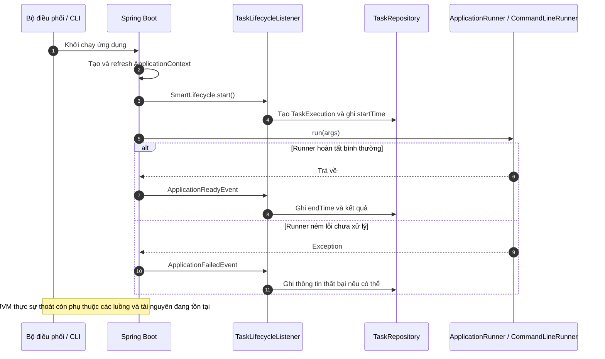

# Vai trò của `TaskLifecycleListener` và `SmartLifecycle` trong Spring Cloud Task

## 1. Bài toán: làm sao biết một chương trình ngắn hạn đã chạy đến đâu?

Một ứng dụng Spring Cloud Task thường chỉ tồn tại đủ lâu để hoàn thành công việc: tổng hợp báo cáo, nhập dữ liệu, đối soát thanh toán hoặc gọi dịch vụ bên ngoài. Sau khi chương trình Java kết thúc, người vận hành vẫn cần biết **lần chạy nào đã bắt đầu, lúc nào kết thúc và kết quả ra sao**.

Spring Cloud Task giải quyết nhu cầu này bằng cách ghi nhận **`TaskExecution`** trong **`TaskRepository`**. Để biết lúc nào tạo và hoàn tất bản ghi, framework phải kết nối với **vòng đời của ứng dụng Spring Boot**. Hai thành phần quan trọng là:

- **`TaskLifecycleListener`**: thành phần hạ tầng do Spring Cloud Task cung cấp, theo dõi các mốc khởi động và kết thúc của ứng dụng tác vụ rồi phối hợp cập nhật `TaskRepository`.
- **`SmartLifecycle`**: giao diện của Spring Framework để một bean tham gia vào quá trình khởi động/dừng `ApplicationContext`. `TaskLifecycleListener` triển khai giao diện này nhằm ghi nhận lúc bắt đầu **trước khi các runner xử lý nghiệp vụ được chạy**.

Đây là bài học thuộc chương **Vòng đời**. Mục tiêu là hiểu cơ chế phối hợp giữa Spring Boot, Spring Framework và Spring Cloud Task; biết cách bổ sung logic quan sát của riêng mình; và xử lý đúng những tình huống như lỗi khởi động, lỗi runner, kết thúc bất thường hoặc chạy lại theo lịch.

## 2. Bức tranh tổng thể của một lần thực thi

Mỗi lần khởi chạy bình thường của ứng dụng được cấu hình làm Spring Cloud Task có thể tạo một bản ghi `TaskExecution` riêng. Cần phân biệt **vòng đời của `ApplicationContext`**, **vòng đời công việc trong runner**, **vòng đời metadata của tác vụ** và **vòng đời tiến trình hệ điều hành**. Chúng liên quan nhưng không phải lúc nào cũng kết thúc cùng thời điểm.



Những điểm cần ghi nhớ từ sơ đồ:

1. `TaskLifecycleListener` bắt đầu ghi nhận khi `ApplicationContext` đã được khởi tạo đủ để Spring gọi `SmartLifecycle.start()`; nó **không** chạy trước toàn bộ quy trình tạo bean.
2. `ApplicationRunner` hoặc `CommandLineRunner` chạy **sau mốc bắt đầu tác vụ**. Vì vậy, lần thực thi đã có định danh để gắn log và theo dõi khi nghiệp vụ chạy.
3. `ApplicationReadyEvent` báo Spring Boot đã hoàn thành quá trình khởi động, bao gồm chạy các runner đồng bộ. Với ứng dụng tác vụ điển hình, đây là mốc Spring Cloud Task xác định kết thúc thành công.
4. `ApplicationFailedEvent` là tín hiệu kết thúc thất bại khi có lỗi không được xử lý trong quá trình khởi động hoặc runner. Khả năng cập nhật repository phụ thuộc việc hạ tầng đã khởi tạo và database còn truy cập được hay không.

## 3. `TaskLifecycleListener` thực sự làm gì?

`TaskLifecycleListener` thuộc package `org.springframework.cloud.task.listener`. Đây là **lớp hạ tầng nội bộ quan trọng của Spring Cloud Task**, không phải một listener nghiệp vụ mà ứng dụng thường cần tự tạo. Trong các phiên bản hiện hành, lớp này triển khai `SmartLifecycle` và lắng nghe các sự kiện ứng dụng để biết mốc bắt đầu/kết thúc.

Các trách nhiệm chính:

| Trách nhiệm | Thời điểm | Tác động |
| --- | --- | --- |
| Xác định tên và tham số tác vụ | Khi bắt đầu | Nhận tên từ `TaskNameResolver` và đối số khởi chạy để gắn vào `TaskExecution`. |
| Ghi nhận bắt đầu | Khi `SmartLifecycle.start()` được gọi | Tạo bản ghi thông qua `TaskRepository` và ghi `startTime`. |
| Kích hoạt các callback mở rộng | Quanh các mốc thực thi | Gọi `TaskExecutionListener` hoặc phương thức gắn chú giải tương ứng nếu ứng dụng đăng ký. |
| Ghi nhận hoàn tất bình thường | Khi nhận `ApplicationReadyEvent` | Cập nhật thời gian kết thúc và thông tin thoát. |
| Ghi nhận thất bại | Khi nhận `ApplicationFailedEvent` | Ghi lỗi và mã thoát phù hợp nếu đã có lần thực thi và repository còn hoạt động. |
| Kết thúc dự phòng | Khi `SmartLifecycle.stop()` diễn ra | Cố gắng hoàn tất bản ghi nếu đường xử lý sự kiện thông thường chưa làm việc đó. |

Trong trường hợp phổ biến, bản ghi có các trường như `executionId`, `taskName`, `startTime`, `endTime`, `exitCode`, `exitMessage`, `errorMessage` và các đối số khởi chạy. Chúng mô tả **lần thực thi ứng dụng**, không chứa toàn bộ dữ liệu mà tác vụ tạo ra.

### 3.1. Vì sao cần một listener riêng của framework?

Nếu từng ứng dụng tự gọi `TaskRepository` trong `main()` hoặc `ApplicationRunner`, các lỗi sau dễ xảy ra:

- Khởi tạo thất bại trước khi vào runner thì không có chỗ ghi nhận.
- Mỗi nhóm phát triển chọn một cách ghi start/end, tạo lịch sử không nhất quán.
- Một đường xử lý ngoại lệ bị bỏ quên có thể khiến bản ghi không bao giờ được đánh dấu kết thúc.
- Chạy lại với tham số khác dễ bị nhầm giữa **loại tác vụ** và **lần thực thi**.

`TaskLifecycleListener` tích hợp việc ghi metadata vào các sự kiện lifecycle chung của framework. Ứng dụng tập trung làm công việc nghiệp vụ; phần ghi dấu vết chuẩn được thực hiện nhất quán hơn.

### 3.2. `TaskLifecycleListener` không đảm nhiệm những việc nào?

Lớp này **không tự lập lịch**, không tự quyết định chính sách retry, không bảo đảm idempotency, không xác nhận dữ liệu nghiệp vụ chính xác và không thay thế hệ thống giám sát tiến trình. Ví dụ, `exitCode=0` chỉ phản ánh cách lần thực thi kết thúc theo cơ chế ghi nhận; nó không chứng minh file báo cáo có đầy đủ số liệu.

Để chạy lúc 02:00 hằng ngày, thường cần cron, Kubernetes CronJob hoặc một bộ điều phối khác. Để chống tạo báo cáo trùng khi chạy lại, cần thiết kế transaction, ràng buộc dữ liệu hoặc khóa phù hợp trong phần nghiệp vụ.

## 4. `SmartLifecycle` là gì và vì sao nó phù hợp?

`SmartLifecycle` là giao diện mở rộng `Lifecycle` và `Phased` của Spring Framework. Nó giúp các bean có vòng đời hoạt động rõ ràng được Spring quản lý cùng với `ApplicationContext`.

| Phương thức / khả năng | Ý nghĩa khái niệm | Liên hệ với Spring Cloud Task |
| --- | --- | --- |
| `start()` | Bắt đầu hoạt động khi context khởi động. | `TaskLifecycleListener` dùng mốc này để ghi nhận bắt đầu `TaskExecution`. |
| `stop()` | Dừng hoạt động khi context đóng hoặc được dừng. | Có thể là đường kết thúc dự phòng nếu chưa nhận sự kiện kết thúc. |
| `stop(Runnable callback)` | Cho Spring biết quá trình dừng đã hoàn tất bằng cách gọi callback. | Hữu ích cho quá trình shutdown có điều phối; callback cần được gọi đúng cách. |
| `isAutoStartup()` | Quy định bean có được Spring tự khởi động hay không. | Hạ tầng listener của Task được thiết kế tự tham gia lifecycle khi được kích hoạt. |
| `isRunning()` | Trạng thái lifecycle của **bean**. | Không phải API kiểm tra trạng thái thực của một task từ xa. |
| `getPhase()` | Điều khiển thứ tự khởi động và dừng giữa các bean có lifecycle. | Quan trọng khi ứng dụng còn có component quản lý kết nối, consumer hoặc scheduler. |

Đối với các bean `SmartLifecycle`, Spring khởi động theo **thứ tự phase tăng dần** và dừng theo **thứ tự phase giảm dần**. Quan hệ phụ thuộc giữa bean có thể ảnh hưởng đến thứ tự thực tế. Trong mã nguồn của một số phiên bản Spring Cloud Task, `TaskLifecycleListener` dùng phase `0`; đây là **chi tiết triển khai theo phiên bản**, không nên xây dựng nghiệp vụ phụ thuộc cứng vào một con số mà không kiểm tra phiên bản đang sử dụng.

`SmartLifecycle` phù hợp cho việc **đánh dấu thời điểm hạ tầng ứng dụng sẵn sàng bắt đầu**. Nếu chờ tới `ApplicationRunner`, framework sẽ mất mốc rõ ràng trước khi nghiệp vụ bắt đầu chạy. Nếu dùng riêng sự kiện `ContextClosedEvent` để đánh dấu kết thúc, sẽ bỏ sót trường hợp công việc đã hoàn thành nhưng context vẫn còn mở vì một luồng nền hoặc tài nguyên khác.

### 4.1. Một bean `SmartLifecycle` tự viết có thay thế listener của Task không?

Không. Bạn có thể tự triển khai `SmartLifecycle` để quản lý một tài nguyên của ứng dụng, chẳng hạn khởi động/dừng bộ đọc hàng đợi, nhưng cách đó không tự ghi `TaskExecution` vào `TaskRepository`.

```java
import java.util.concurrent.atomic.AtomicBoolean;
import org.springframework.context.SmartLifecycle;

// Ví dụ minh họa cơ chế lifecycle của một bean thông thường.
// Bean này KHÔNG thay thế TaskLifecycleListener.
public class WorkerResourceLifecycle implements SmartLifecycle {

    private final AtomicBoolean running = new AtomicBoolean(false);

    @Override
    public void start() {
        // Khởi tạo tài nguyên cần thiết ở đây.
        running.set(true);
    }

    @Override
    public void stop() {
        // Giải phóng tài nguyên tại đây.
        running.set(false);
    }

    @Override
    public boolean isRunning() {
        return running.get();
    }

    @Override
    public boolean isAutoStartup() {
        return true;
    }

    @Override
    public void stop(Runnable callback) {
        try {
            stop();
        } finally {
            callback.run();
        }
    }

    @Override
    public int getPhase() {
        return 100;
    }
}
```

Ví dụ trên trình bày **hợp đồng lifecycle** của Spring, không nhằm khuyến nghị thêm bean này vào mọi ứng dụng task. `getPhase() = 100` là giá trị minh họa, không có nghĩa mọi tài nguyên cần khởi động ở phase đó. Trong ứng dụng thật, cần xem các phụ thuộc và hành vi dừng an toàn trước khi tự đặt phase.

## 5. Các mốc bắt đầu, kết thúc và thất bại

### 5.1. Bắt đầu: `SmartLifecycle.start()`

Sau khi `ApplicationContext` đã được tạo và refresh thành công, Spring điều phối các bean có lifecycle. `TaskLifecycleListener.start()` ghi nhận một lần chạy thông qua `TaskRepository` **trước khi** Spring Boot gọi các `ApplicationRunner` và `CommandLineRunner`.

Điều đó giải thích vì sao code trong runner có thể truy vết theo định danh thực thi, còn khi context **không khởi tạo được** (ví dụ lỗi cấu hình quá sớm), Spring Cloud Task có thể **không tạo được bản ghi nào**. Không nên suy ra rằng mọi lần lệnh `java -jar` được gọi đều phải có một hàng trong bảng lịch sử.

### 5.2. Thành công: `ApplicationReadyEvent`

Spring Boot phát `ApplicationReadyEvent` khi đã hoàn tất các runner đồng bộ và quá trình khởi động thông thường. Spring Cloud Task dựa vào sự kiện này để cập nhật metadata hoàn tất.

Một hệ quả quan trọng: nếu runner **chỉ khởi động một luồng khác rồi trả về ngay**, `ApplicationReadyEvent` có thể phát trước khi công việc trong luồng đó thực sự hoàn thành. Lúc ấy repository có thể ghi thành công quá sớm. Với tác vụ hữu hạn, runner nên **đợi công việc thực sự kết thúc** hoặc dùng cơ chế phối hợp rõ ràng để kết quả ghi nhận phản ánh kết quả nghiệp vụ.

### 5.3. Thất bại: `ApplicationFailedEvent`

Nếu một runner ném ngoại lệ không được xử lý, Spring Boot phát sự kiện thất bại. `TaskLifecycleListener` xử lý đường lỗi, ghi thông tin lỗi và mã thoát khi có thể. Nếu lỗi xảy ra trước lúc tạo được `TaskExecution` hoặc database không truy cập được, bản ghi có thể vắng mặt hoặc chưa hoàn chỉnh.

Nếu ứng dụng **bắt lỗi rồi chỉ log và trả về bình thường**, Spring Boot có thể xem runner là thành công. Do đó, lỗi làm công việc không hoàn thành cần được báo ra theo cơ chế thích hợp: ném ngoại lệ, ánh xạ mã thoát hoặc thiết kế trạng thái thất bại rõ ràng. Không nên nuốt lỗi chỉ để cho ứng dụng tắt êm.

### 5.4. Dừng context: `SmartLifecycle.stop()`

`stop()` là một đường dự phòng để cố gắng kết thúc bản ghi trong những tình huống sự kiện sẵn sàng/thất bại chưa được xử lý. Nó **không bảo đảm** luôn có thể ghi được, đặc biệt khi tiến trình bị dừng cưỡng bức, host mất điện hoặc kết nối database đã mất.

Lưu ý rằng **metadata hoàn tất không đồng nghĩa JVM đã thoát**. Một `ApplicationReadyEvent` có thể ghi `endTime` trong repository trong khi luồng không phải daemon vẫn đang chạy. Spring Cloud Task có cấu hình đóng context sau khi công việc hoàn tất (ví dụ thuộc tính `spring.cloud.task.closecontextEnabled` theo tài liệu phiên bản tương ứng); chỉ bật khi đã hiểu cách ứng dụng quản lý tài nguyên và không cần tiếp tục xử lý nền.

### 5.5. Bảng đối chiếu tình huống

| Tình huống | Sự kiện hoặc lifecycle có thể xảy ra | Hệ quả đối với `TaskExecution` |
| --- | --- | --- |
| Runner hoàn tất bình thường | `SmartLifecycle.start()` → runner → `ApplicationReadyEvent` | Có bản ghi bắt đầu và kết thúc, thường với mã thoát thành công. |
| Runner ném lỗi chưa xử lý | `SmartLifecycle.start()` → runner lỗi → `ApplicationFailedEvent` | Có thể cập nhật bản ghi thất bại nếu repository còn truy cập được. |
| Bean lỗi khi context chưa khởi tạo được | Bootstrap thất bại trước `SmartLifecycle.start()` | Có thể không có bản ghi thực thi. |
| Listener mở rộng gặp lỗi trong quá trình startup | Đường ghi nhận/khởi tạo có thể bị ngắt | Spring Cloud Task cố xử lý lỗi, nhưng cần đọc log và kết quả thực tế. |
| JVM bị `kill -9` hoặc container bị cưỡng bức dừng | Không có shutdown thông thường | Có thể còn bản ghi chưa có `endTime`; cần đối chiếu hệ điều phối. |
| Runner tạo luồng nền và trả về sớm | `ApplicationReadyEvent` xuất hiện trước khi luồng kết thúc | Metadata có thể hoàn tất dù việc nền còn chạy. |

## 6. Thực hành: theo dõi vòng đời của một task

Ví dụ dưới đây dùng Spring Boot, Spring Cloud Task và `ApplicationRunner`. Nó tạo báo cáo giả lập theo tham số `businessDate`. Một listener do ứng dụng định nghĩa sẽ log các mốc thực thi để quan sát hoạt động của hạ tầng.

### 6.1. Cấu hình tối thiểu

```yaml
spring:
  application:
    name: daily-settlement-worker
  main:
    web-application-type: none
  cloud:
    task:
      name: daily-settlement
  datasource:
    url: ${TASK_DB_URL}
    username: ${TASK_DB_USER}
    password: ${TASK_DB_PASSWORD}

logging:
  level:
    org.springframework.cloud.task: DEBUG
```

Ứng dụng cần `spring-cloud-starter-task`, JDBC driver phù hợp, phiên bản Spring Boot/Spring Cloud tương thích và schema Spring Cloud Task tương ứng trong database. Với môi trường production, nên sử dụng database bền vững và quản lý bảng bằng migration; bộ nhớ H2 có thể hữu ích để học nhưng không duy trì lịch sử qua nhiều lần chạy khi tiến trình bị hủy.

### 6.2. Logic nghiệp vụ trong `ApplicationRunner`

```java
import java.time.LocalDate;
import java.util.List;

import org.springframework.boot.ApplicationRunner;
import org.springframework.boot.SpringApplication;
import org.springframework.boot.autoconfigure.SpringBootApplication;
import org.springframework.cloud.task.configuration.EnableTask;
import org.springframework.context.annotation.Bean;

@SpringBootApplication
@EnableTask
public class DailySettlementTaskApplication {

    public static void main(String[] args) {
        SpringApplication.run(DailySettlementTaskApplication.class, args);
    }

    @Bean
    ApplicationRunner settlementRunner() {
        return arguments -> {
            List<String> dates = arguments.getOptionValues("businessDate");
            if (dates == null || dates.size() != 1) {
                throw new IllegalArgumentException(
                    "Cần truyền đúng một --businessDate=yyyy-MM-dd"
                );
            }

            LocalDate businessDate = LocalDate.parse(dates.get(0));
            System.out.println("Bắt đầu đối soát: " + businessDate);

            // Thay phần này bằng logic đối soát có xử lý retry an toàn.
            if (arguments.containsOption("simulateFailure")) {
                throw new IllegalStateException("Lỗi đối soát giả lập");
            }

            System.out.println("Đối soát hoàn tất: " + businessDate);
        };
    }
}
```

`@EnableTask` kích hoạt cấu hình lifecycle của Spring Cloud Task. Các runner chỉ mô tả công việc cần chạy; chúng **không phải** nơi cần tự gọi `createTaskExecution()` hoặc `completeTaskExecution()` trong luồng sử dụng thông thường.

### 6.3. Đăng ký listener quan sát của ứng dụng

**`TaskExecutionListener` khác `TaskLifecycleListener`.** `TaskLifecycleListener` là bộ điều phối lifecycle của framework. `TaskExecutionListener` là **điểm mở rộng cho mã của bạn** để phản ứng với các mốc tác vụ.

Ví dụ tạo bean sau trong một lớp cấu hình hoặc một component được Spring quét:

```java
import org.slf4j.Logger;
import org.slf4j.LoggerFactory;
import org.springframework.cloud.task.listener.TaskExecutionListener;
import org.springframework.cloud.task.repository.TaskExecution;
import org.springframework.context.annotation.Bean;
import org.springframework.context.annotation.Configuration;

@Configuration
public class TaskAuditConfiguration {

    private static final Logger log =
        LoggerFactory.getLogger(TaskAuditConfiguration.class);

    @Bean
    TaskExecutionListener taskAuditListener() {
        return new TaskExecutionListener() {
            @Override
            public void onTaskStartup(TaskExecution execution) {
                log.info("Task bắt đầu: id={}, name={}",
                    execution.getExecutionId(), execution.getTaskName());
            }

            @Override
            public void onTaskFailed(TaskExecution execution, Throwable error) {
                log.error("Task thất bại: id={}",
                    execution.getExecutionId(), error);
            }

            @Override
            public void onTaskEnd(TaskExecution execution) {
                log.info("Task hoàn tất: id={}, exitCode={}",
                    execution.getExecutionId(), execution.getExitCode());
            }
        };
    }
}
```

Ở đây, callback phục vụ ghi log. Chúng không tự thay thế quá trình ghi metadata. Nếu listener tự định nghĩa ném ngoại lệ, quá trình lifecycle cũng có thể bị ảnh hưởng; vì vậy callback nên **nhanh, có kiểm soát lỗi và không phụ thuộc vào hệ thống bên ngoài thiếu ổn định**.

Có thể dùng `@BeforeTask`, `@AfterTask`, `@FailedTask` theo hỗ trợ của thư viện thay cho triển khai interface trực tiếp. Tên phương thức `onTaskStartup()`, `onTaskFailed()` và `onTaskEnd()` mô tả các callback tác vụ; đừng nhầm chúng với `SmartLifecycle.start()`/`stop()` được Spring gọi trên bean hạ tầng.

### 6.4. Chạy thử hai đường kết thúc

Chạy thành công:

```bash
java -jar daily-settlement-worker.jar --businessDate=2026-11-23
```

Chạy giả lập thất bại:

```bash
java -jar daily-settlement-worker.jar \
  --businessDate=2026-11-23 \
  --simulateFailure
```

Kỳ vọng ở mức logic:

- Cả hai lần chạy đều được ghi nhận thành **hai `TaskExecution` khác nhau**, nếu context và repository khởi tạo thành công.
- Trường hợp thành công đi qua callback bắt đầu và kết thúc.
- Trường hợp thất bại đi qua callback bắt đầu, thất bại và kết thúc khi listener có đủ điều kiện hoạt động.
- Cơ sở dữ liệu ghi trạng thái và mốc thời gian của từng lần chạy, trong khi log của runner cho biết nghiệp vụ đã đi đến bước nào.

Đây là ví dụ học thuật. Cần tạo JAR bằng công cụ build phù hợp, chuẩn bị database và cấu hình kết nối trước khi thử. Không nên coi tên JAR hoặc mã ID trong phần minh họa là giá trị Spring Cloud Task tự tạo.

## 7. Kiểm tra metadata và kết quả thực thi

Với lược đồ JDBC Spring Cloud Task phổ biến, bảng `TASK_EXECUTION` lưu các cột mô tả vòng đời. Có thể kiểm tra các lần chạy theo tên tác vụ bằng câu lệnh tham khảo:

```sql
SELECT TASK_EXECUTION_ID,
       TASK_NAME,
       START_TIME,
       END_TIME,
       EXIT_CODE,
       EXIT_MESSAGE,
       ERROR_MESSAGE
FROM TASK_EXECUTION
WHERE TASK_NAME = 'daily-settlement'
ORDER BY TASK_EXECUTION_ID DESC;
```

Hãy đối chiếu tên bảng/cột với schema chính xác của phiên bản triển khai. Có thể dùng `TaskExplorer` nếu cần truy vấn lịch sử bằng API Java.

| Câu hỏi vận hành | Nguồn dữ liệu phù hợp |
| --- | --- |
| Lần chạy có được ghi nhận chưa? | `TaskRepository` / `TaskExplorer`, bảng `TASK_EXECUTION`. |
| Runner thất bại tại bước nào? | Log ứng dụng, exception và `ERROR_MESSAGE` nếu đã ghi được. |
| Tiến trình Java còn chạy không? | Hệ điều hành, container runtime, Kubernetes Job hoặc bộ điều phối. |
| Báo cáo đã được tạo đúng chưa? | Bảng/tệp/kho lưu trữ nghiệp vụ và cơ chế đối soát kết quả. |
| Lần chạy cần được thử lại không? | Chính sách retry, thông tin lỗi, tính idempotent và dữ liệu thực tế. |

Nếu `END_TIME` trống, đừng vội kết luận tiến trình vẫn hoạt động. Có thể tiến trình đã bị dừng bất thường mà listener không có cơ hội hoàn tất bản ghi. Ngược lại, `END_TIME` đã có không bảo đảm mọi luồng nền đã kết thúc.

## 8. Thực thi đồng bộ, bất đồng bộ và lưu kết quả đúng thời điểm

Lỗi thiết kế phổ biến là dùng runner để **khởi động** công việc rồi trả về, trong khi phần nghiệp vụ chính được thực hiện sau đó:

```java
// Ví dụ cần tránh khi muốn TaskExecution phản ánh hoàn tất nghiệp vụ.
@Bean
ApplicationRunner fireAndForget(MyService service) {
    return args -> {
        new Thread(service::process).start();
        // Runner đã trả về dù process() có thể chưa xong hoặc chưa thành công.
    };
}
```

Lúc runner trả về, Spring Boot có thể phát `ApplicationReadyEvent`. `TaskLifecycleListener` thấy mốc hoàn tất **vòng đời runner**, không có cách tự biết việc trong `new Thread(...)` còn tiếp tục. Nếu tác vụ cần kết quả chính xác, nên chờ công việc hoàn thành hoặc sử dụng cách điều phối và truyền kết quả lỗi phù hợp:

```java
@Bean
ApplicationRunner synchronousTask(MyService service) {
    return args -> {
        service.process(); // Chỉ trả về khi công việc hoàn tất hoặc ném lỗi.
    };
}
```

Nếu công việc bắt buộc chạy bất đồng bộ, cần thiết kế cơ chế phối hợp có khả năng **đợi hoàn tất và truyền thất bại** về runner, đồng thời bảo đảm shutdown đóng tài nguyên đúng thứ tự. Không nên dùng riêng sự kiện của lifecycle để suy đoán rằng một luồng nền đã xử lý xong dữ liệu.

## 9. Xử lý lỗi và vận hành an toàn

### 9.1. Trường hợp không thể tạo `TaskExecution`

Nếu datasource sai, thiếu bảng metadata, quyền database không đủ hoặc lỗi cấu hình làm context không khởi tạo được, listener có thể không tạo bản ghi. Khi đó cần xem **log khởi động, mã thoát tiến trình và trạng thái bộ điều phối**, thay vì chỉ tìm trong repository. `TaskRepository` rất hữu ích sau khi hạ tầng hoạt động, nhưng không phải nguồn sự thật duy nhất về mọi lỗi khởi động.

### 9.2. Trường hợp mất kết nối database khi kết thúc

Một lần thực thi có thể đã xử lý nghiệp vụ xong nhưng cập nhật `endTime` hoặc `exitCode` thất bại vì database mất kết nối. Bộ điều phối cần có chiến lược đối soát tình trạng này; không được tự động chạy lại vô điều kiện nếu hành động nghiệp vụ không idempotent.

### 9.3. Trường hợp bị dừng cưỡng bức

Khi JVM nhận tín hiệu kết thúc thông thường, shutdown hook và các lifecycle callback có thể có cơ hội chạy, nhưng điều này không bảo đảm trong mọi môi trường hoặc mọi thứ tự đóng tài nguyên. Với `kill -9`, node mất nguồn hoặc container bị hủy đột ngột, `TaskLifecycleListener` không thể kỳ vọng ghi nhận kết thúc.

Để vận hành an toàn, có thể đối chiếu bản ghi chưa hoàn tất với trạng thái Job/Pod/process; đặt timeout cho tác vụ; cảnh báo những lần chạy không có tiến triển; và xác định rõ điều kiện nào cho phép retry. Hãy thiết kế khóa nghiệp vụ hoặc thao tác idempotent để việc chạy lại không sinh dữ liệu trùng lặp.

### 9.4. Trường hợp phối hợp với Spring Batch

Một ứng dụng Spring Cloud Task có thể chạy một Spring Batch job. Khi đó:

- `TaskLifecycleListener` ghi nhận **lần chạy của ứng dụng** thông qua `TaskExecution`.
- Spring Batch ghi nhận **`JobExecution` và `StepExecution`** để theo dõi job, bước xử lý, checkpoint hoặc khả năng restart.
- Hoàn thành vòng đời của ứng dụng không thay thế việc đọc trạng thái job và xác minh kết quả dữ liệu Batch.

Nếu ứng dụng khởi chạy job bất đồng bộ rồi runner trả về trước khi job kết thúc, mốc hoàn tất của Task có thể xuất hiện quá sớm. Cần bảo đảm việc chạy job, chờ kết quả và truyền lỗi cho vòng đời tác vụ được thiết kế thống nhất.

## 10. Những nhầm lẫn thường gặp

**Nhầm lẫn 1 — `TaskLifecycleListener` là listener do người dùng phải tự viết.** Nó là thành phần của Spring Cloud Task. Muốn gắn log hoặc xử lý mốc nghiệp vụ, hãy dùng `TaskExecutionListener` và các điểm mở rộng được framework hỗ trợ.

**Nhầm lẫn 2 — `SmartLifecycle.start()` chạy ngay khi bắt đầu `main()`.** Nó được Spring gọi trong quá trình refresh và khởi động context, khi các bean cần thiết đã được tạo. Lỗi quá sớm có thể không có bản ghi lịch sử.

**Nhầm lẫn 3 — `ApplicationReadyEvent` luôn đồng nghĩa toàn bộ việc nền đã thành công.** Sự kiện phản ánh quá trình khởi động và các runner đồng bộ. Công việc tách luồng có thể còn chạy; runner cần đợi hoặc phối hợp kết quả một cách chính xác.

**Nhầm lẫn 4 — `SmartLifecycle.stop()` luôn cập nhật được kết quả khi chương trình chết.** Callback chỉ có thể chạy nếu JVM và context có cơ hội xử lý shutdown; không thể chống mọi hình thức dừng cưỡng bức.

**Nhầm lẫn 5 — `isRunning()` là cách kiểm tra tác vụ hiện đang chạy trong database.** Đây là trạng thái lifecycle của bean trong context hiện tại. Muốn quan sát một tác vụ đã được điều phối ở nơi khác, cần xem repository và trạng thái hệ thống chạy tiến trình.

**Nhầm lẫn 6 — Bản ghi `TaskExecution` chứa đủ thông tin để restart Spring Batch.** Repository của Spring Cloud Task quản lý metadata ứng dụng; thông tin restart job/step thuộc cơ chế lưu trữ của Spring Batch.

## 11. Tự kiểm tra và bài tập suy luận

1. **Tại sao Spring Cloud Task ghi `startTime` qua `SmartLifecycle.start()` thay vì chờ tới đầu `ApplicationRunner`?**
2. **Nếu `ApplicationRunner` chạy thành công nhưng một luồng nền còn xử lý dữ liệu, `ApplicationReadyEvent` có thể dẫn tới rủi ro gì?**
3. **Tại sao không nên tự tạo một `TaskLifecycleListener` khác chỉ để ghi log mỗi lần chạy?**
4. **Khi có bản ghi `TaskExecution` với `endTime` rỗng, cần kiểm tra thêm những gì?**
5. **Trong ứng dụng tích hợp Spring Batch, `TaskExecution` và `JobExecution` ghi nhận những phạm vi nào?**

**Gợi ý trả lời:** (1) Mốc bắt đầu phải có trước khi runner thực thi để thống nhất theo dõi; (2) metadata có thể ghi thành công trước khi nghiệp vụ hoàn tất hoặc thất bại; (3) dùng điểm mở rộng `TaskExecutionListener` thay vì can thiệp vào hạ tầng framework; (4) xem trạng thái tiến trình/container, log, database, bộ điều phối và kết quả nghiệp vụ; (5) lần chạy ứng dụng so với lần chạy job/step của Batch.

## 12. Tổng kết kiến thức

Trong Spring Cloud Task, **`TaskLifecycleListener` là cầu nối giữa vòng đời Spring Boot và `TaskRepository`**. Việc triển khai **`SmartLifecycle`** giúp lớp này ghi nhận bắt đầu tại thời điểm Spring khởi động các bean có lifecycle, trước khi chạy logic trong `ApplicationRunner`/`CommandLineRunner`. Sau đó, các sự kiện như `ApplicationReadyEvent`, `ApplicationFailedEvent` và đường `stop()` dự phòng giúp framework cập nhật kết quả lần thực thi.

Người viết ứng dụng nên khai thác `TaskExecutionListener` cho nhu cầu quan sát, để runner xử lý công việc hữu hạn và bảo đảm mọi xử lý quan trọng đã hoàn thành trước khi runner trả về. Khi triển khai theo lịch hoặc yêu cầu, cần kết hợp lịch sử `TaskExecution` với log, bộ điều phối, kiểm tra dữ liệu đầu ra và chính sách retry an toàn. Nếu dùng Spring Batch, cần phân biệt vòng đời ứng dụng với vòng đời job/step.

**Tài liệu tham khảo chính thức:**

- [Spring Cloud Task — Features: lifecycle, TaskExecution và listener](https://docs.spring.io/spring-cloud-task/reference/features.html)
- [Spring Cloud Task — Getting Started: cấu hình và ví dụ ứng dụng](https://docs.spring.io/spring-cloud-task/reference/getting-started.html)
- [Spring Framework — `SmartLifecycle` API](https://docs.spring.io/spring-framework/docs/current/javadoc-api/org/springframework/context/SmartLifecycle.html)
