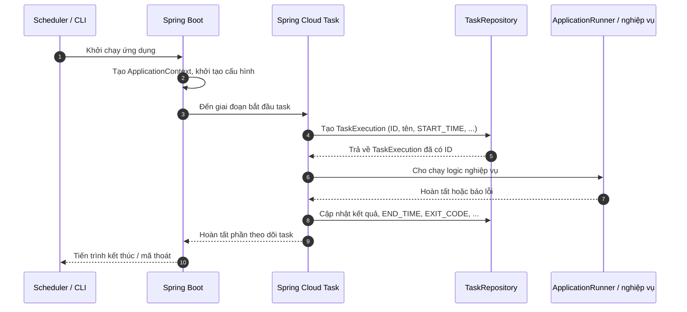
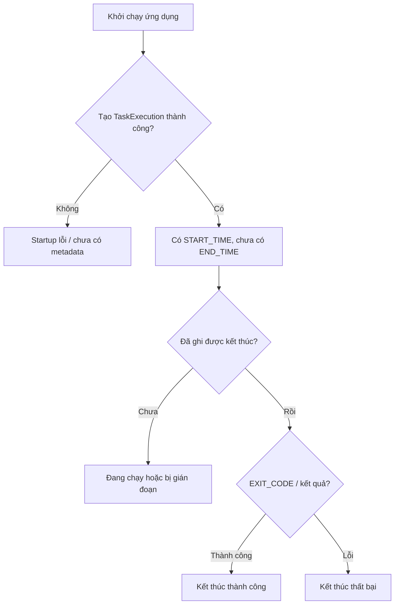
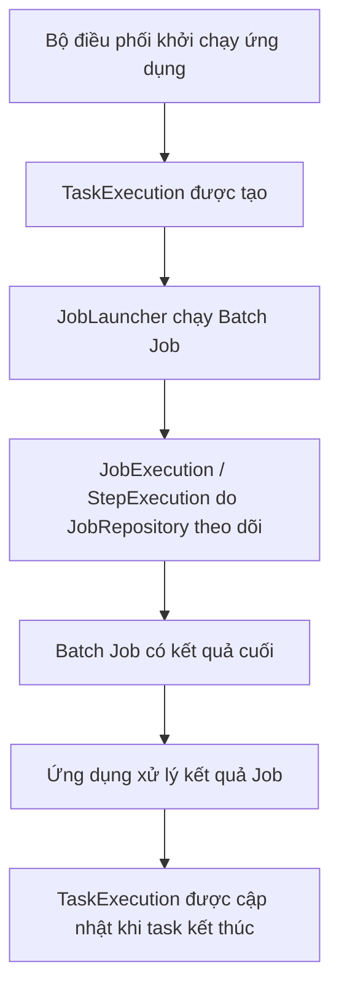

# Thời điểm tạo và cập nhật `TaskExecution` trong Spring Cloud Task

## Mục tiêu bài học

Trong chương **Vòng đời**, câu hỏi quan trọng không chỉ là “Task đã chạy hay chưa?” mà còn là **“Spring Cloud Task tạo bản ghi thực thi vào lúc nào, cập nhật kết quả vào lúc nào và có thể tin đến mức nào vào các trường đang đọc?”**. Đây là nền tảng để xây dựng ứng dụng có thời gian chạy hữu hạn, tra cứu lịch sử thực thi trong cơ sở dữ liệu và vận hành an toàn khi chạy theo lịch hoặc theo yêu cầu.

Sau bài học, bạn có thể:

- Phân biệt **đối tượng `TaskExecution`**, **bản ghi metadata** và **tiến trình ứng dụng**.
- Mô tả các mốc tạo, cập nhật và kết thúc một lần thực thi trong `TaskRepository`.
- Đọc đúng ý nghĩa của `START_TIME`, `END_TIME`, `EXIT_CODE`, `EXIT_MESSAGE` và các tham số.
- Sử dụng `TaskExecutionListener` để quan sát các mốc vòng đời, đồng thời hiểu giới hạn của callback.
- Chẩn đoán trường hợp task lỗi, bị ngắt đột ngột, thực thi bất đồng bộ hoặc không ghi được metadata.
- Liên hệ việc theo dõi task với chạy lại, điều phối và `JobExecution` của Spring Batch.

## 1. `TaskExecution` đại diện cho điều gì?

Một ứng dụng **Spring Boot** có thể chạy một lần rồi thoát. Khi ứng dụng tích hợp **Spring Cloud Task**, framework có thể ghi lại mỗi lần chạy bằng một **`TaskExecution`** trong **`TaskRepository`**. Một `TaskExecution` là lịch sử của **một lượt khởi chạy ứng dụng task**; nó không đại diện cho từng method Java, từng dòng dữ liệu hay từng bước xử lý Batch.

Ví dụ hệ thống chạy `daily-reconciliation` vào 02:00 mỗi ngày. Lần chạy ngày 24/11 thất bại, bộ điều phối gọi lại lúc 02:10. Đây là **hai lần khởi chạy**, vì vậy thông thường có **hai `TaskExecution`** khác nhau, kể cả khi chúng dùng cùng tham số ngày nghiệp vụ.

Để không nhầm các khái niệm, hãy phân biệt:

| Khái niệm | Ý nghĩa |
| --- | --- |
| Tiến trình Java/container | Đơn vị hệ điều hành hoặc hạ tầng thực sự đang chạy; có PID, tài nguyên và mã thoát tiến trình. |
| `TaskExecution` | Đơn vị metadata cho một lần chạy ứng dụng Spring Cloud Task, được cấp ID và lưu thông qua repository. |
| `TaskRepository` | API/lớp lưu trữ tạo, cập nhật và truy vấn metadata task, thường dựa trên JDBC và cơ sở dữ liệu quan hệ. |
| `TaskExecutionListener` | Điểm mở rộng để nhận callback ở các mốc bắt đầu, hoàn tất hoặc thất bại của task. |
| Spring Batch `JobExecution` | Metadata của một lần thực thi **job Batch** bên trong hoặc ngoài task, do `JobRepository` riêng quản lý. |

Một tiến trình có thể lần lượt thực hiện nhiều thao tác nghiệp vụ nhưng vẫn chỉ tương ứng với **một `TaskExecution` ở cấp ứng dụng**. Nếu tiến trình được chạy lại, Spring Cloud Task ghi nhận một lượt mới. Khi cần checkpoint, thống kê đọc/ghi và restart từng step, dùng cơ chế của **Spring Batch** thay vì kỳ vọng `TaskExecution` đảm nhiệm việc đó.

## 2. Các mốc chính: tạo trước khi xử lý, cập nhật khi hoàn tất

Với cấu hình Spring Cloud Task thông thường và repository hoạt động bình thường, vòng đời có thể hình dung như sau:



Sơ đồ diễn tả **trình tự logic**. Tên sự kiện Spring Boot, thứ tự chi tiết giữa các callback và thao tác lưu repository có thể khác theo phiên bản/configuration. Không nên gắn cứng vào một sự kiện Boot như `ApplicationReadyEvent` để suy luận chính xác thời điểm ghi ở mọi phiên bản.

### Mốc A — Ứng dụng khởi động

JVM khởi chạy phương thức `main`, Spring Boot tạo `ApplicationContext`, nạp bean, cấu hình datasource và các thành phần cần thiết. **Khởi động JVM không đồng nghĩa đã có `TaskExecution`**. Nếu lỗi xảy ra rất sớm, ví dụ classpath sai, profile không hợp lệ hoặc context không thể khởi tạo, Spring Cloud Task có thể chưa kịp lưu bất kỳ bản ghi nào.

Thời gian `START_TIME` trong repository được ghi tại **mốc Task bắt đầu được framework theo dõi**, không nhất thiết trùng chính xác thời gian hệ điều hành sinh tiến trình hay lúc người dùng nhấn nút Run. Khi đo thời gian startup JVM/context, cần quan sát thêm log và số liệu của bộ điều phối.

### Mốc B — Tạo `TaskExecution`

Khi đến pha bắt đầu thực thi task, cơ chế vòng đời của Spring Cloud Task gọi `TaskRepository` để tạo metadata cho lượt chạy. Trong ứng dụng Spring Boot sử dụng `ApplicationRunner`/`CommandLineRunner`, việc theo dõi được thiết lập để nhận diện giai đoạn chạy logic task. Mỗi bản ghi có định danh riêng (`TASK_EXECUTION_ID`) do repository cấp.

Các thông tin thường được lưu ở thời điểm đầu gồm tên task, thời điểm bắt đầu và các tham số dòng lệnh. **`END_TIME` chưa có giá trị kết thúc** khi task còn đang chạy; mã thoát/kết quả cuối cùng cũng chưa thể kết luận. Không suy ra “thất bại” chỉ vì `END_TIME IS NULL` hoặc chưa có mã thoát.

Việc lưu thành công còn phụ thuộc datasource và schema của `TaskRepository`. Nếu database không truy cập được hoặc bảng metadata chưa được khởi tạo, task có thể thất bại tại pha startup trước khi chạy được nghiệp vụ.

### Mốc C — Nghiệp vụ thực thi

Sau khi task đã bắt đầu, `ApplicationRunner`, `CommandLineRunner` hoặc luồng nghiệp vụ được cấu hình sẽ thực hiện công việc. Trong thời gian này, cùng một `TaskExecution` đại diện cho **toàn bộ lượt chạy**. Repository **không tự cập nhật tiến độ từng dòng hoặc từng phần trăm** chỉ vì một method đã hoàn thành.

Nếu cần báo tiến độ, hãy dùng log/metrics, bảng trạng thái nghiệp vụ hoặc Spring Batch cho xử lý theo job/step. `TaskRepository` chủ yếu trả lời câu hỏi *lượt chạy ứng dụng đang diễn ra hay đã kết thúc*, không phải *đã xử lý được bao nhiêu bản ghi*.

### Mốc D — Kết thúc bình thường

Khi phần thực thi task hoàn tất theo cơ chế vòng đời, Spring Cloud Task cập nhật metadata tương ứng, thường bao gồm thời điểm kết thúc và mã kết quả. Lượt chạy thành công thường được ghi với `EXIT_CODE` biểu diễn thành công, nhưng **đừng coi mọi mã thoát là mặc định tuyệt đối**: ứng dụng có thể tùy chỉnh `ExitCodeGenerator`, sự kiện thoát và chính sách ánh xạ kết quả.

`END_TIME` là mốc **framework ghi nhận task đã kết thúc**, không phải bảo đảm rằng container đã bị hủy ngay tại thời điểm đó. Một ứng dụng còn HTTP server, scheduler nội bộ hoặc non-daemon thread có thể giữ JVM sống sau khi logic task đã xong; vì vậy phải kiểm tra cả vòng đời tiến trình.

### Mốc E — Kết thúc do lỗi

Nếu runner ném exception hoặc framework quan sát được một lỗi liên quan đến task, cơ chế vòng đời cố gắng cập nhật kết quả thất bại và thông tin lỗi. Tuy nhiên, có thể không có bản ghi hoàn chỉnh nếu exception xảy ra **trước khi tạo `TaskExecution`**, kết nối database bị hỏng hoặc JVM bị kết thúc cưỡng bức.

Đặc biệt, nếu ứng dụng bắt exception rồi **nuốt lỗi** và kết thúc bình thường, framework có thể ghi kết quả thành công dù nghiệp vụ đã thất bại. Cần chuyển lỗi nghiệp vụ thành kết quả task và mã thoát phù hợp, thay vì chỉ in thông báo lỗi.

## 3. Các trường metadata và cách diễn giải

Schema mặc định của Spring Cloud Task thường có bảng `TASK_EXECUTION`. Tên bảng, kiểu dữ liệu, cột mở rộng và cơ chế lưu tham số có thể khác giữa các phiên bản hoặc khi dự án tùy biến schema. Những trường sau mang ý nghĩa quan trọng khi vận hành:

| Trường hoặc thuộc tính | Khi tạo | Khi cập nhật/kết thúc | Cần lưu ý |
| --- | --- | --- | --- |
| `TASK_EXECUTION_ID` | Được cấp cho lần chạy mới | Không đổi trong cùng lần chạy | Hai lượt chạy lại có ID khác nhau. |
| `TASK_NAME` | Gắn với tên task | Thường giữ nguyên | Có thể có nhiều ID cùng tên. |
| `START_TIME` | Ghi thời điểm task bắt đầu được theo dõi | Giữ làm mốc bắt đầu | Không phải thời điểm người dùng bấm Run hoặc lúc JVM sinh ra. |
| `END_TIME` | Chưa có giá trị kết thúc | Được điền khi hoàn tất được ghi nhận | `NULL` không đủ kết luận task đang sống. |
| `EXIT_CODE` | Chưa có kết quả cuối cùng để diễn giải | Phản ánh kết quả theo chính sách của framework/ứng dụng | Phải đối chiếu với mã thoát tiến trình khi điều phối. |
| `EXIT_MESSAGE` | Thường chưa có lỗi/kết quả cần mô tả | Có thể chứa thông điệp lỗi hoặc thông tin bổ sung | Không dùng làm kho log hay lưu thông tin nhạy cảm. |
| Tham số thực thi | Có thể ghi nhận ở thời điểm tạo | Dùng để đối chiếu yêu cầu/lần chạy | Không tự động là Spring Batch `JobParameters`. |

**Điểm rất dễ nhầm:** Spring Cloud Task không có một cột `STATUS` kiểu `STARTED`/`COMPLETED` trong mọi schema để bạn tùy ý giả định. Khi kiểm tra trạng thái, thông thường cần xem **sự hiện diện của bản ghi, `START_TIME`, `END_TIME`, `EXIT_CODE` và tình trạng thực của tiến trình**.

Một bảng định hướng đọc nhanh:

| Tình huống quan sát | Diễn giải hợp lý | Việc cần kiểm tra tiếp |
| --- | --- | --- |
| Không thấy bản ghi | Có thể chưa vào pha tạo TaskExecution, đang truy vấn sai DB/schema hoặc ghi metadata thất bại | Log khởi động, datasource, schema, quyền truy cập. |
| Có `START_TIME`, chưa có `END_TIME` | Task chưa được ghi nhận kết thúc | Tiến trình đang chạy hay đã crash/kill; kết nối DB còn hoạt động? |
| Có `END_TIME` và exit code thành công | Framework ghi nhận đã hoàn tất thành công | Đối chiếu kết quả nghiệp vụ và tiến trình nếu cần bảo đảm đầu-cuối. |
| Có `END_TIME` và exit code lỗi | Lần chạy được ghi nhận thất bại | Phân tích `EXIT_MESSAGE`, log và nguyên nhân nghiệp vụ. |
| Log ghi “Hoàn tất” nhưng bản ghi chưa kết thúc | Log nghiệp vụ không đồng nghĩa framework đã cập nhật repository | Callback cuối, transaction, shutdown và DB. |

## 4. Mô hình trạng thái để giám sát

Vì metadata Task không nhất thiết có sẵn mọi trạng thái nghiệp vụ, hệ thống giám sát thường phải **suy diễn có điều kiện**:



Một `END_TIME` còn trống có **hai khả năng rất khác nhau**: (1) tiến trình vẫn đang xử lý; (2) tiến trình đã biến mất nhưng framework không kịp cập nhật bản ghi. Cần kết hợp dữ liệu của scheduler, container runtime, PID/heartbeat hoặc hệ thống giám sát để phân biệt. Không sửa trực tiếp `END_TIME` trong database để “làm đẹp” dashboard vì sẽ làm mất chứng cứ của sự cố.

## 5. Ví dụ quan sát `TaskExecution` trong một ứng dụng hữu hạn

### 5.1. Khởi tạo application và công việc mẫu

Ví dụ sau sử dụng Spring Boot + Spring Cloud Task. Dự án cần dependency `spring-cloud-starter-task`, JDBC driver và bộ phiên bản Spring Boot/Spring Cloud tương thích. Class dưới đây dùng `ApplicationRunner` để nhận ngày nghiệp vụ, giả lập xử lý vài giây và có tùy chọn gây lỗi kiểm chứng.

```java
package com.example.lifecycle;

import java.time.LocalDate;
import java.util.List;

import org.slf4j.Logger;
import org.slf4j.LoggerFactory;
import org.springframework.boot.ApplicationRunner;
import org.springframework.boot.SpringApplication;
import org.springframework.boot.autoconfigure.SpringBootApplication;
import org.springframework.cloud.task.configuration.EnableTask;
import org.springframework.context.annotation.Bean;

@SpringBootApplication
@EnableTask
public class TaskLifecycleApplication {
    private static final Logger log = LoggerFactory.getLogger(TaskLifecycleApplication.class);

    public static void main(String[] args) {
        SpringApplication.run(TaskLifecycleApplication.class, args);
    }

    @Bean
    ApplicationRunner reconcile() {
        return args -> {
            List<String> dates = args.getOptionValues("business-date");
            if (dates == null || dates.size() != 1) {
                throw new IllegalArgumentException("Cần --business-date=yyyy-MM-dd");
            }

            LocalDate businessDate = LocalDate.parse(dates.get(0));
            log.info("Bắt đầu nghiệp vụ cho {}", businessDate);

            // Mô phỏng tác vụ đủ lâu để quan sát bản ghi đang thực thi.
            Thread.sleep(8_000);

            if (args.containsOption("fail")) {
                throw new IllegalStateException("Lỗi mô phỏng khi đối soát");
            }

            log.info("Đã hoàn tất nghiệp vụ cho {}", businessDate);
        };
    }
}
```

Ví dụ giả lập `Thread.sleep` **chỉ dùng để quan sát vòng đời**. Trong production, thay bằng service xử lý thực tế và thiết kế timeout, hủy tác vụ, idempotency phù hợp. Nếu dùng nhiều runner, lưu ý thứ tự/đồng bộ giữa chúng có thể ảnh hưởng thời điểm task thực sự hoàn tất.

### 5.2. Cấu hình repository

Trong `application.yml`, sử dụng một database PostgreSQL có sẵn schema metadata của Spring Cloud Task:

```yaml
spring:
  application:
    name: lifecycle-demo
  main:
    web-application-type: none
  datasource:
    url: jdbc:postgresql://localhost:5432/task_demo
    username: task_user
    password: ${TASK_DB_PASSWORD}
  cloud:
    task:
      name: lifecycle-demo
```

Database, tài khoản và schema phải được chuẩn bị trước; cách khởi tạo/migrate các bảng metadata phụ thuộc phiên bản thư viện và chính sách môi trường. Dùng database bền vững để có thể truy vấn sau khi ứng dụng đã thoát. Không lưu mật khẩu thật trực tiếp vào tài liệu hoặc source code.

### 5.3. Chạy thành công, đang chạy và thất bại

Đóng gói executable JAR bằng Maven/Gradle của dự án, rồi khởi chạy:

```bash
java -jar lifecycle-demo.jar --business-date=2026-11-24
```

Trong khoảng thời gian mô phỏng xử lý, dùng SQL client **khác** kết nối đến cùng database:

```sql
SELECT TASK_EXECUTION_ID,
       TASK_NAME,
       START_TIME,
       END_TIME,
       EXIT_CODE,
       EXIT_MESSAGE
FROM TASK_EXECUTION
ORDER BY TASK_EXECUTION_ID DESC;
```

Đối chiếu **mốc trước và sau khi runner hoàn tất**:

1. Trong lúc đang xử lý, bản ghi tương ứng thường đã có `TASK_EXECUTION_ID`, `START_TIME`; `END_TIME` chưa được cập nhật thành thời điểm kết thúc.
2. Khi runner kết thúc và framework hoàn tất việc ghi metadata, `END_TIME` và kết quả của lần chạy được cập nhật.
3. Chạy cùng JAR lần nữa với thêm `--fail` để mô phỏng exception; bản ghi mới sẽ cho thấy kết quả thất bại **nếu cơ chế lifecycle ghi được metadata lỗi**.

```bash
java -jar lifecycle-demo.jar --business-date=2026-11-24 --fail
```

Để theo dõi các lần thực thi chưa có kết thúc trong database, có thể chạy truy vấn:

```sql
SELECT TASK_EXECUTION_ID, TASK_NAME, START_TIME
FROM TASK_EXECUTION
WHERE END_TIME IS NULL
ORDER BY START_TIME DESC;
```

Kết quả truy vấn này chỉ là **danh sách chưa được ghi nhận hoàn tất**. Không thể dựa vào nó để khẳng định “đang chạy” nếu chưa kiểm tra tiến trình hoặc container tương ứng.

## 6. Quan sát callback bằng `TaskExecutionListener`

Spring Cloud Task cung cấp `TaskExecutionListener` cho nhu cầu thực thi logic phụ tại các mốc vòng đời. Các callback thường dùng là:

- `onTaskStartup(TaskExecution)` — nhận thông tin khi task bắt đầu.
- `onTaskEnd(TaskExecution)` — nhận thông tin khi task kết thúc theo cơ chế lifecycle.
- `onTaskFailed(TaskExecution, Throwable)` — nhận thông tin khi có lỗi được framework bắt ở vòng đời task.

Ví dụ listener chỉ ghi log:

```java
package com.example.lifecycle;

import org.slf4j.Logger;
import org.slf4j.LoggerFactory;
import org.springframework.cloud.task.listener.TaskExecutionListener;
import org.springframework.cloud.task.repository.TaskExecution;
import org.springframework.stereotype.Component;

@Component
public class LifecycleAuditListener implements TaskExecutionListener {
    private static final Logger log = LoggerFactory.getLogger(LifecycleAuditListener.class);

    @Override
    public void onTaskStartup(TaskExecution execution) {
        log.info("Task bắt đầu: id={}, name={}",
                execution.getExecutionId(), execution.getTaskName());
    }

    @Override
    public void onTaskEnd(TaskExecution execution) {
        log.info("Task đến mốc kết thúc: id={}", execution.getExecutionId());
    }

    @Override
    public void onTaskFailed(TaskExecution execution, Throwable throwable) {
        log.error("Task thất bại: id={}", execution.getExecutionId(), throwable);
    }
}
```

**Các lưu ý khi dùng listener:**

1. Listener giúp quan sát và xử lý tác vụ phụ (audit, metrics, thông báo nội bộ). Không mặc định callback đã thấy **bản ghi DB được commit đầy đủ** tại thời điểm nó được gọi; thứ tự và transaction có thể phụ thuộc phiên bản.
2. Không đặt xử lý nghiệp vụ dài, thao tác blocking không giới hạn hoặc lời gọi mạng thiếu timeout trong callback vòng đời. Lỗi của listener có thể làm phức tạp quá trình bắt đầu/kết thúc task.
3. Không xem `onTaskFailed` là hệ thống ghi nhận mọi nguyên nhân hạ tầng: mất nguồn, `SIGKILL`, `kill -9` hoặc JVM crash có thể ngăn callback chạy.
4. Không ghi toàn bộ argument, exception hoặc dữ liệu nhạy cảm vào log/metadata. Cần lọc token, mật khẩu, thông tin cá nhân.

Listener là **điểm móc sự kiện**, còn `TaskRepository` vẫn là thành phần quản lý metadata chuẩn. Tránh tự phát sinh SQL `UPDATE TASK_EXECUTION` tùy tiện trong listener vì dễ làm sai thứ tự, tính nhất quán và khả năng đối chiếu.

## 7. Những tình huống khiến metadata dễ bị hiểu sai

### 7.1. Ứng dụng thất bại trước khi tạo TaskExecution

Nếu cấu hình datasource sai, không có schema hay bean lỗi trong quá trình khởi tạo, framework có thể chưa đi đến pha tạo metadata. Hệ thống điều phối vẫn ghi nhận tiến trình thất bại, nhưng truy vấn Task Repository không thấy bản ghi. Vì vậy **không tìm thấy TaskExecution không đồng nghĩa chưa từng có yêu cầu chạy**.

Với yêu cầu theo lịch hoặc kích hoạt qua API, nên lưu ID yêu cầu và log kích hoạt ở bộ điều phối; khi task bắt đầu thành công, liên kết ID đó tới Task Execution nếu cần đối chiếu đầu-cuối.

### 7.2. Bị kill hoặc crash sau khi đã tạo bản ghi

Nếu tiến trình bị dừng cưỡng bức trong lúc xử lý, repository có thể chỉ lưu được `START_TIME`. `END_TIME` vẫn trống và callback kết thúc không chạy. Trạng thái này không tự được giải quyết chỉ bằng việc truy vấn database. Bộ giám sát cần xác nhận tiến trình đã biến mất và ghi nhận sự cố theo quy trình vận hành, tránh coi bản ghi đó là “chạy mãi”.

Khi triển khai Kubernetes CronJob hoặc một hệ thống scheduler, theo dõi cả **job/container completion**, timeout, số lần retry và metadata Task. Có thể có nhiều lần chạy task cho một ngày nghiệp vụ nếu scheduler retry; hãy gắn khóa yêu cầu/ngày xử lý phù hợp.

### 7.3. Bắt exception rồi trả về như thành công

Ví dụ không nên sử dụng:

```java
try {
    importBusinessData();
} catch (Exception ex) {
    log.error("Nhập dữ liệu thất bại", ex);
    // Không làm gì thêm: runner vẫn có thể kết thúc bình thường.
}
```

Nếu lỗi là lỗi làm toàn bộ task thất bại, hãy cho phép exception lan tới cơ chế xử lý lỗi hoặc chuyển thành mã thoát/kết quả có chủ đích. Nếu một số bản ghi lỗi được phép bỏ qua, định nghĩa rõ chính sách lỗi nghiệp vụ và cách báo cáo thay vì tùy tiện coi mọi exception là thành công.

### 7.4. Công việc chạy bất đồng bộ và runner thoát quá sớm

Ví dụ:

```java
executor.submit(this::performLongRunningWork);
// ApplicationRunner trả về ngay, trong khi công việc thật chưa hoàn tất.
```

Khi tác vụ con chạy trong một thread khác, thời điểm runner trả về **không chứng minh** công việc con đã hoàn tất. Ứng dụng có thể ghi nhận task kết thúc sớm, hoặc tiến trình còn tồn tại do executor chưa được đóng, tùy cấu hình. Với một task hữu hạn, cần `join`/chờ `Future` và truyền thất bại từ tác vụ con lên runner, sau đó đóng tài nguyên rõ ràng.

Nếu sử dụng Spring Batch với `JobLauncher` bất đồng bộ, lưu ý tương tự: phải biết `JobExecution` đã đạt trạng thái cuối trước khi coi tác vụ nghiệp vụ đã hoàn thành.

### 7.5. Database hỏng ở thời điểm kết thúc

Có thể đã tạo được `TaskExecution` và xử lý nghiệp vụ thành công, nhưng mất kết nối DB đúng lúc cập nhật `END_TIME` hoặc `EXIT_CODE`. Khi đó, lịch sử Task có thể không phản ánh kết quả thật. Không thể suy luận dữ liệu nghiệp vụ đã rollback chỉ từ trạng thái metadata Task: giao dịch nghiệp vụ và giao dịch cập nhật Task Repository có thể có phạm vi độc lập.

Cần giám sát lỗi ghi repository, bảo đảm cấu hình kết nối ổn định và thiết kế nghiệp vụ idempotent để tránh ghi trùng khi điều phối quyết định retry vì thiếu kết quả rõ ràng.

### 7.6. Nhiều lần chạy đồng thời

Hai tiến trình `daily-reconciliation --business-date=2026-11-24` chạy cùng lúc thường tạo hai `TaskExecution` với hai ID khác nhau. Metadata task **không tự khóa nghiệp vụ theo ngày**. Khi dữ liệu không cho phép chạy song song, đặt cơ chế chống trùng ở scheduler, hàng đợi, database hoặc tầng service, đồng thời xử lý an toàn khi retry.

## 8. Liên hệ với Spring Batch: hai mốc hoàn tất có thể khác nhau

Khi một Spring Cloud Task khởi chạy **Spring Batch**, ta có hai phạm vi metadata:



**`JobExecution` thành công không tự bảo đảm `TaskExecution` đã kết thúc thành công**, vì ứng dụng còn có thể lỗi sau khi job xong hoặc không ghi được metadata Task. Chiều ngược lại cũng cần chú ý: nếu ứng dụng không truyền lỗi Batch ra cấp task, `TaskExecution` có thể được ghi thành công dù job Batch thất bại.

Với launcher bất đồng bộ, job có thể còn chạy khi mã gọi `launch` đã trả về. Cần chờ/kết hợp trạng thái của job đúng cách trước khi cho ứng dụng kết thúc. Khi scheduler chạy lại cùng yêu cầu, Spring Cloud Task thường tạo **`TaskExecution` mới**, trong khi Spring Batch quyết định restart `JobInstance` hay tạo instance mới dựa trên tên job, các `JobParameters` mang tính định danh và trạng thái các execution trước đó.

## 9. Nguyên tắc vận hành an toàn

| Việc cần làm | Vì sao liên quan đến thời điểm ghi `TaskExecution` |
| --- | --- |
| Dùng database metadata bền vững, schema tương thích và migration có kiểm soát | Lịch sử không mất khi container thoát, tránh lỗi ghi bản ghi lúc startup hoặc shutdown. |
| Theo dõi tiến trình/container cùng Task Repository | Phân biệt task đang chạy với bản ghi chưa được đóng do crash hoặc kill. |
| Ánh xạ lỗi nghiệp vụ sang trạng thái kết thúc và mã thoát rõ ràng | Không báo thành công giả khi nghiệp vụ thất bại. |
| Không để runner trả về trước khi tác vụ bất đồng bộ hoàn tất | Thời điểm kết thúc metadata phải phản ánh công việc thật. |
| Thiết kế idempotency và khóa nghiệp vụ khi cần | Task chạy lại tạo lịch sử mới nhưng không tự ngăn ghi trùng dữ liệu. |
| Giới hạn và lọc thông tin trong argument, message, log | Metadata và log có thể được lưu lâu dài, nhiều người có quyền đọc. |
| Có timeout và chính sách xử lý task treo | Bản ghi `END_TIME` trống không đủ để ra quyết định retry an toàn. |
| Kiểm tra kết quả ghi repository sau lần chạy kiểm thử | Log kết thúc nghiệp vụ không bảo đảm metadata đã được commit. |

## 10. Bài tập tự kiểm tra

1. Một container chạy 25 giây, nhưng truy vấn `TASK_EXECUTION` chỉ thấy `START_TIME` trễ hơn thời điểm container bắt đầu 4 giây. Có nhất thiết dữ liệu sai không? Vì sao?
2. Khi `END_TIME IS NULL`, hãy nêu ít nhất hai tình huống thực tế có thể dẫn đến kết quả đó và nguồn dữ liệu bổ sung cần kiểm tra.
3. Một runner ghi log “Hoàn tất xử lý” rồi ứng dụng không cập nhật được `EXIT_CODE` do mất kết nối database. Có thể khẳng định nghiệp vụ thất bại hoặc thành công hoàn toàn từ metadata task không?
4. Vì sao `onTaskFailed` không thể đảm bảo chạy nếu JVM bị kill cưỡng bức? Nên giám sát thêm dữ liệu nào?
5. Nếu một task gọi Batch job bất đồng bộ, việc `JobLauncher` trả về có đủ để cập nhật “đã hoàn thành nghiệp vụ” không?
6. Cùng tham số `business-date` được dùng cho hai lần retry. Spring Cloud Task và Spring Batch có thể tạo những đơn vị metadata khác nhau như thế nào?

**Ghi nhớ:** `TaskExecution` được **tạo khi Spring Cloud Task bắt đầu theo dõi lượt chạy** và được **cập nhật khi framework ghi nhận kết thúc**, trong điều kiện repository có thể truy cập. `START_TIME`, `END_TIME`, `EXIT_CODE` và `EXIT_MESSAGE` phản ánh metadata vòng đời task, nhưng **không thay thế** tín hiệu từ tiến trình, hệ thống điều phối hay trạng thái nghiệp vụ/Batch job. Đọc đúng thời điểm và giới hạn của các trường này là cơ sở để chạy task theo lịch, theo yêu cầu và xử lý retry an toàn.
