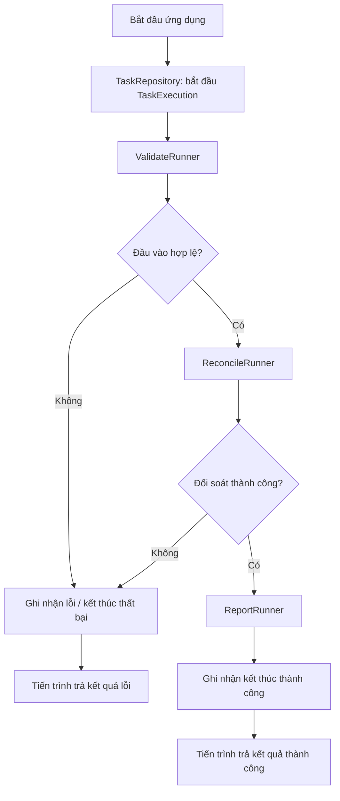

# Thực thi nhiều bộ chạy trong cùng một lần chạy ứng dụng

Trong **Spring Cloud Task**, một tiến trình ứng dụng có thể thực hiện nhiều công việc nhỏ liên tiếp rồi kết thúc. Ví dụ, tác vụ đối soát doanh thu cần **kiểm tra tham số**, **đối soát dữ liệu** và **tạo thông báo kết quả**. Spring Boot cho phép đăng ký nhiều bean kiểu `ApplicationRunner` hoặc `CommandLineRunner` để thực hiện các công việc đó khi ứng dụng khởi động.

Điều quan trọng trong chương **Vòng đời** là phân biệt hai cấp độ:

- **Một lần khởi chạy ứng dụng** (chẳng hạn một lệnh `java -jar`) là một lần thực thi Spring Cloud Task, thường được ghi thành **một `TaskExecution`** trong cơ sở dữ liệu qua `TaskRepository`.
- **Nhiều runner** là nhiều callback chạy **bên trong chính lần khởi chạy đó**. Chúng không tự tạo ra các `TaskExecution` độc lập.

Bài này giải thích cách đăng ký và sắp xếp runner, cách Spring Cloud Task ghi nhận kết quả chung, và cách tránh việc kết thúc sai khi một runner thất bại hoặc khởi tạo tác vụ bất đồng bộ.

## 1. Runner trong Spring Boot là gì?

Spring Boot cung cấp hai giao diện thường gặp để chạy công việc ngay sau khi ngữ cảnh ứng dụng được chuẩn bị:

| Giao diện | Phương thức | Đầu vào nhận được | Khi nào phù hợp? |
| --- | --- | --- | --- |
| `ApplicationRunner` | `run(ApplicationArguments args)` | Các tham số đã được Spring Boot phân tích thành option và non-option | Cần đọc `--business-date=...`, cờ bật/tắt hoặc tham số đặt tên. |
| `CommandLineRunner` | `run(String... args)` | Mảng chuỗi dòng lệnh ban đầu | Cần tự xử lý cú pháp hoặc chuyển nguyên các tham số cho công cụ khác. |

Ví dụ với lệnh:

```bash
java -jar multi-runner-task.jar --business-date=2026-11-24 --dry-run input.csv
```

Một `ApplicationRunner` có thể dùng `args.getOptionValues("business-date")` để nhận `2026-11-24`, `args.containsOption("dry-run")` để biết có cờ và `args.getNonOptionArgs()` để lấy `input.csv`. Một `CommandLineRunner` nhận các chuỗi gốc trong mảng `String... args`.

**Không phải hai loại vòng đời khác nhau.** Cả hai loại runner đều được Spring Boot gọi trong giai đoạn khởi động ứng dụng, sau khi ngữ cảnh đã được tạo và các bean cần thiết đã sẵn sàng. Chúng đều có thể ném ngoại lệ ra ngoài và làm quá trình chạy thất bại.

### Runner khác gì với `TaskExecution`?

`TaskExecution` là metadata của **toàn bộ lần chạy ứng dụng Spring Cloud Task**: tên task, mã thực thi, thời điểm bắt đầu và kết thúc, mã thoát và các thông tin liên quan tùy phiên bản/cấu hình. Nó không mang danh sách trạng thái thành công/thất bại riêng cho từng runner.

Ví dụ một tiến trình chứa ba runner:

```text
java -jar multi-runner-task.jar
  |
  +-- ValidateRunner       (ApplicationRunner)
  +-- ReconcileRunner      (ApplicationRunner)
  +-- ReportRunner         (CommandLineRunner)
  |
  +-- Kết thúc ứng dụng

TaskRepository: ghi một TaskExecution cho toàn bộ tiến trình
```

Nếu chạy lại cùng JAR một lần nữa, Spring Cloud Task có thể ghi thêm một `TaskExecution` mới với ID khác. Số bản ghi phụ thuộc số **lần khởi chạy ứng dụng đã được ghi nhận**, không phụ thuộc số runner đăng ký.

## 2. Thứ tự thực thi khi có nhiều runner

Spring Boot thu thập bean `ApplicationRunner` và `CommandLineRunner`, sắp xếp chúng theo cơ chế `Ordered`/`@Order` rồi gọi lần lượt. Vì vậy:

1. Runner có **thứ tự số nhỏ hơn** được gọi trước runner có thứ tự số lớn hơn.
2. Cả hai loại runner cùng tham gia cơ chế sắp xếp; không nên mặc định rằng *tất cả* `ApplicationRunner` luôn chạy xong rồi mới đến `CommandLineRunner`.
3. Nếu các runner có cùng thứ tự hoặc không khai báo thứ tự, không nên phụ thuộc vào vị trí gọi của chúng. Dùng các giá trị `@Order` khác nhau nếu có phụ thuộc.
4. `@Order` điều khiển **thứ tự gọi phương thức `run`**, không đảm bảo thứ tự khởi tạo bean hay thứ tự hoàn thành công việc bất đồng bộ.

Trong ví dụ này, thứ tự mong muốn là:

<svg xmlns="http://www.w3.org/2000/svg" width="690" height="156" viewBox="0 0 690 156" role="img" aria-label="Ba runner trong một TaskExecution, theo thứ tự kiểm tra đầu vào, đối soát và báo cáo">
  <rect x="6" y="7" width="678" height="142" rx="12" fill="#f6f8fc" stroke="#c8d4e4"/>
  <text x="21" y="30" font-family="Arial,sans-serif" font-size="16" font-weight="bold" fill="#253858">Một tiến trình / một TaskExecution</text>
  <rect x="20" y="50" width="193" height="75" rx="8" fill="#e8f2ff" stroke="#91b7df"/>
  <rect x="248" y="50" width="193" height="75" rx="8" fill="#e6f5eb" stroke="#9acbaa"/>
  <rect x="476" y="50" width="193" height="75" rx="8" fill="#fff1df" stroke="#e3bf87"/>
  <g font-family="Arial,sans-serif" fill="#253858" font-size="14">
    <text x="34" y="75">1. ValidateRunner</text>
    <text x="34" y="99">@Order(10)</text>
    <text x="262" y="75">2. ReconcileRunner</text>
    <text x="262" y="99">@Order(20)</text>
    <text x="490" y="75">3. ReportRunner</text>
    <text x="490" y="99">@Order(30)</text>
  </g>
  <path d="M215 87 L244 87 M240 83 L244 87 L240 91" fill="none" stroke="#657b99" stroke-width="2"/>
  <path d="M443 87 L472 87 M468 83 L472 87 L468 91" fill="none" stroke="#657b99" stroke-width="2"/>
</svg>

Thứ tự trên chỉ mô tả đường chạy bình thường, khi các runner làm việc đồng bộ và không ném lỗi.

## 3. Ví dụ đầy đủ: ba runner trong một Spring Cloud Task

Ta xây dựng một ứng dụng Java chạy hữu hạn, nhận ngày nghiệp vụ `--business-date=YYYY-MM-DD` và thực hiện ba bước:

- `ValidateRunner`: xác minh tham số ngày hợp lệ.
- `ReconcileRunner`: giả lập đối soát và có thể mô phỏng lỗi.
- `ReportRunner`: ghi nhận đã hoàn thành báo cáo.

### 3.1. Dependency và cấu hình

Trong dự án Spring Boot đã có cấu hình Maven parent/plugin và **Spring Cloud BOM tương thích với phiên bản Spring Boot**, thêm dependency:

```xml
<dependencies>
    <dependency>
        <groupId>org.springframework.cloud</groupId>
        <artifactId>spring-cloud-starter-task</artifactId>
    </dependency>
    <dependency>
        <groupId>org.springframework.boot</groupId>
        <artifactId>spring-boot-starter-jdbc</artifactId>
    </dependency>
    <dependency>
        <groupId>com.h2database</groupId>
        <artifactId>h2</artifactId>
        <scope>runtime</scope>
    </dependency>
</dependencies>
```

Tạo `src/main/resources/application.yml` cho môi trường thực hành:

```yaml
spring:
  application:
    name: multi-runner-task
  main:
    web-application-type: none
  datasource:
    url: jdbc:h2:file:./multi-runner-metadata
    driver-class-name: org.h2.Driver
    username: sa
    password: ""
  cloud:
    task:
      name: dailyRevenuePipeline
      initialize-enabled: true
```

H2 file giúp giữ lịch sử giữa các lần chạy, với điều kiện chạy từ cùng thư mục làm việc. Cơ chế tạo bảng tự động thích hợp cho thực hành; môi trường sản xuất cần quản lý schema phù hợp phiên bản và dùng cơ sở dữ liệu được vận hành ổn định.

### 3.2. Viết ứng dụng

Tạo `src/main/java/com/example/task/MultiRunnerTaskApplication.java`. Để dễ xem một lần, ba runner được đặt thành lớp `static` lồng trong lớp khởi động; trong dự án thật có thể tách thành ba file:

```java
package com.example.task;

import java.time.LocalDate;
import java.util.List;

import org.springframework.boot.ApplicationArguments;
import org.springframework.boot.ApplicationRunner;
import org.springframework.boot.CommandLineRunner;
import org.springframework.boot.SpringApplication;
import org.springframework.boot.autoconfigure.SpringBootApplication;
import org.springframework.cloud.task.configuration.EnableTask;
import org.springframework.core.annotation.Order;
import org.springframework.stereotype.Component;

@SpringBootApplication
@EnableTask
public class MultiRunnerTaskApplication {

    public static void main(String[] args) {
        SpringApplication.run(MultiRunnerTaskApplication.class, args);
    }

    // Hàm dùng chung để đọc và kiểm tra đầu vào nghiệp vụ.
    private static LocalDate requiredBusinessDate(ApplicationArguments args) {
        List<String> values = args.getOptionValues("business-date");
        if (values == null || values.size() != 1
                || values.get(0) == null || values.get(0).isBlank()) {
            throw new IllegalArgumentException(
                "Can truyen --business-date=YYYY-MM-DD"
            );
        }
        return LocalDate.parse(values.get(0));
    }

    @Component
    @Order(10)
    public static class ValidateRunner implements ApplicationRunner {
        @Override
        public void run(ApplicationArguments args) {
            LocalDate date = requiredBusinessDate(args);
            System.out.println("1. Tham so hop le: " + date);
        }
    }

    @Component
    @Order(20)
    public static class ReconcileRunner implements ApplicationRunner {
        @Override
        public void run(ApplicationArguments args) {
            LocalDate date = requiredBusinessDate(args);
            System.out.println("2. Dang doi soat ngay " + date);

            if (args.containsOption("simulate-error")) {
                throw new IllegalStateException(
                    "Loi mo phong trong buoc doi soat"
                );
            }

            System.out.println("2. Doi soat thanh cong");
        }
    }

    @Component
    @Order(30)
    public static class ReportRunner implements CommandLineRunner {
        @Override
        public void run(String... args) {
            System.out.println("3. Hoan thanh bao cao");
        }
    }
}
```

Các lớp `@Component` được Spring quản lý thành bean. Spring Boot sẽ gọi cả ba runner theo `@Order(10)`, `@Order(20)` và `@Order(30)`. Ví dụ không sử dụng tác vụ bất đồng bộ, nên lời gọi `run` của runner thứ hai chỉ bắt đầu sau khi runner thứ nhất kết thúc.

Hàm `requiredBusinessDate` được gọi ở hai nơi để ví dụ an toàn trước tham số thiếu hoặc sai định dạng. Trong ứng dụng lớn, nên tách bước phân tích đầu vào thành một đối tượng giá trị/bean cấu hình được kiểm tra một lần; `@Order` không nên là phương tiện duy nhất bảo đảm dữ liệu hợp lệ.

### 3.3. Đóng gói và chạy

Giả sử Maven project có artifact là `multi-runner-task`, phiên bản `0.0.1-SNAPSHOT` và đã cấu hình `spring-boot-maven-plugin`, đóng gói:

```bash
./mvnw clean package
```

Khởi chạy từ thư mục gốc dự án:

```bash
java -jar target/multi-runner-task-0.0.1-SNAPSHOT.jar \
  --business-date=2026-11-24
echo $?
```

Đầu ra nghiệp vụ kỳ vọng có thứ tự:

```text
1. Tham so hop le: 2026-11-24
2. Dang doi soat ngay 2026-11-24
2. Doi soat thanh cong
3. Hoan thanh bao cao
```

Trong trường hợp thành công bình thường, mã thoát tiến trình là `0`. Nếu chạy trên PowerShell, có thể dùng:

```powershell
java -jar .\target\multi-runner-task-0.0.1-SNAPSHOT.jar --business-date=2026-11-24
$LASTEXITCODE
```

Đầu ra thực tế còn có log khởi động Spring Boot và Spring Cloud Task. Chúng không làm thay đổi nguyên tắc: ba runner chạy **trong cùng một tiến trình** và chia sẻ **cùng một lần thực thi Spring Cloud Task**.

## 4. Nếu một runner gặp lỗi thì điều gì xảy ra?

Thử mô phỏng lỗi trong bước đối soát:

```bash
java -jar target/multi-runner-task-0.0.1-SNAPSHOT.jar \
  --business-date=2026-11-24 \
  --simulate-error
echo $?
```

Diễn biến dự kiến:

1. `ValidateRunner` chạy xong.
2. `ReconcileRunner` bắt đầu, sau đó ném `IllegalStateException`.
3. Spring Boot không tiếp tục gọi `ReportRunner` trong đợt chạy runner đồng bộ đó.
4. Khởi động ứng dụng thất bại; hệ thống cần thể hiện lỗi qua log, kết quả thực thi và **mã thoát khác `0`** khi không có cơ chế tùy biến che giấu lỗi.



**Cẩn thận khi bắt ngoại lệ:** Nếu `ReconcileRunner` tự bắt mọi `Exception`, chỉ ghi log rồi trả về bình thường, Spring Boot sẽ coi runner đó đã hoàn thành. Runner tiếp theo vẫn được gọi, và toàn bộ task có thể mang kết quả thành công dù nghiệp vụ thực sự thất bại.

```java
// Sai nếu muốn task thất bại khi nghiệp vụ lỗi:
try {
    reconcile();
} catch (Exception e) {
    log.error("Doi soat that bai", e);
    // Nuot loi -> runner tiep theo van co the chay.
}

// Cách phổ biến: ghi thêm ngữ cảnh và ném lại lỗi.
try {
    reconcile();
} catch (Exception e) {
    log.error("Doi soat that bai", e);
    throw e;
}
```

Đoạn minh họa trên giả định có phương thức `reconcile()` và đối tượng log trong lớp nghiệp vụ; nó chỉ làm rõ **khác biệt trong cách truyền lỗi**, không phải đoạn mã độc lập để dán trực tiếp.

Trong trường hợp JVM bị dừng đột ngột, mất kết nối kho metadata hoặc lỗi xuất hiện quá sớm lúc khởi động, `TaskExecution` có thể chưa được tạo hoặc chưa được cập nhật thời điểm kết thúc. Phải đối chiếu thông tin trong cơ sở dữ liệu với mã thoát, log và trạng thái container/tiến trình.

## 5. Quan sát một lần thực thi chung trong cơ sở dữ liệu

Nếu ứng dụng được cấu hình với `TaskRepository`, mỗi lần chạy sẽ có một mã `TaskExecution`. Bạn có thể xem dữ liệu lịch sử trong bảng metadata, ví dụ:

```sql
SELECT
    TASK_EXECUTION_ID,
    TASK_NAME,
    START_TIME,
    END_TIME,
    EXIT_CODE
FROM TASK_EXECUTION
ORDER BY TASK_EXECUTION_ID DESC;
```

Sau một lần chạy thành công và một lần chạy mô phỏng lỗi, dự kiến có **hai bản ghi lần chạy** (nếu cả hai khởi động và ghi metadata thành công), **không phải sáu bản ghi** tương ứng với ba runner của mỗi lần.

| Điều cần theo dõi | Xem ở đâu? | Giới hạn |
| --- | --- | --- |
| Lần chạy chung bắt đầu/kết thúc, mã thoát | `TaskExecution` qua `TaskRepository`/`TaskExplorer` | Không có trạng thái riêng cho mỗi runner. |
| Runner nào bắt đầu hoặc thất bại | Log có tên runner, mã yêu cầu và thời gian | Log có thể thất lạc nếu không thu thập tập trung. |
| Thời gian và kết quả từng bước | Metrics, tracing hoặc bảng nghiệp vụ tự thiết kế | Cần chủ động instrument. |
| Kết quả đối soát và file báo cáo | Cơ sở dữ liệu/kho dữ liệu nghiệp vụ | Metadata task không lưu dữ liệu nghiệp vụ thay bạn. |
| Container hoặc tiến trình có bị kill/OOM | Nền tảng khởi chạy/điều phối | Có thể khác trạng thái metadata ghi được. |

`TaskExecutionListener` hỗ trợ các callback cấp **vòng đời tác vụ** như lúc bắt đầu, kết thúc và thất bại. Không nên hiểu những callback đó là sự kiện tương ứng với *từng runner*. Nếu cần lịch sử chi tiết theo bước, hãy bổ sung log/tracing/metrics có tên bước hoặc chọn công cụ mô hình hóa step thích hợp.

## 6. Những điểm dễ nhầm khi dùng nhiều runner

### 6.1. `@Order` không tạo giao dịch nghiệp vụ chung

Giả sử `ReconcileRunner` đã ghi một phần kết quả vào cơ sở dữ liệu nghiệp vụ rồi `ReportRunner` thất bại. Việc toàn bộ Spring Cloud Task có mã thoát lỗi **không tự rollback** mọi thay đổi mà runner trước đã commit.

Nếu muốn nhất quán, hãy xác định transaction ở lớp service, tách tác vụ thành các bước có thể chạy lại, hoặc dùng cơ chế bù trừ khi giao dịch trải qua nhiều hệ thống. Với xử lý theo lịch, đặc biệt phải đảm bảo **idempotency** theo khóa nghiệp vụ (ví dụ `business-date` và mã báo cáo) để retry không tạo kết quả trùng.

### 6.2. Runner bất đồng bộ có thể trả về quá sớm

`@Order` chỉ sắp thứ tự **lúc gọi**; nó không đợi tác vụ chạy nền kết thúc nếu runner tự tạo thread, gọi `@Async` hoặc mở `CompletableFuture` rồi return ngay.

```java
// Không phù hợp nếu task cần chờ dữ liệu hoàn thành:
public void run(ApplicationArguments args) {
    CompletableFuture.runAsync(() -> processData());
    // Phương thức run trả về trước khi processData hoàn tất.
}
```

Giải pháp là **đợi kết quả**, quản lý timeout và đưa lỗi từ tác vụ nền trở lại luồng thực thi:

```java
public void run(ApplicationArguments args) {
    CompletableFuture<Void> work =
        CompletableFuture.runAsync(() -> processData(), executor);
    work.join(); // Chờ và lan truyền lỗi để task biết thất bại.
}
```

Trong ví dụ thứ hai, `processData()` và `executor` là các thành phần giả định đã được khai báo và quản lý vòng đời. Trên thực tế, nên dùng executor do Spring quản lý và đặt timeout phù hợp; `join()` không có timeout nên có thể khiến task chờ vô hạn nếu công việc bị treo. Khi cần giới hạn thời gian, dùng API chờ có timeout và xử lý hủy công việc đúng cách.

### 6.3. Không nên lạm dụng runner làm workflow phức tạp

Nhiều runner phù hợp khi các công việc nhỏ, ngắn và độc lập tương đối, hoặc khi bạn cần khởi tạo vài tác vụ theo thứ tự rõ ràng. Với những bước có phụ thuộc chặt chẽ, việc đặt toàn bộ logic điều phối vào nhiều bean chạy lúc startup dễ gây khó kiểm soát và khó kiểm thử. Một cách khác là dùng **một `ApplicationRunner`** gọi lần lượt các service nghiệp vụ:

```java
@Component
public class RevenuePipelineRunner implements ApplicationRunner {
    private final RevenuePipelineService service;

    public RevenuePipelineRunner(RevenuePipelineService service) {
        this.service = service;
    }

    @Override
    public void run(ApplicationArguments args) {
        service.validateInput(args);
        service.reconcile(args);
        service.publishReport(args);
    }
}
```

Đoạn này minh họa lựa chọn kiến trúc; `RevenuePipelineService` là service nghiệp vụ cần bạn tự triển khai. Nếu dùng cách này, hãy thay thế ba runner cũ để tránh chạy trùng logic.

Khi workflow cần **restart theo từng bước, checkpoint, xử lý dữ liệu khối lượng lớn**, Spring Batch thường phù hợp hơn với `Job`, `Step`, `JobRepository`. Lúc đó, **Spring Cloud Task** vẫn ghi vòng đời **ứng dụng chạy hữu hạn**, còn **Spring Batch** ghi vòng đời và kết quả **job/step** bên trong. Hai bộ metadata giải quyết hai cấp độ quan sát khác nhau.

### 6.4. Runner tự động do thư viện tạo cũng cần được tính đến

Ứng dụng có thể có thêm runner từ auto-configuration của các thư viện. Ví dụ, khi tích hợp Spring Batch, Spring Boot có thể cấu hình runner để tự khởi chạy Batch Job nếu thỏa điều kiện. Do đó, khi thấy công việc chạy ngoài dự kiến, hãy kiểm tra **tất cả bean `ApplicationRunner` và `CommandLineRunner`** được đăng ký, thứ tự và cấu hình tự động. Có thể chủ động tắt cơ chế tự chạy batch job bằng `spring.batch.job.enabled=false` nếu ứng dụng cần tự điều khiển thời điểm gọi `JobLauncher`.

## 7. Chạy theo lịch, chạy theo yêu cầu và retry

Khi lệnh `java -jar` được gọi bởi cron, Kubernetes Job, Spring Cloud Data Flow hoặc một launcher của nền tảng, **mỗi lần tạo tiến trình** là một lần chạy ứng dụng mới. Nếu lần trước thất bại ở runner thứ hai, lần retry thường sẽ **chạy lại từ runner đầu tiên**, trừ khi bạn tự thiết kế khả năng nhận biết công việc đã hoàn thành hoặc chuyển phần nghiệp vụ sang cơ chế restart có trạng thái.

| Tình huống | Hệ quả | Biện pháp |
| --- | --- | --- |
| Người dùng bấm chạy hai lần cho cùng ngày | Hai tiến trình, hai `TaskExecution`; có thể ghi dữ liệu trùng | Khóa nghiệp vụ, idempotency, kiểm soát đồng thời. |
| Scheduler retry sau lỗi runner thứ hai | Các runner trước đó có thể chạy lại | Bước xử lý an toàn khi lặp, lưu checkpoint nếu cần. |
| Task hết thời gian chờ nhưng vẫn đang chạy | Có nguy cơ hai tiến trình cùng xử lý một kỳ | Xác minh trạng thái hạ tầng trước retry, cơ chế lock/lease phù hợp. |
| Runner kết thúc nhưng tác vụ nền chưa hoàn tất | Metadata có thể không phản ánh kết quả thực của tác vụ nền | Chờ Future, quản lý timeout và đưa lỗi về luồng chính. |

**TaskRepository không tự điều phối retry hay lịch chạy.** Nó lưu lịch sử thực thi, hỗ trợ theo dõi và truy vấn trạng thái. Bộ lập lịch/launcher/orchestrator bên ngoài quyết định khi nào khởi chạy tiến trình; ứng dụng chịu trách nhiệm bảo đảm các bước nghiệp vụ xử lý đúng và có thể chạy lại an toàn.

## 8. Thực hành và câu hỏi tự kiểm tra

Thực hành với dự án minh họa:

1. Build ứng dụng, chạy với `--business-date=2026-11-24` và xác nhận thứ tự các dòng `1 → 2 → 3`.
2. Thêm `--simulate-error`, xác nhận bước `3` không xuất hiện và ghi nhận mã thoát khác `0`.
3. Chạy lại ứng dụng; truy vấn `TASK_EXECUTION` và giải thích vì sao có thêm bản ghi lần chạy nhưng không có một bản ghi cho mỗi runner.
4. Đổi `@Order(20)` và `@Order(30)` để quan sát thứ tự thay đổi; sau đó trả về thứ tự đúng.
5. Thử bắt rồi bỏ qua lỗi trong `ReconcileRunner`; kiểm tra xem thông báo hoàn thành và kết quả chung có gây hiểu nhầm hay không.
6. Viết đề xuất cho trường hợp báo cáo đã lưu xong nhưng tiến trình bị kill trước khi ghi kết thúc: cần dựa vào đâu để retry an toàn?

Các câu hỏi cần trả lời:

- Nếu ứng dụng có hai `ApplicationRunner` và một `CommandLineRunner`, một lần `java -jar` tạo bao nhiêu `TaskExecution`?
- `@Order` đảm bảo thứ tự **gọi runner** hay thứ tự **hoàn tất các Future bất đồng bộ**?
- Vì sao thành công của một runner không đồng nghĩa toàn bộ task thành công?
- Khi cần restart từ bước đã hoàn thành, nên ưu tiên thêm nhiều runner hay mô hình `Job`/`Step` của Spring Batch?

**Điểm cốt lõi:** Trong một ứng dụng Spring Cloud Task, nhiều runner là các đơn vị thực thi nội bộ của **cùng một vòng đời ứng dụng**. Hãy thiết lập thứ tự rõ ràng, để lỗi lan truyền đúng, đợi các công việc cần hoàn tất và bảo vệ nghiệp vụ khỏi retry trùng. `TaskRepository` theo dõi lần chạy tổng thể; khi cần mức giám sát hoặc khả năng restart chi tiết cho từng bước, cần bổ sung công cụ và mô hình phù hợp.
