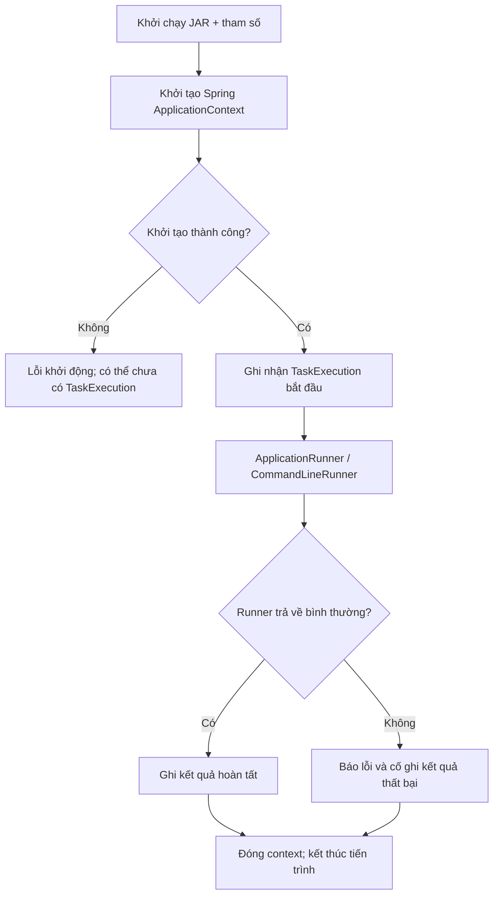

# Kết thúc bình thường và lỗi không được xử lý

## 1. Vì sao cần phân biệt các cách kết thúc Spring Cloud Task?

**Spring Cloud Task** là nền tảng xây dựng ứng dụng Spring Boot chạy trong thời gian hữu hạn: khởi động, xử lý công việc, ghi nhận quá trình thực thi qua `TaskRepository` rồi kết thúc. Một tác vụ có thể được khởi chạy theo lịch, theo yêu cầu hoặc từ một hệ thống điều phối; sau mỗi lần chạy, người vận hành phải biết **đã thành công**, **đã thất bại** hay **chưa thể xác định kết quả**.

Việc thấy tiến trình Java đã dừng chưa đủ để kết luận công việc thành công. Chương trình có thể hoàn tất bình thường, ném ngoại lệ chưa được xử lý, gặp lỗi từ lúc khởi động, bị kill cưỡng bức hoặc mất kết nối đến database khi ghi trạng thái cuối. Các tình huống này có ảnh hưởng khác nhau đến dữ liệu nghiệp vụ và bản ghi `TaskExecution`.

**Mục tiêu học tập:** Sau bài này, bạn có thể:

- Mô tả vòng đời một task từ khởi động đến ghi trạng thái kết thúc.
- Phân biệt Runner hoàn tất bình thường với exception thoát khỏi `ApplicationRunner` hoặc `CommandLineRunner`.
- Diễn giải `START_TIME`, `END_TIME`, `EXIT_CODE`, `EXIT_MESSAGE`, `ERROR_MESSAGE` trong repository.
- Giải thích mối liên hệ giữa exception, rollback, kết quả Task và exit code của tiến trình.
- Chọn chiến lược xử lý lỗi, theo dõi trạng thái, chạy lại và vận hành an toàn.

## 2. Ba loại kết quả cần phân biệt

| Phạm vi | Thành phần quyết định | Câu hỏi cần trả lời |
| --- | --- | --- |
| **Kết quả nghiệp vụ** | Service, transaction, dữ liệu và hệ thống ngoài | Đơn hàng, file hoặc dữ liệu đã được xử lý đúng chưa? |
| **Kết quả Task** | Spring Cloud Task, `TaskRepository` và `TaskExecution` | Framework đã ghi nhận lần chạy hoàn thành hay lỗi chưa? |
| **Kết quả tiến trình** | Spring Boot, JVM, hệ điều hành, scheduler | Process còn chạy hay đã thoát với exit code nào? |

Ba phạm vi liên quan nhưng không đồng nhất. Ví dụ, một service ghi log rồi bỏ qua ngoại lệ có thể khiến Runner kết thúc bình thường dù dữ liệu còn thiếu. Ngược lại, dữ liệu đã commit có thể vẫn tồn tại nếu tiến trình bị kill trước khi cập nhật bản ghi Task.

Một hệ thống đáng tin cậy cần đối chiếu **trạng thái dữ liệu + metadata Task + log + exit code**. Không suy ra toàn bộ kết quả chỉ từ một nguồn.

## 3. Vòng đời khởi động và kết thúc

### 3.1. Các bước chính

Một ứng dụng Spring Cloud Task phổ biến trải qua:

1. Cron, người dùng hoặc hệ thống điều phối khởi chạy JAR cùng tham số và biến môi trường.
2. `SpringApplication.run(...)` khởi tạo `ApplicationContext`, bean, datasource và hạ tầng Task.
3. Khi hạ tầng sẵn sàng, Spring Cloud Task ghi nhận thời điểm bắt đầu một `TaskExecution` trong `TaskRepository`.
4. Spring Boot gọi `ApplicationRunner`/`CommandLineRunner` để thực hiện logic nghiệp vụ.
5. Khi Runner hoàn tất hoặc phát sinh lỗi chưa xử lý, framework cố ghi nhận kết quả cuối của Task.
6. Context được đóng theo cấu hình; khi không có luồng hoặc thành phần giữ JVM sống, tiến trình kết thúc.



Sơ đồ mô tả các giai đoạn **thường gặp**, không cam kết mọi callback luôn chạy. Nếu database chưa kết nối được, schema Task lỗi, tiến trình bị dừng cưỡng bức hoặc JVM gặp lỗi nghiêm trọng, một số bước có thể không xảy ra.

### 3.2. Runner hoàn tất không luôn đồng nghĩa JVM đã dừng

`ApplicationRunner.run(...)` trả về nghĩa là Runner hoàn tất phần việc đồng bộ của nó. Nếu ứng dụng vẫn có web server, thread không phải daemon, executor đang chạy hoặc các nguồn giữ tiến trình khác, JVM có thể chưa thoát.

Ứng dụng Task thường cấu hình:

```yaml
spring:
  main:
    web-application-type: none
  cloud:
    task:
      closecontextEnabled: true
```

`spring.main.web-application-type=none` giúp tác vụ không mở web server không cần thiết. Tùy chọn đóng context của Spring Cloud Task cần được kiểm tra theo phiên bản đang dùng; các executor và tài nguyên do ứng dụng tự tạo vẫn phải được quản lý đúng vòng đời.

Spring Cloud Task ghi nhận một lần thực thi; nó **không tự lập lịch**. Nếu cần chạy hằng đêm hoặc theo lịch cố định, cron, Kubernetes CronJob hay hệ thống điều phối chịu trách nhiệm tạo lần chạy mới.

## 4. Kết thúc bình thường (normal completion)

### 4.1. Khi nào Runner được coi là hoàn tất?

Ở cấp Spring Boot, Runner hoàn tất bình thường khi phương thức `run(...)` **trả về mà không ném ngoại lệ ra ngoài**. Một ứng dụng được thiết kế tốt nên chỉ cho Runner trả về sau khi:

- Đã xác thực đầu vào và quyết định công việc hợp lệ.
- Đã hoàn thành những bước nghiệp vụ bắt buộc.
- Các giao dịch cần commit đã commit thành công.
- Các thao tác bất đồng bộ quan trọng đã được chờ kết thúc và kiểm tra kết quả.
- Các trường hợp bỏ qua (nếu có) tuân theo quy tắc nghiệp vụ rõ ràng.

Ví dụ:

```java
import org.springframework.boot.ApplicationRunner;
import org.springframework.context.annotation.Bean;
import org.springframework.context.annotation.Configuration;

@Configuration
public class ImportRunnerConfig {
    @Bean
    ApplicationRunner importRunner(ImportService service) {
        return args -> {
            int count = service.importPendingData();
            System.out.println("Hoàn thành, số bản ghi: " + count);
        };
    }
}
```

Giả sử `importPendingData()` chỉ trả về sau khi toàn bộ bước bắt buộc hoàn tất, Runner cũng kết thúc bình thường. Spring Cloud Task cố ghi trạng thái kết thúc thành công. Với cấu hình mặc định phổ biến, exit code khi thành công bằng **0**.

**Giới hạn cần hiểu:** Dòng log `Hoàn thành` không chứng minh metadata đã được lưu thành công, còn metadata kết thúc bình thường cũng không tự chứng minh nghiệp vụ đúng nếu code đã nuốt lỗi.

### 4.2. TaskExecution ghi những gì?

`TaskRepository` quản lý một `TaskExecution` cho **mỗi lần thực thi Task**, không phải cho từng bước trong Runner. Các thuộc tính thường gặp:

| Thuộc tính | Ý nghĩa |
| --- | --- |
| `taskExecutionId` | Định danh riêng cho lần chạy |
| `taskName` | Tên logic của tác vụ |
| `startTime` | Thời điểm framework ghi nhận bắt đầu |
| `endTime` | Thời điểm ghi nhận kết thúc; có thể chưa có nếu Task bị gián đoạn |
| `exitCode` | Mã kết quả ở cấp Task |
| `exitMessage` | Thông điệp kết thúc, nếu có |
| `errorMessage` | Thông tin ngoại lệ được ghi nhận, nếu có |

Với schema Spring Cloud Task phù hợp, có thể kiểm tra bảng metadata:

```sql
SELECT TASK_EXECUTION_ID,
       TASK_NAME,
       START_TIME,
       END_TIME,
       EXIT_CODE,
       EXIT_MESSAGE,
       ERROR_MESSAGE
FROM TASK_EXECUTION
ORDER BY TASK_EXECUTION_ID DESC;
```

Không dùng riêng `START_TIME` để kết luận Task đã hoàn tất. Bản ghi thiếu `END_TIME` có thể đang chạy, bị kill hoặc không lưu được kết quả cuối.

## 5. Lỗi không được xử lý (unhandled exception)

### 5.1. Ngoại lệ thoát khỏi Runner

Ví dụ một Runner không bắt lỗi:

```java
@Bean
ApplicationRunner failingRunner() {
    return args -> {
        throw new IllegalStateException(
                "Dữ liệu đầu vào không hợp lệ");
    };
}
```

Khi `IllegalStateException` thoát khỏi `run(...)`, Spring Boot coi quá trình chạy ứng dụng có lỗi. Nếu `TaskRepository` đã khởi tạo và còn truy cập được, Spring Cloud Task có cơ hội ghi trạng thái thất bại, mã kết thúc và thông tin lỗi vào `TaskExecution`. Process thường kết thúc với exit code **khác 0**, nhưng con số cụ thể phụ thuộc cơ chế ánh xạ exit code và môi trường chạy.

**Không có bảo đảm** mọi exception đều tạo được một bản ghi lỗi. Nếu context lỗi trước khi repository được khởi tạo, hoặc database đứt kết nối khi cập nhật kết quả cuối, repository có thể thiếu bản ghi hoặc chưa có `END_TIME`.

### 5.2. So sánh các cách kết thúc

| Tình huống | Trạng thái Runner | Metadata Task | Dữ liệu nghiệp vụ |
| --- | --- | --- | --- |
| Tất cả bước hoàn thành | Trả về bình thường | Thường có thời điểm kết thúc và mã thành công | Thay đổi đã commit được giữ |
| Runtime exception thoát khỏi Runner | Bất thường | Framework cố ghi lỗi | Transaction đang hoạt động có thể rollback |
| Exception được bắt và nuốt | Trả về bình thường | Có thể ghi thành công dù nghiệp vụ lỗi | Có thể thiếu một phần dữ liệu |
| Lỗi khi khởi tạo `ApplicationContext` | Runner chưa chạy | Có thể chưa có `TaskExecution` | Thường chưa bắt đầu nghiệp vụ |
| Process bị kill hoặc mất điện | Không hoàn tất đường đi thông thường | Có thể thiếu `END_TIME`/mã cuối | Thay đổi đã commit vẫn còn; phần chưa commit thường rollback |
| Runner khởi chạy async rồi trả về sớm | Trả về bình thường | Có thể ghi hoàn thành quá sớm | Công việc nền chưa chắc đã hoàn tất |

Các kết quả trên là cách diễn giải thường gặp. Trình tự callback và khả năng cập nhật metadata tùy tình trạng thực tế của JVM, repository và phiên bản framework.

### 5.3. Vì sao không nên che giấu lỗi?

Ví dụ sau dễ làm trạng thái Task sai:

```java
@Bean
ApplicationRunner misleadingRunner(ImportService service) {
    return args -> {
        try {
            service.importPendingData();
        } catch (RuntimeException ex) {
            System.err.println("Đã gặp lỗi: " + ex.getMessage());
            // Nuốt lỗi: Runner vẫn kết thúc bình thường.
        }
    };
}
```

Nếu lỗi khiến nhiệm vụ không thể hoàn thành, hãy cho ngoại lệ lan lên hoặc ghi log rồi **ném lại**:

```java
@Bean
ApplicationRunner correctRunner(ImportService service) {
    return args -> service.importPendingData();
}
```

Nếu một bản ghi lỗi được **cho phép bỏ qua** theo hợp đồng nghiệp vụ, có thể ghi nhận riêng số bản ghi bỏ qua và tiếp tục. Hãy xác định rõ thế nào là kết thúc thành công thay vì để mọi ngoại lệ đều bị bỏ qua.

## 6. Thực hành: quan sát thành công, thất bại và rollback

Ta xây dựng một Spring Cloud Task nhận `--record-id` và cờ `--fail`, ghi một dòng dữ liệu vào PostgreSQL. Nếu có `--fail`, service cố ý ném lỗi runtime trước khi commit để minh họa sự khác biệt giữa metadata Task và dữ liệu nghiệp vụ.

### 6.1. Chuẩn bị dữ liệu và cấu hình

Dự án cần dùng phiên bản Spring Boot và Spring Cloud Task tương thích; thêm `spring-cloud-starter-task`, `spring-boot-starter-jdbc` và PostgreSQL driver. Chuẩn bị các bảng `TASK_*` bằng DDL đúng phiên bản Spring Cloud Task, bên cạnh bảng nghiệp vụ sau:

```sql
CREATE TABLE task_messages (
    id BIGINT PRIMARY KEY,
    body VARCHAR(200) NOT NULL
);
```

Ví dụ `application.yml`:

```yaml
spring:
  application:
    name: lifecycle-demo-task
  main:
    web-application-type: none
  datasource:
    url: ${TASK_DB_URL:jdbc:postgresql://localhost:5432/taskdb}
    username: ${TASK_DB_USER:task_user}
    password: ${TASK_DB_PASSWORD}
  cloud:
    task:
      closecontextEnabled: true
      initialize-enabled: false
```

`initialize-enabled: false` chỉ phù hợp khi đã tạo bảng metadata từ trước. Nếu thiếu schema Task, ứng dụng có thể lỗi trước khi Runner chạy. `TASK_DB_PASSWORD` phải được cung cấp bằng biến môi trường hoặc hệ thống quản lý secret; không truyền mật khẩu qua tham số dòng lệnh.

### 6.2. Service nghiệp vụ có transaction

```java
import org.springframework.jdbc.core.JdbcTemplate;
import org.springframework.stereotype.Service;
import org.springframework.transaction.annotation.Transactional;

@Service
public class MessageService {
    private final JdbcTemplate jdbc;

    public MessageService(JdbcTemplate jdbc) {
        this.jdbc = jdbc;
    }

    @Transactional
    public void process(long id, boolean fail) {
        jdbc.update(
                "INSERT INTO task_messages (id, body) VALUES (?, ?)",
                id, "Đã xử lý");

        if (fail) {
            throw new IllegalStateException(
                    "Lỗi mô phỏng trước commit, id=" + id);
        }
    }
}
```

Với transaction manager được cấu hình phù hợp và lời gọi đi qua Spring proxy, ngoại lệ `IllegalStateException` kích hoạt rollback theo quy tắc mặc định. Dòng vừa chèn sẽ không được commit.

### 6.3. ApplicationRunner xử lý hai nhánh

```java
import java.util.List;
import org.springframework.boot.ApplicationArguments;
import org.springframework.boot.ApplicationRunner;
import org.springframework.boot.SpringApplication;
import org.springframework.boot.autoconfigure.SpringBootApplication;
import org.springframework.cloud.task.configuration.EnableTask;
import org.springframework.context.annotation.Bean;

@SpringBootApplication
@EnableTask
public class LifecycleDemoTaskApplication {

    public static void main(String[] args) {
        SpringApplication.run(LifecycleDemoTaskApplication.class, args);
    }

    @Bean
    ApplicationRunner runner(MessageService service) {
        return args -> {
            long id = parseRecordId(args);

            if (args.containsOption("fail")
                    && !args.getOptionValues("fail").isEmpty()) {
                throw new IllegalArgumentException(
                        "--fail là cờ không nhận giá trị");
            }
            boolean fail = args.containsOption("fail");

            service.process(id, fail);
            System.out.println("Hoàn tất xử lý id=" + id);
        };
    }

    private static long parseRecordId(ApplicationArguments args) {
        List<String> values = args.getOptionValues("record-id");
        if (values == null || values.size() != 1
                || values.get(0).isBlank()) {
            throw new IllegalArgumentException(
                    "Cần đúng một --record-id=<số nguyên>");
        }
        try {
            return Long.parseLong(values.get(0));
        } catch (NumberFormatException ex) {
            throw new IllegalArgumentException(
                    "--record-id phải là số nguyên 64-bit", ex);
        }
    }
}
```

Ở đây chỉ có **một Runner nghiệp vụ**. Nếu ứng dụng có nhiều Runner, một lần khởi động Task vẫn không tự tạo `TaskExecution` riêng cho từng Runner. Dữ liệu do Runner trước commit cũng không tự động được rollback nếu Runner sau thất bại.

### 6.4. Chạy nhánh thành công

Sau khi build, thay tên JAR ví dụ bằng tên thực tế rồi chạy:

```bash
java -jar target/lifecycle-demo-task.jar --record-id=101
```

Khi mọi cấu hình hợp lệ:

1. `MessageService.process(101, false)` chèn dòng `101` và commit.
2. Runner in `Hoàn tất xử lý id=101` và trả về bình thường.
3. Spring Cloud Task cố ghi kết quả kết thúc thành công vào repository.

Kiểm tra:

```sql
SELECT id, body FROM task_messages WHERE id = 101;
SELECT TASK_EXECUTION_ID, TASK_NAME, END_TIME, EXIT_CODE
FROM TASK_EXECUTION
ORDER BY TASK_EXECUTION_ID DESC;
```

Kỳ vọng có bản ghi nghiệp vụ `101` và một `TaskExecution` đã kết thúc thành công, thông thường exit code `0`.

### 6.5. Chạy nhánh lỗi

Chọn ID khác để tránh lỗi trùng khóa không liên quan:

```bash
java -jar target/lifecycle-demo-task.jar --record-id=102 --fail
```

Diễn biến:

1. Runner parse đầu vào và gọi `service.process(102, true)`.
2. Service thực hiện `INSERT` rồi ném `IllegalStateException` trước commit.
3. Transaction manager rollback `INSERT`.
4. Ngoại lệ thoát khỏi Runner; Spring Boot báo lỗi và Spring Cloud Task cố ghi nhận thất bại.

Kiểm tra cả hai bảng:

```sql
SELECT id, body FROM task_messages WHERE id IN (101, 102);

SELECT TASK_EXECUTION_ID, TASK_NAME, START_TIME, END_TIME,
       EXIT_CODE, ERROR_MESSAGE
FROM TASK_EXECUTION
ORDER BY TASK_EXECUTION_ID DESC;
```

Kỳ vọng bảng nghiệp vụ chỉ có `id=101`; dòng `102` không tồn tại vì rollback. Metadata thường có **hai lần chạy riêng**: một thành công và một lỗi. Không kết luận “task chưa chạy” chỉ vì bản ghi nghiệp vụ `102` không còn.

## 7. Ngoại lệ, rollback và phạm vi giao dịch

### 7.1. Lỗi Task không đồng nghĩa hoàn tác toàn bộ công việc

`@Transactional` mặc định đánh dấu rollback cho `RuntimeException` hoặc `Error` khi ngoại lệ thoát khỏi phương thức được Spring quản lý. Với **checked exception**, quy tắc mặc định thường không rollback nếu không cấu hình `rollbackFor`.

Ví dụ:

```java
import java.io.IOException;
import org.springframework.transaction.annotation.Transactional;

@Transactional(rollbackFor = IOException.class)
public void importFile() throws IOException {
    // Thực hiện thao tác SQL thuộc cùng transaction.
    // IOException thoát khỏi phương thức sẽ kích hoạt rollback.
}
```

Đây là mẫu **phương thức cần đặt bên trong một Spring bean**, được gọi qua proxy; không phải lớp Java hoàn chỉnh. Nếu bỏ `rollbackFor` mà phương thức ghi dữ liệu rồi ném `IOException`, Runner có thể thất bại trong khi giao dịch service vẫn commit theo quy tắc mặc định.

Một transaction chỉ chi phối những thao tác thực sự tham gia vào nó. Nếu Task đã commit phần A trước khi lỗi ở phần B, giao dịch B rollback **không** tự hoàn tác A. Tương tự, gửi HTTP, email hoặc thông điệp ra hệ thống khác không tự được rollback cùng JDBC.

### 7.2. Thiết kế chống xử lý trùng khi chạy lại

Ví dụ Task đã xử lý và commit 80 đơn hàng, rồi lỗi ở đơn thứ 81. Bộ lập lịch retry toàn bộ chương trình có thể chạm lại 80 đơn đầu. Cần dùng một hoặc nhiều cơ chế:

- Điều kiện cập nhật theo trạng thái, khóa nghiệp vụ và ràng buộc unique trong database.
- Ghi nhận checkpoint hoặc dấu đã xử lý.
- Giao dịch nhỏ theo từng đơn vị dữ liệu thay vì giữ một transaction cực dài.
- Cơ chế outbox/idempotency key khi thao tác với hệ thống bên ngoài.

**`TaskRepository` theo dõi quá trình thực thi**, không tự cung cấp exactly-once cho các thay đổi nghiệp vụ. Mỗi lần retry có thể tạo một `TaskExecution` mới, nhưng dữ liệu cần được thiết kế để chạy lại an toàn.

## 8. Exit code, exception và tín hiệu cho hệ điều phối

### 8.1. Mã kết thúc có ý nghĩa gì?

Mã `exitCode` trong `TaskExecution` thuộc metadata Task; exit code của hệ điều hành là mã mà shell/Kubernetes Job/scheduler nhận từ **process**. Thông thường mã `0` biểu thị thành công, còn khác `0` biểu thị thất bại. Tuy nhiên:

- Các mã lỗi cụ thể có thể được tùy chỉnh bằng `ExitCodeGenerator` hoặc `ExitCodeExceptionMapper` của Spring Boot.
- Cách bắt ngoại lệ, thoát process hoặc đóng context có thể ảnh hưởng tới mã mà hệ điều phối nhìn thấy.
- Nếu process bị kill cứng hoặc repository không còn ghi được, mã process và metadata Task có thể không nhất quán hoặc thiếu dữ liệu.

Ví dụ một **quy ước nội bộ đề xuất**, không phải chuẩn bắt buộc của Spring Cloud Task:

| Mã | Ý nghĩa trong ứng dụng | Retry |
| --- | --- | --- |
| `0` | Hoàn thành | Không cần |
| `2` | Tham số đầu vào không hợp lệ | Thường phải sửa đầu vào trước |
| `3` | Hạ tầng phụ thuộc tạm thời không khả dụng | Có thể retry sau khi kiểm tra |
| `4` | Lỗi nghiệp vụ cần can thiệp | Tùy tình huống và chính sách |

Không dùng `System.exit(0)` sau khi gặp lỗi quan trọng: bộ điều phối có thể hiểu nhầm là thành công. Nếu cần ánh xạ mã lỗi riêng, nên cấu hình theo cơ chế exit code của Spring Boot và kiểm chứng với môi trường thực thi thực tế.

### 8.2. Không gọi System.exit đột ngột giữa Runner

Cách dưới đây làm mất cơ hội thực thi đường lỗi thông thường:

```java
if (invalidInput) {
    System.exit(2); // Không nên gọi trực tiếp trong Runner.
}
```

Nên thể hiện lỗi rõ ràng:

```java
if (invalidInput) {
    throw new IllegalArgumentException(
            "Thiếu tham số bắt buộc --source");
}
```

Để exception lan lên giúp Spring Boot/Spring Cloud Task có cơ hội xử lý, ghi log, đóng context và cập nhật trạng thái. Một lời gọi `System.exit(...)` từ logic nghiệp vụ có thể cắt ngang vòng đời thông thường; không nên coi callback hay khối `finally` chắc chắn sẽ chạy sau khi process bị dừng cưỡng bức.

## 9. Quan sát vòng đời bằng TaskExecutionListener

Spring Cloud Task cung cấp `TaskExecutionListener` để nhận thông báo liên quan tới bắt đầu, kết thúc và lỗi. Có thể dùng cho log hoặc metric, ví dụ:

```java
import org.slf4j.Logger;
import org.slf4j.LoggerFactory;
import org.springframework.cloud.task.listener.TaskExecutionListener;
import org.springframework.cloud.task.repository.TaskExecution;
import org.springframework.stereotype.Component;

@Component
public class TaskLogListener implements TaskExecutionListener {
    private static final Logger log =
            LoggerFactory.getLogger(TaskLogListener.class);

    @Override
    public void onTaskStartup(TaskExecution execution) {
        log.info("Task bắt đầu, id={}", execution.getExecutionId());
    }

    @Override
    public void onTaskEnd(TaskExecution execution) {
        log.info("Task kết thúc, id={}, exitCode={}",
                execution.getExecutionId(), execution.getExitCode());
    }

    @Override
    public void onTaskFailed(
            TaskExecution execution, Throwable throwable) {
        log.error("Task thất bại, id={}",
                execution.getExecutionId(), throwable);
    }
}
```

Ví dụ dùng API listener phổ biến của Spring Cloud Task; kiểm tra tên phương thức và cấu hình đăng ký theo phiên bản dependency thực tế. Listener giúp ghi nhận sự kiện **khi framework có thể gọi callback**, nhưng không bảo đảm chạy nếu JVM crash, tiến trình bị kill hoặc lỗi xảy ra trước khi listener khởi tạo.

Không đặt thao tác nghiệp vụ quan trọng chỉ trong listener rồi kỳ vọng nó luôn được thực thi đúng một lần. Công việc khôi phục sau lỗi hệ thống cần có sự hỗ trợ của scheduler, trạng thái dữ liệu bền vững và cơ chế retry phù hợp.

## 10. Phân biệt lỗi sớm, lỗi khi chạy và dừng cưỡng bức

| Giai đoạn | Ví dụ | Hệ quả có thể gặp |
| --- | --- | --- |
| Trước khi context sẵn sàng | Sai classpath, lỗi cấu hình, không thể tạo bean | Chưa có `TaskExecution` |
| Khi TaskRepository khởi tạo | Database không kết nối, thiếu schema `TASK_*` | Metadata không thể được ghi đúng |
| Trong Runner | Tham số sai, SQL lỗi, API timeout | Có thể ghi Task lỗi nếu repository hoạt động |
| Khi đóng context | Lỗi giải phóng tài nguyên, mất kết nối | Metadata có thể không phản ánh đầy đủ vấn đề |
| Kill cưỡng bức | `kill -9`, container bị dừng, mất điện | Không trông đợi callback hoặc `finally` chạy |

### 10.1. Graceful shutdown

Khi còn thời gian để dừng có kiểm soát, ứng dụng nên ngừng tạo công việc mới, chờ phần đang xử lý đến điểm an toàn, giải phóng connection/executor và cho framework ghi trạng thái nếu có thể. Tuy vậy, tín hiệu dừng như `SIGTERM` không bảo đảm JVM luôn đủ thời gian hoàn tất; một hệ điều phối có thể kill sau khoảng thời gian ân hạn.

### 10.2. Bản ghi chưa có END_TIME

Một truy vấn hữu ích:

```sql
SELECT TASK_EXECUTION_ID, TASK_NAME, START_TIME, EXIT_CODE
FROM TASK_EXECUTION
WHERE END_TIME IS NULL
ORDER BY START_TIME;
```

Các dòng này có thể đại diện cho Task vẫn chạy hoặc Task bị gián đoạn. **Không retry ngay chỉ vì `END_TIME` rỗng**: kiểm tra trạng thái process, lịch chạy, log, timeout và khóa nghiệp vụ. Retry khi lần chạy cũ chưa dừng có thể dẫn đến hai tiến trình xử lý đồng thời cùng dữ liệu.

## 11. Phối hợp với Spring Batch và lịch chạy

Khi một Spring Cloud Task khởi động Spring Batch Job, thường có hai lớp metadata:

- `TaskExecution` ghi nhận **vòng đời tiến trình Task**.
- `JobExecution` và `StepExecution` ghi nhận **vòng đời Batch Job/Step**; Spring Batch dùng metadata này để phục vụ khả năng restart.

Không mặc định suy ra trạng thái `FAILED` của `JobExecution` sẽ luôn tạo exit code thất bại ở cấp Task trong mọi cách tích hợp. Nếu ứng dụng tự khởi chạy Job, bắt lỗi rồi trả về bình thường, Runner có thể vẫn bị xem là thành công. Khi đó cần chủ động quyết định khi nào phát tín hiệu thất bại cho Runner và hệ điều phối.

```text
Spring Cloud Task
  └── ApplicationRunner
        └── Spring Batch Job
              ├── Step A
              └── Step B (có thể thất bại)

Cần quan sát:
  - JobExecution/StepExecution có trạng thái gì?
  - Runner có chuyển kết quả Batch thành lỗi Task không?
  - Scheduler nên retry Task hay restart Batch Job?
```

Với cron hoặc Kubernetes CronJob, hệ thống điều phối thường sử dụng exit code và trạng thái Job/Pod để quyết định retry. Spring Cloud Task bổ sung lịch sử thực thi trong database. Nên kết hợp cả hai nguồn và thiết kế idempotency, tránh retry mù quáng một Batch Job vốn đã có cơ chế restart và `JobParameters` riêng.

## 12. Xử lý lỗi an toàn trong production

### 12.1. Quy tắc thiết kế

1. **Xác thực đầu vào sớm:** từ chối tham số thiếu, sai kiểu hoặc ngoài phạm vi ngay trong Runner trước khi ghi dữ liệu.
2. **Định nghĩa thành công theo nghiệp vụ:** không mặc định “không có exception” nghĩa là mọi bản ghi đã xử lý đúng.
3. **Giao dịch vừa đủ:** mỗi phần việc có ranh giới commit/rollback thích hợp; xử lý rõ phần đã commit trước lỗi.
4. **Không nuốt lỗi nghiêm trọng:** để ngoại lệ lan lên hoặc biểu diễn thất bại bằng cơ chế framework được hỗ trợ.
5. **Giữ nguồn quan sát độc lập:** log có ID lần chạy, mã thoát, metadata Task và số liệu nghiệp vụ.
6. **Retry có điều kiện:** chỉ chạy lại sau khi xác nhận lần trước không còn xử lý đồng thời và thao tác retry an toàn.
7. **Tránh lộ bí mật:** không truyền password/token qua CLI; các đối số có thể xuất hiện trong log hoặc metadata Task.

### 12.2. Điều tra một lần chạy lỗi

Đặt câu hỏi theo thứ tự:

- Có log process bắt đầu không? Runner đã được gọi chưa?
- Có `TaskExecution` không, và `START_TIME`/`END_TIME`/`EXIT_CODE` đang ra sao?
- Có `ERROR_MESSAGE` hoặc stack trace không? Repository có gặp lỗi ghi không?
- Process có còn hoạt động, bị timeout hay được hệ điều phối đánh dấu failed không?
- Những thay đổi nghiệp vụ nào đã commit, rollback hoặc chưa rõ?
- Nếu cần retry, có khóa nghiệp vụ hoặc cơ chế idempotency nào ngăn trùng lặp không?

## 13. Bài tập thực hành

**Bài tập 1 — Kết thúc bình thường:** Chạy ví dụ `--record-id=101` và đối chiếu log, bảng `task_messages`, `TASK_EXECUTION` và exit code process.

**Bài tập 2 — Ngoại lệ chưa xử lý:** Chạy `--record-id=102 --fail`. Giải thích vì sao `task_messages` không có dòng `102` trong khi repository vẫn có thể ghi lịch sử Task thất bại.

**Bài tập 3 — Bắt và nuốt lỗi:** Viết Runner cố tình bắt `IllegalStateException` rồi chỉ log, quan sát kết quả Task. Sau đó sửa code để ngoại lệ thoát ra và so sánh.

**Bài tập 4 — Checked exception:** Cho một service `@Transactional` ghi SQL rồi ném `IOException`. Dự đoán thay đổi nghiệp vụ theo cấu hình mặc định và sửa bằng `rollbackFor`.

**Bài tập 5 — Lỗi khởi tạo:** Trong môi trường kiểm thử, cố ý cấu hình URL database sai. Kiểm tra log process và giải thích tại sao có thể không có `TaskExecution`.

**Bài tập 6 — Chạy lại:** Một Task đã commit 80/100 bản ghi rồi lỗi. Thiết kế cách retry an toàn khi job được chạy lại theo lịch.

**Bài tập 7 — Batch:** Vẽ quan hệ Task → Runner → Job → Step. Khi Step thất bại, chỉ ra nơi cần kiểm tra `JobExecution`, cách báo thất bại ở cấp Task và điều kiện retry.

## 14. Ghi nhớ

- **Runner trả về bình thường** chỉ đáng tin khi logic nghiệp vụ đã kiểm tra tất cả điều kiện bắt buộc.
- **Exception thoát khỏi Runner** là tín hiệu để Spring Boot và Spring Cloud Task xử lý lỗi, nhưng việc ghi metadata vẫn phụ thuộc repository hoạt động.
- **Rollback transaction** không xóa được những thay đổi đã commit trước đó hoặc hiệu ứng đã gửi sang hệ thống ngoài.
- **Một TaskExecution chưa có END_TIME** chưa đủ để kết luận tiến trình còn sống hay đã chết.
- **Kết quả Task, exit code process và dữ liệu nghiệp vụ** cần được đối chiếu trước khi ra quyết định chạy lại.

## Tài liệu tham khảo

- [Spring Cloud Task Reference](https://docs.spring.io/spring-cloud-task/reference/): vòng đời Task, `TaskRepository` và xử lý kết quả thực thi.
- [Spring Cloud Task — Features](https://docs.spring.io/spring-cloud-task/reference/features.html): `TaskExecution`, listener và cấu hình Task.
- [Spring Boot — SpringApplication](https://docs.spring.io/spring-boot/reference/features/spring-application.html): `ApplicationRunner`, `CommandLineRunner` và exit code.
- [Spring Framework — Declarative Transaction Management](https://docs.spring.io/spring-framework/reference/data-access/transaction/declarative.html): transaction và quy tắc rollback.
- [Spring Batch Reference](https://docs.spring.io/spring-batch/reference/): `JobExecution`, `StepExecution` và restart Batch.
