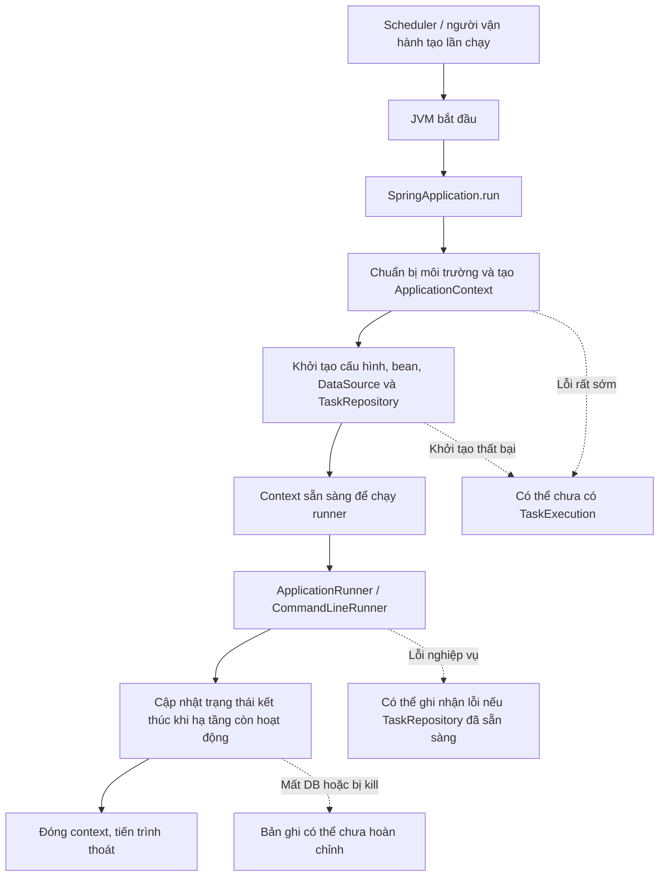
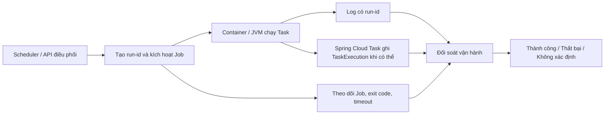

# Lỗi khởi tạo ApplicationContext và giới hạn ghi nhận thực thi

Trong module **SPRING_CLOUD_TASK**, một tác vụ là ứng dụng Spring Boot có thời gian chạy hữu hạn: khởi động, thực hiện công việc, ghi nhận kết quả rồi kết thúc. Spring Cloud Task hỗ trợ theo dõi từng lần chạy qua `TaskExecution` và `TaskRepository`. Tuy nhiên, có một giới hạn rất quan trọng: **nếu ứng dụng hỏng ngay trong lúc tạo `ApplicationContext`, hạ tầng theo dõi tác vụ có thể chưa kịp khởi tạo hoặc ghi bản ghi thực thi**.

Bài học thuộc chương **Vòng đời**, tập trung vào mối quan hệ giữa tiến trình hệ điều hành, quá trình khởi động Spring Boot và metadata do Spring Cloud Task ghi nhận. Hiểu ranh giới này giúp thiết kế cơ chế xử lý lỗi, chạy theo lịch hoặc theo yêu cầu, đối soát với Spring Batch và vận hành tác vụ an toàn.

## 1. Mục tiêu học tập

Sau bài này, bạn có thể:

- Trình bày các giai đoạn từ lúc JVM chạy đến khi `ApplicationContext` sẵn sàng, runner thực thi và ứng dụng kết thúc.
- Giải thích vì sao lỗi tạo bean, cấu hình JDBC hoặc cấu hình Spring có thể khiến lần chạy **không xuất hiện** trong `TaskRepository`.
- Phân biệt bản ghi **không tồn tại**, bản ghi **chưa có thời điểm kết thúc** và bản ghi **đã ghi nhận thất bại**.
- Xây dựng ví dụ gây lỗi trong giai đoạn tạo context và trong `ApplicationRunner`, sau đó phân tích log, exit code và metadata.
- Thiết kế cách giám sát từ scheduler/container, đối soát lịch sử tác vụ và xử lý retry mà không nhân đôi tác động nghiệp vụ.

## 2. Vòng đời ứng dụng và vị trí của TaskRepository

Một ứng dụng Spring Cloud Task thường bắt đầu bằng `SpringApplication.run(...)`. Trong lời gọi này, Spring Boot chuẩn bị môi trường, tạo `ApplicationContext`, nạp cấu hình, khởi tạo bean, hoàn thiện context rồi chạy các `ApplicationRunner`/`CommandLineRunner` đã đăng ký. Hạ tầng Spring Cloud Task tham gia quản lý metadata trong quá trình khởi động và kết thúc.



**Đây là sơ đồ khái niệm**, không phải cam kết về thứ tự chính xác từng callback nội bộ của mọi phiên bản Spring Boot/Spring Cloud Task. Thời điểm tạo và cập nhật `TaskExecution` phụ thuộc cơ chế vòng đời và phiên bản thư viện. Điều có thể dựa vào khi thiết kế là: **chỉ các thành phần đã khởi tạo và còn truy cập được mới có khả năng ghi metadata**.

Ba khái niệm liên quan nhưng không đồng nhất:

| Thành phần | Chịu trách nhiệm | Giới hạn |
| --- | --- | --- |
| **Tiến trình JVM / container** | Khởi chạy chương trình, cung cấp PID, thời gian chạy và mã thoát | Có thể kết thúc trước khi Spring kịp khởi tạo |
| **`ApplicationContext`** | Nạp cấu hình, tạo bean, quản lý vòng đời của ứng dụng | Có thể thất bại trước khi runner được gọi |
| **`TaskRepository`** | Lưu thông tin `TaskExecution` qua cấu hình lưu trữ phù hợp | Không thể ghi khi chưa sẵn sàng, không có kết nối hoặc tiến trình chết đột ngột |

Vì thế, **Spring Cloud Task không thể tự bảo đảm có một bản ghi database cho mọi lần hệ điều hành từng cố gắng khởi động chương trình**. Scheduler hoặc container runtime nhìn thấy một phạm vi rộng hơn phần mà `TaskRepository` có thể quan sát.

## 3. Lỗi khi khởi tạo ApplicationContext là gì?

`ApplicationContext` chứa và quản lý các bean của ứng dụng. Trong quá trình tạo context, Spring có thể gặp lỗi trước khi chuyển quyền điều khiển cho công việc nghiệp vụ.

Các ví dụ thường gặp:

1. **Sai cấu hình:** thiếu thuộc tính bắt buộc, kiểu dữ liệu binding không hợp lệ, profile sai.
2. **Lỗi tạo bean:** constructor, phương thức `@Bean` hoặc `@PostConstruct` ném exception.
3. **Thiếu dependency:** bean cần thiết không tồn tại, vòng phụ thuộc không giải quyết được.
4. **Hỏng kết nối hạ tầng:** DataSource không xác thực được, cơ sở dữ liệu chưa sẵn sàng, schema metadata sai.
5. **Lỗi chạy migration:** thay đổi cấu trúc bảng thất bại hoặc tài khoản database không đủ quyền.
6. **Lỗi classpath / phiên bản:** thiếu class hoặc phiên bản Spring Boot và Spring Cloud không tương thích.

Ví dụ một bean thất bại ngay trong lúc được tạo:

```java
@Bean
Object failingBean() {
    throw new IllegalStateException("Không tải được cấu hình nghiệp vụ");
}
```

Nếu Spring phải khởi tạo bean này trong quá trình refresh context, exception sẽ khiến `SpringApplication.run` thất bại. `ApplicationRunner` chưa có cơ hội xử lý công việc. Lúc đó, **không nên mặc định sẽ có bản ghi `TaskExecution` thể hiện thất bại**.

Đối chiếu với tình huống khác:

```java
@Bean
ApplicationRunner failingRunner() {
    return args -> {
        throw new IllegalStateException("Dữ liệu đầu vào không hợp lệ");
    };
}
```

Runner được thực thi sau khi Spring đã chuẩn bị context đến giai đoạn chạy runner. Hạ tầng tác vụ **có cơ hội** ghi nhận lần chạy và lỗi nếu đã được thiết lập, nhưng bản ghi cuối cùng vẫn phụ thuộc khả năng truy cập `TaskRepository` và cách phiên bản thư viện xử lý sự kiện thất bại.

Điểm phân biệt là **thời điểm lỗi tương đối với quá trình khởi tạo hạ tầng theo dõi tác vụ**, chứ không chỉ tên exception.

## 4. Những trạng thái metadata dễ bị hiểu nhầm

Khi tra cứu lịch sử, thường gặp ba trường hợp:

### 4.1. Không thấy bản ghi TaskExecution

Điều này có thể có nhiều nguyên nhân:

- Scheduler chưa thực sự tạo được tiến trình.
- JVM lỗi trước khi Spring Boot bắt đầu (chẳng hạn thiếu main class, JAR hỏng).
- `ApplicationContext` thất bại quá sớm.
- `TaskRepository` chưa được tạo, cơ sở dữ liệu không kết nối được hoặc schema chưa tồn tại.
- Ứng dụng ghi vào **database/schema khác** với nơi người vận hành đang truy vấn.
- Dữ liệu đã bị dọn dẹp theo chính sách lưu trữ, hoặc đang dùng database trong bộ nhớ đã bị xóa khi JVM thoát.

**Không có bản ghi không chứng minh rằng tác vụ chưa chạy**; cũng không chứng minh rằng nó đã thành công.

### 4.2. Có bản ghi nhưng chưa có END_TIME

Một `TaskExecution` có thể đã được tạo, nhưng chưa có thời điểm kết thúc vì:

- Tác vụ vẫn đang chạy hợp lệ.
- Tiến trình bị `SIGKILL`, hết bộ nhớ hoặc node/container bị mất.
- Hệ thống mất điện, runtime bị dừng đột ngột.
- Hệ thống không thể cập nhật bản ghi cuối vì database ngắt kết nối.

Giá trị `END_TIME = NULL` là **tín hiệu cần kiểm tra thêm**, không đủ để khẳng định tác vụ đang chạy hay đã thất bại. Phải đối chiếu với trạng thái thực tế của PID/container/Job và giới hạn thời gian đã định.

### 4.3. Có bản ghi hoàn tất với exit code thất bại

Khi cơ chế vòng đời hoạt động và ghi metadata thành công, bản ghi có thể chứa exit code khác `0`, thời gian kết thúc và thông tin lỗi. Trường hợp này thuận tiện cho giám sát, nhưng vẫn cần xác nhận nghiệp vụ: hệ thống có thể đã cập nhật một phần dữ liệu trước khi báo lỗi.

| Quan sát | Điều có thể kết luận | Điều chưa thể kết luận |
| --- | --- | --- |
| Không có `TaskExecution` | Kho lưu trữ được truy vấn không có bản ghi khớp điều kiện | Tác vụ chưa từng được khởi chạy |
| Có `START_TIME`, thiếu `END_TIME` | Có ghi nhận bắt đầu nhưng chưa thấy kết thúc trong repository | Tiến trình hiện còn sống |
| Có `END_TIME`, exit code lỗi | Hệ thống đã ghi nhận kết thúc thất bại | Mọi tác động nghiệp vụ đã được rollback |
| Exit code của container bằng `0` | Tiến trình được runtime coi là thoát thành công | Dữ liệu nghiệp vụ chắc chắn đúng và metadata chắc chắn đã lưu |
| Có `TaskExecution` thành công | Hạ tầng đã ghi nhận một lần chạy hoàn tất theo tiêu chí của nó | Các bước kiểm tra dữ liệu nghiệp vụ đều đã đạt |

## 5. Thực hành: tạo hai kiểu lỗi khác nhau

Ví dụ dưới đây cho phép **chủ động gây lỗi khi tạo context** và **gây lỗi khi chạy `ApplicationRunner`**. Mục tiêu là quan sát sự khác biệt, không dựa vào một bản ghi database cụ thể như điều kiện bắt buộc.

### 5.1. Chuẩn bị

Dùng dự án Spring Boot tương thích với Spring Cloud Task. Phần dependency Maven tối thiểu cho ví dụ:

```xml
<dependencies>
    <dependency>
        <groupId>org.springframework.boot</groupId>
        <artifactId>spring-boot-starter</artifactId>
    </dependency>
    <dependency>
        <groupId>org.springframework.cloud</groupId>
        <artifactId>spring-cloud-starter-task</artifactId>
    </dependency>
    <dependency>
        <groupId>org.springframework.boot</groupId>
        <artifactId>spring-boot-starter-jdbc</artifactId>
    </dependency>
    <dependency>
        <groupId>com.h2database</groupId>
        <artifactId>h2</artifactId>
        <scope>runtime</scope>
    </dependency>
</dependencies>
```

Sử dụng Spring Boot parent/BOM và Spring Cloud BOM **đúng release train tương thích**, đồng thời cấu hình `spring-boot-maven-plugin` để đóng gói JAR thực thi. H2 chỉ phục vụ thử nghiệm ngắn tại máy cá nhân.

Tạo `src/main/resources/application.yml`:

```yaml
spring:
  application:
    name: lifecycle-failure-demo
  main:
    web-application-type: none
  datasource:
    url: jdbc:h2:mem:taskdb
    driver-class-name: org.h2.Driver
    username: sa
    password: ""
  cloud:
    task:
      name: lifecycle-failure-demo
      initialize-enabled: true
```

`web-application-type: none` giúp tiến trình không giữ web server chạy liên tục. `initialize-enabled` bật cơ chế khởi tạo schema Task trong môi trường thử nghiệm khi các điều kiện hỗ trợ của phiên bản thư viện được đáp ứng. Trên production, nên sử dụng schema đã quản lý bằng migration và database lưu bền vững.

### 5.2. Mã Java

Tạo `src/main/java/com/example/task/LifecycleFailureDemoApplication.java`:

```java
package com.example.task;

import org.springframework.beans.factory.annotation.Value;
import org.springframework.boot.ApplicationRunner;
import org.springframework.boot.SpringApplication;
import org.springframework.boot.autoconfigure.SpringBootApplication;
import org.springframework.cloud.task.configuration.EnableTask;
import org.springframework.context.ConfigurableApplicationContext;
import org.springframework.context.annotation.Bean;

@SpringBootApplication
@EnableTask
public class LifecycleFailureDemoApplication {

    public static void main(String[] args) {
        ConfigurableApplicationContext context =
                SpringApplication.run(LifecycleFailureDemoApplication.class, args);

        int exitCode = SpringApplication.exit(context);
        System.exit(exitCode);
    }

    @Bean
    Object initializationProbe(
            @Value("${demo.fail-during-init:false}") boolean fail) {

        if (fail) {
            throw new IllegalStateException("Giả lập lỗi tạo ApplicationContext");
        }

        return new Object();
    }

    @Bean
    ApplicationRunner businessRunner(
            @Value("${demo.fail-in-runner:false}") boolean fail) {

        return arguments -> {
            if (fail) {
                throw new IllegalStateException("Giả lập lỗi trong ApplicationRunner");
            }

            System.out.println("Công việc đã hoàn thành");
        };
    }
}
```

**Vai trò của hai công tắc:**

- `--demo.fail-during-init=true` khiến việc tạo bean `initializationProbe` thất bại trong quá trình xây dựng `ApplicationContext`.
- `--demo.fail-in-runner=true` cho phép context khởi tạo, sau đó ném exception tại `ApplicationRunner`.

Lời gọi `SpringApplication.exit(context)` trong `main` chỉ chạy khi `SpringApplication.run` trả về context thành công. Nếu lỗi xảy ra trong quá trình tạo context hoặc chạy runner, `SpringApplication.run` có thể ném exception ra ngoài và đoạn mã sau đó không được thực thi. Với launcher Java thông thường, exception không được xử lý sẽ khiến tiến trình kết thúc thất bại; đừng giả định rằng mã thoát và metadata luôn được cập nhật bởi cùng một cơ chế.

### 5.3. Chạy và quan sát

Đóng gói dự án:

```bash
./mvnw clean package
```

Trên Windows, dùng `mvnw.cmd clean package` thay cho `./mvnw`. Các lệnh dưới đây dùng tên JAR giả định `target/lifecycle-failure-demo.jar`; hãy thay bằng đường dẫn artifact thực tế mà Maven tạo ra.

**Lần 1 — Thành công:**

```bash
java -jar target/lifecycle-failure-demo.jar
```

Kết quả nghiệp vụ mong đợi:

```text
Công việc đã hoàn thành
```

**Lần 2 — Lỗi khởi tạo context:**

```bash
java -jar target/lifecycle-failure-demo.jar --demo.fail-during-init=true
```

Quan sát exception liên quan đến tạo bean và việc runner không in dòng hoàn tất. Trường hợp này **không được giả định** là đã có `TaskExecution` thất bại.

**Lần 3 — Lỗi trong runner:**

```bash
java -jar target/lifecycle-failure-demo.jar --demo.fail-in-runner=true
```

Quan sát lỗi phát sinh từ runner. Hãy kiểm tra khả năng Spring Cloud Task ghi metadata theo cấu hình và phiên bản đang sử dụng, thay vì mặc định nó giống trường hợp khởi tạo context.

**Ghi chú quan trọng về H2:** `jdbc:h2:mem:taskdb` mất dữ liệu khi JVM thoát; vì vậy không thể dùng database trong bộ nhớ này để so sánh các bản ghi của ba tiến trình sau khi chúng kết thúc. Muốn đối chiếu lịch sử giữa các lần chạy, hãy dùng một database lưu bền vững, chuẩn bị schema tương ứng và kết nối cả ba lần chạy tới cùng repository.

### 5.4. Bảng kết quả cần ghi lại

| Tình huống | Runner chạy? | Dấu hiệu đáng tin cậy nhất để kiểm tra | TaskExecution |
| --- | --- | --- | --- |
| Không bật lỗi | Có | Log nghiệp vụ, mã thoát, record nếu repository hoạt động | Thường có thể hoàn tất khi hạ tầng sẵn sàng |
| `fail-during-init=true` | Không | Log tạo bean, exit code, trạng thái Job/container | Có thể không được tạo |
| `fail-in-runner=true` | Có nhưng ném lỗi | Log runner, exit code, record nếu repository hoạt động | Có thể có metadata thất bại nếu ghi được |
| Tiến trình bị kill mạnh | Có thể đã/đang chạy | Container/Job event và trạng thái thực tế của process | Có thể chưa có kết thúc |

Các nhận xét ở cột cuối là **khả năng**, không phải kết quả cứng áp dụng cho mọi phiên bản.

## 6. Giám sát từ bên ngoài ứng dụng

Để không bỏ sót lỗi trước lúc context sẵn sàng, cần một nguồn quan sát **không phụ thuộc vào `ApplicationContext` của tác vụ**. Nguồn này có thể là Kubernetes Job, scheduler, hệ thống điều phối hoặc process supervisor.

Một mô hình thực tế:



Cách triển khai nên có các bước sau:

1. **Tạo mã yêu cầu chạy từ trước khi khởi động:** chẳng hạn `run-id` hoặc mã yêu cầu nghiệp vụ, được sinh ở scheduler/API điều phối.
2. **Ghi nhận yêu cầu tại nguồn điều phối:** tên job, thời điểm yêu cầu, đầu vào đã được làm sạch và danh tính hệ thống gọi.
3. **Truyền mã tương quan vào task:** ví dụ `--run-id=report-2026-11-24-001`; log ứng dụng sử dụng mã này để ghép sự kiện.
4. **Theo dõi bên ngoài:** job/container đã được tạo chưa, có khởi động được không, còn chạy hay không, kết thúc với exit code nào.
5. **Đối chiếu repository:** tìm `TaskExecution` phù hợp khi có bản ghi; không đặt giả định rằng mọi `run-id` luôn có `TASK_EXECUTION_ID`.
6. **Phân loại tình trạng không rõ:** nếu job không còn chạy nhưng thiếu metadata hoặc không có `END_TIME`, chuyển sang kiểm tra và đối soát thay vì tự động báo thành công.

Các hệ thống có thể lưu `run-id` trong log, bảng điều phối hoặc metadata mở rộng phù hợp. Tránh đưa mật khẩu, token hoặc thông tin cá nhân nhạy cảm vào command line vì chúng có thể xuất hiện trong log, lịch sử tiến trình hay metadata tác vụ.

### ApplicationFailedEvent có thay thế TaskRepository không?

Spring Boot có các tín hiệu về lỗi khởi động như `ApplicationFailedEvent`. Một listener được đăng ký sớm vào `SpringApplication` có thể giúp ghi log hoặc gửi cảnh báo **theo khả năng tốt nhất** khi quá trình khởi động thất bại.

Tuy nhiên, listener vẫn chạy **bên trong tiến trình đang lỗi**. Nếu JVM chưa khởi chạy, hết tài nguyên, bị dừng cưỡng bức hoặc mất kết nối tới hệ thống ghi log/alert, nó cũng có thể không phát ra sự kiện mà bên ngoài nhận được. Vì thế, cảnh báo của ứng dụng hữu ích nhưng không thay thế theo dõi từ scheduler/container.

## 7. Đối soát TaskRepository và xử lý bản ghi chưa hoàn tất

Giả sử tác vụ dùng cơ sở dữ liệu JDBC **lưu bền vững** và schema Spring Cloud Task đã được tạo đúng phiên bản. Có thể tra cứu lịch sử cơ bản:

```sql
SELECT TASK_EXECUTION_ID,
       TASK_NAME,
       START_TIME,
       END_TIME,
       EXIT_CODE
FROM TASK_EXECUTION
ORDER BY TASK_EXECUTION_ID DESC;
```

Tìm những bản ghi chưa có `END_TIME`:

```sql
SELECT TASK_EXECUTION_ID,
       TASK_NAME,
       START_TIME,
       END_TIME,
       EXIT_CODE
FROM TASK_EXECUTION
WHERE END_TIME IS NULL
ORDER BY START_TIME ASC;
```

**Cảnh báo khi diễn giải:** các câu SQL trên chỉ liệt kê những gì repository có thể trả về. `END_TIME IS NULL` không tự động có nghĩa là tác vụ thất bại. Cần xác định process/container còn sống không, tác vụ có đang xử lý hợp lệ hay đã quá thời hạn cho phép.

Quy trình đối soát có thể dùng:

| Dữ liệu từ điều phối | Metadata TaskRepository | Xử lý phù hợp |
| --- | --- | --- |
| Job chưa khởi chạy | Chưa có record | Kiểm tra trigger, quyền khởi chạy, tài nguyên runtime |
| Job thất bại trước khi chạy code | Không có record | Ghi nhận lỗi ở scheduler, phân loại lỗi boot/bean/config |
| Job đang chạy | Có record chưa kết thúc | Theo dõi deadline, tài nguyên và log hiện tại |
| Job đã chết | Record chưa kết thúc | Điều tra crash/timeout/DB, cân nhắc phục hồi metadata theo quy trình có kiểm soát |
| Job hoàn tất, exit code `0` | Record hoàn tất | Kiểm tra thêm điều kiện thành công của nghiệp vụ |
| Job thất bại | Record báo thành công hoặc thiếu | Điều tra sự lệch thời điểm, lỗi ghi metadata và tiêu chí exit code |

Đối với bản ghi mồ côi (không có `END_TIME` dù process đã chết), **không nên trực tiếp chạy SQL sửa trạng thái tùy tiện**. Việc xử lý thủ công phải dựa vào thông tin đối chiếu độc lập, chính sách kiểm toán và cơ chế repository phù hợp. Một sửa đổi vội vàng có thể làm mất dấu thời gian/sự kiện phục vụ điều tra.

Nếu ứng dụng có nhiều instance hoặc nhiều môi trường, cần xác minh đang truy vấn **đúng database, schema, tên task và khoảng thời gian**, vì tìm nhầm nơi cũng tạo ra cảm giác “mất bản ghi”.

## 8. Thiết kế lỗi ở tầng nào cho phù hợp?

Không phải mọi lỗi đều nên khiến `ApplicationContext` khởi tạo thất bại.

**Lỗi cấu hình bắt buộc để ứng dụng vận hành:** sai JDBC URL, thiếu secret cần thiết hoặc không thể tạo service cốt lõi có thể dẫn tới lỗi khởi động. Hãy để lỗi lộ rõ và bảo đảm hệ thống điều phối quan sát được; không nên cố “làm giả” context thành công chỉ để có bản ghi Task.

**Lỗi của một lần xử lý nghiệp vụ:** ngày báo cáo không hợp lệ, file đầu vào bị lỗi hoặc dữ liệu không đáp ứng điều kiện là lỗi của **run**. Khi có thể, hãy nhận và kiểm tra dữ liệu nghiệp vụ trong `ApplicationRunner` hoặc service được runner gọi, để giữ ranh giới lỗi gắn với lần thực thi. Phải trả trạng thái thất bại đúng cách, tránh bắt exception rồi im lặng trả thành công.

**Lỗi hạ tầng tạm thời:** mất mạng, database quá tải, broker không phản hồi có thể xảy ra ở cả hai giai đoạn. Chính sách retry nên dựa trên loại lỗi và mức độ an toàn khi chạy lại, không chỉ dựa vào một exception string.

Ví dụ một mẫu bắt lỗi **không nên sử dụng**:

```java
try {
    reportService.generate(businessDate);
} catch (Exception e) {
    logger.error("Tạo báo cáo thất bại", e);
    // Không ném lại => runner có thể kết thúc bình thường.
}
```

Với lỗi chưa xử lý được, giữ nguyên tín hiệu thất bại:

```java
try {
    reportService.generate(businessDate);
} catch (Exception e) {
    logger.error("Tạo báo cáo thất bại cho ngày {}", businessDate, e);
    throw e;
}
```

Hai đoạn trên giả định `reportService`, `businessDate` và `logger` đã được khai báo trong service hoặc runner. Chúng chỉ minh họa nguyên tắc: **không được để bộ điều phối coi tác vụ thành công khi nghiệp vụ thực sự thất bại**.

## 9. Retry, Spring Batch và tính nhất quán nghiệp vụ

Khi không có `TaskExecution` hoặc bản ghi chưa kết thúc, có một cám dỗ là lập tức chạy lại. Nhưng **thiếu metadata không đồng nghĩa công việc chưa có tác động**. Có thể dữ liệu đã ghi thành công trước khi ứng dụng chết hoặc mất kết nối repository.

Ví dụ, tác vụ đối soát thanh toán có quy trình:

1. Đọc ngày đối soát `businessDate`.
2. Tạo các bản ghi điều chỉnh.
3. Lưu kết quả nghiệp vụ.
4. Cập nhật metadata kết thúc trong `TaskRepository`.

Nếu bước 3 hoàn tất nhưng bước 4 thất bại, lần chạy tiếp theo có thể ghi điều chỉnh trùng. Biện pháp là dùng **khóa nghiệp vụ**, ràng buộc duy nhất trong database, giao dịch hợp lý và kiểm tra kết quả đã thực hiện trước khi retry. Với tác vụ gửi yêu cầu qua mạng, có thể cần idempotency key do hệ thống đích hỗ trợ.

Nếu dùng **Spring Batch** trong ứng dụng Spring Cloud Task, cần phân biệt:

- `TaskExecution` mô tả vòng đời **ứng dụng tác vụ**.
- `JobExecution` và `StepExecution` của Spring Batch theo dõi **công việc theo lô** ở mức job/step và có thể hỗ trợ checkpoint, restart theo thiết kế của job.
- Nếu context thất bại trước khi hạ tầng Batch được tạo, **không thể mặc định** có `JobExecution`.
- Nếu job Batch đã xử lý một phần rồi JVM chết, thông tin restart phụ thuộc `JobRepository`, transaction, checkpoint và cấu hình job; nó **không tự động sửa** một `TaskExecution` còn dang dở.

Khi tác vụ được kích hoạt theo lịch bằng Kubernetes `CronJob` hoặc hệ thống điều phối khác, hãy tách ba quyết định: **có nên thử lại**, **có thể thử lại mà không gây trùng**, và **có cần điều tra nguyên nhân trước khi thử lại**. Retry có giới hạn, backoff và kiểm soát chạy chồng là các thành phần vận hành thường cần thiết.

## 10. Kịch bản sự cố và cách chẩn đoán

### Kịch bản A: Kubernetes Job báo Failed nhưng dashboard TaskRepository trống

**Khả năng:** image không khởi chạy, thiếu secret, main class sai, Spring cấu hình thất bại rất sớm hoặc repository không truy cập được.

**Cách làm:** bắt đầu từ trạng thái Job/Pod, exit code, events và log khởi động. Xác minh image, command, môi trường và kết nối database. Chỉ khi hạ tầng Task đã khởi tạo mới kỳ vọng nhìn thấy metadata tương ứng.

### Kịch bản B: TaskRepository có bản ghi đang chạy suốt nhiều giờ nhưng Pod không còn

**Khả năng:** bị kill, crash, OOM, mất kết nối hoặc không hoàn thành bước ghi kết thúc.

**Cách làm:** tra thời điểm bắt đầu, Pod termination reason, log cuối và kết quả nghiệp vụ. Đánh dấu sự cố trong hệ thống điều phối, điều tra điều kiện chạy lại. Không kết luận “vẫn chạy” chỉ vì `END_TIME` chưa có giá trị.

### Kịch bản C: Báo cáo đã có file nhưng TaskExecution kết thúc lỗi

**Khả năng:** file đã được xuất rồi nhưng bước sau đó (lưu trạng thái, thông báo, đóng tài nguyên) thất bại.

**Cách làm:** kiểm tra tính toàn vẹn file, mã đầu ra, khóa nghiệp vụ và thông tin lỗi. Chọn bù trừ, hoàn thiện thủ công hoặc retry idempotent; tránh xuất thêm bản trùng chỉ vì exit code khác `0`.

### Kịch bản D: Thi thoảng tác vụ biến mất khỏi lịch sử

**Khả năng:** nhiều profile trỏ tới các database khác nhau, H2 trong bộ nhớ, thay đổi schema, dọn dẹp dữ liệu hoặc lỗi thời điểm khởi tạo.

**Cách làm:** xác thực `DataSource`, database/schema, quy trình migration, thời gian lưu trữ và ID tương quan. Sau đó mới điều tra hành vi của Spring Cloud Task.

## 11. Checklist vận hành

Trước khi đưa tác vụ hữu hạn lên môi trường thực tế, kiểm tra:

- [ ] Scheduler/Job runtime có lưu lịch sử các lần **yêu cầu khởi chạy** và kết quả process/container?
- [ ] Có `run-id` giúp đối chiếu yêu cầu chạy, log, kết quả nghiệp vụ và `TaskExecution` nếu tồn tại?
- [ ] `TaskRepository` dùng database lưu bền vững, schema đúng và kết nối có quyền phù hợp?
- [ ] Lỗi lúc khởi động context xuất hiện trong log/giám sát bên ngoài, ngay cả khi không có `TaskExecution`?
- [ ] Có timeout, giới hạn tài nguyên và phân biệt trạng thái “đang chạy”, “thất bại” và “chưa xác định”?
- [ ] Tác vụ có thể xử lý việc chạy lại sau khi đã ghi **một phần** dữ liệu nghiệp vụ?
- [ ] Dashboard/alert không coi việc thiếu bản ghi hoặc `END_TIME = NULL` là thành công?
- [ ] Có quy trình đối soát và điều tra trước khi chỉnh sửa metadata hay kích hoạt retry?

## 12. Câu hỏi tự kiểm tra

1. Một container thoát với mã `1` nhưng không có `TASK_EXECUTION`. Nêu ít nhất ba khả năng và nguồn dữ liệu cần kiểm tra.
2. Vì sao việc ném exception trong `@Bean` và trong `ApplicationRunner` có ý nghĩa khác nhau đối với khả năng ghi metadata?
3. `END_TIME IS NULL` có đủ để kết luận một task đã treo không? Cần thêm những bằng chứng nào?
4. Tại sao cần `run-id` được tạo từ scheduler, thay vì chỉ dựa vào `TASK_EXECUTION_ID`?
5. Spring Batch có bảo đảm rằng lỗi tạo `ApplicationContext` luôn được ghi thành một `JobExecution` không? Vì sao?
6. Nếu nghiệp vụ đã cập nhật database nhưng `TaskRepository` chưa cập nhật kết thúc, bạn sẽ thiết kế retry như thế nào để tránh trùng dữ liệu?

**Bài tập:** Mở rộng ví dụ mục 5 để có ba kịch bản `success`, `context-failure` và `runner-failure`. Dùng scheduler hoặc script bên ngoài lưu một `run-id`, thời điểm bắt đầu/kết thúc và mã thoát của mỗi lần chạy. Sử dụng database lưu bền vững đã được tạo schema để quan sát `TaskExecution`. Lập bảng so sánh bằng chứng từ hai nguồn, giải thích rõ trường hợp không có metadata.

## 13. Ghi nhớ

- **Lỗi khởi tạo `ApplicationContext` có thể xảy ra trước khi Spring Cloud Task sẵn sàng ghi nhận thực thi**; sự vắng mặt của `TaskExecution` không phủ nhận việc JVM đã được khởi chạy.
- **`TaskRepository` chỉ thể hiện phần vòng đời mà nó thực sự quan sát và ghi được**. Bản ghi thiếu `END_TIME` cũng cần đối chiếu với trạng thái thực tế.
- **Theo dõi bên ngoài** từ scheduler/container, cùng log có mã tương quan, là nguồn dữ liệu cần thiết để phát hiện lỗi khởi động sớm, crash và mất metadata.
- **Thành công kỹ thuật, metadata và kết quả nghiệp vụ là ba lớp bằng chứng riêng**. Chúng phải được đối soát khi điều tra sự cố.
- **Retry phải an toàn với dữ liệu đã xử lý một phần**; Spring Batch có thể hỗ trợ checkpoint/restart cho batch job nhưng không loại bỏ giới hạn khi ứng dụng chưa khởi tạo xong.
