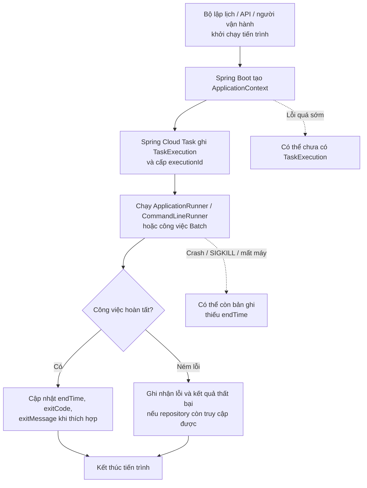
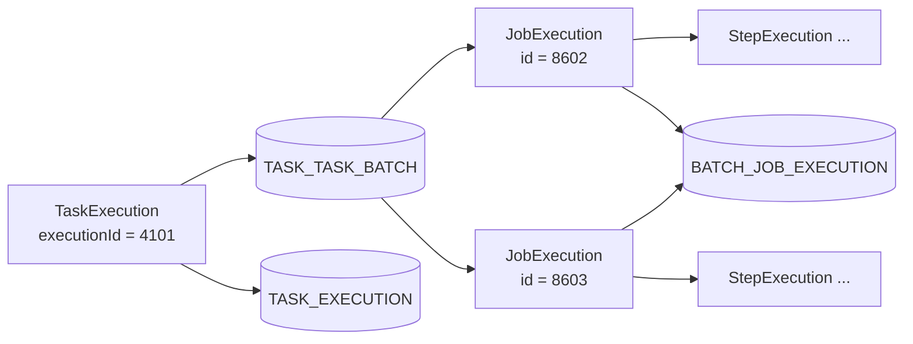

# Mô hình `TaskExecution` và định danh `executionId`

## Mục tiêu học tập

Sau bài học, bạn có thể:

- Mô tả được `TaskExecution` đại diện cho **một lần chạy** của ứng dụng Spring Cloud Task và phân biệt nó với tên Task hay định danh của tiến trình hệ điều hành.
- Giải thích vòng đời bắt đầu, hoàn tất và thất bại của một lần chạy; đọc ý nghĩa các trường chính như `executionId`, `taskName`, thời gian, mã thoát và tham số.
- Hiểu cách `TaskRepository` lưu lần chạy vào cơ sở dữ liệu, `TaskExplorer` truy vấn lại dữ liệu và `TaskExecutionListener` giúp ghi log theo định danh.
- Tra cứu một lần chạy bằng SQL, đối chiếu log và phân biệt `executionId` của Task với `JOB_EXECUTION_ID` của Spring Batch.
- Thiết kế việc chạy theo yêu cầu hoặc theo lịch có khả năng truy vết, xử lý lỗi, nhận diện trùng lặp và bảo vệ dữ liệu nhạy cảm.

> **Phạm vi:** Bài thuộc chương **Dữ liệu thực thi** của module **SPRING_CLOUD_TASK**. Spring Cloud Task phục vụ ứng dụng Spring Boot chạy hữu hạn: bắt đầu, thực hiện công việc và kết thúc; kết quả mỗi lần thực thi được ghi vào cơ sở dữ liệu. Mô hình `TaskExecution` là nền tảng để theo dõi những lần chạy do người dùng yêu cầu, do lịch bên ngoài kích hoạt hoặc chứa các Spring Batch Job.

## 1. `TaskExecution` là gì?

Một **Task** thường được hiểu là chương trình/công việc có tên xác định, chẳng hạn `daily-reconciliation`. Khi được kích hoạt, mỗi tiến trình Spring Cloud Task thực hiện công việc đó một lần trong vòng đời hữu hạn. **`TaskExecution` là bản ghi metadata đại diện cho chính lần thực thi cụ thể này**, bao gồm định danh, thời gian bắt đầu/kết thúc, tham số và kết quả.

Giả sử ứng dụng `daily-reconciliation` được gọi vào 02:00 và 03:00 để xử lý ngày 2026-11-24:

| Đặc điểm | Lần chạy A | Lần chạy B |
| --- | --- | --- |
| `taskName` | `daily-reconciliation` | `daily-reconciliation` |
| Tham số nghiệp vụ | `--business-date=2026-11-24` | `--business-date=2026-11-24` |
| `executionId` | `4101` | `4102` |
| Trạng thái quan sát | Đã hoàn tất, exit code `0` | Đã hoàn tất, exit code khác `0` |

**Các giá trị số trên chỉ là dữ liệu minh họa.** Hai lần chạy có thể có cùng tên và cùng tham số nhưng có **hai `executionId` khác nhau**. Lần chạy B có thể là retry do bộ lập lịch kích hoạt sau khi gặp lỗi hoặc một lệnh chạy lại có chủ ý. Khi muốn trả lời “lần nào đã xử lý dữ liệu này?”, phải xác định rõ lần chạy chứ không chỉ dựa vào `taskName`.

Một đối tượng `TaskExecution` không chứa toàn bộ dữ liệu nghiệp vụ, không lưu từng bản ghi đã xử lý và không tự thay thế log ứng dụng. Nó phản ánh **metadata ở cấp vòng đời Task**; nếu cần chi tiết từng bước, kết quả nghiệp vụ hoặc giao dịch, ta phải lưu ở nguồn tương ứng.

### Bốn khái niệm dễ bị nhầm

| Khái niệm | Định danh cho điều gì? | Tính chất |
| --- | --- | --- |
| Tên Task (`taskName`) | Loại chương trình/công việc, ví dụ `daily-reconciliation`. | Nhiều lần thực thi có thể cùng tên. |
| `executionId` | **Một bản ghi `TaskExecution` cụ thể trong một repository.** | Được repository cấp khi ghi metadata; dùng để truy vết một lần chạy. |
| Khóa nghiệp vụ, ví dụ `businessDate` | Dữ liệu/đợt công việc cần xử lý. | Có thể lặp lại giữa các lần retry; do ứng dụng định nghĩa. |
| PID, container/pod ID | Một tiến trình hoặc đơn vị triển khai của hệ điều hành/nền tảng. | Thuộc hệ thống vận hành; không phải khóa `TaskExecution`. |

`executionId` là định danh kỹ thuật để tra cứu metadata, **không phải khóa bảo đảm chỉ xử lý nghiệp vụ một lần**. Kiểm soát trùng lặp vẫn cần idempotency, transaction, khóa nghiệp vụ hoặc cơ chế điều phối riêng.

## 2. Các trường quan trọng trong mô hình `TaskExecution`

Lớp mô hình thuộc package `org.springframework.cloud.task.repository.TaskExecution`. Tùy phiên bản Spring Cloud Task, hình thức API và các trường bổ sung có thể thay đổi; các nhóm dữ liệu phổ biến là:

| Trường/thuộc tính | Ý nghĩa | Cách đọc đúng |
| --- | --- | --- |
| `executionId` | Định danh lần chạy được `TaskRepository` cấp. | Khóa để nối log, bảng Task và dữ liệu quan sát của **cùng lần chạy**. |
| `taskName` | Tên Task gắn với lần chạy. | Dùng để lọc nhóm lần chạy; **không duy nhất**. |
| `startTime` | Thời điểm bắt đầu Task được ghi nhận. | Có thể khác thời điểm container bắt đầu tạo hoặc lúc chuẩn bị môi trường. |
| `endTime` | Thời điểm Task ghi nhận kết thúc. | Có thể chưa có nếu Task đang chạy hoặc tiến trình bị dừng bất thường. |
| `exitCode` | Kết quả thoát được ghi ở mức Task; thường `0` là thành công. | Cần đối chiếu trạng thái nghiệp vụ và mã thoát tiến trình thật. |
| `exitMessage` | Thông điệp mô tả kết quả thoát. | Hữu ích để tóm tắt lỗi nhưng không thay thế log/stack trace. |
| `errorMessage` | Thông tin lỗi được ghi nhận khi có thất bại. | Có thể trống; nội dung và độ dài lưu trữ phụ thuộc schema/configuration. |
| `arguments` | Các đối số gắn với lần chạy. | Chỉ dùng dữ liệu an toàn; không đưa token hoặc mật khẩu vào tham số CLI. |
| `externalExecutionId` | Định danh bên ngoài, khi ứng dụng/điều phối cung cấp. | Giúp tương quan với hệ thống khởi chạy; không thay `executionId`. |
| `parentExecutionId` | Tham chiếu đến lần chạy cha trong mô hình Task cha–con khi có cấu hình. | Không tự suy ra từ tên Task hay thời gian bắt đầu. |

**Lưu ý về trạng thái:** `TaskExecution` không nên bị đồng nhất với một enum `BatchStatus` của Spring Batch. Trong dữ liệu Task, người vận hành thường suy luận tình trạng từ `startTime`, `endTime`, `exitCode` và thông tin lỗi. Không nên đặt quy tắc “`endTime` trống chắc chắn còn chạy” vì ứng dụng có thể đã bị kill và không kịp cập nhật metadata.

### Dữ liệu mẫu để hình dung

```text
TaskExecution
  executionId:        4101
  taskName:           daily-reconciliation
  startTime:          2026-11-24T02:00:03Z
  endTime:            2026-11-24T02:01:14Z
  exitCode:           0
  exitMessage:        (rỗng hoặc thông điệp thành công)
  arguments:          ["--business-date=2026-11-24"]
  externalExecutionId: (tùy hệ thống khởi chạy)
  parentExecutionId:   (không có nếu đây là Task độc lập)
```

Đây là dữ liệu minh họa ở dạng dễ đọc, không phải biểu diễn `toString()` chính xác của một phiên bản framework.

## 3. `executionId` được tạo ở đâu và duy nhất đến mức nào?

Trong cách triển khai thông dụng với JDBC, Spring Cloud Task dùng `TaskRepository` để ghi metadata vào bảng `TASK_EXECUTION`. Khi tạo bản ghi, repository cấp một `executionId` dựa trên cơ chế sinh khóa tương ứng với database/schema và phiên bản thư viện. Ứng dụng truy cập khóa này sau khi lần chạy đã được đăng ký thành công.

Các quy tắc quan trọng:

1. **Định danh một lần chạy trong một repository:** hai bản ghi khác nhau trong cùng repository không có cùng khóa chính `TASK_EXECUTION_ID`.
2. **Không phải số thứ tự toàn hệ thống:** database của production, staging và môi trường cục bộ có thể đều có `executionId=4101`. Khi tổng hợp log đa môi trường, ghép thêm môi trường, cụm hoặc định danh nguồn dữ liệu.
3. **Không giả định số liên tiếp:** cơ chế sequence, giao dịch rollback, chạy song song hoặc dữ liệu cũ có thể tạo khoảng trống giữa các ID.
4. **Không suy ra thứ tự nghiệp vụ chỉ bằng ID:** ID có thể tăng theo thời điểm cấp khóa, nhưng không chứng minh công việc nào kết thúc trước. Khi phân tích thời gian, xem `startTime` và `endTime`.
5. **Không tái sử dụng ID làm khóa nghiệp vụ:** một lần retry của cùng `businessDate` vẫn có ID mới; idempotency cần xét khóa nghiệp vụ.
6. **Không nhập ID thủ công trong luồng Task thông thường:** để `TaskRepository` cấp và quản lý khóa. Tự chèn/chỉnh sửa metadata có thể phá vỡ liên kết và lịch sử.

Nếu repository không thể tạo bản ghi do lỗi kết nối, sai schema hoặc thiếu quyền, ứng dụng có thể thất bại trước khi có ID hợp lệ. Vì vậy không được giả định mọi yêu cầu kích hoạt đều sinh ra bản ghi `TASK_EXECUTION`.

## 4. Vòng đời metadata của một lần chạy

Sơ đồ sau mô tả hành vi điển hình của ứng dụng Spring Boot có Spring Cloud Task:



Thực tế có thể khác theo phiên bản, listener và cấu hình; sơ đồ tập trung vào sự thay đổi metadata trong quá trình chạy. Ví dụ:

| Giai đoạn | `startTime` | `endTime` | `exitCode` | Ý nghĩa |
| --- | --- | --- | --- | --- |
| Trước khi Task đăng ký vào repository | Chưa có bản ghi | Chưa có | Chưa có | Không tra được `executionId` từ repository. |
| Đã bắt đầu, runner đang thực hiện | Có | Thường chưa có | Có thể chưa có | Lần chạy đang diễn ra theo góc nhìn repository. |
| Hoàn tất bình thường | Có | Có | Thường `0` | Hạ tầng Task ghi nhận kết thúc; vẫn cần kiểm chứng kết quả nghiệp vụ. |
| Kết thúc do lỗi đã được xử lý bởi vòng đời Task | Có | Có nếu cập nhật thành công | Có thể khác `0` | Kiểm tra log, error/exit message và mã thoát process. |
| Tiến trình bị dừng đột ngột | Có thể có | Có thể trống | Có thể trống | Metadata có nguy cơ tồn đọng dù không còn tiến trình. |

Đặc biệt, `TaskExecution` **không phải heartbeat**. Một hàng có `endTime = NULL` sau nhiều giờ không tự chứng minh tiến trình đang chạy; phải đối chiếu với pod/container, job scheduler, log và giới hạn thời gian vận hành.

## 5. `TaskRepository` và `TaskExplorer` có trách nhiệm gì?

| Thành phần | Trách nhiệm | Cách sử dụng |
| --- | --- | --- |
| `TaskRepository` | Tạo/cập nhật metadata vòng đời Task, cấp và lưu ID, lưu kết quả. | Thường được hạ tầng Spring Cloud Task gọi tự động. |
| `TaskExplorer` | Đọc và tìm các `TaskExecution` đã được lưu. | Hỗ trợ màn hình vận hành, công cụ tra cứu, báo cáo/đối chiếu. |
| `TaskExecutionListener` | Nhận callback theo vòng đời Task. | Log `executionId`, ghi số liệu quan sát và liên kết với yêu cầu ngoài. |

Trong luồng thông thường, **không cần tự gọi `TaskRepository` để tạo một lần thực thi**. Khi ứng dụng Task được cấu hình đúng, Spring Cloud Task sẽ quản lý vòng đời. Nếu gọi repository thủ công mà không hiểu rõ contract, có thể sinh bản ghi không khớp với lần chạy thực tế.

### 5.1. Ghi log `executionId` bằng listener

Giả sử dự án đã sử dụng `spring-cloud-starter-task`, có cấu hình `DataSource` và các bảng metadata Task. Tạo bean listener:

```java
package com.example.reconciliation;

import org.slf4j.Logger;
import org.slf4j.LoggerFactory;
import org.springframework.cloud.task.listener.TaskExecutionListener;
import org.springframework.cloud.task.repository.TaskExecution;
import org.springframework.stereotype.Component;

@Component
public class TaskAuditListener implements TaskExecutionListener {

    private static final Logger log =
            LoggerFactory.getLogger(TaskAuditListener.class);

    @Override
    public void onTaskStartup(TaskExecution execution) {
        log.info(
            "Task started: executionId={}, taskName={}",
            execution.getExecutionId(),
            execution.getTaskName()
        );
    }

    @Override
    public void onTaskEnd(TaskExecution execution) {
        log.info(
            "Task ended: executionId={}, exitCode={}",
            execution.getExecutionId(),
            execution.getExitCode()
        );
    }

    @Override
    public void onTaskFailed(TaskExecution execution, Throwable throwable) {
        log.error(
            "Task failed: executionId={}",
            execution.getExecutionId(),
            throwable
        );
    }
}
```

Callback `onTaskStartup` thích hợp để ghi lại ID sau khi Task đã đăng ký trong repository; `onTaskEnd` và `onTaskFailed` giúp tập trung log theo cùng ID. Trong môi trường thực, đẩy `executionId` vào structured logging hoặc MDC nếu nhiều lớp service cần ghi log; nếu dùng MDC, nhớ dọn giá trị sau khi kết thúc xử lý và chú ý khi truyền qua thread bất đồng bộ.

Không dùng `TaskExecutionListener` để biến toàn bộ logic nghiệp vụ thành sự kiện phụ; hãy giữ logic chính trong runner hoặc service. Listener hỗ trợ quan sát vòng đời, còn tính đúng đắn và idempotency là trách nhiệm của nghiệp vụ.

### 5.2. Tra cứu một lần thực thi qua `TaskExplorer`

Có thể tạo một service hỗ trợ tra cứu `executionId` từ database đã cấu hình:

```java
package com.example.reconciliation;

import java.util.Optional;

import org.springframework.cloud.task.repository.TaskExecution;
import org.springframework.cloud.task.repository.TaskExplorer;
import org.springframework.stereotype.Service;

@Service
public class TaskExecutionLookup {

    private final TaskExplorer taskExplorer;

    public TaskExecutionLookup(TaskExplorer taskExplorer) {
        this.taskExplorer = taskExplorer;
    }

    public Optional<TaskExecution> find(long executionId) {
        return Optional.ofNullable(
            taskExplorer.getTaskExecution(executionId)
        );
    }
}
```

Ví dụ sử dụng trong công cụ nội bộ:

```java
TaskExecution execution = lookup.find(4101L)
    .orElseThrow(() ->
        new IllegalArgumentException("Không tìm thấy executionId"));

System.out.println("Task: " + execution.getTaskName());
System.out.println("Exit: " + execution.getExitCode());
System.out.println("Started: " + execution.getStartTime());
```

Đoạn gọi cuối minh họa cách dùng đối tượng `lookup` đã được inject vào service, **không phải mã Java độc lập chạy ngay sau khi dán**. Tùy release, cách báo lỗi khi không tìm thấy bản ghi có thể khác; kiểm tra API của phiên bản đang sử dụng.

Khi xây dashboard tra cứu tất cả lần chạy, nên phân trang và lọc theo tên Task/thời gian thay vì đọc toàn bộ bảng metadata vào bộ nhớ. Nếu cung cấp endpoint HTTP nội bộ, bổ sung xác thực và phân quyền vì tham số hoặc thông tin lỗi có thể chứa dữ liệu nhạy cảm.

## 6. Bảng dữ liệu và truy vấn theo `executionId`

Spring Cloud Task với JDBC thường lưu metadata trong những bảng:

| Bảng | Chức năng |
| --- | --- |
| `TASK_EXECUTION` | Một hàng cho mỗi lần thực thi Task; có `TASK_EXECUTION_ID`, tên, thời gian và kết quả. |
| `TASK_EXECUTION_PARAMS` | Các tham số của mỗi lần chạy, gắn với `TASK_EXECUTION_ID`. |
| `TASK_TASK_BATCH` | Bảng liên kết giữa một `TASK_EXECUTION_ID` với `JOB_EXECUTION_ID` của Spring Batch khi có tích hợp. |

Tên cột, kiểu dữ liệu, sequence và cách lưu tham số có thể thay đổi theo database hoặc schema/release; luôn dùng DDL tương ứng phiên bản và xác minh trên database thực tế.

### 6.1. Tìm lần chạy bằng định danh

```sql
SELECT
    TASK_EXECUTION_ID,
    TASK_NAME,
    START_TIME,
    END_TIME,
    EXIT_CODE,
    EXIT_MESSAGE,
    ERROR_MESSAGE
FROM TASK_EXECUTION
WHERE TASK_EXECUTION_ID = 4101;
```

Với ID đã biết, đây là truy vấn chính xác hơn việc chỉ tìm theo `TASK_NAME`. Nếu dùng JDBC `PreparedStatement` thì thay hằng số `4101` bằng dấu `?` và truyền ID theo tham số, tránh nối chuỗi dữ liệu nhận từ người dùng vào SQL.

### 6.2. Liệt kê những lần chạy gần đây theo tên Task

```sql
SELECT
    TASK_EXECUTION_ID,
    TASK_NAME,
    START_TIME,
    END_TIME,
    EXIT_CODE
FROM TASK_EXECUTION
WHERE TASK_NAME = 'daily-reconciliation'
ORDER BY START_TIME DESC, TASK_EXECUTION_ID DESC;
```

Bảng có thể có rất nhiều hàng sau các lần chạy theo lịch; trong code thực tế hãy thêm phân trang/giới hạn theo cú pháp database đang dùng và index phù hợp. `ORDER BY START_TIME` phản ánh thời điểm bắt đầu; cột ID chỉ hỗ trợ phân giải trường hợp cùng timestamp, không định nghĩa hoàn tất trước sau.

### 6.3. Lọc những lần chạy chưa ghi nhận kết thúc

```sql
SELECT
    TASK_EXECUTION_ID,
    TASK_NAME,
    START_TIME,
    END_TIME,
    EXIT_CODE
FROM TASK_EXECUTION
WHERE END_TIME IS NULL
ORDER BY START_TIME ASC;
```

Đây là **danh sách cần kiểm tra**, không phải danh sách tiến trình chắc chắn còn hoạt động. Một lần chạy có thể thiếu `END_TIME` vì container đã bị kill, node bị lỗi, repository mất kết nối lúc kết thúc hoặc Task vẫn đang thực thi bình thường.

### 6.4. Tra tham số theo ID

```sql
SELECT
    TASK_EXECUTION_ID,
    TASK_PARAM
FROM TASK_EXECUTION_PARAMS
WHERE TASK_EXECUTION_ID = 4101;
```

Nếu bảng `TASK_EXECUTION_PARAMS` được cấu hình theo schema của một phiên bản khác, hãy kiểm tra cột tương ứng trước khi viết truy vấn. Không ghi tham số chứa mật khẩu, access token hoặc dữ liệu nhạy cảm lên nhật ký, dashboard hay kho metadata trừ khi đã thiết kế biện pháp bảo vệ phù hợp.

## 7. Phân biệt `executionId` Task với ID của Spring Batch

Spring Cloud Task và Spring Batch trả lời hai câu hỏi khác nhau:

- `TASK_EXECUTION_ID`: “**Lần chạy ứng dụng Task nào?**”
- `JOB_EXECUTION_ID`: “**Lần thực thi Spring Batch Job nào?**”
- `JOB_INSTANCE_ID`: “**Job instance logic nào**, được nhận dạng theo tên Job và identifying JobParameters?”

Một tiến trình Task có thể không chạy Batch Job nào, chạy một Job hoặc chạy nhiều Job. Vì vậy không được giả định `TASK_EXECUTION_ID` bằng `JOB_EXECUTION_ID` hay một Task luôn tương ứng đúng một Job.



Với integration `spring-cloud-task-batch` được kích hoạt, bảng `TASK_TASK_BATCH` ghi cặp ID liên kết. Ví dụ truy vấn:

```sql
SELECT
    t.TASK_EXECUTION_ID,
    t.TASK_NAME,
    t.EXIT_CODE AS TASK_EXIT_CODE,
    x.JOB_EXECUTION_ID,
    j.STATUS AS JOB_STATUS,
    j.EXIT_CODE AS JOB_EXIT_CODE
FROM TASK_EXECUTION t
LEFT JOIN TASK_TASK_BATCH x
    ON x.TASK_EXECUTION_ID = t.TASK_EXECUTION_ID
LEFT JOIN BATCH_JOB_EXECUTION j
    ON j.JOB_EXECUTION_ID = x.JOB_EXECUTION_ID
WHERE t.TASK_EXECUTION_ID = 4101;
```

Nếu truy vấn trả về nhiều hàng, điều đó có thể là **một Task liên kết nhiều JobExecution**; không có nghĩa nhiều TaskExecution trùng ID. Nếu không có hàng tương ứng trong `TASK_TASK_BATCH`, kiểm tra liệu Job có thực sự được chạy, thư viện tích hợp có mặt trên classpath và listener Task–Batch có hoạt động hay không.

**Về thất bại:** Spring Batch có thể ghi `JobExecution.status=FAILED` trong khi mã thoát Task hoặc tiến trình vẫn là `0` nếu lỗi không được lan truyền đúng cách. Khi cần bộ điều phối biết Job thất bại, đánh giá cấu hình tích hợp `spring.cloud.task.batch.fail-on-job-failure=true` và kiểm thử cả ba lớp: Job, Task, process. Không dùng chỉ một ID hoặc một trạng thái để kết luận toàn bộ luồng đã thành công.

## 8. Đưa `executionId` vào vận hành theo lịch và theo yêu cầu

Cùng ứng dụng `daily-reconciliation` có thể được chạy theo hai cách:

- **Theo yêu cầu:** người vận hành hoặc hệ thống API khởi chạy một tiến trình cho `--business-date=2026-11-24`.
- **Theo lịch:** Kubernetes CronJob hoặc scheduler khác khởi chạy tiến trình cùng tên Task theo thời gian đặt trước.

Spring Cloud Task **không tự cung cấp cron scheduler**. Cả hai nguồn kích hoạt đều có thể tạo ra các `TaskExecution` riêng biệt nếu mỗi lần yêu cầu khởi chạy một tiến trình và hạ tầng Task ghi repository thành công.

Cách truy vết một yêu cầu điển hình:

1. Hệ thống khởi chạy tạo **request ID/correlation ID** riêng (ví dụ `recon-20261124-request-17`) hoặc ghi nhận ID của scheduler.
2. Khi listener `onTaskStartup` nhận `TaskExecution`, nó log `executionId` kèm correlation ID nếu có; nếu hệ thống hỗ trợ, có thể gắn ID ngoài vào metadata `externalExecutionId`.
3. Khi tiến trình kết thúc, hệ thống so sánh `TaskExecution.exitCode`, kết quả nghiệp vụ và exit code của container.
4. Khi có retry, **giữ correlation ID nghiệp vụ** nếu muốn nhóm các lần thử của cùng yêu cầu, nhưng mỗi lần thực thi có `executionId` riêng.
5. Công cụ vận hành hiển thị cả `taskName`, `executionId`, tham số nghiệp vụ an toàn, thời gian và kết quả để chẩn đoán chính xác.

Đừng để một bộ điều phối tự đặt `executionId` thay repository rồi mong chúng trùng nhau. `externalExecutionId` dành cho liên kết với nguồn bên ngoài, còn `executionId` là khóa nội bộ của TaskRepository. Nếu luồng cha–con được cấu hình, `parentExecutionId` có thể thể hiện quan hệ Task cha, nhưng phải đảm bảo ID cha thuộc đúng repository/phạm vi thiết kế.

### Khi chạy song song

Hai Task cùng tên và cùng tham số có thể chạy đồng thời, mỗi Task có ID khác nhau. Repository cấp khóa khác nhau **không tự loại trừ xử lý trùng dữ liệu**. Hãy đặt quy tắc idempotency theo khóa nghiệp vụ, giới hạn concurrency của scheduler hoặc dùng cơ chế single-instance của Spring Cloud Task khi phù hợp với phiên bản và hạ tầng khóa.

`executionId` hữu ích để gắn log và kết quả về đúng lần chạy, nhưng điều kiện “đã xử lý ngày X chưa?” nên được trả lời từ trạng thái nghiệp vụ đáng tin cậy, không phải phép so sánh ID lớn nhất.

## 9. Lỗi thường gặp khi phân tích dữ liệu thực thi

| Triệu chứng | Nguyên nhân có thể | Cách xử lý |
| --- | --- | --- |
| Không tìm thấy `executionId` trong database | Task chưa đăng ký vì lỗi bootstrap; truy vấn nhầm database/schema; metadata bị xóa theo retention. | Kiểm tra datasource, log khởi động, migrations, repository đích và chính sách lưu lịch sử. |
| Nhiều hàng cùng `taskName`/tham số | Task đã được chạy nhiều lần hoặc bị retry. | Dùng `TASK_EXECUTION_ID` để phân biệt từng lần; so sánh với request ID nghiệp vụ. |
| `END_TIME` trống lâu | Task đang chạy, bị kill hoặc không cập nhật được repository. | Đối chiếu log, tình trạng process/pod, timeout và scheduler; không gắn nhãn “RUNNING” chỉ từ DB. |
| `EXIT_CODE=0` nhưng nghiệp vụ lỗi | Exception bị bắt rồi bỏ qua, tác vụ bất đồng bộ chưa hoàn tất hoặc Batch failure chưa lan truyền. | Kiểm tra logic, đợi tác vụ hoàn tất, kiểm thử đường lỗi và exit code process. |
| `TASK_EXECUTION_ID` không khớp `JOB_EXECUTION_ID` | Đây là hai định danh được cấp từ repository khác nhau. | Join qua `TASK_TASK_BATCH` nếu có tích hợp Batch. |
| ID xuất hiện giống nhau ở staging và production | Định danh chỉ có ý nghĩa trong phạm vi repository. | Luôn gắn thêm môi trường/repository khi tập trung log. |
| Tham số nhạy cảm xuất hiện trong metadata | Dùng secret trong CLI args và lưu kèm lần chạy. | Chuyển secret sang cơ chế cấp phát an toàn; hạn chế quyền xem/log và áp dụng retention. |
| Truy vấn dashboard chậm | Đọc toàn bộ lịch sử Task, thiếu index hoặc thiếu phân trang. | Lọc theo thời gian/tên, phân trang, tạo index dựa trên workload thực tế. |

**Không sửa trực tiếp `TASK_EXECUTION_ID` hoặc trạng thái lỗi trong bảng** để làm dashboard “đẹp”. Nếu cần đối soát dữ liệu sau sự cố, hãy lưu dấu vết điều chỉnh riêng và dùng quy trình vận hành có kiểm toán.

## 10. Quy trình thực hành kiểm chứng

### Chuẩn bị

Tạo một ứng dụng Spring Boot có dependency `spring-cloud-starter-task` và JDBC driver thích hợp. Có thể dùng H2 để học cấu trúc bảng trong cùng một lần khởi động, nhưng nên dùng PostgreSQL hoặc database bền vững nếu muốn **so sánh nhiều lần chạy nối tiếp**. Cấu hình schema Task đúng theo release; trong production nên dùng migration thay vì tự tạo bảng mỗi lần chạy.

Ví dụ cấu hình với PostgreSQL đã được tạo bảng trước:

```yaml
spring:
  application:
    name: daily-reconciliation
  main:
    web-application-type: none
  datasource:
    url: jdbc:postgresql://localhost:5432/taskdb
    username: ${DB_USER}
    password: ${DB_PASSWORD}
  cloud:
    task:
      initialize-enabled: false
      name: daily-reconciliation
```

Lưu ý: cấu hình `initialize-enabled=false` ở đây giả định các bảng metadata Task đã tồn tại. Nếu thiếu schema, lần chạy đầu sẽ lỗi; không được kết luận `TaskExecution` sai chỉ vì database chưa sẵn sàng.

Ví dụ runner đơn giản:

```java
package com.example.reconciliation;

import java.time.LocalDate;

import org.springframework.boot.ApplicationArguments;
import org.springframework.boot.ApplicationRunner;
import org.springframework.boot.SpringApplication;
import org.springframework.boot.autoconfigure.SpringBootApplication;
import org.springframework.cloud.task.configuration.EnableTask;
import org.springframework.context.annotation.Bean;

@SpringBootApplication
@EnableTask
public class DailyReconciliationApplication {

    public static void main(String[] args) {
        SpringApplication.run(DailyReconciliationApplication.class, args);
    }

    @Bean
    ApplicationRunner reconcile() {
        return (ApplicationArguments args) -> {
            String day = args.getOptionValues("business-date") == null
                    ? null
                    : args.getOptionValues("business-date").get(0);
            if (day == null) {
                throw new IllegalArgumentException(
                    "Thiếu --business-date=yyyy-MM-dd");
            }

            LocalDate.parse(day);
            System.out.println("Reconciling businessDate=" + day);
            // Gọi service nghiệp vụ; ném exception nếu xử lý thất bại.
        };
    }
}
```

Thêm `TaskAuditListener` ở mục 5 để nhận `executionId` trên log. Đối với production, nên kiểm tra chính xác một giá trị tham số và xử lý đầu vào an toàn hơn; code trên được rút gọn để tập trung vào metadata.

### Thao tác và quan sát

1. Đóng gói ứng dụng với release tương thích, chạy `java -jar daily-reconciliation.jar --business-date=2026-11-24`.
2. Ghi lại `executionId` do listener in ra, dùng SQL mục 6 để kiểm tra `TASK_EXECUTION` và `TASK_EXECUTION_PARAMS`.
3. Chạy lại **cùng tham số**. So sánh: `taskName` và ngày nghiệp vụ giống nhau, nhưng `executionId` phải khác.
4. Chạy một lần với giá trị không hợp lệ, ví dụ `--business-date=invalid`. Quan sát exception, log, `errorMessage`/`exitCode` nếu được ghi và exit code của process.
5. Giả lập việc tiến trình bị dừng đột ngột trong quá trình xử lý trên môi trường test. Kiểm tra metadata còn thiếu `endTime` và đối chiếu với log/nền tảng điều phối.
6. Nếu chạy Batch Job trong Task, join `TASK_TASK_BATCH` để xác nhận đúng `JobExecution` gắn với Task đã quan sát.

### Câu hỏi tự kiểm tra

1. Tại sao hai lần chạy cùng `taskName` và `businessDate` lại phải có hai `executionId` khác nhau?
2. `executionId=4101` ở production có đủ để phân biệt với `executionId=4101` ở staging không?
3. Vì sao `END_TIME IS NULL` không đủ kết luận Task vẫn đang chạy?
4. Nếu một Task chạy ba Spring Batch Job, quan hệ giữa `TASK_EXECUTION_ID` và `JOB_EXECUTION_ID` được biểu diễn như thế nào?
5. Khi scheduler retry sau lỗi, ID nào nên thay đổi và khóa nào có thể giữ nguyên để tránh xử lý dữ liệu trùng?

## Ghi nhớ

- **`TaskExecution` là metadata của một lần chạy Task**, gồm tên, thời gian, tham số và kết quả; không phải định nghĩa công việc hay bản ghi nghiệp vụ.
- **`executionId` nhận diện duy nhất một lần thực thi trong phạm vi `TaskRepository`**. Mỗi lần retry có ID mới, dù tên và tham số nghiệp vụ giống nhau.
- `TaskRepository` quản lý việc ghi; `TaskExplorer` đọc lại metadata; `TaskExecutionListener` giúp gắn ID vào log.
- Không đồng nhất `executionId` của Task với `JOB_EXECUTION_ID` của Spring Batch, PID/container ID hay mã yêu cầu nghiệp vụ.
- Kết hợp metadata với log, trạng thái tiến trình, Batch Job và dữ liệu nghiệp vụ để xác minh thành công; thiết kế idempotency và bảo vệ tham số nhạy cảm để vận hành an toàn.

## Tài liệu tham khảo

- [Spring Cloud Task — Reference Documentation](https://docs.spring.io/spring-cloud-task/reference/)
- [Spring Cloud Task — Features](https://docs.spring.io/spring-cloud-task/reference/features.html)
- [Spring Cloud Task — TaskRepository schema](https://docs.spring.io/spring-cloud-task/docs/current/reference/html/appendix-task-repository-schema.html)
- [Spring Cloud Task — Batch integration](https://docs.spring.io/spring-cloud-task/reference/batch.html)
- [Spring Batch — Metadata schema](https://docs.spring.io/spring-batch/reference/schema-appendix.html)
