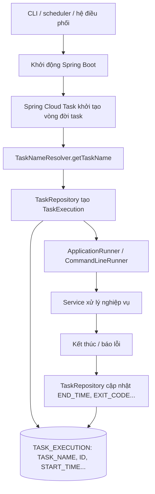

# Tên tác vụ và TaskNameResolver

## 1. Tên tác vụ có vai trò gì trong dữ liệu thực thi?

**Spring Cloud Task** giúp xây dựng ứng dụng Spring Boot có thời gian chạy hữu hạn: nhận yêu cầu, thực hiện công việc như nhập dữ liệu, tạo báo cáo hoặc đối soát, sau đó kết thúc. Khi được cấu hình cùng kho dữ liệu, Spring Cloud Task ghi lại metadata của mỗi lần chạy bằng **`TaskRepository`**. Tên tác vụ (`taskName`) là thông tin quan trọng để phân nhóm và truy vết các lần thực thi này.

Giả sử hệ thống có một tiến trình xử lý đơn hàng chạy lúc 02:00 mỗi ngày:

| Lần chạy | Tên tác vụ | ID lần thực thi | Kết quả |
| --- | --- | --- | --- |
| Ngày thứ nhất | `orders-daily-import` | `101` | Thành công |
| Ngày thứ hai | `orders-daily-import` | `102` | Thất bại |
| Ngày thứ ba | `orders-daily-import` | `103` | Thành công |

Ba lần chạy thuộc **một loại công việc** nhưng có **ba ID khác nhau**. Tên tác vụ giúp nhận diện loại công việc ổn định; ID giúp xác định chính xác một lần chạy. Các ID trên chỉ mang tính minh họa, không phải dữ liệu do framework tạo sẵn.

`TaskNameResolver` là chiến lược mà Spring Cloud Task dùng để xác định tên sẽ được gắn vào `TaskExecution`. Bạn có thể sử dụng resolver mặc định hoặc cung cấp cách đặt tên phù hợp với nghiệp vụ.

### Phân biệt tên và các định danh liên quan

| Thông tin | Ý nghĩa | Có thay đổi giữa các lần chạy? |
| --- | --- | --- |
| `taskName` / `TASK_EXECUTION.TASK_NAME` | Tên logic của loại tác vụ | Thường giữ ổn định cho cùng loại công việc |
| `TaskExecution.executionId` / `TASK_EXECUTION_ID` | Định danh một bản ghi thực thi | Mỗi lần chạy mới thường có ID riêng |
| `spring.application.name` | Tên ứng dụng Spring Boot; có thể dùng làm tên mặc định của task | Thường cố định theo ứng dụng |
| `spring.cloud.task.name` | Thuộc tính cấu hình tên task khi dùng resolver mặc định | Có thể thay đổi theo profile hoặc lần khởi động |
| `spring.cloud.task.executionid` | ID thực thi được cấp trước trong luồng tích hợp đặc biệt | Không phải cách đặt tên task; cần bản ghi tương ứng được quản lý đúng quy trình |
| Tham số nghiệp vụ `--date`, `--customer`, `--request-id` | Dữ liệu đầu vào cho lần xử lý | Có thể khác nhau ở từng lần chạy |

Điểm mấu chốt: **tên tác vụ không phải khóa duy nhất của một lần chạy**, không thay thế tham số đầu vào và không chứa kết quả xử lý nghiệp vụ.

## 2. TaskNameResolver tham gia vào vòng đời thực thi như thế nào?



Khi `ApplicationContext` được khởi tạo thành công và framework bắt đầu vòng đời task, Spring Cloud Task sử dụng tên do `TaskNameResolver` cung cấp để ghi bản ghi `TaskExecution`. Sau đó các runner thực hiện logic. Khi task kết thúc, framework cập nhật kết quả thực thi. Nếu lỗi xuất hiện quá sớm khiến `ApplicationContext` không thể khởi tạo, có thể chưa có bản ghi task trong kho metadata.

Vì tên được xác định ở **giai đoạn khởi tạo lần thực thi**, không nên chờ tới lúc `ApplicationRunner` xử lý xong rồi mới quyết định đổi tên của chính bản ghi. Nếu tên phải phụ thuộc một tham số, tham số đó cần được cung cấp từ nguồn cấu hình mà resolver có thể đọc khi ứng dụng khởi động.

Ví dụ: một JAR thực hiện công việc `orders-daily-import`. Mỗi lần chạy có thể nhận `--business.date=2026-11-24` hay `--business.date=2026-11-25`, nhưng tên `orders-daily-import` nên được giữ nguyên; ngày cần được lưu ở tham số, kết quả nghiệp vụ hoặc hệ thống truy vết riêng.

## 3. Resolver mặc định: SimpleTaskNameResolver

Spring Cloud Task cung cấp **`SimpleTaskNameResolver`** (package `org.springframework.cloud.task.repository.support`) làm cách xác định tên mặc định. Thứ tự ưu tiên của resolver này là:

1. Giá trị thuộc tính **`spring.cloud.task.name`** nếu được cấu hình.
2. Nếu không có giá trị tên cấu hình, dùng **ID của `ApplicationContext`** theo cơ chế Spring Boot; ID này thường phản ánh `spring.application.name` khi thuộc tính đó được đặt.

Đây là thứ tự ưu tiên của **resolver mặc định**. Một `TaskNameResolver` tự viết có thể áp dụng quy tắc khác.

### 3.1. Đặt tên trực tiếp trong application.yml

Ví dụ cho task nhập đơn hàng:

```yaml
spring:
  application:
    name: order-processing-app
  main:
    web-application-type: none
  cloud:
    task:
      name: orders-daily-import
```

Khi chạy với cấu hình trên, tên task được ghi vào metadata là `orders-daily-import`, mặc dù tên Spring Boot application là `order-processing-app`.

Trong môi trường học tập, đây thường là lựa chọn **đơn giản và dễ kiểm soát nhất**: mọi lần chạy của cùng loại task có một tên thống nhất, dễ lọc lịch sử và xây dựng cảnh báo.

### 3.2. Ghi đè tên khi khởi động

Spring Boot cho phép truyền thuộc tính qua đối số chương trình. Giả sử file JAR đã được build thành `target/order-task.jar`:

```bash
java -jar target/order-task.jar --spring.cloud.task.name=orders-backfill
```

Trong trường hợp này, khi dùng resolver mặc định và không có nguồn cấu hình ưu tiên cao hơn ghi đè, tên được chọn là `orders-backfill`. Đặc điểm này phù hợp với hệ thống triển khai một artifact để chạy các **loại tác vụ đã được định nghĩa rõ ràng**; không nên đặt tên tùy hứng cho mỗi yêu cầu.

Tương tự, có thể dùng biến môi trường theo quy tắc binding thuộc tính của Spring Boot:

```bash
# Ví dụ trên shell Bash/Linux
export SPRING_CLOUD_TASK_NAME=orders-daily-import
java -jar target/order-task.jar
```

Khi nhiều nguồn cấu hình cùng cung cấp một thuộc tính, **quy tắc ưu tiên của Spring Boot Environment** quyết định giá trị sau cùng. Hãy kiểm tra profile, CLI, biến môi trường và cấu hình do nền tảng triển khai cung cấp khi tên trong CSDL khác mong đợi.

### 3.3. Không đặt spring.cloud.task.name thì sao?

Nếu bỏ `spring.cloud.task.name`, resolver mặc định dùng ID của `ApplicationContext`. Với `spring.application.name: order-processing-app`, tên thường được phản ánh qua `order-processing-app`. Tuy nhiên ID context còn phụ thuộc cách khởi tạo ứng dụng hoặc cấu hình framework; muốn **ổn định tên giữa các môi trường**, hãy đặt `spring.cloud.task.name` tường minh và kiểm tra `TASK_EXECUTION.TASK_NAME` thực tế.

## 4. Ví dụ hoàn chỉnh để ghi và quan sát tên task

### 4.1. Chuẩn bị dependencies

Trong một dự án Maven Spring Boot, dùng bộ phiên bản Spring Cloud tương thích với Spring Boot qua BOM của dự án. Các dependency chính cho bài thực hành:

```xml
<dependencies>
    <dependency>
        <groupId>org.springframework.cloud</groupId>
        <artifactId>spring-cloud-starter-task</artifactId>
    </dependency>
    <dependency>
        <groupId>com.h2database</groupId>
        <artifactId>h2</artifactId>
        <scope>runtime</scope>
    </dependency>
</dependencies>
```

Không chọn ngẫu nhiên phiên bản starter nếu chưa xác nhận tương thích với phiên bản Spring Boot trong dự án.

### 4.2. Tạo một task hữu hạn

Tạo lớp `OrderTaskApplication.java`:

```java
import java.util.List;

import org.springframework.boot.ApplicationArguments;
import org.springframework.boot.ApplicationRunner;
import org.springframework.boot.SpringApplication;
import org.springframework.boot.autoconfigure.SpringBootApplication;
import org.springframework.context.annotation.Bean;

@SpringBootApplication
public class OrderTaskApplication {

    public static void main(String[] args) {
        SpringApplication.run(OrderTaskApplication.class, args);
    }

    @Bean
    ApplicationRunner importOrders() {
        return args -> {
            String input = "demo";
            if (args.containsOption("input")) {
                List<String> values = args.getOptionValues("input");
                if (values == null || values.size() != 1
                        || values.get(0) == null || values.get(0).isBlank()) {
                    throw new IllegalArgumentException("Cần một giá trị --input hợp lệ");
                }
                input = values.get(0);
            }
            System.out.println("Đang thực hiện nhập đơn hàng; input=" + input);
            // Trong ứng dụng thật, gọi service xử lý nghiệp vụ tại đây.
            System.out.println("Kết thúc một lần chạy task.");
        };
    }
}
```

Code tập trung minh họa **tên task**. `ApplicationRunner` chạy một lần rồi trả về; tác vụ thật sẽ gọi business service để xử lý dữ liệu và ném exception nếu thất bại. Đầu vào `--input` thuộc logic runner, **không mặc định trở thành tên task**.

### 4.3. Dùng H2 lưu tệp để xem lịch sử qua nhiều lần chạy

Đặt cấu hình `src/main/resources/application.yml`:

```yaml
spring:
  application:
    name: order-processing-app
  main:
    web-application-type: none
  datasource:
    driver-class-name: org.h2.Driver
    url: jdbc:h2:file:./data/task-names;DB_CLOSE_ON_EXIT=FALSE
    username: sa
    password: ""
  cloud:
    task:
      name: orders-daily-import
      initialize-enabled: true
```

`initialize-enabled: true` dùng cho bài lab: schema metadata được khởi tạo theo hỗ trợ của phiên bản Spring Cloud Task đang dùng. Môi trường thật nên quản lý schema bằng migration tương ứng phiên bản framework, dùng tài khoản CSDL có quyền hạn phù hợp và tránh H2 nhúng khi nhiều tiến trình cần dùng chung kho metadata.

Giả sử đã build executable JAR, tạo thư mục `data` tại **working directory** rồi chạy:

```bash
mkdir data
java -jar target/order-task.jar --input=file-a.csv
java -jar target/order-task.jar --input=file-b.csv
java -jar target/order-task.jar --spring.cloud.task.name=orders-backfill --input=old.csv
```

Ba lần khởi động trên có thể tạo ba `TaskExecution` với ID khác nhau. Hai lần đầu có tên `orders-daily-import`; lần thứ ba có tên `orders-backfill` nếu không có resolver tùy chỉnh ghi đè chiến lược mặc định. Cả ba dùng chung file H2 nếu được khởi động tại cùng working directory.

Sau khi các tiến trình đã kết thúc, dùng H2 Shell hoặc IDE database client để mở **đúng file** tại `jdbc:h2:file:./data/task-names;IFEXISTS=TRUE` với user `sa`, rồi chạy:

```sql
SELECT TASK_EXECUTION_ID,
       TASK_NAME,
       START_TIME,
       END_TIME,
       EXIT_CODE
FROM TASK_EXECUTION
ORDER BY TASK_EXECUTION_ID DESC;
```

Để nhóm lịch sử theo tên task:

```sql
SELECT TASK_NAME,
       COUNT(*) AS TOTAL_EXECUTIONS,
       SUM(CASE WHEN EXIT_CODE = 0 THEN 1 ELSE 0 END) AS SUCCESSFUL
FROM TASK_EXECUTION
GROUP BY TASK_NAME
ORDER BY TASK_NAME;
```

Truy vấn chỉ minh họa nhóm các lần thực thi; `EXIT_CODE` có thể chưa có giá trị khi task còn đang chạy. Kết luận task thực sự hoàn tất cần xem thêm `END_TIME` và xử lý các trường hợp tiến trình bị dừng cưỡng bức. Tên task giống nhau **không bảo đảm** hai lần chạy có cùng tham số, cùng kết quả hoặc không trùng dữ liệu nghiệp vụ.

## 5. Viết TaskNameResolver tùy chỉnh khi nào?

Thuộc tính `spring.cloud.task.name` đáp ứng hầu hết nhu cầu đặt một tên cố định hoặc thay tên theo profile/lần chạy. Chỉ cần tùy chỉnh `TaskNameResolver` khi **quy tắc xác định tên** không thể biểu đạt thuận tiện bằng một giá trị cấu hình, chẳng hạn:

- Một artifact có hai chế độ công việc đã được quy định (`daily-import` và `reconcile`), cần ánh xạ tên môi trường thành tên nghiệp vụ chuẩn.
- Có nền tảng điều phối cung cấp định danh *loại tác vụ* riêng và muốn chuẩn hóa trước khi lưu metadata.
- Muốn đặt tên theo danh mục cho phép, tránh hàng trăm biến thể không hợp lệ do người chạy nhập thủ công.

API chính thức là:

```java
package org.springframework.cloud.task.repository;

public interface TaskNameResolver {
    String getTaskName();
}
```

Đây là **hợp đồng rút gọn** để minh họa chữ ký phương thức, không phải yêu cầu tự tạo interface trong dự án. Trong code thực tế, hãy `import` interface do dependency Spring Cloud Task cung cấp.

### 5.1. Ví dụ resolver chuẩn hóa tên theo chế độ công việc

Giả sử ứng dụng nhận thuộc tính `app.task.operation` tại thời điểm khởi động. Bạn muốn hai giá trị hợp lệ được chuẩn hóa thành hai tên dễ truy vấn:

| `app.task.operation` | Tên task được lưu |
| --- | --- |
| `daily` | `orders-daily-import` |
| `reconcile` | `orders-reconcile` |
| Giá trị khác | Không khởi động task với tên tùy ý; từ chối cấu hình |

Tạo `TaskNamingConfiguration.java`:

```java
import org.springframework.beans.factory.annotation.Value;
import org.springframework.cloud.task.repository.TaskNameResolver;
import org.springframework.context.annotation.Bean;
import org.springframework.context.annotation.Configuration;
import org.springframework.context.annotation.Primary;

@Configuration(proxyBeanMethods = false)
public class TaskNamingConfiguration {

    @Bean
    @Primary
    TaskNameResolver businessTaskNameResolver(
            @Value("${app.task.operation:daily}") String operation) {
        String taskName = switch (operation) {
            case "daily" -> "orders-daily-import";
            case "reconcile" -> "orders-reconcile";
            default -> throw new IllegalArgumentException(
                    "Không hỗ trợ app.task.operation=" + operation);
        };
        return () -> taskName;
    }
}
```

`@Bean` đăng ký chiến lược riêng; `@Primary` giúp Spring chọn bean này khi có nhiều `TaskNameResolver` phù hợp với injection theo kiểu dữ liệu, ví dụ khi resolver mặc định vẫn được đăng ký. Tên bean `businessTaskNameResolver` **khác** tên bean mặc định `taskNameResolver`, tránh trùng định danh bean. Các bước wiring cụ thể cần kiểm tra với phiên bản Spring Cloud Task mà dự án thực sự sử dụng. Ví dụ yêu cầu Java 17 trở lên do có biểu thức `switch` dạng mũi tên.

Khi áp dụng chiến lược này, tên do `businessTaskNameResolver` trả về được dùng làm tên task. Giá trị `spring.cloud.task.name` trong YAML **không còn là quy tắc ưu tiên** của resolver tự viết. Để tránh nhầm lẫn, nên bỏ `spring.cloud.task.name` khỏi cấu hình của biến thể dùng custom resolver và chỉ cấp `app.task.operation`.

```bash
java -jar target/order-task.jar --app.task.operation=daily
java -jar target/order-task.jar --app.task.operation=reconcile
```

Khi dùng chung lớp ứng dụng `OrderTaskApplication`, runner vẫn chạy nghiệp vụ minh họa như cũ; đổi `app.task.operation` trong ví dụ chỉ quyết định **tên của bản ghi metadata**. Muốn có hai quy trình nghiệp vụ thật sự khác nhau, cần thiết kế runner/service điều phối theo chế độ và kiểm tra danh mục `operation` ở nơi thực hiện nghiệp vụ. Resolver **không** có trách nhiệm tự chọn hoặc thực thi business service.

### 5.2. Các nguyên tắc khi viết resolver

1. **Trả về tên không rỗng, có nghĩa nghiệp vụ và ổn định:** tên như `orders-daily-import` giúp nhận diện loại công việc qua nhiều lần chạy.
2. **Không ghép timestamp, UUID hay ID khách hàng vào tên:** những thứ đó phù hợp hơn với execution ID, tham số hoặc mã tương quan (`requestId`). Nếu mỗi lần chạy có một tên mới, việc nhóm lịch sử và cảnh báo theo tên mất ý nghĩa.
3. **Không truy cập hệ thống chậm hoặc dễ lỗi chỉ để đặt tên:** resolver được gọi trong giai đoạn khởi động task; gọi HTTP hoặc SQL phức tạp có thể làm mất khả năng ghi nhận lần chạy.
4. **Không nhúng dữ liệu nhạy cảm:** mật khẩu, token, thông tin cá nhân hay chuỗi người dùng nhập tự do không nên nằm trong `taskName`, vì tên được lưu trong database/log/metric tùy cấu hình.
5. **Giữ quy tắc đồng nhất giữa các môi trường:** nếu cùng loại công việc có tên khác nhau ở dev/staging/prod, chỉ bổ sung hậu tố môi trường khi hệ thống quan sát thực sự cần; thường đã có metadata môi trường ở tầng triển khai.
6. **Tránh thay đổi định danh sau khi vận hành:** việc đổi tên làm các truy vấn lịch sử, dashboard và cảnh báo dựa vào tên cũ cần được cập nhật hoặc xử lý tương thích.

## 6. Tên tác vụ liên quan gì đến chạy theo lịch, xử lý lỗi và Spring Batch?

### Chạy theo lịch hoặc theo yêu cầu

Nếu scheduler khởi động `orders-daily-import` mỗi đêm, mỗi tiến trình thông thường tạo một `TaskExecution` mới mang cùng tên. Scheduler có thể dùng tên để hiển thị hoặc lọc lịch sử, nhưng **tên không tự lên lịch**. Lịch và việc retry được quyết định bởi cron, Kubernetes CronJob, Spring Cloud Data Flow hoặc nền tảng điều phối đang dùng.

Nếu cùng một artifact có hai loại công việc thật sự khác nhau, có thể dùng `spring.cloud.task.name` riêng cho từng loại hoặc resolver có quy tắc như mục 5. Quan trọng nhất là tên phản ánh **loại tác vụ**, không phản ánh một lần khởi động ngẫu nhiên.

### Hạn chế chạy song song theo tên

Theo tài liệu Spring Cloud Task, thuộc tính `spring.cloud.task.single-instance-enabled=true` có thể cấu hình để chỉ cho phép một instance đang chạy ứng với **cùng tên task** tại một thời điểm, khi đáp ứng các dependency và điều kiện hạ tầng cần thiết của tính năng. Mặc định tính năng này **không được bật**. Vì cơ chế xét theo tên, việc đặt tên thay đổi liên tục có thể khiến giới hạn này không bảo vệ được cùng một loại công việc.

Tuy nhiên, tên ổn định và tính năng giới hạn instance **không thay thế** khóa duy nhất, giao dịch, idempotency hay ràng buộc nghiệp vụ. Những biện pháp đó vẫn cần thiết khi scheduler chạy lại sau timeout, hệ thống có nhiều bản sao hoặc tiến trình ngừng đột ngột.

### Liên hệ trạng thái và lỗi

`TaskRepository` có metadata như `START_TIME`, `END_TIME`, `EXIT_CODE` và thông điệp lỗi. Khi muốn trả lời câu hỏi “`orders-daily-import` lỗi bao nhiêu lần trong tuần này?”, hãy lọc theo `TASK_NAME`, khoảng thời gian và trường kết quả.

```sql
SELECT TASK_EXECUTION_ID, START_TIME, END_TIME, EXIT_CODE
FROM TASK_EXECUTION
WHERE TASK_NAME = 'orders-daily-import'
  AND START_TIME >= TIMESTAMP '2026-11-01 00:00:00'
  AND START_TIME < TIMESTAMP '2026-12-01 00:00:00'
ORDER BY START_TIME DESC;
```

Ví dụ này lọc theo khoảng thời gian **minh họa** trên cơ sở dữ liệu hỗ trợ cú pháp `TIMESTAMP`. Để thống kê đúng cần kiểm tra cả những bản ghi đang chạy hoặc thiếu `END_TIME` sau khi tiến trình bị dừng cưỡng bức; bản ghi đó không nhất thiết có `EXIT_CODE` cuối cùng.

### Kết hợp Spring Batch

Một tiến trình Spring Cloud Task có thể khởi chạy một Spring Batch job. Khi đó:

- **`TaskExecution.taskName`** nhận diện ứng dụng task/chế độ chạy đang được giám sát bởi Spring Cloud Task.
- **Tên Spring Batch job** là định danh logic của job Batch, dùng cùng job parameters để quản lý job instance và khả năng restart trong `JobRepository`.
- **`TaskExecution` và `JobExecution`** là hai đơn vị dữ liệu thực thi khác nhau; việc đặt trùng tên cho task và Batch job không khiến metadata của chúng tự hợp nhất.

Ví dụ `TaskNameResolver` trả về `orders-daily-import`, còn Batch job có thể tên `importOrdersJob`. Khi kiểm tra một lỗi, cần xem cả lịch sử task và các bản ghi job/step Batch liên quan. Spring Batch yêu cầu chuẩn bị schema metadata `BATCH_*` riêng theo phiên bản sử dụng.

## 7. Lỗi thường gặp khi đặt tên

| Triệu chứng | Nguyên nhân có thể | Cách kiểm tra / xử lý |
| --- | --- | --- |
| `TASK_NAME` khác `spring.application.name` | Có cấu hình `spring.cloud.task.name` hoặc resolver tùy chỉnh | Kiểm tra giá trị Environment cuối cùng và bean `TaskNameResolver` được sử dụng |
| Các lần chạy cùng loại xuất hiện dưới nhiều tên | Nền tảng truyền tên khác nhau, profile không nhất quán hoặc tên chứa tham số thay đổi | Thống nhất tên logic, tách tham số theo từng execution |
| Mọi tác vụ đều ghi tên chung chung | Thiếu `spring.cloud.task.name` và dựa vào context ID mặc định | Đặt tên task tường minh theo loại nghiệp vụ |
| Không có dòng `TASK_EXECUTION` | Chưa cấu hình/khởi tạo `TaskRepository`, lỗi khởi động context hoặc đang kiểm tra sai database | Kiểm tra log bootstrap, JDBC URL, schema và profile đang chạy |
| Khai báo custom resolver nhưng ứng dụng vẫn dùng tên mặc định | Bean chưa được scan/không được chọn hoặc có nhiều bean cùng kiểu | Kiểm tra phạm vi component scan, cách đăng ký `@Bean`, ưu tiên bean và wiring theo phiên bản |
| Task không khởi động khi bật giới hạn một instance | Đã có instance cùng tên đang chạy hoặc phụ thuộc/cấu hình tính năng chưa đúng | Kiểm tra bản ghi đang chạy, cơ chế khóa, dependency Spring Integration và chính sách xử lý lần chạy bị ngắt |
| Dashboard báo số lần lỗi không đúng | Đang lọc theo tên đã đổi, chỉ đếm `EXIT_CODE != 0` hoặc bỏ sót bản ghi chưa kết thúc | Kiểm tra lịch sử tên, khoảng thời gian, exit code và `END_TIME` |

## 8. Bài thực hành và câu hỏi tự kiểm tra

Hãy thực hiện trên một dự án có phiên bản Spring Boot/Spring Cloud Task tương thích và lưu metadata vào H2 file-based hoặc database có khả năng giữ lịch sử:

1. Đặt `spring.application.name=order-processing-app` và `spring.cloud.task.name=orders-daily-import`, chạy hai lần. Truy vấn `TASK_EXECUTION` để giải thích vì sao có **hai ID** nhưng **một tên task**.
2. Chạy lần thứ ba với `--spring.cloud.task.name=orders-backfill`. Kiểm tra tên nào được lưu, sau đó giải thích thứ tự ưu tiên của `SimpleTaskNameResolver`.
3. Bỏ `spring.cloud.task.name`, chạy một lần và quan sát tên được lấy từ `ApplicationContext` như thế nào. Đặt lại tên rõ ràng trước khi tiếp tục bài lab.
4. Áp dụng `businessTaskNameResolver`, thử lần lượt `--app.task.operation=daily`, `reconcile` và `invalid`. Xác định lúc nào framework có thể tạo bản ghi và lúc nào lỗi cấu hình xảy ra quá sớm để có `TaskExecution`.
5. Viết truy vấn đếm số lần chạy thành công theo `TASK_NAME`. Bổ sung điều kiện xử lý các bản ghi thiếu `END_TIME` thay vì coi chúng là thành công.
6. Trả lời: vì sao không nên tạo tên kiểu `orders-import-2026-11-24-tenant-42`? Nếu phải truy vết đúng một yêu cầu khách hàng, nên đặt định danh đó ở đâu?
7. Giả sử task kích hoạt một Spring Batch job: phân biệt `taskName`, `TASK_EXECUTION_ID`, tên Batch job và `JobExecution` ID trong một kịch bản retry.

Sau bài học, bạn cần nắm được cách **Spring Cloud Task xác định `taskName`**, vai trò và API của **`TaskNameResolver`**, thứ tự ưu tiên của **`SimpleTaskNameResolver`**, cách thay đổi tên bằng cấu hình hoặc chiến lược riêng, và tác động của tên tới **truy vấn metadata, lịch chạy, xử lý lỗi, giám sát và vận hành an toàn**.

## 9. Tài liệu tham khảo

- [Spring Cloud Task Reference Guide — Features](https://docs.spring.io/spring-cloud-task/reference/features.html): vòng đời `TaskExecution`, dữ liệu metadata và cấu hình task.
- [Javadoc `TaskNameResolver`](https://docs.spring.io/spring-cloud-task/docs/current/apidocs/org/springframework/cloud/task/repository/TaskNameResolver.html): package và chữ ký `getTaskName()`.
- [Javadoc `SimpleTaskNameResolver`](https://docs.spring.io/spring-cloud-task/docs/current/apidocs/org/springframework/cloud/task/repository/support/SimpleTaskNameResolver.html): thứ tự ưu tiên giữa `spring.cloud.task.name` và ID của `ApplicationContext`.
