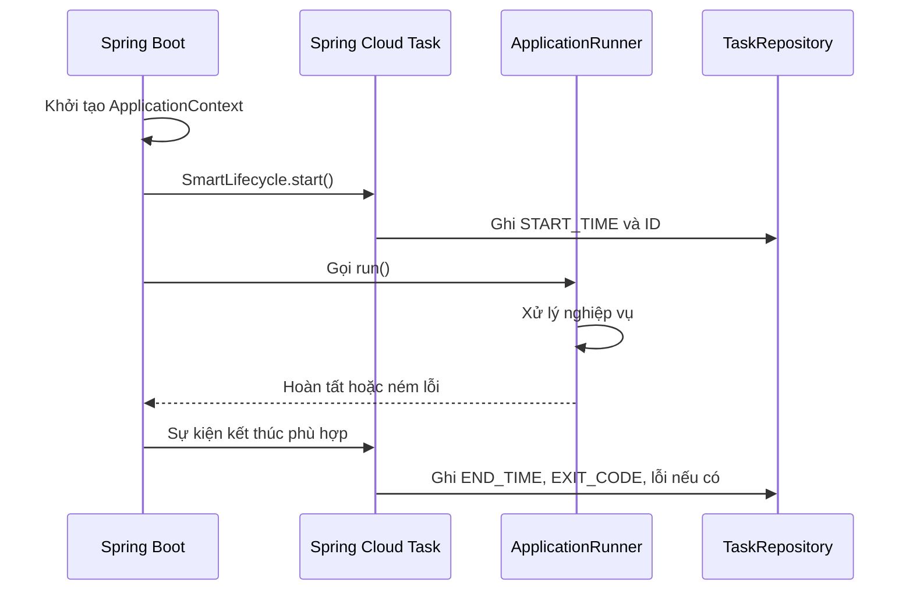

# startTime, endTime và thời lượng thực thi

## 1. Vì sao phải theo dõi thời điểm bắt đầu và kết thúc?

**Spring Cloud Task** phù hợp với các ứng dụng Spring Boot có thời gian chạy hữu hạn: nhập dữ liệu từ đối tác, đồng bộ đơn hàng, tạo báo cáo, chạy tác vụ theo lịch hoặc nhận yêu cầu từ hệ thống điều phối. Sau mỗi lần chạy, người vận hành thường cần trả lời:

- Tác vụ bắt đầu lúc nào, đã kết thúc chưa?
- Mất bao lâu để thực thi? Lần chạy này có chậm hơn bình thường không?
- Lần chạy thành công hay thất bại, và có cần thử lại không?
- Nếu tác vụ chưa có thời điểm kết thúc, nó vẫn chạy hay đã bị dừng bất thường?

Spring Cloud Task lưu thông tin vòng đời của mỗi lần chạy trong **`TaskRepository`**. Đối tượng **`TaskExecution`** chứa các trường `startTime` và `endTime`; từ hai thời điểm đó, ta có thể tính thời lượng thực thi. Đây là dữ liệu quan trọng để theo dõi, cảnh báo, vận hành và phân tích hiệu năng theo thời gian.

**Mục tiêu:** Sau bài học, bạn có thể đọc đúng ý nghĩa `startTime`/`endTime`, tính thời lượng bằng Java và SQL, xử lý trường hợp thời điểm bị thiếu, phân biệt thời lượng của toàn tác vụ với từng công đoạn, đồng thời kết hợp thời lượng với `exitCode` để đánh giá kết quả thực thi.

## 2. `TaskExecution` ghi nhận những mốc thời gian nào?

Mỗi lần một ứng dụng Spring Cloud Task được khởi chạy, framework quản lý một bản ghi `TaskExecution` riêng. Các trường thời gian và liên quan thường gặp:

| Trường trong `TaskExecution` | Cột trong `TASK_EXECUTION` | Ý nghĩa |
| --- | --- | --- |
| `executionId` | `TASK_EXECUTION_ID` | Khóa định danh duy nhất cho **một lần chạy**. |
| `taskName` | `TASK_NAME` | Tên tác vụ, thường do cấu hình xác định. |
| `startTime` | `START_TIME` | Thời điểm Spring Cloud Task bắt đầu theo dõi lần thực thi. |
| `endTime` | `END_TIME` | Thời điểm framework đánh dấu lần thực thi hoàn tất. |
| `exitCode` | `EXIT_CODE` | Mã kết thúc của lần chạy; có thể chưa có khi tác vụ đang chạy. |
| `errorMessage` | `ERROR_MESSAGE` | Thông tin lỗi nếu framework ghi nhận lỗi thực thi. |
| `lastUpdated` (cột metadata) | `LAST_UPDATED` | Thời điểm bản ghi metadata được cập nhật; không phải thời gian chạy. |

Trong các phiên bản Spring Cloud Task hiện đại, `TaskExecution.getStartTime()` và `getEndTime()` trả về **`java.time.LocalDateTime`**. Ở cấp cơ sở dữ liệu, schema cung cấp các cột ngày-giờ tương ứng, thường là `DATETIME` hoặc `TIMESTAMP` tùy hệ quản trị và phiên bản schema.

### 2.1. Vị trí của các mốc trong vòng đời

Theo vòng đời Spring Cloud Task:

1. Spring Boot khởi tạo `ApplicationContext` và các bean cần thiết.
2. Khi `SmartLifecycle.start()` của hạ tầng task được gọi, Spring Cloud Task tạo/cập nhật `TaskExecution` với **`startTime`**; mốc này diễn ra **trước khi** các `CommandLineRunner` và `ApplicationRunner` thực hiện công việc.
3. Các runner chạy logic nghiệp vụ. Khi chúng hoàn tất, framework ghi nhận kết thúc thông qua vòng đời ứng dụng, bao gồm sự kiện `ApplicationReadyEvent`; lúc đó có **`endTime`** và mã thoát tương ứng. Nếu xảy ra lỗi ứng dụng, `ApplicationFailedEvent` có thể dẫn đến trạng thái lỗi.
4. Dữ liệu đã ghi được giữ lại trong `TaskRepository` để tra cứu sau khi tiến trình kết thúc.



> **Ranh giới đo:** `startTime` không phải thời điểm JVM vừa được hệ điều hành tạo ra, vì một phần khởi động Spring Boot đã diễn ra trước khi hạ tầng task ghi bản ghi. `endTime` phản ánh thời điểm hoàn tất theo vòng đời task, không nhất thiết gồm toàn bộ thời gian dọn dẹp tài nguyên sau đó hoặc độ trễ của bộ điều phối bên ngoài.

Nếu ứng dụng không khởi tạo được `ApplicationContext` đến mức cần thiết, có thể **không có bản ghi `TaskExecution` nào**. Vì vậy, việc không tìm thấy dữ liệu thời gian không tự chứng minh rằng chương trình chưa từng được khởi chạy.

### 2.2. `endTime == null` có nghĩa gì?

Một bản ghi mới được tạo thường có `startTime` nhưng **chưa có `endTime`**. Trong quá trình chạy, `exitCode` cũng có thể là `null`. Điều đó là bình thường.

Tuy nhiên, `endTime` trống **không luôn đồng nghĩa tác vụ vẫn đang chạy**. Nếu JVM bị buộc dừng, máy chủ mất điện hoặc tiến trình bị kill trước khi framework cập nhật metadata, bản ghi có thể tồn tại lâu với `END_TIME = NULL`. Để phân biệt *đang chạy* với *bản ghi mồ côi*, cần đối chiếu thêm trạng thái tiến trình, log, bộ lập lịch/Kubernetes và thời điểm cập nhật gần nhất.

`startTime` cũng có thể là `null` đối với một số bản ghi được khởi tạo bên ngoài rồi chưa thực sự bắt đầu. Hãy kiểm tra tính đầy đủ dữ liệu trước khi tính thời lượng.

## 3. Công thức thời lượng và ví dụ trực quan

Với một lần chạy có đủ mốc hợp lệ:

\[
\text{duration} = \text{endTime} - \text{startTime}
\]

Ví dụ giả định:

| Thuộc tính | Giá trị |
| --- | --- |
| `TASK_EXECUTION_ID` | `42` |
| `TASK_NAME` | `import-orders` |
| `START_TIME` | `2026-11-24 10:00:00.150` |
| `END_TIME` | `2026-11-24 10:00:01.410` |
| Thời lượng | **1.260 ms**, tương đương **1,26 giây** |

Thời lượng này là **thời gian đã trôi qua của toàn lần thực thi được Spring Cloud Task ghi nhận**, không phải tổng CPU time và cũng không phải tổng thời gian của tất cả worker. Nếu ba công việc con xử lý đồng thời trong 2 giây, thời lượng toàn task có thể gần 2 giây cộng chi phí chung; không phải mặc định 6 giây.

Để đọc đúng kết quả, cần phân biệt:

| Chỉ số | Phạm vi đo | Cách lấy |
| --- | --- | --- |
| Thời lượng `TaskExecution` | Khoảng từ `startTime` đến `endTime` của task | `TaskRepository` / `TASK_EXECUTION` |
| Thời lượng nghiệp vụ cụ thể | Riêng bước đọc file, gọi API hoặc ghi DB | `System.nanoTime()`, timer/metrics của ứng dụng |
| Thời gian chờ trên hàng đợi | Từ lúc điều phối yêu cầu đến lúc task thật sự được chạy | Dữ liệu scheduler/orchestrator, nếu có |
| Thời gian JVM/process sống | Từ khi OS tạo đến khi tiến trình thoát | Quan sát process hoặc hệ thống điều phối |

Không nên dùng `startTime` và `endTime` thay cho đo hiệu năng chính xác tới từng microsecond. Hai mốc là thời gian theo đồng hồ hệ thống và có thể chịu ảnh hưởng của điều chỉnh đồng hồ, múi giờ hoặc cách hệ quản trị cơ sở dữ liệu xử lý timestamp.

## 4. Tạo một Spring Cloud Task để thu thập thời lượng

Ví dụ thực hành sử dụng **JDK 17**, **Spring Boot 3.4.5**, **Spring Cloud 2024.0.2** và cơ sở dữ liệu H2 lưu ra file. Đây là cặp phiên bản cùng thế hệ; khi dùng bản mới hơn, cần chọn Spring Cloud release train tương thích với Spring Boot.

Ứng dụng `duration-demo` sẽ ngủ một khoảng thời gian được truyền qua `--sleep-ms`, sau đó kết thúc hoặc giả lập lỗi qua `--fail`. Mỗi lần chạy được ghi nhận độc lập.

### 4.1. Cấu trúc dự án

```text
duration-demo/
├── pom.xml
└── src/main/
    ├── java/com/example/duration/
    │   ├── DurationDemoApplication.java
    │   └── DurationRunner.java
    └── resources/
        └── application.yml
```

### 4.2. Cấu hình Maven

Tạo `pom.xml`:

```xml
<?xml version="1.0" encoding="UTF-8"?>
<project xmlns="http://maven.apache.org/POM/4.0.0"
         xmlns:xsi="http://www.w3.org/2001/XMLSchema-instance"
         xsi:schemaLocation="http://maven.apache.org/POM/4.0.0 https://maven.apache.org/xsd/maven-4.0.0.xsd">
    <modelVersion>4.0.0</modelVersion>

    <parent>
        <groupId>org.springframework.boot</groupId>
        <artifactId>spring-boot-starter-parent</artifactId>
        <version>3.4.5</version>
        <relativePath/>
    </parent>

    <groupId>com.example</groupId>
    <artifactId>duration-demo</artifactId>
    <version>0.0.1-SNAPSHOT</version>

    <properties>
        <java.version>17</java.version>
    </properties>

    <dependencyManagement>
        <dependencies>
            <dependency>
                <groupId>org.springframework.cloud</groupId>
                <artifactId>spring-cloud-dependencies</artifactId>
                <version>2024.0.2</version>
                <type>pom</type>
                <scope>import</scope>
            </dependency>
        </dependencies>
    </dependencyManagement>

    <dependencies>
        <dependency>
            <groupId>org.springframework.cloud</groupId>
            <artifactId>spring-cloud-starter-task</artifactId>
        </dependency>
        <dependency>
            <groupId>org.springframework.boot</groupId>
            <artifactId>spring-boot-starter-jdbc</artifactId>
        </dependency>
        <dependency>
            <groupId>com.h2database</groupId>
            <artifactId>h2</artifactId>
            <scope>runtime</scope>
        </dependency>
    </dependencies>

    <build>
        <plugins>
            <plugin>
                <groupId>org.springframework.boot</groupId>
                <artifactId>spring-boot-maven-plugin</artifactId>
            </plugin>
        </plugins>
    </build>
</project>
```

`spring-cloud-starter-task` cung cấp cơ chế vòng đời task, `spring-boot-starter-jdbc` hỗ trợ truy cập cơ sở dữ liệu và H2 giúp giữ lịch sử cho bài thực hành.

### 4.3. Cấu hình `application.yml`

```yaml
spring:
  application:
    name: duration-demo
  main:
    web-application-type: none
  datasource:
    url: jdbc:h2:file:./data/duration-db;DB_CLOSE_ON_EXIT=FALSE
    username: sa
    password: ""
    driver-class-name: org.h2.Driver
  cloud:
    task:
      name: duration-demo
      initialize-enabled: true
      closecontext-enabled: true
```

`web-application-type: none` giúp ứng dụng không khởi động web server. `initialize-enabled: true` cho phép tạo bảng metadata phục vụ thực hành. `closecontext-enabled: true` yêu cầu đóng Spring context sau khi task hoàn tất.

**Chú ý đường dẫn H2:** `./data/duration-db` nằm tương đối so với thư mục chạy lệnh Java. Hãy tạo thư mục `data` trước; giữ cùng thư mục làm việc cho mọi lần chạy để truy vấn đúng tệp dữ liệu. Với production, nên thay H2 file bằng cơ sở dữ liệu có độ bền và khả năng truy cập đồng thời, quản lý schema bằng migration và phân quyền tài khoản.

### 4.4. Kích hoạt task và viết runner

Tạo `src/main/java/com/example/duration/DurationDemoApplication.java`:

```java
package com.example.duration;

import org.springframework.boot.SpringApplication;
import org.springframework.boot.autoconfigure.SpringBootApplication;
import org.springframework.cloud.task.configuration.EnableTask;

@SpringBootApplication
@EnableTask
public class DurationDemoApplication {

    public static void main(String[] args) {
        SpringApplication.run(DurationDemoApplication.class, args);
    }
}
```

Tạo `src/main/java/com/example/duration/DurationRunner.java`:

```java
package com.example.duration;

import java.util.List;

import org.springframework.boot.ApplicationArguments;
import org.springframework.boot.ApplicationRunner;
import org.springframework.stereotype.Component;

@Component
public class DurationRunner implements ApplicationRunner {

    @Override
    public void run(ApplicationArguments args) throws Exception {
        List<String> values = args.getOptionValues("sleep-ms");
        long delayMs = (values == null || values.isEmpty())
                ? 1200L
                : Long.parseLong(values.get(0));

        if (delayMs < 0 || delayMs > 60000L) {
            throw new IllegalArgumentException(
                    "--sleep-ms phải trong khoảng 0..60000");
        }

        System.out.println("Bắt đầu công việc, sleep=" + delayMs + " ms");
        try {
            Thread.sleep(delayMs);
        } catch (InterruptedException ex) {
            Thread.currentThread().interrupt();
            throw ex;
        }

        if (args.containsOption("fail")) {
            throw new IllegalStateException("Giả lập lỗi tác vụ");
        }

        System.out.println("Công việc hoàn tất");
    }
}
```

Ứng dụng cố ý dùng `Thread.sleep()` để thấy rõ sự khác biệt giữa các lần chạy. Với ứng dụng thực tế, thay đoạn này bằng logic xử lý hữu hạn và bảo đảm các công việc bất đồng bộ bắt buộc đã hoàn tất trước khi `run()` trả về.

## 5. Chạy thử và đọc bản ghi thời gian

Trong thư mục `duration-demo`, tạo thư mục lưu H2:

```bash
mkdir -p data
mvn clean package
```

Trên PowerShell, có thể dùng `New-Item -ItemType Directory -Force data` thay cho `mkdir -p data`.

Chạy ba lần:

```bash
# Lần 1: chạy bình thường với độ trễ 1200 ms
java -jar target/duration-demo-0.0.1-SNAPSHOT.jar --sleep-ms=1200

# Lần 2: chạy lâu hơn
java -jar target/duration-demo-0.0.1-SNAPSHOT.jar --sleep-ms=3000

# Lần 3: có lỗi nghiệp vụ sau khi chờ
java -jar target/duration-demo-0.0.1-SNAPSHOT.jar --sleep-ms=500 --fail
```

Sau mỗi lần chạy, Spring Cloud Task ghi một `TASK_EXECUTION_ID` mới. Lần thứ ba sẽ phát sinh ngoại lệ; nếu được hệ thống xử lý như lỗi chạy runner, mã kết thúc được ghi nhận là thất bại. **Không suy thời lượng thực tế bằng đúng giá trị `--sleep-ms`**: giữa `startTime` và `endTime` còn có công việc của framework, runner và việc lưu metadata.

Sau khi các tiến trình Java kết thúc, dùng H2 console hoặc một SQL client kết nối đến:

```text
JDBC URL: jdbc:h2:file:./data/duration-db
Username: sa
Password: (để trống)
```

Truy vấn lịch sử:

```sql
SELECT TASK_EXECUTION_ID,
       TASK_NAME,
       START_TIME,
       END_TIME,
       EXIT_CODE,
       ERROR_MESSAGE
FROM TASK_EXECUTION
ORDER BY TASK_EXECUTION_ID DESC;
```

Kết quả minh họa (ID và timestamp chỉ là ví dụ):

| ID | Tên task | `START_TIME` | `END_TIME` | `EXIT_CODE` |
| ---: | --- | --- | --- | ---: |
| 3 | duration-demo | 10:05:00.100 | 10:05:00.680 | 1 |
| 2 | duration-demo | 10:04:00.100 | 10:04:03.180 | 0 |
| 1 | duration-demo | 10:03:00.100 | 10:03:01.380 | 0 |

Ở lần 2, `END_TIME - START_TIME` là khoảng 3,08 giây, lớn hơn độ trễ 3 giây do runner có thêm chi phí xử lý. Kết quả thực tế tùy máy, JVM và truy cập cơ sở dữ liệu.

## 6. Tính thời lượng bằng SQL

### 6.1. Thời lượng của từng lần chạy trong H2

H2 có hàm `DATEDIFF`. Dùng đơn vị `MILLISECOND` để nhận số mili giây:

```sql
SELECT TASK_EXECUTION_ID,
       TASK_NAME,
       START_TIME,
       END_TIME,
       EXIT_CODE,
       CASE
           WHEN START_TIME IS NOT NULL AND END_TIME IS NOT NULL
           THEN DATEDIFF('MILLISECOND', START_TIME, END_TIME)
           ELSE NULL
       END AS DURATION_MS
FROM TASK_EXECUTION
ORDER BY TASK_EXECUTION_ID DESC;
```

`DURATION_MS` sẽ là `NULL` nếu chưa đủ hai mốc. Với bản ghi hợp lệ, số dương cho biết khoảng thời gian giữa hai timestamp. Nếu nhận giá trị âm, cần điều tra đồng hồ hệ thống, timezone, dữ liệu bất thường hoặc thao tác cập nhật metadata từ bên ngoài; không tự động ép về `0` vì sẽ che mất sự cố.

Ví dụ với PostgreSQL, phép tính tương đương thường là:

```sql
SELECT TASK_EXECUTION_ID,
       EXTRACT(EPOCH FROM (END_TIME - START_TIME)) * 1000
           AS DURATION_MS
FROM TASK_EXECUTION
WHERE START_TIME IS NOT NULL
  AND END_TIME IS NOT NULL;
```

**Hàm tính và kiểu cột phụ thuộc hệ quản trị.** Hãy dùng SQL đúng với database và schema thực tế, thay vì sao chép nguyên truy vấn H2 sang MySQL, SQL Server hoặc PostgreSQL.

### 6.2. Độ dài trung bình và số lần hoàn tất

Một báo cáo vận hành đơn giản có thể đếm số lần chạy và thời lượng trung bình:

```sql
SELECT TASK_NAME,
       COUNT(*) AS TOTAL_RUNS,
       SUM(CASE
           WHEN END_TIME IS NOT NULL AND EXIT_CODE = 0
           THEN 1 ELSE 0
       END) AS SUCCESS_RUNS,
       SUM(CASE
           WHEN END_TIME IS NULL
           THEN 1 ELSE 0
       END) AS NO_END_TIME_RUNS,
       AVG(CASE
           WHEN START_TIME IS NOT NULL
                AND END_TIME IS NOT NULL
                AND END_TIME >= START_TIME
           THEN DATEDIFF('MILLISECOND', START_TIME, END_TIME)
           ELSE NULL
       END) AS AVG_DURATION_MS
FROM TASK_EXECUTION
GROUP BY TASK_NAME;
```

Vì `AVG` bỏ qua giá trị `NULL`, kết quả chỉ tính những lần có timestamp hợp lệ. **Không trộn các lần chưa kết thúc vào trung bình bằng cách thay thời lượng trống bằng 0**; làm như vậy sẽ làm sai lệch thống kê.

Khi so sánh hiệu năng, nên phân nhóm theo loại dữ liệu, kích thước đầu vào và thời điểm chạy. Trung bình đơn thuần có thể che khuất một số lần chạy rất chậm; với dữ liệu đủ nhiều, nên tính thêm percentile như p95 và p99 bằng công cụ phân tích hỗ trợ.

### 6.3. Tìm các bản ghi chưa có thời điểm kết thúc

```sql
SELECT TASK_EXECUTION_ID,
       TASK_NAME,
       START_TIME,
       LAST_UPDATED,
       EXIT_CODE
FROM TASK_EXECUTION
WHERE END_TIME IS NULL
ORDER BY START_TIME;
```

Đây là **danh sách cần kiểm tra**, chưa phải danh sách chắc chắn thất bại. Một task có thể vẫn đang chạy hợp lệ; một task khác đã bị buộc dừng và bỏ lại metadata chưa hoàn chỉnh. Khi cảnh báo, cần kết hợp ngưỡng thời gian dự kiến, trạng thái tiến trình và thông tin từ hệ thống điều phối.

## 7. Tính thời lượng qua API Java `TaskExplorer`

Khi cần lấy thời lượng trong một dịch vụ giám sát hoặc chương trình báo cáo riêng, Spring Cloud Task cung cấp `TaskExplorer` để đọc các `TaskExecution` được lưu bởi `TaskRepository`. Ví dụ dưới đây giả định dịch vụ đã cấu hình kết nối đến cùng cơ sở dữ liệu với tác vụ cần theo dõi.

```java
package com.example.duration;

import java.time.Duration;
import java.time.LocalDateTime;
import java.util.Optional;

import org.springframework.cloud.task.repository.TaskExecution;
import org.springframework.cloud.task.repository.TaskExplorer;
import org.springframework.stereotype.Service;

@Service
public class TaskDurationService {

    private final TaskExplorer taskExplorer;

    public TaskDurationService(TaskExplorer taskExplorer) {
        this.taskExplorer = taskExplorer;
    }

    public Optional<Duration> findCompletedDuration(long executionId) {
        TaskExecution execution = taskExplorer.getTaskExecution(executionId);
        if (execution == null) {
            return Optional.empty();
        }

        LocalDateTime start = execution.getStartTime();
        LocalDateTime end = execution.getEndTime();
        if (start == null || end == null || end.isBefore(start)) {
            return Optional.empty();
        }

        return Optional.of(Duration.between(start, end));
    }
}
```

Ví dụ sử dụng dịch vụ **sau khi lần chạy cần quan sát đã kết thúc**:

```java
taskDurationService.findCompletedDuration(42L)
        .ifPresent(duration ->
                System.out.println("Thời lượng: "
                        + duration.toMillis() + " ms"));
```

`TaskExplorer.getTaskExecution(id)` có thể trả `null` nếu không tìm thấy bản ghi. Hàm trả `Optional.empty()` khi không thể tính thời lượng hợp lệ; người gọi có thể hiển thị “chưa kết thúc” hoặc “thiếu dữ liệu” sau khi kiểm tra lý do.

**Lưu ý quan trọng:** Nếu dùng `TaskExplorer` ngay bên trong `ApplicationRunner` của chính lần chạy hiện tại, `endTime` của lần chạy đó thường **chưa được ghi** vì runner chưa trả về. Muốn truy vấn thời lượng hoàn chỉnh, hãy đọc từ một ứng dụng giám sát/báo cáo khác, từ lần chạy kế tiếp hoặc sau khi task đã cập nhật trạng thái cuối.

`Duration.between(start, end)` hoạt động với hai `LocalDateTime`, nhưng `LocalDateTime` **không mang thông tin múi giờ hay UTC offset**. Nếu nhiều máy chạy với cấu hình múi giờ khác nhau hoặc đồng hồ hệ thống bị điều chỉnh, kết quả so sánh thời điểm có thể sai lệch. Hãy chuẩn hóa timezone (thường dùng UTC), đồng bộ đồng hồ và định nghĩa rõ cách JDBC ánh xạ timestamp.

## 8. Khi cần đo chính xác một đoạn xử lý: `System.nanoTime()`

Thời lượng toàn `TaskExecution` hữu ích cho vận hành. Nhưng nếu muốn biết riêng bước gọi API mất bao lâu, nên đo trong phạm vi mã:

```java
long startNanos = System.nanoTime();
try {
    importOrders();
} finally {
    long elapsedNanos = System.nanoTime() - startNanos;
    long elapsedMs = java.util.concurrent.TimeUnit.NANOSECONDS
            .toMillis(elapsedNanos);
    System.out.println("importOrders mất " + elapsedMs + " ms");
}
```

`importOrders()` là phương thức nghiệp vụ tự triển khai. `System.nanoTime()` được thiết kế để đo **khoảng thời gian trôi qua trong cùng tiến trình**; không phải một ngày-giờ thực tế để lưu thay `startTime` hay so sánh giữa hai máy khác nhau.

Nếu cần phân tích nhiều bước, hãy ghi metric theo tên bước, trạng thái, thời lượng và số lượng bản ghi xử lý. Có thể sử dụng Micrometer/timer để tổng hợp phân phối thời lượng, song cần tránh gắn nhãn có cardinality quá lớn như ID riêng cho từng lần chạy vào mọi metric.

## 9. Diễn giải dữ liệu khi lỗi, retry và xử lý đồng thời

### 9.1. Lần chạy lỗi vẫn có thời lượng

Một task ném ngoại lệ **sau khi đã được Spring Cloud Task bắt đầu theo dõi** vẫn có thể có cả `startTime` và `endTime`. Vì thế:

- **Có thời lượng** không đồng nghĩa **thành công**.
- **Không có `endTime`** không đủ để kết luận task lỗi hay còn chạy.
- **`exitCode = 0`** mô tả kết thúc thành công theo cơ chế báo trạng thái của ứng dụng, nhưng không tự đảm bảo dữ liệu nghiệp vụ đã đúng hoặc đủ.

Khi thống kê, hãy hiển thị ít nhất `taskName`, `executionId`, `startTime`, `endTime`, `duration` và `exitCode` cùng nhau. Nếu nghiệp vụ có một kết quả riêng (chẳng hạn số đơn hàng đã đồng bộ), lưu kết quả đó ở nơi thích hợp và liên hệ nó với lần chạy bằng một định danh rõ ràng.

### 9.2. Chạy lại và chạy chồng

Mỗi lần chạy lại tạo một `TaskExecution` mới. Không được lấy `endTime` của lần chạy thứ nhất trừ `startTime` của lần chạy thứ hai; đó là **hai lần thực thi khác nhau**. Khi scheduler cho phép chạy đồng thời, các khoảng `startTime..endTime` có thể chồng lên nhau, dù mỗi lần chạy có một ID riêng.

Một tác vụ mất 8 phút có thể là bình thường khi nhập 2 triệu bản ghi, nhưng bất thường nếu xử lý 10 bản ghi. Để tạo cảnh báo có ý nghĩa, hãy kết hợp thời lượng với độ lớn đầu vào, số lần retry, mã thoát và mức độ ưu tiên của tác vụ.

### 9.3. Bất đồng bộ và Spring Batch

Nếu runner chỉ gửi việc đến executor rồi trả về, `endTime` của Spring Cloud Task có thể được ghi **trước khi** các việc con hoàn thành. Khi các việc đó là thành phần bắt buộc của task, cần chờ kết quả, xử lý timeout và lan truyền lỗi **trước khi runner kết thúc**.

Khi tích hợp **Spring Batch**, `TaskRepository` theo dõi toàn ứng dụng, còn `JobRepository` theo dõi từng `JobExecution` và `StepExecution`. Những thời lượng này có **ranh giới khác nhau**. Với launcher Batch bất đồng bộ, cần đảm bảo runner chờ job hoàn tất nếu muốn `TaskExecution` phản ánh toàn bộ quá trình xử lý.

## 10. Checklist giám sát và xử lý sự cố

| Dấu hiệu | Khả năng xảy ra | Hướng kiểm tra |
| --- | --- | --- |
| `END_TIME` là `NULL` và tiến trình còn sống | Tác vụ đang chạy lâu | So với SLA, tải dữ liệu, timeout từng bước, thread dump nếu cần. |
| `END_TIME` là `NULL` nhưng không tìm thấy tiến trình | Bị kill/crash hoặc metadata chưa được cập nhật | Xem log JVM, sự kiện Kubernetes/scheduler, hạ tầng và kết nối DB. |
| Không có hàng trong `TASK_EXECUTION` | Có thể lỗi rất sớm khi tạo context hoặc dùng nhầm DB | Xem log khởi động và URL datasource; kiểm tra schema. |
| `END_TIME` nhỏ hơn `START_TIME` | Dữ liệu hoặc thời gian hệ thống không nhất quán | Kiểm tra múi giờ, NTP, đồng hồ từng node và thao tác sửa metadata. |
| Thời lượng tăng nhưng `EXIT_CODE = 0` | Task vẫn thành công nhưng chạy chậm | Đo từng bước, xem database/query/API và kích thước đầu vào. |
| Task báo hoàn tất quá sớm | Runner trả về trước async work hoặc thiếu bước | Kiểm tra việc chờ `Future`/`CompletableFuture`, log và trạng thái dữ liệu. |
| Nhiều hàng cùng tên task | Nhiều lần chạy/retry/chạy chồng | Dùng `TASK_EXECUTION_ID` để phân biệt; xem chính sách concurrency. |

Trong môi trường production, nên dùng database bền vững và migration có kiểm soát cho schema task. Theo dõi thêm tỷ lệ thất bại, số lần chưa có `endTime` quá ngưỡng, phân vị thời lượng và thời gian chờ ngoài hệ thống. Không đưa secret vào tham số dòng lệnh vì metadata task có thể lưu lại danh sách tham số.

## 11. Tự kiểm tra kiến thức

1. `startTime` được thiết lập trước hay sau khi `ApplicationRunner` thực hiện công việc? Tại sao điều đó quan trọng khi tính thời lượng?
2. Bản ghi có `startTime` nhưng `endTime = NULL` cho biết chắc chắn điều gì và điều gì **chưa thể kết luận**?
3. Vì sao hai lần chạy trùng `TASK_NAME` phải được phân biệt bằng `TASK_EXECUTION_ID`?
4. Với `START_TIME = 14:00:00.250` và `END_TIME = 14:00:02.000`, thời lượng bằng bao nhiêu mili giây?
5. `Duration.between(startTime, endTime)` khác `System.nanoTime()` ở mục đích sử dụng nào?
6. Làm thế nào để tránh coi một tác vụ bất đồng bộ hoặc Spring Batch job chưa kết thúc là hoàn tất?
7. Khi nào cần so `EXIT_CODE` và số lượng bản ghi nghiệp vụ cùng với thời lượng?

### Bài tập thực hành

- Chạy `duration-demo` ba lần với `--sleep-ms=500`, `--sleep-ms=2000` và `--sleep-ms=500 --fail`.
- Viết SQL hiển thị `TASK_EXECUTION_ID`, hai timestamp, thời lượng mili giây và mã thoát.
- Tính thời lượng trung bình chỉ của các lần chạy hoàn tất thành công.
- Thêm phần ghi log riêng cho thời gian xử lý trong runner bằng `System.nanoTime()`; so sánh nó với thời lượng tổng trong `TASK_EXECUTION`.
- Giả định một bản ghi `END_TIME` bị bỏ trống sau khi JVM chết. Viết ra các nguồn thông tin cần đối chiếu trước khi quyết định chạy lại.

**Ghi nhớ:** `startTime` và `endTime` mô tả **vòng đời của một `TaskExecution`**, còn thời lượng là hiệu giữa hai mốc khi cả hai hợp lệ. Hãy đọc chúng cùng `executionId`, `exitCode`, kết quả nghiệp vụ và trạng thái bộ điều phối để hiểu chính xác tiến trình đã chạy thế nào.

## Tài liệu tham khảo

- [Spring Cloud Task — Features](https://docs.spring.io/spring-cloud-task/reference/3.2/features.html): thời điểm tạo/cập nhật `TaskExecution`, ý nghĩa `startTime` và `endTime`.
- [Spring Cloud Task — Task Repository Schema](https://docs.spring.io/spring-cloud-task/docs/current/reference/html/appendix-task-repository-schema.html): các cột `TASK_EXECUTION`.
- [Spring Cloud Task — TaskExecution API](https://docs.spring.io/spring-cloud-task/docs/current/apidocs/org/springframework/cloud/task/repository/TaskExecution.html): kiểu trả về và phương thức truy cập timestamp.
