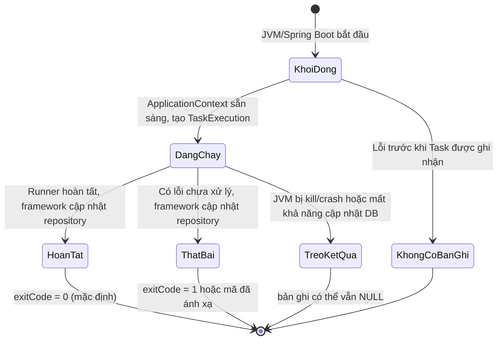
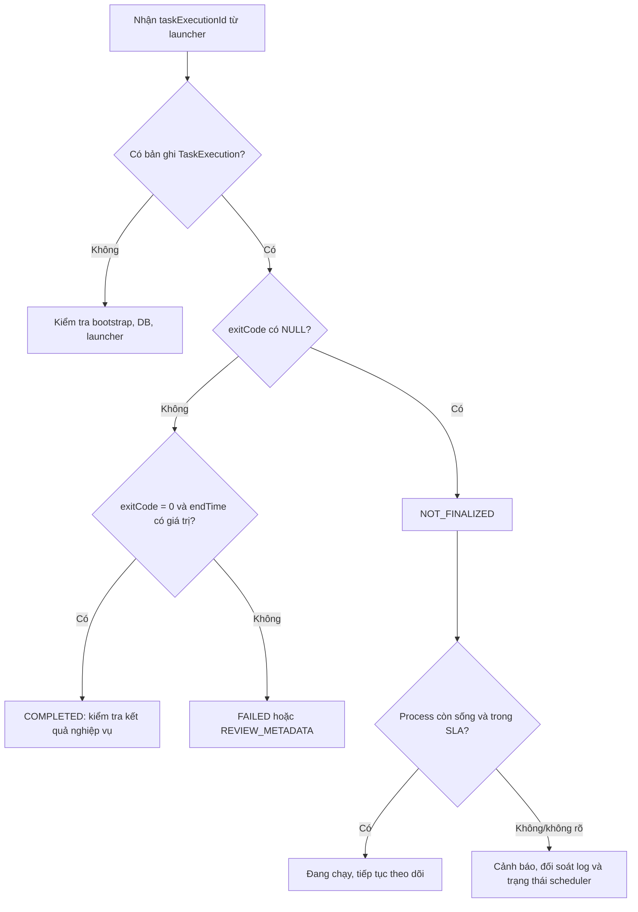

# `exitCode` chưa có giá trị và kết quả khi tác vụ hoàn tất

## Mục tiêu bài học

Trong **Spring Cloud Task**, mỗi lần chạy một ứng dụng có thời gian thực thi hữu hạn được ghi nhận bằng một `TaskExecution`. Bản ghi này giúp vận hành biết tác vụ bắt đầu khi nào, đã kết thúc chưa, kết thúc với mã nào và có thông tin lỗi hay không. Đây là một phần quan trọng của việc theo dõi tác vụ chạy theo lịch, theo yêu cầu, hoặc phối hợp với Spring Batch.

Điểm dễ gây hiểu nhầm nhất là: **khi tác vụ đang chạy, `exitCode` chưa có giá trị (`null`)**. Spring Cloud Task chỉ ghi mã thoát thích hợp khi tiến trình đi qua luồng hoàn tất của framework. Vì vậy, `null`, `0` và mã khác `0` phải được hiểu theo ba cách khác nhau.

Sau bài học, bạn có thể:

- Giải thích vòng đời của `TaskExecution` và thời điểm `exitCode` được cập nhật.
- Phân biệt `NULL` với `0`, mã lỗi khác `0` và trường hợp không có bản ghi thực thi.
- Đọc kết quả bằng SQL hoặc `TaskExplorer` mà không gặp lỗi unboxing `null`.
- Điều khiển mã thoát cho lỗi nghiệp vụ bằng `ExitCodeExceptionMapper` và ghi thông điệp hoàn tất an toàn.
- Phát hiện lần chạy bất thường khi JVM bị dừng đột ngột hoặc repository chưa được cập nhật, đồng thời hiểu mối liên hệ với Spring Batch.

## 1. `exitCode` biểu thị điều gì?

`TaskExecution` là mô hình dữ liệu một **lần chạy vật lý** của ứng dụng Spring Boot được cấu hình để sử dụng Spring Cloud Task. Thuộc tính Java `getExitCode()` trả về **`Integer`**, không phải `int`; vì vậy nó có thể là `null`. Ở cơ sở dữ liệu, cột tương ứng là `TASK_EXECUTION.EXIT_CODE`, cho phép `NULL`.

| Giá trị trong `TaskExecution` | Ý nghĩa khi đọc | Có nên kết luận tác vụ thành công? |
| --- | --- | --- |
| `null` / SQL `NULL` | **Chưa có kết quả cuối cùng được lưu**; thường là tác vụ đang thực thi | **Không**. Chưa đủ dữ kiện để đánh giá thành công hay thất bại |
| `0` | Theo quy ước mặc định, luồng tác vụ kết thúc thành công | **Có thể**, nếu đã hoàn tất, lưu kết quả hợp lệ và nghiệp vụ thực sự thành công |
| Khác `0` (thường là `1`, có thể là mã tùy chỉnh) | Luồng kết thúc với thất bại hoặc trạng thái được quy ước là không thành công | Không. Cần đọc mã, `errorMessage`, `exitMessage` và log |
| Không tìm thấy bản ghi | Có thể chưa khởi chạy, sai `executionId`, truy vấn sai DB hoặc lỗi quá sớm khiến Task không được ghi | Không. Đây là trường hợp **khác** với bản ghi có `exitCode = NULL` |

**Không được đồng nhất `null` với `0`:** trong Java, `Integer exitCode = null` nghĩa là *chưa có giá trị*, còn `exitCode = 0` là *đã có một giá trị cụ thể*. SQL cũng vậy: `EXIT_CODE = NULL` không phải cách kiểm tra hợp lệ; phải dùng `EXIT_CODE IS NULL`.

Tài liệu [Spring Cloud Task – Features](https://docs.spring.io/spring-cloud-task/reference/features.html) xác nhận mã thoát được lưu `null` trong lúc tác vụ chạy và được cập nhật khi kết thúc. Sự phân biệt này giúp tránh báo “thành công” cho một tiến trình mới chạy được vài giây.

## 2. Vòng đời một lần thực thi



Thời điểm quan trọng trong luồng:

1. **Khởi động:** Spring Boot tạo `ApplicationContext`, thiết lập `DataSource`, `TaskRepository` và các bean cần thiết. Nếu không bootstrap được context, framework **có thể không tạo bản ghi** `TaskExecution`.
2. **Ghi nhận bắt đầu:** sau khi khởi tạo đủ hạ tầng và trước khi gọi `ApplicationRunner`/`CommandLineRunner`, Spring Cloud Task tạo bản ghi với `startTime` đã có, `endTime = null` và **`exitCode = null`**.
3. **Thực thi:** mã nghiệp vụ chạy trong các runner. Trong giai đoạn này, bản ghi chưa có kết quả cuối, dù ứng dụng đã xử lý được một phần dữ liệu.
4. **Hoàn tất bình thường:** khi các runner kết thúc, framework cập nhật thời điểm kết thúc, mã thoát và những thông điệp liên quan trong `TaskRepository`. Nếu không có sự kiện lỗi hoặc mã khác được cấu hình, **mặc định là `0`**.
5. **Thất bại có ghi nhận:** khi có lỗi chưa được xử lý và framework tiếp nhận sự kiện thất bại, mã mặc định thường là **`1`**, hoặc mã do cơ chế ánh xạ lỗi cung cấp. Các trường mô tả lỗi có thể được cập nhật.
6. **Dừng bất thường:** `SIGKILL`, hết bộ nhớ, máy/container bị hủy, mất điện hoặc DB không thể cập nhật có thể làm **bản ghi tồn tại với `exitCode = NULL` rất lâu**. Vì vậy `NULL` không chứng minh JVM vẫn còn chạy.

Hai trường hợp ở bước 1 và bước 6 phải được giám sát bằng trạng thái tiến trình/container, log và thông tin scheduler; không thể kết luận chỉ qua bảng Task. Theo tài liệu, việc ghi nhận một lần chạy yêu cầu `ApplicationContext` khởi tạo thành công. [Nguồn: Task lifecycle](https://docs.spring.io/spring-cloud-task/reference/features.html#the-lifecycle-of-a-spring-cloud-task).

### Ví dụ hai thời điểm của cùng một bản ghi

Giả sử hệ thống tổng hợp giao dịch cho ngày `2026-11-23` và có `TASK_EXECUTION_ID = 281`. Các giá trị sau **minh họa**, không phải dữ liệu từ hệ thống thật:

| Thời điểm quan sát | `START_TIME` | `END_TIME` | `EXIT_CODE` | Cách hiểu |
| --- | --- | --- | --- | --- |
| 02:00:02, ngay sau khi bắt đầu | `2026-11-24 02:00:01` | `NULL` | `NULL` | Chưa có kết quả cuối |
| 02:00:10, đang ghi dữ liệu | `2026-11-24 02:00:01` | `NULL` | `NULL` | Vẫn chưa có kết quả cuối |
| 02:00:40, hoàn tất thành công | `2026-11-24 02:00:01` | `2026-11-24 02:00:40` | `0` | Đã ghi nhận thành công |

Nếu lần thực thi đó ném lỗi chưa xử lý ở 02:00:30, kết quả cuối có thể là `END_TIME = 2026-11-24 02:00:30`, `EXIT_CODE = 1` và một `ERROR_MESSAGE`. Thời gian xử lý chính xác do logic nghiệp vụ quyết định; ví dụ chỉ minh họa sự biến đổi của metadata.

## 3. Đọc các trường dữ liệu cùng với `exitCode`

`exitCode` là tín hiệu quan trọng, nhưng **không đủ** để đánh giá toàn bộ lần chạy.

| Trường / API | Ý nghĩa | Câu hỏi vận hành |
| --- | --- | --- |
| `executionId` | ID duy nhất cho một lần chạy Task | Đây là lần nào, có liên quan tới yêu cầu nào? |
| `taskName` | Tên Task, thường dựa trên `spring.application.name` | Loại tác vụ gì đã chạy? |
| `startTime` | Lúc Task được ghi nhận bắt đầu | Lịch chạy bắt đầu đúng giờ không? |
| `endTime` | Lúc Task được ghi nhận kết thúc | Framework đã hoàn tất cập nhật kết quả chưa? |
| `exitCode` | Mã kết thúc, **nullable** trong lúc chạy | Kết quả cuối là thành công, lỗi, hay chưa có? |
| `exitMessage` | Thông điệp do ứng dụng có thể cung cấp qua `TaskExecutionListener` | Cần mô tả ngắn nào cho người vận hành? |
| `errorMessage` | Thông tin lỗi, có thể chứa stack trace khi thất bại | Đường lỗi nằm ở đâu, cần đối chiếu log gì? |
| `arguments` | Danh sách đối số dòng lệnh đã truyền cho Task | Lần chạy xử lý ngày/tenant nào? |

Trong schema mặc định, `TASK_EXECUTION` có các cột `TASK_EXECUTION_ID`, `TASK_NAME`, `START_TIME`, `END_TIME`, `EXIT_CODE`, `EXIT_MESSAGE`, `ERROR_MESSAGE`, `LAST_UPDATED`...; đối số nằm ở `TASK_EXECUTION_PARAMS`. Tên bảng có thể khác nếu dự án cấu hình **table prefix**, nên cần đối chiếu schema thực tế. Xem [Task Repository Schema](https://docs.spring.io/spring-cloud-task/reference/appendix-task-repository-schema.html).

Phân biệt ba khái niệm:

- **`exitCode`** là **mã số kết quả thực thi** mà Spring Cloud Task lưu. `null` không phải mã lỗi đặc biệt.
- **`exitMessage`** là **thông điệp giải thích** do ứng dụng điền. Nó không tự làm `exitCode` chuyển từ `0` sang `1`.
- **`errorMessage`** giúp điều tra ngoại lệ, nhưng không bảo đảm lúc nào cũng có nội dung. Một nghiệp vụ nuốt ngoại lệ có thể kết thúc `0` và không tạo ra thông điệp lỗi của framework.

`TaskExecution` chủ yếu trả lời **“tiến trình thực thi ra sao?”**. Với nghiệp vụ như thanh toán hoặc đối soát, phải có thêm kết quả miền nghiệp vụ: số bản ghi đã xử lý, tổng giá trị, mã yêu cầu, checkpoint và trạng thái giao dịch. Các dữ liệu này không tự được đảm bảo chỉ vì `exitCode = 0`.

## 4. Truy vấn trạng thái an toàn bằng SQL

Ví dụ dưới đây giả sử `TaskRepository` dùng một **PostgreSQL bền vững**, đã tạo schema Spring Cloud Task và ứng dụng có quyền ghi metadata. Không dùng H2 trong bộ nhớ cho việc kiểm tra lịch sử giữa các tiến trình: DB sẽ mất khi JVM kết thúc.

### Xem các lần thực thi gần nhất

```sql
SELECT
    TASK_EXECUTION_ID,
    TASK_NAME,
    START_TIME,
    END_TIME,
    EXIT_CODE,
    EXIT_MESSAGE,
    LAST_UPDATED
FROM TASK_EXECUTION
WHERE TASK_NAME = 'invoice-summary-task'
ORDER BY TASK_EXECUTION_ID DESC
LIMIT 20;
```

Để lấy các bản ghi **chưa có mã kết thúc**:

```sql
SELECT TASK_EXECUTION_ID, TASK_NAME, START_TIME, END_TIME
FROM TASK_EXECUTION
WHERE EXIT_CODE IS NULL
ORDER BY START_TIME;
```

Không viết `WHERE EXIT_CODE = NULL` hoặc `WHERE EXIT_CODE != NULL`: trong SQL, phép so sánh trực tiếp với `NULL` không trả về `TRUE`, nên kết quả truy vấn có thể rỗng ngoài ý muốn. Luôn dùng `IS NULL`/`IS NOT NULL`.

### Hiển thị nhãn trạng thái do hệ thống giám sát suy ra

```sql
SELECT
    TASK_EXECUTION_ID,
    TASK_NAME,
    START_TIME,
    END_TIME,
    EXIT_CODE,
    CASE
        WHEN EXIT_CODE IS NULL AND END_TIME IS NULL
            THEN 'NOT_FINALIZED'
        WHEN EXIT_CODE = 0 AND END_TIME IS NOT NULL
            THEN 'COMPLETED'
        WHEN EXIT_CODE <> 0 AND END_TIME IS NOT NULL
            THEN 'FAILED'
        ELSE 'REVIEW_METADATA'
    END AS OBSERVED_STATE
FROM TASK_EXECUTION
ORDER BY TASK_EXECUTION_ID DESC
LIMIT 50;
```

`NOT_FINALIZED` nghĩa là **chưa có kết quả cuối**, không đồng nghĩa `RUNNING`. Muốn hiện thị `RUNNING`, cần **thêm bằng chứng**: process/container còn hoạt động, scheduler xác nhận đang chạy, heartbeat ứng dụng hoặc tín hiệu phù hợp. `REVIEW_METADATA` giúp phát hiện trường hợp các trường không khớp kỳ vọng, ví dụ `END_TIME` đã có nhưng `EXIT_CODE` vẫn `NULL`.

### Phát hiện bản ghi chưa hoàn tất quá lâu

Ví dụ PostgreSQL đánh dấu các tác vụ **bắt đầu hơn 30 phút trước** mà chưa có kết quả:

```sql
SELECT TASK_EXECUTION_ID, TASK_NAME, START_TIME, LAST_UPDATED
FROM TASK_EXECUTION
WHERE END_TIME IS NULL
  AND EXIT_CODE IS NULL
  AND START_TIME < CURRENT_TIMESTAMP - INTERVAL '30 minutes'
ORDER BY START_TIME;
```

Danh sách này chỉ là **ứng viên điều tra**. Một tác vụ 2 giờ vẫn có thể hợp lệ, còn một tác vụ bị kill từ phút đầu có thể nằm đó mãi. Ngưỡng thời gian cần dựa trên SLA của từng `taskName`, dữ liệu chạy thực tế và tình trạng scheduler. Không chạy câu SQL `UPDATE ... SET EXIT_CODE = 1` hàng loạt chỉ vì đã quá 30 phút: sửa trực tiếp metadata sẽ làm sai lịch sử và có thể xung đột với một tiến trình thực sự còn chạy.

## 5. Đọc qua Java `TaskExplorer` mà không gặp `NullPointerException`

`TaskExplorer` cung cấp API đọc dữ liệu từ repository, ví dụ `getTaskExecution(long executionId)`. Bên ngoài tiến trình xử lý, một service giám sát có thể dùng API này để truy vấn trạng thái. Phương thức `getTaskExecution` có thể trả về `null` nếu không tìm thấy ID.

```java
package com.example.monitoring;

import org.springframework.cloud.task.repository.TaskExecution;
import org.springframework.cloud.task.repository.TaskExplorer;
import org.springframework.stereotype.Service;

@Service
public class TaskStatusReader {
    private final TaskExplorer taskExplorer;

    public TaskStatusReader(TaskExplorer taskExplorer) {
        this.taskExplorer = taskExplorer;
    }

    public String getObservedState(long executionId) {
        TaskExecution execution = taskExplorer.getTaskExecution(executionId);
        if (execution == null) {
            return "NOT_FOUND";
        }

        // Dùng Integer: getExitCode() có thể là null.
        Integer exitCode = execution.getExitCode();
        if (exitCode == null && execution.getEndTime() == null) {
            return "NOT_FINALIZED";
        }
        if (exitCode == null || execution.getEndTime() == null) {
            return "REVIEW_METADATA";
        }
        return exitCode == 0 ? "COMPLETED" : "FAILED (" + exitCode + ")";
    }
}
```

`exitCode == 0` ở cuối ví dụ là an toàn **vì đã kiểm tra `null`**. Nếu viết trực tiếp `if (execution.getExitCode() == 0)`, Java có thể tự chuyển `Integer` thành `int` (*unboxing*), làm phát sinh `NullPointerException` khi tác vụ còn đang chạy.

Trong API trả cho dashboard hoặc hệ thống khác, nên dùng **enum/DTO có trường trạng thái rõ ràng** (`NOT_FOUND`, `NOT_FINALIZED`, `COMPLETED`, `FAILED`, `REVIEW_METADATA`) thay vì ghép chuỗi tùy tiện. Đây là các **nhãn của ứng dụng giám sát**, không phải enum trạng thái được Spring Cloud Task lưu sẵn.

## 6. Ví dụ: thành công, lỗi mặc định và mã lỗi tùy chỉnh

Xét tác vụ `invoice-summary-task`: nhận `--business-date=YYYY-MM-DD`, mô phỏng xử lý trong 15 giây để có thời gian quan sát bản ghi khi đang chạy, và hỗ trợ `--simulate-failure` để kiểm tra đường lỗi.

Ứng dụng minh họa dùng `spring-cloud-starter-task` cùng Spring Boot/Spring Cloud BOM tương thích và JDBC driver tương ứng. Chỉ sử dụng delay trong thực hành; production phải thực thi logic nghiệp vụ thật.

File `src/main/java/com/example/task/InvoiceSummaryTaskApplication.java`:

```java
package com.example.task;

import java.time.LocalDate;
import java.time.format.DateTimeParseException;
import java.util.List;

import org.springframework.boot.ApplicationRunner;
import org.springframework.boot.ExitCodeExceptionMapper;
import org.springframework.boot.SpringApplication;
import org.springframework.boot.autoconfigure.SpringBootApplication;
import org.springframework.cloud.task.configuration.EnableTask;
import org.springframework.context.annotation.Bean;

@SpringBootApplication
@EnableTask
public class InvoiceSummaryTaskApplication {

    public static void main(String[] args) {
        SpringApplication.run(InvoiceSummaryTaskApplication.class, args);
    }

    @Bean
    ApplicationRunner invoiceSummary() {
        return args -> {
            List<String> values = args.getOptionValues("business-date");
            if (values == null || values.size() != 1) {
                throw new InvalidTaskInputException("Cần một --business-date");
            }

            LocalDate businessDate;
            try {
                businessDate = LocalDate.parse(values.get(0));
            } catch (DateTimeParseException ex) {
                throw new InvalidTaskInputException("Ngày phải theo YYYY-MM-DD", ex);
            }

            // Chỉ dùng cho thí nghiệm: có thời gian query EXIT_CODE IS NULL.
            Thread.sleep(15_000);

            if (args.containsOption("simulate-failure")) {
                throw new IllegalStateException("Mô phỏng xử lý thất bại");
            }

            System.out.println("Tổng hợp hóa đơn thành công cho " + businessDate);
        };
    }

    @Bean
    ExitCodeExceptionMapper taskExitCodes() {
        return error -> {
            // Spring Boot có thể bọc ngoại lệ của ApplicationRunner.
            for (Throwable cause = error; cause != null; cause = cause.getCause()) {
                if (cause instanceof InvalidTaskInputException) {
                    return 12; // Mã do ứng dụng quy ước: đầu vào không hợp lệ.
                }
            }
            return 1; // Lỗi khác.
        };
    }

    static final class InvalidTaskInputException extends RuntimeException {
        InvalidTaskInputException(String message) {
            super(message);
        }

        InvalidTaskInputException(String message, Throwable cause) {
            super(message, cause);
        }
    }
}
```

`ExitCodeExceptionMapper` là cơ chế Spring Boot chuyển **ngoại lệ chưa được xử lý** thành mã thoát. Spring Cloud Task có thể ghi mã được ánh xạ vào `TaskExecution`. Ví dụ này quy ước `12` cho đầu vào sai; **số 12 là lựa chọn của ứng dụng**, không phải mã chuẩn của Spring Cloud Task. Nếu muốn phân loại lỗi chi tiết hơn, tài liệu Spring Boot còn cung cấp `ExitCodeGenerator` và Spring Cloud Task có cơ chế tiếp nhận `ExitCodeEvent`.

### Cấu hình repository để nhìn thấy bản ghi giữa các lần chạy

Trong môi trường thử nghiệm, hãy chuẩn bị trước PostgreSQL và schema Task tương ứng với phiên bản thư viện; mẫu `application.yml` sau giả định DB đó đã tồn tại:

```yaml
spring:
  application:
    name: invoice-summary-task
  main:
    web-application-type: none
  datasource:
    url: ${TASK_DB_URL}
    username: ${TASK_DB_USER}
    password: ${TASK_DB_PASSWORD}
  cloud:
    task:
      initialize-enabled: false   # Schema đã được tạo bằng migration.
      closecontext-enabled: true
logging:
  level:
    org.springframework.cloud.task: DEBUG
```

Biến `TASK_DB_*` là ví dụ cấu hình do môi trường cấp; không đưa thông tin đăng nhập vào command-line arguments để tránh lộ ở lịch sử lệnh và `TASK_EXECUTION_PARAMS`. `closecontext-enabled: true` giúp đóng context khi framework đã hoàn tất cập nhật; ứng dụng thực tế cũng phải xử lý các thread/tài nguyên khác để tiến trình kết thúc hữu hạn.

Sau khi build ra JAR đúng tên, chạy lần lượt ba kịch bản (thay `target/invoice-summary-task.jar` bằng artifact thực tế):

```bash
# A: dự kiến thành công, exitCode cuối = 0
java -jar target/invoice-summary-task.jar --business-date=2026-11-23

# B: thiếu tham số, dự kiến mã đã ánh xạ = 12
java -jar target/invoice-summary-task.jar

# C: giả lập lỗi nghiệp vụ chưa xử lý, mã mặc định/mapper = 1
java -jar target/invoice-summary-task.jar \
  --business-date=2026-11-23 --simulate-failure
```

Trong khi kịch bản A hoặc C đang ngủ 15 giây, thực hiện truy vấn ở mục 4 từ **một kết nối khác** vào cùng PostgreSQL. Bạn sẽ thấy `EXIT_CODE IS NULL`, `END_TIME IS NULL`. Sau khi runner và luồng cập nhật hoàn tất, đọc lại cùng `TASK_EXECUTION_ID` để thấy `0`, `12` hoặc `1` theo đường đi đã chọn.

Lưu ý: trình chạy thực tế, phiên bản Spring Boot/Cloud, các listener bổ sung và lỗi hạ tầng có thể ảnh hưởng đến mã cuối. Ví dụ chỉ thể hiện cách **thiết kế và thử nghiệm** ba kết quả chính, không bảo đảm mọi ứng dụng đều sử dụng cùng bảng mã. Đặc biệt, nếu ứng dụng thất bại trước khi Task được tạo thì không thể quan sát `exitCode` trên một bản ghi chưa tồn tại.

## 7. Thông điệp hoàn tất: `exitMessage` và `errorMessage`

Trong một số tình huống, mã `0` hoặc `1` quá ít thông tin. Ta muốn biết *đã tổng hợp bao nhiêu hóa đơn*, *lỗi thuộc loại gì* hoặc *mã yêu cầu để tra cứu*.

Spring Cloud Task cho phép đăng ký `TaskExecutionListener`, hoặc dùng annotation `@BeforeTask`, `@AfterTask`, `@FailedTask`. `@AfterTask` được gọi **trước khi** framework ghi trạng thái cuối vào repository; `@FailedTask` nhận ngoại lệ trong luồng thất bại.

Ví dụ listener chỉ ghi một mã lỗi an toàn:

```java
package com.example.task;

import org.springframework.cloud.task.listener.annotation.FailedTask;
import org.springframework.cloud.task.repository.TaskExecution;
import org.springframework.stereotype.Component;

@Component
public class TaskFailureDetails {

    @FailedTask
    public void onFailure(TaskExecution execution, Throwable error) {
        // Dùng mã phân loại/ID, tránh lưu token, dữ liệu cá nhân hoặc stack trace nhạy cảm.
        execution.setExitMessage(
                "Failure recorded; taskExecutionId=" + execution.getExecutionId());
    }
}
```

`exitMessage` do listener đặt không thay thế `exitCode`. Nếu cài thêm listener `@AfterTask` cũng gọi `setExitMessage`, thông điệp từ giai đoạn cuối có thể **ghi đè thông điệp lỗi** theo quy tắc ưu tiên của framework. Cần thiết kế thông điệp nhất quán và kiểm tra giá trị thực sự lưu trong DB.

`errorMessage` được framework điền khi có thông tin lỗi tương ứng. Trường này có giới hạn độ dài theo schema, nên không nên trông đợi chứa trọn stack trace. Duy trì log tập trung có `taskExecutionId` và correlation ID để điều tra chi tiết. Khi xây API/dashboard, hạn chế quyền truy cập và làm sạch thông điệp trước khi hiển thị.

## 8. Mã thoát lưu trong DB và mã thoát của tiến trình khác nhau thế nào?

Hai nguồn thường gặp:

| Nguồn | Thời điểm/ý nghĩa | Rủi ro khi dùng một mình |
| --- | --- | --- |
| `TaskExecution.exitCode` / `TASK_EXECUTION.EXIT_CODE` | Do Spring Cloud Task ghi khi framework đi qua luồng hoàn tất và lưu được vào repository | Không có kết quả khi chạy dở; có thể stale khi kill/crash/mất kết nối DB |
| **Process exit code** do hệ điều hành, scheduler hoặc container trả về | Cho biết trạng thái kết thúc của **tiến trình** theo quy ước nền tảng | Không chứa ngữ cảnh nghiệp vụ; giá trị do signal/launcher quy định, không nhất thiết trùng DB |

Trong đường đi bình thường, hai mã thường phản ánh cùng kết quả. Nhưng không được giả định chúng **luôn bằng nhau**:

- **JVM bị `SIGKILL` hoặc container bị hủy cưỡng bức:** scheduler có thể thấy tiến trình chết, trong khi bản ghi `TaskExecution` còn `EXIT_CODE = NULL` vì không có dịp cập nhật repository.
- **Mất kết nối cơ sở dữ liệu lúc kết thúc:** nghiệp vụ có thể đã làm xong nhưng repository chưa ghi được `END_TIME`/`EXIT_CODE`; cần điều tra để tránh chạy lại gây trùng dữ liệu.
- **Bắt lỗi rồi bỏ qua:** runner chỉ log ngoại lệ mà không ném lại hoặc đặt trạng thái thất bại, nên framework có thể coi lần chạy là thành công và ghi `0` dù tác vụ xử lý sai.
- **Dùng `System.exit(n)` đột ngột trong mã nghiệp vụ:** có nguy cơ ngăn listener và quá trình cập nhật repository chạy đầy đủ. Không dùng nó như cơ chế thông thường để báo lỗi nghiệp vụ.
- **Lỗi khởi động trước khi Task được ghi:** scheduler/container báo lỗi nhưng cơ sở dữ liệu không có dòng `TASK_EXECUTION` tương ứng.

Vì vậy, ở production, khi kết luận kết quả một tác vụ nên đối chiếu **bản ghi TaskRepository + trạng thái launcher/process + log và kết quả nghiệp vụ**. Đặc biệt, signal `SIGTERM` không mặc nhiên có nghĩa `exitCode` Task được ghi thành `1`; kết quả phụ thuộc cách ứng dụng xử lý việc dừng và liệu cập nhật repository có chạy được hay không.

## 9. Khi chạy cùng Spring Batch

Spring Cloud Task ghi **`TaskExecution`** (một lần chạy tiến trình), còn Spring Batch ghi **`JobExecution`** và `StepExecution` (trạng thái job và các bước xử lý). Hai lớp này có thể liên kết với nhau nhưng không đồng nhất.

| Tình huống | Cần kiểm tra |
| --- | --- |
| Runner kết thúc bình thường, không dùng Batch | `TaskExecution.exitCode` mặc định `0` |
| Runner có ngoại lệ chưa được xử lý | `TaskExecution.exitCode` thường `1` hoặc mã tùy chỉnh |
| Spring Batch Job có `BatchStatus.FAILED` nhưng ứng dụng Boot kết thúc bình thường | Task **có thể vẫn nhận `0`** theo cấu hình mặc định, dù Job thất bại |
| Muốn Batch Job thất bại làm Task báo mã khác `0` | Xem `spring.cloud.task.batch.fail-on-job-failure=true`, kiểm tra behavior theo phiên bản đang dùng |

Ví dụ cấu hình khi ứng dụng thực sự có Spring Batch và thành phần tích hợp Task/Batch:

```yaml
spring:
  cloud:
    task:
      batch:
        fail-on-job-failure: true
```

Khi cần kiểm soát đầu ra, hãy kiểm tra cả `BatchStatus`/`ExitStatus` của `JobExecution`, thông tin retry/restart và mã cuối của `TaskExecution`. Không thể lấy `EXIT_CODE IS NULL` làm kết luận một Batch Job đang chờ, cũng không thể dựa vào `TaskExecution.exitCode = 0` để chứng minh mọi step nghiệp vụ thành công nếu cấu hình không truyền kết quả thất bại của Batch lên Task. Tham khảo [Spring Cloud Task – Batch Job Exit Codes](https://docs.spring.io/spring-cloud-task/reference/batch.html#batch-job-exit-codes).

## 10. Thiết kế giám sát và cảnh báo

Giả sử một tác vụ chạy mỗi 15 phút và thường hoàn tất trong 2–5 phút. Một dashboard có thể áp dụng quy tắc sau:



Một số nguyên tắc vận hành:

1. **Theo dõi với một ID duy nhất:** lưu `taskExecutionId` và ID request/scheduler để đối chiếu giữa DB, log, container và nếu có, `JobExecution` của Spring Batch.
2. **Cảnh báo theo SLA từng loại Task:** `exitCode = NULL` quá 15 phút là bình thường với công việc 1 giờ nhưng đáng ngờ với công việc 2 phút. Đừng áp dụng một ngưỡng cố định cho mọi tác vụ.
3. **Kiểm tra process sống hay chết:** `exitCode IS NULL` chỉ nói rằng metadata **chưa chốt**. Kết hợp trạng thái Pod/Job trong Kubernetes, process exit code hoặc trạng thái do scheduler trả về.
4. **Không tự sửa kết quả lịch sử để làm sạch dashboard:** khi phát hiện bản ghi treo, mở sự kiện điều tra, xác định nguyên nhân và có quy trình vận hành riêng để đánh dấu ngoại lệ nếu thật sự cần.
5. **Thiết kế idempotency trước khi retry:** nếu Task đã ghi một phần nghiệp vụ nhưng bị kill trước khi cập nhật metadata, chạy lại có thể tạo hóa đơn/chuyển tiền trùng. Sử dụng transaction, khóa nghiệp vụ, checkpoint và mã idempotency phù hợp.
6. **Giới hạn dữ liệu nhạy cảm:** `arguments`, `exitMessage`, `errorMessage` và log có thể chứa thông tin không nên công khai. Không đưa password/token vào CLI hoặc exit message; phân quyền truy cập repository.

### Bốn tình huống để tự đánh giá

**Tình huống A.** `EXIT_CODE = NULL`, `END_TIME = NULL`, lần chạy mới bắt đầu cách đây 15 giây. **Kết luận:** chưa có kết quả cuối; nếu process còn chạy, có thể hiển thị “đang chạy”. Không hiển thị “thành công”.

**Tình huống B.** `EXIT_CODE = 0`, `END_TIME` đã có, nhưng báo cáo nghiệp vụ không chứa dữ liệu mong muốn. **Kết luận:** framework ghi nhận lần chạy hoàn tất; cần kiểm tra điều kiện nghiệp vụ, logic nuốt lỗi, báo cáo đầu ra và khả năng giao dịch chưa commit.

**Tình huống C.** `EXIT_CODE = NULL`, `END_TIME = NULL` sau 4 giờ; scheduler xác nhận container đã bị hủy. **Kết luận:** bản ghi chưa chốt có thể do dừng bất thường; đánh dấu điều tra/cảnh báo, kiểm tra dữ liệu đã tác động trước khi retry. Không suy đoán rằng tiến trình vẫn chạy.

**Tình huống D.** Spring Batch Job thất bại nhưng `TaskExecution.exitCode = 0`. **Kết luận:** kiểm tra cấu hình truyền trạng thái Batch lên Task, trong đó có `spring.cloud.task.batch.fail-on-job-failure`, và đường xử lý/ngoại lệ của launcher.

## 11. Checklist trước khi đưa vào lịch chạy production

- [ ] `TaskRepository` kết nối DB bền vững, schema đúng phiên bản; không phụ thuộc DB in-memory nếu cần lịch sử qua nhiều tiến trình.
- [ ] Dashboard xử lý được ba giá trị `null`, `0` và khác `0`, không unbox `Integer` khi chưa kiểm tra `null`.
- [ ] Truy vấn SQL dùng `IS NULL`, không dùng `= NULL`; phân biệt “chưa chốt” với “thực sự đang chạy”.
- [ ] Lỗi nghiệp vụ quan trọng không bị bỏ qua; mapping exit code được mô tả và được thử nghiệm trên đường lỗi thực.
- [ ] Có giám sát thêm trạng thái launcher/container, mã thoát OS và lỗi khởi động trước khi TaskRepository sẵn sàng.
- [ ] `exitMessage`/`errorMessage` đủ thông tin tra cứu nhưng không chứa token, mật khẩu hay dữ liệu cá nhân nhạy cảm.
- [ ] Có SLA, phát hiện chạy quá hạn, quy trình điều tra bản ghi treo và khả năng retry an toàn.
- [ ] Nếu kết hợp Spring Batch, kiểm tra liên kết `TaskExecution`–`JobExecution`, `BatchStatus`/`ExitStatus` và cấu hình ảnh hưởng đến mã kết thúc.

## Câu hỏi ôn tập

1. Vì sao `TaskExecution.getExitCode()` dùng `Integer` thay vì luôn trả `int`?
2. Khi `EXIT_CODE IS NULL` sau 10 giây, có thể khẳng định tác vụ đang chạy không? Cần dữ liệu gì thêm?
3. Vì sao `WHERE EXIT_CODE = NULL` là sai, và câu SQL đúng để tìm các bản ghi chưa có mã là gì?
4. Nếu một `ApplicationRunner` bắt lỗi nghiệp vụ nhưng không ném lại, `exitCode` mặc định có thể là bao nhiêu?
5. Tại sao `TaskExecution.exitCode = 0` không luôn đủ để kết luận Spring Batch Job hoặc nghiệp vụ đã thành công?
6. Khi `exitCode` còn `NULL` nhưng container đã chết, trước khi retry cần xác minh điều gì?

**Đáp án gợi ý:** (1) Vì trạng thái đang chạy chưa có mã cuối, cần biểu diễn `null`; (2) Không, phải đối chiếu trạng thái process/scheduler và SLA; (3) Dùng `IS NULL`; (4) Có thể là `0` nếu framework thấy runner kết thúc bình thường; (5) Vì mã Task và kết quả Job/điều kiện nghiệp vụ là các lớp thông tin khác nhau; (6) Kiểm tra log, nguyên nhân dừng, các side effect và cơ chế idempotency để tránh xử lý trùng.

## Tài liệu chính thức

1. [Spring Cloud Task – Features: Lifecycle, TaskExecution, Mapping Exit Codes](https://docs.spring.io/spring-cloud-task/reference/features.html) — giải thích thời điểm tạo/cập nhật `TaskExecution`, `exitCode = null` khi đang chạy, mapping lỗi và listener.
2. [Spring Cloud Task – Getting Started](https://docs.spring.io/spring-cloud-task/reference/getting-started.html) — log ví dụ từ `exitCode=null` lúc tạo đến `exitCode=0` khi cập nhật.
3. [Spring Cloud Task – Task Repository Schema](https://docs.spring.io/spring-cloud-task/reference/appendix-task-repository-schema.html) — cấu trúc `TASK_EXECUTION`, cột nullable và các bảng liên quan.
4. [Spring Cloud Task – Batch Job Exit Codes](https://docs.spring.io/spring-cloud-task/reference/batch.html) — mối liên hệ giữa kết quả Batch Job và mã thoát Task.
5. [Spring Cloud Task – `TaskExecution` API](https://docs.spring.io/spring-cloud-task/docs/current/apidocs/org/springframework/cloud/task/repository/TaskExecution.html) và [`TaskExplorer` API](https://docs.spring.io/spring-cloud-task/docs/current/apidocs/org/springframework/cloud/task/repository/TaskExplorer.html) — các phương thức đọc kết quả chương trình.

**Nguyên tắc ghi nhớ:** **`NULL` nghĩa là chưa có kết quả cuối được ghi; `0` là kết thúc thành công theo quy ước; khác `0` là kết thúc với lỗi hoặc trạng thái do ứng dụng quy định.** Để biết tác vụ thật sự còn chạy hay đã bị dừng bất thường, phải nhìn cả repository và hệ thống thực thi.
