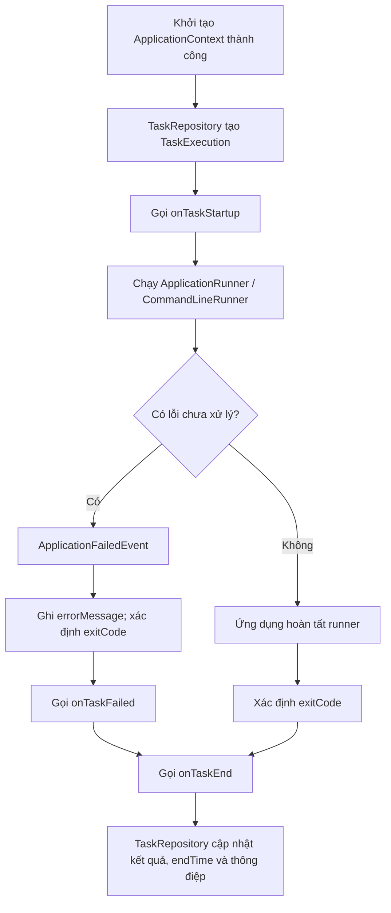

# Phân biệt exitMessage và errorMessage trong Spring Cloud Task

## 1. Bối cảnh: Một lần chạy Task lưu những gì?

**Spring Cloud Task** dùng để xây dựng tiến trình Spring Boot có thời gian chạy hữu hạn: khởi động, thực hiện công việc rồi kết thúc. Một tác vụ có thể được kích hoạt theo lịch, qua API điều phối hoặc chạy thủ công. Spring Cloud Task lưu dữ liệu vòng đời của mỗi lần chạy trong **TaskRepository** dưới dạng một đối tượng **`TaskExecution`**.

Giả sử ứng dụng nhập dữ liệu đơn hàng chạy mỗi đêm. Lần đầu xử lý thành công 1.200 bản ghi; lần sau thất bại vì file đầu vào sai định dạng. Người vận hành cần biết đồng thời:

- Lần chạy nào, bắt đầu và kết thúc khi nào?
- Tác vụ **thành công hay thất bại**, thể hiện bằng `exitCode`?
- Nếu kết thúc, thông điệp tổng kết ngắn là gì, thể hiện bằng `exitMessage`?
- Nếu có lỗi chưa được xử lý khiến ứng dụng thất bại, thông tin kỹ thuật để điều tra nằm ở đâu, thể hiện bằng `errorMessage`?

Hai trường dễ nhầm nhất là `exitMessage` và `errorMessage`. Chúng đều là chuỗi được lưu trong metadata thực thi, nhưng có nguồn gốc và mục đích khác nhau.

Sau bài này, bạn có thể giải thích sự khác biệt, ghi `exitMessage` bằng listener, đọc metadata trong cơ sở dữ liệu, phân biệt tình huống có/không có `errorMessage` và thiết kế giám sát an toàn khi phối hợp với Spring Batch.

## 2. Phân biệt chính xác ba trường exitCode, exitMessage và errorMessage

| Thuộc tính của `TaskExecution` | Kiểu và ý nghĩa | Nguồn dữ liệu thường gặp | Dùng để làm gì? |
| --- | --- | --- | --- |
| `exitCode` | `Integer`, có thể chưa có giá trị khi Task đang chạy | Quy tắc exit code của Spring Cloud Task, `ExitCodeEvent`, `ExitCodeGenerator` hoặc ánh xạ lỗi tương ứng | Xác định kết quả ở cấp máy và hỗ trợ quyết định điều phối |
| `exitMessage` | `String`, có thể `null` | Ứng dụng chủ động gán qua `TaskExecutionListener`, ví dụ `setExitMessage(...)` | Mô tả kết quả cuối cùng bằng câu ngắn, dễ đọc |
| `errorMessage` | `String`, có thể `null` | Khi ứng dụng kết thúc vì ngoại lệ được phản ánh bởi `ApplicationFailedEvent`, framework thường lưu **stack trace** tại đây | Chẩn đoán nguyên nhân kỹ thuật của lần chạy lỗi |

Theo tài liệu Spring Cloud Task, **`exitMessage`** là “thông tin có sẵn tại thời điểm kết thúc” và có thể được đặt bằng listener; **`errorMessage`** chứa stack trace nếu nguyên nhân kết thúc là ngoại lệ được báo qua `ApplicationFailedEvent`. Khi không có mã thoát tùy chỉnh, quá trình thất bại thường nhận `exitCode=1`; trường hợp bình thường thường nhận `exitCode=0`.

Vì vậy, cách hiểu ngắn gọn là:

- **`exitCode` = kết quả dạng số** để scheduler, CI/CD hoặc hệ thống giám sát ra quyết định.
- **`exitMessage` = lời giải thích/tóm tắt do ứng dụng muốn lưu** khi kết thúc.
- **`errorMessage` = thông tin chẩn đoán lỗi** do cơ chế lifecycle ghi nhận trong tình huống phù hợp.

**Không có quy tắc bắt buộc chỉ một trong hai thông điệp được phép có giá trị.** Một lần chạy thất bại hoàn toàn có thể có cả `exitMessage="IMPORT_FAILED; reason=INVALID_INPUT"` và `errorMessage` chứa stack trace của `IllegalArgumentException`. Ngược lại, một lần chạy thành công có thể không có `exitMessage` nếu ứng dụng không thiết lập nó.

> Lưu ý: các giá trị cụ thể phụ thuộc vào cách ứng dụng kết thúc, listener, phiên bản framework và cấu hình. Đừng suy luận rằng cứ `exitCode != 0` thì chắc chắn có `errorMessage`, hoặc `errorMessage == null` thì nghiệp vụ chắc chắn thành công.

### Ví dụ dữ liệu minh họa

| Task execution | `exitCode` | `exitMessage` | `errorMessage` |
| --- | ---: | --- | --- |
| Nhập 1.200 bản ghi thành công, listener có đặt tóm tắt | `0` | `IMPORT_OK; imported=1200` | `null` |
| Nhập thành công nhưng không dùng listener | `0` | `null` | `null` |
| Chạy thất bại do ngoại lệ không được xử lý; listener ghi loại lỗi | `1` | `IMPORT_FAILED; reason=INVALID_FORMAT` | Stack trace của ngoại lệ |
| Trả mã lỗi theo quy ước ứng dụng mà không phát sinh ngoại lệ | Ví dụ `2` | Có thể có hoặc không | Có thể `null` |
| Ứng dụng bắt ngoại lệ rồi im lặng kết thúc bình thường | Có thể `0` | Có thể `null` | Thường `null` |

Các dòng trên là **tình huống minh họa**, không phải các giá trị mà Spring Cloud Task tự động gán cho `exitMessage`.

## 3. Những trường này được ghi ở giai đoạn nào?

Vòng đời cơ bản:



Ở thời điểm Task bắt đầu, bản ghi `TaskExecution` thường đã có `taskName`, `startTime`, tham số và ID; `endTime` và `exitCode` chưa có kết quả cuối cùng. Khi các runner kết thúc hoặc có sự kiện thất bại, Spring Cloud Task xác định dữ liệu kết thúc rồi cập nhật repository.

Các callback của `TaskExecutionListener`:

| Callback | Thời điểm | Vai trò phù hợp |
| --- | --- | --- |
| `onTaskStartup(TaskExecution)` | Task vừa khởi chạy | Đặt thông tin khởi tạo nếu cần |
| `onTaskFailed(TaskExecution, Throwable)` | Có ngoại lệ chưa được xử lý khi thực thi | Phân loại lỗi thành `exitMessage` ngắn và không lộ dữ liệu nhạy cảm |
| `onTaskEnd(TaskExecution)` | Trước khi ghi trạng thái cuối vào repository | Đặt thông điệp tổng kết thành công hoặc hoàn chỉnh kết quả |

Một chi tiết quan trọng: **`onTaskEnd` được gọi cả trong luồng kết thúc có lỗi** sau `onTaskFailed`. Nếu đặt `exitMessage` không điều kiện trong `onTaskEnd`, giá trị đó có thể **ghi đè** thông điệp đặt ở `onTaskFailed`. Tài liệu Spring Cloud Task nêu thứ tự ưu tiên giá trị `exitMessage`: `onTaskEnd`, rồi `onTaskFailed`, rồi `onTaskStartup`. Vì vậy, khi muốn giữ thông điệp lỗi, listener cuối chỉ nên đặt tóm tắt thành công nếu thật sự thành công.

Không nên dựa vào `errorMessage` như một nơi luôn tồn tại cho mọi thất bại:

- Nếu ứng dụng gặp lỗi **trước khi ApplicationContext khởi tạo đủ để tạo TaskExecution**, repository có thể không có bản ghi tương ứng.
- Nếu tiến trình bị hệ điều hành cưỡng bức kết thúc, mất nguồn hoặc bị `SIGKILL`, callback hoàn tất có thể không chạy; bản ghi có thể còn `endTime`/`exitCode` chưa cập nhật.
- Nếu code bắt ngoại lệ và không phát tín hiệu thất bại, Spring Cloud Task có thể chỉ thấy luồng hoàn tất bình thường.

Do đó, giám sát production nên kết hợp **repository, exit code của tiến trình, log, thời gian timeout và dữ liệu từ scheduler**.

## 4. Ví dụ Java: ghi exitMessage và để framework ghi errorMessage

Ví dụ dưới đây sử dụng ứng dụng Java 17+ đã thêm `spring-cloud-starter-task` và cấu hình cơ sở dữ liệu cho `TaskRepository`. Để tránh lệ thuộc phiên bản, hãy dùng cặp Spring Boot/Spring Cloud tương thích theo BOM của dự án.

### 4.1. Ứng dụng Task mô phỏng thành công và thất bại

Tệp `ImportTaskApplication.java`:

```java
package com.example.importtask;

import org.springframework.boot.ApplicationArguments;
import org.springframework.boot.ApplicationRunner;
import org.springframework.boot.SpringApplication;
import org.springframework.boot.autoconfigure.SpringBootApplication;
import org.springframework.cloud.task.configuration.EnableTask;
import org.springframework.context.annotation.Bean;

@SpringBootApplication
@EnableTask
public class ImportTaskApplication {

    public static void main(String[] args) {
        SpringApplication.run(ImportTaskApplication.class, args);
    }

    @Bean
    ApplicationRunner importOrders() {
        return arguments -> {
            if (arguments.containsOption("demo.fail")) {
                // Mô phỏng lỗi chưa được xử lý trong logic nghiệp vụ.
                throw new IllegalArgumentException(
                    "Dữ liệu đầu vào không đúng định dạng"
                );
            }
            System.out.println("Mô phỏng nhập đơn hàng thành công");
        };
    }
}
```

Task này chỉ minh họa lifecycle; trong ứng dụng thực tế, thay phần mô phỏng bằng dịch vụ nhập dữ liệu, ghi kết quả giao dịch và kiểm soát chạy lại.

### 4.2. Listener gắn thông điệp kết thúc

Tệp `ImportResultListener.java`:

```java
package com.example.importtask;

import org.springframework.cloud.task.listener.TaskExecutionListener;
import org.springframework.cloud.task.repository.TaskExecution;
import org.springframework.stereotype.Component;

@Component
public class ImportResultListener implements TaskExecutionListener {

    @Override
    public void onTaskStartup(TaskExecution taskExecution) {
        // Không cần gán exitMessage trong ví dụ này.
    }

    @Override
    public void onTaskFailed(
            TaskExecution taskExecution, Throwable throwable) {
        // Không ghi throwable.getMessage() hay stack trace vào exitMessage.
        // Chỉ lưu một mã lý do ổn định, an toàn cho hệ thống giám sát.
        taskExecution.setExitMessage(
            "IMPORT_FAILED; reason=PROCESSING_ERROR"
        );
    }

    @Override
    public void onTaskEnd(TaskExecution taskExecution) {
        // onTaskEnd vẫn có thể chạy sau onTaskFailed.
        // Không ghi đè thông điệp thất bại.
        if (Integer.valueOf(0).equals(taskExecution.getExitCode())
                && taskExecution.getErrorMessage() == null) {
            taskExecution.setExitMessage(
                "IMPORT_COMPLETED; result=SUCCESS"
            );
        }
    }
}
```

Điểm cần chú ý:

1. `@Component` cho phép Spring quản lý listener. Spring Cloud Task nhận các bean triển khai `TaskExecutionListener` và gọi callback phù hợp.
2. `onTaskFailed` đặt **`exitMessage`** là một thông điệp nghiệp vụ/kỹ thuật ngắn; không cần tự gán **`errorMessage`** vì cơ chế lifecycle xử lý stack trace khi nhận `ApplicationFailedEvent`.
3. `onTaskEnd` kiểm tra `exitCode` và `errorMessage` trước khi gán thông điệp thành công. Nhờ đó thất bại không bị gắn nhầm `IMPORT_COMPLETED`.
4. Phần cập nhật repository cuối cùng do Spring Cloud Task thực hiện; code ví dụ không gọi `TaskRepository.completeTaskExecution(...)` thủ công.

Chạy thử với gói JAR đã build:

```bash
# Đường chạy bình thường
java -jar import-task.jar

# Đường chạy thất bại: runner ném ngoại lệ
java -jar import-task.jar --demo.fail=true
```

Với cơ sở dữ liệu được cấu hình và listener hoạt động, kết quả dự kiến:

| Tình huống | `exitMessage` dự kiến | `errorMessage` dự kiến | `exitCode` thường gặp |
| --- | --- | --- | --- |
| Không truyền `--demo.fail=true` | `IMPORT_COMPLETED; result=SUCCESS` | `null` | `0` |
| Có truyền `--demo.fail=true` | `IMPORT_FAILED; reason=PROCESSING_ERROR` | Stack trace chứa `IllegalArgumentException` | `1` nếu không ánh xạ khác |

**Lưu ý chạy thử:** Tùy cấu hình Spring Boot, `ApplicationArguments.containsOption("demo.fail")` chỉ kiểm tra sự hiện diện của tùy chọn. Ví dụ sử dụng `--demo.fail=true` để kích hoạt lỗi; nếu truyền `--demo.fail=false` thì tùy chọn vẫn hiện diện và **vẫn gây lỗi**. Trong sản phẩm thật, hãy đọc và xác thực giá trị boolean thay vì chỉ kiểm tra có key.

### 4.3. Biến exitMessage thành thông tin hữu ích

Khi tác vụ có dữ liệu thống kê thực, một thông điệp tốt có thể là:

```text
IMPORT_COMPLETED; processed=1200; skipped=4; reportDate=2026-11-24
```

Đây là **chuỗi ví dụ**, không phải giá trị tự động do Spring Cloud Task sinh ra. Để tạo thông điệp đó, ứng dụng có thể lưu kết quả tổng hợp trong bean báo cáo của lần chạy và để listener lấy kết quả sau khi runner hoàn tất. Đừng đặt số liệu cố định như `1200` trong listener của hệ thống thực.

Giữ `exitMessage` ngắn, có cấu trúc đơn giản, dễ đọc và không chứa stack trace. Nếu cần lưu hàng nghìn thống kê hoặc kết quả nghiệp vụ, hãy dùng bảng nghiệp vụ hoặc hệ thống metrics riêng và liên kết với `taskExecutionId`.

## 5. Đọc và diễn giải thông điệp từ cơ sở dữ liệu

Với schema quan hệ mặc định của Spring Cloud Task, metadata nằm trong bảng `TASK_EXECUTION`. Bạn có thể kiểm tra những bản ghi gần nhất bằng câu SQL:

```sql
SELECT
    TASK_EXECUTION_ID,
    TASK_NAME,
    START_TIME,
    END_TIME,
    EXIT_CODE,
    EXIT_MESSAGE,
    ERROR_MESSAGE
FROM TASK_EXECUTION
ORDER BY TASK_EXECUTION_ID DESC;
```

Không nên đưa toàn bộ `ERROR_MESSAGE` vào một dashboard phổ thông vì stack trace có thể dài và chứa dữ liệu nội bộ. Một màn hình vận hành chỉ cần biết có lỗi hay không:

```sql
SELECT
    TASK_EXECUTION_ID,
    TASK_NAME,
    END_TIME,
    EXIT_CODE,
    EXIT_MESSAGE,
    CASE
        WHEN ERROR_MESSAGE IS NULL OR ERROR_MESSAGE = ''
            THEN 'NO'
        ELSE 'YES'
    END AS HAS_ERROR_MESSAGE
FROM TASK_EXECUTION
ORDER BY TASK_EXECUTION_ID DESC;
```

Tên bảng/cột trên áp dụng cho schema Task tiêu chuẩn; nếu tổ chức dùng prefix bảng hoặc schema được tùy chỉnh, hãy điều chỉnh câu SQL. Người vận hành cần quyền đọc tương ứng, không nhất thiết có quyền sửa `TASK_EXECUTION`.

### Quy trình điều tra một lần chạy lỗi

1. **Xác định lần chạy** qua `TASK_EXECUTION_ID`, `TASK_NAME`, thời điểm và ID của scheduler/container.
2. **Xem `END_TIME` và `EXIT_CODE`** để biết lần chạy đã được cập nhật kết thúc hay đang treo/chưa hoàn tất.
3. **Đọc `EXIT_MESSAGE`** để lấy tóm tắt do ứng dụng tạo, ví dụ `reason=INVALID_INPUT` hoặc số bản ghi đã nhập.
4. **Đọc `ERROR_MESSAGE` có kiểm soát** khi cần stack trace; tìm loại ngoại lệ và nguyên nhân gốc, rồi đối chiếu log và trace ID.
5. **Kiểm tra tác động nghiệp vụ** trong database trước khi quyết định retry. Có thể đã ghi một phần dữ liệu dù Task kết thúc thất bại.

Nếu `ERROR_MESSAGE` trống nhưng `EXIT_CODE` khác `0`, đừng kết luận repository bị lỗi: quy ước mã thoát hoặc sự kiện kết thúc có thể không đi qua một ngoại lệ chưa xử lý. Ngược lại, nếu `EXIT_CODE=0` nhưng dữ liệu thiếu, cần xem lại code có nuốt ngoại lệ, dùng xử lý bất đồng bộ không được chờ hoặc đánh dấu thành công quá sớm không.

## 6. Exit code không đồng nghĩa với exitMessage

Tên gần giống nhau nhưng **`exitCode` là số**, còn **`exitMessage` là chuỗi**. Scheduler không nên phân tích chuỗi `exitMessage` như `IMPORT_OK` để xác định retry; nên dựa trên mã thoát cuối cùng và quy ước vận hành.

Ví dụ chính sách của một ứng dụng nhập dữ liệu:

| Exit code theo quy ước ứng dụng | Ý nghĩa | Hành động của scheduler |
| ---: | --- | --- |
| `0` | Thành công | Ghi nhận hoàn tất |
| `2` | Tham số hoặc dữ liệu đầu vào không hợp lệ | Không retry y nguyên; sửa yêu cầu đầu vào |
| `3` | Lỗi hạ tầng tạm thời được phân loại là có thể phục hồi | Retry giới hạn với backoff |
| `1` | Lỗi khác chưa phân loại | Điều tra trước khi retry tự động |

Các mã `2` và `3` chỉ là **quy ước đề xuất của ứng dụng**, không phải ý nghĩa cố định do Spring Cloud Task quy định. Khi cần ánh xạ lỗi cụ thể, Spring Boot cung cấp `ExitCodeExceptionMapper`; mã này có thể được Spring Cloud Task ghi nhận. Ví dụ:

```java
import org.springframework.boot.ExitCodeExceptionMapper;
import org.springframework.context.annotation.Bean;

@Bean
ExitCodeExceptionMapper taskExitCodeMapper() {
    return exception -> {
        Throwable cause = exception;
        while (cause != null) {
            if (cause instanceof IllegalArgumentException) {
                return 2;
            }
            cause = cause.getCause();
        }
        return 1;
    };
}
```

Đây là phương thức bean minh họa để đặt **bên trong lớp `@Configuration` hoặc `@SpringBootApplication`**; không phải tệp Java hoàn chỉnh. Với hệ thống thật, nên dùng kiểu ngoại lệ nghiệp vụ riêng như `InvalidTaskInputException`, tránh ánh xạ mọi `IllegalArgumentException` thành lỗi đầu vào vì một lỗi lập trình cũng có thể phát sinh kiểu ngoại lệ này.

**Không thể thay đổi mã lỗi chỉ bằng `setExitMessage("SUCCESS")`.** Tương tự, tự gán `errorMessage` thành một chuỗi không làm hệ thống tự động biết tiến trình đã thất bại. Để biểu đạt thất bại, phải có tín hiệu lỗi thực sự và mã thoát được cấu hình nhất quán.

### Ví dụ lỗi bị nuốt

```java
// Sai nếu mục tiêu là báo Task thất bại.
try {
    importService.importOrders();
} catch (Exception ex) {
    log.error("Nhập đơn hàng thất bại", ex);
    // Không ném lại hoặc trả trạng thái thất bại.
}
```

Trong trường hợp này, runner có thể kết thúc bình thường; framework không nhận `ApplicationFailedEvent` tương ứng. Hệ quả có thể là `exitCode=0` và `errorMessage=null` mặc dù log đã ghi lỗi. Cách sửa là phát tín hiệu thất bại thích hợp (ví dụ ném lại ngoại lệ có kiểm soát), đồng thời bảo đảm giao dịch và logic chạy lại an toàn.

## 7. Tương tác với Spring Batch và các hệ thống điều phối

Spring Cloud Task theo dõi **một lần chạy tiến trình**, trong khi Spring Batch theo dõi **JobExecution**, `StepExecution`, checkpoint và chính sách restart của job. Khi kết hợp cả hai, dữ liệu lỗi có thể tồn tại ở các lớp khác nhau:

| Lớp | Dữ liệu liên quan | Câu hỏi trả lời |
| --- | --- | --- |
| Spring Cloud Task | `TaskExecution.exitCode`, `exitMessage`, `errorMessage` | Toàn bộ tiến trình Task kết thúc ra sao? |
| Spring Batch Job | `JobExecution.status` và `exitStatus` / `exitDescription` | Batch Job kết thúc với trạng thái và mô tả nào? |
| Spring Batch Step | `StepExecution`, số lần đọc/ghi/bỏ qua, thông tin lỗi | Bước xử lý nào thất bại hoặc đã xử lý bao nhiêu bản ghi? |
| Scheduler/orchestrator | Mã thoát tiến trình, timeout, lịch sử retry | Có cần cảnh báo hoặc thực thi lại không? |

**`exitMessage` của Task không phải `ExitStatus.exitDescription` của Batch**, và `errorMessage` của Task không phải danh sách failure exceptions của Batch. Một Batch Job có thể được code bắt và xử lý lỗi riêng; nếu runner kết thúc bình thường dù Batch Job `FAILED`, Task có thể vẫn bị ghi thành công. Khi thiết kế tích hợp, cần xác định rõ **khi nào thất bại của Job phải dẫn đến thất bại của Task** và truyền tín hiệu đó ra khỏi runner.

Ví dụ chính sách vận hành: khi Job thất bại vì input không hợp lệ, Task ghi mã lỗi `2`, `exitMessage` tóm tắt là `JOB_FAILED; reason=INVALID_INPUT`, còn chi tiết kỹ thuật được xem trong metadata Batch/log. Không sao chép toàn bộ lỗi Batch vào `exitMessage` để tránh quá dài và trùng lặp.

Với Task được chạy theo lịch hoặc theo yêu cầu:

- Sử dụng `taskExecutionId` và ID từ scheduler để liên kết lần thực thi với log và bản ghi nghiệp vụ.
- Đặt ngưỡng cảnh báo dựa trên mã lỗi, thời gian chạy hoặc tình trạng thiếu `endTime` sau timeout; không chỉ tìm từ `FAILED` trong chuỗi.
- Thiết kế retry có giới hạn và idempotency, vì mỗi lần retry có thể tạo một lần `TaskExecution` mới.
- Phân quyền và chính sách lưu giữ metadata, nhất là với `errorMessage` chứa stack trace.

## 8. Bảo mật và giới hạn dữ liệu

`errorMessage` có thể chứa tên lớp, câu SQL, đường dẫn file, thông tin môi trường và cả dữ liệu nhạy cảm nếu ngoại lệ bị tạo từ đầu vào thô. Hãy ngăn rò rỉ ngay từ nguồn: không đưa mật khẩu/token vào thông điệp ngoại lệ, dùng logger và trace theo chính sách bảo mật, hạn chế quyền truy vấn bảng Task.

`exitMessage` cũng cần tránh lưu dữ liệu cá nhân hoặc bí mật. Một chuỗi như `IMPORT_FAILED; reason=INVALID_FORMAT` thường hữu ích hơn việc chép nguyên nội dung dòng dữ liệu lỗi. Chỉ lưu một mã lỗi ổn định và định danh bản ghi không nhạy cảm nếu cần liên kết tới nơi chứa chi tiết.

Ngoài ra, schema database có thể giới hạn độ dài cột `EXIT_MESSAGE` và `ERROR_MESSAGE`. Stack trace dài có thể bị cắt hoặc làm lộ thông tin không cần thiết. Kiểm tra schema do phiên bản Spring Cloud Task sử dụng, không mặc định rằng các trường này có thể chứa log vô hạn. Hệ thống log tập trung mới là nơi phù hợp để giữ chi tiết chẩn đoán theo chính sách lưu trữ.

## 9. Bài tập và câu hỏi tự kiểm tra

### Bài tập thực hành

1. Tạo một Task dùng `ApplicationRunner` có hai chế độ `--demo.fail=true` và chạy bình thường. Bật `TaskRepository` với cơ sở dữ liệu có thể truy vấn.
2. Thêm một `TaskExecutionListener` ghi `exitMessage` thành công tại `onTaskEnd` và thông điệp lỗi tại `onTaskFailed`. Đảm bảo `onTaskEnd` không ghi đè thông điệp thất bại.
3. Chạy cả hai trường hợp, truy vấn `TASK_EXECUTION` và điền bảng: `taskExecutionId`, `exitCode`, `exitMessage`, `errorMessage` có/không, `endTime`.
4. Sửa runner để **bắt và nuốt lỗi**, chạy lại rồi so sánh metadata với trường hợp ngoại lệ được ném ra.
5. Đề xuất quy ước exit code cho lỗi tham số và lỗi kết nối database; giải thích khi nào được retry.

### Câu hỏi tự đánh giá

**Câu 1:** Một Task có `exitCode=1`, `exitMessage=null` và `errorMessage` chứa stack trace. Dữ liệu này có mâu thuẫn không?

*Gợi ý:* Không. Ứng dụng có thể thất bại vì ngoại lệ mà không có listener ghi `exitMessage`.

**Câu 2:** Vì sao không dùng `exitMessage="SUCCESS"` thay cho việc kiểm tra `exitCode`?

*Gợi ý:* `exitMessage` là chuỗi mô tả tùy ý; nó không quyết định mã thoát cuối cùng của tiến trình.

**Câu 3:** Nếu một Batch Job thất bại nhưng Task hiển thị `exitCode=0`, cần kiểm tra điều gì?

*Gợi ý:* Kiểm tra logic runner có kiểm tra trạng thái `JobExecution`, có ném ngoại lệ hoặc truyền tín hiệu lỗi tương ứng hay không.

**Câu 4:** Tại sao một Task bị hệ điều hành dừng cưỡng bức có thể không có `errorMessage` hoặc `endTime`?

*Gợi ý:* Lifecycle listener không có cơ hội cập nhật repository nếu tiến trình bị kết thúc trước khi sự kiện và thao tác ghi hoàn tất.

**Tiêu chí hoàn thành:** Bạn có thể giải thích được nguồn gốc riêng của `exitMessage` và `errorMessage`, quan sát chúng trên metadata thực tế, ghi `exitMessage` đúng vị trí, và tránh suy luận sai kết quả Task từ riêng một trường thông điệp.

## Tài liệu tham khảo chính thức

- [Spring Cloud Task — Features: TaskExecution, Mapping Exit Codes, Exit Messages](https://docs.spring.io/spring-cloud-task/reference/features.html).
- [TaskExecution Java API](https://docs.spring.io/spring-cloud-task/docs/current/apidocs/org/springframework/cloud/task/repository/TaskExecution.html).
- [Spring Cloud Task — tài liệu tham khảo](https://docs.spring.io/spring-cloud-task/reference/).
- [Spring Batch — Reference Documentation](https://docs.spring.io/spring-batch/reference/).
