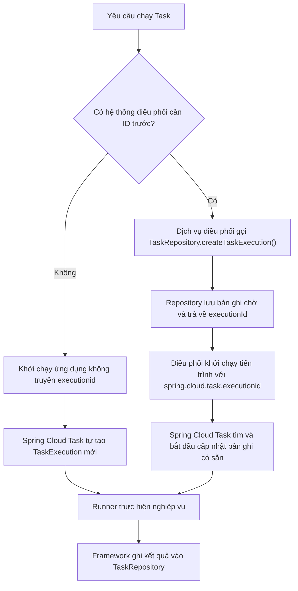
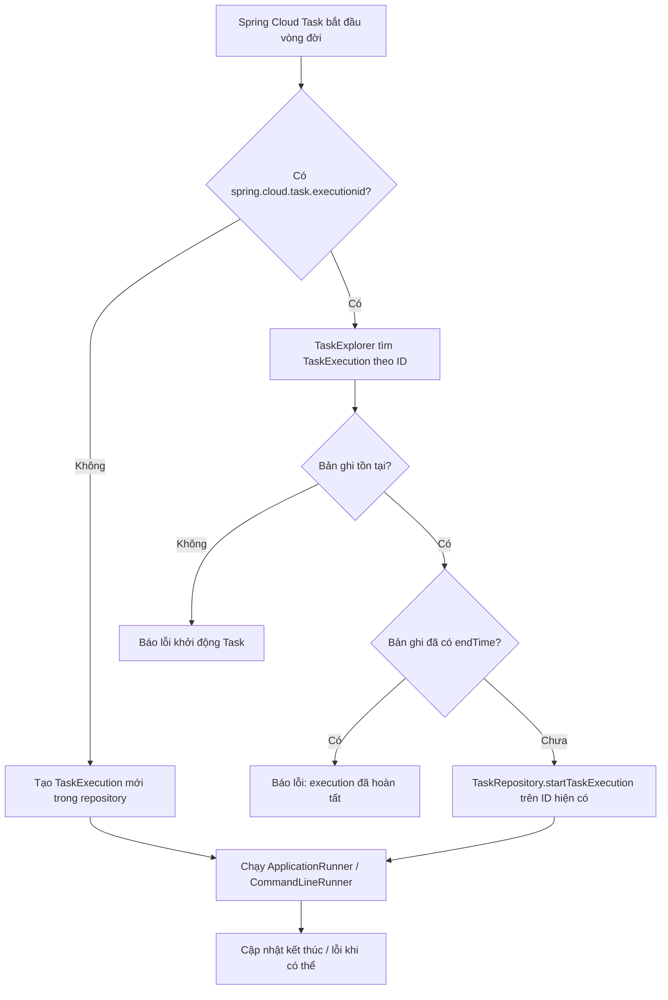
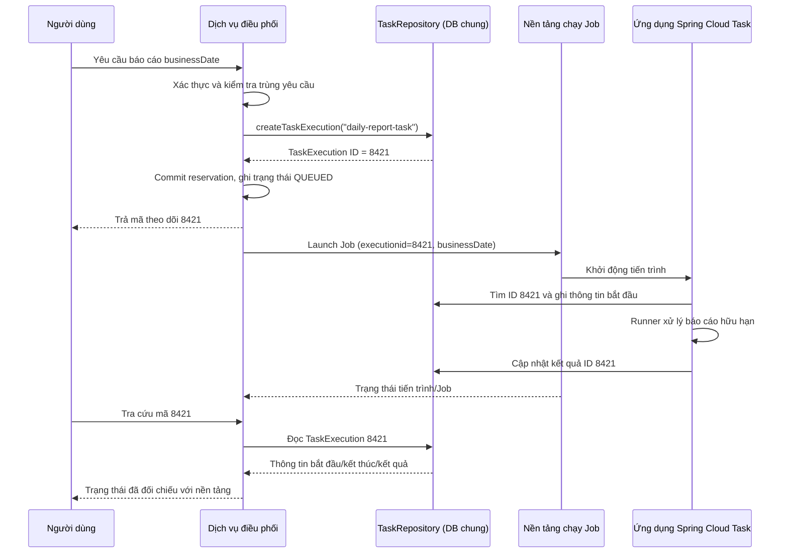

# Tạo trước executionId và sử dụng spring.cloud.task.executionid

## Mục tiêu

Trong mô-đun **SPRING_CLOUD_TASK (Spring Cloud Task)**, ứng dụng Spring Boot thực hiện một công việc **hữu hạn** rồi kết thúc. Spring Cloud Task lưu dữ liệu từng lần chạy trong `TaskRepository`: tên tác vụ, thời điểm bắt đầu/kết thúc, kết quả và thông tin lỗi. Những dữ liệu này giúp theo dõi tác vụ chạy theo lịch hoặc theo yêu cầu, kiểm tra sự cố và phối hợp với Spring Batch.

Bài học thuộc chương **Dữ liệu thực thi** tập trung vào một trường hợp đặc biệt: **tạo trước bản ghi `TaskExecution` và chuyển ID của bản ghi đó cho tiến trình Task** qua thuộc tính `spring.cloud.task.executionid`. Sau bài học, bạn có thể:

- Giải thích vì sao hệ thống điều phối cần một `executionId` **trước** khi JVM của tác vụ được khởi động.
- Tạo bản ghi chờ thực thi bằng `TaskRepository.createTaskExecution(…)`, nhận ID do repository sinh và truyền lại đúng ID ấy khi khởi chạy.
- Phân biệt `spring.cloud.task.executionid` với `spring.cloud.task.external-execution-id`, `spring.cloud.task.parent-execution-id` và tham số nghiệp vụ.
- Theo dõi một bản ghi từ trạng thái chưa bắt đầu đến khi chạy xong hoặc phát hiện yêu cầu bị kẹt trước khi khởi chạy.
- Chẩn đoán các lỗi ID không tồn tại, ID đã hoàn tất, dùng sai database, sử dụng lại ID và retry không an toàn.

## 1. Vì sao cần tạo executionId trước?

Theo cách chạy thông thường, khi ứng dụng Spring Cloud Task khởi động thành công đến giai đoạn quản lý vòng đời, framework **tự tạo** một bản ghi `TaskExecution` và lấy ID mới. Như vậy, `executionId` chỉ xuất hiện sau khi tiến trình đã bắt đầu khởi tạo.

Nhưng trong một hệ thống thực tế, thời điểm **nhận yêu cầu chạy** và thời điểm **hạ tầng thật sự chạy tiến trình** có thể cách nhau vài giây, vài phút hoặc lâu hơn:

1. Người vận hành yêu cầu chạy tác vụ `daily-report-task` cho ngày `2026-11-23`.
2. Hệ thống điều phối kiểm tra quyền, tiếp nhận yêu cầu và đưa việc triển khai vào hàng đợi.
3. Nền tảng chuẩn bị tài nguyên, tải image và tạo Job/Pod.
4. JVM của tác vụ mới bắt đầu chạy.

Nếu chờ đến bước 4 mới sinh `executionId`, ở các bước 1–3 hệ thống điều phối chưa có ID Spring Cloud Task để trả về cho người yêu cầu, gắn vào nhật ký điều phối hoặc tra cứu lại. **Tạo trước `TaskExecution`** giải quyết khoảng trễ này: người yêu cầu có ID ngay khi công việc được tiếp nhận, còn tiến trình thực thi sau đó cập nhật **chính bản ghi đã tồn tại**.

Ví dụ:

| Mốc | Sự kiện | Dữ liệu có thể quan sát |
| --- | --- | --- |
| 09:00:00 | API nhận yêu cầu xuất báo cáo | Yêu cầu được kiểm tra, chưa có JVM Task. |
| 09:00:01 | `TaskRepository` tạo `TaskExecution` ID `8421` | Có bản ghi ID `8421` nhưng chưa có dấu thời gian chạy thực tế. |
| 09:00:02 | Bộ điều phối trả mã `8421` và xếp hàng triển khai | Có thể tra cứu/yêu cầu hỗ trợ bằng ID đó. |
| 09:02:10 | Container khởi chạy với `--spring.cloud.task.executionid=8421` | Tiến trình tìm bản ghi ID `8421` và cập nhật thông tin bắt đầu. |
| 09:03:25 | Runner hoàn tất | Cùng bản ghi ID `8421` được cập nhật thời điểm kết thúc và kết quả. |

Các thời điểm và ID trong bảng chỉ là **ví dụ minh họa**, không phải giá trị framework luôn sinh ra.

## 2. Phân biệt các loại ID

Trong Spring Cloud Task, các ID dưới đây phục vụ các mục đích khác nhau:

| Giá trị | Ví dụ | Ý nghĩa |
| --- | --- | --- |
| `TaskExecution.executionId` | `8421` | Khóa định danh **một lần chạy Task** trong kho metadata, thường tương ứng `TASK_EXECUTION.TASK_EXECUTION_ID`. |
| `spring.cloud.task.executionid` | `8421` | Chỉ dẫn cho tiến trình dùng **bản ghi `TaskExecution` đã được tạo trước** với ID này. |
| `spring.cloud.task.external-execution-id` | `job-abc123` | ID do nền tảng bên ngoài cấp, chẳng hạn ID của Job/container; lưu để liên kết vận hành. |
| `spring.cloud.task.parent-execution-id` | `8300` | ID Task cha, dùng khi một Task khởi chạy hoặc điều phối Task con. |
| `spring.cloud.task.name` hoặc tên giải quyết bởi `TaskNameResolver` | `daily-report-task` | Tên **loại công việc**, có thể chung cho nhiều lần chạy. |
| `businessDate` hoặc `requestId` của nghiệp vụ | `2026-11-23` | Đầu vào nghiệp vụ hoặc khóa chống gửi yêu cầu trùng; **không phải** khóa `TaskExecution`. |
| Spring Batch `JobExecution.id` | `312` | Khóa một lần chạy Job của Spring Batch, thuộc mô hình metadata Batch riêng. |

**Điểm mấu chốt:** Trong tên thuộc tính `spring.cloud.task.executionid`, chữ “external generation” ở tài liệu Spring Cloud Task có nghĩa **bản ghi Task được sinh ra ở ngoài tiến trình Task**, thông qua `TaskRepository`. Nó **không** có nghĩa lấy tùy ý ID của Kubernetes Job, mã lô nghiệp vụ hay một UUID do phía client đưa đến rồi gán vào ID nội bộ.

`spring.cloud.task.executionid` và `spring.cloud.task.external-execution-id` có thể được dùng cùng lúc, nhưng giá trị và chức năng của chúng khác nhau. Ví dụ:

```properties
spring.cloud.task.executionid=8421
spring.cloud.task.external-execution-id=k8s-job-daily-report-6df4
```

Ở đây `8421` xác định bản ghi Spring Cloud Task phải cập nhật; `k8s-job-daily-report-6df4` là mã liên kết sang nền tảng điều phối. Không hoán đổi hai giá trị.

## 3. Hai luồng xử lý: sinh ID khi bắt đầu và tạo trước



Với **luồng mặc định**, ứng dụng không nhận `spring.cloud.task.executionid`; framework tạo mới `TaskExecution` khi bắt đầu theo dõi vòng đời.

Với **luồng tạo trước**, hệ thống điều phối phải tạo bản ghi thật trong cùng kho metadata trước, nhận ID được cấp và chuyển ID ấy cho tiến trình Task. Khi nhận thuộc tính, framework sử dụng đường đi cập nhật bản ghi có sẵn thay cho đường đi tự sinh một bản ghi độc lập.

Việc tạo trước **không tự khởi chạy ứng dụng**. `TaskRepository` chỉ quản lý metadata, không phải dịch vụ tạo container, đặt lịch hay gửi Job vào nền tảng triển khai.

## 4. Điều kiện cần có trước khi tạo bản ghi

Hai phía tham gia thường là:

- **Dịch vụ điều phối/launcher**: nhận yêu cầu, truy cập `TaskRepository` để tạo `TaskExecution` chờ, sau đó gọi cơ chế triển khai của nền tảng.
- **Ứng dụng tác vụ**: một ứng dụng Spring Boot có Spring Cloud Task, kết nối đến **cùng cơ sở dữ liệu và schema metadata**, nhận ID đã có và chạy logic hữu hạn.

Để luồng hoạt động ổn định:

1. Chốt phiên bản Spring Boot, Spring Cloud Task và JDBC driver tương thích ở các ứng dụng liên quan.
2. Chuẩn bị bảng và đối tượng cấp ID của Spring Cloud Task bằng DDL phù hợp phiên bản và hệ quản trị cơ sở dữ liệu.
3. Cấu hình `DataSource` cho cả hai phía trỏ tới **cùng kho metadata**; nếu dùng schema hoặc table prefix riêng, phải khớp.
4. Bảo đảm tài khoản của dịch vụ điều phối có quyền tạo bản ghi metadata; tài khoản của Task có quyền đọc và cập nhật các bản ghi cần thiết.
5. Thiết kế cách kết nối yêu cầu nghiệp vụ với `executionId` trong dữ liệu điều phối riêng, cùng chính sách retry và thời hạn chờ khởi chạy.

Không nên dùng H2 in-memory ở **hai JVM tách rời** để minh họa cơ chế này: mặc dù chuỗi JDBC trông giống nhau, mỗi JVM có thể có một cơ sở dữ liệu trong bộ nhớ riêng. Hãy dùng PostgreSQL, MariaDB, SQL Server hoặc một database dùng chung được hỗ trợ. Để sản xuất, nên chạy migration schema trước và không cho mỗi container tự tạo bảng.

Ví dụ phần cấu hình metadata production của **ứng dụng Task**:

```yaml
# application-prod.yml
spring:
  datasource:
    url: ${TASK_DB_URL}
    username: ${TASK_DB_USER}
    password: ${TASK_DB_PASSWORD}
  cloud:
    task:
      name: daily-report-task
      initialize-enabled: false
```

Ứng dụng điều phối cần cấu hình `TaskRepository` của nó trỏ tới cùng cơ sở dữ liệu/schema. Tên biến môi trường trong ví dụ là lựa chọn của dự án; **không** hard-code mật khẩu vào tệp cấu hình hoặc dòng lệnh.

## 5. Tạo trước `TaskExecution` với `TaskRepository`

API của Spring Cloud Task cung cấp các phương thức tạo execution, trong đó `createTaskExecution(String name)` phù hợp khi muốn lưu trước tên Task. Repository sẽ quản lý việc cấp ID; người dùng không cần tự tính `MAX(TASK_EXECUTION_ID) + 1` hay viết SQL chèn bảng thủ công.

Ví dụ dưới đây nằm trong **dịch vụ điều phối**, với điều kiện ứng dụng điều phối đã cấu hình và tiêm được `TaskRepository` dùng kho metadata chung:

```java
package com.example.dispatcher;

import org.springframework.cloud.task.repository.TaskExecution;
import org.springframework.cloud.task.repository.TaskRepository;
import org.springframework.stereotype.Service;

@Service
public class ExecutionReservationService {

    private final TaskRepository taskRepository;

    public ExecutionReservationService(TaskRepository taskRepository) {
        this.taskRepository = taskRepository;
    }

    public long reserveDailyReportExecution() {
        TaskExecution pending =
                taskRepository.createTaskExecution("daily-report-task");

        return pending.getExecutionId();
    }
}
```

Giả sử lời gọi trả về `8421`. Repository đã tạo bản ghi metadata có ID đó; dịch vụ điều phối cần **lưu/commit thành công** trước khi gửi ID cho launcher. Một phương án là:

1. Xác thực yêu cầu, kiểm tra trùng theo khóa nghiệp vụ/idempotency key.
2. Gọi `reserveDailyReportExecution()` để tạo bản ghi.
3. Commit giao dịch tạo bản ghi rồi ghi nhận ánh xạ yêu cầu → `executionId` vào hệ thống điều phối.
4. Yêu cầu nền tảng chạy ứng dụng cùng tham số `--spring.cloud.task.executionid=8421`.
5. Theo dõi việc triển khai và kết quả để cập nhật trạng thái điều phối.

**Cảnh báo về giao dịch:** Nếu dịch vụ điều phối bọc cả bước tạo bản ghi **và khởi chạy tiến trình** trong một giao dịch chưa commit, Task chạy nhanh có thể tìm ID khi bản ghi còn chưa hiển thị. Cần bảo đảm bản ghi đã commit trước khi tiến trình bắt đầu đọc nó. Mặt khác, khi tạo bản ghi thành công nhưng việc gọi launcher thất bại, bản ghi sẽ tồn tại ở dạng chưa bắt đầu; dịch vụ điều phối phải phát hiện và xử lý trường hợp này.

`createTaskExecution()` không tham số cũng có thể tạo bản ghi rỗng; ví dụ sử dụng phiên bản có tên để việc tra cứu dễ hiểu. Giao diện và hành vi cụ thể phải đối chiếu với phiên bản thư viện dùng trong dự án.

## 6. Truyền `spring.cloud.task.executionid` khi khởi chạy

Sau khi nhận `8421` từ `TaskRepository`, bộ điều phối chạy ứng dụng Task với tham số:

```bash
java -jar daily-report-task.jar \
  --spring.profiles.active=prod \
  --spring.cloud.task.executionid=8421 \
  --businessDate=2026-11-23
```

Đường dẫn JAR và ID là ví dụ. Trong Kubernetes hoặc một nền tảng khác, hệ điều phối đưa cùng tham số vào danh sách `args` của container, hoặc cấp qua nguồn cấu hình Spring Boot tương thích.

Với đúng property này, Spring Cloud Task hiểu rằng bản ghi có ID `8421` **đã được tạo trước**. Khi bắt đầu vòng đời Task, framework tìm bản ghi và cập nhật thông tin bắt đầu, tham số và các trường liên quan; lúc hoàn thành sẽ cập nhật kết quả cho **cùng ID**.

Thuộc tính được viết trong tài liệu là:

```properties
spring.cloud.task.executionid=<ID-da-duoc-TaskRepository-tao>
```

Không chọn một con số ngẫu nhiên để truyền vào. Cũng không suy rằng truyền `--spring.cloud.task.executionid=8421` sẽ **tự chèn** bản ghi ID `8421` nếu kho metadata chưa có nó. ID phải là khóa tồn tại trong đúng database/schema.

Để tránh lẫn dữ liệu hạ tầng và nghiệp vụ:

- `spring.cloud.task.executionid` là tham số kết nối metadata **do hệ điều phối cấp**.
- `businessDate` và các option khác là dữ liệu để runner thực hiện báo cáo.
- `spring.profiles.active` chọn môi trường; chỉ đổi profile khi chắc chắn cả điều phối và Task vẫn dùng cùng kho metadata dự kiến.

**Lưu ý bảo mật:** Spring Cloud Task có thể lưu các đối số khởi chạy vào bảng `TASK_EXECUTION_PARAMS`. Không truyền mật khẩu, khóa API hoặc dữ liệu nhạy cảm trên dòng lệnh; dùng biến môi trường/secret manager và cơ chế truy cập phù hợp.

### Ví dụ runner của ứng dụng Task

Task vẫn xử lý nghiệp vụ theo cách thông thường. Không cần tự gọi `createTaskExecution(…)` lần nữa trong runner:

```java
package com.example.report;

import java.time.LocalDate;
import java.util.List;
import org.springframework.boot.ApplicationRunner;
import org.springframework.boot.SpringApplication;
import org.springframework.boot.autoconfigure.SpringBootApplication;
import org.springframework.cloud.task.configuration.EnableTask;
import org.springframework.context.annotation.Bean;

@SpringBootApplication
@EnableTask
public class DailyReportTaskApplication {

    public static void main(String[] args) {
        SpringApplication.run(DailyReportTaskApplication.class, args);
    }

    @Bean
    ApplicationRunner reportRunner() {
        return arguments -> {
            List<String> dates = arguments.getOptionValues("businessDate");
            if (dates == null || dates.size() != 1) {
                throw new IllegalArgumentException(
                        "Cần --businessDate=yyyy-MM-dd");
            }

            LocalDate businessDate = LocalDate.parse(dates.get(0));
            // Ví dụ minh họa: thay bằng một service xuất báo cáo thực tế.
            System.out.println("Đã xử lý báo cáo ngày " + businessDate);
        };
    }
}
```

Framework quản lý `TaskExecution` ở vòng đời của ứng dụng, trước khi runner chạy. Runner không được tự đổi `executionId`, không nên ghi thẳng vào bảng metadata và phải để lỗi nghiệp vụ nghiêm trọng lan truyền để hệ thống nhận diện kết quả thất bại.

## 7. Cơ chế sử dụng ID đã có khi Task bắt đầu

Có thể hiểu hành vi ở mức khái niệm theo các nhánh sau:



Trong cách triển khai của Spring Cloud Task được mô tả ở tài liệu/mã nguồn tham khảo, khi có `executionid` framework có thể:

1. Sử dụng `TaskExplorer.getTaskExecution(id)` để tìm bản ghi.
2. Báo lỗi nếu **không tìm thấy ID**.
3. Báo lỗi nếu bản ghi **đã có thời điểm kết thúc**.
4. Dùng `TaskRepository.startTaskExecution(…)` để cập nhật bản ghi hiện tại khi khởi động; cuối vòng đời dùng cơ chế hoàn tất của repository.

Đây là **mô tả hành vi để hiểu và vận hành**, không phải lời khuyên gọi `startTaskExecution(…)` trực tiếp từ runner. Hãy để framework quản lý metadata ở tiến trình Task.

Các phiên bản Spring Cloud Task có thể khác nhau về kiểm tra cạnh tranh và các callback nội bộ. **Đặc biệt, không được cho rằng việc một ID chưa có `endTime` đồng nghĩa ID đó chắc chắn đang rảnh để khởi chạy thêm một tiến trình**. Nếu hai launcher cùng cấp một ID, chúng có thể tranh chấp ghi metadata. Hệ điều phối phải kiểm soát việc claim/launch một cách nguyên tử.

## 8. Quan sát dữ liệu trước, trong và sau khi chạy

`TaskExecution` vừa được tạo trước thường là bản ghi **chờ**: có ID, có thể có tên Task, nhưng chưa có thời điểm bắt đầu thực tế và chưa có kết quả cuối. Khi tiến trình Task nhận ID, metadata dần được bổ sung.

| Thời điểm | `TASK_EXECUTION_ID` | `START_TIME` | `END_TIME` | `EXIT_CODE` |
| --- | --- | --- | --- | --- |
| Sau khi tạo trước | `8421` | Thường chưa có | Chưa có | Chưa có |
| Khi Task thực sự bắt đầu | `8421` | Đã có | Chưa có | Chưa kết luận |
| Khi Task kết thúc thành công | `8421` | Đã có | Đã có | Thường là `0` |
| Khi Task kết thúc thất bại và ghi metadata thành công | `8421` | Đã có | Đã có | Mã thất bại tùy xử lý lỗi |

Đây là **diễn giải trạng thái điển hình**, không phải cam kết mọi cột đều có giá trị chính xác như bảng trong mọi phiên bản hoặc mọi kiểu kết thúc. Chẳng hạn tiến trình có thể bị kill đột ngột khi đang chạy khiến `END_TIME` vẫn rỗng.

Với bảng metadata mặc định, có thể kiểm tra bằng SQL:

```sql
SELECT TASK_EXECUTION_ID,
       TASK_NAME,
       START_TIME,
       END_TIME,
       EXIT_CODE,
       LAST_UPDATED,
       EXTERNAL_EXECUTION_ID
FROM TASK_EXECUTION
WHERE TASK_EXECUTION_ID = 8421;
```

Để xem tham số được lưu (không nên có bí mật trong tham số):

```sql
SELECT TASK_EXECUTION_ID, TASK_PARAM
FROM TASK_EXECUTION_PARAMS
WHERE TASK_EXECUTION_ID = 8421;
```

Hoặc dùng API tra cứu thay vì truy vấn trực tiếp:

```java
import org.springframework.cloud.task.repository.TaskExecution;
import org.springframework.cloud.task.repository.TaskExplorer;

// taskExplorer được tiêm từ cấu hình repository chung.
TaskExecution execution = taskExplorer.getTaskExecution(8421L);
if (execution == null) {
    throw new IllegalStateException("Không tìm thấy TaskExecution 8421");
}

System.out.println("taskName=" + execution.getTaskName());
System.out.println("startTime=" + execution.getStartTime());
System.out.println("endTime=" + execution.getEndTime());
System.out.println("exitCode=" + execution.getExitCode());
```

Kiểm tra `TASK_EXECUTION_ID` ở cả ba thời điểm để chứng minh rằng framework **cập nhật cùng một bản ghi**. Có thể thêm trường `EXTERNAL_EXECUTION_ID` nếu nền tảng có định danh riêng để đối chiếu với log của Job/Pod.

Không dùng một phép thử kiểu `END_TIME IS NULL` làm định nghĩa tuyệt đối cho “đang chạy”: nó cũng có thể biểu thị **chưa khởi động**, **chạy bị mất liên lạc** hoặc **tiến trình đã chết nhưng chưa ghi được kết quả**. Đối chiếu thêm thời điểm đặt lịch, ID nền tảng, trạng thái process và giới hạn thời gian.

## 9. Các tình huống lỗi và cách khôi phục

| Tình huống | Nguyên nhân thường gặp | Cách xử lý |
| --- | --- | --- |
| Truyền ID chưa có trong repository | Dịch vụ điều phối chưa commit, dùng nhầm ID hoặc Task kết nối sai DB/schema. | Xác nhận bản ghi đã commit, đối chiếu database/schema/table prefix, log ID và điểm khởi chạy. |
| ID đã hoàn tất | Một lượt Task khác đã dùng ID và cập nhật `END_TIME`. | Tạo execution mới cho một lần chạy mới; không tái sử dụng ID của lượt đã kết thúc. |
| Hai tiến trình dùng cùng ID chờ | Hai dispatcher cùng gửi lệnh hoặc retry mà không có khóa. | Dùng idempotency key và cơ chế claim độc quyền ở hệ điều phối; kiểm soát retry ở nền tảng. |
| Tạo trước thành công nhưng launcher không tạo được Job | Lỗi xác thực nền tảng, quota, image hoặc API. | Ghi lỗi và trạng thái launch vào kho điều phối; thực hiện retry có giới hạn hoặc báo người vận hành. |
| Bản ghi chờ quá lâu không có `START_TIME` | Hàng đợi tắc, Job không được schedule hoặc container không khởi động. | Đặt deadline, kiểm tra Job/Pod/log; phân biệt “chờ” với “thất bại”. |
| Task bắt đầu nhưng `END_TIME` không được cập nhật | Mất database, kill đột ngột, node chết hoặc timeout. | So sánh `TaskExecution` với trạng thái nền tảng; thiết kế reconciliation và cảnh báo. |
| Task chạy thành công nhưng nghiệp vụ ghi trùng | Retry cùng ngày tạo đầu ra trùng mà không có khóa nghiệp vụ. | Thiết kế idempotent/upsert/checkpoint; `executionId` chỉ giúp theo dõi, không tự chống trùng dữ liệu. |
| Sai tên task hoặc khác cấu hình metadata | Dịch vụ điều phối và ứng dụng thống nhất chưa đủ về tên, schema hoặc version. | Chốt tên công việc và cấu hình; kiểm thử tích hợp hai phía trước khi triển khai. |

### 9.1. Tạo trước nhưng không bao giờ khởi chạy

`TaskRepository.createTaskExecution(…)` chỉ ghi nhận rằng có một execution **được dành trước**. Nếu bộ điều phối lỗi ngay sau đó, Spring Cloud Task **không thể tự biết** người dùng đã bỏ yêu cầu hay nền tảng đang chờ. Dữ liệu có thể tồn tại mà không có `START_TIME`.

Vì vậy, nên có một bảng hoặc hệ thống điều phối lưu các mốc bổ sung: `REQUESTED`, `QUEUED`, `LAUNCHING`, `PLATFORM_RUNNING`, `PLATFORM_FAILED`, `TIMED_OUT`, cùng mã lỗi và thời điểm chuyển trạng thái. Đây là trạng thái **do hệ thống điều phối thiết kế**, không phải các enum trạng thái mặc định của `TaskExecution`.

Giám sát định kỳ các yêu cầu vượt quá thời hạn chờ, kiểm tra trạng thái Job thực tế và xử lý theo chính sách. Không tự động sửa `END_TIME` hay đặt `EXIT_CODE=0` để “đóng” một bản ghi không được chạy; thay đổi metadata phải phản ánh sự kiện có thật và tuân theo hợp đồng của repository/phiên bản đang dùng.

### 9.2. Retry và chạy lại

Cần phân biệt hai quyết định:

- **Retry gửi lệnh launch khi chưa khởi chạy:** có thể tiếp tục xử lý một yêu cầu đã được tạo trước, nhưng **phải bảo đảm** chỉ có một tiến trình được phép nhận ID đó. Đừng retry mù khi chưa biết lệnh đầu tiên đã được nền tảng nhận hay chưa.
- **Chạy lại nghiệp vụ sau một lần Task đã chạy hoặc đã kết thúc:** về nguyên tắc, tạo **`TaskExecution` mới**, liên kết các lần chạy trong hệ thống điều phối bằng `requestId`/ngày nghiệp vụ. Việc cố dùng lại ID đã có `END_TIME` sẽ bị coi là không hợp lệ; dùng lại ID chưa kết thúc sau sự cố cũng cần cân nhắc khả năng tiến trình cũ còn sống.

Giả sử execution `8421` xuất báo cáo ngày `2026-11-23` thất bại, một lần chạy lại có thể nhận ID `8422` nhưng cùng `businessDate`. Cả hai execution cần hiện rõ trong lịch sử, còn phần nghiệp vụ phải tự bảo đảm không xuất dữ liệu trùng.

## 10. Tương tác với Spring Batch

Một Task có thể khởi chạy Batch Job gồm nhiều bước xử lý, nhưng:

- `TaskExecution.executionId` (ví dụ `8421`) là ID của vòng đời ứng dụng Spring Cloud Task.
- `JobExecution.id` là ID của một lần chạy Spring Batch trong `JobRepository`.
- `JobParameters` (chẳng hạn `businessDate`) chi phối nhận diện và restart semantics của Spring Batch; chúng không bị thay thế bởi `spring.cloud.task.executionid`.
- Khi tích hợp đúng, metadata có thể liên kết Task với Job; truy vấn và theo dõi phải dùng đúng loại ID.

Ví dụ một lời yêu cầu xuất báo cáo có thể tạo Task execution `8421`, và trong đó chạy Batch Job execution `312`. Hai ID thuộc **hai repository khác vai trò**. Truyền `--spring.cloud.task.executionid=312` vì tưởng `312` là ID Task sẽ tìm sai bản ghi hoặc cập nhật nhầm dữ liệu nếu ID đó trùng ngẫu nhiên.

Nếu Batch Job báo `FAILED` nhưng ứng dụng nuốt lỗi và kết thúc bình thường, việc theo dõi Task có thể không phản ánh đúng kết quả nghiệp vụ. Cần kiểm tra và ánh xạ trạng thái Batch thành kết quả thích hợp của tiến trình.

## 11. Kịch bản thiết kế end-to-end

**Bài toán:** Một API cho phép người dùng yêu cầu tạo báo cáo theo ngày, người dùng nhận mã tra cứu ngay, còn báo cáo được xử lý bởi Spring Cloud Task trên Kubernetes.



Ở thiết kế này, thao tác gọi API và thao tác chạy Task **không cần diễn ra cùng một tiến trình**. Điểm kết nối quan trọng là **ID do cùng `TaskRepository` tạo**. Hệ thống điều phối vẫn phải quản lý các trạng thái của yêu cầu và xử lý khi Job không được khởi chạy.

Để vận hành an toàn, áp dụng các quy tắc sau:

1. Không nhận `executionId` tùy ý từ client như một quyền để sửa bất kỳ Task nào; xác thực người dùng/quyền trên yêu cầu và cấp ID ở máy chủ.
2. Ghi ánh xạ `requestId → executionId → platformJobId` bền vững, có ràng buộc tránh gửi trùng và cơ chế phục hồi khi một bước lỗi.
3. Đảm bảo hai bên dùng cùng repository/schema; cấu hình connection pool và migration trước khi khởi chạy.
4. Không truyền secrets trong tham số đã ghi vào metadata; tránh log dữ liệu nhạy cảm.
5. Tách kết quả nghiệp vụ, trạng thái `TaskExecution` và trạng thái Job ở nền tảng để xử lý trường hợp bất đồng.

## 12. Thực hành kiểm chứng

**Chuẩn bị:** Hai ứng dụng hoặc hai thành phần tách biệt: một dịch vụ điều phối có quyền gọi `TaskRepository` và một ứng dụng Spring Cloud Task có runner chạy hữu hạn. Cả hai cùng truy cập một database/schema metadata được hỗ trợ.

| Bài thử | Cách thực hiện | Điều cần xác nhận |
| --- | --- | --- |
| A. Tạo trước | Gọi `createTaskExecution("daily-report-task")` và ghi lại ID trả về. | Bản ghi tồn tại trước khi JVM Task chạy. |
| B. Chạy bằng ID | Khởi động Task với `--spring.cloud.task.executionid=<ID-A>`. | Bản ghi ID-A được cập nhật; không sinh thêm bản ghi Task độc lập cho cùng lượt chạy. |
| C. Chạy không truyền ID | Khởi động lại ứng dụng nhưng bỏ `executionid`. | Framework tạo một `TaskExecution` mới với ID khác. |
| D. ID không tồn tại | Truyền một ID chưa được tạo. | Task báo lỗi thay vì tự tạo một bản ghi mang ID tùy ý. |
| E. ID đã kết thúc | Truyền lại ID-A sau khi A hoàn tất. | Task từ chối sử dụng ID đã hoàn tất. |
| F. Sai metadata DB | Cho Task dùng schema khác với nơi điều phối tạo ID. | Xác định được nguyên nhân lookup không thấy bản ghi. |
| G. Launcher thất bại | Tạo execution trước nhưng không thực sự gửi Job. | Hệ thống điều phối phát hiện yêu cầu chờ quá hạn; không đánh dấu giả là thành công. |
| H. Runner lỗi | Tạo execution mới, chạy runner ném exception có chủ đích. | Metadata và trạng thái tiến trình phản ánh thất bại khi hạ tầng còn khả dụng. |

Không nên cố tình chạy **hai** tiến trình đồng thời với cùng `executionId` trên môi trường có dữ liệu thật. Nếu kiểm thử hành vi race condition, dùng môi trường cô lập và kiểm chứng cơ chế khóa/claim của launcher.

### Câu hỏi tự kiểm tra

1. Vì sao `spring.cloud.task.executionid` chỉ có ý nghĩa khi có một bản ghi `TaskExecution` được tạo trước?
2. Điểm nào khác nhau giữa **đã nhận yêu cầu chạy** và **đã bắt đầu chạy**?
3. Nếu một Job được nền tảng xếp hàng nhưng chưa tạo Pod, liệu `END_TIME IS NULL` có nghĩa Job đang xử lý nghiệp vụ hay không?
4. Khi cần chạy lại báo cáo cùng ngày, nên tạo ID Task mới hay dùng lại ID cũ? Vì sao?
5. `spring.cloud.task.external-execution-id` và `JobExecution.id` của Batch có thay thế được `TaskExecution.executionId` không?

## 13. Tài liệu tham khảo

- [Spring Cloud Task — Features: Externally Generated Task ID](https://docs.spring.io/spring-cloud-task/reference/features.html): giải thích trường hợp sinh `TaskExecution` trước lúc khởi chạy và thuộc tính `spring.cloud.task.executionid`.
- [Spring Cloud Task — TaskRepository API](https://docs.spring.io/spring-cloud-task/docs/current/apidocs/org/springframework/cloud/task/repository/TaskRepository.html): các phương thức tạo, bắt đầu và hoàn tất execution (cần đối chiếu phiên bản API với thư viện đang dùng).
- [Spring Cloud Task — TaskExplorer API](https://docs.spring.io/spring-cloud-task/docs/current/apidocs/org/springframework/cloud/task/repository/TaskExplorer.html): tra cứu execution theo ID và các truy vấn liên quan.
- [Spring Cloud Task — TaskExecution API](https://docs.spring.io/spring-cloud-task/docs/current/apidocs/org/springframework/cloud/task/repository/TaskExecution.html): cấu trúc dữ liệu lần chạy.

## Ghi nhớ

- **Tạo trước `executionId`** nghĩa là dùng `TaskRepository` tạo **bản ghi chờ** trước khi tiến trình chạy, không phải tự chọn một con số.
- `spring.cloud.task.executionid` nói với ứng dụng **cập nhật bản ghi đã tồn tại**; bỏ thuộc tính này để framework sinh execution mới theo cách thông thường.
- Dịch vụ điều phối và ứng dụng Task phải dùng **cùng metadata repository**, đồng thời bảo đảm bản ghi đã được commit trước khi tiến trình khởi động.
- Một execution chưa có `END_TIME` có thể đang chờ, đang chạy hoặc bị mất liên lạc. Cần đối chiếu dữ liệu Task, trạng thái launcher và kết quả nghiệp vụ.
- **Mỗi lần chạy lại độc lập phải có ID Task riêng**; thiết kế chống chạy trùng/idempotency và xử lý launch thất bại thuộc trách nhiệm hệ thống điều phối cùng ứng dụng nghiệp vụ.
