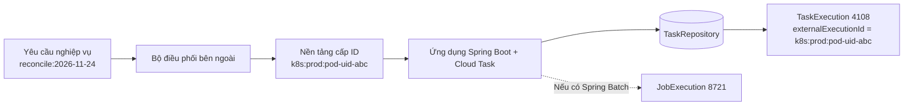
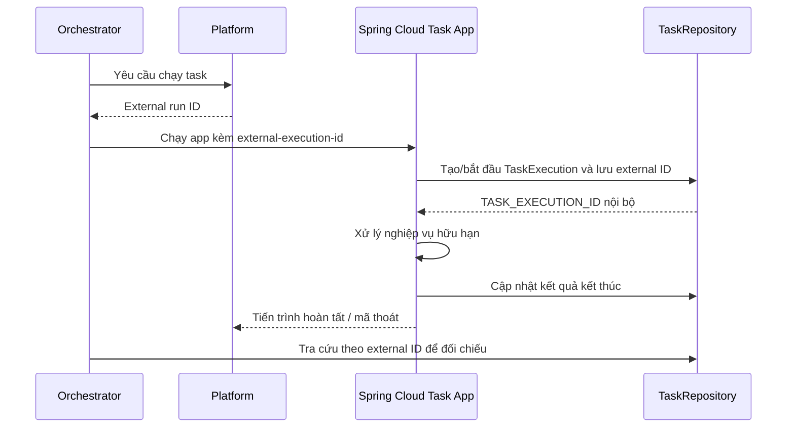
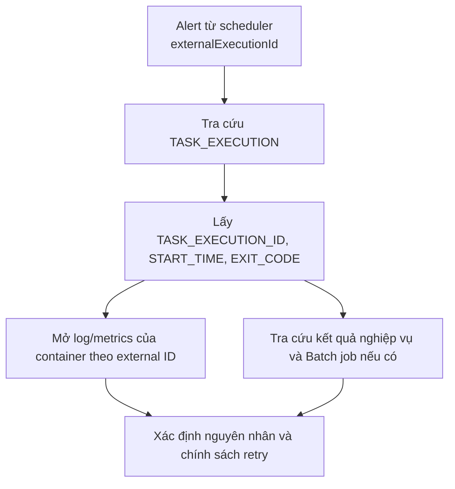
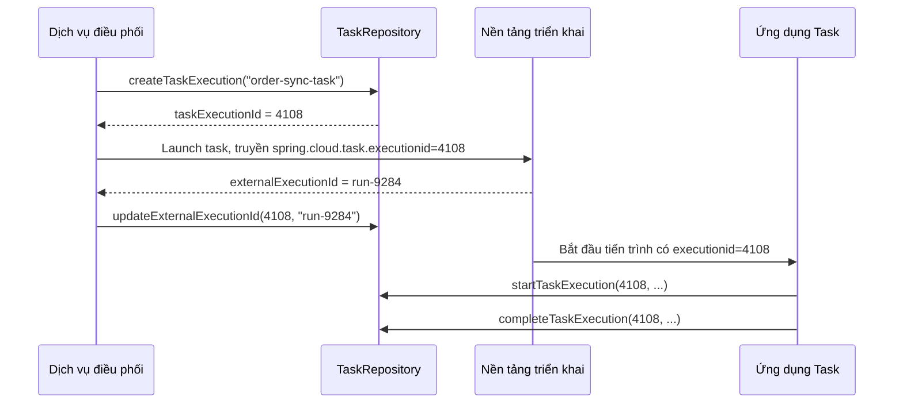

# Liên kết hệ thống ngoài bằng `externalExecutionId` trong Spring Cloud Task

## 1. Vì sao cần một mã thực thi từ hệ thống ngoài?

Trong chương **Dữ liệu thực thi** của **Spring Cloud Task**, `TaskExecution` giúp chúng ta biết một ứng dụng Spring Boot có thời gian chạy hữu hạn đã bắt đầu, kết thúc và trả kết quả như thế nào. Tuy nhiên, ứng dụng hiếm khi tự xuất hiện: nó có thể được khởi chạy bởi Kubernetes Job/CronJob, một hệ thống điều phối, một dịch vụ nhận yêu cầu từ API hoặc một nền tảng quản lý tác vụ. Những hệ thống này thường có **mã định danh lần chạy riêng**.

Ví dụ, bộ điều phối nhận yêu cầu đồng bộ đơn hàng vào ngày `2026-11-24`, sau đó tạo một container để chạy ứng dụng. Khi cần điều tra thất bại, người vận hành có thể đang cầm **ID container/job của nền tảng**, trong khi database của Spring Cloud Task chỉ hiển thị **`TASK_EXECUTION_ID`**. Nếu không lưu mối liên hệ giữa hai ID, việc truy vết log, cấu hình, trạng thái hạ tầng và kết quả nghiệp vụ dễ trở nên thủ công.

Spring Cloud Task giải quyết phần liên kết này bằng thuộc tính **`externalExecutionId`**, được biểu diễn trong `TaskExecution` và có thể lưu vào cột **`EXTERNAL_EXECUTION_ID`** của `TASK_EXECUTION` khi dùng schema JDBC tương ứng.

Sau bài học, bạn sẽ có thể:

- Phân biệt `externalExecutionId` với `TASK_EXECUTION_ID`, mã yêu cầu nghiệp vụ, `parentExecutionId` và `JobExecution` của Spring Batch.
- Truyền mã thực thi từ hệ thống điều phối vào ứng dụng bằng `spring.cloud.task.external-execution-id`.
- Đọc, tra cứu và cập nhật quan hệ này trong `TaskRepository` khi mã ngoài xuất hiện muộn.
- Thiết kế liên kết an toàn khi chạy đồng thời, retry, container bị dừng, hoặc hệ thống ngoài không trả được ID.
- Đối chiếu kết quả từ cơ sở dữ liệu Task với log và trạng thái của scheduler/nền tảng triển khai.

## 2. Phân biệt những loại ID dễ nhầm

Một yêu cầu xử lý có thể liên quan đến nhiều loại định danh. Tên giống nhau không có nghĩa chúng thay thế được cho nhau.

| Định danh | Nguồn cấp | Phạm vi và ý nghĩa | Ví dụ minh họa |
| --- | --- | --- | --- |
| `TASK_EXECUTION_ID` | `TaskRepository` của Spring Cloud Task | Khóa nội bộ cho **một bản ghi lần chạy task** | `4108` |
| `externalExecutionId` | Hệ thống ngoài (scheduler, cloud platform, container orchestrator…) | Mã chạy do bên ngoài quản lý, được gắn vào Task Execution | `k8s:prod:pod-uid-abc` |
| Mã yêu cầu nghiệp vụ | Ứng dụng nghiệp vụ/API | Nhận diện yêu cầu, kỳ xử lý hoặc đối tượng nghiệp vụ; có thể được retry nhiều lần | `reconcile:2026-11-24` |
| `parentExecutionId` | Spring Cloud Task | ID **Task Execution cha** khi task được một task khác kích hoạt, nếu có cấu hình | `4099` |
| `JOB_EXECUTION_ID` | Spring Batch `JobRepository` | ID của **một lần thực thi Batch job**, không phải Task Execution | `8721` |

Sơ đồ quan hệ trong một ví dụ:



**`externalExecutionId` là dữ liệu liên kết, không phải khóa chính thay thế `TASK_EXECUTION_ID`.** Khi task chạy lại sau lỗi, `TaskRepository` thường tạo một Task Execution mới; mã ngoài cần phản ánh chính xác lần khởi chạy tương ứng. Nếu hệ thống ngoài sử dụng một ID chung cho cả một nhóm retry, cần thêm một ID cụ thể ở cấp *attempt* (lần thử) hoặc dữ liệu bổ sung để phân biệt.

## 3. Thuộc tính `externalExecutionId` được ghi ở đâu và khi nào?

Tài liệu Spring Cloud Task định nghĩa thuộc tính cấu hình:

```properties
spring.cloud.task.external-execution-id=<externalTaskId>
```

Khi ứng dụng khởi động với thuộc tính này, Spring Cloud Task có thể đưa giá trị vào `TaskExecution` và lưu qua `TaskRepository` tại giai đoạn tạo/bắt đầu lần thực thi. Trong schema JDBC chuẩn, cột `TASK_EXECUTION.EXTERNAL_EXECUTION_ID` là kiểu chuỗi, có thể để trống và **có độ dài khai báo 250 ký tự** ở các phiên bản schema được tài liệu hóa. Kiểm tra DDL theo **phiên bản thật của dự án** trước khi thiết kế định dạng ID hoặc thay đổi schema.

Thông tin liên quan của một dòng `TASK_EXECUTION` thường gồm:

| Cột | Vai trò |
| --- | --- |
| `TASK_EXECUTION_ID` | ID nội bộ được cấp trong Task Repository. |
| `TASK_NAME` | Tên ứng dụng/task, giúp phân loại các lần chạy. |
| `START_TIME`, `END_TIME` | Mốc bắt đầu và kết thúc được framework ghi nhận. |
| `EXIT_CODE`, `EXIT_MESSAGE`, `ERROR_MESSAGE` | Kết quả thực thi và thông tin lỗi nếu có. |
| `EXTERNAL_EXECUTION_ID` | ID của lần chạy tương ứng ở hệ thống bên ngoài. |
| `PARENT_TASK_EXECUTION_ID` | Quan hệ task cha nếu có, không đồng nghĩa với external ID. |

`EXTERNAL_EXECUTION_ID` **có thể là `NULL`** nếu không được cấu hình/cập nhật, ví dụ khi chạy trực tiếp từ IDE. Trong nhiều schema mặc định, trường này cũng **không phải khóa duy nhất toàn cục**. Vì vậy, không mặc định rằng cùng một giá trị external ID chỉ có duy nhất một bản ghi; ứng dụng phải quyết định phạm vi duy nhất phù hợp (nền tảng, môi trường, namespace, attempt) và có cơ chế kiểm soát nếu nghiệp vụ yêu cầu.

### Thời điểm tạo và cập nhật



Đây là luồng thông dụng khi hệ thống ngoài **đã biết ID trước lúc ứng dụng bắt đầu**. Nếu nền tảng chỉ cấp ID sau khi yêu cầu launch được gửi, xem mục 7 để biết cách cập nhật sau hoặc đặt trước Task Execution nội bộ. Sơ đồ không khẳng định mọi nền tảng đều có cùng thứ tự cấp ID.

## 4. Ví dụ: truyền external ID qua tham số khởi chạy

### 4.1. Ứng dụng Spring Cloud Task đơn giản

Giả sử dự án Spring Boot đã có `spring-cloud-starter-task`, JDBC driver, metadata schema và bộ phiên bản Spring Boot/Spring Cloud tương thích. Ứng dụng không mở HTTP server, nhận ngày nghiệp vụ và ghi log một lượt xử lý:

```java
package com.example.externalid;

import java.time.LocalDate;
import java.util.List;

import org.slf4j.Logger;
import org.slf4j.LoggerFactory;
import org.springframework.boot.ApplicationRunner;
import org.springframework.boot.SpringApplication;
import org.springframework.boot.autoconfigure.SpringBootApplication;
import org.springframework.cloud.task.configuration.EnableTask;
import org.springframework.context.annotation.Bean;

@SpringBootApplication
@EnableTask
public class ExternalIdTaskApplication {
    private static final Logger log =
            LoggerFactory.getLogger(ExternalIdTaskApplication.class);

    public static void main(String[] args) {
        SpringApplication.run(ExternalIdTaskApplication.class, args);
    }

    @Bean
    ApplicationRunner synchronizeOrders() {
        return args -> {
            List<String> dates = args.getOptionValues("business-date");
            if (dates == null || dates.size() != 1) {
                throw new IllegalArgumentException(
                        "Cần đúng một --business-date=yyyy-MM-dd");
            }

            LocalDate businessDate = LocalDate.parse(dates.get(0));
            log.info("Bắt đầu đồng bộ đơn hàng ngày {}", businessDate);
            // Gọi service thực tế tại đây; xử lý lỗi và transaction ở tầng nghiệp vụ.
            log.info("Hoàn thành đồng bộ đơn hàng ngày {}", businessDate);
        };
    }
}
```

`application.yml` sử dụng database bền vững để lịch sử vẫn còn sau khi tiến trình kết thúc:

```yaml
spring:
  application:
    name: order-sync-task
  main:
    web-application-type: none
  datasource:
    url: jdbc:postgresql://localhost:5432/task_demo
    username: task_user
    password: ${TASK_DB_PASSWORD}
```

Trong ví dụ này, database PostgreSQL, tài khoản, JDBC driver và bảng metadata của Spring Cloud Task phải được chuẩn bị trước. `spring.cloud.task.external-execution-id` **không bị gắn cứng vào file cấu hình dùng chung** vì mỗi lần chạy có thể nhận một ID khác nhau từ nền tảng điều phối.

### 4.2. Cấp external ID ngay trong lệnh chạy

Giả sử hệ thống ngoài cấp mã `scheduler:prod:run-9284` cho một lượt chạy:

```bash
java -jar order-sync-task.jar \
  --spring.cloud.task.external-execution-id=scheduler:prod:run-9284 \
  --business-date=2026-11-24
```

Sau khi khởi chạy thành công, `TASK_EXECUTION.EXTERNAL_EXECUTION_ID` sẽ chứa giá trị đã truyền nếu Spring Cloud Task và repository được cấu hình đúng. `TASK_EXECUTION_ID` vẫn do `TaskRepository` cấp; đây là hai trường **khác nhau**.

Cùng một giá trị cũng có thể cấu hình qua biến môi trường Spring Boot, ví dụ:

```bash
export SPRING_CLOUD_TASK_EXTERNAL_EXECUTION_ID='scheduler:prod:run-9284'
java -jar order-sync-task.jar --business-date=2026-11-24
```

Spring Boot hỗ trợ relaxed binding giữa dạng biến môi trường và property. Nếu vừa đặt biến môi trường vừa truyền option dòng lệnh, cần hiểu quy tắc ưu tiên nguồn cấu hình của Spring Boot; trong trường hợp thông thường **option dòng lệnh có độ ưu tiên cao hơn**. Bộ điều phối nên chọn một nguồn sự thật rõ ràng để tránh truy vết nhầm.

Đừng sử dụng một giá trị cố định như `external-execution-id=nightly-import` cho **mọi lần chạy**. Đó chỉ là tên loại công việc, không phân biệt được hai lượt chạy hoặc hai lần retry. Giá trị nên đến từ ID của **execution/attempt** thực tế.

### 4.3. In mối liên kết ở mốc bắt đầu

Có thể dùng `TaskExecutionListener` để log cả ID nội bộ và ID ngoài cho mục đích đối chiếu:

```java
package com.example.externalid;

import org.slf4j.Logger;
import org.slf4j.LoggerFactory;
import org.springframework.cloud.task.listener.TaskExecutionListener;
import org.springframework.cloud.task.repository.TaskExecution;
import org.springframework.stereotype.Component;

@Component
public class ExternalExecutionAuditListener implements TaskExecutionListener {
    private static final Logger log =
            LoggerFactory.getLogger(ExternalExecutionAuditListener.class);

    @Override
    public void onTaskStartup(TaskExecution execution) {
        log.info("taskExecutionId={}, externalExecutionId={}",
                execution.getExecutionId(), execution.getExternalExecutionId());
    }

    @Override
    public void onTaskEnd(TaskExecution execution) {
        log.info("Đến mốc kết thúc taskExecutionId={}",
                execution.getExecutionId());
    }

    @Override
    public void onTaskFailed(TaskExecution execution, Throwable throwable) {
        log.error("Task lỗi, taskExecutionId={}", execution.getExecutionId(), throwable);
    }
}
```

`getExternalExecutionId()` là getter có sẵn trên `TaskExecution`. Giá trị log chỉ nên là **mã định danh không nhạy cảm**. Không đưa token truy cập, password, thông tin khách hàng hoặc URL có thông tin xác thực vào `externalExecutionId`. Listener cũng không bảo đảm chạy nếu JVM bị kill cưỡng bức.

## 5. Trường hợp Kubernetes: chọn đúng ID cho lần thử chạy

Giả sử Kubernetes Job tạo một Pod để chạy executable JAR. Ta có thể lấy **Pod UID** từ Kubernetes Downward API và truyền vào application arguments. Mỗi Pod có UID riêng; khi Job tạo Pod khác để retry, Pod UID sẽ khác.

Ví dụ manifest **minh họa phần truyền ID**, giả định image đã có entrypoint nhận các argument của Spring Boot:

```yaml
apiVersion: batch/v1
kind: Job
metadata:
  name: order-sync-20261124
spec:
  template:
    spec:
      restartPolicy: Never
      containers:
        - name: task
          image: registry.example.com/order-sync-task:1.0.0
          env:
            - name: POD_UID
              valueFrom:
                fieldRef:
                  fieldPath: metadata.uid
          args:
            - "--spring.cloud.task.external-execution-id=$(POD_UID)"
            - "--business-date=2026-11-24"
```

Kubernetes có thể thay thế `$(POD_UID)` từ biến môi trường đã khai báo trong `args`. Ứng dụng nhận ID Pod ở cấp attempt. Manifest đầy đủ còn cần phù hợp image, cơ chế cấp credential DB/secret, RBAC, giới hạn tài nguyên và chính sách retry của cụm. Nếu image không có entrypoint gọi đúng ứng dụng Java thì phải cấu hình `command` tương ứng.

**Chọn định danh theo nhu cầu truy vết:**

| ID Kubernetes | Phạm vi | Nên dùng khi nào? |
| --- | --- | --- |
| Tên CronJob | Loại lịch chạy, có thể tái sử dụng | Dùng làm `taskName`/nhãn phân loại, không đủ nhận diện từng lần chạy. |
| Job UID | Một đối tượng Job | Muốn truy vết lần Job được tạo; có thể bao gồm nhiều Pod/attempt. |
| Pod UID | Một đối tượng Pod | Muốn phân biệt từng Pod được tạo khi retry hoặc thay thế. |

Nếu chỉ lưu Job UID mà một Job tạo **nhiều Pod** hoặc nhiều lần thử, có thể có **nhiều Task Execution dùng cùng external ID**. Trong hệ thống yêu cầu nhận diện chính xác từng tiến trình, ưu tiên Pod UID hoặc lưu thêm mã attempt trong bảng nghiệp vụ. Khi có nhiều cluster/namespace, cân nhắc tiền tố như `k8s:<cluster>:<namespace>:<uid>`, đồng thời bảo đảm không vượt độ dài của cột metadata.

## 6. Tra cứu hai chiều giữa TaskRepository và hệ thống ngoài

### 6.1. Tìm Task Execution bằng external ID

Khi hệ thống bên ngoài báo `scheduler:prod:run-9284` lỗi, truy vấn database metadata có thể xác định lần chạy Task tương ứng:

```sql
SELECT TASK_EXECUTION_ID,
       TASK_NAME,
       EXTERNAL_EXECUTION_ID,
       START_TIME,
       END_TIME,
       EXIT_CODE,
       EXIT_MESSAGE
FROM TASK_EXECUTION
WHERE EXTERNAL_EXECUTION_ID = :externalId
ORDER BY START_TIME DESC, TASK_EXECUTION_ID DESC;
```

`:externalId` là **named parameter minh họa** khi sử dụng JDBC abstraction (ví dụ `NamedParameterJdbcTemplate`), không phải cú pháp placeholder mà mọi SQL client đều hiểu. Khi chạy trực tiếp trong SQL client, dùng cú pháp bind parameter của công cụ đó hoặc thay bằng một literal an toàn trong môi trường thử nghiệm. **Không ghép chuỗi đầu vào chưa kiểm soát thành SQL.**

Nếu truy vấn trả về nhiều dòng, phải kiểm tra liệu ID ngoài được dùng cho cả nhóm retry hay bị tái sử dụng sai. Không tự chọn bản ghi đầu tiên và tuyên bố đó là execution duy nhất.

### 6.2. Tìm ID ngoài từ Task Execution nội bộ

Khi log của Spring Cloud Task hiển thị `TASK_EXECUTION_ID=4108`, truy vấn:

```sql
SELECT TASK_EXECUTION_ID,
       EXTERNAL_EXECUTION_ID,
       START_TIME,
       END_TIME,
       EXIT_CODE,
       ERROR_MESSAGE
FROM TASK_EXECUTION
WHERE TASK_EXECUTION_ID = :taskExecutionId;
```

Nếu đã biết ID nội bộ, `TaskExplorer` cũng cung cấp API `getTaskExecution(long)` để lấy đối tượng và gọi `getExternalExecutionId()`:

```java
import org.springframework.cloud.task.repository.TaskExecution;
import org.springframework.cloud.task.repository.TaskExplorer;

public String findExternalId(TaskExplorer taskExplorer, long taskExecutionId) {
    TaskExecution execution = taskExplorer.getTaskExecution(taskExecutionId);
    return execution == null ? null : execution.getExternalExecutionId();
}
```

Đây là ví dụ **method đặt trong một service hợp lệ**; `TaskExplorer` được inject theo cách thông thường của Spring. API `TaskExplorer` phổ biến có phương thức tìm theo **Task Execution ID** và theo **tên task**, nhưng không nên giả định nó có sẵn một method chuẩn `findByExternalExecutionId`. Khi cần tìm theo external ID, dùng truy vấn JDBC có tham số hoặc một repository đọc riêng được kiểm soát quyền.

### 6.3. Tạo liên kết với dữ liệu log, metric hoặc dashboard

Ví dụ luồng tra cứu một sự cố:



Nếu ứng dụng chạy Spring Batch, có thể tra cứu các `JobExecution` liên quan tới Task Execution thông qua cơ chế liên kết Task–Batch của framework. `externalExecutionId` **không phải** `JOB_EXECUTION_ID` và không thay thế khóa liên kết Batch.

## 7. Khi external ID chỉ có sau khi đã tạo Task Execution

Trong một số hệ thống, bộ điều phối tạo yêu cầu trước rồi mới nhận được ID từ API nền tảng. Spring Cloud Task cung cấp `TaskRepository.updateExternalExecutionId(long executionId, String externalExecutionId)` để cập nhật mối liên kết cho một Task Execution đã tồn tại.

Ví dụ một service nội bộ được phép cập nhật repository:

```java
package com.example.externalid;

import org.springframework.cloud.task.repository.TaskRepository;
import org.springframework.stereotype.Service;

@Service
public class ExternalIdLinkService {
    private final TaskRepository taskRepository;

    public ExternalIdLinkService(TaskRepository taskRepository) {
        this.taskRepository = taskRepository;
    }

    public void attach(long taskExecutionId, String platformExecutionId) {
        if (taskExecutionId <= 0) {
            throw new IllegalArgumentException("Task execution ID không hợp lệ");
        }
        if (platformExecutionId == null || platformExecutionId.isBlank()) {
            throw new IllegalArgumentException("External execution ID không được rỗng");
        }
        taskRepository.updateExternalExecutionId(taskExecutionId, platformExecutionId);
    }
}
```

Đoạn code thể hiện **API cập nhật**, giả sử service biết đúng `taskExecutionId` và truy cập cùng `TaskRepository` với ứng dụng thực thi. Trong production, cần xác minh bản ghi tồn tại, quyền cập nhật, độ dài/định dạng ID, tính nhất quán khi nhiều thành phần cùng cập nhật và cách xử lý lỗi transaction. Kiểm tra đầu vào đơn giản ở trên **không tự tạo tính duy nhất hoặc chống race condition**.

### Phương án nâng cao: đặt trước Task Execution

Spring Cloud Task hỗ trợ trường hợp **yêu cầu chạy đến trước thời điểm ứng dụng thực sự khởi động**. Thành phần điều phối có thể tạo sẵn một `TaskExecution` bằng `TaskRepository.createTaskExecution(String name)` để nhận `TASK_EXECUTION_ID` trước, sau đó truyền ID này vào ứng dụng qua:

```properties
spring.cloud.task.executionid=<taskExecutionIdDaTaoTruoc>
```

Khi ứng dụng bắt đầu, Spring Cloud Task có thể cập nhật **bản ghi đã đặt trước** thay vì tạo một bản ghi hoàn toàn mới, nếu cùng repository và trạng thái bản ghi phù hợp. Đây là cơ chế khác với `external-execution-id`:

- `spring.cloud.task.executionid` là **ID nội bộ đã tồn tại** mà task phải tiếp tục cập nhật.
- `spring.cloud.task.external-execution-id` là **ID của lần chạy bên ngoài** cần gắn với Task Execution.

Kịch bản trình tự có thể là:



**Lưu ý về thứ tự thực tế:** nhiều nền tảng có thể bắt đầu container ngay sau API launch, thậm chí trước lúc dịch vụ điều phối nhận phản hồi. Các thao tác `startTaskExecution` và `updateExternalExecutionId` có thể xảy ra gần nhau. Hãy chọn giao thức chuyển ID, kiểm soát transaction và kiểm thử tình huống race; không dựa vào sơ đồ để giả định rằng nền tảng luôn đợi dịch vụ cập nhật repository xong mới chạy ứng dụng. Nếu external ID đã biết trước, truyền trực tiếp bằng property thường đơn giản hơn.

Nếu việc đặt trước Task Execution thành công nhưng launch thất bại hoặc không bao giờ diễn ra, repository có thể còn một bản ghi **chưa bắt đầu**. Hệ thống điều phối cần có timeout, trạng thái yêu cầu và chính sách xử lý phù hợp, không coi bản ghi chưa hoàn tất là tiến trình đang sống.

## 8. Thiết kế ID an toàn khi chạy đồng thời và retry

### 8.1. Phân biệt request, run và attempt

Giả sử một yêu cầu đối soát duy nhất bị retry hai lần:

| Mốc | Request ID nghiệp vụ | External execution ID | Task Execution ID |
| --- | --- | --- | --- |
| Lần chạy ban đầu | `req-20261124-01` | `scheduler:attempt-1` | `4108` |
| Retry lần 1 | `req-20261124-01` | `scheduler:attempt-2` | `4109` |
| Retry lần 2 | `req-20261124-01` | `scheduler:attempt-3` | `4110` |

Một **request** có thể có nhiều **attempt**. Thiết kế tốt cho phép truy vấn ngược cả hai chiều: từ request tìm mọi lần thử, từ mỗi attempt tìm một Task Execution, và từ Task Execution mở log/metrics của nền tảng. `externalExecutionId` chỉ có một trường chuỗi nên nếu cần lưu đồng thời cả request ID, workflow ID, cluster ID và attempt ID, hãy chọn định dạng namespace rõ ràng hoặc quản lý thêm bảng ánh xạ riêng.

### 8.2. Không mặc định external ID là khóa chống trùng

Spring Cloud Task lưu external ID để **truy vết**; việc đặt ID vào cột không tự khiến task ngừng chạy trùng hoặc bảo đảm nghiệp vụ idempotent. Với hệ thống xử lý đơn hàng, hai Task Execution khác nhau có thể cùng đọc và ghi một ngày dữ liệu. Hãy có cơ chế khóa nghiệp vụ/unique constraint/transaction hoặc xác định idempotency key phù hợp khi chạy đồng thời hay retry.

Nếu cần yêu cầu **mỗi `externalExecutionId` chỉ ánh xạ tới một Task Execution**, hãy ràng buộc trên phạm vi xác định (ví dụ `provider + environment + attemptId`) bằng một bảng mapping hoặc chỉ mục phù hợp sau khi đánh giá dữ liệu và tác động migration. Không thêm unique index tùy tiện lên cột mặc định nếu các luồng hiện tại cho phép tái sử dụng external ID.

### 8.3. Không dùng dữ liệu bí mật làm ID

Task metadata có thể tồn tại lâu dài, được backup, xuất ra dashboard hoặc được người vận hành truy vấn. ID ngoài nên là **opaque identifier** ít nhạy cảm và không chứa access token, password, cookie, thông tin thanh toán hay dữ liệu cá nhân. Nếu ID từ provider không phù hợp để lưu trực tiếp, dùng surrogate ID/hash thích hợp và bảng ánh xạ riêng với quyền truy cập chặt chẽ.

### 8.4. Xử lý external ID rỗng, không thấy bản ghi và bản ghi treo

| Dấu hiệu | Giải thích có thể xảy ra | Hướng kiểm tra |
| --- | --- | --- |
| `EXTERNAL_EXECUTION_ID IS NULL` | Task chạy từ IDE, thiếu property hoặc chưa cập nhật ID bên ngoài | Kiểm tra launch arguments, environment và bước gắn ID. |
| Có external ID nhưng không thấy Task Execution mong đợi | Truy vấn sai database/schema, task chưa tạo metadata hoặc cập nhật nhầm ID | Kiểm tra datasource, task log, repository và quyền cập nhật. |
| Một external ID ánh xạ nhiều Task Execution | ID được tái sử dụng hoặc dùng ở cấp Job thay vì cấp attempt | Phân biệt namespace/run/attempt và kiểm tra chính sách retry. |
| Có `START_TIME`, `END_TIME` vẫn trống | Task còn chạy, bị kill hoặc không cập nhật được metadata kết thúc | Đối chiếu trạng thái container, log và kết nối DB. |
| Platform báo failed nhưng Task exit code thành công | Mã thoát và lỗi nghiệp vụ không được phản ánh nhất quán, hoặc thất bại xảy ra sau mốc Task cập nhật | Đối chiếu thời gian, log, exit code tiến trình, `ERROR_MESSAGE`. |
| External ID quá dài | Vượt kích thước cột hoặc quy ước mapping | Kiểm tra giới hạn schema, rút gọn/hàm ánh xạ, tránh cắt khiến ID trùng. |

## 9. Quy trình vận hành và truy vết một sự cố

Giả sử hệ thống điều phối báo lần chạy `scheduler:prod:run-9284` thất bại. Một quy trình điều tra có căn cứ gồm:

1. **Xác định đúng provider và môi trường** của external ID; nếu có nhiều cụm/hệ thống, tránh tìm nhầm namespace.
2. **Tra cứu `TASK_EXECUTION`** bằng ID ngoài. Nếu có nhiều bản ghi, đối chiếu `TASK_NAME`, thời gian, thông số yêu cầu và attempt.
3. **Đọc `START_TIME`, `END_TIME`, `EXIT_CODE` và lỗi** để biết Spring Cloud Task đã ghi nhận đến giai đoạn nào; không khẳng định task còn sống chỉ vì `END_TIME` rỗng.
4. **Mở log/metrics của nền tảng bằng external ID**, kiểm tra thời điểm container được tạo, trạng thái hoàn tất, signal/timeout và mã thoát thật.
5. **Nếu có Spring Batch**, tra cứu `JobExecution`/`StepExecution` qua liên kết Task–Batch để xác định xử lý đã đến bước nào và điều kiện restart.
6. **Kiểm tra tính idempotent trước khi retry**: cùng request có thể đã ghi một phần dữ liệu dù Task hoặc container báo lỗi.
7. **Ghi nhận quan hệ ID trong audit** để có thể truy vết từ ticket sự cố về request, attempt, Task Execution và nền tảng mà không lưu secret.

Với hệ thống có lưu lượng lớn, truy vấn thường xuyên theo `EXTERNAL_EXECUTION_ID` có thể cần một index phù hợp. Trước khi tạo index, kiểm tra schema thật, số lượng dòng, tỷ lệ `NULL`, mức độ tái sử dụng ID và chính sách retention. Các lần chạy thất bại do bootstrap sớm đôi khi **không có Task Execution**, khi đó dữ liệu của bộ điều phối mới là nguồn để biết rằng đã có yêu cầu chạy.

## 10. Bài thực hành tự kiểm tra

Thực hiện trên một ứng dụng Spring Cloud Task có database metadata bền vững:

1. Chạy bằng `java -jar` với `--spring.cloud.task.external-execution-id=local:run-001` và `--business-date=2026-11-24`.
2. Truy vấn `TASK_EXECUTION` để xác minh bản ghi có `TASK_EXECUTION_ID` nội bộ và external ID vừa truyền.
3. Chạy lần thứ hai với external ID `local:run-002` nhưng cùng ngày nghiệp vụ; so sánh hai ID nội bộ và thời gian chạy.
4. Chạy lần thứ ba **không truyền** external ID; kiểm tra cách repository biểu diễn trường này.
5. Gắn một external ID giả định thông qua `TaskRepository.updateExternalExecutionId` với ID nội bộ đã biết; đọc lại bằng SQL và `TaskExplorer.getTaskExecution`.
6. Thử dùng **cùng một** external ID cho hai lượt chạy và quan sát rằng việc liên kết không tự ngăn nghiệp vụ chạy lại.
7. Mô phỏng lỗi giữa chừng hoặc ngắt container, rồi đối chiếu Task Repository với trạng thái thật của tiến trình trước khi quyết định retry.

Các câu hỏi nên trả lời được sau thực hành:

- Vì sao `spring.cloud.task.executionid` và `spring.cloud.task.external-execution-id` không thể hoán đổi cho nhau?
- Nếu chỉ có CronJob name, có thể xác định duy nhất một lượt chạy thất bại không?
- Trong trường hợp một Kubernetes Job có nhiều Pod do retry, bạn sẽ chọn Job UID hay Pod UID để liên kết cấp Task Execution?
- Nếu `TaskExplorer` chỉ nhận `TASK_EXECUTION_ID`, làm thế nào tra cứu từ external ID mà vẫn phòng ngừa SQL injection?
- Nếu một request cần chạy lại ba lần, bạn sẽ lưu request ID và attempt ID theo cấu trúc nào để tiện đối chiếu và vẫn chống trùng nghiệp vụ?

## 11. Tài liệu tham khảo

- [Spring Cloud Task — Features: External Task Id và Externally Generated Task ID](https://docs.spring.io/spring-cloud-task/reference/3.2/features.html).
- [Spring Cloud Task — Task Repository Schema](https://docs.spring.io/spring-cloud-task/reference/3.2/appendix-task-repository-schema.html).
- [API `TaskExecution`](https://docs.spring.io/spring-cloud-task/docs/current/apidocs/org/springframework/cloud/task/repository/TaskExecution.html), [API `TaskRepository`](https://docs.spring.io/spring-cloud-task/docs/current/apidocs/org/springframework/cloud/task/repository/TaskRepository.html) và [API `TaskExplorer`](https://docs.spring.io/spring-cloud-task/docs/current/apidocs/org/springframework/cloud/task/repository/TaskExplorer.html). Đối chiếu phiên bản API với dependency thực tế trong dự án.

**Ghi nhớ:** `externalExecutionId` là **cầu nối truy vết** giữa một `TaskExecution` của Spring Cloud Task và ID do hệ thống bên ngoài cấp. Truyền `spring.cloud.task.external-execution-id` khi khởi chạy là cách đơn giản nhất nếu ID đã có; `TaskRepository.updateExternalExecutionId` hỗ trợ trường hợp cập nhật sau. Hãy tách bạch ID nội bộ, ID bên ngoài và khóa nghiệp vụ, kiểm soát retry/idempotency và luôn đối chiếu metadata Task với trạng thái thật của hệ thống điều phối.
