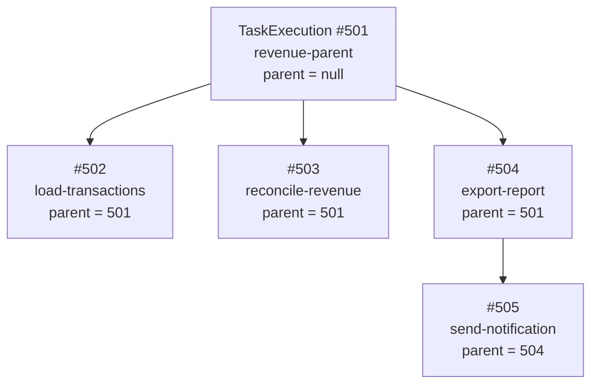
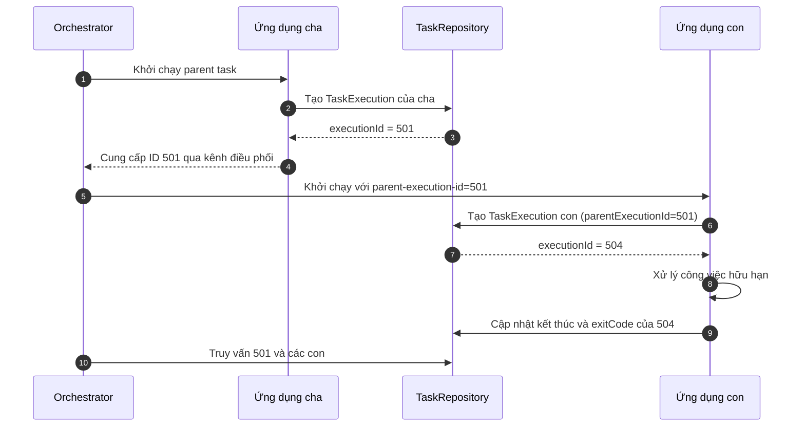

# Quan hệ cha con bằng `parentExecutionId`

Trong chương **Dữ liệu thực thi**, một câu hỏi quan trọng là: khi một ứng dụng **Spring Cloud Task** khởi chạy thêm các tác vụ khác, làm thế nào biết các lần chạy nào thuộc cùng một quy trình? Chẳng hạn, quy trình đối soát doanh thu cần nạp dữ liệu, tính toán và xuất báo cáo. Từng công việc có thể là **một ứng dụng chạy hữu hạn**, có trạng thái và kết quả riêng được ghi trong cơ sở dữ liệu. Nếu chỉ nhìn từng bản ghi `TaskExecution` độc lập, người vận hành khó lần theo nguồn gốc của chúng.

Spring Cloud Task hỗ trợ thuộc tính **`parentExecutionId`** trên `TaskExecution` để biểu diễn **quan hệ cha–con giữa các lần thực thi**. Một tác vụ con có thể ghi lại mã `TaskExecution` của tác vụ cha. Nhờ đó, hệ thống giám sát hoặc bộ điều phối có thể truy vết các lần chạy có liên quan, kể cả khi mỗi ứng dụng được khởi chạy thành một tiến trình hay container riêng.

Mục tiêu bài học:

- Hiểu ý nghĩa, phạm vi và giới hạn của `parentExecutionId`.
- Truyền ID cha khi khởi chạy ứng dụng con và kiểm tra cột `PARENT_EXECUTION_ID`.
- Truy vấn quan hệ một cha – nhiều con, các cấp lồng nhau và bản ghi thiếu cha.
- Phân biệt quan hệ cha–con với thứ tự thực thi, mã hạ tầng và khả năng restart của Spring Batch.
- Thiết kế theo dõi lỗi, retry và vận hành an toàn khi có nhiều ứng dụng Spring Cloud Task.

## 1. Một `TaskExecution` mô tả một lần chạy

Khi một ứng dụng được tích hợp Spring Cloud Task bắt đầu, cơ chế vòng đời dùng **`TaskRepository`** để tạo bản ghi `TaskExecution` trong cơ sở dữ liệu metadata. Khi ứng dụng kết thúc bình thường, cơ chế này cập nhật thời điểm kết thúc và kết quả. Mỗi lần khởi chạy thành công đến bước ghi metadata thường có **một ID thực thi mới**, dù tên tác vụ và tham số nghiệp vụ giống lần trước.

Những trường có liên quan đến quan hệ cha–con:

| Trường trong `TaskExecution` | Cột metadata thường gặp | Vai trò |
| --- | --- | --- |
| `executionId` | `TASK_EXECUTION_ID` | Định danh **lần thực thi hiện tại** trong kho metadata. |
| `taskName` | `TASK_NAME` | Tên logic của tác vụ; nhiều lần chạy có thể cùng tên. |
| `parentExecutionId` | `PARENT_EXECUTION_ID` | ID lần thực thi **cha trực tiếp**, có thể để trống. |
| `startTime` / `endTime` | `START_TIME` / `END_TIME` | Phục vụ theo dõi vòng đời, thời lượng và tương quan thời gian. |
| `exitCode` | `EXIT_CODE` | Kết quả kết thúc của lần chạy theo quy ước ứng dụng/nền tảng. |
| `externalExecutionId` (nếu có) | `EXTERNAL_EXECUTION_ID` | Mã thực thi bên ngoài do nền tảng khởi chạy sử dụng; **khác** ID cha. |

Tên cột và đặc điểm schema phụ thuộc phiên bản Spring Cloud Task và nền tảng cơ sở dữ liệu. Khi triển khai thực tế, luôn đối chiếu schema với phiên bản thư viện của dự án.

### Một liên kết từ con đến cha

Giả sử kho thực thi có dữ liệu:

| `TASK_EXECUTION_ID` | `TASK_NAME` | `PARENT_EXECUTION_ID` | `EXIT_CODE` |
| ---: | --- | ---: | ---: |
| 501 | `revenue-parent` | `NULL` | 0 |
| 502 | `load-transactions` | 501 | 0 |
| 503 | `reconcile-revenue` | 501 | 0 |
| 504 | `export-report` | 501 | 1 |
| 505 | `send-notification` | 504 | 0 |

Đọc bảng như sau:

- **501** là lần thực thi gốc, không khai báo cha.
- **502, 503 và 504** cùng có `parentExecutionId = 501`, nên đều là **con trực tiếp** của 501.
- **505** có cha trực tiếp là **504**, vì thế là **cháu** của 501. Nó không cần lưu đồng thời hai ID cha và ông.
- Dù ba công việc con có tên khác nhau, quan hệ được xác định bằng **execution ID**, không phải bằng tên tác vụ.
- Bản ghi 504 có mã lỗi `1`, nhưng điều đó **không tự động sửa** mã thoát của 501 hay 505.



Quan hệ trên là một **cây liên kết logic giữa các bản ghi thực thi**, không nhất thiết mô tả thứ tự chạy. Ví dụ, `load-transactions` có thể chạy xong trước `reconcile-revenue`, nhưng thông tin đó phải được xác định từ thời gian, trạng thái hoặc hệ thống điều phối; `parentExecutionId` chỉ cho biết **ai là cha trực tiếp**.

## 2. `parentExecutionId` làm được và không làm được gì?

Một `TaskExecution` thường có **không quá một cha trực tiếp**, nhưng một cha có thể có **nhiều con**. Tham chiếu được lưu ở bản ghi **con**. Khi không được gán cha, `parentExecutionId` thường là `null`.

**Những việc trường này hỗ trợ:**

1. Truy vết tác vụ con do một lần thực thi cha sinh ra hoặc được liên kết với cha.
2. Gom lịch sử nhiều ứng dụng vào cùng một quy trình xử lý.
3. Xây dựng màn hình hiển thị cây thực thi, tìm tất cả con/cháu và đối chiếu các lần retry.
4. Liên kết log, metrics và cảnh báo với đúng lần chạy gốc.

**Những việc trường này không tự động thực hiện:**

- **Không khởi chạy ứng dụng con.** Việc tạo tiến trình/container vẫn thuộc trách nhiệm launcher, scheduler hoặc orchestrator.
- **Không buộc các tác vụ chạy tuần tự.** Hai bản ghi cùng một cha không tự có ràng buộc chạy trước/sau.
- **Không truyền kết quả hoặc lỗi ngược lên cha.** Child thất bại không tự biến `TaskExecution` cha thành thất bại.
- **Không thực hiện retry, rollback hoặc chống trùng.** Cần chính sách điều phối và idempotency ở tầng nghiệp vụ.
- **Không thể thay thế bảng dữ liệu nghiệp vụ.** Metadata chỉ ghi lịch sử chạy; kết quả đối soát, file báo cáo và checkpoint phải được lưu riêng.

> **Nguyên tắc:** `parentExecutionId` là **quan hệ giữa hai lần chạy cụ thể**, không phải quan hệ giữa hai định nghĩa tác vụ. Nếu chạy lại một ứng dụng, lần chạy mới có `executionId` khác và muốn tiếp tục thuộc cùng cây thì cần được gán lại `parentExecutionId` phù hợp.

## 3. Gán ID cha khi khởi chạy tác vụ con

Spring Cloud Task hỗ trợ thuộc tính cấu hình **`spring.cloud.task.parent-execution-id`** để gán ID cha cho `TaskExecution` của ứng dụng đang khởi động. Giá trị này cần được truyền **trước khi ứng dụng con tạo bản ghi thực thi**; không thể kỳ vọng việc đặt một biến trong `ApplicationRunner` sau khi startup tự cập nhật quan hệ đã lưu.

Ví dụ, giả sử tác vụ cha đã có ID **501**, một ứng dụng con có thể được chạy bằng:

```bash
java -jar export-report-task.jar \
  --spring.cloud.task.name=export-report \
  --spring.cloud.task.parent-execution-id=501 \
  --business-date=2026-11-24
```

Đối với ứng dụng con sử dụng Spring Cloud Task và kết nối tới cùng kho metadata, `TaskRepository` sẽ lưu một `TaskExecution` mới (ví dụ ID 504) với `parentExecutionId = 501`.

Trên Windows PowerShell, có thể viết lệnh trên một dòng:

```powershell
java -jar .\export-report-task.jar --spring.cloud.task.name=export-report --spring.cloud.task.parent-execution-id=501 --business-date=2026-11-24
```

**Cần đáp ứng đồng thời các điều kiện:**

- **501 phải là ID thực tế** của một lần thực thi cha, lấy từ nguồn đáng tin cậy hoặc `TaskExplorer`.
- Cả cha và con cần **nhìn thấy cùng kho `TaskRepository` hoặc cùng không gian ID metadata**, nếu muốn truy vấn được liên kết. ID 501 ở database A không có nghĩa là ID 501 ở database B.
- Ứng dụng con phải được cấu hình Spring Cloud Task và database phù hợp; chỉ chạy `java -jar` không tự tạo metadata khi ứng dụng không tích hợp framework.
- Cơ chế khởi chạy phải truyền được tham số, quyền truy cập CSDL và thông tin correlation một cách nhất quán.
- Không nên giả định có **foreign key** hay cơ chế kiểm tra ID cha bắt buộc ở mọi phiên bản/schema; ứng dụng điều phối nên xác minh ID cha trước khi gán.

### Sơ đồ các bước



Sơ đồ mô tả cách **liên kết metadata**, không ép buộc cha phải còn đang chạy khi con bắt đầu. Tùy thiết kế, cha có thể gọi launcher lúc đang chạy; hoặc orchestrator tạo con sau khi cha đã kết thúc. Việc **đợi con**, tổng hợp trạng thái và quyết định bước tiếp theo là nhiệm vụ cần lập trình rõ ràng.

## 4. Ví dụ thực hành: một JAR tạo nhiều lần thực thi có liên kết

Để tập trung vào dữ liệu thực thi, ta dùng **cùng một JAR** chạy nhiều lần với vai trò `parent` hoặc `child`. Cách này giúp quan sát rằng quan hệ cha–con thuộc về **lần chạy**, không phụ thuộc việc dùng hai source code khác nhau.

### 4.1. Chuẩn bị dependency và CSDL metadata

Tạo một dự án Spring Boot dùng Java tương thích với phiên bản Spring Cloud được chọn, có Spring Cloud BOM tương thích, Spring Boot Maven Plugin và các dependency:

```xml
<dependencies>
    <dependency>
        <groupId>org.springframework.cloud</groupId>
        <artifactId>spring-cloud-starter-task</artifactId>
    </dependency>
    <dependency>
        <groupId>org.springframework.boot</groupId>
        <artifactId>spring-boot-starter-jdbc</artifactId>
    </dependency>
    <dependency>
        <groupId>com.h2database</groupId>
        <artifactId>h2</artifactId>
        <scope>runtime</scope>
    </dependency>
</dependencies>
```

Các đoạn XML này là phần dependency của một `pom.xml` đã được cấu hình đúng phiên bản; không phải POM hoàn chỉnh.

Trong `src/main/resources/application.yml`:

```yaml
spring:
  application:
    name: task-hierarchy-demo
  main:
    web-application-type: none
  datasource:
    url: jdbc:h2:file:./task-hierarchy-metadata
    driver-class-name: org.h2.Driver
    username: sa
    password: ""
  cloud:
    task:
      initialize-enabled: true
```

H2 dạng **file** cho phép kiểm tra nhiều lần chạy sau khi JVM thoát. Vì `./task-hierarchy-metadata` là đường dẫn tương đối theo **working directory**, các lệnh trong ví dụ phải chạy từ cùng một thư mục. H2 phù hợp cho máy học thử; môi trường production nên quản lý schema bằng migration và dùng kho metadata tập trung, có quyền truy cập và kết nối được bảo vệ.

### 4.2. Viết tác vụ hữu hạn

Tạo `src/main/java/com/example/task/TaskHierarchyApplication.java`:

```java
package com.example.task;

import java.time.LocalDate;
import java.util.List;

import org.springframework.boot.ApplicationArguments;
import org.springframework.boot.ApplicationRunner;
import org.springframework.boot.SpringApplication;
import org.springframework.boot.autoconfigure.SpringBootApplication;
import org.springframework.cloud.task.configuration.EnableTask;
import org.springframework.context.annotation.Bean;

@SpringBootApplication
@EnableTask
public class TaskHierarchyApplication {

    public static void main(String[] args) {
        SpringApplication.run(TaskHierarchyApplication.class, args);
    }

    @Bean
    ApplicationRunner runWork() {
        return args -> {
            String role = requiredOption(args, "role");
            if (!role.equals("parent") && !role.equals("child")) {
                throw new IllegalArgumentException(
                    "--role phai la parent hoac child"
                );
            }

            LocalDate date = LocalDate.parse(
                requiredOption(args, "business-date")
            );
            System.out.printf(
                "Dang chay vai tro %s cho ngay %s%n", role, date
            );

            if (args.containsOption("simulate-error")) {
                throw new IllegalStateException("Loi mo phong");
            }

            System.out.println("Hoan thanh cong viec");
        };
    }

    private static String requiredOption(
            ApplicationArguments args, String name) {
        List<String> values = args.getOptionValues(name);
        if (values == null || values.size() != 1
                || values.get(0) == null || values.get(0).isBlank()) {
            throw new IllegalArgumentException(
                "Can truyen --" + name + "=..."
            );
        }
        return values.get(0);
    }
}
```

`@EnableTask` kích hoạt ghi nhận vòng đời Spring Cloud Task. `ApplicationRunner` xử lý phần nghiệp vụ hữu hạn; ví dụ in log và có cờ mô phỏng lỗi để quan sát metadata. Việc **gắn quan hệ cha–con** không nằm ở code nghiệp vụ này, mà nằm trong **thuộc tính khởi chạy** của từng tiến trình.

### 4.3. Chạy cha trước, lấy ID thực thi

Giả sử `artifactId=task-hierarchy-demo`, `version=0.0.1-SNAPSHOT` và plugin tạo Spring Boot executable JAR. Đóng gói:

```bash
./mvnw clean package
```

Khởi chạy lần đầu **không truyền ID cha**:

```bash
java -jar target/task-hierarchy-demo-0.0.1-SNAPSHOT.jar \
  --spring.cloud.task.name=revenue-parent \
  --role=parent \
  --business-date=2026-11-24
```

Sau khi tác vụ kết thúc, kết nối đến H2 metadata và truy vấn:

```sql
SELECT
    TASK_EXECUTION_ID,
    TASK_NAME,
    PARENT_EXECUTION_ID,
    EXIT_CODE,
    START_TIME,
    END_TIME
FROM TASK_EXECUTION
ORDER BY TASK_EXECUTION_ID DESC;
```

Hãy **ghi lại `TASK_EXECUTION_ID` của lần chạy `revenue-parent` vừa tạo**, ví dụ **501**. Số 501 chỉ minh họa; thực tế ID có thể là 1, 2 hoặc giá trị khác tùy dữ liệu có sẵn. Khi có nhiều lần chạy cùng tên, chọn chính xác ID bằng thời gian và bối cảnh yêu cầu, không lấy bừa “lần chạy mới nhất” trong hệ thống có xử lý song song.

### 4.4. Khởi chạy hai con cùng cha

Giả sử ID cha thực tế là **501**. Chạy con đầu tiên:

```bash
java -jar target/task-hierarchy-demo-0.0.1-SNAPSHOT.jar \
  --spring.cloud.task.name=load-transactions \
  --spring.cloud.task.parent-execution-id=501 \
  --role=child \
  --business-date=2026-11-24
```

Chạy con thứ hai, mô phỏng lỗi:

```bash
java -jar target/task-hierarchy-demo-0.0.1-SNAPSHOT.jar \
  --spring.cloud.task.name=export-report \
  --spring.cloud.task.parent-execution-id=501 \
  --role=child \
  --business-date=2026-11-24 \
  --simulate-error
```

Truy vấn lại bảng `TASK_EXECUTION`. Kết quả kỳ vọng về mặt quan hệ là:

- Lần chạy `revenue-parent` có `PARENT_EXECUTION_ID` là `NULL`.
- Hai lần chạy `load-transactions` và `export-report` có `PARENT_EXECUTION_ID = 501`.
- Mỗi lần chạy có `TASK_EXECUTION_ID` riêng; lỗi của `export-report` thể hiện trên **bản ghi của chính nó**.
- `revenue-parent` vẫn có kết quả đã được ghi khi nó kết thúc trước đó, trừ khi bạn xây dựng cơ chế cập nhật trạng thái quy trình ở tầng khác.

**Không dùng cứng ID 501** khi chạy trên dữ liệu thật; phải thay bằng ID đã truy vấn từ kho metadata. Chạy một tác vụ con với ID cha không tồn tại có thể tạo quan hệ sai hoặc bị từ chối tùy schema và quy tắc của hệ thống.

## 5. Truy vấn cha, con và toàn bộ cây thực thi

### 5.1. Tìm các con trực tiếp

Giả sử ID cha là 501:

```sql
SELECT
    TASK_EXECUTION_ID,
    TASK_NAME,
    PARENT_EXECUTION_ID,
    START_TIME,
    END_TIME,
    EXIT_CODE
FROM TASK_EXECUTION
WHERE PARENT_EXECUTION_ID = 501
ORDER BY START_TIME, TASK_EXECUTION_ID;
```

Truy vấn này trả về các **con trực tiếp**, không tự tìm cháu hoặc các cấp sâu hơn.

### 5.2. Hiển thị cha cùng con bằng tự kết nối bảng

```sql
SELECT
    p.TASK_EXECUTION_ID AS parent_id,
    p.TASK_NAME AS parent_name,
    c.TASK_EXECUTION_ID AS child_id,
    c.TASK_NAME AS child_name,
    c.EXIT_CODE AS child_exit_code
FROM TASK_EXECUTION p
JOIN TASK_EXECUTION c
    ON c.PARENT_EXECUTION_ID = p.TASK_EXECUTION_ID
WHERE p.TASK_EXECUTION_ID = 501
ORDER BY c.TASK_EXECUTION_ID;
```

`JOIN` ở đây là thao tác **self-join** vì cha và con được lưu trong **cùng một bảng**. Nếu muốn hiển thị cả cha chưa có con, thay `JOIN` bằng `LEFT JOIN`.

### 5.3. Đi qua nhiều cấp cha–con

Trên CSDL hỗ trợ recursive CTE như PostgreSQL, MySQL 8+ hoặc các phiên bản H2 phù hợp, có thể minh họa truy vấn cây:

```sql
WITH RECURSIVE task_tree (
    TASK_EXECUTION_ID,
    TASK_NAME,
    PARENT_EXECUTION_ID,
    depth
) AS (
    SELECT
        TASK_EXECUTION_ID,
        TASK_NAME,
        PARENT_EXECUTION_ID,
        0
    FROM TASK_EXECUTION
    WHERE TASK_EXECUTION_ID = 501

    UNION ALL

    SELECT
        c.TASK_EXECUTION_ID,
        c.TASK_NAME,
        c.PARENT_EXECUTION_ID,
        t.depth + 1
    FROM TASK_EXECUTION c
    JOIN task_tree t
        ON c.PARENT_EXECUTION_ID = t.TASK_EXECUTION_ID
    WHERE t.depth < 20
)
SELECT *
FROM task_tree
ORDER BY depth, TASK_EXECUTION_ID;
```

Truy vấn dùng `depth` để mô tả mức lồng nhau và giới hạn độ sâu ở 20 trong bài thực hành. Cú pháp CTE, cách giới hạn đệ quy và tên cột có thể phải điều chỉnh theo **SQL dialect**, đặc biệt ở schema hoặc phiên bản CSDL khác. Không dựa vào giới hạn độ sâu như một giải pháp duy nhất nếu dữ liệu có vòng lặp bất thường; cần xác minh tính hợp lệ của quan hệ trước khi dựng cây.

### 5.4. Phát hiện tham chiếu cha không tồn tại

Nếu kho dữ liệu cho phép lưu tham chiếu cha mà không có ràng buộc khóa ngoại, có thể kiểm tra:

```sql
SELECT
    child.TASK_EXECUTION_ID,
    child.TASK_NAME,
    child.PARENT_EXECUTION_ID
FROM TASK_EXECUTION child
LEFT JOIN TASK_EXECUTION parent
    ON parent.TASK_EXECUTION_ID = child.PARENT_EXECUTION_ID
WHERE child.PARENT_EXECUTION_ID IS NOT NULL
  AND parent.TASK_EXECUTION_ID IS NULL;
```

Kết quả không rỗng gợi ý **metadata bị mồ côi**: ID cha bị nhập sai, dữ liệu nằm trong kho khác hoặc cha đã bị xóa trong quá trình lưu trữ dọn dẹp. Đây là tín hiệu cần điều tra, không nên tự động sửa `PARENT_EXECUTION_ID` theo phỏng đoán.

### 5.5. Đọc quan hệ bằng `TaskExplorer`

Ở tầng Java, `TaskExplorer` cung cấp API đọc metadata. Ví dụ khi đã có một bean `TaskExplorer`:

```java
import org.springframework.cloud.task.repository.TaskExecution;
import org.springframework.cloud.task.repository.TaskExplorer;

public TaskExecution findParent(TaskExplorer explorer, long childId) {
    TaskExecution child = explorer.getTaskExecution(childId);
    if (child == null || child.getParentExecutionId() == null) {
        return null; // Không tìm thấy child hoặc child không có cha.
    }

    return explorer.getTaskExecution(child.getParentExecutionId());
}
```

Đây là **phương thức minh họa**, cần đặt trong class/service phù hợp; nó chỉ đọc **cha trực tiếp**. Để lấy toàn bộ cây, dùng truy vấn phù hợp hoặc xây dựng dịch vụ duyệt quan hệ và tránh truy vấn từng node quá nhiều lần trên kho lớn.

## 6. Lấy ID cha ở thời điểm nào?

Nếu **một tác vụ cha tự khởi chạy tác vụ con**, nó cần biết `executionId` của chính mình. Một cách tiếp cận là quan sát callback vòng đời **`TaskExecutionListener.onTaskStartup(TaskExecution)`**, khi framework đã có bản ghi thực thi cha, rồi cung cấp ID đó cho tầng launcher của ứng dụng. Ví dụ minh họa phần lấy ID:

```java
import org.springframework.cloud.task.listener.TaskExecutionListener;
import org.springframework.cloud.task.repository.TaskExecution;
import org.springframework.stereotype.Component;

@Component
public class ParentExecutionContext implements TaskExecutionListener {
    private volatile Long executionId;

    @Override
    public void onTaskStartup(TaskExecution taskExecution) {
        executionId = taskExecution.getExecutionId();
    }

    @Override
    public void onTaskEnd(TaskExecution taskExecution) {
    }

    @Override
    public void onTaskFailed(
            TaskExecution taskExecution, Throwable throwable) {
    }

    public long requireExecutionId() {
        if (executionId == null) {
            throw new IllegalStateException(
                "TaskExecution chua duoc khoi tao"
            );
        }
        return executionId;
    }
}
```

Từ một runner hoặc service khởi chạy con, có thể lấy `requireExecutionId()` và thêm đối số `--spring.cloud.task.parent-execution-id=<ID>` cho launcher. **Chỉ bắt đầu con sau khi có ID hợp lệ.** Khi triển khai trên Kubernetes hoặc Spring Cloud Data Flow, launcher thường giao tiếp với API hạ tầng thay vì gọi trực tiếp `ProcessBuilder`; nguyên tắc truyền ID vẫn tương tự.

Trường hợp **orchestrator bên ngoài** khởi chạy cha rồi con, orchestrator phải lưu quan hệ giữa yêu cầu nghiệp vụ, ID hạ tầng và ID `TaskExecution` thực tế. Không nên chỉ suy đoán ID cha từ tên ứng dụng hoặc thời gian bắt đầu vì các tác vụ cùng tên có thể chạy đồng thời.

## 7. Lỗi, retry và tính nhất quán của cây

### Lỗi của con không tự làm cha thất bại

Nếu cha đã kết thúc với `exitCode = 0`, con khởi chạy sau đó gặp lỗi, metadata sẽ có thể biểu diễn:

```text
TaskExecution #501  revenue-parent       exitCode = 0
  ├─ #502          load-transactions      exitCode = 0
  └─ #504          export-report          exitCode = 1
```

Điều này không nhất thiết mâu thuẫn: mã thoát của cha là kết quả của **tiến trình cha**; mã thoát của con là kết quả của **tiến trình con**. Nếu doanh nghiệp muốn coi **cả quy trình** thất bại khi bất kỳ con nào thất bại, hãy triển khai trạng thái quy trình riêng trong orchestrator hoặc cho cha chủ động đợi con và quyết định mã thoát của mình.

Nếu cha phải đợi con, cần thiết kế timeout và xử lý trường hợp một con không tạo được tiến trình, không ghi metadata hoặc chết đột ngột. Chỉ kiểm tra sự tồn tại của bản ghi con là không đủ để kết luận nó đã thành công.

### Retry sẽ tạo một lần thực thi mới

Khi `export-report` lỗi và được chạy lại, Spring Cloud Task thường tạo bản ghi mới, ví dụ:

| `TASK_EXECUTION_ID` | `TASK_NAME` | `PARENT_EXECUTION_ID` | `EXIT_CODE` |
| ---: | --- | ---: | ---: |
| 504 | `export-report` | 501 | 1 |
| 506 | `export-report` | 501 | 0 |

Cả hai là **hai lần chạy khác nhau của cùng loại tác vụ**. Nếu retry vẫn thuộc cùng quy trình 501, launcher cần **truyền lại `parent-execution-id=501`**. `parentExecutionId` không tự động cho biết 506 là retry của 504; muốn biết quan hệ retry, hãy dùng correlation ID, mã yêu cầu, khóa nghiệp vụ hoặc metadata điều phối bổ sung.

### Các lỗi liên kết dễ xảy ra

| Tình huống | Hậu quả | Cách phòng tránh |
| --- | --- | --- |
| Quên truyền `parent-execution-id` | Con thành tác vụ gốc hoặc không có liên kết cha. | Xem đây là tham số bắt buộc của luồng điều phối khi cần dựng cây. |
| Truyền ID cha từ database khác | Cây bị tách rời hoặc trỏ nhầm bản ghi trùng ID. | Dùng cùng kho metadata và quản lý phân vùng môi trường rõ ràng. |
| Truyền ID không tồn tại | Có thể phát sinh bản ghi mồ côi hoặc lỗi dữ liệu tùy schema. | Kiểm tra cha bằng `TaskExplorer` trước khi launch. |
| Con lỗi nhưng cha vẫn `exitCode=0` | Dashboard đọc riêng cha có thể bỏ sót lỗi quy trình. | Tổng hợp trạng thái tất cả con ở orchestration layer. |
| Cha hoặc con chết đột ngột | `END_TIME` có thể trống, metadata không đầy đủ. | Đối chiếu trạng thái container, process, log và timeout. |
| Retry con cùng ngày nhiều lần | Nguy cơ xử lý trùng dữ liệu nghiệp vụ. | Idempotency, khóa nghiệp vụ, giới hạn retry và kiểm soát đồng thời. |
| Xóa lịch sử cha trước con | Mất gốc để truy vết hoặc vi phạm ràng buộc dữ liệu. | Thiết kế retention theo cả cây, archive trước khi dọn metadata. |

## 8. Phân biệt ID cha, ID hạ tầng và Spring Batch

Trong một hệ thống vận hành theo lịch hoặc yêu cầu, thường tồn tại nhiều kiểu định danh:

| Định danh | Gắn với | Dùng để làm gì? |
| --- | --- | --- |
| `TaskExecution.executionId` | Một lần chạy Spring Cloud Task | Tìm metadata trạng thái trong `TaskRepository`. |
| `TaskExecution.parentExecutionId` | Lần chạy cha trực tiếp của task hiện tại | Truy xuất cây những lần thực thi có liên quan. |
| `externalExecutionId` hoặc mã Kubernetes Job | Tiến trình/job trên hạ tầng | Đối chiếu tài nguyên khởi chạy, sự kiện hạ tầng và log. |
| `JobExecution.id` của Spring Batch | Một lần thực thi Batch Job | Theo dõi job, step và checkpoint bằng `JobRepository` của Spring Batch. |
| Business request ID hoặc correlation ID | Một yêu cầu nghiệp vụ hoặc workflow | Liên kết nhiều lần chạy và lần retry ở cấp ứng dụng. |

**Không dùng thay thế các ID này cho nhau.** Khi một ứng dụng Spring Cloud Task đồng thời chạy một Spring Batch Job, cả hai có thể có metadata riêng. `parentExecutionId` liên kết **hai `TaskExecution`**, không phải mã `JobExecution` hoặc `StepExecution`. Spring Batch hỗ trợ quản lý bước và restart theo ngữ nghĩa Batch; nó không mặc nhiên tạo cây cha–con `TaskExecution` cho từng step.

Tương tự, khi dùng **Spring Cloud Data Flow** hoặc bộ điều phối khác để khởi chạy nhiều ứng dụng task, nền tảng có thể quản lý luồng thực thi và liên kết metadata theo cách riêng. Cần kiểm tra cơ chế truyền `parent-execution-id` và trạng thái thực tế của phiên bản đang triển khai, không mặc định mọi task được khởi chạy sẽ tự biết task cha.

## 9. Nguyên tắc vận hành an toàn

**Xác thực nguồn ID cha.** Chỉ chấp nhận ID cha từ luồng điều phối đáng tin cậy. Với hệ thống nhiều nhóm hoặc tenant, cần kiểm tra quyền truy cập và phạm vi dữ liệu trước khi cho phép một yêu cầu liên kết đến task khác.

**Giữ phạm vi kho metadata nhất quán.** ID `TaskExecution` có ý nghĩa trong một kho/schema. Tạo riêng kho cho dev, staging và production; không chuyển ID giữa các môi trường mà không có ánh xạ rõ ràng.

**Kết hợp parent ID với correlation ID.** Parent ID giúp dựng cây trực tiếp; correlation ID giúp truy dấu từ yêu cầu người dùng tới scheduler, launcher, container, log và các hệ thống nghiệp vụ. Tránh ghi secret hay dữ liệu cá nhân không cần thiết vào dòng lệnh và metadata.

**Thiết kế trạng thái quy trình độc lập.** Một bản ghi cha không thể thay thế kết quả tổng hợp của mọi con. Theo dõi tổng số con dự kiến, số con hoàn thành/thất bại, timeout và retry bằng orchestrator hoặc bảng nghiệp vụ.

**Không coi link là bảo đảm giao dịch.** Metadata cha–con không tạo transaction chung xuyên nhiều tiến trình. Khi một con đã ghi dữ liệu nghiệp vụ rồi bị retry, cần idempotency và cơ chế xác nhận kết quả để tránh trùng.

**Giám sát và lưu trữ theo cây.** Dựng dashboard theo root execution và các hậu duệ; theo dõi các child còn đang chạy, con thiếu cha, khoảng thời gian dài bất thường và sự khác biệt giữa exit code với trạng thái hạ tầng. Nếu cần dọn lịch sử, cân nhắc lưu trữ hoặc xuất thông tin liên kết trước.

## 10. Bài thực hành và tự kiểm tra

1. Xây JAR minh họa và chạy một tác vụ `revenue-parent`, ghi lại ID thực tế từ `TASK_EXECUTION`.
2. Dùng ID đó khởi chạy hai lần với các tên `load-transactions` và `export-report`; kiểm tra cả hai có cùng `PARENT_EXECUTION_ID`.
3. Khởi chạy một tác vụ thứ ba lấy **ID của `export-report`** làm cha. Truy vấn SQL để xác định nó là cháu của `revenue-parent`.
4. Chạy lại `export-report` với `--simulate-error` và quan sát: kết quả lỗi nằm ở đâu, parent có tự đổi mã thoát hay không?
5. Thử chạy một con **không có** tham số `parent-execution-id`; so sánh vị trí của nó trên cây.
6. Thực hành `self-join` và recursive CTE để liệt kê con trực tiếp và toàn bộ hậu duệ. Thử xác định trường hợp ID cha không tồn tại nếu schema thực hành cho phép.
7. Thiết kế bảng theo dõi quy trình gồm `businessRequestId`, root execution ID, số con dự kiến, số con thành công, số con lỗi và trạng thái tổng hợp. Giải thích tại sao không thể suy ra đầy đủ từ mỗi cột `PARENT_EXECUTION_ID`.

**Câu hỏi ôn tập:**

- Hai lần chạy có cùng `TASK_NAME` có bắt buộc là cha–con không? Vì sao?
- Khi `parentExecutionId = null`, có thể kết luận chắc chắn đây là tác vụ đầu tiên của một workflow hay chỉ biết rằng bản ghi không khai báo cha?
- Nếu con có `EXIT_CODE = 1` và cha có `EXIT_CODE = 0`, trách nhiệm tổng hợp lỗi thuộc về thành phần nào?
- Tại sao ID cha chỉ đáng tin cậy khi cha và con sử dụng cùng phạm vi `TaskRepository`?
- Khi retry tạo một `TaskExecution` mới, trường nào cần được truyền lại và thông tin nào cần bổ sung để nhận biết đó là retry?

**Kết quả cần đạt:** Bạn có thể dùng `parentExecutionId` để liên kết các lần chạy ứng dụng Spring Cloud Task thành cây, ghi và truy vấn quan hệ trong cơ sở dữ liệu, đồng thời phân biệt rõ **dữ liệu truy vết** với **cơ chế thực sự điều phối, xử lý lỗi và retry**. Đây là nền tảng để vận hành các chuỗi tác vụ hữu hạn theo lịch hoặc theo yêu cầu, kể cả khi kết hợp với Spring Batch.
