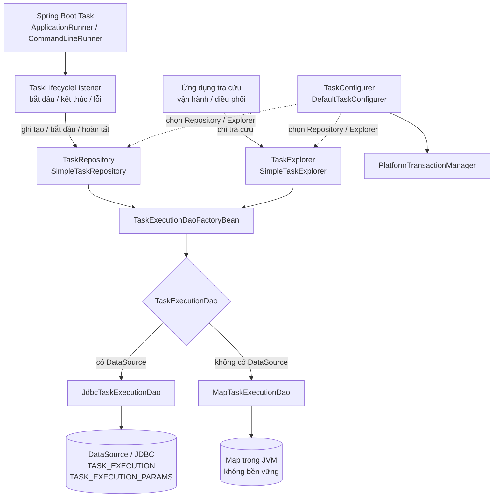
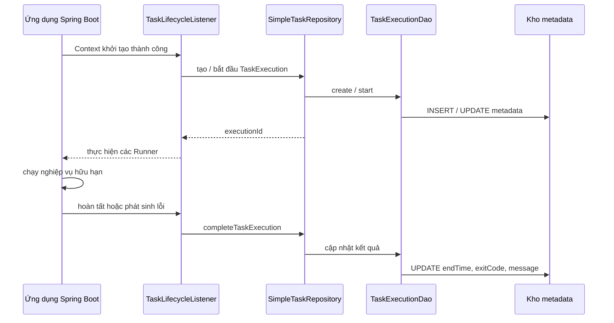
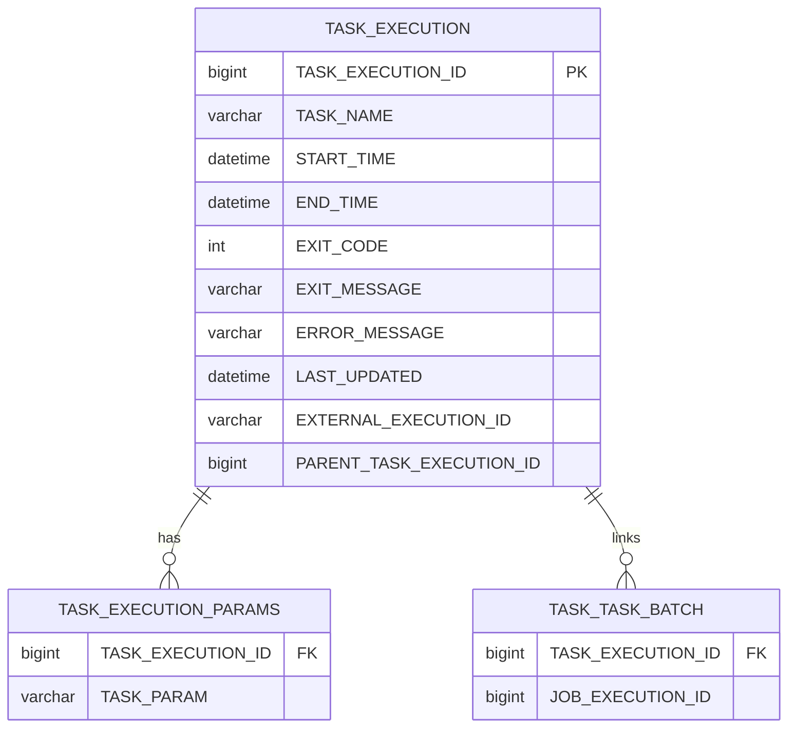

# SimpleTaskRepository, SimpleTaskExplorer và các thành phần truy cập dữ liệu

## Mục tiêu bài học

Trong chương **Kho và schema** của mô-đun **Spring Cloud Task**, bài này đi sâu vào cách framework lưu và đọc **metadata của những lần thực thi tác vụ hữu hạn**. Sau bài học, bạn có thể:

- Phân biệt `TaskRepository` với `TaskExplorer`, đồng thời giải thích vai trò của hai triển khai mặc định `SimpleTaskRepository` và `SimpleTaskExplorer`.
- Mô tả đường đi của dữ liệu từ `TaskLifecycleListener` qua `TaskExecutionDao` đến bảng cơ sở dữ liệu.
- Hiểu lựa chọn `JdbcTaskExecutionDao`, `MapTaskExecutionDao` và `TaskExecutionDaoFactoryBean`, tránh nhầm giữa Map trong bộ nhớ với H2 in-memory.
- Tra cứu `TaskExecution` bằng Java hoặc SQL; hiểu cách liên kết thông tin tham số và Spring Batch.
- Cấu hình datasource, transaction manager, table prefix và schema cho môi trường phát triển lẫn vận hành, đồng thời nhận diện lỗi truy cập dữ liệu.

## 1. Vì sao cần một lớp kho riêng cho Task?

Giả sử ứng dụng đối soát thanh toán được chạy lúc 02:00. Một lượt thực thi nhận `--businessDate=2026-11-23`, xử lý giao dịch, xuất báo cáo và kết thúc. Sau khi tiến trình đã thoát, bộ phận vận hành vẫn cần biết:

1. Lượt chạy có ID nào và kết thúc lúc mấy giờ?
2. Mã thoát và thông báo lỗi của lượt chạy là gì?
3. Có những lượt chạy nào khác của cùng tác vụ?
4. Tham số đã dùng và Spring Batch job liên quan (nếu có) là gì?

Mã `ApplicationRunner` hoặc `CommandLineRunner` giải quyết **công việc nghiệp vụ**; các thành phần `TaskRepository`, `TaskExplorer` và tầng truy cập dữ liệu của Spring Cloud Task giải quyết **lịch sử thực thi**. Đây là hai loại dữ liệu khác nhau: bảng Task chứa metadata về tiến trình, còn dữ liệu thanh toán/báo cáo vẫn thuộc về các bảng nghiệp vụ do hệ thống thiết kế.

**Không nên đánh đồng “Spring Cloud Task lưu TaskExecution” với “Spring Cloud Task tự lưu kết quả nghiệp vụ”.** Framework có thể ghi `exitCode=0`, nhưng không biết số tiền đối soát có chính xác hay không nếu ứng dụng không tự kiểm tra và ghi nhận kết quả phù hợp.

## 2. Kiến trúc truy cập dữ liệu



Sơ đồ mô tả cách các **triển khai mặc định** phối hợp. Ứng dụng nên phụ thuộc vào **interface** `TaskRepository` và `TaskExplorer`; không cần `new SimpleTaskRepository(...)` hoặc tự tạo DAO khi cấu hình mặc định đã đủ.

| Tầng/thành phần | Trách nhiệm | Giao tiếp chính |
| --- | --- | --- |
| `TaskLifecycleListener` | Theo dõi vòng đời chạy thực tế của ứng dụng | Gọi `TaskRepository` |
| `TaskRepository` | Hợp đồng **tạo, bắt đầu, cập nhật và hoàn tất** một lần thực thi | `SimpleTaskRepository` |
| `SimpleTaskRepository` | Triển khai mặc định của hợp đồng ghi; ghi log và chuyển thao tác đến DAO | `TaskExecutionDao` |
| `TaskExplorer` | Hợp đồng **đọc/tra cứu** metadata thực thi | `SimpleTaskExplorer` |
| `SimpleTaskExplorer` | Triển khai mặc định của hợp đồng đọc; tìm kiếm, đếm và lấy lịch sử | `TaskExecutionDao` |
| `TaskExecutionDaoFactoryBean` | Tạo DAO phù hợp với nguồn lưu trữ được cấu hình | `JdbcTaskExecutionDao` hoặc `MapTaskExecutionDao` |
| `TaskConfigurer` | Chọn các thành phần repository, explorer, datasource, transaction manager | `DefaultTaskConfigurer` nếu không tùy chỉnh |
| `DataSource` | Cấp kết nối đến cơ sở dữ liệu chứa metadata Task | JDBC |
| `PlatformTransactionManager` | Quản lý giao dịch cho cập nhật metadata | JDBC hoặc cơ chế không có tài nguyên, tùy cấu hình |

Lợi ích của kiến trúc này: **người viết logic nghiệp vụ không phải viết câu INSERT/UPDATE cho bảng Task**; người viết màn hình giám sát có thể tra cứu qua `TaskExplorer` mà không trực tiếp sửa trạng thái thực thi.

## 3. `SimpleTaskRepository`: đường ghi của một lần chạy

`SimpleTaskRepository` nằm trong package `org.springframework.cloud.task.repository.support` và triển khai interface `org.springframework.cloud.task.repository.TaskRepository`. Javadoc mô tả nó ghi thông tin thực thi ra log và gửi đến `TaskExecutionDao` được cung cấp.

Các nhóm phương thức quan trọng trong API:

| Nhóm thao tác | Phương thức tiêu biểu | Ý nghĩa |
| --- | --- | --- |
| Đăng ký | `createTaskExecution()`, `createTaskExecution(String name)` | Tạo bản ghi với ID mới; có dạng dành cho hệ điều phối đăng ký trước |
| Ghi lúc bắt đầu | `startTaskExecution(...)` | Đưa tên Task, thời điểm bắt đầu, arguments và ID từ hệ thống ngoài vào metadata |
| Kết thúc | `completeTaskExecution(executionId, exitCode, endTime, exitMessage)` | Ghi kết quả và thời gian kết thúc |
| Kết thúc kèm lỗi | `completeTaskExecution(..., errorMessage)` | Bổ sung thông tin lỗi khi có |
| Liên kết nền tảng chạy | `updateExternalExecutionId(...)` | Cập nhật ID mà scheduler hoặc nền tảng triển khai đã cấp |

Một số phiên bản có overload nhận `TaskExecution` hoặc `parentExecutionId`. **Tên chữ ký, kiểu thời gian và các overload có thể thay đổi theo phiên bản**: API hiện đại dùng `LocalDateTime`, còn tài liệu nhánh rất cũ có dạng `Date`. Đừng chép mã tạo repository thủ công từ blog cũ mà không kiểm tra Javadoc của release đang sử dụng.

### 3.1. Dòng thời gian minh họa



Khi Task đang thực thi, `exitCode` thường còn `null`; sau khi hoàn thành framework cập nhật mã kết quả, `endTime` và các thông tin liên quan. **Một bản ghi có `endTime = null` không chắc tiến trình còn sống**: JVM có thể bị hủy cưỡng bức, mất kết nối DB hoặc gặp sự cố trước khi ghi lần cập nhật cuối.

### 3.2. Có nên tự gọi `createTaskExecution`?

Với ứng dụng Task thông thường sử dụng `@EnableTask`, **để lifecycle listener quản lý việc ghi metadata**. Nếu bạn gọi `createTaskExecution(...)` thêm ngay trong runner, có thể vô tình tạo **một bản ghi khác** không tương ứng một tiến trình mới.

Trường hợp tạo thủ công được thiết kế cho **hệ điều phối**: hệ thống nhận yêu cầu chạy, đăng ký trước một `TaskExecution`, sau đó truyền ID đã tạo cho tiến trình thực tế. Tài liệu Spring Cloud Task mô tả thuộc tính `spring.cloud.task.executionid` cho kịch bản này. Việc ghép các bước phải đúng database, đúng ID và đúng phiên bản; tránh tự sáng tạo bản ghi “hoàn tất” bằng SQL ngoài repository.

### 3.3. Trách nhiệm và giới hạn

`SimpleTaskRepository` duy trì **metadata**, không tạo lịch chạy, không quyết định retry nghiệp vụ, không đảm bảo tính duy nhất của `businessDate` và không cung cấp khả năng checkpoint dữ liệu theo từng bản ghi. Để khôi phục một công việc xử lý dữ liệu lớn, cân nhắc Spring Batch; để chống nhập trùng, dùng idempotency, ràng buộc duy nhất hoặc giao dịch của dữ liệu nghiệp vụ.

## 4. `SimpleTaskExplorer`: đường đọc và tìm kiếm lịch sử

`SimpleTaskExplorer` cùng nằm trong package `org.springframework.cloud.task.repository.support` nhưng triển khai **interface `TaskExplorer`**. Đây là API **đọc** thông tin thực thi, phù hợp cho màn hình giám sát, dịch vụ truy vấn và điều tra lỗi.

Một số phương thức thường dùng:

| Phương thức | Dữ liệu trả về / mục đích |
| --- | --- |
| `getTaskExecution(long executionId)` | Một `TaskExecution` theo ID; có thể `null` nếu không tìm thấy |
| `getTaskNames()` | Danh sách tên Task từng được lưu |
| `getLatestTaskExecutionForTaskName(String taskName)` | Lượt thực thi gần nhất của một tên Task |
| `getLatestTaskExecutionsByTaskNames(String... names)` | Lượt gần nhất cho nhiều tên Task |
| `findTaskExecutionsByName(String taskName, Pageable pageable)` | Các lượt thực thi theo tên, có phân trang |
| `findAll(Pageable pageable)` | Các lượt thực thi trong phạm vi trang; tài liệu mô tả thứ tự theo thời điểm bắt đầu giảm dần, rồi ID giảm dần |
| `findRunningTaskExecutions(String taskName, Pageable pageable)` | Các lượt được repository coi là đang chạy của một tên Task |
| `getTaskExecutionCount()`, `getRunningTaskExecutionCount()` | Đếm các bản ghi toàn cục hoặc đang chạy |
| `getTaskExecutionIdByJobExecutionId(long jobId)` | Tra TaskExecution liên quan Spring Batch JobExecution |
| `getJobExecutionIdsByTaskExecutionId(long id)` | Tra các Batch JobExecution gắn với một TaskExecution |

**`TaskExplorer` là interface đọc, nhưng không có nghĩa bạn chỉ cần dùng nó là đã triển khai bảo mật.** API không tự kiểm tra một người dùng có được xem thông tin Task, tham số hoặc thông báo lỗi hay không; điều đó phải do ứng dụng gọi API và quyền truy cập database quyết định.

### 4.1. Ví dụ dịch vụ Java chỉ đọc

Giả sử một ứng dụng quản trị cần xem lịch sử của `inventory-snapshot`. Nó có thể inject `TaskExplorer` do Spring Cloud Task cấu hình:

```java
package com.example.taskhistory;

import org.springframework.cloud.task.repository.TaskExecution;
import org.springframework.cloud.task.repository.TaskExplorer;
import org.springframework.data.domain.Page;
import org.springframework.data.domain.PageRequest;
import org.springframework.stereotype.Service;

@Service
public class TaskHistoryService {

    private final TaskExplorer taskExplorer;

    public TaskHistoryService(TaskExplorer taskExplorer) {
        this.taskExplorer = taskExplorer;
    }

    public TaskExecution findById(long executionId) {
        return taskExplorer.getTaskExecution(executionId);
    }

    public TaskExecution latest(String taskName) {
        return taskExplorer.getLatestTaskExecutionForTaskName(taskName);
    }

    public Page<TaskExecution> recent(String taskName, int page) {
        return taskExplorer.findTaskExecutionsByName(
            taskName,
            PageRequest.of(Math.max(page, 0), 20)
        );
    }
}
```

Mã minh họa cách dùng **interface**, không phụ thuộc trực tiếp vào `SimpleTaskExplorer`. Khi đưa vào API HTTP thực tế, cần validate `taskName`, phân quyền trước khi trả dữ liệu, giới hạn trang/kích thước trang và không trả nguyên chuỗi lỗi hoặc arguments chứa thông tin nhạy cảm.

Nếu chạy đoạn tra cứu này **ngay trong runner của chính Task**, bản ghi mới của runner có thể đang ở trạng thái **chưa kết thúc**. Muốn quan sát một Task đã hoàn thành, nên truy vấn sau khi tiến trình thoát hoặc từ một ứng dụng giám sát riêng.

### 4.2. “Đang chạy” chỉ là trạng thái metadata

Các phương thức đếm/tìm Task đang chạy dựa vào các bản ghi đã lưu; chúng **không trực tiếp kiểm tra PID, container hay pod có còn sống**. Vì vậy, một lượt không có `endTime` do bị `SIGKILL` có thể xuất hiện trong kết quả “running” dù tiến trình đã chết. Hệ thống giám sát nên kết hợp dữ liệu repository với scheduler/container và quy tắc phát hiện lượt chạy quá hạn.

## 5. Tầng DAO: từ interface đến kho vật lý

Hai lớp mặc định cùng dựa vào `TaskExecutionDao`, một hợp đồng truy cập dữ liệu nội bộ nằm trong package `org.springframework.cloud.task.repository.dao`.

### 5.1. `TaskExecutionDaoFactoryBean`

`TaskExecutionDaoFactoryBean` là một Spring `FactoryBean` tạo DAO phù hợp với cấu hình. Ở các bản API được tài liệu công bố:

- Có `DataSource` → thường tạo `JdbcTaskExecutionDao`.
- Không có `DataSource` → có thể tạo `MapTaskExecutionDao`.
- Table prefix và cấu hình repository được truyền xuống DAO để dùng đúng tên bảng.

Phần lớn ứng dụng **không trực tiếp khởi tạo factory này**. `DefaultTaskConfigurer` và cấu hình Spring Cloud Task thực hiện kết nối các thành phần. Việc sử dụng interface ở tầng ứng dụng giúp tránh ràng buộc vào một loại database cụ thể.

### 5.2. `JdbcTaskExecutionDao`

`JdbcTaskExecutionDao` ghi/đọc thông tin Task qua `DataSource`. Đây là lựa chọn thông dụng cho ứng dụng cần lưu lịch sử qua nhiều lần chạy và nhiều tiến trình:

- Thao tác trên bảng `TASK_EXECUTION` và các bảng liên quan bằng JDBC.
- Sử dụng cơ chế phát sinh execution ID phù hợp với loại database/schema.
- Cho phép nhiều tiến trình độc lập cùng truy cập metadata khi database và sơ đồ bảng được cấu hình đúng.
- Phụ thuộc vào tính sẵn sàng của DB, quyền truy cập, transaction manager và migration schema.

**Không nên tự sửa bảng bằng `UPDATE TASK_EXECUTION SET EXIT_CODE=0...` để che lỗi.** Cách làm đó phá vỡ ý nghĩa audit và có thể khiến repository/explorer trả trạng thái không phản ánh thực tế.

### 5.3. `MapTaskExecutionDao`

`MapTaskExecutionDao` lưu dữ liệu trong `Map` của **tiến trình JVM**. Nó hữu ích khi thử nghiệm phần mềm mà chưa muốn có database, nhưng:

- Dữ liệu biến mất khi JVM kết thúc.
- Hai tiến trình khác nhau không chia sẻ một Map.
- Không dùng để theo dõi lịch sử tập trung hoặc chạy song song nhiều replica.

Cần phân biệt **Map trong JVM** với **H2 in-memory**:

| Hình thức | Có dùng JDBC? | Tồn tại sau khi JVM thoát? | Phù hợp |
| --- | --- | --- | --- |
| `MapTaskExecutionDao` | Không | Không | Unit/demo phát triển đơn giản |
| `JdbcTaskExecutionDao` + H2 in-memory | Có | Thường không | Thử luồng JDBC/schema tại máy cá nhân |
| `JdbcTaskExecutionDao` + H2 file | Có | Có, nếu cùng tệp và tệp được giữ | Phát triển cần kiểm tra lịch sử sau khi chạy |
| `JdbcTaskExecutionDao` + PostgreSQL/MySQL/... | Có | Có, theo chính sách DB | Production, lịch sử lâu dài và nhiều tiến trình |

Đừng suy ra “chạy được khi không khai báo datasource” đồng nghĩa có repository dùng được cho audit. Kiểu DAO thực sự cần được xác nhận qua cấu hình và hành vi lưu trữ.

## 6. Các bảng metadata và quan hệ quan trọng

Schema mặc định trong Spring Cloud Task có tiền tố `TASK_`. Các bảng/thành phần chính được tài liệu mô tả:



Đây là sơ đồ **quan hệ logic**; kiểu dữ liệu vật lý, ràng buộc và DDL có thể khác theo hệ quản trị CSDL, dialect và phiên bản Spring Cloud Task.

| Bảng/thành phần | Vai trò |
| --- | --- |
| `TASK_EXECUTION` | Một dòng cho một lần thực thi: ID, tên, thời gian, mã thoát, lỗi, ID ngoài và quan hệ cha |
| `TASK_EXECUTION_PARAMS` | Lưu các chuỗi tham số thuộc mỗi TaskExecution |
| `TASK_TASK_BATCH` | Liên kết TaskExecution với Spring Batch JobExecution khi tích hợp |
| `TASK_LOCK` | Phục vụ tùy chọn chạy một instance đồng thời (`single-instance-enabled`), tùy cấu hình |
| `TASK_SEQ` hoặc cơ chế phát ID tương ứng | Hỗ trợ cấp ID thực thi; cấu trúc có thể khác giữa database và bản phát hành |

Các trường đáng chú ý của `TASK_EXECUTION`:

- `TASK_EXECUTION_ID`: định danh duy nhất **một lượt**, không phải ID của định nghĩa tác vụ.
- `TASK_NAME`: thường được xác định từ tên ứng dụng hoặc `TaskNameResolver`.
- `START_TIME`, `END_TIME`: mốc bắt đầu/kết thúc; có thể thiếu thời điểm kết thúc nếu tiến trình chết đột ngột.
- `EXIT_CODE`: trạng thái kết thúc theo mã lỗi/thoát được ghi nhận.
- `EXIT_MESSAGE`, `ERROR_MESSAGE`: mô tả thêm; có thể bị giới hạn độ dài theo schema.
- `LAST_UPDATED`: phục vụ theo dõi lần cập nhật metadata.
- `EXTERNAL_EXECUTION_ID`: ID từ bộ điều phối/nền tảng triển khai.
- `PARENT_TASK_EXECUTION_ID`: quan hệ cha khi một Task kích hoạt Task khác.

Schema này **không chứa dữ liệu chi tiết của báo cáo tồn kho, thanh toán hoặc các bước xử lý của một Spring Batch Job**. Để điều tra cụ thể số dòng đã xử lý, cần dữ liệu ứng dụng và/hoặc Spring Batch JobRepository.

### 6.1. SQL tra cứu Task

Truy vấn các lượt chạy mới nhất:

```sql
SELECT
    TASK_EXECUTION_ID,
    TASK_NAME,
    START_TIME,
    END_TIME,
    EXIT_CODE,
    LAST_UPDATED
FROM TASK_EXECUTION
ORDER BY TASK_EXECUTION_ID DESC;
```

Lọc lịch sử của một tác vụ:

```sql
SELECT
    TASK_EXECUTION_ID,
    START_TIME,
    END_TIME,
    EXIT_CODE,
    ERROR_MESSAGE
FROM TASK_EXECUTION
WHERE TASK_NAME = 'inventory-snapshot'
ORDER BY START_TIME DESC, TASK_EXECUTION_ID DESC;
```

Kiểm tra các lượt chưa có `END_TIME`:

```sql
SELECT
    TASK_EXECUTION_ID,
    TASK_NAME,
    START_TIME,
    LAST_UPDATED
FROM TASK_EXECUTION
WHERE END_TIME IS NULL
ORDER BY START_TIME;
```

Kết quả truy vấn cuối cùng là **danh sách cần xác minh**, không phải bằng chứng các tiến trình tương ứng đang hoạt động. Nên đối chiếu với bộ điều phối và timeout trước khi gắn nhãn “treo”.

### 6.2. Liên kết tham số với lượt chạy

```sql
SELECT
    e.TASK_EXECUTION_ID,
    e.TASK_NAME,
    e.EXIT_CODE,
    p.TASK_PARAM
FROM TASK_EXECUTION AS e
LEFT JOIN TASK_EXECUTION_PARAMS AS p
    ON p.TASK_EXECUTION_ID = e.TASK_EXECUTION_ID
WHERE e.TASK_EXECUTION_ID = 42;
```

`42` chỉ là ID minh họa, phải thay bằng ID thực tế. Nếu lượt chạy có nhiều tham số, phép JOIN có thể trả **nhiều dòng cho cùng một TaskExecution**. `TASK_PARAM` lưu chuỗi tham số, không phải schema khóa/giá trị nghiệp vụ đã được chuẩn hóa.

### 6.3. Liên kết Spring Batch

Khi có tích hợp phù hợp, bảng `TASK_TASK_BATCH` liên kết một lượt Task với các ID `JobExecution`:

```sql
SELECT
    TASK_EXECUTION_ID,
    JOB_EXECUTION_ID
FROM TASK_TASK_BATCH
WHERE TASK_EXECUTION_ID = 42;
```

Muốn biết Batch Job đã chạy Step nào, checkpoint ở đâu, số bản ghi đọc/ghi bao nhiêu, cần truy vấn **Spring Batch JobRepository** và API của Batch. `TaskExplorer` có các phương thức tra ID liên kết nhưng không thay thế `JobExplorer` của Spring Batch.

## 7. Cấu hình `DefaultTaskConfigurer`, datasource và schema

### 7.1. Một datasource: trường hợp thông dụng

Nếu ứng dụng có một `DataSource` vừa truy cập nghiệp vụ vừa lưu Task metadata, Spring Cloud Task thường có thể sử dụng datasource được Spring Boot cấu hình:

```yaml
spring:
  application:
    name: inventory-snapshot
  main:
    web-application-type: none
  datasource:
    url: jdbc:postgresql://localhost:5432/appdb
    username: task_app
    password: "${TASK_DB_PASSWORD}"
  cloud:
    task:
      initialize-enabled: false
```

Ví dụ giả định ứng dụng đã có dependency JDBC driver PostgreSQL, DB, tài khoản và **schema Task được tạo trước bằng migration**. `initialize-enabled: false` có nghĩa Spring Cloud Task không tự chạy logic khởi tạo bảng tại startup; **nó không tạo hộ bảng**. Tên biến môi trường ở đây chỉ mang tính minh họa, cần cấu hình secrets của nền tảng vận hành.

Khi làm dev, có thể dùng H2 trong bộ nhớ để chạy nhanh, nhưng H2 in-memory mất metadata khi JVM kết thúc; **không dùng nó nếu mục tiêu là tra lịch sử qua nhiều lần khởi chạy**.

### 7.2. Vai trò của `DefaultTaskConfigurer`

Theo tài liệu cấu hình, nếu ứng dụng không cung cấp `TaskConfigurer` riêng thì `DefaultTaskConfigurer` chọn:

- `SimpleTaskRepository` làm triển khai `TaskRepository`.
- `SimpleTaskExplorer` làm triển khai `TaskExplorer`.
- DAO lưu trong Map khi không có datasource, hoặc DAO JDBC khi có datasource.
- Transaction manager phù hợp với backend. Tài liệu nhánh mới có `JdbcTransactionManager` cho JDBC và `ResourcelessTransactionManager` khi không dùng datasource; nhánh cũ có thể ghi `DataSourceTransactionManager`.

`TaskConfigurer` còn có các phương thức cung cấp `getTaskRepository()`, `getTaskExplorer()`, `getTransactionManager()` và `getTaskDataSource()`. Đây là **chiến lược xây dựng hạ tầng**, không phải API để mỗi bước nghiệp vụ gọi getter liên tục.

### 7.3. Nhiều datasource: chọn rõ kho Task

Nếu ứng dụng vừa đọc nghiệp vụ từ `businessDataSource` vừa ghi metadata vào `taskDataSource`, framework không thể suy ra lựa chọn đúng trong mọi cấu hình. Cần định nghĩa `TaskConfigurer` tương thích với phiên bản đang dùng, chọn datasource Task và đảm bảo transaction manager trỏ đến cùng kho metadata.

Trong các nhánh có constructor `DefaultTaskConfigurer(DataSource)`, ý tưởng cấu hình có thể như sau:

```java
import javax.sql.DataSource;

import org.springframework.beans.factory.annotation.Qualifier;
import org.springframework.cloud.task.configuration.DefaultTaskConfigurer;
import org.springframework.cloud.task.configuration.TaskConfigurer;
import org.springframework.context.annotation.Bean;
import org.springframework.context.annotation.Configuration;

@Configuration
public class TaskInfrastructureConfiguration {

    @Bean
    TaskConfigurer taskConfigurer(
            @Qualifier("taskDataSource") DataSource taskDataSource) {
        return new DefaultTaskConfigurer(taskDataSource);
    }
}
```

**Điều kiện của đoạn mã:** ứng dụng **đã khai báo bean `taskDataSource`** và có driver/schema tương ứng; đoạn trên không tạo datasource thứ hai. API constructor có thể thay đổi giữa các nhánh, nên phải kiểm tra Javadoc của phiên bản đã chọn. Với nhiều transaction manager, cần cấu hình đủ để cập nhật metadata dùng đúng manager của Task.

### 7.4. Table prefix và migration

Mặc định các bảng bắt đầu bằng `TASK_`. Có thể thay tiền tố khi cần phân tách hai bộ Task metadata trong cùng schema hoặc chỉ định schema:

```yaml
spring:
  cloud:
    task:
      tablePrefix: APP_TASK_
      initialize-enabled: false
```

Khi đổi prefix thành `APP_TASK_`, bạn phải cung cấp **các bảng/sequences với tên tương ứng**, theo DDL của phiên bản Spring Cloud Task đang dùng. Chỉ đổi property trong application YAML mà để bảng cũ `TASK_EXECUTION` sẽ gây lỗi truy vấn hoặc ghi. Dùng migration tool như Flyway/Liquibase hoặc quy trình DDL được tổ chức phê duyệt để triển khai schema nhất quán.

**Tránh tự viết DDL bằng cách đoán kiểu cột.** Spring Cloud Task cung cấp script/schema cho các database khác nhau. Đặc biệt cơ chế cấp ID và cú pháp sequence có thể khác giữa H2, PostgreSQL, MySQL, Oracle và SQL Server; kiểm tra script theo đúng phiên bản thư viện và dialect.

## 8. Giao dịch, tính nhất quán và trường hợp lỗi

### 8.1. Transaction của Task metadata không đồng nghĩa transaction nghiệp vụ

`TaskRepository` quản lý các thao tác tạo/cập nhật TaskExecution, thường thông qua transaction manager do `TaskConfigurer` cung cấp. Nhưng điều đó **không tự làm cho toàn bộ quá trình xử lý nghiệp vụ và metadata thành một giao dịch nguyên tử**.

Ví dụ:

1. Tác vụ cập nhật được 700/1.000 dòng dữ liệu kinh doanh.
2. JVM bị dừng trước khi ghi `endTime`/`exitCode`.
3. Database nghiệp vụ đã commit 700 dòng, nhưng Task metadata vẫn có thể hiển thị đang chạy.
4. Lần chạy lại cần biết phải tiếp tục từ đâu và không ghi trùng các dòng đã xử lý.

Giải pháp nằm ở thiết kế transaction/chunk/checkpoint và idempotency của ứng dụng (hoặc Spring Batch), kết hợp cảnh báo và đối soát trạng thái Task.

### 8.2. Khi kho metadata không sẵn sàng

| Triệu chứng | Khả năng cần kiểm tra | Hướng xử lý |
| --- | --- | --- |
| Startup báo “table not found” | Chưa chạy DDL, sai schema hoặc prefix | Kiểm tra migration/schema và `tablePrefix` |
| Không kết nối được DB | URL, DNS, tài khoản, quyền, connection pool | Kiểm tra datasource, driver và quyền kết nối |
| Có kết quả nghiệp vụ nhưng không thấy lịch sử lâu dài | Sử dụng `MapTaskExecutionDao` hoặc H2 in-memory | Chọn JDBC với DB bền vững |
| `TaskExplorer` không thấy lượt chạy | Đọc sai DB/schema, Task name không đúng hoặc chưa có bản ghi | Đối chiếu datasource và `TASK_NAME` |
| Lượt chạy không có `END_TIME` | Bị kill hoặc không ghi được cập nhật cuối | So với trạng thái scheduler/container, không tự kết luận thành công |
| Không tạo được ID khi nhiều tiến trình chạy | Schema hoặc cơ chế sequence/locking không phù hợp | Dùng DDL/sequence đúng DB, kiểm tra transaction và contention |
| Truy vấn phân trang chậm | Số bản ghi tăng, thiếu index hoặc lọc quá rộng | Giới hạn trang, phân vùng/lưu trữ theo chính sách và tối ưu index theo workload |
| Metadata chứa chuỗi lỗi/arguments nhạy cảm | Đưa token vào CLI hoặc log exception | Loại secret khỏi arguments, phân quyền và che dữ liệu khi hiển thị |

Nên giám sát đồng thời **mã thoát tiến trình**, trạng thái chạy ở hệ điều phối, log, kết quả nghiệp vụ và metadata `TaskExecution`. Không chỉ dựa vào một bảng để kết luận thành công.

### 8.3. Các chính sách vận hành cần thiết

**Retention và dung lượng.** Nếu cron chạy hàng nghìn lượt/ngày, bảng Task, bảng tham số và chuỗi lỗi có thể tăng nhanh. Cần định nghĩa thời gian lưu trữ, lưu trữ ngoài/archiving, backup và kế hoạch xóa dữ liệu **có kiểm soát, giữ toàn vẹn khóa liên quan**. Đừng tự xóa bản ghi Task khi đang chạy hoặc xóa trực tiếp từng bảng mà không xét liên kết.

**Quyền đọc/ghi.** Tiến trình ghi Task cần quyền phù hợp trên metadata; dịch vụ chỉ tra cứu nên sử dụng nguyên tắc cấp quyền tối thiểu. Màn hình giám sát không được tùy ý hiển thị `TASK_PARAM` hoặc `ERROR_MESSAGE` cho mọi người dùng.

**Idempotency.** Hai lượt chạy với cùng `--businessDate` tạo hai `executionId` khác nhau. TaskRepository ghi cả hai; việc ngăn báo cáo bị nhân đôi cần khóa nghiệp vụ, constraint, hoặc cơ chế đảm bảo lặp lại an toàn.

**Spring Batch.** Khi Task chạy một Batch Job, `TASK_TASK_BATCH` là cầu nối tra cứu; Task không thay thế JobRepository, và một Job thất bại cần được phản ánh phù hợp về exit code của tiến trình nếu bộ điều phối dựa vào kết quả này.

## 9. Thực hành tự kiểm tra

Sau khi đã cấu hình một Task có database bền vững:

1. Chạy ứng dụng hai lần với cùng `taskName` nhưng khác `businessDate`.
2. Xác minh có **hai `TASK_EXECUTION_ID` khác nhau**, đúng thời điểm chạy, và chuỗi tham số tương ứng.
3. Dùng `TaskExplorer.getLatestTaskExecutionForTaskName(...)` lấy lượt gần nhất; đối chiếu với SQL.
4. Cố tình cho runner ném exception **ở môi trường dev**; kiểm tra mã thoát và lỗi đã được ghi nhận.
5. Dừng JVM cưỡng bức trong môi trường test rồi xem liệu có bản ghi chưa có `END_TIME`; đối chiếu trạng thái tiến trình thực tế.
6. Thay datasource thành Map hoặc H2 in-memory trong một thử nghiệm cô lập; xác minh dữ liệu không còn sau khi JVM thoát.

### Câu hỏi ôn tập

**1. Khi muốn xem 20 lượt chạy mới nhất của một tên Task, nên dùng `SimpleTaskRepository` hay `TaskExplorer`?**

> Dùng interface `TaskExplorer`, ví dụ `findTaskExecutionsByName(taskName, PageRequest.of(0, 20))`. Không gọi phương thức ghi của repository chỉ để truy vấn.

**2. Vì sao Task hoạt động trên H2 in-memory nhưng dashboard sau vài giờ không tìm thấy lịch sử?**

> Database H2 trong bộ nhớ không tồn tại sau khi JVM kết thúc. Cần dùng JDBC với kho bền vững. Đây là trường hợp khác với `MapTaskExecutionDao`, dù cả hai đều không lưu được lịch sử qua vòng đời tiến trình.

**3. Thay `spring.cloud.task.tablePrefix` có tự tạo bộ bảng mới không?**

> Không thể mặc định như vậy. Phải triển khai schema/prefix tương ứng bằng DDL phù hợp với phiên bản và cấu hình khởi tạo bảng.

**4. Tại sao `findRunningTaskExecutions` không đủ để biết pod còn hoạt động?**

> API truy vấn metadata lưu trong repository; một tiến trình đã bị hủy vẫn có thể để lại bản ghi chưa được cập nhật `END_TIME`.

**5. Vì sao không dùng `TASK_EXECUTION` làm bảng kết quả đối soát?**

> Nó chỉ là metadata về vòng đời tiến trình. Các kết quả nghiệp vụ, ràng buộc duy nhất và trạng thái xử lý chi tiết phải do ứng dụng hoặc Spring Batch lưu trữ.

## Ghi nhớ

- **`SimpleTaskRepository` là đường ghi**, **`SimpleTaskExplorer` là đường đọc** và cả hai cùng dựa vào `TaskExecutionDao`.
- **`DefaultTaskConfigurer`** chọn các triển khai mặc định; có `DataSource` thì thường dùng `JdbcTaskExecutionDao`, không có thì có thể dùng `MapTaskExecutionDao`.
- **Map, H2 in-memory và database bền vững là ba lựa chọn khác nhau**, dù Map và H2 in-memory đều mất dữ liệu khi tiến trình kết thúc.
- **`TASK_EXECUTION` lưu metadata của một lần chạy; `TASK_EXECUTION_PARAMS` lưu tham số; `TASK_TASK_BATCH` liên kết Batch Job.**
- Cần **schema đúng phiên bản, transaction manager phù hợp, phân quyền, retention và giám sát ngoài repository** để vận hành an toàn.

## Tài liệu tham khảo

1. [Spring Cloud Task — Features: DataSource, TaskConfigurer, metadata và vòng đời](https://docs.spring.io/spring-cloud-task/reference/features.html)
2. [Spring Cloud Task — Task Repository Schema](https://docs.spring.io/spring-cloud-task/docs/current/reference/html/appendix-task-repository-schema.html)
3. [Javadoc — SimpleTaskRepository](https://docs.spring.io/spring-cloud-task/docs/current/apidocs/org/springframework/cloud/task/repository/support/SimpleTaskRepository.html)
4. [Javadoc — SimpleTaskExplorer](https://docs.spring.io/spring-cloud-task/docs/current/apidocs/org/springframework/cloud/task/repository/support/SimpleTaskExplorer.html)
5. [Javadoc — DefaultTaskConfigurer](https://docs.spring.io/spring-cloud-task/docs/current/apidocs/org/springframework/cloud/task/configuration/DefaultTaskConfigurer.html)
6. [Javadoc — TaskExecutionDaoFactoryBean](https://docs.spring.io/spring-cloud-task/docs/current/apidocs/org/springframework/cloud/task/repository/support/TaskExecutionDaoFactoryBean.html)
7. [Spring Cloud Task — Getting Started](https://docs.spring.io/spring-cloud-task/reference/getting-started.html)
