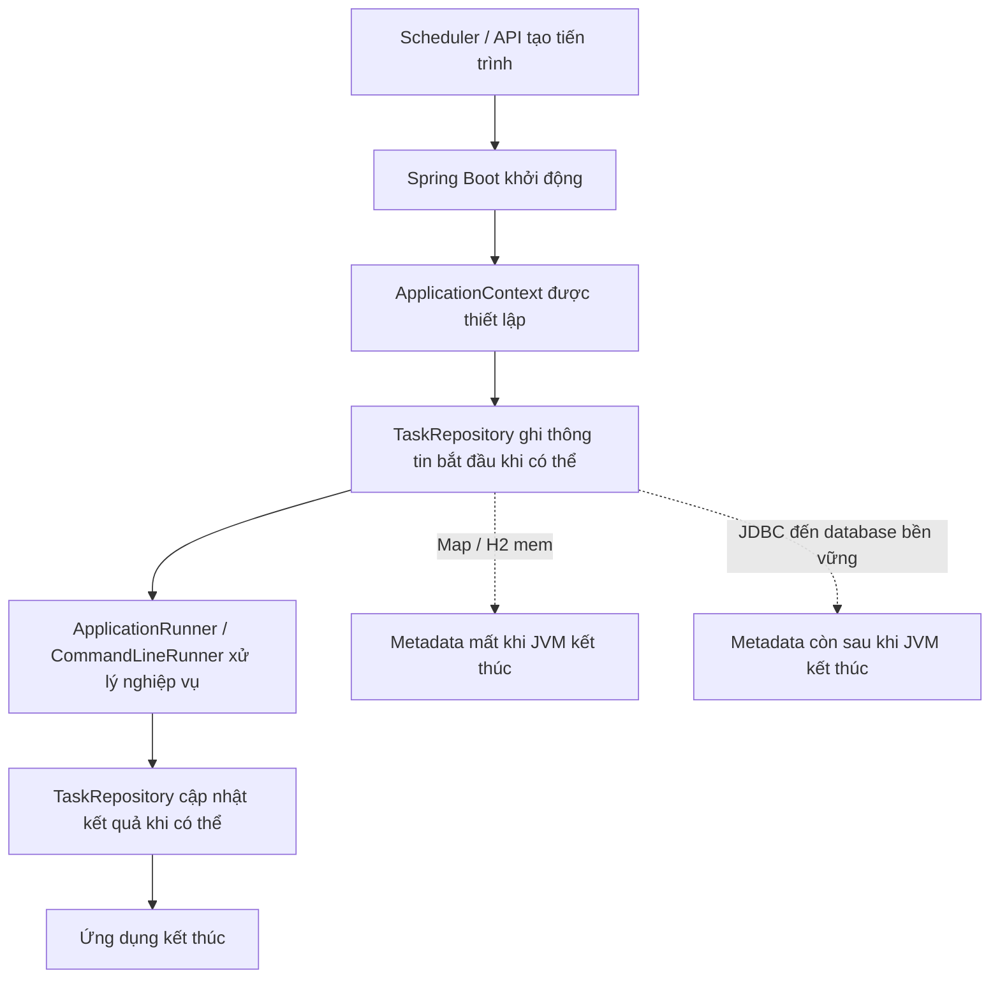
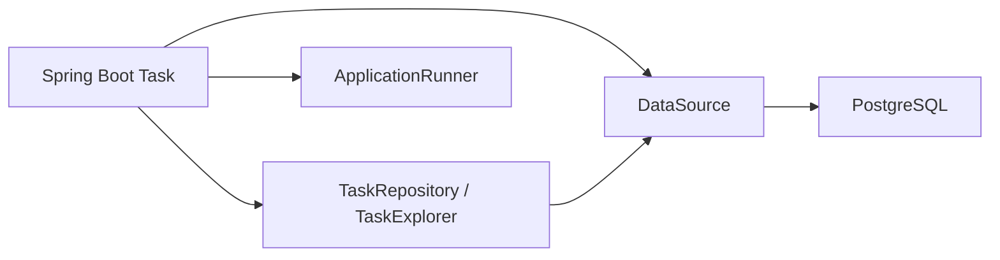
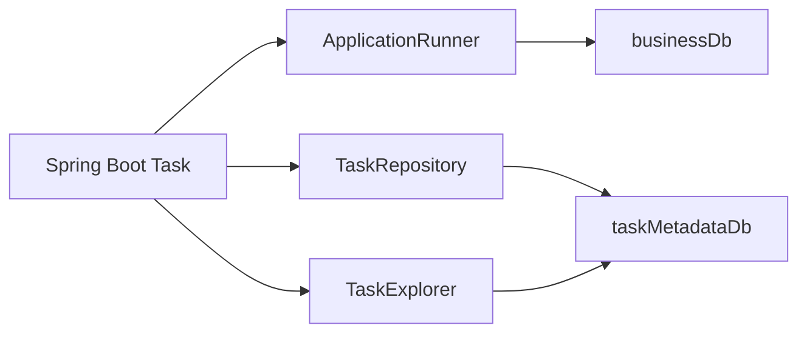

# Kho trong bộ nhớ và lưu trữ JDBC theo cấu hình

Trong chương **Kho và schema** của module **SPRING_CLOUD_TASK**, chúng ta tìm hiểu cách Spring Cloud Task ghi nhận trạng thái và kết quả của một ứng dụng Spring Boot **có thời gian chạy hữu hạn**. Mỗi lần chạy cần có điểm bắt đầu, điểm kết thúc, mã thoát và thông tin phục vụ tra cứu. Các thông tin này thuộc về `TaskExecution` và được quản lý qua `TaskRepository`.

Một câu hỏi thực tế thường gặp là: **vì sao task chạy thành công nhưng khi mở lại ứng dụng không thấy lịch sử lần chạy trước?** Câu trả lời nằm ở cơ chế lưu trữ. Spring Cloud Task có thể hoạt động với dữ liệu **trong bộ nhớ** để phát triển nhanh, hoặc sử dụng **JDBC đến cơ sở dữ liệu lưu bền vững** để theo dõi các lần chạy qua nhiều tiến trình, nhiều máy và nhiều lần triển khai.

Bài này phân biệt ba tình huống dễ bị đánh đồng: **Map trong JVM**, **cơ sở dữ liệu H2 trong bộ nhớ dùng JDBC**, và **JDBC đến cơ sở dữ liệu lưu bền vững**. Từ đó, bạn sẽ biết cách chọn, cấu hình, xác minh và vận hành kho metadata phù hợp với nhu cầu.

## 1. Mục tiêu học tập

Sau bài này, bạn có thể:

- Giải thích vai trò của `TaskRepository`, `TaskExplorer` và `TaskExecution` trong Spring Cloud Task.
- Phân biệt Map trong bộ nhớ, H2 `jdbc:h2:mem:...` và PostgreSQL/MySQL qua JDBC.
- Hiểu cách `DefaultTaskConfigurer` lựa chọn thành phần lưu trữ theo `DataSource` khả dụng.
- Cấu hình ví dụ task hoạt động không có `DataSource`, dùng H2 trong bộ nhớ và chuyển sang PostgreSQL.
- Chuẩn bị schema đúng phiên bản thư viện, quyết định khi nào dùng `spring.cloud.task.initialize-enabled`.
- Xác minh metadata sau hai lần chạy, phân tích lỗi kết nối/schema và các giới hạn về giao dịch, bảo mật, vận hành.

## 2. TaskRepository lưu những gì?

Spring Cloud Task được thiết kế cho các tiến trình thực thi hữu hạn: ứng dụng được khởi chạy theo lịch, theo yêu cầu hoặc bởi một hệ thống điều phối; chạy công việc rồi kết thúc. `TaskRepository` ghi và cập nhật thông tin **lần thực thi ứng dụng**; `TaskExplorer` giúp đọc lại metadata đã lưu.

| Thành phần | Ý nghĩa | Ví dụ |
| --- | --- | --- |
| `TaskExecution` | Mô hình thông tin của một lần chạy | Tên task, định danh thực thi, giờ bắt đầu/kết thúc, exit code, tham số, thông báo lỗi |
| `TaskRepository` | Ghi và cập nhật thông tin thực thi | Tạo record khi task bắt đầu và cập nhật khi task hoàn thành |
| `TaskExplorer` | Tra cứu metadata đã ghi | Liệt kê những lần chạy gần nhất của task |
| `TaskConfigurer` | Điểm tùy biến cách thiết lập repository, explorer và transaction manager | Chọn datasource riêng khi ứng dụng có nhiều datasource |
| `DataSource` | Kết nối JDBC đến cơ sở dữ liệu | H2, PostgreSQL, MySQL hoặc database được hỗ trợ |

Một `TaskExecution` thể hiện **một lần chạy vật lý**, không phải định nghĩa lịch chạy. Nếu bộ lập lịch kích hoạt cùng một ứng dụng vào hai ngày khác nhau, repository bền vững có thể lưu hai record riêng.

Dữ liệu trong repository chủ yếu là **metadata vận hành**, không tự động bao gồm kết quả nghiệp vụ. Ví dụ task tổng hợp doanh thu có thể tạo file CSV hoặc ghi bảng `DAILY_REVENUE`; `TaskRepository` chỉ ghi thông tin thực thi. Đừng dùng record `TaskExecution` thành công thay cho việc kiểm tra file và số liệu đã tạo.

### Dòng thời gian ghi nhận



Thao tác ghi metadata chỉ thực hiện được khi hạ tầng repository đã hoạt động. Nếu quá trình khởi tạo `ApplicationContext` thất bại quá sớm hoặc tiến trình bị dừng cưỡng bức, có thể không có record hoặc record chưa được cập nhật thời gian kết thúc. Vì vậy luôn nên đối chiếu repository với log và trạng thái do scheduler/container ghi nhận.

## 3. Ba cơ chế lưu trữ và sự khác nhau

Đây là điểm cốt lõi của bài học.

### 3.1. Map trong bộ nhớ JVM: không cần DataSource

Khi không có `DataSource` và cấu hình mặc định phù hợp, Spring Cloud Task có thể dùng cơ chế `Map` để lưu metadata bên trong chính tiến trình đang chạy. `DefaultTaskConfigurer` cung cấp `SimpleTaskRepository`, trong đó thành phần DAO chọn cách lưu phù hợp với môi trường: có thể là DAO dựa trên `Map` khi không có JDBC.

Điều này không có nghĩa tồn tại một database để truy vấn SQL. Dữ liệu trong `Map` chỉ tồn tại trong phạm vi bộ nhớ và vòng đời ứng dụng; sau khi tác vụ thoát, lịch sử đó cũng biến mất. Chế độ này chủ yếu phù hợp với bài thử nghiệm hoặc phát triển khi chưa cần lịch sử qua nhiều lần chạy.

> **Lưu ý:** Không nên gọi `MapTaskRepository` là loại repository mặc định. Thành phần phổ biến là `SimpleTaskRepository`; ở tình huống không có `DataSource`, thành phần **DAO** có thể sử dụng `MapTaskExecutionDao`. Cần phân biệt giao diện repository, implementation repository và cách DAO lưu dữ liệu.

### 3.2. H2 trong bộ nhớ: có JDBC nhưng chưa lưu bền vững

Khi bổ sung H2 và JDBC, bạn có thể cấu hình:

```yaml
spring:
  datasource:
    url: jdbc:h2:mem:taskdb
    driver-class-name: org.h2.Driver
    username: sa
    password: ""
```

Ở đây **có `DataSource` và JDBC thật**. Metadata được ghi vào các bảng SQL của H2 trong bộ nhớ; bạn có thể truy vấn các bảng đó **trong khi database còn sống**. Tuy nhiên, với cấu hình `mem:` này, sau khi JVM đóng, dữ liệu không còn để tiến trình mới mở lại.

Vì vậy, câu “Spring Cloud Task ghi xuống database” **chưa đủ** để kết luận rằng dữ liệu được giữ vĩnh viễn. Cần xem database chạy ở chế độ nào, lưu trữ ở đâu và liệu dữ liệu có tồn tại sau khi tiến trình kết thúc không.

### 3.3. JDBC đến cơ sở dữ liệu lưu bền vững

Khi `DataSource` trỏ đến PostgreSQL, MySQL hoặc một database hỗ trợ khác có cấu hình lưu trữ bền vững, các lần thực thi có thể được lưu qua nhiều lần khởi chạy JVM. Cả scheduler và dashboard vận hành có thể truy vấn cùng database để xem lịch sử.

Trong tình huống này, tính bền vững còn phụ thuộc vào cách quản trị database: ổ đĩa, sao lưu, quyền truy cập, quy trình migration và chính sách lưu trữ. JDBC **không tự đảm bảo** không mất metadata nếu hạ tầng database bị hỏng hoặc việc ghi thất bại.

### 3.4. So sánh

| Tiêu chí | Map trong JVM | H2 `mem:` qua JDBC | JDBC đến DB bền vững |
| --- | --- | --- | --- |
| Cần `DataSource`? | Không | Có | Có |
| Nơi giữ metadata | Map nội bộ của tiến trình | Bảng SQL trong bộ nhớ JVM | Bảng SQL của database bền vững |
| Có thể dùng SQL? | Không | Có, khi database còn tồn tại | Có |
| Còn dữ liệu sau khi task thoát? | Không | Không với H2 `mem:` | Thông thường có nếu ghi thành công |
| Nhiều tiến trình cùng xem lịch sử? | Không | Không với H2 `mem:` riêng từng JVM | Có, nếu cùng dùng database/schema và phân quyền phù hợp |
| Phù hợp nhất | Thử nhanh, phát triển đơn giản | Thử schema/JDBC trên máy cá nhân | Theo dõi lịch sử, vận hành nhiều lần chạy |
| Điểm cần chú ý | Mất ngay khi JVM kết thúc | Dễ nhầm JDBC với persistence | Quản lý schema, migration, credentials, database availability |

Một biến thể khác là H2 **lưu vào tệp** (ví dụ `jdbc:h2:file:...`). Đây là JDBC có lưu trên ổ đĩa nhưng vẫn phải cân nhắc cách dùng nhiều tiến trình, khóa tệp, đường dẫn và độ tin cậy của hạ tầng. Trong triển khai nhiều container/host, một database server dùng chung thường phù hợp hơn.

## 4. Spring Cloud Task chọn repository như thế nào?

Trong cấu hình tiêu chuẩn, `DefaultTaskConfigurer` thiết lập ba thành phần chính:

- `TaskRepository` (thường là `SimpleTaskRepository`), dùng để cập nhật metadata của lần chạy.
- `TaskExplorer` (thường là `SimpleTaskExplorer`), dùng để truy vấn metadata.
- `PlatformTransactionManager`, phối hợp các thao tác ghi metadata theo loại lưu trữ.

**Tình huống không có `DataSource`:** cơ chế mặc định có thể chọn DAO dựa trên `Map`, với transaction manager không dùng tài nguyên JDBC.

**Tình huống có một `DataSource`:** Spring Cloud Task thường sử dụng nguồn dữ liệu đó cho JDBC repository. Ví dụ kết nối PostgreSQL được Spring Boot tạo từ các thuộc tính `spring.datasource.*`; Spring Cloud Task dùng nó để lưu dữ liệu thực thi.

**Tình huống có nhiều `DataSource`:** không nên đoán Spring Cloud Task sẽ chọn đúng database metadata. Cần cấu hình rõ datasource của repository qua một `TaskConfigurer` hoặc phương án tùy biến phù hợp với phiên bản đang dùng. Cách viết class cấu hình cụ thể phụ thuộc phiên bản Spring Cloud Task và loại transaction manager; hãy kiểm tra API version của dự án trước khi sao chép một ví dụ tùy biến.

**Quy tắc thực hành:** muốn biết dữ liệu đang lưu ở đâu, kiểm tra `DataSource` thực tế mà `TaskConfigurer` sử dụng, không chỉ nhìn tên database trong một tệp YAML.

## 5. Bài thực hành: ứng dụng Hello Repository

Chúng ta tạo một ứng dụng task chạy hữu hạn và in tham số ngày nghiệp vụ. Dùng cùng nghiệp vụ để chuyển qua ba loại lưu trữ.

### 5.1. Dependency Maven

Dự án cần Spring Boot và Spring Cloud tương thích. Thêm dependency cơ bản vào `pom.xml`:

```xml
<dependencies>
    <dependency>
        <groupId>org.springframework.boot</groupId>
        <artifactId>spring-boot-starter</artifactId>
    </dependency>
    <dependency>
        <groupId>org.springframework.cloud</groupId>
        <artifactId>spring-cloud-starter-task</artifactId>
    </dependency>
</dependencies>
```

Dùng Spring Boot parent/BOM và import Spring Cloud BOM **phù hợp với phiên bản Boot đang chạy**. Để đóng gói JAR thực thi, dự án cần `spring-boot-maven-plugin`:

```xml
<build>
    <plugins>
        <plugin>
            <groupId>org.springframework.boot</groupId>
            <artifactId>spring-boot-maven-plugin</artifactId>
        </plugin>
    </plugins>
</build>
```

Ở bước đầu chưa khai báo JDBC driver hoặc H2. Nếu trong dự án đã có dependency tự cấu hình database, hãy bảo đảm chúng không vô tình tạo `DataSource` khi bạn muốn kiểm tra chế độ Map.

### 5.2. Java: runner và vòng đời kết thúc

Tạo `src/main/java/com/example/task/HelloRepositoryApplication.java`:

```java
package com.example.task;

import java.util.List;

import org.springframework.boot.ApplicationRunner;
import org.springframework.boot.SpringApplication;
import org.springframework.boot.autoconfigure.SpringBootApplication;
import org.springframework.cloud.task.configuration.EnableTask;
import org.springframework.context.annotation.Bean;

@SpringBootApplication
@EnableTask
public class HelloRepositoryApplication {

    public static void main(String[] args) {
        SpringApplication.run(HelloRepositoryApplication.class, args);
    }

    @Bean
    ApplicationRunner helloRunner() {
        return arguments -> {
            String date = "not-specified";
            if (arguments.containsOption("businessDate")) {
                List<String> values = arguments.getOptionValues("businessDate");
                if (values == null || values.size() != 1
                        || values.get(0).isBlank()) {
                    throw new IllegalArgumentException(
                            "Cần truyền --businessDate=YYYY-MM-DD");
                }
                date = values.get(0);
            }

            System.out.println("Processing businessDate = " + date);
        };
    }
}
```

Ứng dụng thực thi nghiệp vụ một lần bằng `ApplicationRunner`. Ví dụ đã kiểm tra việc truyền đúng một giá trị không rỗng; với tác vụ thực tế, cần kiểm tra cả định dạng ngày (chẳng hạn bằng `LocalDate.parse`), múi giờ và điều kiện nghiệp vụ.

Với Spring Cloud Task, có thể cấu hình đóng context sau khi runner hoàn thành. Ví dụ `application.yml` cơ bản:

```yaml
spring:
  application:
    name: hello-repository
  main:
    web-application-type: none
  cloud:
    task:
      name: hello-repository
      closecontextEnabled: true

logging:
  level:
    org.springframework.cloud.task: DEBUG
```

Thuộc tính `spring.cloud.task.closecontextEnabled` yêu cầu đóng `ApplicationContext` khi tác vụ kết thúc (theo phiên bản Spring Cloud Task hỗ trợ thuộc tính đó). Chế độ không web và không có luồng nền thường giúp ứng dụng tự thoát. Nếu cần kiểm soát mã thoát hệ điều hành cụ thể, hãy thiết kế phù hợp với cơ chế exit code của Spring Boot; không mặc định rằng thành công nghiệp vụ đã được xác thực chỉ vì tiến trình thoát.

### 5.3. Lần thử A: không có DataSource

Giữ dependency ở mục 5.1 và `application.yml` cơ bản; chạy:

```bash
./mvnw clean package
java -jar target/hello-repository-0.0.1-SNAPSHOT.jar --businessDate=2026-11-24
```

Tên JAR là minh họa, phụ thuộc `artifactId` và `version` trong `pom.xml`. Trên Windows dùng `mvnw.cmd` thay cho `./mvnw`.

Trong log, tìm thông tin về việc tạo/cập nhật `TaskExecution`. Ở cấu hình không có `DataSource`, repository Map có thể ghi log nhưng **không có bảng SQL** để dùng sau khi process kết thúc. Việc chạy lệnh lần hai sẽ tạo một tiến trình khác và Map mới, không khôi phục metadata của lần trước.

> **Kiểm chứng cấu hình:** nếu thấy log khởi động HikariCP hoặc URL `jdbc:h2:mem:...`, môi trường thực tế đã có `DataSource`. Trường hợp đó không còn là phép thử Map thuần túy.

## 6. Lần thử B: JDBC với H2 trong bộ nhớ

Bổ sung hai dependency:

```xml
<dependency>
    <groupId>org.springframework.boot</groupId>
    <artifactId>spring-boot-starter-jdbc</artifactId>
</dependency>
<dependency>
    <groupId>com.h2database</groupId>
    <artifactId>h2</artifactId>
    <scope>runtime</scope>
</dependency>
```

Giữ phần cấu hình cơ bản ở mục 5.2, bổ sung:

```yaml
spring:
  datasource:
    url: jdbc:h2:mem:taskdb
    driver-class-name: org.h2.Driver
    username: sa
    password: ""
  cloud:
    task:
      initialize-enabled: true
```

Đây là **đoạn bổ sung để hợp nhất vào `application.yml`**, không phải file YAML độc lập thay thế cấu hình ở trên. Trong một file hoàn chỉnh, chỉ nên có một khóa `spring:` ở cấp gốc.

`spring.cloud.task.initialize-enabled: true` cho phép Spring Cloud Task khởi tạo bảng metadata từ script hỗ trợ khi điều kiện môi trường và phiên bản thư viện phù hợp. Chạy lại:

```bash
./mvnw clean package
java -jar target/hello-repository-0.0.1-SNAPSHOT.jar --businessDate=2026-11-24
```

Trong log DEBUG có thể thấy kết nối H2, khởi tạo schema và thao tác tạo/cập nhật `TaskExecution`. H2 `mem:` có các bảng trong thời gian ứng dụng chạy, nhưng **khi JVM kết thúc, database này cũng biến mất**. Chạy lần thứ hai với cùng URL chỉ tạo database khác trong JVM mới, không phải nạp lại lịch sử đã có.

### Làm sao thấy SQL khi task quá nhanh?

Không nên bắt đầu bằng cách buộc task ngủ tùy tiện rồi kỳ vọng có thể truy vấn từ JVM bên ngoài. Có thể chọn một trong hai cách học tập:

1. Dùng debugger hoặc một đoạn mã truy vấn trong **cùng ứng dụng, trước khi context đóng**, để quan sát database H2 nội bộ.
2. Chuyển sang một database có lưu trữ bền vững ở mục 7, sau đó truy vấn từ công cụ SQL độc lập.

Với mục tiêu học **lịch sử qua nhiều lần chạy**, phương án thứ hai trực quan và sát production hơn.

## 7. Lần thử C: JDBC với PostgreSQL lưu bền vững

Giữ Spring Cloud Task và JDBC, thay H2 runtime driver bằng PostgreSQL JDBC driver:

```xml
<dependency>
    <groupId>org.postgresql</groupId>
    <artifactId>postgresql</artifactId>
    <scope>runtime</scope>
</dependency>
```

Tạo database, user riêng cho task repository và chuẩn bị schema Spring Cloud Task **đúng phiên bản đang dùng**. Trong production, tạo/cập nhật bảng bằng migration độc lập với mỗi lần chạy. Có thể cấu hình `application-prod.yml`:

```yaml
spring:
  datasource:
    url: ${TASK_DB_URL}
    username: ${TASK_DB_USERNAME}
    password: ${TASK_DB_PASSWORD}
    driver-class-name: org.postgresql.Driver
  cloud:
    task:
      initialize-enabled: false
```

Ví dụ giá trị biến môi trường `TASK_DB_URL`:

```text
jdbc:postgresql://db.example.internal:5432/task_metadata
```

Đoạn YAML trên bổ sung cho cấu hình chung ở mục 5.2 khi bật profile `prod`. Thông tin tài khoản và địa chỉ database là **giá trị ví dụ**, phải được cung cấp từ môi trường vận hành thực tế; không hard-code mật khẩu vào git hoặc tham số command line.

Dùng lệnh khởi chạy theo profile:

```bash
java -jar target/hello-repository-0.0.1-SNAPSHOT.jar   --spring.profiles.active=prod --businessDate=2026-11-24
```

Đây là cách xuống dòng cho shell POSIX. Trong PowerShell, hãy dùng lệnh trên **một dòng** hoặc quy tắc xuống dòng phù hợp với PowerShell.

Chạy lần thứ hai với ngày khác. Sau khi cả hai tiến trình đã kết thúc, sử dụng công cụ SQL kết nối PostgreSQL để xem metadata. **Điều kiện tiên quyết:** database đang sẵn sàng, quyền truy cập hợp lệ, bảng được tạo bằng script phù hợp và việc ghi metadata không thất bại.

## 8. Schema JDBC cần được quản lý như thế nào?

Spring Cloud Task lưu `TaskExecution` và thông tin liên quan trong các bảng do framework định nghĩa. Những tên thường gặp gồm:

- `TASK_EXECUTION`: metadata chính của một lần chạy như tên task, thời gian, exit code, trạng thái/thông điệp lỗi.
- `TASK_EXECUTION_PARAMS`: thông tin tham số liên quan đến lần thực thi, tùy schema và phiên bản.
- Những đối tượng khác như bảng khóa hoặc sequence có thể có tùy database, phiên bản và tính năng đang sử dụng.

**Không nên viết tay một bộ DDL “dùng cho mọi phiên bản”**. Kiểu cột, độ dài, chỉ mục, khóa và danh sách đối tượng phụ thuộc bộ script schema đi kèm phiên bản Spring Cloud Task. Khi dùng PostgreSQL hoặc cơ sở dữ liệu khác, hãy lấy **DDL chính thức tương ứng với loại database và phiên bản artifact**, đưa vào công cụ migration của dự án và kiểm tra trên môi trường thử nghiệm.

### Cơ chế khởi tạo tự động

| Môi trường | `spring.cloud.task.initialize-enabled` | Cách quản lý |
| --- | --- | --- |
| H2 đơn giản để thực hành | `true` (phù hợp) | Framework khởi tạo bảng theo script hỗ trợ |
| Database dùng chung trong development | Có thể `true` khi kiểm soát được vòng đời, nhưng cần tránh chạy trùng quá trình tạo bảng | Thống nhất ai chịu trách nhiệm schema |
| Staging/production | Thường `false` | Migration độc lập chạy trước ứng dụng, theo đúng phiên bản |

Ví dụ production:

```yaml
spring:
  cloud:
    task:
      initialize-enabled: false
```

Khi tắt tự khởi tạo, **bạn phải chuẩn bị schema trước**. Nếu bảng chưa có hoặc sai quyền, ứng dụng có thể thất bại khi cố ghi `TaskExecution`.

### Thay đổi tiền tố bảng

Mặc định bảng thường có tiền tố `TASK_`. Spring Cloud Task hỗ trợ cấu hình thay đổi:

```properties
spring.cloud.task.tablePrefix=OPS_TASK_
```

Việc đổi tiền tố **không tự động đổi tên bảng cũ**. Người quản trị phải bảo đảm DDL thực tế, tên bảng, sequence và truy vấn vận hành tương thích với cấu hình. Một lỗi phổ biến là đặt tiền tố mới trong YAML nhưng schema vẫn giữ tên mặc định, khiến repository báo không tìm thấy bảng.

## 9. Truy vấn lịch sử và kiểm tra tính bền vững

Sau khi đã chạy ít nhất **hai tiến trình riêng biệt** với cùng cấu hình JDBC bền vững, dùng SQL cơ bản (theo schema mặc định):

```sql
SELECT TASK_EXECUTION_ID,
       TASK_NAME,
       START_TIME,
       END_TIME,
       EXIT_CODE
FROM TASK_EXECUTION
ORDER BY TASK_EXECUTION_ID DESC;
```

Ví dụ dữ liệu minh họa:

| TASK_EXECUTION_ID | TASK_NAME | START_TIME | END_TIME | EXIT_CODE |
| ---: | --- | --- | --- | ---: |
| 102 | hello-repository | 2026-11-25 01:00:00 | 2026-11-25 01:00:03 | 0 |
| 101 | hello-repository | 2026-11-24 01:00:00 | 2026-11-24 01:00:02 | 0 |

Đây chỉ là **ví dụ giả định**, không phải kết quả chạy thực tế. ID và timestamp sẽ do database và runtime xác định.

Có thể lọc những lần chạy chưa hoàn tất:

```sql
SELECT TASK_EXECUTION_ID, TASK_NAME, START_TIME, END_TIME
FROM TASK_EXECUTION
WHERE END_TIME IS NULL
ORDER BY START_TIME;
```

Không nên suy luận rằng `END_TIME IS NULL` đồng nghĩa với “vẫn đang chạy”. Process có thể bị kill hoặc mất kết nối trước khi cập nhật kết thúc. Hãy so sánh với trạng thái Job/container và log.

### Tiêu chí xác nhận bài thực hành

1. Dùng PostgreSQL hoặc database lưu bền vững để chạy hai lần, kiểm tra cả hai lần tạo record độc lập.
2. Thoát ứng dụng hoàn toàn, kết nối lại database từ một công cụ riêng và vẫn đọc được hai record.
3. Khởi chạy lần thứ ba, xác minh record mới được thêm mà các record cũ không mất.
4. Cố tình truyền đầu vào không hợp lệ trong môi trường thử nghiệm và xem log, exit code cùng trạng thái lưu ở repository.
5. Xác nhận task ghi đúng database/schema mà công cụ SQL đang kết nối.

Cần phân biệt **lưu bền vững** với **ghi luôn thành công**. Khi database không truy cập được hoặc schema chưa tạo, bản ghi có thể không được lưu; hệ thống điều phối phải có giám sát độc lập để phát hiện lỗi khởi động sớm.

## 10. Một DataSource hay nhiều DataSource?

### Trường hợp chỉ có một nguồn dữ liệu

Nếu ứng dụng có đúng một `DataSource` và nguồn này được dùng cho metadata, Spring Cloud Task thường chọn nó làm JDBC repository. Ví dụ:



Dùng chung database cho nghiệp vụ và metadata là cách cấu hình đơn giản, nhưng cần cân nhắc phân quyền, migration và tác động lên khả năng phục hồi. Không nên mặc định việc ghi metadata và nghiệp vụ thuộc cùng một transaction duy nhất: điều đó còn tùy transaction manager và cách tổ chức công việc.

### Trường hợp có hai nguồn dữ liệu

Ví dụ ứng dụng cần đọc giao dịch từ `businessDb` nhưng muốn ghi lịch sử task vào `taskMetadataDb`:



Đây là lúc cần lựa chọn datasource của repository **một cách tường minh** với `TaskConfigurer` và transaction manager tương ứng. Nếu chỉ thêm hai bean `DataSource` rồi chờ cơ chế mặc định đoán đúng, ứng dụng có thể không khởi tạo được hoặc ghi metadata sai nơi.

Khi sử dụng hai database độc lập, cũng không nên giả định metadata và dữ liệu nghiệp vụ có giao dịch phân tán nguyên tử. Ví dụ nghiệp vụ đã commit nhưng việc cập nhật `TaskExecution` cuối cùng thất bại; lần retry phải xử lý an toàn khi kết quả nghiệp vụ có thể đã tồn tại.

## 11. Những lỗi thường gặp

| Hiện tượng | Khả năng gây ra | Cách kiểm tra |
| --- | --- | --- |
| Task chạy được nhưng không thấy bảng `TASK_EXECUTION` | Đang dùng Map trong JVM; chưa có `DataSource` | Kiểm tra dependency JDBC, bean `DataSource` và log khởi tạo |
| Có H2 và bảng trong lần chạy đầu nhưng lần sau trống | Dùng URL `jdbc:h2:mem:...`, DB mất khi JVM kết thúc | Chuyển sang database bền vững |
| Lỗi “table not found” | Chưa chạy migration, sai database/schema hoặc đổi `tablePrefix` mà chưa đổi DDL | Xác minh URL, schema, version script và tên bảng |
| Lỗi quyền tạo bảng | User DB không có quyền DDL, trong khi `initialize-enabled=true` | Dùng migration với tài khoản phù hợp, tắt tự khởi tạo khi vận hành |
| Lỗi kết nối | Sai URL/credentials, database chưa sẵn sàng, TLS/network lỗi | Kiểm tra kết nối DB từ môi trường chạy task và secret |
| Có nhiều `DataSource`, TaskRepository dùng sai DB | Chưa xác định tường minh nguồn metadata | Cấu hình `TaskConfigurer` theo version, kiểm tra log/config |
| Không có record dù container báo Failed | Lỗi trước khi hạ tầng Task hoạt động, hoặc JDBC ghi thất bại | Đối chiếu log khởi động, trạng thái Job/Pod, database |
| Bản ghi không có `END_TIME` | Task đang chạy hoặc chết trước khi cập nhật | Đối chiếu PID/Job và timeout; không kết luận chỉ dựa vào SQL |
| Exit code bằng 0 nhưng dữ liệu nghiệp vụ sai | Chưa kiểm tra điều kiện thành công hoặc nuốt exception | Bổ sung kiểm tra dữ liệu, xử lý lỗi và log đúng |

### Một lỗi cấu hình cần tránh

Dù đang thử H2, đừng kết luận rằng chỉ cần thêm `spring-boot-starter-jdbc` là sẽ có lịch sử bền vững. Cần xem URL JDBC, loại database, vòng đời process và cách triển khai database server.

Tương tự, chuyển từ Map sang JDBC **không tự tạo lịch sử của các lần chạy cũ**. Những record chỉ tồn tại trong Map của JVM đã thoát không thể lấy lại qua việc cấu hình PostgreSQL ở lần chạy sau.

## 12. Vận hành an toàn với kho JDBC

Một repository JDBC trong production nên được thiết kế như thành phần hạ tầng vận hành:

1. **Cơ sở dữ liệu ổn định:** đảm bảo kết nối từ môi trường chạy task; giám sát độ trễ và lỗi kết nối.
2. **Schema có phiên bản:** dùng migration phù hợp với Spring Cloud Task và cơ sở dữ liệu, kiểm tra trước khi triển khai phiên bản mới.
3. **Phân quyền tối thiểu:** user runtime chỉ có quyền dữ liệu cần thiết; quyền tạo/sửa schema được kiểm soát bởi quy trình migration.
4. **Mật khẩu an toàn:** đọc URL, username, password từ secret/biến môi trường; không đưa token hoặc dữ liệu riêng tư vào tham số dòng lệnh vì `TaskExecution` có thể ghi tham số.
5. **Theo dõi từ bên ngoài:** scheduler/container cần lưu run-id, thời điểm tạo process và exit code. Không có record trong repository chưa chắc task chưa được kích hoạt.
6. **Giới hạn lưu trữ:** xác định retention, archive và dọn dữ liệu cũ theo quan hệ giữa các bảng; tránh xóa trực tiếp thiếu kiểm soát.
7. **Chống chạy trùng:** khi retry hoặc scheduler khởi chạy chồng, dùng khóa nghiệp vụ/idempotency để bảo vệ kết quả, không chỉ dựa vào metadata.
8. **Sao lưu và khôi phục:** kiểm tra backup/restore của database metadata nếu lịch sử thực thi cần phục vụ kiểm toán hoặc điều tra.

Khi kết hợp với **Spring Batch**, cần phân biệt `TaskRepository` và `JobRepository`. `TaskRepository` ghi vòng đời ứng dụng Spring Cloud Task; `JobRepository` của Batch ghi job/step, execution context và checkpoint theo cấu hình. Hai repository có thể cùng dùng một database hoặc các nguồn dữ liệu riêng tùy kiến trúc; không vì dùng chung JDBC mà chúng trở thành cùng một cơ chế lưu dữ liệu.

## 13. Bài tập tự thực hành

**Bài 1 — Nhận biết Map và JDBC.** Chạy ứng dụng chỉ có starter Task, quan sát log và kiểm tra xem có `DataSource` hay không. Thêm H2 + JDBC rồi chạy lại; giải thích vì sao xuất hiện bảng SQL nhưng chưa có lịch sử bền vững.

**Bài 2 — Kiểm chứng sau restart.** Dùng PostgreSQL đã chuẩn bị schema đúng version, chạy task với hai giá trị `--businessDate` khác nhau. Khi cả hai JVM đã dừng, dùng SQL truy vấn số record và giải thích vì sao H2 `mem:` không cho kết quả giống vậy.

**Bài 3 — Cố tình gây lỗi schema.** Trên môi trường thử nghiệm, đặt `initialize-enabled: false` khi chưa chuẩn bị bảng. Quan sát lỗi, giải thích tại sao chỉ đổi cấu hình chưa đủ để repository chạy.

**Bài 4 — Hai DataSource.** Phác thảo kiến trúc đọc dữ liệu nghiệp vụ từ `businessDb` và lưu metadata vào `taskMetadataDb`. Xác định cách chọn repository datasource, transaction manager và kế hoạch xử lý tình huống nghiệp vụ commit nhưng cập nhật metadata thất bại.

**Bài 5 — Chạy theo lịch.** Cho scheduler chạy task hai lần. Thiết kế cách đối chiếu lịch sử scheduler và `TASK_EXECUTION`, kể cả khi một lần chạy thất bại trước lúc `ApplicationContext` sẵn sàng.

### Câu hỏi kiểm tra

1. Điểm khác nhau cốt lõi giữa lưu metadata bằng `Map` và H2 `mem:` là gì? Tại sao cả hai đều không phù hợp để giữ lịch sử sau khi JVM thoát?
2. `SimpleTaskRepository` và `JdbcTaskExecutionDao` có phải cùng một tầng trách nhiệm không?
3. Khi ứng dụng có một `DataSource`, điều gì khiến Spring Cloud Task có thể ghi metadata bằng JDBC?
4. Vì sao `spring.cloud.task.initialize-enabled: false` thường được dùng trong production?
5. Nếu đổi `spring.cloud.task.tablePrefix`, người vận hành cần đồng bộ phần nào của schema?
6. Tại sao hai lần chạy cùng tên task vẫn cần hai `TaskExecution` khác nhau?
7. Vì sao không thể xem `TaskRepository` như nơi lưu dữ liệu kết quả chính của Spring Batch job?

## 14. Ghi nhớ

- **Map trong JVM**, **H2 trong bộ nhớ qua JDBC** và **JDBC đến database lưu bền vững** là ba trường hợp khác nhau, dù hai trường hợp đầu đều mất lịch sử khi tiến trình kết thúc.
- `TaskRepository` quản lý metadata lần chạy; `TaskExplorer` phục vụ tra cứu. `DefaultTaskConfigurer` lựa chọn thành phần phù hợp, còn nhiều `DataSource` thường cần cấu hình rõ nguồn metadata.
- Muốn xem lịch sử qua các lần chạy, cần **database JDBC bền vững**, schema đúng phiên bản và kết nối được cả khi process ứng dụng đã kết thúc.
- Khởi tạo schema tự động thuận tiện cho ví dụ; production nên có **migration có kiểm soát** và thường đặt `spring.cloud.task.initialize-enabled: false`.
- Lưu trữ bền vững không thay thế giám sát từ scheduler/container, kiểm tra kết quả nghiệp vụ, xử lý lỗi và chiến lược retry an toàn.

## Tài liệu tham khảo

- [Spring Cloud Task — Getting started](https://docs.spring.io/spring-cloud-task/reference/getting-started.html): ví dụ task và giới hạn của repository trong bộ nhớ.
- [Spring Cloud Task — Features / Configuration](https://docs.spring.io/spring-cloud-task/reference/features.html): `DataSource`, `TaskConfigurer`, table prefix, khởi tạo schema và vòng đời task.

Khi sử dụng một phiên bản Spring Cloud Task cụ thể, hãy chọn tài liệu, API và script schema tương ứng với phiên bản đó.
