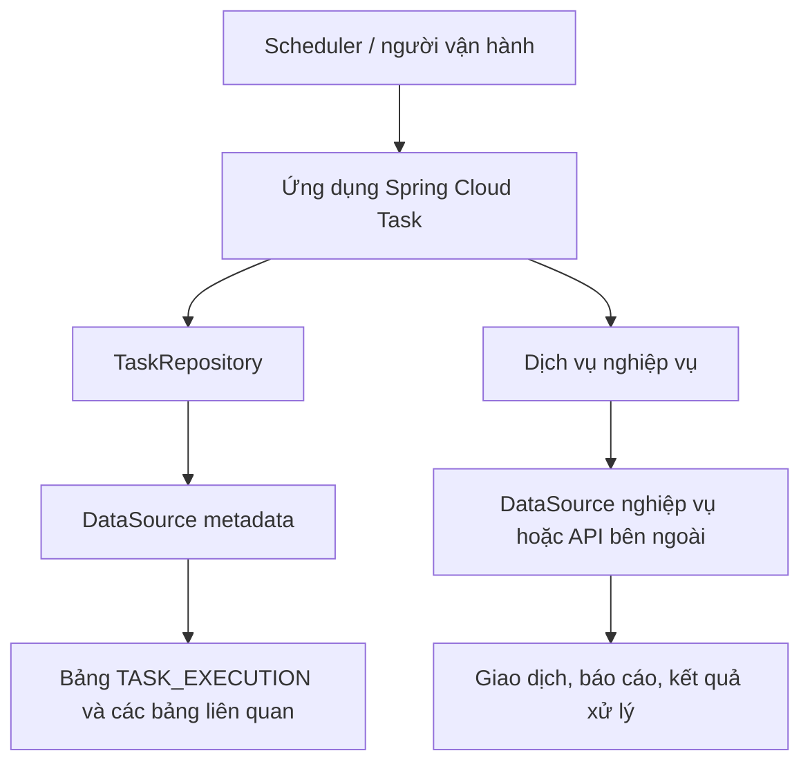
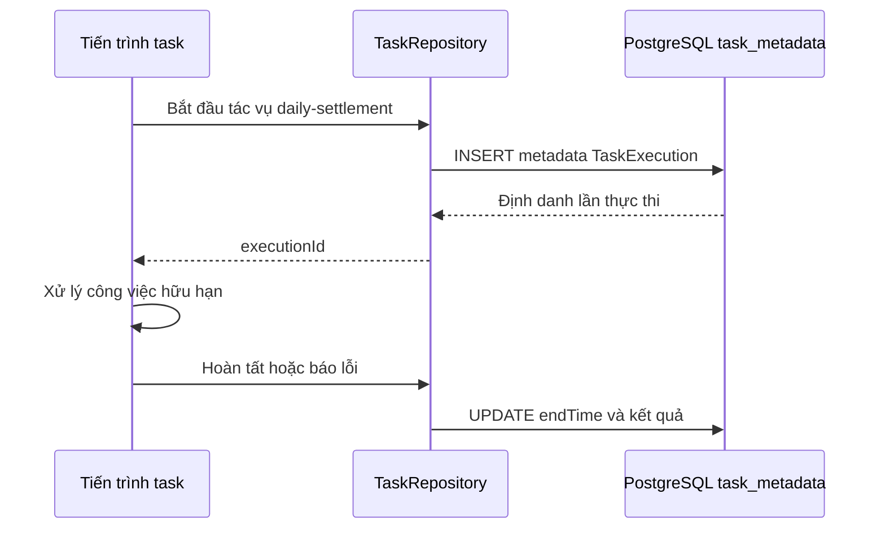

# Chọn `DataSource` cho dữ liệu thực thi trong Spring Cloud Task

## 1. Vì sao `DataSource` là quyết định quan trọng?

Một ứng dụng **Spring Cloud Task** được khởi chạy để thực hiện công việc hữu hạn: nhập tệp dữ liệu, đối soát giao dịch, tổng hợp báo cáo hay đồng bộ thông tin. Khi ứng dụng kết thúc, tiến trình Java có thể biến mất nhưng đội vận hành vẫn cần biết **lần chạy nào bắt đầu, khi nào hoàn tất, có lỗi không và đã chạy lại bao nhiêu lần**.

Spring Cloud Task giải quyết phần lưu dấu vết này bằng **`TaskRepository`**, nơi ghi metadata của từng **`TaskExecution`** vào cơ sở dữ liệu. `DataSource` chính là đối tượng kết nối JDBC mà hạ tầng repository sử dụng. Chọn đúng `DataSource` quyết định lịch sử thực thi được ghi ở đâu, có bền vững qua nhiều lần chạy hay không và những ai được quyền đọc, ghi dữ liệu đó.

Bài thuộc chương **Kho và schema** này tập trung vào việc chọn `DataSource` dành cho **dữ liệu thực thi**, bao gồm ứng dụng một database và ứng dụng có nhiều database. Mục tiêu không chỉ là kết nối thành công, mà còn là thiết kế phù hợp cho chạy theo lịch, chạy theo yêu cầu, xử lý lỗi, retry và phối hợp với Spring Batch.

Sau bài học, bạn có thể:

- Giải thích mối quan hệ giữa `DataSource`, `TaskRepository`, `TaskExecution` và schema metadata.
- Cấu hình một nguồn dữ liệu mặc định cho task đầu tiên.
- Quyết định khi nào nên dùng chung database với dữ liệu nghiệp vụ, khi nào nên tách riêng.
- Chỉ định nguồn dữ liệu dành riêng cho Spring Cloud Task trong ứng dụng nhiều `DataSource`.
- Kiểm tra nơi ghi lịch sử thực thi và phát hiện các lỗi cấu hình thường gặp.

## 2. Phân biệt metadata thực thi với dữ liệu nghiệp vụ

Hãy xét tác vụ `daily-settlement`: đọc giao dịch, đối soát với đối tác và ghi kết quả thanh toán. Trong lần chạy này có **hai nhóm dữ liệu** rất khác nhau:

| Nhóm dữ liệu | Nội dung điển hình | Thành phần quản lý |
| --- | --- | --- |
| **Metadata thực thi** | `executionId`, tên tác vụ, thời điểm bắt đầu/kết thúc, mã thoát, thông tin lỗi và tham số khởi chạy. | `TaskRepository` / `TaskExplorer` của Spring Cloud Task. |
| **Dữ liệu nghiệp vụ** | Giao dịch, số tiền đối soát, báo cáo kết quả, tệp đã nhập, trạng thái gửi đối tác. | Repository/JDBC/JPA hoặc dịch vụ nghiệp vụ của ứng dụng. |

`TaskRepository` **không thay thế** kho dữ liệu nghiệp vụ. Một lần chạy được ghi nhận `exitCode = 0` chỉ cho biết hạ tầng đã kết thúc theo đường thành công; ứng dụng vẫn phải kiểm chứng nội dung báo cáo hoặc giao dịch mà nó xử lý.



Hai nhánh trên có thể trỏ đến **cùng một database** hoặc **hai database khác nhau**. Spring Cloud Task chỉ cần biết nguồn dữ liệu nào phải dùng cho metadata. Dù chọn phương án nào, lịch sử thực thi vẫn phải được lưu đủ bền vững để tra cứu sau khi tiến trình kết thúc.

## 3. `TaskRepository` sử dụng `DataSource` như thế nào?

Các thành phần liên quan có vai trò riêng:

| Thành phần | Trách nhiệm |
| --- | --- |
| `DataSource` | Cung cấp kết nối JDBC đến database cụ thể. |
| `TaskRepository` | Tạo và cập nhật bản ghi `TaskExecution` trong lúc ứng dụng bắt đầu, chạy và kết thúc. |
| `TaskExplorer` | Cho phép truy vấn metadata lịch sử thực thi bằng API. |
| Schema Spring Cloud Task | Cung cấp bảng, khóa và cơ chế định danh cần thiết cho repository. |
| `TaskExecution` | Mô hình biểu diễn **một lần thực thi cụ thể**, không phải toàn bộ ứng dụng hay loại tác vụ. |

Trong cách cấu hình JDBC thông dụng, bảng `TASK_EXECUTION` lưu metadata vòng đời; `TASK_EXECUTION_PARAMS` chứa tham số được ghi nhận; các bảng bổ sung phục vụ tính năng như liên kết với Spring Batch. Tên bảng, kiểu dữ liệu, chỉ mục và cơ chế cấp ID phải được lấy từ **script schema dành cho đúng phiên bản Spring Cloud Task và hệ quản trị database đang dùng**.

Một ứng dụng chạy ba lần thường có ba `TaskExecution` khác nhau, ngay cả khi đều dùng tên tác vụ `daily-settlement`. Khi dùng database bền vững, các bản ghi còn lại sau khi cả ba tiến trình đã thoát.

## 4. Trường hợp đơn giản: chỉ có một `DataSource`

Với **task đầu tiên**, cách dễ hiểu nhất là cấu hình một database thông qua `spring.datasource`. Khi ứng dụng chỉ có một `DataSource` phù hợp, Spring Cloud Task có thể sử dụng nó làm kho metadata mặc định.

### 4.1. Ví dụ cấu hình PostgreSQL

```yaml
spring:
  application:
    name: daily-settlement-worker
  main:
    web-application-type: none
  cloud:
    task:
      name: daily-settlement
  datasource:
    url: ${TASK_DB_URL}
    username: ${TASK_DB_USER}
    password: ${TASK_DB_PASSWORD}
    driver-class-name: org.postgresql.Driver
```

Các biến môi trường có thể được cung cấp khi triển khai:

```bash
export TASK_DB_URL='jdbc:postgresql://db.example.internal:5432/task_metadata'
export TASK_DB_USER='task_runtime'
export TASK_DB_PASSWORD='replace-with-secret-from-secret-manager'
java -jar daily-settlement-worker.jar --businessDate=2026-11-23
```

Các hostname và thông tin tài khoản ở trên chỉ là **ví dụ minh họa**; không đặt mật khẩu thật trong tài liệu hoặc mã nguồn. Tại môi trường sản xuất, sử dụng secret manager hoặc cơ chế cấp bí mật của nền tảng triển khai.

Ứng dụng cần phiên bản tương thích của Spring Boot và Spring Cloud Task, thư viện `spring-cloud-starter-task`, JDBC driver cho PostgreSQL và schema Spring Cloud Task được chuẩn bị đúng. `@EnableTask` hoặc cấu hình bật task tương đương theo phiên bản đang sử dụng phải được kích hoạt.

### 4.2. Đường đi của một lần chạy



Nếu `TASK_DB_URL` trỏ sang database khác ở mỗi lần chạy, lịch sử bị phân tán. Với ứng dụng chạy theo lịch, hãy bảo đảm **tất cả các lần chạy cần được theo dõi chung đều truy cập đúng repository**, bất kể tiến trình mới được tạo trên máy chủ hoặc container nào.

### 4.3. Database nhúng phù hợp trong trường hợp nào?

H2 hoặc một database nhúng có thể thuận tiện khi học và chạy thử. Tuy nhiên, **database in-memory gắn với mỗi tiến trình** thường mất dữ liệu khi tiến trình kết thúc. Hai lần chạy độc lập không tự động nhìn thấy lịch sử của nhau. Vì thế, mô hình này không phù hợp nếu mục tiêu là giám sát tác vụ theo lịch hoặc điều tra lỗi giữa nhiều lần chạy.

Khi cần lưu lịch sử thực tế, nên dùng database bền vững với chính sách backup, quyền truy cập và giám sát phù hợp. Không mặc định Spring Cloud Task sẽ tự tạo schema trong PostgreSQL: cách khởi tạo phụ thuộc phiên bản, cấu hình và cơ chế quản lý migration.

## 5. Dùng chung hay tách riêng database metadata?

Đây là quyết định kiến trúc trước khi cấu hình nhiều nguồn dữ liệu.

| Tiêu chí | Chung database với dữ liệu nghiệp vụ | Database metadata riêng |
| --- | --- | --- |
| Khởi tạo ban đầu | Ít thành phần và thông tin kết nối hơn. | Cần database/schema, tài khoản và cấu hình kết nối bổ sung. |
| Phân quyền | Phải giới hạn quyền truy cập giữa bảng nghiệp vụ và bảng task trong cùng nơi lưu. | Có thể cấp quyền chuyên biệt cho metadata. |
| Vận hành và backup | Có thể tận dụng hạ tầng sẵn có. | Dễ xây chính sách lưu trữ, giám sát và backup riêng cho lịch sử task. |
| Khả năng cô lập lỗi/tải | Metadata và giao dịch nghiệp vụ cùng phụ thuộc tài nguyên database. | Có thể giảm mức ảnh hưởng giữa hai nhóm tải, nhưng tăng số thành phần cần quản lý. |
| Transaction | Một số thao tác có thể cùng database, nhưng không có nghĩa framework tự gom mọi ghi chép thành một transaction. | Ghi metadata và dữ liệu nghiệp vụ thường thuộc các transaction độc lập. |
| Nhiều ứng dụng task | Đơn giản nếu chỉ có vài tác vụ và sử dụng chung hạ tầng. | Phù hợp khi nhiều dịch vụ cần kho lịch sử tập trung có phân quyền rõ ràng. |

**Khi nên dùng chung:** ứng dụng nhỏ, một database ổn định và yêu cầu vận hành đơn giản. Có thể tách bảng bằng schema hoặc quyền database nếu hệ quản trị hỗ trợ.

**Khi nên tách riêng:** hệ thống lớn, yêu cầu bảo mật và giới hạn quyền cao, nhiều tác vụ cần truy vết chung hoặc database nghiệp vụ có vòng đời và chính sách backup khác. Tách riêng không tự tạo tính sẵn sàng cao: cả hai nguồn dữ liệu vẫn phải được vận hành và theo dõi.

Một lưu ý quan trọng: **thành công của việc ghi `TaskExecution` không tự bảo đảm giao dịch nghiệp vụ đã commit**, và ngược lại. Khi dùng hai nguồn dữ liệu, cần có chiến lược xử lý lỗi từng phần, idempotency và đối soát kết quả; không nên mặc định có transaction phân tán.

## 6. Nhiều `DataSource`: chỉ định kho metadata bằng `@TaskDataSource`

Khi ứng dụng vừa truy cập dữ liệu nghiệp vụ vừa ghi metadata thực thi, việc để nhiều `DataSource` mà không có cơ chế chọn rõ ràng có thể dẫn đến cấu hình mơ hồ hoặc repository kết nối sai nơi. Spring Cloud Task cung cấp annotation **`@TaskDataSource`** để chỉ ra `DataSource` dành cho hạ tầng Task trong các phiên bản hỗ trợ tính năng này.

### 6.1. Cấu hình hai nguồn dữ liệu

Ví dụ `application.yml`:

```yaml
spring:
  application:
    name: daily-settlement-worker
  main:
    web-application-type: none
  cloud:
    task:
      name: daily-settlement

app:
  business:
    datasource:
      url: ${BUSINESS_DB_URL}
      username: ${BUSINESS_DB_USER}
      password: ${BUSINESS_DB_PASSWORD}
  task:
    datasource:
      url: ${TASK_DB_URL}
      username: ${TASK_DB_USER}
      password: ${TASK_DB_PASSWORD}
```

Các prefix `app.business.datasource` và `app.task.datasource` là **quy ước do ứng dụng tự đặt**. Spring Boot không tự động tạo hai `DataSource` chỉ nhờ các prefix này; chúng cần được bind vào các bean do ứng dụng định nghĩa.

### 6.2. Định nghĩa bean kết nối và đánh dấu `@TaskDataSource`

```java
import javax.sql.DataSource;

import org.springframework.beans.factory.annotation.Qualifier;
import org.springframework.boot.autoconfigure.jdbc.DataSourceProperties;
import org.springframework.boot.context.properties.ConfigurationProperties;
import org.springframework.cloud.task.configuration.TaskDataSource;
import org.springframework.context.annotation.Bean;
import org.springframework.context.annotation.Configuration;
import org.springframework.context.annotation.Primary;

@Configuration(proxyBeanMethods = false)
public class DataSourceConfiguration {

    @Bean
    @Primary
    @ConfigurationProperties("app.business.datasource")
    DataSourceProperties businessProperties() {
        return new DataSourceProperties();
    }

    @Bean("businessDataSource")
    @Primary
    DataSource businessDataSource(
            @Qualifier("businessProperties") DataSourceProperties properties) {
        return properties.initializeDataSourceBuilder().build();
    }

    @Bean
    @ConfigurationProperties("app.task.datasource")
    DataSourceProperties taskMetadataProperties() {
        return new DataSourceProperties();
    }

    @Bean("taskMetadataDataSource")
    @TaskDataSource
    DataSource taskMetadataDataSource(
            @Qualifier("taskMetadataProperties") DataSourceProperties properties) {
        return properties.initializeDataSourceBuilder().build();
    }
}
```

Trong ví dụ này:

- `businessDataSource` được đánh dấu `@Primary` để làm nguồn mặc định cho những injection `DataSource` không có qualifier trong ứng dụng.
- `taskMetadataDataSource` được đánh dấu `@TaskDataSource`, là tín hiệu để hạ tầng Spring Cloud Task lựa chọn nó cho `TaskRepository`.
- `DataSourceProperties` đọc `url`, `username`, `password`; phương thức `initializeDataSourceBuilder()` tạo kết nối từ cấu hình tương ứng.
- Hai nguồn dữ liệu có thể trỏ đến hai database khác nhau hoặc hai schema độc lập, tùy thiết kế phân quyền.

Ví dụ dựa trên cơ chế `@TaskDataSource` của các phiên bản Spring Cloud Task hỗ trợ annotation này. Khi dùng một dòng phiên bản cụ thể, hãy đối chiếu package, API và cách auto-configuration chọn nguồn dữ liệu với **tài liệu chính thức của đúng phiên bản**. Nếu tự cấu hình `TaskConfigurer` hoặc `TaskRepository`, cần bảo đảm chính các bean đó sử dụng nguồn dữ liệu đã chọn.

### 6.3. Không để nghiệp vụ vô tình dùng kho metadata

Khi có hai `DataSource`, hãy chỉ định rõ `JdbcTemplate`, transaction manager hoặc entity manager của nghiệp vụ. Ví dụ:

```java
import javax.sql.DataSource;
import org.springframework.beans.factory.annotation.Qualifier;
import org.springframework.context.annotation.Bean;
import org.springframework.context.annotation.Configuration;
import org.springframework.jdbc.core.JdbcTemplate;

@Configuration(proxyBeanMethods = false)
public class BusinessJdbcConfiguration {

    @Bean("businessJdbcTemplate")
    JdbcTemplate businessJdbcTemplate(
            @Qualifier("businessDataSource") DataSource businessDataSource) {
        return new JdbcTemplate(businessDataSource);
    }
}
```

Sau đó inject bằng `@Qualifier("businessJdbcTemplate")` ở dịch vụ xử lý đối soát. Tránh mặc định mọi `JdbcTemplate`, JPA repository hoặc `@Transactional` đều sẽ tự hiểu nguồn dữ liệu mà bạn mong muốn, đặc biệt khi ứng dụng có nhiều transaction manager.

**Phân biệt với Spring Batch:** nếu ứng dụng đồng thời dùng Spring Batch, Batch cũng có repository của riêng nó để lưu `JobExecution`, `StepExecution` và các thông tin checkpoint. Trong cấu hình nhiều nguồn dữ liệu, cần kiểm tra riêng cách Spring Batch chọn `DataSource` (chẳng hạn cơ chế `@BatchDataSource` trong các phiên bản Spring Boot hỗ trợ) và transaction manager tương ứng. `@TaskDataSource` không tự động cấu hình toàn bộ hạ tầng của Batch.

## 7. Schema cho database được chọn

**Chọn đúng `DataSource` là điều kiện cần, chưa đủ.** Database được chọn còn phải có đúng bảng và cơ chế cấp ID của Spring Cloud Task. Nếu ứng dụng kết nối được nhưng thiếu `TASK_EXECUTION`, lần chạy có thể thất bại khi framework thử lưu bản ghi bắt đầu.

### 7.1. Những đối tượng cần chuẩn bị

Một schema Spring Cloud Task điển hình có:

| Đối tượng | Vai trò |
| --- | --- |
| `TASK_EXECUTION` | Lịch sử từng lần thực thi, gồm thời gian bắt đầu/kết thúc và kết quả. |
| `TASK_EXECUTION_PARAMS` | Các tham số được ghi nhận cho lần thực thi. |
| Các bảng liên kết bổ sung | Có thể dùng cho liên kết task với Spring Batch hoặc tính năng tùy phiên bản. |
| Sequence/bảng hỗ trợ cấp khóa | Cấp định danh duy nhất an toàn khi nhiều tiến trình cùng chạy; chi tiết phụ thuộc DBMS và phiên bản. |

Không nên tự viết một schema "giống gần đúng" với tài liệu hoặc sao chép script của phiên bản cũ mà không đối chiếu. Spring Cloud Task phân phối schema theo loại database và phiên bản thư viện. Khi nâng cấp phiên bản, cần xem thay đổi schema và lập kế hoạch migration.

### 7.2. Ai tạo bảng?

Trong môi trường học tập, một số cấu hình và loại database nhúng có thể được framework hỗ trợ khởi tạo bảng tự động. Trong môi trường sản xuất, nên **quản lý migration riêng** bằng công cụ như Flyway, Liquibase hoặc quy trình DBA của tổ chức.

Với cấu hình nhiều `DataSource`, hãy kiểm tra migration thật sự chạy trên **database metadata**, vì các công cụ migration có thể mặc định chọn `@Primary` hoặc nguồn dữ liệu được cấu hình riêng. Việc chạy migration nhầm vào database nghiệp vụ có thể khiến ứng dụng khởi động thành công ở môi trường phát triển nhưng không ghi được metadata ở môi trường khác.

Một trình tự triển khai rõ ràng là: chuẩn bị database → tạo schema đúng phiên bản → cấp quyền runtime → cấu hình nguồn dữ liệu → chạy thử một task ngắn → kiểm tra bản ghi thực thi.

### 7.3. Quyền truy cập cần cân nhắc

Tài khoản mà Spring Cloud Task dùng phải có đủ quyền đọc/ghi các bảng metadata và sử dụng cơ chế sinh khóa của schema. Đồng thời, tài khoản runtime thông thường **không cần** có quyền tạo/xóa bảng nếu schema được quản lý bằng migration độc lập.

Hãy tách vai trò migration và runtime khi yêu cầu bảo mật cho phép:

- **Tài khoản migration**: tạo/sửa cấu trúc bảng trong lúc triển khai có kiểm soát.
- **Tài khoản runtime**: chỉ có quyền cần thiết để ghi/đọc metadata của các lần thực thi.
- **Tài khoản đọc/giám sát**: truy vấn lịch sử mà không thể sửa kết quả.

Đối số khởi chạy có thể được ghi vào kho metadata, vì vậy **không truyền mật khẩu, token hoặc bí mật qua command-line** nếu chúng có thể bị lưu trong bảng `TASK_EXECUTION_PARAMS`, log hoặc công cụ theo dõi tiến trình.

## 8. Kiểm tra đúng database sau khi chạy

Sau khi xây dựng và khởi chạy ứng dụng, cần xác minh thực tế rằng `TaskRepository` đã ghi vào **nguồn dữ liệu dự kiến**.

### 8.1. Thực hiện hai lần chạy

Ví dụ:

```bash
java -jar daily-settlement-worker.jar --businessDate=2026-11-23
java -jar daily-settlement-worker.jar --businessDate=2026-11-24
```

Trong ví dụ ứng dụng đầy đủ, runner phải xử lý tham số và kết thúc; `@EnableTask` và kết nối metadata phải hoạt động. Sau đó hãy mở kết nối SQL tới **database dành cho metadata** và thực hiện truy vấn:

```sql
SELECT TASK_EXECUTION_ID,
       TASK_NAME,
       START_TIME,
       END_TIME,
       EXIT_CODE,
       EXIT_MESSAGE
FROM TASK_EXECUTION
WHERE TASK_NAME = 'daily-settlement'
ORDER BY TASK_EXECUTION_ID DESC;
```

Câu truy vấn là minh họa với tên cột thường gặp; cần đối chiếu schema thực tế. Nếu kết nối đến database nghiệp vụ mà thấy kết quả, hãy xem lại liệu hai `DataSource` có đang trỏ cùng database/schema hay Spring Cloud Task đã chọn nhầm nguồn dữ liệu.

Kết quả kỳ vọng là **hai bản ghi có `TASK_EXECUTION_ID` khác nhau** trong database metadata. Với những lần chạy đã hoàn thành bình thường và lưu được kết quả, `END_TIME` có giá trị. Mã thoát và thông báo kết thúc phụ thuộc vào kết quả thật của chương trình.

### 8.2. Đối chiếu ba lớp thông tin

| Cần xác minh | Cách kiểm tra | Lý do |
| --- | --- | --- |
| Ứng dụng kết nối đến đâu? | Kiểm tra cấu hình hữu hiệu, URL JDBC và bean `DataSource` được chọn; che thông tin đăng nhập. | Phân biệt cấu hình mong muốn với cấu hình được nạp thật. |
| Metadata lưu ở đâu? | Truy vấn `TASK_EXECUTION` trong database đã chỉ định. | Xác nhận lựa chọn `DataSource` của `TaskRepository`. |
| Công việc xử lý đúng chưa? | Kiểm tra kết quả nghiệp vụ, log và trạng thái của bộ điều phối. | Metadata không thay thế kiểm thử đầu ra. |

Không nên dùng việc "không tìm thấy bản ghi" làm bằng chứng rằng ứng dụng chưa được khởi chạy: nếu lỗi xảy ra trước khi `TaskRepository` hoạt động, có thể không có bản ghi; cũng có thể bạn đang truy vấn sai database.

## 9. Xử lý những lỗi cấu hình thường gặp

| Biểu hiện | Nguyên nhân khả dĩ | Hướng kiểm tra |
| --- | --- | --- |
| Không tạo được `TaskExecution` ngay khi khởi chạy | URL/credential sai, database chưa sẵn sàng, thiếu quyền hoặc thiếu schema. | Xem exception gốc, kiểm tra kết nối và quyền của tài khoản runtime. |
| Có nhiều `DataSource` và Spring không biết chọn bean nào | Không có chỉ định phù hợp hoặc dùng cấu hình auto-config không nhất quán. | Đánh dấu rõ `@TaskDataSource`, dùng `@Qualifier`/`@Primary` đúng vai trò và đối chiếu phiên bản. |
| Metadata xuất hiện trong database nghiệp vụ | Chỉ chọn `@Primary` cho nghiệp vụ, nhưng chưa chỉ định nguồn cho task; hoặc cấu hình repository thủ công trỏ nhầm. | Kiểm tra `@TaskDataSource`, `TaskConfigurer`, tên bean, URL và schema của kết nối. |
| Chỉ một vài lần chạy có lịch sử | Các tiến trình dùng cấu hình DB khác nhau, hoặc hạ tầng DB không bền vững. | Đối chiếu cấu hình từng môi trường, thông tin kết nối và lịch chạy. |
| Bản ghi có `END_TIME` rỗng | Tiến trình bị dừng bất thường hoặc không cập nhật được database khi kết thúc. | Đọc log, trạng thái Job/Pod/process và lịch sử lỗi kết nối. |
| Không cấp được `executionId` khi chạy đồng thời | Schema cấp khóa không đúng hoặc thiếu quyền dùng sequence/bảng sinh khóa. | Dùng script schema chính thức đúng phiên bản, kiểm tra quyền và cấu hình DBMS. |
| Sau nâng cấp thư viện, task lỗi SQL | Schema cũ không tương thích với code mới. | Kiểm tra migration và đối chiếu các thay đổi của phiên bản. |

Ví dụ: tác vụ chạy trên Kubernetes CronJob được tạo mới mỗi đêm. Nếu mỗi Pod dùng một database H2 trong bộ nhớ, lần chạy sau không thể đọc lịch sử trước. Nếu các Pod kết nối PostgreSQL ổn định nhưng credential hết hạn, ứng dụng có thể không ghi được metadata. Hai sự cố nhìn giống nhau ở dashboard nhưng có nguyên nhân khác nhau.

## 10. Lựa chọn `DataSource` khi chạy lại, chạy song song và dùng Spring Batch

### 10.1. Chạy lại không ghi đè lần thực thi cũ

Khi bộ điều phối retry cùng một tác vụ, lần chạy mới thường nhận `executionId` mới và lưu thành bản ghi mới trong cùng `TaskRepository`. Nếu lịch sử của mỗi lần retry nằm ở database khác nhau, người vận hành khó tổng hợp được chuỗi thử lại.

Không nên lấy `executionId` làm khóa nghiệp vụ để chống ghi trùng báo cáo. Cơ chế idempotency nên dựa trên khóa phù hợp, chẳng hạn `(report_type, business_date)`, và quy tắc cập nhật kết quả trong kho nghiệp vụ.

### 10.2. Nhiều tiến trình cùng cập nhật repository

Khi nhiều bản sao ứng dụng dùng chung kho metadata, database và schema phải hỗ trợ **cấp ID an toàn khi đồng thời**. Cấu hình connection pool phải vừa với tải và giới hạn kết nối của database. Cần giám sát độ trễ và số lỗi ghi metadata, vì database metadata không khả dụng có thể khiến các lần khởi chạy thất bại ngay cả khi database nghiệp vụ vẫn đang hoạt động.

Việc có `TaskRepository` chung **không tự giới hạn số tác vụ được phép chạy đồng thời**. Chính sách concurrency, khóa xử lý và tránh trùng lặp vẫn thuộc ứng dụng hoặc bộ điều phối.

### 10.3. Khi có Spring Batch

Spring Cloud Task theo dõi **vòng đời ứng dụng**, còn Spring Batch theo dõi **vòng đời job và step** thông qua metadata `JobExecution`, `StepExecution` và các bảng Batch. Hai hệ thống repository có thể dùng chung một database nếu cấu hình/schema/transaction phù hợp, hoặc sử dụng nguồn dữ liệu khác nhau.

Nếu dùng nhiều nguồn dữ liệu, phải xác định rõ:

1. `TaskRepository` sử dụng `DataSource` nào để lưu `TaskExecution`.
2. `JobRepository` của Spring Batch sử dụng `DataSource` và transaction manager nào.
3. Xử lý nghiệp vụ sử dụng `DataSource` nào, và ranh giới transaction ra sao.
4. Nếu một repository lưu được còn repository kia thất bại, bộ điều phối sẽ phát hiện và khôi phục thế nào.

Không nên giả định hai repository tự tham gia cùng một transaction chỉ vì nằm trong cùng ứng dụng Spring Boot. Cũng không nên đồng nhất `TaskExecution.executionId` với `JobExecution` ID.

## 11. Tình huống thiết kế: chọn kho metadata cho hệ thống đối soát

Giả sử công ty có database `payments_prod` chứa giao dịch và database `operations_prod` dành cho metadata vận hành. Ứng dụng `payment-reconciliation-task` chạy mỗi đêm, có thể được khởi chạy thủ công khi cần đối soát lại một ngày cũ.

Một lựa chọn hợp lý là:

- **`businessDataSource`** trỏ đến `payments_prod`, giới hạn quyền đọc giao dịch và ghi bảng kết quả cần thiết.
- **`taskMetadataDataSource`** trỏ đến `operations_prod`, được đánh dấu `@TaskDataSource` và có schema Spring Cloud Task đúng phiên bản.
- **`TaskRepository`** ghi lịch sử vào `operations_prod`; `TaskExplorer` phục vụ truy vấn hoặc dashboard.
- **Bộ điều phối** chạy ứng dụng theo lịch hoặc yêu cầu, lưu định danh phiên chạy và đối chiếu log với metadata.
- **Logic đối soát** dùng khóa nghiệp vụ ổn định cho ngày xử lý để chống tạo kết quả trùng khi retry.

Nếu không được phép tạo database vận hành riêng, có thể dùng một database nhưng tách schema, role và chính sách lưu trữ phù hợp. Quyết định quan trọng nhất là có thể **chỉ rõ và kiểm chứng nơi lưu metadata**, chứ không phải luôn phải có hai máy chủ database.

## 12. Checklist trước khi triển khai

- [ ] Đã xác định metadata `TaskExecution` và dữ liệu nghiệp vụ sẽ lưu ở đâu.
- [ ] `DataSource` được chọn cho `TaskRepository` có URL, tài khoản và quyền truy cập phù hợp.
- [ ] Với nhiều `DataSource`, đã chỉ định nguồn cho Spring Cloud Task và cấu hình riêng nguồn cho nghiệp vụ/Batch.
- [ ] Schema Spring Cloud Task, các bảng liên quan và cơ chế cấp ID được tạo theo đúng phiên bản và DBMS.
- [ ] Migration áp dụng vào đúng database, không vô tình chạy trên nguồn dữ liệu khác.
- [ ] Database metadata bền vững qua các lần khởi chạy mới của JAR/container.
- [ ] Đã chạy thử nhiều lần, truy vấn được các `TaskExecution` khác nhau bằng `TaskExplorer` hoặc SQL.
- [ ] Đã kiểm tra đường lỗi, mã thoát, log và trường hợp metadata không được ghi khi DB gặp sự cố.
- [ ] Không truyền bí mật qua tham số có thể được lưu hoặc ghi log; tài khoản runtime được cấp quyền tối thiểu.
- [ ] Có chính sách backup, retention, giới hạn tải, cảnh báo lỗi và hướng khôi phục phù hợp.

### Câu hỏi tự kiểm tra

**Câu 1.** Ứng dụng có một `DataSource` trỏ tới H2 in-memory. Vì sao lịch sử chạy mỗi đêm có thể mất sau khi Pod kết thúc?

**Câu 2.** Ứng dụng có `businessDataSource` được đánh dấu `@Primary` và `taskMetadataDataSource`. Cần làm gì để Spring Cloud Task dùng nguồn metadata trong các phiên bản hỗ trợ `@TaskDataSource`?

**Câu 3.** `TaskExecution` đã ghi thành công vào database riêng nhưng thao tác cập nhật bảng nghiệp vụ thất bại. Có thể coi báo cáo nghiệp vụ đã hoàn tất không?

**Câu 4.** Trong ứng dụng có cả Spring Batch, vì sao chọn `@TaskDataSource` chưa đủ để kết luận metadata Batch được lưu đúng nơi?

**Gợi ý:** (1) database in-memory gắn với vòng đời tiến trình; (2) đánh dấu nguồn dành cho Task bằng `@TaskDataSource` và kiểm tra cấu hình repository; (3) không, phải kiểm tra kết quả và transaction nghiệp vụ; (4) `JobRepository` của Batch có cấu hình kết nối và transaction riêng.

## 13. Tổng kết

Với Spring Cloud Task, **chọn `DataSource` nghĩa là chọn nơi lưu lịch sử vòng đời của các lần thực thi**. Ứng dụng đơn giản có thể dùng `spring.datasource`; khi có nhiều nguồn dữ liệu, cần đánh dấu rõ nguồn cho `TaskRepository` và tách bạch với kết nối nghiệp vụ. Sau khi chọn xong, phải chuẩn bị schema đúng phiên bản, cấp quyền, kiểm tra kết quả ghi thực tế và thiết kế khả năng khôi phục khi database hoặc tiến trình gặp lỗi.

Quy tắc vận hành là: **giữ lịch sử thực thi bền vững, biết chắc nó được lưu ở đâu, và không dùng metadata thay cho kiểm chứng kết quả nghiệp vụ**. Điều này giúp các tác vụ chạy theo lịch hoặc theo yêu cầu có thể được theo dõi, xử lý lỗi và phối hợp an toàn với Spring Batch.

**Tài liệu tham khảo:** [Spring Cloud Task Reference](https://docs.spring.io/spring-cloud-task/reference/), [Spring Boot Reference](https://docs.spring.io/spring-boot/reference/), [Spring Batch Reference](https://docs.spring.io/spring-batch/reference/).
