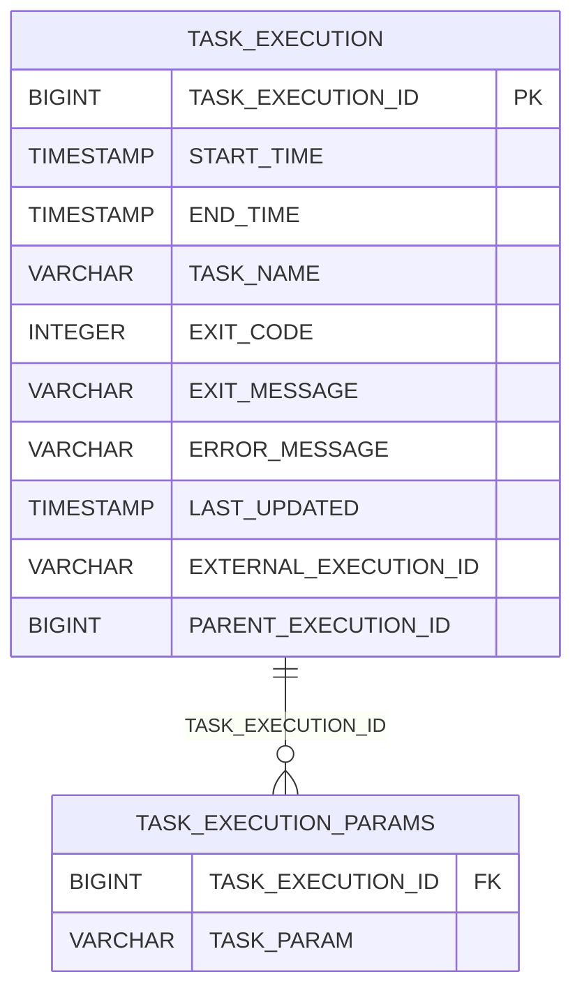
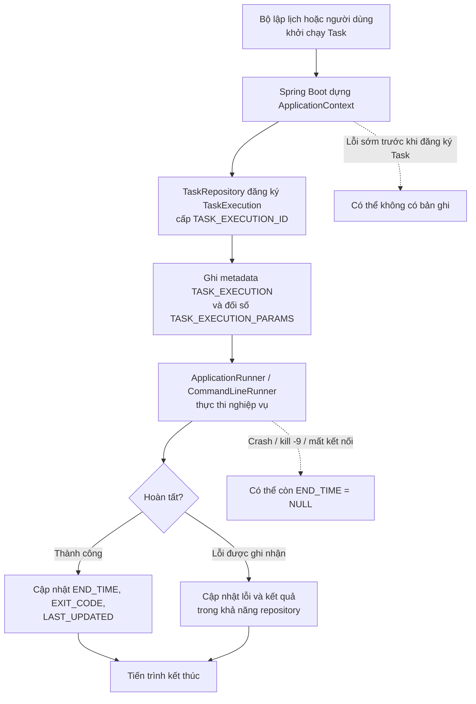
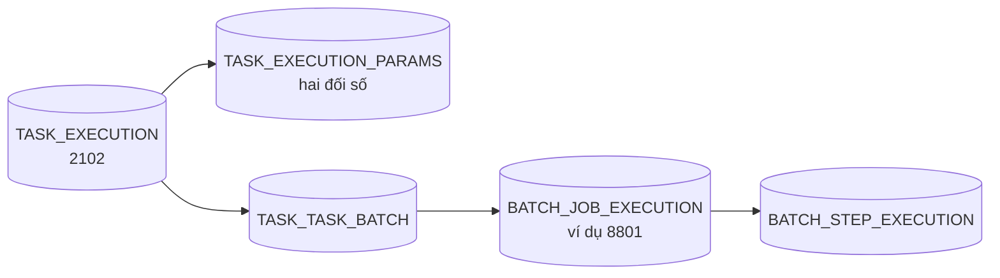

# Cấu trúc `TASK_EXECUTION` và `TASK_EXECUTION_PARAMS`

## Mục tiêu học tập

Sau bài học, bạn có thể:

- Giải thích vì sao Spring Cloud Task dùng các bảng metadata để theo dõi một ứng dụng Spring Boot có thời gian chạy hữu hạn.
- Mô tả vai trò, khóa và các cột quan trọng của hai bảng `TASK_EXECUTION` và `TASK_EXECUTION_PARAMS`.
- Hiểu quan hệ **một lần chạy Task – nhiều tham số**, phân biệt `executionId` với tên Task, tham số nghiệp vụ và ID của Spring Batch.
- Viết SQL để tra cứu thời gian, kết quả, lỗi và tham số của một lần chạy; đọc đúng các trường hợp chưa kết thúc hoặc lỗi bất thường.
- Cấu hình khởi tạo schema, kiểm tra tính tương thích phiên bản, phân quyền và áp dụng quy trình lưu trữ an toàn khi chạy Task theo lịch hoặc theo yêu cầu.

> **Ngữ cảnh:** Bài thuộc chương **Kho và schema** của module **SPRING_CLOUD_TASK**. Spring Cloud Task cho phép xây dựng tiến trình Spring Boot chạy hữu hạn, lưu trạng thái và kết quả thực thi qua `TaskRepository`. Khi có cơ sở dữ liệu bền vững, các bảng repository giúp vận hành truy vết những lượt chạy, xử lý lỗi và phối hợp với Spring Batch mà không phải chỉ dựa vào log của một tiến trình đã kết thúc.

## 1. Hai bảng giải quyết vấn đề gì?

Giả sử hệ thống khởi chạy ứng dụng `daily-settlement` hằng đêm để đối soát thanh toán. Hôm nay có hai lần chạy:

- 02:00: `java -jar settlement.jar --business-date=2026-11-24 --region=apac`.
- 02:10: chạy lại cùng ngày và khu vực sau khi lượt trước lỗi.

Cả hai đều có tên Task `daily-settlement` nhưng phải có **hai bản ghi thực thi riêng**. Mỗi bản ghi cần thời gian bắt đầu, thời gian kết thúc, exit code, thông điệp lỗi và các tham số đã truyền vào. Đó là lý do tồn tại hai bảng:

| Bảng | Câu hỏi được trả lời | Đơn vị dữ liệu |
| --- | --- | --- |
| `TASK_EXECUTION` | “Lần chạy cụ thể này là lần nào, khi nào, kết thúc với kết quả gì?” | **Một hàng trên mỗi lần chạy Task.** |
| `TASK_EXECUTION_PARAMS` | “Những đối số nào được gắn với lần chạy đó?” | **Thông thường một hàng trên mỗi đối số** của lần chạy. |

`TaskRepository` chịu trách nhiệm ghi/cập nhật metadata; `TaskExplorer` hỗ trợ đọc lại các `TaskExecution`. Hai bảng nói trên **không phải kho dữ liệu nghiệp vụ**: không có nghĩa chúng chứa các giao dịch đã đối soát, số bản ghi xử lý hoặc dữ liệu đầu ra của Task.

**Phân biệt ba định danh:**

- `TASK_NAME`: tên một loại Task, có thể giống nhau ở nhiều lần chạy.
- `TASK_EXECUTION_ID` (trong Java là `TaskExecution.executionId`): khóa đại diện cho **một lần thực thi** trong phạm vi repository.
- `business-date`, `region`, `customerId`...: giá trị nghiệp vụ do ứng dụng định nghĩa; các lần chạy lại có thể có cùng tham số.

`executionId` thường được repository cấp khi tạo metadata. Đừng dùng nó thay cho khóa idempotency: cùng dữ liệu nghiệp vụ có thể được xử lý ở hai lần chạy có ID khác nhau.

## 2. Sơ đồ quan hệ giữa hai bảng



Đây là **mô hình logic minh họa**, dùng tên cột phổ biến của Spring Cloud Task JDBC. Một `TASK_EXECUTION_ID` bên bảng cha có thể liên hệ **không, một hoặc nhiều** dòng trong `TASK_EXECUTION_PARAMS`. Trường `TASK_PARAM` chứa đối số như một chuỗi; trong schema thông dụng không có hai cột chuẩn hóa riêng `PARAM_NAME` và `PARAM_VALUE`.

Ví dụ dữ liệu:

**Bảng `TASK_EXECUTION`**

| TASK_EXECUTION_ID | TASK_NAME | START_TIME (UTC) | END_TIME (UTC) | EXIT_CODE |
| ---: | --- | --- | --- | ---: |
| 2101 | daily-settlement | 2026-11-24 02:00:01 | 2026-11-24 02:03:40 | 1 |
| 2102 | daily-settlement | 2026-11-24 02:10:05 | 2026-11-24 02:13:13 | 0 |

**Bảng `TASK_EXECUTION_PARAMS`**

| TASK_EXECUTION_ID | TASK_PARAM |
| ---: | --- |
| 2101 | `--business-date=2026-11-24` |
| 2101 | `--region=apac` |
| 2102 | `--business-date=2026-11-24` |
| 2102 | `--region=apac` |

Các ID, thời điểm và mã thoát ở trên chỉ là dữ liệu giả định. Hai lượt có cùng tham số không có nghĩa cùng lần thực thi; khóa `TASK_EXECUTION_ID` giúp nhóm từng tập tham số với đúng lần chạy.

## 3. Cấu trúc bảng `TASK_EXECUTION`

Bảng này lưu metadata của `TaskExecution`, được Spring Cloud Task ghi khi tiến trình bắt đầu và cập nhật khi kết thúc hoặc xảy ra lỗi mà framework có thể ghi nhận.

| Cột thường gặp | Kiểu dữ liệu tham khảo | Ý nghĩa |
| --- | --- | --- |
| `TASK_EXECUTION_ID` | `BIGINT` | Khóa chính của bản ghi lần chạy; repository cấp ID. |
| `START_TIME` | `TIMESTAMP` | Thời điểm Task được ghi nhận bắt đầu. |
| `END_TIME` | `TIMESTAMP` | Thời điểm Task được ghi nhận kết thúc; có thể là `NULL` khi chưa cập nhật. |
| `TASK_NAME` | `VARCHAR(100)` | Tên Task/ứng dụng được cấu hình. |
| `EXIT_CODE` | `INTEGER` | Mã kết quả được ghi ở mức Task; thường dùng `0` cho thành công. |
| `EXIT_MESSAGE` | `VARCHAR(2500)` | Thông điệp mô tả kết quả thoát. |
| `ERROR_MESSAGE` | `VARCHAR(2500)` | Thông điệp lỗi liên quan đến lần chạy, nếu được ghi nhận. |
| `LAST_UPDATED` | `TIMESTAMP` | Thời điểm metadata lần gần nhất được cập nhật. |
| `EXTERNAL_EXECUTION_ID` | `VARCHAR(255)` | Định danh từ bộ điều phối hoặc hệ thống bên ngoài khi được sử dụng. |
| `PARENT_EXECUTION_ID` | `BIGINT` | Tham chiếu logic tới lần chạy cha trong các luồng Task cha–con khi được cấu hình. |

**Kiểu và độ dài trong bảng là ví dụ theo schema JDBC phổ biến**, không phải hợp đồng bất biến cho mọi release và mọi database. Khi triển khai, luôn xem script schema **đúng phiên bản Spring Cloud Task và đúng dialect** (PostgreSQL, MySQL/MariaDB, SQL Server, Oracle...). Một số schema có thêm cấu trúc phục vụ sinh khóa và tối ưu hóa; không được đoán chỉ từ tên bảng.

### 3.1. Khóa `TASK_EXECUTION_ID`

`TASK_EXECUTION_ID` là khóa chính ở bảng `TASK_EXECUTION`, nhờ đó có thể tìm đúng một lần chạy:

```sql
SELECT TASK_EXECUTION_ID, TASK_NAME, START_TIME, END_TIME, EXIT_CODE
FROM TASK_EXECUTION
WHERE TASK_EXECUTION_ID = 2102;
```

Các điểm cần nhớ:

1. ID chỉ được bảo đảm phân biệt **trong phạm vi repository**. Môi trường dev và production khác database vẫn có thể cùng mang số `2102`.
2. Không suy ra ID liên tiếp hoặc không có khoảng trống: sequence/table incrementer, transaction, rollback và chạy đồng thời có thể làm số ID bị nhảy.
3. Không suy ra Task nào **hoàn tất trước** chỉ bằng ID. Hãy so sánh `END_TIME` và log.
4. Không tự nhập hoặc thay `TASK_EXECUTION_ID` trong nghiệp vụ thường ngày. Hạ tầng `TaskRepository` có cơ chế cấp và quản lý ID.
5. Khi tổng hợp log từ nhiều cụm, nên ghi kèm môi trường, repository hoặc cluster để tránh nhầm một ID cục bộ với định danh toàn cầu.

### 3.2. Thời điểm `START_TIME`, `END_TIME` và `LAST_UPDATED`

Ba cột này trả lời các câu hỏi khác nhau:

- `START_TIME`: Task đã được ghi nhận khởi chạy lúc nào?
- `END_TIME`: lần chạy đã được repository ghi nhận kết thúc lúc nào?
- `LAST_UPDATED`: metadata đã được ghi/cập nhật gần nhất khi nào?

`END_TIME IS NULL` **không luôn đồng nghĩa đang chạy**. Có thể Task vẫn đang xử lý, nhưng cũng có thể process bị `SIGKILL`, container bị xóa hoặc database mất kết nối trước khi cập nhật cuối cùng. Cần đối chiếu trạng thái tiến trình và thông tin scheduler.

Có thể tính thời lượng cho lần chạy **đã có cả hai thời điểm**:

```sql
-- Cú pháp PostgreSQL, kết quả là khoảng thời gian (interval).
SELECT TASK_EXECUTION_ID,
       TASK_NAME,
       END_TIME - START_TIME AS DURATION
FROM TASK_EXECUTION
WHERE START_TIME IS NOT NULL
  AND END_TIME IS NOT NULL
ORDER BY START_TIME DESC
LIMIT 20;
```

Khi hệ thống dùng nhiều múi giờ, cần chuẩn hóa cách ghi/hiển thị timestamp trong cấu hình JDBC/database và báo cáo. Đừng tự coi giá trị `TIMESTAMP` không kèm timezone là UTC nếu chưa xác minh.

### 3.3. `EXIT_CODE`, `EXIT_MESSAGE` và `ERROR_MESSAGE`

`EXIT_CODE` là tín hiệu cấp Task mà Spring Cloud Task lưu. Thông thường mã `0` gắn với kết quả thành công, mã khác `0` phản ánh lỗi theo cách ứng dụng/framework thiết lập. Tuy nhiên:

- `EXIT_CODE = 0` không bảo đảm dữ liệu nghiệp vụ đúng nếu code đã nuốt exception hoặc khởi chạy tác vụ bất đồng bộ rồi thoát.
- `ERROR_MESSAGE` có thể rỗng mặc dù tiến trình gặp sự cố quá sớm, crash đột ngột hoặc hạ tầng không ghi được metadata.
- `EXIT_MESSAGE`/`ERROR_MESSAGE` có giới hạn kích thước theo schema; đừng kỳ vọng lưu trọn stack trace.
- Mã trong bảng Task và **mã thoát của tiến trình hệ điều hành/container** cần được đối chiếu trong vận hành. Chúng có thể khác nhau nếu luồng báo lỗi hoặc tích hợp Batch chưa đúng.

Ví dụ bảng Task cho một lượt gặp lỗi:

```text
TASK_EXECUTION_ID: 2101
TASK_NAME:         daily-settlement
START_TIME:        2026-11-24 02:00:01
END_TIME:          2026-11-24 02:03:40
EXIT_CODE:         1
EXIT_MESSAGE:      Validation failed
ERROR_MESSAGE:     Business date is not available
```

Đây là minh họa; giá trị thật của thông điệp/lỗi phụ thuộc chương trình và cách framework nhận được exception.

### 3.4. `EXTERNAL_EXECUTION_ID` và `PARENT_EXECUTION_ID`

Hai cột hỗ trợ tương quan với hệ thống lớn hơn:

- `EXTERNAL_EXECUTION_ID` có thể chứa định danh do bộ điều phối ngoài (ví dụ hệ thống launch/worker) cung cấp; phù hợp để tìm liên hệ giữa lần chạy Task và một yêu cầu phía ngoài.
- `PARENT_EXECUTION_ID` có thể diễn tả quan hệ Task cha–con. Giá trị này **không tự sinh** chỉ vì Task A kết thúc rồi Task B bắt đầu; cần có cơ chế chuyển/cấu hình quan hệ.

Không xem `EXTERNAL_EXECUTION_ID` là khóa chính thay thế. Cũng không tự giả định database luôn có foreign key tự tham chiếu trên `PARENT_EXECUTION_ID`; phải đọc DDL của phiên bản cụ thể.

## 4. Cấu trúc bảng `TASK_EXECUTION_PARAMS`

Bảng tham số thường có hai cột chính:

| Cột | Kiểu tham khảo | Vai trò |
| --- | --- | --- |
| `TASK_EXECUTION_ID` | `BIGINT` | Khóa ngoại hoặc cột tham chiếu đến `TASK_EXECUTION.TASK_EXECUTION_ID`. |
| `TASK_PARAM` | `VARCHAR(2500)` | **Một đối số đầu vào** được lưu ở dạng chuỗi. |

Ví dụ chạy Task:

```bash
java -jar settlement.jar --business-date=2026-11-24 --region=apac --dry-run
```

Trong cách lưu phổ biến, các hàng tham số có dạng:

```text
(2102, "--business-date=2026-11-24")
(2102, "--region=apac")
(2102, "--dry-run")
```

Cần phân biệt:

1. `TASK_EXECUTION_PARAMS` **không mặc định có cột `NAME` và `VALUE` riêng** như một số bảng của Spring Batch.
2. `TASK_PARAM` phản ánh **đối số chuỗi**. Khi cần hiểu `--business-date=2026-11-24` nghĩa là gì, code ứng dụng phải diễn giải theo quy ước tham số đã định nghĩa.
3. Bảng thông dụng **không có cột thứ tự đối số**. Một câu `SELECT` không có `ORDER BY` sẽ không bảo đảm tái tạo đúng thứ tự chuỗi lệnh ban đầu. Nếu thứ tự là quan trọng, cần thiết kế cách lưu riêng có thứ tự hoặc giữ quy tắc rõ trong nghiệp vụ.
4. `TASK_EXECUTION_ID` **có thể xuất hiện nhiều lần** trong bảng con; đó là điều đúng với quan hệ một–nhiều. Không tạo ràng buộc `UNIQUE(TASK_EXECUTION_ID)` vì sẽ làm mất khả năng lưu nhiều tham số.
5. Khi Task không có đối số, bản ghi `TASK_EXECUTION` vẫn có thể tồn tại nhưng **không có hàng nào** trong `TASK_EXECUTION_PARAMS`.

### 4.1. Lấy tham số theo `executionId`

```sql
SELECT TASK_EXECUTION_ID, TASK_PARAM
FROM TASK_EXECUTION_PARAMS
WHERE TASK_EXECUTION_ID = 2102;
```

Nếu muốn xem kết quả metadata kèm tham số dưới dạng các hàng:

```sql
SELECT e.TASK_EXECUTION_ID,
       e.TASK_NAME,
       e.START_TIME,
       e.END_TIME,
       e.EXIT_CODE,
       p.TASK_PARAM
FROM TASK_EXECUTION e
LEFT JOIN TASK_EXECUTION_PARAMS p
    ON p.TASK_EXECUTION_ID = e.TASK_EXECUTION_ID
WHERE e.TASK_EXECUTION_ID = 2102;
```

Dùng `LEFT JOIN` vì một lần chạy không có tham số vẫn phải xuất hiện trong kết quả. Truy vấn trả về **nhiều hàng** khi có nhiều `TASK_PARAM`; đây là kết quả join một–nhiều, không có nghĩa `TASK_EXECUTION` bị nhân bản trong database.

### 4.2. Không trộn metadata Task với tham số Spring Batch

Spring Batch có `JobParameters` và bảng metadata riêng, thường thuộc nhóm `BATCH_JOB_EXECUTION_PARAMS`. Mô hình Batch JobParameters gắn với `JobInstance`/`JobExecution` và có quy tắc tham số nhận dạng để điều khiển restart.

Trong khi đó, `TASK_EXECUTION_PARAMS` lưu tham số của **lần khởi chạy Task**. Một đối số Task không tự trở thành JobParameter chỉ vì Spring Batch ở trên classpath. Tùy cách ứng dụng khởi chạy Batch Job, cần chuyển đổi tham số đúng quy tắc và kiểm tra tình huống retry/restart.

## 5. DDL minh họa và ràng buộc quan hệ

Để hình dung hai bảng, ví dụ SQL khái niệm có thể viết như sau:

```sql
-- Minh họa cấu trúc logic, KHÔNG dùng thay script migration chính thức.
CREATE TABLE TASK_EXECUTION (
    TASK_EXECUTION_ID    BIGINT NOT NULL PRIMARY KEY,
    START_TIME           TIMESTAMP NULL,
    END_TIME             TIMESTAMP NULL,
    TASK_NAME            VARCHAR(100),
    EXIT_CODE            INTEGER,
    EXIT_MESSAGE         VARCHAR(2500),
    ERROR_MESSAGE        VARCHAR(2500),
    LAST_UPDATED         TIMESTAMP NULL,
    EXTERNAL_EXECUTION_ID VARCHAR(255),
    PARENT_EXECUTION_ID  BIGINT
);

CREATE TABLE TASK_EXECUTION_PARAMS (
    TASK_EXECUTION_ID BIGINT NOT NULL,
    TASK_PARAM        VARCHAR(2500),
    FOREIGN KEY (TASK_EXECUTION_ID)
        REFERENCES TASK_EXECUTION (TASK_EXECUTION_ID)
);
```

Ví dụ chỉ trình bày cấu trúc dữ liệu phổ biến và ràng buộc quan hệ. **Để ứng dụng Spring Cloud Task thực sự chạy được**, repository còn cần cơ chế cấp ID của database/dialect (ví dụ sequence hoặc bảng cấp khóa) và có thể có các chi tiết DDL khác. Không copy đoạn minh họa này vào production hoặc tự tạo bảng thiếu thành phần sinh khóa rồi kết luận thư viện không hoạt động.

**Quy trình đúng:** dùng script schema của **đúng phiên bản Spring Cloud Task**, tương thích database, sau đó quản lý bằng công cụ migration (Flyway/Liquibase hoặc quy trình tương đương). Trong môi trường production nên cấp quyền DDL cho tài khoản migration, còn tài khoản runtime chỉ cần quyền dữ liệu tối thiểu phù hợp.

### Khóa chính và khóa ngoại

Trong thiết kế logic:

- `TASK_EXECUTION.TASK_EXECUTION_ID` là **primary key** cho mỗi lần thực thi.
- `TASK_EXECUTION_PARAMS.TASK_EXECUTION_ID` tham chiếu bản ghi Task cha; một ID có thể có nhiều tham số.
- `TASK_EXECUTION_PARAMS` có thể không định nghĩa primary key riêng trong một số script. Đừng suy diễn thứ tự dòng, tính duy nhất của `TASK_PARAM` hay ràng buộc chống trùng tham số nếu DDL không quy định.

Một số dialect/release có thể khác nhau về ràng buộc vật lý (chẳng hạn tên hoặc sự hiện diện của foreign key). Vì vậy trước khi triển khai sửa schema, hãy kiểm tra **DDL thực tế đang áp dụng** và hành vi repository. Không nên “thêm cho chặt” một constraint làm code framework không còn ghi được tham số hợp lệ.

## 6. Dữ liệu được ghi vào hai bảng khi nào?

Khi ứng dụng có `spring-cloud-starter-task` và repository JDBC hoạt động, luồng thường là:



Cách tạo/cập nhật cụ thể phụ thuộc phiên bản framework và thứ tự listener. Mục đích của sơ đồ là chỉ ra rằng **bảng cha và bảng tham số tạo thành metadata của cùng một lần chạy**, không khẳng định mọi thao tác được gộp thành một transaction hay mọi lỗi đều được ghi hoàn chỉnh.

Trước khi runner chạy, hạ tầng Task phải có khả năng đăng ký bản ghi. Nếu database chưa khởi tạo schema, sai credential hoặc mất kết nối, ứng dụng có thể thất bại **trước khi có `TASK_EXECUTION_ID`**. Trường hợp đó phải tìm trong log ứng dụng, log nền tảng và nhật ký database.

### Quan hệ với `TaskRepository` và `TaskExplorer`

| Thành phần | Vai trò |
| --- | --- |
| `TaskRepository` | Ghi/cập nhật `TaskExecution` và thông tin kèm theo trong schema của Task. |
| `TaskExplorer` | Truy vấn lại các lần chạy để hiển thị lịch sử hoặc điều tra lỗi. |
| `TaskExecutionListener` | Nhận callback vòng đời để log `executionId`, lấy kết quả và đẩy số liệu giám sát. |

Đối với luồng Task thông thường, không cần chèn thủ công vào hai bảng. Để framework quản lý tính nhất quán giữa object `TaskExecution` và metadata repository. Truy vấn SQL phù hợp cho read-only vận hành; còn sửa metadata trực tiếp có thể phá hỏng lịch sử và các liên kết khác.

Ví dụ service truy vấn một lần chạy trong ứng dụng:

```java
import java.util.Optional;

import org.springframework.cloud.task.repository.TaskExecution;
import org.springframework.cloud.task.repository.TaskExplorer;
import org.springframework.stereotype.Service;

@Service
public class TaskExecutionLookup {
    private final TaskExplorer taskExplorer;

    public TaskExecutionLookup(TaskExplorer taskExplorer) {
        this.taskExplorer = taskExplorer;
    }

    public Optional<TaskExecution> findById(long executionId) {
        return Optional.ofNullable(
            taskExplorer.getTaskExecution(executionId)
        );
    }
}
```

Ví dụ minh họa API `TaskExplorer` để đọc metadata theo ID; API và cấu hình bean có thể khác giữa các dòng release, hãy kiểm tra theo dependency của dự án. Khi làm dashboard, cần phân trang và giới hạn quyền người dùng truy cập metadata Task.

## 7. Cấu hình schema cho môi trường học tập và production

### 7.1. Ví dụ PostgreSQL đã có schema

Giả sử database PostgreSQL được tạo sẵn và đã áp dụng migration đúng với Spring Cloud Task release:

```yaml
spring:
  application:
    name: daily-settlement
  main:
    web-application-type: none
  datasource:
    url: jdbc:postgresql://localhost:5432/taskdb
    username: ${DB_USER}
    password: ${DB_PASSWORD}
  cloud:
    task:
      initialize-enabled: false
```

`spring.cloud.task.initialize-enabled=false` được dùng ở đây để tránh runtime tự chạy script tạo bảng khi schema đã do migration quản lý. Lựa chọn này **đòi hỏi bảng và cấu trúc cấp ID phải tồn tại trước** khi khởi chạy Task.

Khi học tập, có thể bật khả năng tự khởi tạo schema phù hợp với tính năng được hỗ trợ và quyền database. Không xem đó là chiến lược migration lâu dài; cập nhật phiên bản Spring Cloud Task có thể yêu cầu nâng cấp DDL.

### 7.2. Quy trình triển khai an toàn

1. Chọn bộ phiên bản Spring Boot và Spring Cloud tương thích; để dependency/BOM quản lý `spring-cloud-starter-task`.
2. Xác định database dialect và script schema Task thuộc **đúng release** ứng dụng sẽ chạy.
3. Áp dụng migration trước khi rollout ứng dụng; kiểm tra bảng `TASK_EXECUTION`, `TASK_EXECUTION_PARAMS` cùng cấu trúc sinh khóa bắt buộc.
4. Đảm bảo `DataSource` trong ứng dụng kết nối đúng database và schema đã migration; kiểm tra quyền `SELECT/INSERT/UPDATE` phù hợp với repository.
5. Chạy một Task nhỏ thành công và một Task có lỗi có chủ đích; đối chiếu row, tham số, `EXIT_CODE`, `END_TIME` và mã thoát process.
6. Kiểm tra tình huống chạy song song và kế hoạch lưu trữ/archiving trước khi áp dụng lịch chạy tần suất lớn.

Nếu sử dụng prefix bảng khác mặc định, cả cơ chế repository và schema/migration phải thống nhất cùng prefix. Không chỉ đổi tên bảng thủ công trong database khi ứng dụng vẫn truy vấn tên mặc định.

### 7.3. Khởi tạo schema tự động có giới hạn gì?

Một script khởi tạo schema trong lúc boot thường tiện cho phát triển vì giảm số bước thiết lập. Nhưng ở môi trường nhiều replica hoặc tác vụ chạy song song, nhiều tiến trình có thể cùng yêu cầu DDL, tạo race condition hoặc lỗi quyền. Ngoài ra, bật tự khởi tạo không có nghĩa tự động **nâng cấp mọi thay đổi schema của release mới**.

Tách quá trình migration khỏi runtime giúp quản lý version, kiểm tra trước thay đổi, rollback theo kế hoạch và hạn chế quyền DDL. Với dữ liệu thực thi cần lưu lâu dài, tránh database in-memory nếu cần tra cứu sau khi tiến trình đã thoát.

## 8. Truy vấn SQL vận hành thường dùng

Các truy vấn dưới đây dùng tên bảng mặc định, theo cú pháp PostgreSQL hoặc SQL phổ biến. Nếu đang dùng hệ quản trị khác hoặc bảng có prefix tùy chỉnh, điều chỉnh `LIMIT`, kiểu thời gian và tên cột phù hợp.

### 8.1. 20 lần chạy mới nhất

```sql
SELECT TASK_EXECUTION_ID,
       TASK_NAME,
       START_TIME,
       END_TIME,
       EXIT_CODE
FROM TASK_EXECUTION
ORDER BY START_TIME DESC, TASK_EXECUTION_ID DESC
LIMIT 20;
```

Đây là truy vấn hữu ích để xem lịch sử gần nhất. Khi bảng có hàng triệu bản ghi, lọc theo tên Task và khoảng thời gian, thiết kế index dựa trên truy vấn thật để tránh quét toàn bộ bảng thường xuyên.

### 8.2. Lần chạy thất bại được ghi nhận

```sql
SELECT TASK_EXECUTION_ID,
       TASK_NAME,
       START_TIME,
       END_TIME,
       EXIT_CODE,
       EXIT_MESSAGE,
       ERROR_MESSAGE
FROM TASK_EXECUTION
WHERE EXIT_CODE IS NOT NULL
  AND EXIT_CODE <> 0
ORDER BY START_TIME DESC
LIMIT 50;
```

Kết quả chỉ chứa những lần có mã khác `0` đã được lưu. Những lần bị kill hoặc lỗi không kịp cập nhật có thể **không xuất hiện**; cần kết hợp truy vấn `END_TIME IS NULL` và dữ liệu ngoài repository.

### 8.3. Lần chạy chưa được ghi nhận kết thúc

```sql
SELECT TASK_EXECUTION_ID,
       TASK_NAME,
       START_TIME,
       LAST_UPDATED,
       END_TIME
FROM TASK_EXECUTION
WHERE END_TIME IS NULL
ORDER BY START_TIME ASC;
```

Không tự đổi các hàng này thành “đang chạy” nếu chưa xác minh tiến trình/pod còn tồn tại. Trường `LAST_UPDATED` cũng chỉ phản ánh lần cập nhật metadata, không phải heartbeat định kỳ.

### 8.4. Tìm tất cả tham số và bản ghi Task

```sql
SELECT e.TASK_EXECUTION_ID,
       e.TASK_NAME,
       e.START_TIME,
       e.EXIT_CODE,
       p.TASK_PARAM
FROM TASK_EXECUTION e
LEFT JOIN TASK_EXECUTION_PARAMS p
    ON p.TASK_EXECUTION_ID = e.TASK_EXECUTION_ID
WHERE e.TASK_NAME = 'daily-settlement'
ORDER BY e.START_TIME DESC, e.TASK_EXECUTION_ID DESC;
```

Không dựa vào thứ tự các giá trị `TASK_PARAM` trong kết quả vì bảng không cung cấp cột thứ tự chung. Cũng đừng hiển thị trực tiếp toàn bộ tham số trong dashboard cho mọi người dùng: tham số có thể mang dữ liệu cần che giấu.

### 8.5. Kiểm tra tham số mất liên kết (nếu schema cho phép)

```sql
SELECT p.TASK_EXECUTION_ID, p.TASK_PARAM
FROM TASK_EXECUTION_PARAMS p
LEFT JOIN TASK_EXECUTION e
    ON e.TASK_EXECUTION_ID = p.TASK_EXECUTION_ID
WHERE e.TASK_EXECUTION_ID IS NULL;
```

Nếu DDL đang áp dụng có **foreign key được bật và dữ liệu hợp lệ**, truy vấn thường không tìm thấy hàng nào. Nếu có dữ liệu, cần điều tra xem đã từng nhập/xóa thủ công, vô hiệu ràng buộc hay có quy trình migration sai. Chỉ chạy truy vấn ở chế độ đọc, không xóa dữ liệu tự động dựa trên kết quả.

## 9. Tích hợp Spring Batch: cần bảng liên kết khác

Nếu Task chạy Spring Batch Job, dữ liệu công việc còn nằm ở `BATCH_JOB_INSTANCE`, `BATCH_JOB_EXECUTION`, `BATCH_STEP_EXECUTION` và các bảng `BATCH_*`. Khi tích hợp Task–Batch được bật, bảng `TASK_TASK_BATCH` liên kết `TASK_EXECUTION_ID` với `JOB_EXECUTION_ID`.



Không nhầm lẫn:

- `TASK_EXECUTION_PARAMS.TASK_PARAM` là đối số **của Task**.
- `BATCH_JOB_EXECUTION_PARAMS` là metadata tham số **của Spring Batch Job**.
- `TASK_EXECUTION_ID` và `JOB_EXECUTION_ID` được cấp bởi **hai repository khác nhau**, không có yêu cầu bằng nhau.

Một Task có thể chạy nhiều Job, hoặc không có Job nào. Bảng `TASK_TASK_BATCH` có thể tồn tại dù Task cụ thể không dùng Batch. Nếu Batch Job đã thất bại nhưng exit code Task bằng `0`, cần kiểm tra cơ chế truyền lỗi và cấu hình tích hợp (ví dụ `spring.cloud.task.batch.fail-on-job-failure=true`) để scheduler nhận biết đúng kết quả.

## 10. Bảo mật, retention và tính nhất quán

### 10.1. Đối số dòng lệnh có thể bị lưu

Vì `TASK_EXECUTION_PARAMS` chứa dữ liệu từ dòng lệnh, các lệnh như sau có rủi ro:

```bash
# Ví dụ KHÔNG nên dùng trong môi trường thực.
java -jar settlement.jar --db-password=plain-text-secret
```

Mật khẩu có thể đi vào database metadata, log, lịch sử lệnh của shell và thông tin process. Hãy dùng cơ chế secret an toàn của nền tảng (Kubernetes Secret, Vault hoặc giải pháp được cấp quyền), môi trường bảo mật phù hợp và thiết kế hạn chế ghi secret vào tham số. Cũng cần giới hạn quyền `SELECT`/xuất dữ liệu từ `TASK_EXECUTION_PARAMS`.

### 10.2. Thiết kế lưu giữ lịch sử theo thời gian

Task chạy mỗi phút có thể tạo rất nhiều row trong `TASK_EXECUTION` và nhiều hơn nữa trong `TASK_EXECUTION_PARAMS`. Nên xác định:

- Cần giữ bao lâu để điều tra lỗi, đối soát và kiểm toán.
- Được lưu những loại tham số nào; thông điệp lỗi chứa dữ liệu cá nhân hay khóa bí mật hay không.
- Mức tải truy vấn (tên Task, khoảng thời gian, `executionId`) để thiết kế index và phân trang.
- Cách sao lưu, lưu trữ lạnh và xóa sau retention theo đúng các quan hệ tham chiếu.

Khi xóa một lần chạy cũ, bảng tham số có thể tham chiếu đến bản ghi cha; còn bảng `TASK_TASK_BATCH` hoặc liên kết cha–con có thể liên quan đến ID đó. Do đó **không xóa trực tiếp hàng `TASK_EXECUTION` trước khi kiểm tra các bảng tham chiếu**. Nếu schema không có cascade delete, cần kế hoạch xóa theo thứ tự phụ thuộc trong transaction hoặc công cụ quản trị phù hợp. Không tự suy ra rằng đã xóa metadata Task thì toàn bộ metadata Spring Batch cũng phải bị xóa.

### 10.3. Chạy lại và chạy song song

Hai Task cùng tên và cùng `--business-date` có thể xuất hiện đồng thời ở hai tiến trình; repository vẫn cấp hai `TASK_EXECUTION_ID` khác nhau. Việc ghi metadata thành công **không đồng nghĩa có cơ chế khóa nghiệp vụ**.

Nếu công việc không được xử lý trùng, ứng dụng cần idempotency theo khóa nghiệp vụ, cấu hình scheduler hạn chế concurrency hoặc cơ chế khóa phù hợp. Khi retry, nên có request/correlation ID liên kết các lần thử, nhưng mỗi lần thực thi được ghi thành một `TaskExecution` mới.

## 11. Sự cố thường gặp và cách chẩn đoán

| Triệu chứng | Nguyên nhân cần kiểm tra | Hướng xử lý |
| --- | --- | --- |
| Không có bảng `TASK_EXECUTION` | Chưa migration, tắt auto-init hoặc kết nối nhầm database/schema. | Xác minh datasource, schema hiện tại, script đúng release và quyền DDL của bước migration. |
| Lỗi khi cấp `TASK_EXECUTION_ID` | Thiếu/sai sequence hoặc bảng incrementer, quyền DB hoặc script không khớp dialect. | Áp dụng đầy đủ DDL chính thức; kiểm tra cơ chế sinh khóa và quyền runtime. |
| `TASK_EXECUTION` có hàng nhưng `TASK_EXECUTION_PARAMS` trống | Task không nhận đối số, truyền sai cách hoặc metadata chưa được ghi hoàn tất. | Xem command launch thực tế, log bootstrap và `TaskRepository`. |
| Một `executionId` xuất hiện nhiều hàng khi join | Quan hệ một–nhiều với các tham số. | Truy vấn riêng bảng cha hoặc tổng hợp con theo nhu cầu, tránh đếm số lần chạy bằng số dòng sau join. |
| `END_TIME` trống dù container đã dừng | Bị kill, crash hoặc không cập nhật được repository. | Đối chiếu pod/process và log, dùng timeout/giám sát; không tự kết luận chỉ từ SQL. |
| Task báo `EXIT_CODE=0` nhưng đối soát thất bại | Code nuốt lỗi hoặc Batch Job failure không truyền ra tầng Task/process. | Kiểm tra xử lý exception, trạng thái Batch, exit code process, test đường lỗi. |
| Lỗi khóa ngoại khi xóa lịch sử | Tham số hoặc bảng liên kết còn tham chiếu Task. | Thiết kế cleanup có thứ tự, transaction và kiểm tra ràng buộc. |
| Database lớn và truy vấn chậm | Lịch chạy dày, nhiều tham số, thiếu lọc/retention/index. | Giới hạn thời gian truy vấn, phân trang, index, archive theo kế hoạch. |
| Lộ dữ liệu nhạy cảm trong truy vấn tham số | Đưa mật khẩu/token qua CLI args. | Di chuyển secret khỏi args, rà soát quyền xem, log và thời gian lưu. |

## 12. Bài tập thực hành

### Bài tập 1 — Quan sát hai lần chạy cùng tham số

Tạo Task tên `daily-settlement` có runner nhận `--business-date`. Chạy hai lần với cùng tham số trên database bền vững. Dùng SQL tìm `TASK_EXECUTION_ID`, `TASK_NAME`, `START_TIME`, `END_TIME` và tất cả `TASK_PARAM`. Giải thích vì sao có hai ID trong bảng cha nhưng đối số giống nhau.

### Bài tập 2 — Phân biệt bảng cha và bảng con

Giả sử `TASK_EXECUTION` có 3 hàng, mỗi lần chạy có lần lượt 0, 2 và 4 tham số. Dự đoán:

1. Số hàng của `TASK_EXECUTION_PARAMS` là bao nhiêu?
2. `LEFT JOIN` hai bảng trả về bao nhiêu hàng?
3. Vì sao `COUNT(*)` trên kết quả join không phải số lần chạy Task?

*Gợi ý:* một Task không có tham số vẫn tạo một hàng kết quả với `LEFT JOIN`.

### Bài tập 3 — Chẩn đoán Task lỗi bất thường

Mô phỏng runner ném exception và một tình huống Task bị dừng đột ngột trong môi trường test. So sánh `EXIT_CODE`, `ERROR_MESSAGE` và `END_TIME` với log ứng dụng và mã thoát process. Giải thích lý do truy vấn `END_TIME IS NULL` chỉ cung cấp **danh sách cần kiểm tra**.

### Bài tập 4 — Migration và phân quyền

Lập checklist triển khai PostgreSQL: chọn schema đúng version, kiểm tra cơ chế cấp `TASK_EXECUTION_ID`, quyền `SELECT/INSERT/UPDATE` của runtime, cách bảo vệ `TASK_PARAM` và kế hoạch archive. Trình bày điều gì có thể hỏng nếu chỉ copy DDL minh họa ở mục 5 mà thiếu sequence/table incrementer.

### Bài tập 5 — Kết hợp Spring Batch

Cho một Task chạy hai Batch Job và được truyền ba tham số Task. Vẽ quan hệ giữa `TASK_EXECUTION`, `TASK_EXECUTION_PARAMS`, `TASK_TASK_BATCH` và `BATCH_JOB_EXECUTION`. Giải thích vì sao không join trực tiếp `TASK_EXECUTION_ID = JOB_EXECUTION_ID`.

## Ghi nhớ

- **`TASK_EXECUTION` lưu một bản ghi cho mỗi lần chạy**, với định danh, tên, thời gian và kết quả.
- **`TASK_EXECUTION_PARAMS` lưu đối số gắn với `TASK_EXECUTION_ID`**, thường một hàng trên mỗi đối số; không mặc định là bảng key–value đã tách tên và giá trị.
- `TASK_EXECUTION_ID` là khóa kỹ thuật trong phạm vi repository; Task chạy lại với cùng tham số vẫn có ID mới.
- `END_TIME IS NULL` và `EXIT_CODE` phải được phân tích cùng log, trạng thái tiến trình và kết quả nghiệp vụ.
- Schema production phải lấy từ **script đúng phiên bản và dialect**, gồm cơ chế cấp ID; cần migration, phân quyền, retention và bảo vệ tham số nhạy cảm.
- Nếu ứng dụng có Spring Batch, dùng bảng liên kết `TASK_TASK_BATCH` để truy vết Job; metadata Task và metadata Batch phục vụ hai mục đích khác nhau.

## Tài liệu tham khảo

- [Spring Cloud Task — Reference Documentation](https://docs.spring.io/spring-cloud-task/reference/)
- [Spring Cloud Task — Features và TaskRepository](https://docs.spring.io/spring-cloud-task/reference/features.html)
- [Spring Cloud Task — Task Repository Schema (reference)](https://docs.spring.io/spring-cloud-task/docs/current/reference/html/appendix-task-repository-schema.html)
- [Spring Cloud Task — Batch Integration](https://docs.spring.io/spring-cloud-task/reference/batch.html)
- [Spring Batch — Metadata Schema](https://docs.spring.io/spring-batch/reference/schema-appendix.html)
