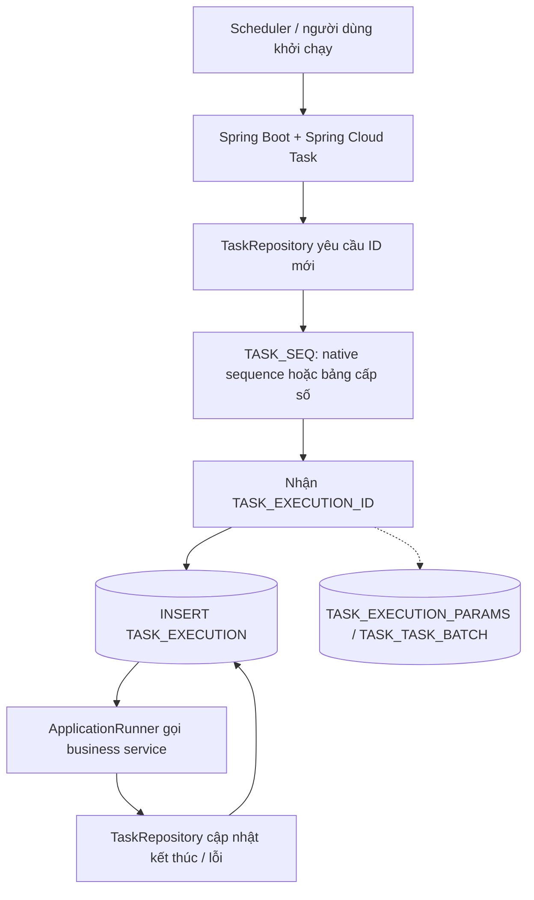

# Định danh tự tăng, sequence và khác biệt giữa các cơ sở dữ liệu

## 1. Vì sao TaskRepository cần cấp định danh?

Một ứng dụng **Spring Cloud Task** là chương trình Spring Boot thực hiện công việc hữu hạn rồi kết thúc: nhập tệp, xử lý yêu cầu, đồng bộ dữ liệu hoặc tạo báo cáo. Khi dùng `TaskRepository` dựa trên JDBC, framework lưu **metadata của từng lần chạy** vào cơ sở dữ liệu để truy vấn thời điểm bắt đầu, kết thúc, tham số và trạng thái thành công/thất bại.

Một lần chạy cần có định danh riêng, kể cả khi tên task và tham số giống lần trước. Định danh này là **`TASK_EXECUTION_ID`** trong bảng `TASK_EXECUTION` và tương ứng với `TaskExecution.getExecutionId()` trong Java.

| Khái niệm | Ý nghĩa | Ví dụ |
| --- | --- | --- |
| `TASK_NAME` | Loại công việc, thường ổn định qua nhiều lần chạy | `daily-import` |
| `TASK_EXECUTION_ID` | Khóa định danh **một lần chạy** trong kho TaskRepository | `101`, `102`, `103` |
| `EXTERNAL_EXECUTION_ID` | Mã tương quan do hệ thống điều phối bên ngoài cung cấp, khi được cấu hình | `job-run-abc` |
| `PARENT_TASK_EXECUTION_ID` | Liên kết metadata tới lần chạy task cha, khi có | `98` |
| `JOB_EXECUTION_ID` của Spring Batch | Định danh một lần chạy Batch job, nằm ở kho metadata Batch | `802` |
| `order_id`, `report_id`... | Khóa dữ liệu nghiệp vụ do ứng dụng tự quản lý | `ORD-2026-1001` |

**Không dùng `TASK_EXECUTION_ID` làm khóa nghiệp vụ**, vì việc thử lại một công việc có thể tạo thêm một lần thực thi mới. Ngược lại, cũng không dùng `TASK_NAME` làm khóa chính: nhiều lần chạy hợp lệ có cùng tên.

Trong schema chuẩn, các thành phần thường gặp gồm:

- `TASK_EXECUTION`: một hàng cho mỗi lần thực thi, bao gồm `TASK_EXECUTION_ID`, tên, thời điểm, mã thoát và thông tin lỗi.
- `TASK_EXECUTION_PARAMS`: các tham số gắn với lần thực thi, tham chiếu `TASK_EXECUTION_ID`.
- `TASK_TASK_BATCH`: bảng liên kết `TASK_EXECUTION_ID` với `JOB_EXECUTION_ID` khi Spring Cloud Task phối hợp với Spring Batch.
- `TASK_SEQ`: đối tượng cấp ID cho lần chạy (có thể được cài đặt dưới dạng **bảng cấp số** hoặc **sequence của CSDL**, tùy phiên bản và dialect).
- `TASK_LOCK`: metadata khóa phục vụ chế độ giới hạn một task cùng tên chạy đồng thời khi tính năng này được bật và cấu hình đúng.

Tên bảng, cấu trúc cột, cách cấp số và việc có thêm bảng hỗ trợ phụ thuộc **phiên bản Spring Cloud Task**, loại CSDL và cấu hình prefix. Khi triển khai, phải dùng script schema đi kèm đúng phiên bản thư viện, thay vì tự suy luận DDL từ một ví dụ chung.

## 2. Ba cách tạo ID thường bị nhầm lẫn

Các hệ quản trị cơ sở dữ liệu cung cấp nhiều cơ chế tăng số tự động. Chúng giải quyết bài toán tương tự nhưng **không có API SQL, cách lưu trạng thái hoặc hành vi đồng thời hoàn toàn giống nhau**.

### 2.1. IDENTITY / AUTO_INCREMENT: tăng số gắn với cột

Với cơ chế này, cột khóa chính tự sinh giá trị khi ứng dụng `INSERT` mà không truyền ID. Ví dụ **minh họa riêng cho bảng nghiệp vụ**:

```sql
-- PostgreSQL: bảng ví dụ, KHÔNG phải DDL TaskRepository
CREATE TABLE demo_events (
    id BIGINT GENERATED BY DEFAULT AS IDENTITY PRIMARY KEY,
    event_type VARCHAR(60) NOT NULL
);

INSERT INTO demo_events (event_type) VALUES ('IMPORT_STARTED');
```

Ví dụ tương tự cho MySQL:

```sql
-- MySQL: cú pháp riêng của MySQL, không dùng thay schema framework
CREATE TABLE demo_events (
    id BIGINT NOT NULL AUTO_INCREMENT PRIMARY KEY,
    event_type VARCHAR(60) NOT NULL
);

INSERT INTO demo_events (event_type) VALUES ('IMPORT_STARTED');
```

Động cơ CSDL cấp số cho cột `id`. Đây là cách thường thấy trong ứng dụng CRUD, nhưng **không được mặc định thay** `TASK_EXECUTION_ID` bằng `IDENTITY` hay `AUTO_INCREMENT`: Spring Cloud Task có cơ chế lấy ID qua thành phần cấp số của chính framework. Nếu chỉ sửa DDL một phía, code và schema có thể không còn khớp nhau.

### 2.2. Native sequence: đối tượng tạo số độc lập với bảng

PostgreSQL, Oracle, SQL Server và nhiều CSDL khác hỗ trợ **sequence** riêng. Ứng dụng có thể xin một số trước khi chèn hàng. Ví dụ độc lập trên PostgreSQL:

```sql
-- Ví dụ học cú pháp PostgreSQL, không đại diện script schema của Task
CREATE SEQUENCE demo_event_seq START WITH 1 INCREMENT BY 1;

CREATE TABLE demo_sequence_events (
    id BIGINT PRIMARY KEY,
    event_type VARCHAR(60) NOT NULL
);

INSERT INTO demo_sequence_events (id, event_type)
VALUES (nextval('demo_event_seq'), 'IMPORT_STARTED');
```

Một sequence có thể cấp số cho nhiều lần chèn. Việc gọi `nextval` thường **tiêu thụ giá trị ngay cả khi transaction sau đó rollback**; vì thế số có thể nhảy cóc. Sequence bảo đảm cách xin số theo cơ chế của CSDL, **không bảo đảm** các giao dịch commit theo đúng thứ tự ID.

### 2.3. Sequence table: bảng mô phỏng bộ đếm

Ở CSDL hoặc phiên bản schema không dùng native sequence, framework có thể sử dụng một **bảng chứa giá trị bộ đếm**. Bộ cấp ID truy cập bảng đó qua SQL thích hợp để lấy số tiếp theo và lưu lại trạng thái bộ đếm.

Ví dụ **mô hình tư duy**, không phải script hay thuật toán cấp số của Spring Cloud Task:

```text
COUNTER_TABLE
+--------------+
| NEXT_VALUE   |
+--------------+
| 101          |
+--------------+

Ứng dụng A xin ID -> bộ cấp số trả 101, cập nhật bộ đếm
Ứng dụng B xin ID -> bộ cấp số trả 102, cập nhật bộ đếm
```

Để an toàn khi nhiều tiến trình chạy đồng thời, cơ chế cập nhật bảng đếm phải có khóa/giao dịch phù hợp và do một bộ cấp số tương thích với dialect thực hiện. Ví dụ trên **không phải hướng dẫn tự viết `SELECT MAX(id) + 1`**: hai tiến trình có thể đọc cùng một `MAX(id)` rồi chèn trùng.

| Tiêu chí | Identity / auto-increment | Native sequence | Bảng cấp số |
| --- | --- | --- | --- |
| Đối tượng quản lý bộ đếm | Thường gắn với cột/bảng | Sequence riêng trong DB | Một bảng/hàng bộ đếm |
| Xin số trước `INSERT` | Tùy tính năng của DB; thường lấy khi chèn | Thường có thể gọi trực tiếp | Có thể qua thao tác SQL của incrementer |
| Áp lực khi nhiều tiến trình xin số | Tùy engine/khóa | Thường tối ưu cho việc cấp số | Có thể tranh chấp khóa trên hàng/bảng bộ đếm |
| Có thể xuất hiện lỗ hổng ID | Có | Có | Có thể có, tùy transaction/cơ chế cấp số |
| Dùng trực tiếp cho `TASK_EXECUTION_ID`? | Chỉ khi framework/schema thực sự hỗ trợ | Khi dialect/script framework sử dụng | Khi dialect/script framework sử dụng |

**Điểm cần nhớ:** dù dùng cách nào, ID số tăng **không phải** đồng hồ thời gian, số đếm thành công hay cam kết xử lý đúng một lần (*exactly once*). Không dùng `MAX(TASK_EXECUTION_ID)` để kết luận task nào kết thúc sau cùng; hãy xem `START_TIME`, `END_TIME`, mã thoát và metadata tương ứng.

## 3. `TASK_SEQ` và vòng đời tạo một `TaskExecution`

Tài liệu schema Spring Cloud Task mô tả ID của `TASK_EXECUTION` được lấy từ **`TASK_SEQ`** khi một `TaskExecution` mới được tạo. Tên đối tượng `TASK_SEQ` là điểm chung để hiểu cơ chế; **loại đối tượng và SQL thao tác có thể khác** giữa H2, PostgreSQL, MySQL, Oracle và SQL Server, cũng như các phiên bản framework.



Ví dụ hai tiến trình chạy cùng tên `daily-import`:

1. Tiến trình A bắt đầu, repository xin ID, tạo `TaskExecution` có ID `501`.
2. Tiến trình B bắt đầu gần như đồng thời, repository xin ID, tạo `TaskExecution` có ID `502`.
3. B hoàn tất trước A. `END_TIME` của bản ghi `502` sớm hơn `501`.
4. Nếu A bị lỗi, `501` có thể được cập nhật mã lỗi trong khi `502` thành công. Giá trị ID **không mô tả kết quả**.

Các số `501` và `502` chỉ để minh họa. Tùy cơ chế cấp số, caching, giao dịch và lần chạy bị huỷ, ID có thể không liên tiếp; điều phải được đảm bảo là định danh **không trùng trong cùng kho thực thi**. Với công việc chạy lại sau timeout, một yêu cầu nghiệp vụ còn có thể tương ứng với **nhiều** bản ghi `TaskExecution`.

### Khi ID đã được cấp từ hệ thống điều phối

Spring Cloud Task có luồng tích hợp cho phép hệ thống ngoài tạo `TaskExecution` trước, sau đó truyền `spring.cloud.task.executionid` vào tiến trình để nó cập nhật bản ghi tương ứng. Cơ chế này **khác** với việc tự chọn một ID bất kỳ:

```bash
# Chỉ minh họa cú pháp; ID 501 phải tồn tại trong TaskRepository phù hợp
java -jar target/daily-import-task.jar --spring.cloud.task.executionid=501
```

Hệ thống tạo sẵn bản ghi phải phối hợp với cùng kho metadata, schema và cơ chế cấp ID của framework. Tránh tự chèn ID thủ công hoặc dùng ID từ một CSDL khác vì có nguy cơ cập nhật nhầm bản ghi hoặc xung đột khi repository tạo bản ghi mới.

## 4. Khác biệt giữa những cơ sở dữ liệu thường dùng

Spring Cloud Task hỗ trợ nhiều RDBMS, gồm H2, HSQLDB, PostgreSQL, MySQL, Oracle, SQL Server và DB2. Phần này mô tả **khả năng nền tảng của từng DB**, không khẳng định rằng mọi phiên bản script `schema-*.sql` đều sử dụng một cơ chế duy nhất.

| CSDL | Khả năng cấp số phổ biến | Điểm cần lưu ý khi dùng TaskRepository |
| --- | --- | --- |
| **H2** | `IDENTITY`, `CREATE SEQUENCE` | `mem:` mất dữ liệu sau khi JVM dừng; `file:` giữ trên đĩa nhưng phụ thuộc đường dẫn và khóa file; kiểm tra script H2 đi kèm phiên bản Task |
| **PostgreSQL** | Native sequence, `GENERATED ... AS IDENTITY` | Sequence là đối tượng riêng, có quyền và giá trị hiện tại cần quản lý khi backup/restore; kiểm tra `search_path`/schema thực tế |
| **MySQL** | `AUTO_INCREMENT` cho cột; mô phỏng sequence bằng bảng khi cần | Không giả định MySQL có `CREATE SEQUENCE` giống PostgreSQL; chú ý engine, khóa khi ghi bộ đếm và collation/tên bảng |
| **Oracle** | Native sequence, identity trong các phiên bản hiện đại | Schema/user và quyền truy cập sequence quan trọng; cú pháp/lược đồ phải đúng bản Oracle và script Task |
| **SQL Server** | `IDENTITY`, native `CREATE SEQUENCE`, hoặc bảng cấp số trong schema cũ | Một số phiên bản/schema cũ dùng bảng `TASK_SEQ`, có thể gặp deadlock khi nhiều task khởi động cùng lúc; đọc hướng dẫn migration trước khi đổi sang sequence thật |
| **DB2 / HSQLDB** | Cơ chế identity/sequence tùy DB | Chỉ dùng script chính thức đúng dialect và xác nhận khả năng khởi tạo schema tương ứng |

### 4.1. H2: kiểm thử nhanh và tính bền vững của ID

Với `jdbc:h2:mem:task_demo`, database tồn tại trong JVM; khởi động lại tiến trình là tạo một kho metadata mới. Vì thế ID có thể **bắt đầu lại** ở lần chạy mới dù tên task giữ nguyên. Đây không phải lỗi cấp số: hai lần chạy thuộc **hai database khác nhau**.

Với `jdbc:h2:file:./data/task_demo`, dữ liệu nằm trong file H2. Nếu giữ nguyên thư mục làm việc, file và schema, những lần chạy khác nhau có thể dùng chung lịch sử và trạng thái bộ cấp số. Nếu đổi `working directory` hoặc xoá file, bạn có thể nhìn thấy ID bắt đầu từ đầu do đã chuyển sang một kho mới.

H2 file-based phù hợp bài lab; khi chạy nhiều tiến trình trên nhiều máy, nên sử dụng database server có cơ chế truy cập đồng thời và vận hành tập trung.

### 4.2. PostgreSQL và Oracle: chú ý trạng thái sequence

Với dialect dùng native sequence, trạng thái bộ đếm **không nhất thiết suy ra từ `MAX(TASK_EXECUTION_ID)`**. Sau khi restore chỉ dữ liệu bảng nhưng bỏ qua sequence, giá trị sequence có thể thấp hơn ID đã tồn tại. Khi tạo lần chạy mới, có thể xảy ra trùng khóa hoặc lỗi cấp ID.

Không sửa số hiện tại bằng một giá trị đoán trước trên production. Cần xác định sequence mà phiên bản Spring Cloud Task sử dụng, xem giá trị hiện tại, tính đến các ID đã có và các tiến trình đang chạy, rồi thực hiện migration trong thời gian đã khóa/điều phối thích hợp. PostgreSQL và Oracle dùng cú pháp kiểm tra/chỉnh sequence khác nhau.

### 4.3. MySQL: bảng cấp số và rủi ro tranh chấp

MySQL nổi tiếng với `AUTO_INCREMENT`, nhưng TaskRepository có thể sử dụng **bảng cấp số độc lập** theo script framework. Khi nhiều instance cùng xin ID, một hàng/bảng bộ đếm trở thành điểm tranh chấp; transaction dài hoặc thứ tự khóa khác nhau giữa các thao tác có thể làm tăng thời gian chờ hoặc gây deadlock. Đây là lý do không nên thay trình cấp ID của framework bằng `MAX(id)+1` hay `AUTO_INCREMENT` tự phát.

Khi gặp timeout hoặc deadlock, cần kiểm tra log của DB, transaction, chỉ mục và phiên bản driver/framework; xử lý theo chính sách retry cho phép và **không tái chạy toàn bộ nghiệp vụ** nếu chưa kiểm tra idempotency.

### 4.4. SQL Server: khi nào cần native sequence?

Tài liệu Spring Cloud Task từng nêu tình huống nhiều tiến trình SQL Server đồng thời gây deadlock trên bảng `TASK_SEQ`, và hướng dùng native sequence cùng tên để giảm tranh chấp. Các migration guide của các dòng phiên bản mới hơn cũng mô tả thay đổi DDL SQL Server từ bảng mô phỏng sang sequence thật.

Ví dụ cú pháp **tham khảo về native sequence SQL Server**, không phải script thay thế toàn bộ schema:

```sql
-- Ví dụ cú pháp, KHÔNG chạy trực tiếp trên kho TaskRepository đang hoạt động
CREATE SEQUENCE dbo.demo_execution_seq
    AS BIGINT
    START WITH 1
    INCREMENT BY 1;

SELECT NEXT VALUE FOR dbo.demo_execution_seq;
```

Nếu kho thực tế đang có bảng `TASK_SEQ` và cần di chuyển sang native sequence, **không chỉ `DROP TABLE TASK_SEQ` rồi tạo sequence từ 1**. Phải đối chiếu cấu trúc nguồn, phiên bản framework/driver, giá trị cao nhất đã cấp, quyền truy cập và hướng dẫn migration; bảo đảm không có phiên task nào cấp ID trong lúc chuyển đổi. Với hệ thống có lịch sử, số bắt đầu phải cao hơn tất cả ID đã sử dụng và trạng thái bộ cấp số liên quan.

## 5. Bài lab: quan sát ID trong H2 qua nhiều lần chạy

### 5.1. Thiết lập một ứng dụng Spring Cloud Task nhỏ

Tạo dự án Spring Boot với JDK và phiên bản **Spring Cloud tương thích**; dùng Spring Cloud BOM của dòng phiên bản đã chọn. Dependency Maven tối thiểu cho bài lab:

```xml
<dependencies>
    <dependency>
        <groupId>org.springframework.cloud</groupId>
        <artifactId>spring-cloud-starter-task</artifactId>
    </dependency>
    <dependency>
        <groupId>com.h2database</groupId>
        <artifactId>h2</artifactId>
        <scope>runtime</scope>
    </dependency>
</dependencies>
```

Ví dụ `IdDemoApplication.java`:

```java
import org.springframework.boot.ApplicationRunner;
import org.springframework.boot.SpringApplication;
import org.springframework.boot.autoconfigure.SpringBootApplication;
import org.springframework.context.annotation.Bean;

@SpringBootApplication
public class IdDemoApplication {
    public static void main(String[] args) {
        SpringApplication.run(IdDemoApplication.class, args);
    }

    @Bean
    ApplicationRunner runOnce() {
        return args -> {
            System.out.println("Bắt đầu xử lý một lần chạy ngắn.");
            // Trong ứng dụng thật: gọi service xử lý và lưu kết quả nghiệp vụ.
            System.out.println("Hoàn tất tác vụ.");
        };
    }
}
```

Đặt `src/main/resources/application.yml`:

```yaml
spring:
  application:
    name: id-demo-task
  main:
    web-application-type: none
  datasource:
    driver-class-name: org.h2.Driver
    url: jdbc:h2:file:./data/id-demo;DB_CLOSE_ON_EXIT=FALSE
    username: sa
    password: ""
  cloud:
    task:
      name: id-demo-task
      initialize-enabled: true
```

`initialize-enabled: true` phù hợp bài lab khi thư viện có thể tạo schema cho H2. Tùy phiên bản Spring Cloud Task, phải bảo đảm database được khởi tạo đúng theo script của phiên bản đó. `sa`/mật khẩu rỗng chỉ dùng cục bộ.

Giả sử đã build thành executable JAR `target/id-demo-task.jar`, tạo thư mục `data` trong **working directory** rồi chạy tuần tự:

```bash
mkdir data
java -jar target/id-demo-task.jar
java -jar target/id-demo-task.jar
java -jar target/id-demo-task.jar
```

Sau khi cả ba tiến trình kết thúc, mở H2 Shell hoặc client SQL với JDBC URL `jdbc:h2:file:./data/id-demo;IFEXISTS=TRUE` từ cùng working directory. `IFEXISTS=TRUE` giúp phát hiện sai đường dẫn thay vì vô ý tạo database mới.

### 5.2. Quan sát khóa chính và thứ tự thời gian

```sql
SELECT TASK_EXECUTION_ID,
       TASK_NAME,
       START_TIME,
       END_TIME,
       EXIT_CODE
FROM TASK_EXECUTION
ORDER BY TASK_EXECUTION_ID;
```

Bạn kỳ vọng có ba bản ghi (nếu ba lần chạy thành công và cùng dùng một database), cùng `TASK_NAME` nhưng **ba `TASK_EXECUTION_ID` khác nhau**. Không yêu cầu các ID phải là `1, 2, 3`: bộ cấp số có thể bắt đầu ở giá trị khác, có khoảng trống hoặc đã từng có dữ liệu.

Kiểm tra trùng ID và đếm số bản ghi:

```sql
SELECT COUNT(*) AS TOTAL_ROWS,
       COUNT(DISTINCT TASK_EXECUTION_ID) AS DISTINCT_IDS,
       MIN(TASK_EXECUTION_ID) AS MIN_ID,
       MAX(TASK_EXECUTION_ID) AS MAX_ID
FROM TASK_EXECUTION;
```

`TOTAL_ROWS = DISTINCT_IDS` xác nhận không có giá trị ID bị lặp trong tập kết quả; ràng buộc `PRIMARY KEY` của schema thực tế mới là cơ chế bảo vệ dữ liệu khi nhiều tiến trình ghi cùng lúc. `MAX_ID - MIN_ID + 1` có thể **lớn hơn** tổng số hàng do sequence có lỗ hổng; đây không phải kết luận rằng bản ghi bị mất.

### 5.3. Xác định `TASK_SEQ` là bảng hay native sequence

Đừng chạy ngay `SELECT * FROM TASK_SEQ` vì lệnh đó chỉ hợp lệ nếu `TASK_SEQ` **thực sự là bảng**. Trước tiên xem metadata H2:

```sql
-- H2: các bảng có tiền tố TASK_
SELECT TABLE_NAME
FROM INFORMATION_SCHEMA.TABLES
WHERE TABLE_SCHEMA = 'PUBLIC'
  AND TABLE_NAME LIKE 'TASK%'
ORDER BY TABLE_NAME;

-- H2: các sequence có tên liên quan TASK
SELECT SEQUENCE_NAME
FROM INFORMATION_SCHEMA.SEQUENCES
WHERE SEQUENCE_SCHEMA = 'PUBLIC'
  AND SEQUENCE_NAME LIKE 'TASK%'
ORDER BY SEQUENCE_NAME;
```

Nếu `TASK_SEQ` xuất hiện trong danh sách bảng thì có thể quan sát nội dung bảng theo **DDL của phiên bản bạn đang dùng**; nếu nó xuất hiện trong danh sách sequence, hãy dùng khả năng introspection sequence của DB/client. **Không gọi lệnh xin số tiếp theo chỉ để kiểm tra**: thao tác đó có thể làm thay đổi trạng thái và tạo khoảng trống ID.

Nếu không thấy `TASK_SEQ`, hãy kiểm tra schema khác `PUBLIC`, table prefix tùy chỉnh, script đã chạy, dữ liệu kết nối và cấu hình phiên bản; đừng tự tạo một sequence mới để chữa lỗi khi chưa xác định nguyên nhân.

## 6. Kiểm tra sequence ở các CSDL khác

Các truy vấn dưới đây **chỉ đọc metadata**. Chúng không cập nhật giá trị bộ đếm; kết quả phải được đối chiếu với tên schema/prefix thực tế.

### PostgreSQL

```sql
-- Các sequence thấy được trong database hiện tại
SELECT schemaname, sequencename
FROM pg_catalog.pg_sequences
WHERE lower(sequencename) LIKE '%task%'
ORDER BY schemaname, sequencename;

-- Các bảng liên quan task
SELECT table_schema, table_name
FROM information_schema.tables
WHERE lower(table_name) LIKE 'task%'
ORDER BY table_schema, table_name;
```

### MySQL

```sql
-- Phân biệt các bảng task trong database đang chọn
SELECT TABLE_SCHEMA, TABLE_NAME, ENGINE
FROM information_schema.TABLES
WHERE TABLE_SCHEMA = DATABASE()
  AND TABLE_NAME LIKE 'TASK%'
ORDER BY TABLE_NAME;
```

MySQL không có `pg_sequences`; nếu script Task dùng bảng `TASK_SEQ`, tên này sẽ nằm trong danh sách bảng. Nếu không thấy, hãy đối chiếu script của đúng phiên bản framework và cấu hình schema/prefix.

### Oracle

```sql
-- Sequence thuộc schema của user hiện tại
SELECT SEQUENCE_NAME, LAST_NUMBER
FROM USER_SEQUENCES
WHERE SEQUENCE_NAME LIKE '%TASK%';
```

`LAST_NUMBER` có thể phản ánh trạng thái cache, **không phải** luôn là ID được commit gần nhất. Khi có quyền và dùng schema khác, cần xem thêm metadata tương ứng của owner/schema.

### SQL Server

```sql
-- Tên và schema của native sequence
SELECT s.name AS schema_name, q.name AS sequence_name
FROM sys.sequences AS q
JOIN sys.schemas AS s ON s.schema_id = q.schema_id
WHERE q.name LIKE '%TASK%';

-- Kiểm tra bảng cấp số trong schema
SELECT s.name AS schema_name, t.name AS table_name
FROM sys.tables AS t
JOIN sys.schemas AS s ON s.schema_id = t.schema_id
WHERE t.name LIKE 'TASK%';
```

Nếu cả hai loại đối tượng tồn tại, cần xem script migration và cấu hình framework để hiểu **đối tượng nào đang được sử dụng**, tránh tự xóa vì tên trông giống nhau.

## 7. Triển khai schema và nâng cấp an toàn

Trong học tập, framework có thể tự khởi tạo schema. Với môi trường vận hành, đặc biệt khi chạy theo lịch hoặc nhiều task instance, nên **quản lý schema bằng migration** và dùng CSDL bền vững.

Ví dụ cấu hình PostgreSQL cho tiến trình Task:

```yaml
spring:
  application:
    name: daily-import
  main:
    web-application-type: none
  datasource:
    url: ${TASK_DB_URL}
    username: ${TASK_DB_USER}
    password: ${TASK_DB_PASSWORD}
  cloud:
    task:
      name: daily-import
      initialize-enabled: false
```

Đồng thời khai báo JDBC driver PostgreSQL ở runtime. `initialize-enabled: false` chỉ đúng khi **schema chính thức đã được tạo hoặc nâng cấp trước**; nếu thiếu bảng/sequence, repository có thể lỗi ngay lúc khởi động.

Quy trình triển khai an toàn:

1. **Chốt phiên bản** Spring Boot, Spring Cloud Task, JDBC driver và loại/version RDBMS; lấy DDL hoặc migration chính thức phù hợp. Không lấy script từ một bài blog của dòng phiên bản khác.
2. **Kiểm tra đối tượng hiện tại**: bảng `TASK_EXECUTION`, đối tượng `TASK_SEQ`, những bảng tham số/Batch/lock liên quan, schema và table prefix. Khi dùng nhiều `DataSource`, phải xác định đúng `DataSource` của `TaskRepository`/`TaskConfigurer`.
3. **Sao lưu đầy đủ** cả bảng lẫn trạng thái bộ cấp số; thử khôi phục trên môi trường staging. Chỉ sao lưu `TASK_EXECUTION` mà bỏ trạng thái sequence có thể khiến lần chạy tiếp theo đụng ID cũ.
4. **Đánh giá ID đã cấp** và các tiến trình còn chạy trước khi chỉnh sequence. Nếu di chuyển giữa hai cơ chế, phải bảo đảm số tiếp theo không đè lên bất kỳ `TASK_EXECUTION_ID` đang tồn tại hoặc còn có thể được cấp từ tiến trình cũ.
5. **Áp dụng migration có kiểm soát**, quyền phù hợp, khóa/giới hạn lịch chạy trong thời gian nâng cấp và phương án rollback. Không tự tạo bảng `TASK_SEQ` song song với native sequence cùng tên.
6. **Kiểm thử thực tế** bằng hai lần chạy nối tiếp và một kiểm thử đồng thời có kiểm soát; xác nhận các ID khác nhau, bản ghi hoàn tất đúng, và không có deadlock/duplicate key.
7. **Thiết lập theo dõi** lỗi cấp ID, deadlock, timeout, mất kết nối, số bản ghi chưa kết thúc và dung lượng metadata; duy trì chính sách lưu trữ/archival có tính đến liên kết khóa ngoại.

> **Quan trọng:** `spring.cloud.task.tablePrefix` có thể thay đổi tiền tố bảng metadata. Khi thay prefix, trách nhiệm tạo các bảng phù hợp thường thuộc về người triển khai; phải xem cả cách tham chiếu đến sequence/bộ cấp số của phiên bản tương ứng. Không dùng đổi prefix để chữa lỗi thiếu schema khi chưa kiểm tra nguyên nhân.

### Điều gì xảy ra khi một task chạy lại?

Một lần task lỗi có thể đã ghi dữ liệu nghiệp vụ trước khi dừng. Lần retry có thể có `TASK_EXECUTION_ID` mới dù tên task và tham số không đổi. **Cấp ID duy nhất cho metadata không đồng nghĩa xử lý nghiệp vụ đúng một lần**. Hãy dùng khóa nghiệp vụ, idempotency key, transaction và chính sách retry thích hợp. Nếu tích hợp Spring Batch, cần quản lý thêm `JobRepository` và metadata `BATCH_*`; các bộ cấp số `JOB_SEQ`, `JOB_EXECUTION_SEQ`... (tùy phiên bản) là cơ chế riêng, không nên gộp với `TASK_SEQ`.

## 8. Lỗi thường gặp và cách chẩn đoán

| Triệu chứng | Nguyên nhân có thể | Cách xử lý |
| --- | --- | --- |
| `Table "TASK_EXECUTION" not found` hoặc không tìm thấy `TASK_SEQ` | Chưa khởi tạo schema, kết nối sai DB/schema, prefix không khớp | Kiểm tra JDBC URL, `TaskConfigurer`, schema và script DDL đúng phiên bản |
| Duplicate key trên `TASK_EXECUTION_ID` sau restore | Bộ cấp số chưa được khôi phục/điều chỉnh tương ứng với dữ liệu đã có | Tạm dừng cấp ID, kiểm tra sequence/bảng cấp số và áp dụng migration an toàn |
| Hai lần chạy H2 đều thấy ID nhỏ nhất như mới | Mỗi JVM dùng H2 in-memory mới hoặc file H2 khác đường dẫn | Dùng chung DB bền vững và xác định tuyệt đối đường dẫn file |
| MySQL xuất hiện lock wait/deadlock | Cạnh tranh trên bảng cấp số hoặc giao dịch khác | Phân tích deadlock log, transaction, độ đồng thời và cơ chế incrementer theo phiên bản |
| SQL Server deadlock trên `TASK_SEQ` | Schema cũ dùng bảng mô phỏng khi nhiều task chạy song song | Kiểm tra migration chính thức; cân nhắc native sequence theo đúng dòng phiên bản, không tự đổi DDL nóng |
| PostgreSQL / Oracle báo thiếu quyền sequence | Tài khoản kết nối không có quyền trên đối tượng cấp số | Cấp quyền phù hợp trên đúng schema/sequence và xác minh tài khoản runtime |
| ID tăng không liên tục | Sequence cache, rollback, xin ID nhưng chưa chèn, hoặc trạng thái cũ | Không coi lỗ hổng là lỗi; đối chiếu dữ liệu và log, không tự reset bộ cấp số |
| ID lớn hơn nhưng `END_TIME` sớm hơn | Nhiều task chạy đồng thời và kết thúc khác thứ tự bắt đầu | Truy vết bằng thời gian, trạng thái và execution ID; không suy luận thứ tự hoàn tất từ ID |
| Tạo bảng với `AUTO_INCREMENT` nhưng repository vẫn lỗi | Cơ chế cấp ID ở code không khớp DDL đã sửa | Khôi phục schema chính thức đúng dialect/version và kiểm thử lại |

## 9. Bài thực hành tự kiểm tra

1. Giải thích vì sao hai task có cùng `TASK_NAME` vẫn phải có hai `TASK_EXECUTION_ID` khác nhau. Lấy ví dụ một lần thành công, một lần thất bại.
2. Trên H2 file-based, chạy task ba lần, truy vấn `TASK_EXECUTION`, kiểm tra số bản ghi và số ID khác nhau. Có cần ID bắt buộc liên tiếp không? Vì sao?
3. Mở metadata H2 để xác định `TASK_SEQ` là bảng hay sequence trong **phiên bản đang dùng**. Nêu vì sao không nên gọi lệnh `NEXT VALUE` chỉ để đọc trạng thái.
4. So sánh cách chèn bảng demo có `IDENTITY`/`AUTO_INCREMENT` với việc framework xin ID từ `TASK_SEQ`. Điều gì có thể sai nếu chỉ thay DDL của `TASK_EXECUTION`?
5. Một database PostgreSQL được restore dữ liệu `TASK_EXECUTION` đến ID `900`, nhưng sequence vẫn ở trạng thái cũ. Hãy mô tả bước điều tra và kế hoạch migration an toàn **không cần chạy lệnh sửa trực tiếp**.
6. Một scheduler kích hoạt đồng thời 20 tiến trình trên SQL Server và xuất hiện deadlock tại `TASK_SEQ`. Nêu sự khác nhau giữa sửa lịch đồng thời, chuyển đúng migration sequence và tự viết `MAX(id)+1`.
7. Trong task chạy Spring Batch, phân biệt `TASK_EXECUTION_ID`, `JOB_EXECUTION_ID` và ID nghiệp vụ. Vì sao các bộ cấp số cần được duy trì riêng?
8. Lập checklist khi chuyển lab H2 sang PostgreSQL: JDBC driver, schema Task đúng phiên bản, đối tượng cấp số, quyền, migration, transaction, backup và kiểm thử chạy đồng thời.

Hoàn thành bài học khi bạn có thể giải thích **ID của một lần chạy được cấp từ đâu**, phân biệt `IDENTITY`, native sequence và bảng cấp số; chỉ ra sự khác nhau giữa các DB mà không áp dụng nhầm DDL; và chuẩn bị/migrate **TaskRepository** đủ an toàn để theo dõi tác vụ chạy theo lịch, theo yêu cầu hoặc phối hợp với Spring Batch.

## 10. Tài liệu tham khảo

- [Spring Cloud Task — Task Repository Schema](https://docs.spring.io/spring-cloud-task/docs/current/reference/html/appendix-task-repository-schema.html): các bảng metadata, `TASK_EXECUTION_ID`, `TASK_SEQ` và lưu ý về SQL Server.
- [Spring Cloud Task — Configuration](https://docs.spring.io/spring-cloud-task/docs/current/reference/htmlsingle/): `DataSource`, `TaskConfigurer`, table prefix, tự khởi tạo schema và `spring.cloud.task.executionid`.
- [Spring Cloud Task — Getting started](https://docs.spring.io/spring-cloud-task/reference/getting-started.html): ví dụ TaskRepository với H2 và dòng đời task.
- [Spring Cloud Task 3.0 Migration Guide](https://github.com/spring-cloud/spring-cloud-task/wiki/Spring-Cloud-Task-3.0-Migration-Guide): ví dụ thay đổi DDL và cách chuyển sequence giữa các dòng phiên bản.

Trong triển khai thật, ưu tiên DDL đi kèm **đúng artifact Spring Cloud Task đang chạy** và hướng dẫn migration của phiên bản đó hơn mọi câu lệnh minh họa trong tài liệu học.
