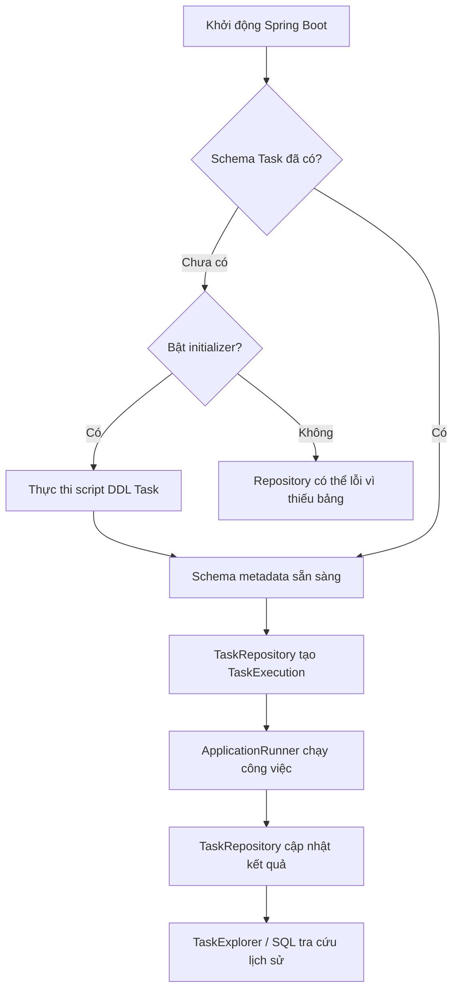

# Khởi tạo schema bằng `spring.cloud.task.initialize-enabled`

## 1. Mục tiêu bài học

Một ứng dụng **Spring Cloud Task** thường chạy công việc hữu hạn rồi kết thúc: đồng bộ dữ liệu, nhập tệp, tạo báo cáo hoặc thực hiện lệnh từ một hệ thống điều phối. Để giám sát và tra cứu các lần chạy, Spring Cloud Task dùng **`TaskRepository`** lưu thông tin như thời điểm bắt đầu, thời điểm kết thúc, tham số, trạng thái và mã thoát.

Muốn lưu được những thông tin đó, cơ sở dữ liệu phải có **schema metadata của Spring Cloud Task**. Thuộc tính **`spring.cloud.task.initialize-enabled`** điều khiển việc hạ tầng Spring Cloud Task tự khởi tạo schema metadata khi ứng dụng bắt đầu.

Sau bài học, bạn có thể:

- Hiểu vì sao `TaskRepository` cần các bảng metadata trước khi ghi `TaskExecution`.
- Bật `spring.cloud.task.initialize-enabled: true` để tạo schema cho một database thực hành.
- Tắt tính năng khởi tạo khi schema đã được quản lý bởi migration hoặc DBA.
- Phân biệt schema Spring Cloud Task với schema nghiệp vụ, schema Spring Batch và các cơ chế chạy SQL khác của Spring Boot.
- Kiểm tra các bảng, bản ghi và xử lý lỗi thiếu bảng, thiếu quyền, sai datasource hoặc script không khớp.
- Chọn quy trình an toàn cho task chạy theo lịch, theo yêu cầu hoặc chạy trên nhiều máy.

Ví dụ xuyên suốt sử dụng ứng dụng `schema-demo-task` với cơ sở dữ liệu H2 lưu ra tệp: lần đầu bật profile `init`, các lần sau chạy bình thường khi initializer đã tắt.

## 2. Schema metadata của Spring Cloud Task gồm những gì?

**`TaskRepository`** ghi và cập nhật dữ liệu thực thi; **`TaskExplorer`** giúp đọc và tra cứu các lần chạy. Cả hai phụ thuộc vào cấu trúc metadata mà phiên bản Spring Cloud Task mong đợi.

Một số đối tượng thường gặp trong schema chuẩn:

| Đối tượng | Vai trò |
| --- | --- |
| `TASK_EXECUTION` | Lưu một bản ghi cho **mỗi lần chạy**: ID, tên, mốc thời gian, mã thoát và thông tin lỗi. |
| `TASK_EXECUTION_PARAMS` | Lưu các tham số gắn với lần thực thi. |
| `TASK_TASK_BATCH` | Liên hệ thông tin task với Spring Batch job khi sử dụng tích hợp tương ứng. |
| Sequence, bảng cấp ID hoặc cơ chế identity tùy hệ quản trị | Hỗ trợ tạo khóa định danh của lần thực thi. |

Tên cột, kiểu dữ liệu và đối tượng hỗ trợ phụ thuộc phiên bản thư viện và hệ quản trị cơ sở dữ liệu. Khi quản lý schema thủ công, phải lấy DDL **tương ứng đúng phiên bản** Spring Cloud Task đang chạy.



**Schema metadata khác schema nghiệp vụ.** Thuộc tính khởi tạo của Spring Cloud Task không tự tạo những bảng như `CUSTOMERS`, `ORDERS` hoặc bảng dùng để lưu báo cáo. Những bảng đó cần cơ chế migration hoặc DDL riêng của ứng dụng.

## 3. Hiểu đúng `spring.cloud.task.initialize-enabled`

Khai báo bằng YAML:

```yaml
spring:
  cloud:
    task:
      initialize-enabled: true
```

Hoặc dạng properties:

```properties
spring.cloud.task.initialize-enabled=true
```

Thuộc tính này là **công tắc cho phép hạ tầng Spring Cloud Task khởi tạo schema metadata**. Nó không quyết định runner có chạy hay không, không tự tạo dữ liệu nghiệp vụ và không thay thế `TaskRepository`.

| Giá trị | Hành vi | Trường hợp sử dụng |
| --- | --- | --- |
| `true` | Cho phép cơ chế khởi tạo schema bằng script do phiên bản Spring Cloud Task hỗ trợ. | Khởi tạo database thực hành hoặc một bước chuẩn bị được kiểm soát. |
| `false` | Không để Spring Cloud Task tự tạo cấu trúc metadata; ứng dụng dùng schema đã chuẩn bị sẵn. | Runtime production hoặc nơi Flyway/Liquibase/DBA quản lý DDL. |

Nên cấu hình tường minh thay vì dựa vào giả định về **giá trị mặc định**, vì dự án và tài liệu ở các phiên bản khác nhau có thể dùng cấu hình không giống nhau.

Những hiểu nhầm cần tránh:

1. **`initialize-enabled=true` không phải lệnh reset database.** Nó không có mục đích xóa lịch sử rồi tạo lại bảng.
2. **Không phải script DDL nào cũng an toàn khi chạy lại.** Nếu bảng đã tồn tại, lệnh tạo bảng có thể lỗi tùy script và cách initializer hoạt động.
3. **`initialize-enabled=false` không vô hiệu hóa repository.** Nó chỉ yêu cầu schema cần thiết đã có trước khi bắt đầu ghi metadata.
4. **Bật initializer không tự sửa được kết nối database.** Sai URL, quyền, dialect hoặc driver đều có thể làm khởi tạo thất bại.
5. **Initializer không phải hệ thống versioned migration.** Việc nâng cấp schema theo phiên bản phải được quản lý có kế hoạch.

## 4. Dự án Spring Boot mẫu

Ví dụ dùng **JDK 17**, **Spring Boot 3.4.5**, **Spring Cloud 2024.0.2** và H2. Khi tạo dự án với phiên bản khác, cần chọn Spring Cloud release train tương thích với Spring Boot.

Cấu trúc:

```text
schema-demo-task/
├── pom.xml
└── src/main/
    ├── java/com/example/schemademo/
    │   ├── SchemaDemoApplication.java
    │   └── SampleTaskRunner.java
    └── resources/
        ├── application.yml
        └── application-init.yml
```

### 4.1. Tệp `pom.xml`

```xml
<?xml version="1.0" encoding="UTF-8"?>
<project xmlns="http://maven.apache.org/POM/4.0.0"
         xmlns:xsi="http://www.w3.org/2001/XMLSchema-instance"
         xsi:schemaLocation="http://maven.apache.org/POM/4.0.0 https://maven.apache.org/xsd/maven-4.0.0.xsd">
    <modelVersion>4.0.0</modelVersion>

    <parent>
        <groupId>org.springframework.boot</groupId>
        <artifactId>spring-boot-starter-parent</artifactId>
        <version>3.4.5</version>
        <relativePath/>
    </parent>

    <groupId>com.example</groupId>
    <artifactId>schema-demo-task</artifactId>
    <version>0.0.1-SNAPSHOT</version>

    <properties>
        <java.version>17</java.version>
    </properties>

    <dependencyManagement>
        <dependencies>
            <dependency>
                <groupId>org.springframework.cloud</groupId>
                <artifactId>spring-cloud-dependencies</artifactId>
                <version>2024.0.2</version>
                <type>pom</type>
                <scope>import</scope>
            </dependency>
        </dependencies>
    </dependencyManagement>

    <dependencies>
        <dependency>
            <groupId>org.springframework.cloud</groupId>
            <artifactId>spring-cloud-starter-task</artifactId>
        </dependency>
        <dependency>
            <groupId>org.springframework.boot</groupId>
            <artifactId>spring-boot-starter-jdbc</artifactId>
        </dependency>
        <dependency>
            <groupId>com.h2database</groupId>
            <artifactId>h2</artifactId>
            <scope>runtime</scope>
        </dependency>
    </dependencies>

    <build>
        <plugins>
            <plugin>
                <groupId>org.springframework.boot</groupId>
                <artifactId>spring-boot-maven-plugin</artifactId>
            </plugin>
        </plugins>
    </build>
</project>
```

`spring-cloud-starter-task` cung cấp hạ tầng Task, `spring-boot-starter-jdbc` cung cấp kết nối JDBC và H2 làm database thử nghiệm.

### 4.2. Cấu hình mặc định: không khởi tạo lại

Tạo `src/main/resources/application.yml`:

```yaml
spring:
  application:
    name: schema-demo-task
  main:
    web-application-type: none
  datasource:
    url: jdbc:h2:file:./data/taskdb;DB_CLOSE_ON_EXIT=FALSE
    driver-class-name: org.h2.Driver
    username: sa
    password: ""
  cloud:
    task:
      name: schema-demo-task
      initialize-enabled: false
      closecontext-enabled: true
```

URL H2 ở chế độ **lưu file** giúp giữ lại metadata sau khi JVM dừng. Đường dẫn `./data/taskdb` tính từ **thư mục hiện hành của lệnh Java**; cần duy trì cùng thư mục khi chạy lần sau hoặc khi dùng SQL client.

`web-application-type: none` giúp tác vụ không mở web server. `closecontext-enabled` hỗ trợ đóng Spring context khi task kết thúc.

### 4.3. Profile `init` để tạo schema lần đầu

Tạo `src/main/resources/application-init.yml`:

```yaml
spring:
  cloud:
    task:
      initialize-enabled: true
```

Khi chạy với profile `init`, `true` trong tệp profile ghi đè `false` ở cấu hình chung. Những lần chạy bình thường không bật profile này sẽ sử dụng schema có sẵn.

Đây là cách trình bày rõ **bước chuẩn bị schema** và **bước sử dụng schema** cho môi trường học tập; môi trường production nên giao DDL cho migration hoặc quy trình triển khai riêng.

### 4.4. Lớp ứng dụng và runner

`src/main/java/com/example/schemademo/SchemaDemoApplication.java`:

```java
package com.example.schemademo;

import org.springframework.boot.SpringApplication;
import org.springframework.boot.autoconfigure.SpringBootApplication;
import org.springframework.cloud.task.configuration.EnableTask;

@SpringBootApplication
@EnableTask
public class SchemaDemoApplication {
    public static void main(String[] args) {
        SpringApplication.run(SchemaDemoApplication.class, args);
    }
}
```

`src/main/java/com/example/schemademo/SampleTaskRunner.java`:

```java
package com.example.schemademo;

import java.util.List;

import org.springframework.boot.ApplicationArguments;
import org.springframework.boot.ApplicationRunner;
import org.springframework.stereotype.Component;

@Component
public class SampleTaskRunner implements ApplicationRunner {

    @Override
    public void run(ApplicationArguments args) {
        List<String> values = args.getOptionValues("item");
        String item = (values == null || values.isEmpty())
                ? "default" : values.get(0);

        if (item.isBlank()) {
            throw new IllegalArgumentException("--item không được rỗng");
        }

        System.out.println("Đã xử lý mục: " + item);
    }
}
```

`@EnableTask` kích hoạt hạ tầng Spring Cloud Task. `ApplicationRunner` định nghĩa công việc hữu hạn. Kết quả in ra stdout để ví dụ tập trung vào schema; trong ứng dụng thật, kết quả nghiệp vụ phải được lưu hoặc gửi đi theo thiết kế riêng.

## 5. Khởi tạo schema và chạy task

Đứng trong thư mục `schema-demo-task`, tạo thư mục H2 và đóng gói JAR:

```bash
mkdir -p data
mvn clean package
```

Trên PowerShell, có thể dùng:

```powershell
New-Item -ItemType Directory -Force data
```

### 5.1. Lần đầu với database chưa có schema Task

```bash
java -jar target/schema-demo-task-0.0.1-SNAPSHOT.jar --spring.profiles.active=init --item=first
```

Trình tự mong đợi:

1. Spring Boot cấu hình `DataSource` trỏ đến `./data/taskdb`.
2. Hạ tầng Spring Cloud Task, với initializer được bật, chuẩn bị cấu trúc metadata cần thiết.
3. `TaskRepository` tạo bản ghi `TaskExecution`.
4. Runner in `Đã xử lý mục: first` rồi kết thúc.
5. Repository cập nhật trạng thái cuối và dữ liệu thời gian cho lần chạy đó.

H2 thường tạo tệp như `data/taskdb.mv.db`. Tên/tệp phụ cụ thể phụ thuộc phiên bản H2. Việc có file database là dấu hiệu kết nối đã được sử dụng, nhưng cần **kiểm tra cả bảng và bản ghi** để biết schema Task đã sẵn sàng.

> Lệnh khởi tạo trên đồng thời thực thi runner. Với ứng dụng có tác động đến dữ liệu thật, không nên dùng thao tác chạy nghiệp vụ làm bước chuẩn bị DDL ở production.

### 5.2. Các lần sau sử dụng schema đã có

Không bật profile `init`:

```bash
java -jar target/schema-demo-task-0.0.1-SNAPSHOT.jar --item=second
```

Lúc này `spring.cloud.task.initialize-enabled=false`. Spring Cloud Task vẫn ghi một lần thực thi **mới** vào schema có sẵn; tắt initializer không có nghĩa là ngừng ghi metadata.

Nếu lần chạy thứ hai báo thiếu bảng, trước tiên hãy kiểm tra rằng cả hai lệnh được chạy từ cùng thư mục và cùng JDBC URL. Với H2 file, đổi working directory có thể dẫn đến kết nối nhầm một cơ sở dữ liệu mới.

## 6. Kiểm tra schema và metadata bằng SQL

Sau khi tiến trình Java đã dừng, mở H2 Console hoặc JDBC client và kết nối:

```text
JDBC URL: jdbc:h2:file:./data/taskdb
User: sa
Password: (để trống)
```

**Lưu ý:** URL `./data/taskdb` cũng tương đối với working directory của công cụ SQL. Nếu công cụ mở từ nơi khác, hãy dùng đường dẫn tuyệt đối đến file H2 vừa tạo.

### 6.1. Xem danh sách bảng

```sql
SELECT TABLE_SCHEMA, TABLE_NAME
FROM INFORMATION_SCHEMA.TABLES
WHERE TABLE_NAME LIKE 'TASK%'
ORDER BY TABLE_SCHEMA, TABLE_NAME;
```

Bạn sẽ thấy các bảng metadata tương ứng với phiên bản Spring Cloud Task, thường có `TASK_EXECUTION`, `TASK_EXECUTION_PARAMS` và các bảng liên quan.

Xem cấu trúc cột của `TASK_EXECUTION`:

```sql
SELECT COLUMN_NAME, DATA_TYPE, IS_NULLABLE
FROM INFORMATION_SCHEMA.COLUMNS
WHERE TABLE_NAME = 'TASK_EXECUTION'
ORDER BY ORDINAL_POSITION;
```

Nếu bảng thuộc namespace khác mặc định hoặc sử dụng tiền tố tùy chỉnh, cần điều chỉnh điều kiện truy vấn.

### 6.2. Xem từng lần thực thi

```sql
SELECT TASK_EXECUTION_ID,
       TASK_NAME,
       START_TIME,
       END_TIME,
       EXIT_CODE,
       ERROR_MESSAGE
FROM TASK_EXECUTION
ORDER BY TASK_EXECUTION_ID DESC;
```

Ví dụ sau hai lần chạy thành công (ID, thời gian sẽ khác khi thực hành):

| `TASK_EXECUTION_ID` | `TASK_NAME` | `END_TIME` | `EXIT_CODE` |
| ---: | --- | --- | ---: |
| 2 | schema-demo-task | Có giá trị | 0 |
| 1 | schema-demo-task | Có giá trị | 0 |

Kiểm tra các tham số đã được lưu:

```sql
SELECT TASK_EXECUTION_ID, TASK_PARAM
FROM TASK_EXECUTION_PARAMS
ORDER BY TASK_EXECUTION_ID;
```

Metadata có thể chứa tham số dòng lệnh, vì vậy **không truyền mật khẩu, token hay secret qua tham số của task**. Hãy dùng cơ chế secret phù hợp và giới hạn quyền xem bảng metadata.

### 6.3. Kiểm tra lịch sử không bị reset

```sql
SELECT TASK_NAME, COUNT(*) AS TOTAL_EXECUTIONS
FROM TASK_EXECUTION
GROUP BY TASK_NAME;
```

Nếu chỉ chạy đúng hai lần như trên vào database mới, kết quả mong đợi là `TOTAL_EXECUTIONS = 2` với `schema-demo-task`. Có thêm bản ghi không nhất thiết là lỗi: mỗi lần khởi động mới có thể tạo thêm `TaskExecution`.

## 7. Dùng PostgreSQL hoặc MySQL khi triển khai thật

H2 thuận tiện cho thực hành, nhưng hệ thống cần giữ lịch sử lâu dài hoặc chạy từ nhiều container nên dùng database bền vững và truy cập được từ các instance.

Ví dụ với PostgreSQL **sau khi schema đã được tạo bằng migration**:

```yaml
spring:
  datasource:
    url: jdbc:postgresql://db.example.internal:5432/task_metadata
    username: task_runtime
    password: ${TASK_DB_PASSWORD}
  cloud:
    task:
      initialize-enabled: false
```

Khai báo JDBC driver trong Maven:

```xml
<dependency>
    <groupId>org.postgresql</groupId>
    <artifactId>postgresql</artifactId>
    <scope>runtime</scope>
</dependency>
```

Hostname, tên database, tài khoản và secret chỉ là ví dụ; thay bằng cấu hình hạ tầng thực tế. Không lưu mật khẩu ngay trong repository mã nguồn.

Khi chuyển hệ quản trị, cần quan tâm:

- **Script đúng dialect:** Identity, sequence, kiểu timestamp và quy tắc đặt tên khác nhau giữa H2, PostgreSQL và MySQL.
- **Schema đúng phiên bản:** DDL phải tương ứng với phiên bản Spring Cloud Task; không đoán cấu trúc chỉ dựa trên một bài viết cũ.
- **Phân quyền:** Tài khoản chạy task thường chỉ cần quyền đọc/ghi metadata và quyền sử dụng sequence liên quan; tài khoản migration phụ trách quyền DDL.
- **Khả năng chạy song song:** Nhiều instance có thể ghi `TaskExecution` đồng thời, nhưng không nên đồng thời tranh chấp lệnh `CREATE TABLE`.
- **Namespace và tiền tố:** Tên schema trong database, search path và tiền tố bảng phải khớp giữa DDL, repository và cấu hình JDBC.

Từ “schema” ở đây có thể chỉ **cấu trúc metadata** hoặc **namespace** của database, ví dụ `public` trong PostgreSQL. Bật initializer không tự giải quyết quyền tạo namespace hoặc `search_path`.

## 8. Quản lý schema bằng Flyway/Liquibase cho production

Trong môi trường có nhiều lần triển khai, nên sử dụng **migration được lập phiên bản** hoặc quy trình DDL do DBA kiểm soát. Ở runtime, đặt:

```yaml
spring:
  cloud:
    task:
      initialize-enabled: false
```

Quy trình khuyến nghị:

1. **Khóa phiên bản:** Xác định rõ phiên bản Spring Boot, Spring Cloud và Spring Cloud Task dùng cho bản phát hành.
2. **Lấy DDL tương ứng:** Sử dụng schema script đi kèm đúng phiên bản và đúng hệ quản trị; kiểm tra sequence, bảng và chỉ mục cần thiết.
3. **Đóng gói migration:** Đưa DDL vào một migration có version, chẳng hạn `V1__create_task_metadata.sql` trong Flyway. Tên này chỉ minh họa; nội dung phải lấy từ schema được hỗ trợ.
4. **Triển khai trước runtime:** Pipeline migration/DBA áp dụng DDL một lần, trước khi các container task được phép chạy.
5. **Kiểm tra:** Đọc danh sách bảng/sequence và thử một lần ghi `TaskExecution` bằng task ngắn.
6. **Duy trì:** Để `initialize-enabled=false` ở tất cả các instance; khi nâng cấp dependency, kiểm tra migration schema mới trước khi triển khai.


**Vì sao nên tách DDL?** Các lệnh tạo bảng và sequence có thể cần quyền cao, trong khi task chỉ cần đọc và ghi metadata. Migration giúp ghi lại lịch sử thay đổi cấu trúc, xử lý nâng cấp có kiểm soát và tránh xung đột khi nhiều task bắt đầu cùng lúc.

`spring.cloud.task.initialize-enabled=true` không phải công cụ tự động nâng cấp schema cho production: nó không cung cấp đầy đủ cơ chế lập phiên bản migration, rollback hay điều phối thay đổi giữa các ứng dụng.

## 9. Phân biệt các cơ chế khởi tạo của Spring

Spring Boot và Spring Cloud có nhiều cơ chế tạo bảng hoặc nạp dữ liệu. Chúng có mục đích khác nhau:

| Cơ chế | Đối tượng quản lý | Lưu ý |
| --- | --- | --- |
| `spring.cloud.task.initialize-enabled` | Schema metadata của **Spring Cloud Task** | Phục vụ `TaskRepository` và `TaskExplorer`. |
| `spring.sql.init.mode` với `schema.sql` / `data.sql` | Các script SQL tổng quát do ứng dụng cung cấp | Không mặc nhiên tương đương script metadata Task. |
| `spring.jpa.hibernate.ddl-auto` | Bảng ánh xạ từ entity JPA/Hibernate | Không phải cơ chế chuẩn để tạo bảng metadata JDBC của Task. |
| Flyway / Liquibase | Migrations có phiên bản cho các schema được quản lý | Phù hợp triển khai schema production. |
| Khởi tạo schema Spring Batch | Metadata của `JobRepository` và các step/job | Khác schema của `TaskRepository`. |

Đặc biệt, **Spring Cloud Task và Spring Batch lưu hai cấp độ thực thi khác nhau**:

- `TaskRepository` theo dõi việc chạy ứng dụng hữu hạn, ví dụ `TaskExecution`.
- `JobRepository` của Spring Batch theo dõi `JobExecution`, `StepExecution`, restart và trạng thái từng bước xử lý.

Nếu ứng dụng kết hợp hai framework, phải chuẩn bị những bảng metadata tương ứng **cho cả hai**. Sự tồn tại của `TASK_TASK_BATCH` không có nghĩa các bảng `BATCH_JOB_EXECUTION` hoặc `BATCH_STEP_EXECUTION` đã được khởi tạo.

## 10. Lỗi thường gặp và cách chẩn đoán

| Triệu chứng | Nguyên nhân có thể | Hướng xử lý |
| --- | --- | --- |
| `TASK_EXECUTION not found` | Chưa có bảng, bật sai profile hoặc trỏ nhầm database | Xác nhận `initialize-enabled` thực tế, URL JDBC và schema. |
| `Table already exists` khi khởi chạy lại | DDL được thực thi lại trên schema đã tồn tại | Khởi tạo một lần; những lần thường để initializer tắt. |
| `Permission denied` hoặc `Not authorized` | User kết nối thiếu quyền tạo bảng/sequence | Chạy migration bằng tài khoản có quyền DDL; runtime chỉ cấp quyền cần thiết. |
| Lỗi cú pháp SQL khi khởi tạo | Script/dialect không khớp database | Đối chiếu nền tảng SQL, driver và phiên bản Task. |
| Có bảng nhưng không ghi được execution | Thiếu sequence, sai schema version hoặc thiếu quyền DML | Soát DDL theo bản thư viện và log repository. |
| Không thấy lịch sử sau khi JVM tắt | H2 in-memory hoặc truy cập nhầm file H2 | Dùng H2 file và working directory/URL nhất quán. |
| Hai instance cùng chạy initializer và một bị lỗi | DDL cạnh tranh trong lúc khởi động | Tách DDL sang pipeline/migration trước khi scale task. |
| Có bảng Task nhưng thiếu bảng Batch | Chưa khởi tạo schema của Spring Batch | Quản lý và áp dụng DDL Batch riêng. |
| Không có `TaskExecution` của lần chạy lỗi | Ứng dụng thất bại trước khi hạ tầng task ghi metadata | Xem log khởi động, datasource và kết quả của migration. |

Quy trình chẩn đoán nên đi từ hạ tầng đến ứng dụng:

1. Kiểm tra cấu hình `initialize-enabled` và **profile thực sự được kích hoạt**.
2. Xác minh **đúng database** và namespace thông qua URL JDBC; tránh để lộ secret khi ghi log.
3. Đọc **lỗi gốc** từ log khởi động, nhất là khi schema tạo thất bại trước khi runner được gọi.
4. Kiểm tra bảng, sequence và quyền truy cập bằng SQL client.
5. Đối chiếu phiên bản Spring Cloud Task với schema được cài đặt, đặc biệt sau lần nâng cấp.

Không nên xóa toàn bộ bảng metadata chỉ để làm một tác vụ lỗi chạy lại. Việc xóa bảng có thể làm mất lịch sử `TaskExecution` và dữ liệu liên kết với Spring Batch. Nếu cần thử nghiệm lại, sử dụng **một database H2 thử nghiệm mới, riêng biệt**.

## 11. Vận hành an toàn khi chạy theo lịch hoặc yêu cầu

Một ứng dụng Spring Cloud Task có thể được gọi từ `cron`, Kubernetes `Job`/`CronJob` hoặc dịch vụ điều phối, nhưng bản thân Spring Cloud Task **không tự lập lịch**. Khi triển khai nhiều lần hoặc nhiều node, schema metadata nên được chuẩn bị trước:

- **Tính bền vững:** Dùng database có backup và chính sách lưu giữ lịch sử; H2 file chỉ phù hợp thực hành một máy.
- **Chạy lại:** Giữ `TaskExecution` cũ để phân biệt từng lần retry, theo dõi lỗi và thời lượng.
- **Đồng thời:** Kiểm soát số instance và bảo đảm DB cấp ID đúng khi nhiều tiến trình ghi metadata; tránh chạy DDL ở từng instance.
- **Bảo mật:** Tách quyền DDL với quyền DML, giới hạn quyền đọc bảng tham số và thông tin lỗi.
- **Giám sát:** Cảnh báo khi không tạo được `TaskExecution`, `END_TIME` trống quá lâu hoặc `EXIT_CODE` cho biết thất bại.
- **Nâng cấp:** Kiểm tra khác biệt schema trong staging trước khi chạy bản thư viện mới trên production.
- **Spring Batch:** Bảo vệ cả metadata Task và Batch để giữ khả năng truy vết, khởi động lại job và phân tích sự cố.

Schema Task là một phần của **hạ tầng ứng dụng**, vì vậy phải được cấp quyền, sao lưu và cập nhật cẩn thận tương tự schema dữ liệu nghiệp vụ.

## 12. Bài tập thực hành và câu hỏi tự kiểm tra

### Bài tập 1: Khởi tạo schema đúng một lần

1. Tạo project `schema-demo-task` như hướng dẫn.
2. Chạy profile `init` với `--item=first`.
3. Truy vấn `INFORMATION_SCHEMA.TABLES`, `TASK_EXECUTION` và xác nhận bảng, execution tồn tại.
4. Chạy lại không dùng profile `init` với `--item=second`.
5. Kiểm tra lịch sử chứa hai lần chạy trong cùng database.

### Bài tập 2: Quan sát lỗi thiếu schema

Tạo **một H2 database thử nghiệm hoàn toàn mới**, giữ `initialize-enabled=false` và chạy task. Quan sát log lỗi repository khi thiếu bảng. Sau đó bật profile `init` để tạo schema, chạy lại và so sánh kết quả.

Không thực hiện bài tập này trên database chứa dữ liệu cần giữ lại hoặc đang được ứng dụng khác sử dụng.

### Bài tập 3: Thiết kế cho nhiều instance

Giả sử ba bản sao Kubernetes của ứng dụng cùng chạy trên PostgreSQL. Hãy chỉ ra ai phụ trách tạo schema, khi nào chạy migration, quyền database của runtime, cách kiểm tra schema trước khi scale và cách giữ lịch sử nhiều lần chạy.

### Tự kiểm tra

1. Vì sao `TaskRepository` không thể ghi `TaskExecution` nếu thiếu các bảng metadata?
2. `spring.cloud.task.initialize-enabled=true` có tự tạo bảng dữ liệu nghiệp vụ không?
3. Vì sao không nên để nhiều instance cùng tạo schema khi khởi động?
4. Đặt `initialize-enabled=false` có làm Spring Cloud Task ngừng theo dõi task không? Điều kiện là gì?
5. `spring.sql.init.mode` khác `spring.cloud.task.initialize-enabled` ở đâu?
6. Nếu tích hợp Spring Batch, phải chuẩn bị thêm nhóm metadata nào?
7. Vì sao có thể không tìm thấy bản ghi `TaskExecution` của một lần khởi động lỗi?

**Ghi nhớ:** `spring.cloud.task.initialize-enabled` điều khiển **khâu khởi tạo schema metadata** cho Spring Cloud Task. Với bài thực hành, có thể bật để tạo bảng trên một database mới rồi tắt ở những lần chạy sau. Với production, hãy quản lý schema bằng migration, để `initialize-enabled=false` và bảo đảm `TaskRepository` luôn truy cập được cấu trúc metadata đúng phiên bản.
