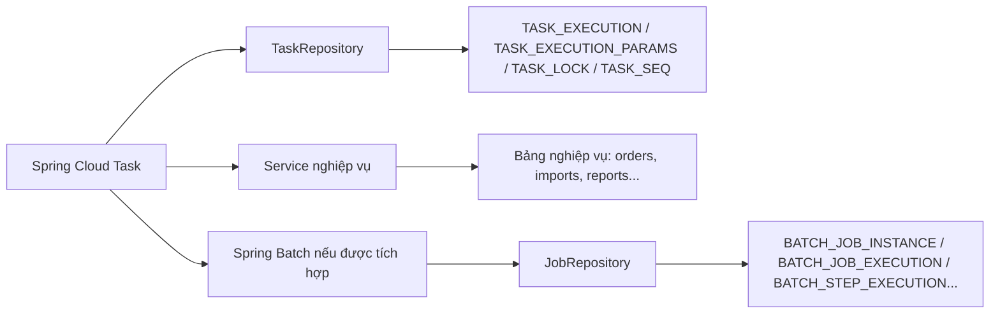
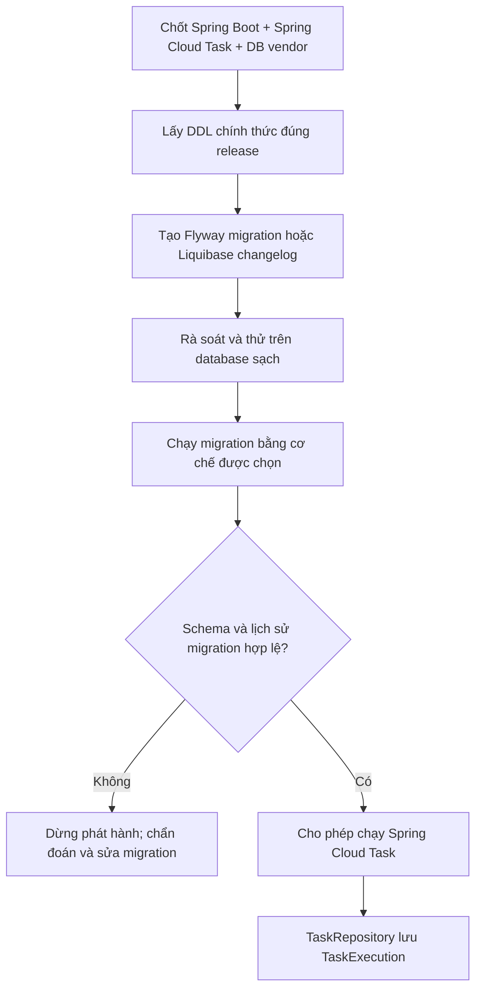

# Quản lý DDL bằng Flyway hoặc Liquibase

## 1. Vì sao Spring Cloud Task cần quản lý phiên bản schema?

**Spring Cloud Task** giúp xây dựng ứng dụng Spring Boot có thời gian chạy hữu hạn: khởi động, thực hiện công việc, ghi trạng thái và kết quả thực thi vào cơ sở dữ liệu thông qua `TaskRepository`, sau đó kết thúc. Một task có thể được gọi theo lịch, theo yêu cầu hoặc thông qua hệ thống điều phối. Khác với ứng dụng chỉ chạy trên bộ nhớ, thông tin lịch sử thực thi phải được lưu **bền vững** để có thể tra cứu, đối soát và vận hành an toàn.

Để làm điều đó, `TaskRepository` cần các bảng, khóa, chỉ mục và cơ chế tạo ID đúng với **phiên bản Spring Cloud Task** và **loại cơ sở dữ liệu**. Tập lệnh tạo hoặc thay đổi những cấu trúc ấy gọi là **DDL** (*Data Definition Language*), ví dụ `CREATE TABLE`, `ALTER TABLE`, `CREATE INDEX` và `CREATE SEQUENCE`.

Ở môi trường phát triển, để framework tự tạo bảng khi khởi động có thể thuận tiện. Với staging/production, nhiều tiến trình task có thể khởi chạy đồng thời hoặc sử dụng chung một database. Khi đó, không nên để mỗi lần chạy tự tạo, chỉnh hoặc suy đoán cấu trúc dữ liệu. **Flyway** và **Liquibase** là hai công cụ quản lý thay đổi schema theo phiên bản, cho phép đội phát triển đưa DDL vào source control, kiểm tra thay đổi và áp dụng chúng theo quy trình có thể kiểm toán.

Sau bài này, bạn có thể:

- Phân biệt schema của `TaskRepository` với dữ liệu nghiệp vụ và bảng metadata của Spring Batch.
- Giải thích vì sao cần tắt bộ khởi tạo schema mặc định của Spring Cloud Task khi đã dùng công cụ migration.
- Tổ chức migration Flyway hoặc changelog Liquibase từ DDL chính thức của framework.
- Áp dụng và kiểm tra migration trước khi chạy task; xử lý schema đã tồn tại, thay đổi phiên bản và lỗi migration.
- Thiết kế cách triển khai cho PostgreSQL, nhiều `DataSource`, nhiều instance và quy trình CI/CD.

## 2. Hiểu đúng schema của TaskRepository

### 2.1. Các đối tượng quan trọng

Trong cấu hình JDBC thông dụng, Spring Cloud Task sử dụng các đối tượng như sau:

| Đối tượng | Vai trò | Lưu ý khi migration |
| --- | --- | --- |
| `TASK_EXECUTION` | Thời gian bắt đầu/kết thúc, tên task, mã kết thúc, thông tin lỗi và định danh lần chạy | Là bảng chính để theo dõi vòng đời |
| `TASK_EXECUTION_PARAMS` | Các tham số gắn với lần chạy | Cần đúng cột, độ dài, ràng buộc và quan hệ mà bản framework yêu cầu |
| `TASK_TASK_BATCH` | Liên kết một lần thực thi Task với `JobExecution` của Spring Batch | Có ích khi tích hợp Task và Batch |
| `TASK_LOCK` | Hỗ trợ tính năng giới hạn một instance đang chạy theo cấu hình | Cần chú ý khi dùng `single-instance-enabled` |
| `TASK_SEQ` | Cấp ID lần thực thi; hiện diện dưới dạng đối tượng phù hợp với database/DDL phiên bản đó | Có thể là cơ chế sequence/table tùy vendor, không được tự ý đặt lại |

Tên và cấu trúc cụ thể **phụ thuộc bản phát hành**. Bảng ở trên giúp định hướng; nó **không thay thế** bộ DDL chính thức. Hãy lấy các tập lệnh `schema-<vendor>.sql` từ gói `spring-cloud-task-core` của **đúng phiên bản** đang khai báo trong dự án. Ví dụ, với PostgreSQL hãy đối chiếu tài nguyên `org/springframework/cloud/task/schema-postgresql.sql` của release được sử dụng.

**Không tự viết toàn bộ `TASK_*` theo trí nhớ.** Một cột bị đặt sai kiểu/độ dài, khóa/sequence bị thiếu, hoặc chỉ mục chưa đúng có thể gây lỗi khó tìm khi framework ghi `TaskExecution`, truy vấn metadata, liên kết Batch hoặc chạy đồng thời.

### 2.2. Phân biệt ba loại schema



- **Schema Task:** do Spring Cloud Task cần để lưu metadata của tiến trình tác vụ.
- **Schema nghiệp vụ:** do ứng dụng thiết kế, ví dụ `orders` hoặc `import_results`.
- **Schema Batch:** nếu dùng Spring Batch, `JobRepository` có các bảng `BATCH_*` độc lập với `TASK_*`.

Flyway hoặc Liquibase có thể quản lý cả ba nhóm schema trong cùng một pipeline, nhưng phải dùng **DDL đúng chủ sở hữu và phiên bản**. `TASK_TASK_BATCH` là bảng liên kết; nó không thay thế các bảng `BATCH_*`. Nếu repository ở các database khác nhau, cần tách rõ nguồn kết nối và thứ tự migration.

## 3. Hai cách tạo bảng: tự khởi tạo và migration

### 3.1. Tự khởi tạo bảng bởi Spring Cloud Task

Spring Cloud Task có khả năng tự khởi tạo bảng metadata khi ứng dụng chạy, phụ thuộc cấu hình và môi trường. Khi chọn **Flyway hoặc Liquibase làm chủ sở hữu schema**, hãy tắt đường tự khởi tạo đó:

```yaml
spring:
  cloud:
    task:
      initialize-enabled: false
```

Thuộc tính tương đương:

```properties
spring.cloud.task.initialize-enabled=false
```

Việc tắt này **không vô hiệu hóa TaskRepository**: framework vẫn sử dụng schema có sẵn để ghi `TaskExecution`. Điều kiện là migration đã tạo **đầy đủ** những đối tượng tương thích trước khi task chạy. Nếu bỏ sót bảng hoặc sequence, lần chạy có thể thất bại ngay lúc ghi metadata.

Tên cấu hình cũ `spring.cloud.task.initialize.enable` đã bị ngừng khuyến nghị/deprecated ở những phiên bản có hỗ trợ nó; dùng `initialize-enabled` theo tài liệu tương ứng với phiên bản đang triển khai.

### 3.2. Cấu hình các cơ chế khởi tạo khác

Spring Boot có thể gặp nhiều công cụ cùng tìm cách tạo bảng:

| Cơ chế | Ví dụ | Khi dùng Flyway/Liquibase quản lý schema |
| --- | --- | --- |
| Spring Cloud Task initializer | `spring.cloud.task.initialize-enabled` | **`false`** |
| Script SQL chung của Spring Boot | `schema.sql`, `data.sql` | Không dùng song song để tạo cùng đối tượng; có thể đặt `spring.sql.init.mode=never` |
| Hibernate/JPA DDL auto | `spring.jpa.hibernate.ddl-auto` | Tránh `create`/`update` đối với schema đã quản lý migration |
| Spring Batch schema initializer | `spring.batch.jdbc.initialize-schema` | `never` nếu bảng Batch cũng do migration quản lý |
| Flyway | `spring.flyway.enabled` | Bật khi Flyway là công cụ được chọn |
| Liquibase | `spring.liquibase.enabled` | Bật khi Liquibase là công cụ được chọn |

**Không bật cả Flyway và Liquibase để cùng chỉnh một tập bảng `TASK_*`.** Mỗi công cụ có lịch sử riêng và không tự đồng bộ trạng thái của công cụ còn lại. Khi chuyển công cụ phải có kế hoạch chuyển giao/baseline riêng.

### 3.3. Ai chạy migration?

Có hai mô hình phổ biến:

1. **Migration khi ứng dụng Spring Boot khởi động.** Tiện trong demo, phát triển hoặc hệ thống nhỏ: Spring Boot phát hiện Flyway/Liquibase trên classpath và chạy các migration trước khi phần nghiệp vụ phụ thuộc schema được sử dụng.
2. **Migration như một bước phát hành riêng.** Phù hợp production: pipeline hoặc database migration Job chạy DDL **một lần**, kiểm tra thành công, sau đó mới cho phép các task/Job/CronJob chạy. Ứng dụng runtime không cần quyền DDL.

Mô hình thứ hai dễ kiểm soát khóa DDL, thời gian ngừng dịch vụ, quyền truy cập và tương thích giữa nhiều bản ứng dụng. Trong cả hai mô hình, hãy đặt `spring.cloud.task.initialize-enabled=false`.

## 4. Chọn Flyway hay Liquibase?

| Tiêu chí | Flyway | Liquibase |
| --- | --- | --- |
| Đơn vị thay đổi | Migration đánh phiên bản, ví dụ `V1__create_task_repository.sql` | `changeSet` gồm `id`, `author` và đường dẫn changelog |
| Cách viết | SQL rất tự nhiên; cũng hỗ trợ Java migration | YAML, XML, JSON hoặc formatted SQL; có thể tham chiếu file SQL |
| Lịch sử áp dụng | Thường dùng `flyway_schema_history` | `DATABASECHANGELOG` |
| Kiểm soát đồng thời | Dùng cơ chế khóa migration phù hợp database | Dùng `DATABASECHANGELOGLOCK` |
| Kiểm tra thay đổi cũ | Dựa trên phiên bản và checksum | Dựa trên định danh changeSet và checksum |
| Phù hợp khi | Đội quen viết SQL, muốn kiểm soát DDL theo vendor | Đội muốn mô tả thay đổi có cấu trúc và dùng preconditions/contexts |

**Đều phù hợp** để quản lý DDL của Spring Cloud Task. Nếu đã có một công cụ ổn định trong dự án, thường nên tiếp tục dùng công cụ đó. Chọn **một** công cụ cho cùng tập đối tượng và giữ lịch sử migration trong Git.

Trong các ví dụ bên dưới, ta chọn **PostgreSQL** và giả định:

- Dự án đã có Spring Boot, Spring Cloud Task và JDBC driver đúng phiên bản tương thích.
- Database `taskdb` và tài khoản kết nối đã được tạo.
- Đây là database mới **chưa tồn tại các bảng Task**; phần 9 sẽ xử lý trường hợp schema đã có.
- DDL chính thức cho PostgreSQL đã được lấy từ **đúng bản `spring-cloud-task-core`** dùng trong ứng dụng.

## 5. Phương án A — Quản lý DDL bằng Flyway

### 5.1. Tổ chức thư mục migration

Flyway dùng tên file `V<version>__<description>.sql`, với hai dấu gạch dưới giữa phiên bản và mô tả. Cấu trúc mẫu:

```text
src/main/resources/
└── db/
    └── migration/
        ├── V1__create_task_repository.sql
        ├── V2__create_task_run_audit.sql
        └── V3__add_audit_source_index.sql
```

Với `V1__create_task_repository.sql`, **sao chép nguyên vẹn DDL chính thức** từ `schema-postgresql.sql` của phiên bản Spring Cloud Task đã chọn, sau khi đối chiếu schema/search path nếu cần. Tên file `V1...` là tên migration do **dự án** đặt; file nguồn của Spring Cloud Task chỉ là cơ sở cung cấp DDL.

Không thay `V1` bằng một ví dụ `CREATE TABLE TASK_EXECUTION` rút gọn hoặc chỉ tạo bảng này. Bạn phải giữ đủ những đối tượng, constraint, sequence và chỉ mục mà DDL chính thức định nghĩa. Nếu gói thư viện đổi ở bản phát hành sau, tạo migration **mới** để cập nhật schema; không sửa nội dung của `V1` đã áp dụng.

### 5.2. Thêm dependency

Với **Spring Boot 4.x** hỗ trợ starter chuyên biệt, ví dụ Maven:

```xml
<dependencies>
    <dependency>
        <groupId>org.springframework.boot</groupId>
        <artifactId>spring-boot-starter-flyway</artifactId>
    </dependency>
    <dependency>
        <groupId>org.flywaydb</groupId>
        <artifactId>flyway-database-postgresql</artifactId>
    </dependency>
</dependencies>
```

Các dependency Spring Cloud Task, Spring JDBC và PostgreSQL JDBC driver phải có trong dự án. **Không chép nguyên starter Boot 4.x vào dự án Boot 3.x mà chưa kiểm tra:** cách khai báo Flyway cho Boot 3.x thường sử dụng `org.flywaydb:flyway-core`, kèm module database khi phiên bản Flyway yêu cầu. Dùng BOM/quản lý phiên bản của Boot và Spring Cloud tương thích để tránh tổ hợp dependency không hỗ trợ.

### 5.3. Cấu hình Flyway cùng TaskRepository

Ví dụ `application.yml`:

```yaml
spring:
  application:
    name: nightly-import-task
  main:
    web-application-type: none
  datasource:
    url: ${TASK_DB_URL:jdbc:postgresql://localhost:5432/taskdb}
    username: ${TASK_DB_USER:task_app}
    password: ${TASK_DB_PASSWORD}
  cloud:
    task:
      initialize-enabled: false
      closecontextEnabled: true
  sql:
    init:
      mode: never
  flyway:
    enabled: true
    locations: classpath:db/migration
    baseline-on-migrate: false
    validate-on-migrate: true
```

Trong ví dụ **migration chạy khi ứng dụng khởi động**, `task_app` phải có các quyền DDL cần thiết; không nên dùng tài khoản này để chạy lâu dài ở production. Với production, chạy Flyway bằng tài khoản migration trong bước deploy riêng, rồi đặt `spring.flyway.enabled=false` cho các instance Task runtime; phần 8 sẽ trình bày quy trình này.

`baseline-on-migrate: false` giữ cơ chế bảo vệ khi Flyway gặp schema **đã có đối tượng nhưng chưa có lịch sử Flyway**. Không bật bừa `baseline-on-migrate: true` để bỏ qua cảnh báo vì có nguy cơ baseline nhầm một database hoặc coi migration chưa chạy là đã hoàn thành.

### 5.4. Migration ví dụ cho bảng bổ sung

`V2__create_task_run_audit.sql` dưới đây là migration **chạy được trên PostgreSQL** để tạo bảng nghiệp vụ riêng phục vụ đối soát. Nó **không thay thế** `V1` chứa toàn bộ DDL `TASK_*` chính thức:

```sql
CREATE TABLE task_run_audit (
    audit_id BIGINT GENERATED ALWAYS AS IDENTITY PRIMARY KEY,
    task_execution_id BIGINT,
    source_name VARCHAR(80) NOT NULL,
    processed_count BIGINT NOT NULL DEFAULT 0,
    created_at TIMESTAMPTZ NOT NULL DEFAULT CURRENT_TIMESTAMP
);
```

Ở đây `task_execution_id` có thể dùng để liên hệ bản ghi nghiệp vụ với một lần chạy Task. **Không tự ý tạo khóa ngoại** sang `TASK_EXECUTION` nếu hạ tầng nghiệp vụ có chính sách giữ/xóa metadata khác hoặc repository nằm ở database riêng; nếu cần FK, thiết kế và thử nghiệm quy tắc xóa, schema và transaction trước.

Một migration kế tiếp `V3__add_audit_source_index.sql`:

```sql
CREATE INDEX ix_task_run_audit_source_created
    ON task_run_audit (source_name, created_at);
```

Sau khi chạy `V1`, `V2`, `V3` trên database trống, Flyway lưu lịch sử thực thi trong `flyway_schema_history`. Mỗi migration đánh phiên bản chỉ được áp dụng theo quy tắc của Flyway và được kiểm tra checksum. **Không sửa `V1` đã áp dụng ở môi trường khác**; nếu cần sửa cấu trúc, tạo `V4__...sql`.

### 5.5. Điều gì xảy ra khi chạy lại ứng dụng?

1. Flyway kiểm tra lịch sử và file migration trong thư mục cấu hình.
2. Các migration đã áp dụng hợp lệ **không được chạy lại**.
3. Migration mới sẽ được thực thi theo thứ tự phiên bản.
4. Sau khi schema sẵn sàng, Spring Cloud Task sử dụng `TaskRepository` để ghi nhận lần thực thi mới.

Sử dụng SQL để kiểm tra lịch sử (tên bảng mặc định):

```sql
SELECT installed_rank, version, description, success, installed_on
FROM flyway_schema_history
ORDER BY installed_rank DESC;
```

Nếu thiếu `V1` trong lịch sử hoặc `V1` có checksum khác với bản đã chạy, **không bỏ qua lỗi bằng cách xóa lịch sử**. Kiểm tra kết nối, version của dự án và file DDL gốc trước.

## 6. Phương án B — Quản lý DDL bằng Liquibase

### 6.1. Tổ chức changelog

Liquibase quản lý lịch sử theo từng **changeSet**. Một changeSet thường được định danh bằng bộ `id`, `author`, và đường dẫn file changelog; Liquibase lưu lịch sử trong `DATABASECHANGELOG`.

Ví dụ cấu trúc:

```text
src/main/resources/
└── db/
    └── changelog/
        ├── db.changelog-master.yaml
        └── sql/
            └── schema-postgresql.sql
```

File `sql/schema-postgresql.sql` là **bản sao đầy đủ** DDL chính thức của Spring Cloud Task cho PostgreSQL và release đang dùng. Bản sao này được đưa vào Git cùng changelog để các môi trường nhận **cùng một nội dung**, không tải DDL thay đổi động từ nhánh phát triển của framework khi triển khai.

### 6.2. Thêm dependency và cấu hình

Với **Spring Boot 4.x**, dependency Maven minh họa:

```xml
<dependency>
    <groupId>org.springframework.boot</groupId>
    <artifactId>spring-boot-starter-liquibase</artifactId>
</dependency>
```

Với Spring Boot 3.x, cách cấu hình dependency có thể là `org.liquibase:liquibase-core`; cần đối chiếu tài liệu đúng phiên bản. Ví dụ application khi chọn **Liquibase**, không cùng lúc bật Flyway:

```yaml
spring:
  application:
    name: nightly-import-task
  datasource:
    url: ${TASK_DB_URL:jdbc:postgresql://localhost:5432/taskdb}
    username: ${TASK_DB_USER:task_app}
    password: ${TASK_DB_PASSWORD}
  cloud:
    task:
      initialize-enabled: false
  sql:
    init:
      mode: never
  liquibase:
    enabled: true
    change-log: classpath:db/changelog/db.changelog-master.yaml
```

Spring Boot phát hiện Liquibase và chạy changelog khi khởi động nếu được bật. Tương tự Flyway, cấu hình này chủ yếu dùng để học tập hoặc với môi trường chấp nhận migration lúc startup. Production thường sử dụng bước migration riêng và tài khoản có quyền DDL chuyên biệt.

### 6.3. Changelog tham chiếu DDL chính thức

`db.changelog-master.yaml`:

```yaml
databaseChangeLog:
  - changeSet:
      id: 001-create-task-repository
      author: platform-team
      changes:
        - sqlFile:
            path: sql/schema-postgresql.sql
            relativeToChangelogFile: true
            splitStatements: true
            stripComments: true

  - changeSet:
      id: 002-create-task-run-audit
      author: platform-team
      changes:
        - createTable:
            tableName: task_run_audit
            columns:
              - column:
                  name: audit_id
                  type: BIGINT
                  autoIncrement: true
                  constraints:
                    primaryKey: true
                    nullable: false
              - column:
                  name: source_name
                  type: VARCHAR(80)
                  constraints:
                    nullable: false
              - column:
                  name: processed_count
                  type: BIGINT
                  defaultValueNumeric: 0
                  constraints:
                    nullable: false
```

Đây là ví dụ minh họa **cách tổ chức** changelog: changeSet đầu tạo đúng schema Task từ SQL vendor đã được chốt; changeSet sau thêm bảng nghiệp vụ riêng. Để file thật chạy thành công, phải đặt **đúng nội dung nguồn** vào `sql/schema-postgresql.sql` và kiểm tra cú pháp DDL khi chuyển qua bộ phân tích `sqlFile` của Liquibase. Nếu DDL có lệnh đặc biệt, function body hoặc delimiter khác dấu chấm phẩy, cần điều chỉnh `splitStatements`/`endDelimiter` phù hợp sau khi thử trên database mục tiêu.

Một khi changeSet đã áp dụng, **không đổi `id`, `author`, đường dẫn hoặc nội dung DDL** tùy tiện. Nếu cần thay đổi cấu trúc, bổ sung changeSet mới; Liquibase sử dụng checksum để phát hiện khác biệt.

### 6.4. Hai bảng riêng của Liquibase

Liquibase thường tự tạo:

| Bảng | Vai trò |
| --- | --- |
| `DATABASECHANGELOG` | Lịch sử các changeSet đã chạy, bao gồm định danh và checksum |
| `DATABASECHANGELOGLOCK` | Ngăn nhiều phiên Liquibase cập nhật schema đồng thời |

Đây là **metadata của công cụ migration**, khác với `TASK_EXECUTION` của Spring Cloud Task. Việc một changeSet được áp dụng thành công **không có nghĩa** đã có lần chạy Task nào.

Ví dụ truy vấn trên PostgreSQL:

```sql
SELECT ID, AUTHOR, FILENAME, DATEEXECUTED, MD5SUM
FROM DATABASECHANGELOG
ORDER BY DATEEXECUTED DESC;

SELECT ID, LOCKED, LOCKGRANTED, LOCKEDBY
FROM DATABASECHANGELOGLOCK;
```

Nếu `DATABASECHANGELOGLOCK` bị khóa, **đầu tiên phải xác minh** có tiến trình migration nào đang chạy. Không xóa bảng hoặc bỏ khóa khi chưa chắc migration trước đã dừng và các thay đổi DDL còn dang dở đã được xử lý.

## 7. Thứ tự startup và quyền sở hữu schema

### 7.1. Luồng triển khai đúng



Trong dự án khởi động migration cùng Spring Boot, cần bảo đảm Flyway/Liquibase chạy trước thành phần truy cập bảng `TASK_*`. Với cơ chế tự cấu hình chuẩn và một `DataSource`, Boot thực hiện migration trong giai đoạn startup; nếu tự tạo `TaskConfigurer`, nhiều `DataSource` hoặc bean truy vấn DB ngay khi khởi tạo, hãy kiểm tra và cấu hình thứ tự phụ thuộc rõ ràng.

### 7.2. Hai vai trò database trong production

| Vai trò | Quyền thường cần | Khi sử dụng |
| --- | --- | --- |
| **Migration account** | Tạo/sửa bảng, chỉ mục, sequence và đối tượng cần thiết | Trong bước triển khai DDL được kiểm soát |
| **Runtime account** | Truy vấn, insert/update/delete metadata cần thiết và sử dụng sequence theo chức năng bật | Mỗi lần ứng dụng Task thực thi |

Không cần cấp quyền `CREATE TABLE` hay `ALTER TABLE` cho mọi instance Task nếu migration đã chạy riêng. Mức quyền chính xác phụ thuộc database và cách schema được phân chia.

Để chạy migration riêng, có thể cấu hình ứng dụng runtime:

```yaml
spring:
  cloud:
    task:
      initialize-enabled: false
  sql:
    init:
      mode: never
  flyway:
    enabled: false
```

Đây là cấu hình **runtime khi pipeline đã chạy Flyway trước đó**. Nếu dùng Liquibase, thay phần `spring.flyway.enabled` bằng `spring.liquibase.enabled: false`. Không áp dụng cả hai nhánh như thể chúng là hai công cụ migration bắt buộc phải chạy cùng nhau.

### 7.3. Quy trình CI/CD gợi ý

1. **Build:** khóa phiên bản Spring Boot/Spring Cloud Task, kiểm tra file migration và review thay đổi DDL.
2. **Test:** tạo PostgreSQL trống, áp dụng toàn bộ migration và xác nhận schema. Thử chạy một Task thật.
3. **Staging:** thử nâng cấp từ schema/metadata của phiên bản đang vận hành lên bản mới; quan sát cả các Task đang chạy hoặc chưa hoàn tất.
4. **Phát hành DDL:** dùng migration Job với credentials riêng; giữ dấu vết version, log và kết quả.
5. **Kiểm tra:** xác minh lịch sử migration, các bảng/sequence và khả năng ghi một `TaskExecution`.
6. **Phát hành ứng dụng:** mới cho phép scheduler/CronJob chạy phiên bản Task mới.
7. **Giám sát:** theo dõi lỗi kết nối, migration chưa áp dụng, tác vụ có `END_TIME` rỗng và bất thường về ID.

Đối với nhiều pod/instance, Flyway/Liquibase có cơ chế điều phối migration riêng nhưng không nên cố ý cho **mọi tác vụ ngắn hạn** cùng tranh chấp DDL mỗi lần chạy. Một bước migration riêng giúp giảm rủi ro và giúp lỗi DDL được phát hiện trước khi tác vụ xử lý nghiệp vụ.

## 8. Tương thích giữa schema và phiên bản Spring Cloud Task

### 8.1. Một bản ứng dụng phải dùng schema phù hợp

Khi nâng cấp Spring Cloud Task, không được giả định mọi bản đều có schema giống nhau. Việc nâng cấp có thể thay đổi cột, độ dài, constraint, chỉ mục hoặc cơ chế cấp ID. Quy trình đề xuất:

1. Ghi nhận phiên bản thư viện **hiện tại** và **mục tiêu**.
2. Lấy hai bộ DDL vendor tương ứng và đối chiếu khác biệt.
3. Xác định các lệnh `ALTER TABLE`/`CREATE INDEX`/chuyển đổi dữ liệu cần thiết.
4. Viết migration kế tiếp, ví dụ `V4__upgrade_task_schema.sql` hoặc changeSet mới.
5. Thử migration với **bản sao schema chứa metadata thực**; kiểm tra giữ nguyên lịch sử.
6. Kiểm tra ứng dụng phiên bản mới có thể đọc/ghi và kết thúc Task đúng trước khi phát hành rộng.

Không copy nguyên `CREATE TABLE` của bản mới và chạy lại lên các bảng đã tồn tại. Chỉ tạo đối tượng mới hoặc chỉnh những phần có khác biệt theo kế hoạch nâng cấp.

### 8.2. Thay đổi không phá vỡ dữ liệu cũ

Ví dụ một bản Task mới cần thêm một cột. Nếu nhiều phiên bản có thể cùng chạy trong giai đoạn chuyển tiếp, thường nên dùng chiến lược **mở rộng → chuyển đổi → thu hẹp**:

1. **Mở rộng:** thêm cột cho phép `NULL` hoặc có mặc định phù hợp; giữ truy vấn ứng dụng cũ hoạt động.
2. **Chuyển đổi:** triển khai app mới, backfill dữ liệu nếu cần và giám sát.
3. **Thu hẹp:** sau khi không còn phiên bản cũ sử dụng, mới áp dụng ràng buộc mới hoặc xóa cấu trúc cũ.

Không áp dụng thao tác xóa bảng, đổi tên cột hoặc thu hẹp kiểu dữ liệu khi các tiến trình Task cũ vẫn có thể đang chạy.

### 8.3. TASK_SEQ và ID không được đặt lại

`TASK_EXECUTION_ID` định danh lịch sử thực thi. Nếu đổi sequence hoặc nhập dữ liệu từ môi trường khác, không được tạo cơ chế phát ID với giá trị thấp hơn ID đã tồn tại. Việc cấp trùng ID có thể khiến task không ghi được bản ghi mới hoặc liên kết metadata sai.

Trước khi sửa sequence, cần kiểm tra:

```sql
SELECT MAX(TASK_EXECUTION_ID) AS max_task_execution_id
FROM TASK_EXECUTION;
```

Sau đó đối chiếu với **đối tượng cấp ID thực tế** của vendor và bản framework đó. `TASK_SEQ` có thể được triển khai khác nhau giữa các database; không dùng một câu `ALTER SEQUENCE` cho tất cả hệ quản trị hoặc tự đặt lại `START WITH 1` trong production.

### 8.4. Trường hợp SQL Server

Tài liệu Spring Cloud Task có ghi nhận tình huống tranh chấp `TASK_SEQ` khi chạy nhiều Task đồng thời trên SQL Server, cùng giải pháp dùng native sequence trong cấu hình/version phù hợp. Đây là ví dụ điển hình cho lý do **không nên áp dụng DDL PostgreSQL lên SQL Server**. Trước khi thay đổi cơ chế cấp ID, đối chiếu hướng dẫn chính thức và giữ giá trị tiếp theo lớn hơn tất cả ID đã cấp.

## 9. Đưa schema đã tồn tại vào Flyway hoặc Liquibase

### 9.1. Vấn đề cần giải quyết

Một hệ thống cũ có thể đã để Spring Cloud Task tự tạo bảng trong nhiều tháng. Khi chuyển sang Flyway/Liquibase, database đã có `TASK_EXECUTION`, `TASK_EXECUTION_PARAMS`, `TASK_SEQ` và dữ liệu lịch sử; nhưng **chưa có lịch sử migration**.

Nếu chạy ngay `V1__create_task_repository.sql`, database có thể báo `relation already exists`. Nếu bật baseline tùy tiện, công cụ có thể ghi “đã có schema” trong khi những bảng hoặc constraint cần thiết vẫn thiếu.

### 9.2. Quy trình chuyển đổi an toàn

1. **Tạo bản sao lưu** schema và dữ liệu metadata, cùng phương án khôi phục đã thử nghiệm.
2. **Dừng/đóng băng** các lần chạy Task mới trong giai đoạn chuyển đổi cần thiết.
3. **Đối chiếu thực tế** các đối tượng, cột, constraint, index và sequence với DDL chính thức của phiên bản hiện tại.
4. **Sửa drift** bằng migration chuyển đổi đã được review, trước khi đánh dấu schema là baseline.
5. **Baseline/changelog sync một cách có chủ đích:** công cụ ghi nhận rằng schema hiện tại tương ứng với một mốc đã xác minh mà không chạy lại các lệnh `CREATE` đã có.
6. **Chạy thử** migration kế tiếp trên bản sao production và khởi chạy Task với runtime user để xác minh có thể tạo/hoàn tất `TaskExecution`.

Với Flyway, thao tác **`baseline`** ghi một mốc trong `flyway_schema_history`; các migration có version **nhỏ hơn hoặc bằng mốc baseline** được xem là đã có, không tự chạy lại. Vì vậy phải chọn mốc dựa trên schema thực sự đang có; một baseline sai có thể che giấu bảng/constraint còn thiếu.

Với Liquibase, có thể thiết lập lịch sử changeSet tương ứng với schema đã được xác minh bằng quy trình đồng bộ changelog phù hợp phiên bản công cụ. Không “đánh dấu đã chạy” một changeSet khi cấu trúc thực tế chưa khớp với kết quả mà changeSet hứa hẹn.

### 9.3. Lịch sử migration phải bất biến

Flyway kiểm tra checksum của migration và Liquibase có cơ chế checksum cho changeSet. Nếu ai đó sửa một migration đã chạy trên staging/production:

- Môi trường mới có thể tạo schema khác với môi trường cũ.
- Công cụ có thể báo mismatch hoặc từ chối cập nhật tiếp.
- Việc xử lý bằng lệnh `repair`/reset checksum **không tự sửa cấu trúc thực tế**.

Cách đúng thông thường là **khôi phục nội dung migration đã phát hành** và tạo migration kế tiếp. Chỉ dùng công cụ sửa lịch sử sau khi đã kiểm chứng chênh lệch, thực hiện remediation cần thiết và có phê duyệt thay đổi.

## 10. Nhiều DataSource, schema riêng và table prefix

### 10.1. Không mặc định có một database

Một Task có thể ghi dữ liệu nghiệp vụ vào DB A nhưng lưu metadata `TaskRepository` vào DB B. Trong trường hợp này:

- Flyway/Liquibase phải thực thi migration trên **DB B** để tạo bảng Task.
- Migration bảng nghiệp vụ phải nhắm vào **DB A**.
- `TaskConfigurer` và transaction manager cần trỏ tới `DataSource` được thiết kế cho repository.
- Tài khoản runtime cần có quyền trên đúng schema; lỗi cấu hình có thể khiến Task tìm bảng trong nhầm database.

Spring Boot có hỗ trợ `@FlywayDataSource` hoặc `@LiquibaseDataSource` (tùy phiên bản) để chọn datasource riêng cho migration; cũng có thể cấu hình `spring.flyway.url/user/password` hay `spring.liquibase.url/user/password` theo tài liệu tương ứng. **Không suy đoán** rằng migration dùng cùng kết nối với `TaskRepository` nếu ứng dụng có nhiều datasource.

### 10.2. Prefix tùy chỉnh

Spring Cloud Task cho phép đổi tiền tố bảng bằng `spring.cloud.task.tablePrefix`, mặc định thường là `TASK_`.

```properties
spring.cloud.task.tablePrefix=ACME_TASK_
```

Đây chỉ là ví dụ về tên tiền tố. Khi đổi, **migration phải tạo chính xác các tên đối tượng mà repository sẽ truy vấn**; không chỉ đổi property rồi giữ DDL gốc không chỉnh. Cần rà soát bảng, chỉ mục, cơ chế cấp ID và trường hợp schema-qualified prefix theo hướng dẫn của phiên bản đang dùng.

### 10.3. Cách ly môi trường

Production và staging không nên cùng dùng một schema metadata; nếu dùng chung server database, nên cấp database/schema và credentials riêng. Đồng thời, đừng để Flyway hoặc Liquibase của môi trường thử nghiệm ghi vào production do biến môi trường sai.

Trong bài toán nhiều tenant, không tạo nhiều schema Task chỉ dựa trên tên tenant nếu chưa thiết kế lại cách cấp ID, cấu hình repository và cách quản trị migrations cho từng schema.

## 11. Phối hợp với Spring Batch

Nếu Task khởi động Spring Batch, cả hai framework đều có repository riêng:

```text
Spring Cloud Task
  TaskRepository -> TASK_*
         |
         +---- TASK_TASK_BATCH (liên kết)
                           |
Spring Batch               v
  JobRepository  -> BATCH_*
```

Khi dùng migration làm chủ sở hữu schema:

```yaml
spring:
  cloud:
    task:
      initialize-enabled: false
  batch:
    jdbc:
      initialize-schema: never
```

Hãy lấy **DDL Spring Batch của đúng phiên bản** và áp dụng như một nhóm migration riêng hoặc một changeSet riêng, đồng thời giữ đủ liên kết và quyền sử dụng giữa hai nhóm bảng. Một lần `TaskExecution` có thể liên kết với `JobExecution`, nhưng các bảng `BATCH_*` không được Spring Cloud Task tự tạo thay cho Spring Batch.

Nếu hai repository sử dụng datasource khác nhau, cần xác định rõ cách liên kết và triển khai riêng. Không thêm khóa ngoại vượt database hoặc dựa vào transaction phân tán nếu kiến trúc không hỗ trợ.

## 12. Xác minh schema sau migration

### 12.1. Kiểm tra đối tượng trên PostgreSQL

Với mặc định dùng schema `public` và không đổi prefix, có thể kiểm tra danh sách bảng:

```sql
SELECT table_schema, table_name
FROM information_schema.tables
WHERE table_schema = 'public'
  AND table_name IN (
      'task_execution',
      'task_execution_params',
      'task_task_batch',
      'task_lock'
  )
ORDER BY table_name;
```

Đây là truy vấn kiểm tra nhanh đối tượng phổ biến, **không đủ** để xác nhận toàn bộ DDL đã đúng. Cần kiểm tra thêm cột, khóa chính, chỉ mục, cơ chế cấp ID và phiên bản migration.

Để quan sát `TASK_SEQ` trong PostgreSQL, do đối tượng có thể là table hoặc sequence theo DDL:

```sql
SELECT n.nspname AS schema_name,
       c.relname AS object_name,
       c.relkind AS object_kind
FROM pg_class c
JOIN pg_namespace n ON n.oid = c.relnamespace
WHERE n.nspname = 'public'
  AND c.relname = 'task_seq';
```

Trong catalog PostgreSQL, `relkind = 'S'` thường là sequence, `relkind = 'r'` là bảng thông thường. Đừng điều chỉnh trực tiếp giá trị ID chỉ dựa vào một dòng kiểm tra catalog.

### 12.2. Kiểm tra TaskRepository thực sự hoạt động

Sau migration, khởi chạy một Task đơn giản có `ApplicationRunner`:

```java
import org.springframework.boot.ApplicationRunner;
import org.springframework.context.annotation.Bean;
import org.springframework.context.annotation.Configuration;

@Configuration
class RepositorySmokeTestConfiguration {

    @Bean
    ApplicationRunner smokeRunner() {
        return args -> System.out.println("TaskRepository smoke test OK");
    }
}
```

Trong ứng dụng thật, đặt bean trên vào profile kiểm thử hoặc chương trình smoke test riêng; không để nó tự động chạy ở production nếu không có nhu cầu.

Khi Task kết thúc bình thường, truy vấn:

```sql
SELECT TASK_EXECUTION_ID, TASK_NAME, START_TIME, END_TIME, EXIT_CODE
FROM TASK_EXECUTION
ORDER BY TASK_EXECUTION_ID DESC
LIMIT 5;
```

Kỳ vọng có một lần thực thi mới, ID không trùng, `START_TIME` và `END_TIME` hợp lý, exit code biểu thị thành công (thường `0`). Đồng thời kiểm tra exit code process và log; bảng có đủ tên nhưng thiếu constraint hoặc không cấp được ID có thể chỉ bộc lộ lỗi khi thực thi thực tế.

### 12.3. Thử cả đường lỗi

Một thử nghiệm hữu ích là cho Runner ném `IllegalStateException` và kiểm tra repository có cố ghi nhận trạng thái thất bại. Nếu migration chỉ tạo bảng chính nhưng thiếu bảng tham số, chỉ mục hay sequence, lỗi có thể xuất hiện trong startup hoặc thời điểm cập nhật trạng thái.

Thử trên **database thử nghiệm riêng**, không giả lập lỗi bằng cách xóa bảng production.

## 13. Những lỗi DDL thường gặp và cách xử lý

| Hiện tượng | Nguyên nhân có thể | Hướng xử lý |
| --- | --- | --- |
| `relation "task_execution" does not exist` | Migration chưa chạy, sai schema hoặc sai `DataSource` | Kiểm tra lịch sử migration, `search_path` và datasource repository |
| `relation already exists` lúc chạy V1 | Schema do framework hoặc người khác tạo trước đó | Kiểm tra schema và dùng quy trình baseline có kiểm chứng |
| Lỗi `TASK_SEQ` hoặc duplicate key | Thiếu cơ chế cấp ID, cấp ID bị đặt lại hoặc DDL sai vendor | Đối chiếu DDL gốc và ID tối đa; sửa bằng migration chuyên biệt |
| Flyway checksum mismatch | File migration đã chạy bị sửa hoặc dùng nhầm nhánh triển khai | Khôi phục file đã phát hành và tạo migration mới |
| Liquibase checksum mismatch | Nội dung/định danh changeSet bị thay đổi | Kiểm tra lịch sử, diff schema và sửa bằng changeSet mới |
| Liquibase chờ `DATABASECHANGELOGLOCK` | Migration khác đang chạy hoặc lock bị giữ sau sự cố | Xác minh tiến trình và trạng thái DDL trước khi xử lý lock |
| Task lỗi khi runtime user truy cập bảng | User thiếu quyền DML/sequence | Cấp đúng quyền tối thiểu sau khi migration hoàn tất |
| Migration chạy đồng thời với nhiều task | Mỗi pod/task tự migrate khi startup | Tách migration thành Job phát hành riêng |
| Batch Job lỗi thiếu `BATCH_*` | Chỉ migrate schema Task hoặc vẫn bật sai initializer | Thêm DDL Batch đúng version, kiểm tra cấu hình `initialize-schema` |
| Chạy migration thành công nhưng Task vẫn lỗi | Sai phiên bản DDL, thiếu đối tượng, đổi tablePrefix hoặc nhiều datasource | So sánh schema thực tế với DDL release và thử smoke test |

**Lưu ý khi migration thất bại:** Không phải mọi database đều rollback DDL giống nhau. PostgreSQL hỗ trợ giao dịch đối với nhiều thao tác DDL, trong khi một số hệ quản trị tự commit các lệnh DDL hoặc có giới hạn khác. Sau khi migration lỗi, phải kiểm tra **trạng thái schema thực tế** trước khi chạy lại, chạy `repair` hay xóa khóa.

## 14. Checklist trước khi phát hành

| Kiểm tra | Tiêu chí đạt |
| --- | --- |
| Phiên bản thư viện | Spring Boot/Spring Cloud Task/Flyway hoặc Liquibase được khóa và tương thích |
| DDL nguồn | Dùng đúng `schema-<vendor>.sql` từ bản `spring-cloud-task-core` đang triển khai |
| Cơ chế tạo bảng | Đã tắt `spring.cloud.task.initialize-enabled` và các initializer trùng nhiệm vụ |
| Lịch sử migration | Migration cũ có checksum hợp lệ; migration mới có ID/version không trùng |
| Thứ tự triển khai | DDL được áp dụng và kiểm tra trước khi task phiên bản mới hoạt động |
| Quyền DB | Migration account có DDL; runtime account có quyền tối thiểu cần thiết |
| Schema bổ sung | Nếu dùng Batch, các bảng `BATCH_*` đã được tạo đúng phiên bản |
| Tính tương thích | Đã thử nâng cấp từ schema có dữ liệu và đã chuẩn bị phương án rollback |
| Smoke test | Task có thể ghi bản ghi `TaskExecution` thành công và lỗi; ID không trùng |
| An toàn vận hành | Có backup, log migration, kiểm soát chạy đồng thời và giám sát |

## 15. Bài tập thực hành

**Bài tập 1 — Vòng đời DDL.** Vẽ sơ đồ một lần chạy Task từ lúc database chưa có bảng `TASK_EXECUTION` đến khi migration hoàn tất và Runner được chạy. Giải thích vì sao `spring.cloud.task.initialize-enabled=false` cần đi kèm migration.

**Bài tập 2 — Flyway.** Tạo dự án mẫu trên PostgreSQL, chốt một bản Spring Cloud Task và đưa DDL chính thức vào `V1__create_task_repository.sql`. Thêm `V2__create_task_run_audit.sql`, chạy hai lần và quan sát `flyway_schema_history`. Giải thích vì sao `V1` chỉ chạy một lần.

**Bài tập 3 — Liquibase.** Chuyển mô hình trên thành changelog YAML gồm hai changeSet. Kiểm tra `DATABASECHANGELOG` và `DATABASECHANGELOGLOCK`. Thảo luận tác động khi hai instance khởi chạy migration cùng lúc.

**Bài tập 4 — Schema đã tồn tại.** Giả sử database production có các bảng Task do framework khởi tạo nhưng chưa có lịch sử Flyway/Liquibase. Mô tả từng bước để đưa schema vào cơ chế quản lý phiên bản mà không xóa lịch sử `TaskExecution`.

**Bài tập 5 — Nâng cấp.** Khi framework đổi schema từ phiên bản A sang B, hãy liệt kê các bước so sánh DDL, viết migration mới, thử trên bản sao database và xử lý trường hợp Task cũ còn chạy.

**Bài tập 6 — Batch và hai database.** Thiết kế sơ đồ DB A lưu dữ liệu nghiệp vụ, DB B lưu `TASK_*` và `BATCH_*`. Xác định nơi thực thi từng migration, datasource mà `TaskRepository` cần dùng và quyền database của từng vai trò.

**Bài tập 7 — Sự cố.** Một lần triển khai báo `TASK_SEQ` không tồn tại dù bảng `TASK_EXECUTION` đã có. Hãy mô tả chuỗi kiểm tra theo thứ tự: đúng database/schema, lịch sử migration, nguồn DDL, đối tượng ID và phương án khôi phục an toàn.

## 16. Những nguyên tắc cần nhớ

- **Flyway hoặc Liquibase là nguồn sự thật về lịch sử DDL** khi ứng dụng đã chọn mô hình migration.
- **Spring Cloud Task vẫn dùng `TaskRepository` bình thường** khi `initialize-enabled=false`, miễn schema cần thiết đã được tạo từ trước.
- **DDL phải khớp vendor và phiên bản**; không tự suy đoán cấu trúc bảng `TASK_*` hoặc áp dụng file SQL của một DB khác.
- **Không sửa migration đã phát hành**; thay đổi sau này cần migration/changeSet mới.
- **Migration và chạy Task nên là hai bước vận hành có thứ tự rõ ràng** ở production.
- **Metadata Task, metadata Batch và metadata của công cụ migration** có chức năng khác nhau; không được trộn lẫn.
- **Kiểm tra thực thi thật** quan trọng hơn chỉ kiểm tra bảng tồn tại: task phải tạo ID, lưu tham số, cập nhật kết quả thành công/thất bại mà không làm mất dữ liệu cũ.

## Tài liệu tham khảo

- [Spring Cloud Task — Task Repository Schema](https://docs.spring.io/spring-cloud-task/reference/appendix-task-repository-schema.html): cấu trúc bảng Task, vai trò các đối tượng và liên kết đến DDL theo database.
- [Spring Cloud Task — Features](https://docs.spring.io/spring-cloud-task/reference/features.html): thuộc tính `spring.cloud.task.initialize-enabled`, `tablePrefix` và cấu hình repository.
- [Spring Cloud Task — DDL chính thức theo vendor](https://github.com/spring-cloud/spring-cloud-task/tree/main/spring-cloud-task-core/src/main/resources/org/springframework/cloud/task): tham khảo mã nguồn; khi đưa vào dự án, chọn **tag/release** khớp dependency đang dùng.
- [Spring Boot — Database Initialization](https://docs.spring.io/spring-boot/how-to/data-initialization.html): cơ chế tự cấu hình Flyway/Liquibase, vị trí migration, datasource và tương tác với Batch.
- [Flyway — Schema History Table](https://documentation.red-gate.com/flyway/flyway-concepts/migrations/flyway-schema-history-table): lịch sử, kiểm tra version/checksum và chẩn đoán drift.
- [Flyway — Baseline](https://documentation.red-gate.com/fd/baseline-277578867.html): đưa schema có sẵn vào lịch sử migration.
- [Liquibase — DATABASECHANGELOG](https://docs.liquibase.com/secure/deliver-changes-6-0-1/what-is-the-databasechangelog-table): cách theo dõi changeSet đã chạy.
- [Liquibase — DATABASECHANGELOGLOCK](https://docs.liquibase.com/secure/user-guide-5-0/what-is-the-database-changelog-lock-table): khóa điều phối các lần migration đồng thời.
