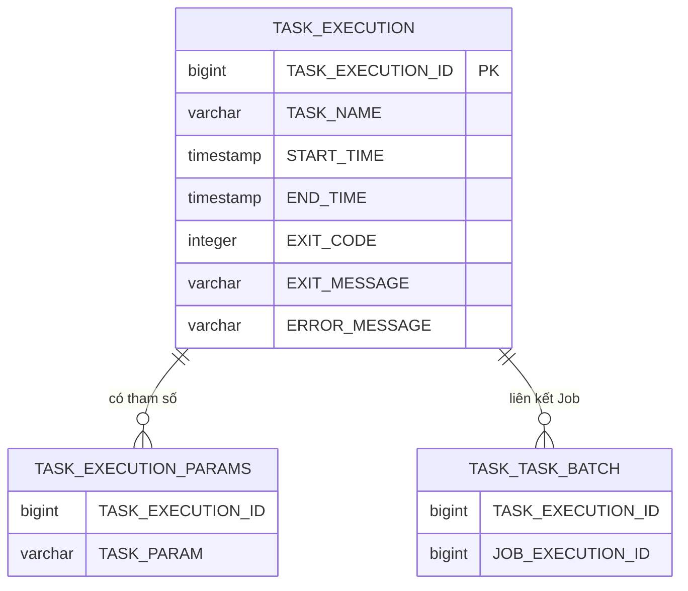
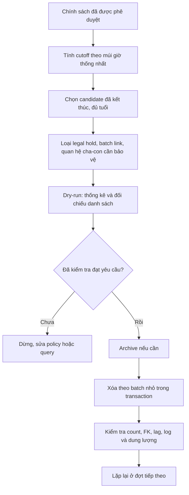

# Tra cứu lịch sử, phân trang và chính sách lưu giữ dữ liệu trong Spring Cloud Task

## 1. Bài toán: Lịch sử thực thi tăng lên theo thời gian

Trong **Spring Cloud Task**, mỗi lần ứng dụng chạy là một lần thực thi hữu hạn. Khi `ApplicationContext` khởi tạo thành công, Spring Cloud Task tạo bản ghi `TaskExecution`; khi Task kết thúc, framework cập nhật kết quả vào **`TaskRepository`**. Các thông tin như tên Task, thời điểm bắt đầu/kết thúc, `exitCode` và thông điệp lỗi giúp đội vận hành trả lời: *Task đã chạy chưa, lúc nào, thành công hay thất bại, và có cần chạy lại không?*

Giả sử hệ thống mỗi ngày chạy ba loại tác vụ: đồng bộ đơn hàng, tính hoa hồng và gửi báo cáo. Một tác vụ có thể chạy hàng trăm lần vì lịch, chạy thủ công hoặc retry. Sau nhiều tháng, `TASK_EXECUTION` có hàng trăm nghìn bản ghi, các bảng tham số và liên kết Batch còn lớn hơn. Nếu dashboard luôn tải toàn bộ lịch sử hoặc người vận hành xóa metadata cũ tùy tiện, hệ thống sẽ vừa chậm vừa khó điều tra sự cố.

Bài học thuộc chương **Kho và schema**, tập trung vào ba kỹ năng:

1. **Tra cứu đúng:** sử dụng `TaskExplorer` hoặc SQL để tìm lần chạy theo ID, tên Task, thời gian và kết quả; hiểu liên kết với Spring Batch.
2. **Phân trang đúng:** trả một lượng kết quả có giới hạn, sắp xếp ổn định, phân biệt phân trang offset và cursor.
3. **Lưu giữ đúng:** quy định thời hạn, bảo vệ dữ liệu còn cần điều tra, dọn theo đợt có kiểm chứng mà không làm hỏng quan hệ giữa các bảng.

Kiến thức này là nền tảng để vận hành ứng dụng Spring Cloud Task chạy theo lịch hoặc theo yêu cầu, đồng thời theo dõi trạng thái thực thi và kết quả trong cơ sở dữ liệu lâu dài.

## 2. Hiểu schema TaskRepository trước khi truy vấn

Spring Cloud Task định nghĩa các bảng metadata của nó; đây là **dữ liệu theo dõi tiến trình**, không phải bảng nghiệp vụ chứa đơn hàng, giao dịch hay kết quả báo cáo.

| Thành phần | Nội dung | Điều cần lưu ý |
| --- | --- | --- |
| `TASK_EXECUTION` | Mỗi dòng tương ứng một lần thực thi Task: ID, tên, thời gian, mã thoát, thông điệp | Bảng chính để lọc lịch sử |
| `TASK_EXECUTION_PARAMS` | Các tham số dòng lệnh được ghi lại theo `TASK_EXECUTION_ID` | Có thể chứa dữ liệu nhạy cảm nếu người gọi truyền qua CLI |
| `TASK_TASK_BATCH` | Liên kết `TASK_EXECUTION_ID` với `JOB_EXECUTION_ID` của Spring Batch | Một Task có thể liên quan các JobExecution |
| `TASK_LOCK` | Metadata khóa khi bật tính năng single-instance | Không được xem là lịch sử chạy để xóa theo tuổi `END_TIME` |
| `TASK_SEQ` hoặc sequence tương đương | Cấp ID cho lần thực thi | Không reset khi dọn lịch sử |

Những cột thường dùng nhất của `TASK_EXECUTION`:

| Cột | Ý nghĩa |
| --- | --- |
| `TASK_EXECUTION_ID` | Khóa định danh duy nhất của một lần chạy |
| `TASK_NAME` | Tên Task được resolver hoặc cấu hình của ứng dụng xác định |
| `START_TIME` | Thời điểm bắt đầu được lưu trong repository |
| `END_TIME` | Thời điểm kết thúc; có thể `NULL` nếu chưa hoàn thành hoặc không cập nhật được |
| `EXIT_CODE` | Mã thoát; thường `0` khi thành công, khác `0` khi lỗi; có thể `NULL` trong khi chạy |
| `EXIT_MESSAGE` | Thông điệp kết thúc do ứng dụng đặt, có thể `NULL` |
| `ERROR_MESSAGE` | Thông tin lỗi kỹ thuật, ví dụ stack trace, có thể `NULL` |
| `LAST_UPDATED` | Thời điểm ghi nhận cập nhật gần nhất theo cơ chế repository |
| `EXTERNAL_EXECUTION_ID` | ID tương quan do nền tảng điều phối cung cấp, nếu có |
| `PARENT_TASK_EXECUTION_ID` | Liên kết tới một TaskExecution cha, nếu ứng dụng sử dụng |

Schema tài liệu hiện hành cho thấy độ dài thông thường của `EXIT_MESSAGE`, `ERROR_MESSAGE` và `TASK_PARAM` là `VARCHAR(2500)`. Hãy đối chiếu **DDL thực tế của đúng phiên bản đang dùng** trước khi tạo chỉ mục hoặc viết công cụ dọn dữ liệu; cấu trúc, cách cấp ID và tên bảng có thể khác giữa phiên bản hoặc khi được tùy chỉnh.



Sơ đồ trên minh họa **quan hệ logic** để truy vấn và dọn dữ liệu; không khẳng định mọi bản DDL đều có khóa ngoại vật lý như ký hiệu. `TASK_TASK_BATCH.JOB_EXECUTION_ID` liên kết với metadata **Spring Batch**, nơi có bộ bảng riêng (`BATCH_JOB_EXECUTION`, `BATCH_STEP_EXECUTION`, ...).

> **Giới hạn quan trọng:** `END_TIME IS NULL` không chứng minh tiến trình còn sống. Ứng dụng bị kill, máy mất nguồn hoặc lỗi trước khi ghi kết quả có thể để lại một lần chạy chưa kết thúc trên database. Cần đối chiếu scheduler, container, log và timeout.

### Tên bảng tùy chỉnh và khởi tạo schema

Một số triển khai dùng tiền tố khác `TASK_`, ví dụ `OPS_TASK_EXECUTION`, thông qua cấu hình `spring.cloud.task.tablePrefix`. Khi đó tất cả truy vấn SQL trong bài cần thay đúng tên bảng. Cấu hình tiền tố và khởi tạo schema phải theo đúng phiên bản đang chạy; với môi trường production, thường nên dùng công cụ migration và kiểm soát quyền DDL thay vì để mỗi lần chạy Task tự thay đổi cấu trúc bảng.

## 3. Tra cứu lịch sử qua TaskExplorer

**`TaskRepository`** đảm nhiệm ghi thông tin vòng đời; **`TaskExplorer`** là API đọc metadata. Khi viết màn hình vận hành hoặc dịch vụ tra cứu, hãy bắt đầu từ `TaskExplorer` nếu nó đáp ứng truy vấn cần thiết.

Các phương thức quan trọng:

| API | Mục đích |
| --- | --- |
| `getTaskExecution(long executionId)` | Tra cứu một lần chạy bằng ID |
| `getLatestTaskExecutionForTaskName(String name)` | Lấy lần chạy gần nhất theo thời điểm bắt đầu của Task |
| `findTaskExecutionsByName(String name, Pageable pageable)` | Lấy một trang lịch sử của một Task |
| `findAll(Pageable pageable)` | Lấy một trang lịch sử toàn hệ thống |
| `findRunningTaskExecutions(String name, Pageable pageable)` | Tra cứu các bản ghi được xem là đang chạy của Task theo tên |
| `getTaskExecutionCount()` | Đếm tổng số bản ghi TaskExecution |
| `getTaskExecutionCountByTaskName(String name)` | Đếm bản ghi theo tên Task |
| `getJobExecutionIdsByTaskExecutionId(long id)` | Tìm các Spring Batch JobExecution liên kết với Task |

Ở API `findAll(Pageable)` được tài liệu mô tả, kết quả sắp xếp theo `startTime` giảm dần, sau đó `taskExecutionId` giảm dần. Đối với các API khác hoặc khi cần lọc tùy ý theo khoảng thời gian và `exitCode`, nên kiểm tra tài liệu đúng phiên bản hoặc sử dụng truy vấn SQL có `ORDER BY` tường minh.

**Ví dụ Java 17+**, triển khai phần dịch vụ truy vấn và chỉ trả các trường cần thiết:

```java
package com.example.taskhistory;

import java.time.LocalDateTime;

import org.springframework.cloud.task.repository.TaskExecution;
import org.springframework.cloud.task.repository.TaskExplorer;
import org.springframework.data.domain.Page;
import org.springframework.data.domain.PageRequest;
import org.springframework.stereotype.Service;

@Service
public class TaskHistoryService {

    private final TaskExplorer explorer;

    public TaskHistoryService(TaskExplorer explorer) {
        this.explorer = explorer;
    }

    public Page<TaskRunSummary> history(String taskName, int page, int size) {
        if (taskName == null || taskName.isBlank()) {
            throw new IllegalArgumentException("taskName is required");
        }
        if (page < 0 || size < 1 || size > 100) {
            throw new IllegalArgumentException(
                "page must be >= 0; size must be between 1 and 100"
            );
        }

        Page<TaskExecution> executions =
            explorer.findTaskExecutionsByName(
                taskName, PageRequest.of(page, size)
            );

        return executions.map(TaskHistoryService::toSummary);
    }

    public TaskRunSummary byId(long executionId) {
        if (executionId <= 0) {
            throw new IllegalArgumentException("executionId must be positive");
        }
        TaskExecution execution = explorer.getTaskExecution(executionId);
        return execution == null ? null : toSummary(execution);
    }

    private static TaskRunSummary toSummary(TaskExecution execution) {
        return new TaskRunSummary(
            execution.getExecutionId(),
            execution.getTaskName(),
            execution.getStartTime(),
            execution.getEndTime(),
            execution.getExitCode()
        );
    }

    public record TaskRunSummary(
        long executionId,
        String taskName,
        LocalDateTime startTime,
        LocalDateTime endTime,
        Integer exitCode
    ) {}
}
```

Các điểm cần nhớ:

- `PageRequest.of(page, size)` dùng **trang bắt đầu từ 0**; với `page=0,size=20` là 20 bản ghi đầu tiên.
- `Page<TaskRunSummary>` chứa `getContent()`, `getTotalElements()` và `getTotalPages()` để tạo giao diện phân trang. Việc tính tổng có thể khiến database phải thực hiện thêm truy vấn đếm.
- Đối tượng `TaskExecution` có thể mang `arguments` và `errorMessage`. DTO `TaskRunSummary` cố ý không trả các trường đó để giảm lộ dữ liệu kỹ thuật hoặc nhạy cảm cho màn hình danh sách.
- Đoạn trên là **service đọc dữ liệu**, không tự tạo REST endpoint, không tự giải quyết xác thực người dùng, tenant scoping hoặc giới hạn quyền xem lịch sử. Nếu dùng API công khai, phải thêm các kiểm soát đó.
- API `TaskExplorer` không phải công cụ xóa dữ liệu. Phần retention nên có job/migration riêng, giao dịch riêng và quy trình phê duyệt vận hành.

### Phân biệt “lần chạy mới nhất” và “lần chạy hoàn tất mới nhất”

`getLatestTaskExecutionForTaskName(...)` lấy lần chạy mới nhất theo **thời điểm bắt đầu**; kết quả có thể vẫn đang chạy. Nó không đồng nghĩa với “lần thành công mới nhất”.

Ví dụ:

| ID | Bắt đầu | Kết thúc | Exit code |
| ---: | --- | --- | ---: |
| 803 | 10:15 | `NULL` | `NULL` |
| 802 | 10:10 | 10:13 | `0` |
| 801 | 10:00 | 10:05 | `1` |

Hàm lấy latest theo tên có thể trả **803**, còn “lần thành công gần nhất” là **802**. Muốn lấy lần thành công cuối cùng, cần điều kiện truy vấn riêng, ví dụ `END_TIME IS NOT NULL AND EXIT_CODE = 0`.

## 4. SQL tra cứu lịch sử có điều kiện

Khi xây dựng báo cáo vận hành theo ngày, tên Task hoặc trạng thái, SQL giúp kiểm soát bộ lọc và sắp xếp. Các câu sau giả định schema mặc định và tên bảng viết hoa. Tùy hệ quản trị, cú pháp phân trang có thể khác; các tham số dạng `:taskName`, `:fromTime` cần được **bind bằng JDBC/framework**, không ghép chuỗi từ đầu vào người dùng.

### 4.1. Truy vấn nhanh một Task theo thời gian

```sql
SELECT
    TASK_EXECUTION_ID,
    TASK_NAME,
    START_TIME,
    END_TIME,
    EXIT_CODE,
    EXIT_MESSAGE,
    EXTERNAL_EXECUTION_ID
FROM TASK_EXECUTION
WHERE TASK_NAME = :taskName
  AND START_TIME >= :fromTime
  AND START_TIME <  :toTime
ORDER BY START_TIME DESC, TASK_EXECUTION_ID DESC;
```

Nên dùng khoảng **[fromTime, toTime)** (đầu bao gồm, cuối không bao gồm) để không đếm lặp tại ranh giới giữa hai ngày. Với nhiều múi giờ, định nghĩa rõ dữ liệu trong cột thời gian theo UTC hay múi giờ hệ thống trước khi chuyển khoảng ngày của người dùng sang tham số query.

### 4.2. Tra cứu các lần chạy không thành công đã kết thúc

```sql
SELECT
    TASK_EXECUTION_ID,
    TASK_NAME,
    START_TIME,
    END_TIME,
    EXIT_CODE,
    EXIT_MESSAGE
FROM TASK_EXECUTION
WHERE END_TIME IS NOT NULL
  AND EXIT_CODE <> 0
ORDER BY END_TIME DESC, TASK_EXECUTION_ID DESC;
```

`EXIT_CODE <> 0` không bao gồm `NULL`. Đó là điều mong muốn khi chỉ tìm các lần chạy đã ghi nhận mã lỗi; những bản ghi thiếu `END_TIME` hoặc `EXIT_CODE` cần có màn hình và cảnh báo riêng.

### 4.3. Thống kê số lần thành công/thất bại

```sql
SELECT
    TASK_NAME,
    COUNT(*) AS TOTAL_RUNS,
    SUM(CASE
        WHEN END_TIME IS NOT NULL AND EXIT_CODE = 0 THEN 1
        ELSE 0
    END) AS SUCCEEDED,
    SUM(CASE
        WHEN END_TIME IS NOT NULL AND EXIT_CODE <> 0 THEN 1
        ELSE 0
    END) AS FAILED,
    SUM(CASE
        WHEN END_TIME IS NULL OR EXIT_CODE IS NULL THEN 1
        ELSE 0
    END) AS INCOMPLETE_OR_UNKNOWN
FROM TASK_EXECUTION
WHERE START_TIME >= :fromTime
  AND START_TIME <  :toTime
GROUP BY TASK_NAME
ORDER BY TASK_NAME;
```

Tên `INCOMPLETE_OR_UNKNOWN` được chọn có chủ ý: đây là nhóm **chưa phân loại đủ**, không khẳng định tất cả đều còn đang chạy. Nếu ứng dụng tự bắt rồi nuốt ngoại lệ, metadata có thể báo exit code thành công mặc dù kết quả nghiệp vụ không như mong đợi.

### 4.4. Liên kết với Spring Batch

```sql
SELECT
    t.TASK_EXECUTION_ID,
    t.TASK_NAME,
    t.START_TIME,
    t.EXIT_CODE,
    b.JOB_EXECUTION_ID
FROM TASK_EXECUTION t
JOIN TASK_TASK_BATCH b
  ON b.TASK_EXECUTION_ID = t.TASK_EXECUTION_ID
WHERE t.TASK_EXECUTION_ID = :taskExecutionId;
```

Quan hệ này giúp chuyển từ lần chạy Task sang các lần chạy Job của Spring Batch. Một TaskExecution có thể liên kết nhiều JobExecution, do đó kết quả `JOIN` có thể có nhiều dòng; không dùng số dòng của câu truy vấn này để đếm số Task duy nhất. Metadata của các Job/Step vẫn do Spring Batch quản lý với quy tắc lưu giữ riêng.

## 5. Phân trang: offset và cursor

Khi bảng có hàng triệu dòng, truy vấn không phân trang như `SELECT * FROM TASK_EXECUTION` gây tải lớn, tốn băng thông, RAM, và làm chậm màn hình. Nên giới hạn `size`, giới hạn độ sâu truy vấn và trả các cột thật sự cần thiết.

### Cách A: offset pagination

Với cơ sở dữ liệu PostgreSQL, một cách viết là:

```sql
SELECT
    TASK_EXECUTION_ID,
    TASK_NAME,
    START_TIME,
    END_TIME,
    EXIT_CODE
FROM TASK_EXECUTION
WHERE TASK_NAME = :taskName
ORDER BY START_TIME DESC, TASK_EXECUTION_ID DESC
LIMIT :limit OFFSET :offset;
```

Ví dụ `limit=20, offset=40` là trang thứ ba nếu bắt đầu đánh số trang từ 0. Truy vấn này tiện cho UI có số trang và đếm tổng, nhưng có hai hạn chế:

1. `OFFSET` lớn có thể khiến database phải đi qua nhiều bản ghi trước khi trả trang hiện tại.
2. Nếu có lần chạy mới được thêm vào giữa hai lần truy vấn, ranh giới offset thay đổi; người dùng có thể thấy bản ghi trùng hoặc bỏ sót khi chuyển trang.

Đừng dùng `LIMIT/OFFSET` như thể đó là cú pháp SQL phổ quát: SQL Server và Oracle có cú pháp/đặc điểm khác. `TaskExplorer` che bớt khác biệt này nếu chỉ cần phương thức mà API hỗ trợ.

### Cách B: keyset/cursor pagination

Nếu người dùng liên tục bấm “Xem thêm” và dữ liệu được ghi mới thường xuyên, có thể dùng **cursor** dựa trên cặp khóa sắp xếp (`START_TIME`, `TASK_EXECUTION_ID`). Bản ghi có cùng `START_TIME` vẫn có thứ tự xác định nhờ ID:

```sql
-- Trang đầu tiên (PostgreSQL):
SELECT TASK_EXECUTION_ID, TASK_NAME, START_TIME, END_TIME, EXIT_CODE
FROM TASK_EXECUTION
WHERE TASK_NAME = :taskName
  AND START_TIME IS NOT NULL
ORDER BY START_TIME DESC, TASK_EXECUTION_ID DESC
LIMIT :limit;

-- Trang tiếp theo: dùng startTime và ID của dòng cuối trang trước.
SELECT TASK_EXECUTION_ID, TASK_NAME, START_TIME, END_TIME, EXIT_CODE
FROM TASK_EXECUTION
WHERE TASK_NAME = :taskName
  AND START_TIME IS NOT NULL
  AND (
      START_TIME < :cursorStartTime
      OR (
          START_TIME = :cursorStartTime
          AND TASK_EXECUTION_ID < :cursorExecutionId
      )
  )
ORDER BY START_TIME DESC, TASK_EXECUTION_ID DESC
LIMIT :limit;
```

Cursor đầu vào phải được parse/validate và gắn với đúng bộ lọc (`taskName`, khoảng thời gian, quyền truy cập). Không nên cho người dùng tự đổi giá trị cursor để đọc lịch sử của tenant khác. Với cursor tiếp tục tra cứu, có thể mã hóa payload thành một token có chữ ký và hạn dùng; mã hóa base64 **đơn thuần không phải cơ chế phân quyền**.

Các giới hạn cần biết:

- Nếu `START_TIME` có thể `NULL`, truy vấn trên cố ý loại các dòng đó; cung cấp luồng riêng để kiểm tra metadata thiếu thời gian.
- Keyset ổn định hơn offset với dữ liệu chèn mới khi thứ tự không thay đổi. Nếu bản ghi bị cập nhật làm thay đổi khóa sắp xếp, xóa giữa lượt xem hoặc cần ảnh chụp chính xác toàn bộ tập kết quả, vẫn có thể cần snapshot/isolation hay một mốc lọc cố định.
- Nếu chỉ muốn sắp xếp theo `TASK_EXECUTION_ID DESC`, cursor `ID < lastId` còn đơn giản hơn, nhưng ID phản ánh cách cấp ID chứ **không phải** lúc nào cũng là thứ tự thời gian thực thi chính xác, nhất là khi TaskExecution được tạo trước lúc khởi chạy.

### Chọn chiến lược

| Tình huống | Giải pháp thường phù hợp |
| --- | --- |
| Danh sách ngắn, người dùng cần số trang | `TaskExplorer` với `Pageable` hoặc SQL offset có giới hạn |
| Lịch sử rất lớn, nút “Xem thêm” | Keyset cursor với thứ tự rõ ràng |
| Xuất báo cáo toàn bộ lịch sử | Đọc streaming/theo lô, chia khoảng thời gian; không đưa một `Page` khổng lồ lên HTTP |
| Tổng hợp theo ngày | Truy vấn aggregate hoặc bảng tổng hợp đã chuẩn hóa |
| Muốn tìm đúng một lần chạy | Tra theo `TASK_EXECUTION_ID` có chỉ mục khóa chính |

## 6. Thiết kế chỉ mục và kiểm soát tải truy vấn

Chỉ mục nên đi theo truy vấn thực tế. Với PostgreSQL và schema mặc định, có thể xem xét **sau khi kiểm tra chỉ mục sẵn có**:

```sql
-- Minh họa: triển khai bằng migration sau khi xem execution plan.
CREATE INDEX IF NOT EXISTS idx_task_name_start_execution
    ON TASK_EXECUTION
       (TASK_NAME, START_TIME DESC, TASK_EXECUTION_ID DESC);

CREATE INDEX IF NOT EXISTS idx_task_end_execution
    ON TASK_EXECUTION
       (END_TIME, TASK_EXECUTION_ID);
```

Chỉ mục thứ nhất hỗ trợ danh sách lịch sử theo tên và thời điểm; chỉ mục thứ hai có thể hỗ trợ chọn các bản ghi đủ tuổi để lưu giữ/dọn dẹp. Đây không phải DDL bắt buộc cho mọi dự án. Mỗi chỉ mục tiêu tốn dung lượng và tăng chi phí ghi của Task, nên cần đo `EXPLAIN (ANALYZE, BUFFERS)` trên khối lượng dữ liệu đại diện, bảo đảm không tạo chỉ mục trùng và cân nhắc quy trình xây chỉ mục tránh khóa ghi trong production.

Các tối ưu thường quan trọng hơn việc thêm nhiều chỉ mục:

- Giới hạn trang, ví dụ tối đa **100 bản ghi** mỗi lần; không cho API nhận `size=1000000`.
- Tránh `SELECT *`, đặc biệt khi `ERROR_MESSAGE` có stack trace dài.
- Bắt buộc lọc khoảng thời gian cho báo cáo quy mô lớn; cache thống kê có thể sử dụng lại.
- Không dùng `TaskExplorer.getTaskExecutionCount()` trong mỗi lần polling nếu bảng rất lớn và UI không thực sự cần tổng chính xác.
- Kiểm soát quyền truy cập theo tenant/nhóm vận hành **trước** khi trả kết quả; `TASK_NAME` không tự bảo đảm tenant isolation.

## 7. Chính sách lưu giữ dữ liệu (retention) nên trả lời điều gì?

**Retention policy** quy định dữ liệu nào còn cần, cần giữ bao lâu, có cần lưu trữ lâu dài hay ẩn thông tin nhạy cảm, và khi nào được xóa. Spring Cloud Task ghi nhận vòng đời nhưng **không nên giả định framework có một chính sách tự động xóa lịch sử theo số ngày đáp ứng quy định của doanh nghiệp**. Việc chọn thời hạn, lưu trữ và dọn dữ liệu thuộc trách nhiệm vận hành ứng dụng.

Một ví dụ chính sách **minh họa** (không phải mặc định Spring Cloud Task, không phải yêu cầu pháp lý):

| Loại dữ liệu | Ví dụ thời hạn | Cách xử lý |
| --- | --- | --- |
| Task thành công, ít cần điều tra | 90 ngày | Giữ bản ghi chi tiết trong DB; sau đó có thể xóa theo lô |
| Task thất bại hoặc cần đối soát | 365 ngày | Giữ lâu hơn để điều tra; xem xét lưu trữ có kiểm soát |
| Task chưa có `END_TIME` hoặc `EXIT_CODE` | Không xóa theo quy tắc tuổi thông thường | Điều tra với scheduler; xác định tiến trình còn chạy hay metadata mắc kẹt |
| Task liên kết Spring Batch | Theo chính sách phối hợp Task và Batch | Không tự ý làm mất mối liên hệ với JobExecution |
| Task thuộc diện điều tra/đóng băng dữ liệu | Theo quyết định có thẩm quyền | Áp dụng *legal hold* hoặc quy định giữ dữ liệu đặc biệt |
| Thống kê tổng hợp theo ngày | Có thể giữ lâu hơn lịch sử chi tiết | Chỉ giữ số liệu cần thiết, không sao chép tham số hoặc stack trace |

**Chọn thời điểm cắt:** thông thường dùng `END_TIME < cutoff` để chỉ xét các lần chạy đã hoàn tất; tránh dùng mỗi `START_TIME` vì Task có thể chạy dài. Cũng nên yêu cầu `EXIT_CODE` đã có giá trị, quy định xử lý rõ cho kết quả lỗi, và không xóa các lần thực thi đang được tham chiếu bởi quy trình điều tra hoặc bảng nghiệp vụ.

**Không đồng nhất retention với backup.** Backup phục vụ phục hồi sau sự cố; archive phục vụ tra cứu dài hạn hoặc tuân thủ. Một bản ghi đã bị purge khỏi database nhưng vẫn còn trong backup không có nghĩa hệ thống có thể tra cứu nó trực tuyến. Chính sách xóa dữ liệu nhạy cảm phải tính tới thời hạn backup, snapshot và archive.

### Thiết kế quy trình retention



**Nên phân tách ba bước:** (1) tính và kiểm tra tập candidate; (2) archive/anonymize nếu có yêu cầu; (3) purge theo lô và giám sát. Một Task dọn dữ liệu cũng là một tiến trình hữu hạn có thể chạy theo lịch, nhưng phải tránh để nó tự xóa chính metadata đang ghi nhận quá trình purge.

## 8. Ví dụ purge an toàn theo lô (PostgreSQL)

Phần này là **mẫu để học và thử nghiệm**, chỉ áp dụng khi đã xác nhận DDL thực tế, quan hệ dữ liệu, quyền truy cập, chính sách lưu giữ và khả năng phục hồi. Chỉ chạy trong database thử nghiệm trước. Mẫu chủ động giới hạn ở **Task thành công, không có liên kết Batch và không bị Task khác tham chiếu là cha** để tránh xóa nhầm lịch sử khó khôi phục.

### 8.1. Xem số lượng đủ điều kiện trước

```sql
-- :cutoff là timestamp được bind, đã chuẩn hóa theo timezone database.
SELECT COUNT(*) AS CANDIDATE_COUNT
FROM TASK_EXECUTION t
WHERE t.END_TIME IS NOT NULL
  AND t.END_TIME < :cutoff
  AND t.EXIT_CODE = 0
  AND NOT EXISTS (
      SELECT 1
      FROM TASK_TASK_BATCH b
      WHERE b.TASK_EXECUTION_ID = t.TASK_EXECUTION_ID
  )
  AND NOT EXISTS (
      SELECT 1
      FROM TASK_EXECUTION child
      WHERE child.PARENT_TASK_EXECUTION_ID = t.TASK_EXECUTION_ID
  );
```

Lệnh đếm chỉ là bước khảo sát: có thể cần thêm tiêu chí `TASK_NAME`, danh sách giữ lại, khoảng ID, cảnh báo pháp lý hoặc bảng đánh dấu giữ hồ sơ theo quy định doanh nghiệp. Dữ liệu đang bị điều tra phải được loại trước khi xóa.

### 8.2. Một giao dịch xóa tối đa 100 lần chạy

Ví dụ PostgreSQL dưới đây dùng một ngày cắt **cố định chỉ để thử nghiệm** (`2026-08-01 00:00:00`). Trong sản phẩm, cutoff phải tính từ chính sách và múi giờ đã quy định. Lệnh chạy như **một transaction**, trước `COMMIT` có thể kiểm tra tập candidate và `ROLLBACK` nếu không phù hợp.

```sql
BEGIN;

CREATE TEMP TABLE purge_task_ids (
    task_execution_id BIGINT PRIMARY KEY
) ON COMMIT DROP;

INSERT INTO purge_task_ids (task_execution_id)
SELECT t.TASK_EXECUTION_ID
FROM TASK_EXECUTION t
WHERE t.END_TIME IS NOT NULL
  AND t.END_TIME < TIMESTAMP '2026-08-01 00:00:00'
  AND t.EXIT_CODE = 0
  AND NOT EXISTS (
      SELECT 1 FROM TASK_TASK_BATCH b
      WHERE b.TASK_EXECUTION_ID = t.TASK_EXECUTION_ID
  )
  AND NOT EXISTS (
      SELECT 1 FROM TASK_EXECUTION child
      WHERE child.PARENT_TASK_EXECUTION_ID = t.TASK_EXECUTION_ID
  )
ORDER BY t.TASK_EXECUTION_ID
LIMIT 100;

-- Xác nhận danh sách candidate theo policy.
SELECT COUNT(*) AS selected_count FROM purge_task_ids;
SELECT task_execution_id FROM purge_task_ids
ORDER BY task_execution_id;

-- Sau khi xác nhận candidate đúng:
DELETE FROM TASK_EXECUTION_PARAMS p
USING purge_task_ids c
WHERE p.TASK_EXECUTION_ID = c.task_execution_id;

DELETE FROM TASK_EXECUTION t
USING purge_task_ids c
WHERE t.TASK_EXECUTION_ID = c.task_execution_id;

COMMIT;
```

**Tại sao xóa bảng tham số trước?** `TASK_EXECUTION_PARAMS` là dữ liệu con theo ID Task; xóa cha trước có thể vi phạm khóa ngoại hoặc để lại dữ liệu mồ côi nếu DDL không cưỡng chế quan hệ. Mẫu **không xóa `TASK_TASK_BATCH`** vì ngay từ bước chọn đã loại các Task có liên kết Batch. Nếu policy cần purge các lần chạy liên kết Batch, phải thiết kế thêm thứ tự, quyền sở hữu và quy tắc xóa metadata Batch riêng, dựa trên schema thực tế.

**Giới hạn của mẫu SQL:** Hai bước chọn và xóa trong một giao dịch không tự giải quyết mọi trường hợp chạy đồng thời. Ví dụ, một quy trình khác có thể thêm quan hệ tham chiếu sau khi đã chọn candidate. Trong production, cần phối hợp quiesce/locking hoặc cơ chế đồng bộ phù hợp, kiểm soát transaction isolation, ràng buộc FK và quy trình archive. Mẫu không xử lý *legal hold* vì cơ chế đánh dấu dữ liệu giữ lại thuộc thiết kế riêng của hệ thống; phải thêm điều kiện trước khi thực thi.

Trong hệ thống có nhiều triệu bản ghi, hãy lặp theo **batch nhỏ** với log số dòng đã chọn/xóa, thời gian mỗi batch và thời gian nghỉ hợp lý; giới hạn tổng thời gian chạy để không cạnh tranh quá mức với các Task nghiệp vụ. Không viết một câu `DELETE` không điều kiện trên toàn bảng trong giờ cao điểm.

### 8.3. Sau khi xóa

Kiểm tra các điều kiện sau:

- Số dòng `TASK_EXECUTION` giảm đúng số lượng đã duyệt; không xuất hiện bản ghi tham số mồ côi.
- Các trang lịch sử mới và API `TaskExplorer` vẫn tra cứu được dữ liệu còn lại.
- Các JobExecution được giữ lại vẫn có thông tin cần thiết để đối soát; không mất dữ liệu Batch ngoài phạm vi policy.
- Chỉ mục, độ trễ truy vấn, log transaction và dung lượng database nằm trong ngưỡng.
- Backup và quy trình khôi phục đã được thử để bảo đảm có thể phục hồi khi phát hiện purge sai.

Trên PostgreSQL, việc `DELETE` nhiều bản ghi không nhất thiết làm kích thước tệp bảng giảm ngay; cơ chế `VACUUM`/autovacuum sẽ quản lý các tuple đã chết. Không tự chạy tác vụ bảo trì gây khóa nặng trong production mà chưa đánh giá tác động.

## 9. Khi có Spring Batch, parent task và yêu cầu audit

Nếu Task gọi Spring Batch Job, **`TASK_TASK_BATCH` là bảng liên kết**, còn Job/Step và checkpoint nằm trong schema Spring Batch. Xóa TaskExecution trong khi vẫn cần lịch sử Batch có thể khiến người vận hành không lần được một Job về tiến trình đã gọi nó. Ngược lại, xóa JobExecution trong Batch khi Task còn tham chiếu cũng tạo lỗ hổng tra cứu.

Một chính sách lưu giữ an toàn thường:

1. Quy định rõ hệ thống nào là nguồn dữ liệu audit chính và chu kỳ lưu giữ của Task/Batch/scheduler.
2. Thống nhất thứ tự lưu trữ, ẩn thông tin và xóa hai phía; không giả định `ON DELETE CASCADE` được cấu hình trong mọi DDL.
3. Giữ khóa tương quan như `TASK_EXECUTION_ID`, `JOB_EXECUTION_ID` và `EXTERNAL_EXECUTION_ID` trong archive nếu cần đối soát.
4. Định nghĩa chính sách cho Task cha/con: không xóa cha khi con vẫn cần hiển thị quan hệ hoặc khi có quy trình nghiệp vụ phụ thuộc ID cha.
5. Kiểm tra quyền truy cập và retention riêng cho `TASK_EXECUTION_PARAMS` vì tham số CLI có thể chứa thông tin nhạy cảm nếu ứng dụng đã truyền sai.

Việc làm sạch các bảng `BATCH_JOB_EXECUTION` và `BATCH_STEP_EXECUTION` không thuộc trách nhiệm tự động của `TaskExplorer` và không nên gộp vào một lệnh xóa sơ sài. Hãy dùng cơ chế quản trị Spring Batch và chính sách restart/audit của ứng dụng để quyết định bản ghi nào được xóa.

### Phân biệt dữ liệu lưu giữ lâu dài và dữ liệu cần cảnh báo ngắn hạn

- **Lịch sử tra cứu:** cần ID, thời điểm, mã thoát, số liệu nghiệp vụ tổng hợp, nguồn điều phối; phù hợp cho dashboard và truy vết.
- **Thông tin xử lý lỗi:** `ERROR_MESSAGE` và log chi tiết thường cần quyền truy cập hạn chế và thời hạn phù hợp với yêu cầu điều tra.
- **Trạng thái sống hiện tại:** nên lấy từ scheduler/container và hệ thống metrics; không suy luận tuyệt đối từ `END_TIME`.
- **Dữ liệu nghiệp vụ:** phải tuân theo chính sách riêng; xóa `TASK_EXECUTION` không có nghĩa được phép xóa đơn hàng hay báo cáo đã tạo.

## 10. Vận hành an toàn: checklist và bài tập

### Checklist trước khi triển khai dashboard lịch sử

1. Đã xác định `TaskRepository` dùng database bền vững và schema/`tablePrefix` đúng phiên bản.
2. API có giới hạn kích thước trang, thời gian truy vấn và quyền truy cập; không trả toàn bộ `arguments`/`errorMessage` trên danh sách.
3. Truy vấn SQL có `ORDER BY` và khóa phụ để sắp xếp xác định; bộ lọc thời gian dùng khoảng rõ ràng.
4. Có trang riêng cho Task chưa có `END_TIME`, đối chiếu với scheduler để nhận biết task treo hoặc metadata thất lạc.
5. Chỉ mục được đánh giá bằng execution plan và khối lượng thực; không thêm chỉ mục tùy tiện.
6. Retention policy định nghĩa thời hạn theo loại kết quả, legal hold, archive, ownership và backup.
7. Job purge có dry-run, audit, transaction, giới hạn batch và theo dõi sau chạy; việc xử lý Batch/cha-con đã được thỏa thuận.

### Bài tập thực hành

**Bài 1 — Tra cứu:** Tạo một Task có tên `daily-order-import`, chạy nhiều lần với một trường hợp thành công và một trường hợp ném lỗi. Dùng `TaskExplorer` lấy lần chạy theo ID và 10 bản ghi gần nhất của tên Task. Giải thích tại sao `getLatestTaskExecutionForTaskName` có thể trả bản ghi chưa kết thúc.

**Bài 2 — Phân trang:** Sinh dữ liệu thử với ít nhất 50 lần chạy. Viết endpoint trả `page=0,size=20` và `page=1,size=20`; kiểm tra số lượng và thứ tự. Sau đó viết truy vấn cursor dùng `START_TIME` và `TASK_EXECUTION_ID`, mô tả kết quả khi có thêm bản ghi mới giữa hai lần lấy trang.

**Bài 3 — Policy:** Cho dữ liệu thử gồm Task thành công 120 ngày trước, Task thất bại 120 ngày trước, Task chưa có `END_TIME`, Task có Batch link và một Task cha có con. Đề xuất policy “thành công giữ 90 ngày, thất bại giữ 365 ngày” và xác định chính xác bản ghi nào đủ điều kiện với mẫu purge an toàn trong bài.

**Bài 4 — Dọn dữ liệu:** Trên database thử nghiệm, chạy câu query đếm candidate, kiểm tra từng ID rồi thực hiện một transaction xóa tối đa 100 bản ghi. So sánh trước và sau với `TASK_EXECUTION_PARAMS` và `TASK_TASK_BATCH`; bảo đảm không có con mồ côi và không mất liên kết Batch.

### Câu hỏi tự đánh giá

- Vì sao `END_TIME IS NULL` không đủ để khẳng định Task đang chạy?
- Tại sao danh sách lịch sử nên chỉ trả DTO gọn thay vì cả `TaskExecution`?
- Khi nào offset pagination dễ bị trùng hoặc bỏ sót bản ghi? Cursor giúp cải thiện điều gì?
- Tại sao cần kiểm tra `TASK_TASK_BATCH` và `PARENT_TASK_EXECUTION_ID` trước khi purge?
- Một hệ thống cần điều tra sự cố trong 12 tháng nhưng chỉ muốn lưu chi tiết thành công 90 ngày nên bố trí aggregate, archive và retention thế nào?

**Tiêu chí hoàn thành:** Bạn có thể tra cứu lịch sử bằng `TaskExplorer` và SQL, lấy từng trang có giới hạn và thứ tự ổn định, giải thích các dòng chưa kết thúc, thiết kế retention policy theo loại kết quả, và chứng minh bằng dữ liệu thử rằng quá trình purge không làm mất thông tin audit/Batch ngoài phạm vi cho phép.

## Tài liệu tham khảo chính thức

- [Spring Cloud Task — Task Repository Schema](https://docs.spring.io/spring-cloud-task/reference/appendix-task-repository-schema.html): các bảng và cột metadata chuẩn.
- [Spring Cloud Task — Features](https://docs.spring.io/spring-cloud-task/reference/features.html): lifecycle, TaskExecution, repository và cấu hình datasource.
- [Spring Cloud Task — TaskExplorer API](https://docs.spring.io/spring-cloud-task/docs/current/apidocs/org/springframework/cloud/task/repository/TaskExplorer.html): các API tra cứu và phân trang; đối chiếu API theo phiên bản phụ thuộc thực tế.
- [Spring Cloud Task — TaskExecution API](https://docs.spring.io/spring-cloud-task/docs/current/apidocs/org/springframework/cloud/task/repository/TaskExecution.html): các trường của một lần thực thi.
- [Spring Data Commons — Paging and Sorting](https://docs.spring.io/spring-data/commons/reference/repositories/query-methods-details.html#repositories.special-parameters): `Pageable`, `Page` và chi phí truy vấn.
- [Spring Batch — Reference Documentation](https://docs.spring.io/spring-batch/reference/): metadata Job/Step và vấn đề restart/audit.
