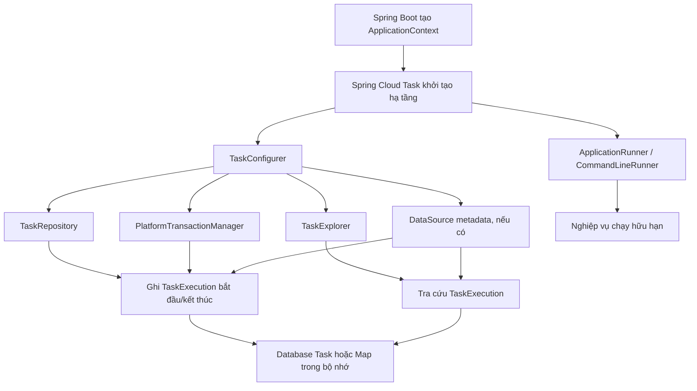
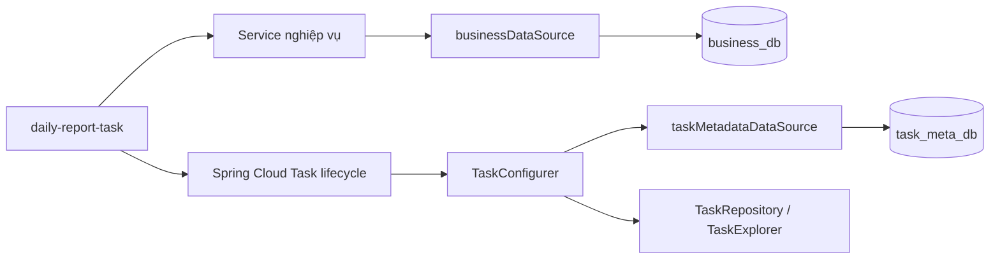
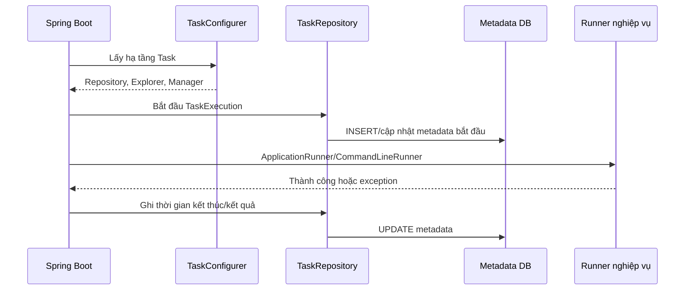

# TaskConfigurer và DefaultTaskConfigurer

## Mục tiêu bài học

**SPRING_CLOUD_TASK (Spring Cloud Task)** dùng để xây dựng các ứng dụng Spring Boot chạy trong thời gian hữu hạn: nhận yêu cầu hoặc được kích hoạt theo lịch, thực hiện nghiệp vụ rồi kết thúc. Framework lưu thông tin về thời điểm, trạng thái và kết quả của mỗi lần thực thi vào `TaskRepository` để có thể theo dõi, phân tích lỗi và phối hợp với Spring Batch khi cần.

Trong chương **Cấu hình mở rộng**, `TaskConfigurer` và `DefaultTaskConfigurer` là hai thành phần quyết định **cách hạ tầng lưu và truy vấn dữ liệu thực thi Task được thiết lập**. Bài học giúp bạn:

- Hiểu vai trò, các phương thức và ranh giới trách nhiệm của `TaskConfigurer`.
- Biết `DefaultTaskConfigurer` tự chọn cơ chế lưu trữ và transaction manager ra sao khi có hoặc không có `DataSource`.
- Phân biệt cấu hình mặc định đủ dùng với tình huống phải cung cấp `TaskConfigurer` tùy chỉnh.
- Cấu hình kho metadata riêng khi ứng dụng có nhiều `DataSource`, kể cả khi nghiệp vụ sử dụng Spring Batch.
- Đồng bộ `DataSource`, schema, table prefix và transaction manager để tránh ghi metadata sai nơi.
- Kiểm tra khả năng ghi nhận `TaskExecution`, xử lý lỗi khởi động và triển khai an toàn.

## 1. TaskConfigurer nằm ở đâu trong kiến trúc?

Một lượt chạy Spring Cloud Task thường được ghi nhận như sau:



`TaskConfigurer` là một **strategy interface**: nó trả về các thành phần được Spring Cloud Task sử dụng để quản lý metadata. Interface này **không** trực tiếp định nghĩa nghiệp vụ cần thực hiện và **không** quyết định lịch chạy Task. Bộ lập lịch, API yêu cầu hoặc nền tảng điều phối chịu trách nhiệm khởi chạy tiến trình; `ApplicationRunner` hoặc `CommandLineRunner` thực hiện công việc thực tế.

Trong ứng dụng thông thường có một `DataSource` hợp lệ, Spring Cloud Task có thể tự tạo `DefaultTaskConfigurer` và ghi metadata bằng JDBC. Trong ứng dụng phức tạp có nhiều nguồn dữ liệu hoặc yêu cầu hạ tầng riêng, bạn cung cấp một bean `TaskConfigurer` để xác định chính xác nguồn metadata và các thành phần đi kèm.

**Phân biệt:** `TaskConfigurer` cấu hình hạ tầng; `TaskRepository` thao tác tạo/cập nhật execution; `TaskExplorer` truy vấn execution. Không nên nhét công việc xuất báo cáo, đồng bộ đơn hàng hay khởi chạy Batch Job vào các getter của configurer.

## 2. Bốn phương thức của TaskConfigurer

Interface trong package `org.springframework.cloud.task.configuration` khai báo bốn phương thức chính:

```java
// Mô tả chữ ký API TaskConfigurer, không phải lớp cần tự tạo.
public interface TaskConfigurer {
    TaskRepository getTaskRepository();
    TaskExplorer getTaskExplorer();
    PlatformTransactionManager getTransactionManager();
    DataSource getTaskDataSource();
}
```

| Phương thức | Đối tượng được cung cấp | Mục đích |
| --- | --- | --- |
| `getTaskRepository()` | `TaskRepository` | Tạo, bắt đầu, cập nhật và kết thúc `TaskExecution`; ghi trạng thái thực thi. |
| `getTaskExplorer()` | `TaskExplorer` | Đọc và tìm kiếm lịch sử `TaskExecution`, chẳng hạn theo ID hoặc tên Task. |
| `getTransactionManager()` | `PlatformTransactionManager` | Quản lý các giao dịch liên quan tới việc cập nhật metadata Task. |
| `getTaskDataSource()` | `DataSource`, có thể `null` ở chế độ không dùng JDBC | Nêu nguồn kết nối dùng cho các thao tác metadata Task. |

Ba thành phần thường được nhắc đến nhất là `TaskRepository`, `TaskExplorer` và `PlatformTransactionManager`; phương thức thứ tư `getTaskDataSource()` rất quan trọng trong ứng dụng có nhiều nguồn kết nối.

Các phương thức này được Spring Cloud Task sử dụng như **hợp đồng cung cấp hạ tầng**. Tài liệu API khuyến cáo không gọi trực tiếp các getter của `TaskConfigurer` từ mã nghiệp vụ, trừ trường hợp đang dùng chúng để công bố các bean tương ứng. Trong service thông thường, hãy tiêm trực tiếp `TaskRepository`, `TaskExplorer` hoặc repository nghiệp vụ thích hợp.

### TaskRepository khác TaskExplorer thế nào?

Ví dụ người vận hành cần xem lịch sử xuất báo cáo ngày hôm qua:

- `TaskRepository` là thành phần framework dùng để ghi nhận các thay đổi của execution. Nó không phải repository bảng `ORDERS`, `REPORT` hay dữ liệu nghiệp vụ.
- `TaskExplorer` là lối truy cập metadata dành cho **đọc/tra cứu**, thuận tiện khi xây dashboard hoặc endpoint quản trị.
- Cả hai phải cùng tham chiếu tới **một kho metadata logic**. Nếu repository ghi vào `task_db_A` nhưng explorer đọc `task_db_B`, dashboard có thể báo “không tìm thấy” dù Task thực sự đã chạy.

## 3. DefaultTaskConfigurer cung cấp gì?

`DefaultTaskConfigurer` là lớp triển khai `TaskConfigurer` mặc định. Nếu không có bean `TaskConfigurer` tùy chỉnh, Spring Cloud Task sử dụng chiến lược mặc định phù hợp với các thành phần đã được cấu hình.

| Điều kiện | `TaskRepository` | `TaskExplorer` | Transaction manager |
| --- | --- | --- | --- |
| Có `DataSource` metadata | `SimpleTaskRepository` dùng cơ chế lưu JDBC, tiêu biểu là `JdbcTaskExecutionDao` | `SimpleTaskExplorer` truy vấn metadata JDBC | Thông thường `JdbcTransactionManager` với các phiên bản hiện đại; có thể thay đổi theo phiên bản hoặc tích hợp JPA. |
| Không có `DataSource` thích hợp | `SimpleTaskRepository` với DAO dựa trên `Map` | `SimpleTaskExplorer` truy vấn dữ liệu trong bộ nhớ | `ResourcelessTransactionManager`. |

`SimpleTaskRepository` là **lớp repository**; JDBC hay Map là chiến lược lưu dữ liệu do DAO bên dưới đảm nhận. Vì vậy, “không có DataSource” không có nghĩa tự động sử dụng một cơ sở dữ liệu bền vững. Dữ liệu Map trong bộ nhớ sẽ mất khi tiến trình kết thúc, không dùng cho lịch sử Task production.

Tài liệu Spring Cloud Task cũng mô tả cấu hình H2 để khởi tạo nhanh môi trường phát triển. Nếu Spring Boot tự cấu hình được H2 `DataSource` do driver/thành phần có mặt trên classpath, `DefaultTaskConfigurer` có thể đi theo **nhánh JDBC** dùng H2; điều này khác với **nhánh Map** khi không có `DataSource`. Đừng đánh đồng “H2 in-memory” và “Map-based repository”.

### Những constructor cần biết

Trong API Spring Cloud Task 3.0.x, các constructor thường gặp là:

```java
new DefaultTaskConfigurer();
new DefaultTaskConfigurer(dataSource);
new DefaultTaskConfigurer(tablePrefix);
new DefaultTaskConfigurer(dataSource, tablePrefix, applicationContext);
```

Mục đích lần lượt là sử dụng mặc định, chọn `DataSource` cụ thể, chọn tiền tố bảng hoặc cấu hình đầy đủ `DataSource` và tiền tố bảng trong context. **Chữ ký có thể thay đổi giữa các phiên bản**: đối chiếu Javadoc của release đang dùng trước khi sao chép constructor nhiều tham số.

Điều đáng chú ý: `DefaultTaskConfigurer` giúp tái sử dụng các mặc định đã được framework kiểm chứng. Trong phần lớn trường hợp cần chỉnh cấu hình, hãy **cấp đúng `DataSource` cho `DefaultTaskConfigurer`** thay vì tự viết lại `TaskRepository`, `TaskExplorer` hoặc transaction manager.

## 4. Khi nào không cần TaskConfigurer riêng?

Ứng dụng có **một `DataSource`** dùng đồng thời cho metadata Task và dữ liệu nghiệp vụ thường chỉ cần cấu hình Spring Boot:

```yaml
# application-local.yml — ví dụ phát triển với PostgreSQL dùng chung
spring:
  application:
    name: daily-report-task
  main:
    web-application-type: none
  datasource:
    url: jdbc:postgresql://localhost:5432/taskdemo
    username: demo
    password: ${LOCAL_DB_PASSWORD}
  cloud:
    task:
      name: daily-report-task
      initialize-enabled: false
```

Ví dụ giả định schema metadata đã được cài đặt trước, nên đặt `initialize-enabled: false`. Nếu môi trường phát triển muốn framework tự khởi tạo schema, cần xác nhận database và phiên bản đang dùng hỗ trợ cơ chế đó. Không thay việc quản lý migration ở production bằng cách bật tự tạo schema trong mọi lần chạy.

Với một `DataSource` rõ ràng và không có custom `TaskConfigurer`, cấu hình mặc định thường là đủ để lưu lịch sử execution. Thêm `@Bean TaskConfigurer` chỉ để trả về cùng `DataSource` mà không có yêu cầu đặc biệt sẽ làm tăng độ phức tạp và có thể thay đổi hành vi auto-configuration.

Lựa chọn **không cần tùy chỉnh** phù hợp khi:

1. Chỉ có một nguồn dữ liệu được dùng cho metadata Task.
2. Schema và quyền truy cập đã đúng, metadata được lưu bền vững.
3. Không cần tên bảng có tiền tố đặc biệt hoặc transaction manager riêng.
4. Đã kiểm thử Task khởi động, ghi kết quả và có thể tra cứu bằng `TaskExplorer`.

## 5. Trường hợp quan trọng: hai DataSource độc lập

**Bài toán:** Một tác vụ đọc đơn hàng từ database nghiệp vụ `business_db`, nhưng lịch sử `TaskExecution` phải được lưu trong database metadata `task_meta_db`. Cả hai nằm trên cùng hoặc khác máy chủ PostgreSQL.

Sự phân chia cần đạt được:



Khi có nhiều bean `DataSource`, chỉ đặt tên `businessDataSource` và `taskMetadataDataSource` **chưa đủ** để Spring Cloud Task biết kho nào phải chứa `TASK_EXECUTION`. Bạn cần cung cấp một bean `TaskConfigurer` định tuyến metadata sang nguồn kết nối đã chọn.

### 5.1. Khai báo hai nguồn kết nối

Ví dụ Spring Boot với JDBC và HikariCP:

```yaml
# application-prod.yml
app:
  datasource:
    business:
      url: ${BUSINESS_DB_URL}
      username: ${BUSINESS_DB_USER}
      password: ${BUSINESS_DB_PASSWORD}
    task:
      url: ${TASK_DB_URL}
      username: ${TASK_DB_USER}
      password: ${TASK_DB_PASSWORD}

spring:
  main:
    web-application-type: none
  cloud:
    task:
      name: daily-report-task
      initialize-enabled: false
```

`BUSINESS_DB_URL` và `TASK_DB_URL` lần lượt có thể là `jdbc:postgresql://business-db:5432/orders` và `jdbc:postgresql://metadata-db:5432/taskmeta`. Hai schema đã được chuẩn bị riêng và mật khẩu được cấp từ secret manager/biến môi trường lúc triển khai.

Tạo hai bean `DataSourceProperties` và hai `DataSource`:

```java
package com.example.report.config;

import javax.sql.DataSource;

import com.zaxxer.hikari.HikariDataSource;
import org.springframework.beans.factory.annotation.Qualifier;
import org.springframework.boot.autoconfigure.jdbc.DataSourceProperties;
import org.springframework.boot.context.properties.ConfigurationProperties;
import org.springframework.context.annotation.Bean;
import org.springframework.context.annotation.Configuration;
import org.springframework.context.annotation.Primary;

@Configuration(proxyBeanMethods = false)
public class MultiDataSourceConfiguration {

    @Bean("businessDataSourceProperties")
    @Primary
    @ConfigurationProperties("app.datasource.business")
    DataSourceProperties businessDataSourceProperties() {
        return new DataSourceProperties();
    }

    @Bean("businessDataSource")
    @Primary
    DataSource businessDataSource(
            @Qualifier("businessDataSourceProperties")
            DataSourceProperties properties) {
        return properties.initializeDataSourceBuilder()
                .type(HikariDataSource.class)
                .build();
    }

    @Bean("taskMetadataDataSourceProperties")
    @ConfigurationProperties("app.datasource.task")
    DataSourceProperties taskMetadataDataSourceProperties() {
        return new DataSourceProperties();
    }

    @Bean("taskMetadataDataSource")
    DataSource taskMetadataDataSource(
            @Qualifier("taskMetadataDataSourceProperties")
            DataSourceProperties properties) {
        return properties.initializeDataSourceBuilder()
                .type(HikariDataSource.class)
                .build();
    }
}
```

`@Primary` ở nguồn nghiệp vụ giúp các bean không ghi rõ qualifier có một lựa chọn mặc định. Nó **không thay thế** việc chọn nguồn cho Task một cách chủ đích. Nếu ứng dụng có JPA hoặc Spring Batch, cấu hình lựa chọn `DataSource`/transaction manager của những framework đó cũng cần được xác định tường minh.

Để đoạn ví dụ hoạt động, dự án cần các dependency thích hợp: Spring Cloud Task starter, Spring JDBC, JDBC driver PostgreSQL và connection pool HikariCP. Spring Boot thường cung cấp HikariCP khi dùng starter JDBC; kiểm tra dependency tree theo release thực tế.

### 5.2. Khai báo TaskConfigurer chọn đúng DataSource

`DefaultTaskConfigurer(DataSource)` nhận một nguồn kết nối cụ thể. Tạo một bean `TaskConfigurer`:

```java
package com.example.report.config;

import javax.sql.DataSource;

import org.springframework.beans.factory.annotation.Qualifier;
import org.springframework.cloud.task.configuration.DefaultTaskConfigurer;
import org.springframework.cloud.task.configuration.TaskConfigurer;
import org.springframework.context.annotation.Bean;
import org.springframework.context.annotation.Configuration;

@Configuration(proxyBeanMethods = false)
public class TaskMetadataConfiguration {

    @Bean
    TaskConfigurer taskConfigurer(
            @Qualifier("taskMetadataDataSource") DataSource taskDataSource) {
        return new DefaultTaskConfigurer(taskDataSource);
    }
}
```

Ở ví dụ này:

- `businessDataSource` phục vụ truy vấn bảng `ORDERS` và nghiệp vụ.
- `taskMetadataDataSource` được đưa vào `DefaultTaskConfigurer` để xây dựng hạ tầng metadata `TaskRepository`/`TaskExplorer`.
- Bean `TaskConfigurer` do ứng dụng cung cấp là cấu hình chủ động, nên framework không cần tạo thêm một `DefaultTaskConfigurer` khác theo đường mặc định.
- Thư viện Spring Cloud Task vẫn chịu trách nhiệm tạo và cập nhật `TaskExecution` trong vòng đời ứng dụng.

Ví dụ dùng constructor `DefaultTaskConfigurer(DataSource)` có trong API được tham chiếu. Nếu dự án dùng một phiên bản có chữ ký khác, điều chỉnh theo Javadoc của phiên bản đó.

### 5.3. Chạy runner với repository nghiệp vụ

Logic Task nên chỉ dùng `businessDataSource` (hoặc repository nghiệp vụ được cấu hình từ nguồn đó). Không gọi `taskConfigurer.getTaskRepository()` để ghi kết quả báo cáo vào metadata:

```java
package com.example.report;

import javax.sql.DataSource;

import org.springframework.beans.factory.annotation.Qualifier;
import org.springframework.boot.ApplicationRunner;
import org.springframework.context.annotation.Bean;
import org.springframework.context.annotation.Configuration;

@Configuration
class ReportRunnerConfiguration {

    @Bean
    ApplicationRunner reportRunner(
            @Qualifier("businessDataSource") DataSource businessDataSource) {
        return arguments -> {
            try (var connection = businessDataSource.getConnection()) {
                // Ở dự án thực tế, chuyển xử lý này vào service/repository.
                if (!connection.isValid(5)) {
                    throw new IllegalStateException(
                            "Không kết nối được database nghiệp vụ");
                }
            }
        };
    }
}
```

Đoạn runner chỉ kiểm tra kết nối để minh họa **đường đi của hai DataSource**, chưa thực hiện báo cáo. Khi thay bằng logic xuất dữ liệu, cần kiểm tra tham số mỗi lượt chạy, đảm bảo tính idempotent và cho lỗi nghiêm trọng lan truyền để framework phản ánh kết quả thất bại.

## 6. Transaction manager cho metadata và nghiệp vụ

`TaskConfigurer.getTransactionManager()` dành cho thao tác cập nhật metadata Task. Trong ứng dụng có nhiều database, transaction manager đó **không nên bị nhầm** với transaction manager của repository nghiệp vụ hoặc `JobRepository` của Spring Batch.

Ví dụ tác vụ:

1. Đọc danh sách đơn hàng từ `business_db`.
2. Xuất báo cáo lên object storage.
3. Spring Cloud Task cập nhật thời gian và exit code vào `task_meta_db`.

Ba thao tác không mặc nhiên thuộc về **một giao dịch phân tán duy nhất**. Một lỗi mạng tại bước 3 có thể khiến báo cáo đã được tạo nhưng metadata chưa có kết quả cuối. Ngược lại, metadata có thể ghi một lỗi trong khi nghiệp vụ mới thực hiện được một phần.

| Giao dịch | Dữ liệu cần bảo vệ | Chọn transaction manager |
| --- | --- | --- |
| Giao dịch metadata Task | Bảng Task như `TASK_EXECUTION`, `TASK_EXECUTION_PARAMS` | Manager do `TaskConfigurer` cung cấp cho `taskMetadataDataSource`. |
| Giao dịch đơn hàng | Bảng đơn hàng/báo cáo trong `business_db` | Manager riêng của nguồn nghiệp vụ. |
| Giao dịch Spring Batch, nếu có | Metadata `BATCH_JOB_EXECUTION` và/hoặc các bước nghiệp vụ theo thiết kế | Cấu hình Batch rõ ràng theo `DataSource` và transaction manager của Job/Step. |

Ở các phiên bản Spring Cloud Task hiện đại, `DefaultTaskConfigurer` thường dùng `JdbcTransactionManager` khi có `DataSource` và `ResourcelessTransactionManager` khi dùng Map; các bản cũ có thể sử dụng `DataSourceTransactionManager`. Khi có EntityManager/JPA và nhiều `DataSource`, cần kiểm tra cụ thể manager được tạo, tránh vô tình ràng buộc metadata Task với transaction manager của database nghiệp vụ.

Nếu cần manager tùy chỉnh, có thể triển khai `TaskConfigurer` riêng hoặc kế thừa `DefaultTaskConfigurer` và override `getTransactionManager()`, **nhưng phải xác minh** rằng repository, explorer và manager cuối cùng đều tham chiếu đúng tài nguyên. Không override một getter chỉ để đổi tên nếu không hiểu tác động tới các thành phần còn lại.

**Nguyên tắc vận hành:** Không kỳ vọng việc cập nhật `TaskExecution` tự rollback toàn bộ thay đổi của công việc nghiệp vụ. Khi cần xử lý lỗi/chạy lại, thiết kế khóa nghiệp vụ, checkpoint, upsert hoặc một cơ chế điều phối giao dịch phù hợp.

## 7. Table prefix và schema Task

Theo mặc định, Spring Cloud Task sử dụng tiền tố bảng `TASK_`, ví dụ `TASK_EXECUTION` và `TASK_EXECUTION_PARAMS`. Nếu nhiều nhóm tác vụ chung một database hoặc phải truy vấn trong schema cụ thể, có thể tùy chỉnh tiền tố bảng.

Ở cấu hình **tự động mặc định**, Spring Cloud Task hỗ trợ thuộc tính:

```properties
spring.cloud.task.tablePrefix=ARCHIVE_TASK_
```

Khi dùng tiền tố mới, schema metadata phải có **đúng bộ bảng và đối tượng cấp ID** theo DDL tương thích. Thay tên prefix trong property không tự tạo/migrate các bảng và sequence thích hợp. Cần đối chiếu database dialect, schema, quyền truy cập và phiên bản Spring Cloud Task.

### Khi đã tạo TaskConfigurer riêng

Một điểm dễ bỏ qua: nếu ứng dụng tự tạo bean `TaskConfigurer` bằng constructor một tham số `new DefaultTaskConfigurer(taskDataSource)`, bạn không nên giả định framework **tự áp dụng lại** mọi giá trị `spring.cloud.task.*` cho configurer do ứng dụng tạo.

Với API có constructor đầy đủ, có thể truyền prefix tường minh:

```java
package com.example.report.config;

import javax.sql.DataSource;

import org.springframework.beans.factory.annotation.Qualifier;
import org.springframework.beans.factory.annotation.Value;
import org.springframework.cloud.task.configuration.DefaultTaskConfigurer;
import org.springframework.cloud.task.configuration.TaskConfigurer;
import org.springframework.context.ApplicationContext;
import org.springframework.context.annotation.Bean;
import org.springframework.context.annotation.Configuration;

@Configuration(proxyBeanMethods = false)
class TaskMetadataPrefixConfiguration {

    @Bean
    TaskConfigurer taskConfigurer(
            @Qualifier("taskMetadataDataSource") DataSource dataSource,
            ApplicationContext applicationContext,
            @Value("${app.task.table-prefix:TASK_}") String prefix) {
        return new DefaultTaskConfigurer(
                dataSource, prefix, applicationContext);
    }
}
```

Đoạn trên là **phương án thay thế** cho bean `taskConfigurer` ở mục 5.2, không khai báo cả hai trong cùng một ứng dụng. Constructor `(DataSource, String, ApplicationContext)` được công bố trong API Spring Cloud Task 3.0.x; hãy kiểm tra chữ ký với phiên bản dự án.

Ví dụ cấu hình:

```yaml
app:
  task:
    table-prefix: ARCHIVE_TASK_
```

Hãy dùng một nguồn cấu hình thống nhất cho prefix, bảo đảm schema migration tạo đủ các bảng tương ứng và kiểm tra truy vấn Task thành công. Nếu chỉ cần tiền tố chuẩn `TASK_`, cấu hình đặc biệt này thường không cần thiết.

## 8. Khởi tạo schema và vòng đời TaskRepository

`DefaultTaskConfigurer` tạo các thành phần truy cập metadata nhưng **không thay thế quy trình quản trị lược đồ**. Để ghi `TaskExecution` vào JDBC, database phải có bảng/sequence tương thích và tài khoản kết nối phải có quyền cần thiết.

Trong production, cách làm phổ biến là:

1. Chọn bản Spring Boot và Spring Cloud Task tương thích cùng JDBC driver.
2. Lấy DDL metadata đúng phiên bản và đúng hệ quản trị cơ sở dữ liệu.
3. Áp dụng migration trước khi triển khai Task; quyết định schema/table prefix cố định.
4. Đặt `spring.cloud.task.initialize-enabled=false` để tránh nhiều tiến trình cạnh tranh tạo bảng.
5. Cấp quyền SELECT/INSERT/UPDATE phù hợp, giới hạn quyền DDL cho tài khoản chạy tác vụ.
6. Chạy smoke test và xác minh bản ghi thực tế trong `TaskRepository`.

Một lần chạy Spring Cloud Task thông thường:



Theo cơ chế vòng đời Spring Cloud Task, hạ tầng cần khởi tạo thành công trước khi runner thực thi. Nếu kết nối hoặc schema metadata bị lỗi **ngay ở pha khởi động**, có thể không ghi được bản ghi execution. Cần dùng log khởi động và trạng thái tiến trình từ scheduler để bổ sung cho dữ liệu `TASK_EXECUTION`.

## 9. Phối hợp với Spring Batch

Spring Cloud Task quản lý **một lần chạy ứng dụng**, còn Spring Batch quản lý `Job` và `Step` của xử lý dữ liệu theo lô. Khi một tác vụ Spring Cloud Task dùng Spring Batch, thường có ít nhất hai khái niệm repository:

- `TaskRepository`: lưu metadata `TaskExecution` của toàn bộ tiến trình hữu hạn.
- `JobRepository`: lưu metadata `JobInstance`, `JobExecution` và `StepExecution` của Spring Batch.

Hai repository có thể sử dụng chung một database hoặc tách riêng tùy yêu cầu bảo mật, khả dụng và vận hành. Việc cấu hình `TaskConfigurer` để đổi `TaskRepository` **không tự động quyết định** database cho `JobRepository`. Cần cấu hình rõ Spring Batch theo API của phiên bản đang dùng, đặc biệt khi có nhiều `DataSource` hoặc nhiều `PlatformTransactionManager`.

Ví dụ một pipeline:

```text
Scheduler
   └─ Spring Cloud Task (TaskExecution ID = 420)
       └─ Spring Batch Job (JobExecution ID = 77)
           ├─ Step 1: đọc đơn hàng từ business_db
           └─ Step 2: ghi báo cáo
```

`420` và `77` là hai ID khác nhau. Việc Job thất bại cần được phản ánh đúng ra tiến trình Task, không chỉ ghi log ở tầng Batch. Đồng thời, trạng thái cuối của Task và của Batch phải có thể đối chiếu để phát hiện trường hợp metadata cập nhật không đầy đủ.

Nếu ứng dụng kết hợp Spring Batch và runner tùy chỉnh, kiểm tra cơ chế tự chạy Job của Spring Boot/Batch để tránh khởi chạy cùng Job hai lần. Việc cấu hình một TaskConfigurer riêng không tự ngăn hiện tượng này.

## 10. Lưu trữ theo môi trường và vận hành an toàn

| Môi trường | Cấu hình metadata nên dùng | Mục đích |
| --- | --- | --- |
| `local` | H2 hoặc PostgreSQL riêng của developer; có thể cho phép khởi tạo schema trong thử nghiệm có kiểm soát. | Phát triển và kiểm tra một lượt chạy. |
| `test` | Database/schema cô lập hoặc PostgreSQL qua container; migration đúng phiên bản. | Kiểm tra thật các thao tác repository, giao dịch và lỗi. |
| `staging` | Cấu trúc gần giống production; secret riêng, schema đã migrate. | Kiểm tra đường triển khai, timeout và giao tiếp với scheduler. |
| `prod` | Kho metadata bền vững, backup, quyền tối thiểu và migration được kiểm soát. | Theo dõi kết quả qua nhiều lần chạy; xử lý và đối chiếu sự cố. |

Giữ cùng artifact ứng dụng giữa staging và production, cấp thông tin kết nối/secret tại môi trường triển khai. Nếu dùng nhiều `DataSource`, log cấu hình nên chỉ ghi **tên định danh bean**, tên môi trường, schema logic và tên Task, tuyệt đối không in mật khẩu/URL chứa credentials.

Lịch chạy qua cron, Kubernetes CronJob hoặc nền tảng điều phối phải tạo các tiến trình Task hữu hạn. `TaskConfigurer` không thiết lập lịch, không tự tạo retry và không bảo đảm chỉ một tiến trình chạy cho cùng kỳ dữ liệu. Để an toàn, cấu hình hạn chế chạy song song ở scheduler, bổ sung khóa/idempotency nghiệp vụ và timeout phù hợp.

## 11. Lỗi cấu hình thường gặp

| Triệu chứng | Nguyên nhân có thể | Cách chẩn đoán/khắc phục |
| --- | --- | --- |
| Có nhiều `DataSource` và startup báo bean không rõ lựa chọn | Không có `@Qualifier`, `@Primary` hoặc TaskConfigurer rõ ràng. | Chỉ định metadata DataSource trong bean `TaskConfigurer`; cấu hình bean nghiệp vụ riêng. |
| Task chạy nhưng không thấy `TASK_EXECUTION` trong database mong muốn | Configurer trỏ sang database khác hoặc fallback Map. | Kiểm tra `getTaskDataSource()` được cấu hình, JDBC URL hiệu lực và schema; truy vấn cả kho metadata dự kiến. |
| `BadSqlGrammarException` hoặc lỗi bảng không tồn tại | Thiếu DDL hoặc table prefix/schema không khớp. | Kiểm tra migration và tên bảng theo phiên bản. |
| Lỗi thiếu quyền ghi metadata | Tài khoản DB chỉ có SELECT hoặc thiếu quyền sequence. | Cấp quyền tối thiểu nhưng đủ cho metadata. |
| Repository đọc được nhưng không ghi được | Repository/Explorer dùng không đồng nhất hoặc transaction manager sai nguồn. | Kiểm tra bốn thành phần của configurer cùng ánh xạ tới một kho logic. |
| Task xuất dữ liệu xong nhưng metadata báo lỗi | Mất kết nối DB Task trong lúc kết thúc. | Đối chiếu log nghiệp vụ, trạng thái process, metadata, xử lý chạy lại an toàn. |
| Thêm TaskConfigurer nhưng tiền tố bảng không đổi như mong muốn | Configurer custom không nhận cùng thiết lập prefix. | Truyền prefix tường minh vào constructor hỗ trợ hoặc cấu hình đúng đường auto-configuration. |
| Test dùng Map vẫn PASS nhưng production JDBC fail | Chưa kiểm thử DDL, quyền, dialect và transaction thực. | Thêm integration test với database thật/cùng loại production. |
| Nhầm transaction manager Task với manager của Batch | Nhiều repository/multi-DataSource không có cấu hình định danh. | Cấu hình và kiểm thử riêng Task repository, Batch repository, giao dịch nghiệp vụ. |

**Chú ý:** Nếu có exception trong một `ApplicationRunner`, nên để lỗi quan trọng lan truyền thay vì chỉ log rồi trả về bình thường. Khi đó hệ thống điều phối mới có đủ tín hiệu thất bại; riêng trường hợp metadata database hỏng, vẫn phải theo dõi mã thoát và log cấp tiến trình.

## 12. Kiểm thử đúng đường cấu hình

Một bài kiểm tra thực tế phải xác minh **nơi metadata được lưu**, không chỉ việc Spring tạo được bean `TaskConfigurer`.

### 12.1. Kiểm tra khi ứng dụng chạy

Khởi chạy với profile có hai `DataSource` và một tham số nghiệp vụ mẫu:

```bash
java -jar daily-report-task.jar \
  --spring.profiles.active=prod \
  --businessDate=2026-11-23
```

Sau khi Task hoàn thành, truy vấn **database metadata**:

```sql
SELECT TASK_EXECUTION_ID,
       TASK_NAME,
       START_TIME,
       END_TIME,
       EXIT_CODE
FROM TASK_EXECUTION
WHERE TASK_NAME = 'daily-report-task'
ORDER BY TASK_EXECUTION_ID DESC;
```

Lưu ý câu SQL dùng schema và prefix mặc định; nếu dùng `ARCHIVE_TASK_` thì phải thay tên bảng tương ứng. `TASK_EXECUTION_ID` xác định một lượt chạy; `TASK_NAME` có thể trùng nhau qua nhiều lần chạy theo lịch. Cần xác nhận lượt chạy mới xuất hiện ở **task_meta_db**, không phải `business_db`.

### 12.2. Dùng TaskExplorer để tra cứu

Ví dụ code khi framework đã cung cấp bean `TaskExplorer`:

```java
package com.example.report.monitoring;

import org.springframework.cloud.task.repository.TaskExecution;
import org.springframework.cloud.task.repository.TaskExplorer;
import org.springframework.stereotype.Service;

@Service
public class TaskStatusReader {

    private final TaskExplorer taskExplorer;

    public TaskStatusReader(TaskExplorer taskExplorer) {
        this.taskExplorer = taskExplorer;
    }

    public TaskExecution getExecution(long executionId) {
        TaskExecution execution =
                taskExplorer.getTaskExecution(executionId);
        if (execution == null) {
            throw new IllegalArgumentException(
                    "Không tìm thấy TaskExecution: " + executionId);
        }
        return execution;
    }
}
```

Code này tra cứu theo ID thật trong kho metadata, không cần gọi `taskConfigurer.getTaskExplorer()` trực tiếp. Đối với API trạng thái cho người dùng, kiểm tra quyền truy cập để tránh lộ execution của nhóm khác; không trả về raw error stack trace hoặc tham số có dữ liệu nhạy cảm.

### 12.3. Ma trận thử nghiệm

| Kịch bản | Thao tác | Kết quả cần kiểm tra |
| --- | --- | --- |
| Một `DataSource` | Bỏ bean configurer riêng, dùng JDBC mặc định. | Task ghi và tra cứu được `TaskExecution`. |
| Hai `DataSource` đúng | Cấp `taskMetadataDataSource` cho `DefaultTaskConfigurer`. | Metadata chỉ xuất hiện ở kho Task được chọn. |
| Trỏ sai database | Cố ý chọn DB không có schema Task trong môi trường test. | Startup/lifecycle báo lỗi; không báo thành công giả. |
| Schema thiếu bảng | Xóa một bảng trong database test cô lập. | Thấy rõ lỗi SQL, sửa bằng migration. |
| Prefix tùy chỉnh | Cấp prefix mới và schema tương ứng. | Repository/Explorer cùng đọc ghi các bảng có prefix mới. |
| Lỗi nghiệp vụ | Runner ném exception sau khi Task đã bắt đầu. | Có tín hiệu thất bại, metadata được ghi nếu database còn hoạt động. |
| Mất kết nối metadata | Ngắt DB Task trong test có kiểm soát. | Trạng thái hệ điều phối và log vẫn giúp phát hiện sự cố. |
| Có Spring Batch | Chạy một Job ngắn cùng Task. | Dữ liệu `TaskExecution` và `JobExecution` đúng kho, đúng ID, đúng kết quả. |

Không cần tự tạo schema bằng code Java trong mỗi lượt chạy để vượt qua bài test. Chuẩn bị migration trước và giữ kết quả kiểm thử có thể tái lập.

## 13. Bài thực hành tổng hợp

**Tình huống:** Công ty triển khai `daily-report-task` chạy mỗi đêm. Báo cáo lấy dữ liệu từ `business_db`, nhưng bộ phận vận hành cần tra cứu lịch sử lỗi và thời lượng trong `task_meta_db`. Một số báo cáo lớn sử dụng Spring Batch.

1. Tạo ứng dụng Spring Boot có Spring Cloud Task, một runner nhận `--businessDate=yyyy-MM-dd` và service xuất báo cáo giả lập.
2. Cấu hình hai `DataSource` và tạo một bean `TaskConfigurer` trả về `new DefaultTaskConfigurer(taskMetadataDataSource)`.
3. Tạo schema metadata phù hợp phiên bản Spring Cloud Task ở `task_meta_db`, dùng `initialize-enabled=false` khi chạy.
4. Chạy Task thành công và truy vấn `TASK_EXECUTION` trong `task_meta_db`; chứng minh không có bản ghi Task trong database nghiệp vụ.
5. Thay đổi tạm thời bean `TaskConfigurer` trỏ sai nguồn trong môi trường test để quan sát lỗi; khôi phục cấu hình đúng.
6. Thử phiên bản có table prefix riêng khi schema đã chuẩn bị, bảo đảm cả ghi và tra cứu hoạt động.
7. Thêm một Spring Batch Job đơn giản; phân biệt cấu hình metadata Task, metadata Batch và giao dịch dữ liệu nghiệp vụ.
8. Mô phỏng lỗi trong runner và lỗi mất kết nối metadata; so sánh Task record với log và trạng thái tiến trình.

**Tiêu chí hoàn thành:** bạn giải thích được vai trò của bốn phương thức `TaskConfigurer`; chọn đúng `DataSource` cho `DefaultTaskConfigurer`; kiểm tra được metadata ở database đã định; hiểu giới hạn giao dịch nhiều nguồn; và biết cách phát hiện trường hợp Task chạy mà metadata không được ghi chính xác.

## 14. Tài liệu tham khảo

- [Spring Cloud Task — Features, Configuration và TaskConfigurer](https://docs.spring.io/spring-cloud-task/reference/features.html): hướng dẫn cơ chế mặc định, nhiều DataSource, table prefix và mở rộng TaskConfigurer.
- [TaskConfigurer — API](https://docs.spring.io/spring-cloud-task/docs/current/apidocs/org/springframework/cloud/task/configuration/TaskConfigurer.html): chữ ký bốn phương thức của interface.
- [DefaultTaskConfigurer — API](https://docs.spring.io/spring-cloud-task/docs/current/apidocs/org/springframework/cloud/task/configuration/DefaultTaskConfigurer.html): constructor và các getter mặc định.

Các ví dụ Java ở đây dựa trên API Spring Cloud Task hiện diện trong bộ tài liệu tham khảo nêu trên. Phiên bản của tài liệu tham khảo và phiên bản dependency có thể khác nhau; phải chốt compatibility giữa Spring Boot, Spring Cloud Task và Spring Batch trước khi áp dụng trong production.

## Ghi nhớ

- `TaskConfigurer` là **điểm mở rộng cấu hình hạ tầng** cho `TaskRepository`, `TaskExplorer`, `PlatformTransactionManager` và `DataSource` metadata.
- `DefaultTaskConfigurer` cung cấp các triển khai mặc định; **có DataSource** thường dùng JDBC, **không có DataSource** có thể dùng Map chỉ phù hợp phát triển ngắn hạn.
- Một `DataSource` rõ ràng thường không cần configurer tùy chỉnh; **nhiều DataSource** nên chỉ định chính xác nguồn metadata qua bean `TaskConfigurer`.
- Tiền tố bảng, schema, quyền DB và transaction manager phải **nhất quán với kho Task đã chọn**; cấu hình repository không thay thế migration.
- Spring Batch, giao dịch nghiệp vụ và scheduler có trách nhiệm riêng. Theo dõi kết quả cuối bằng cả metadata Task, kết quả nghiệp vụ và trạng thái tiến trình.
