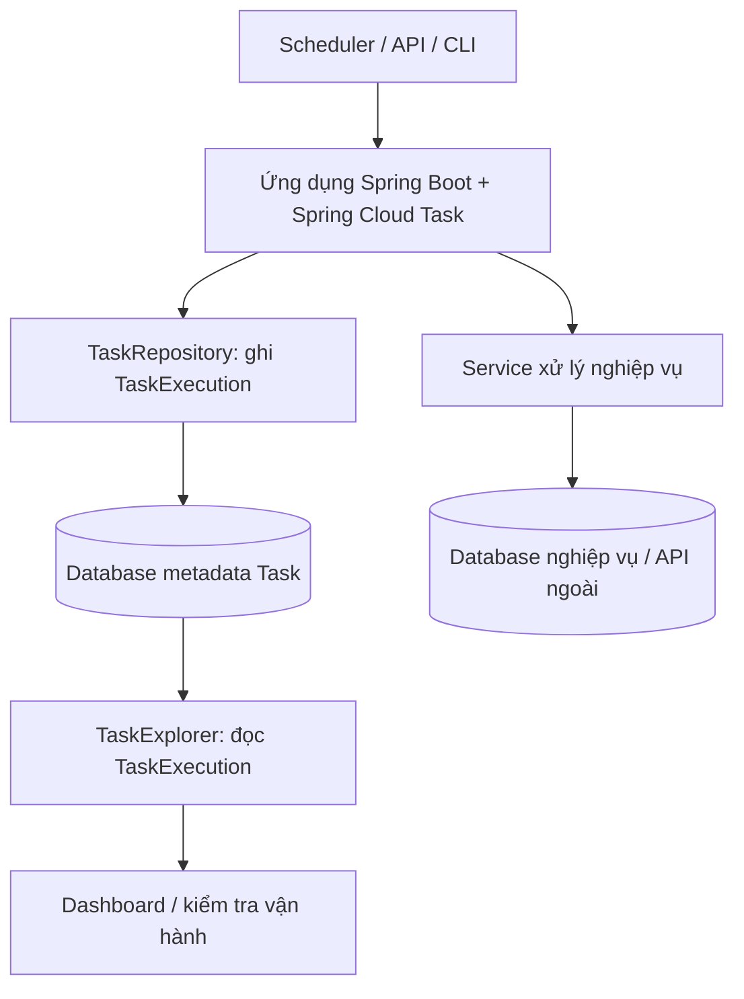
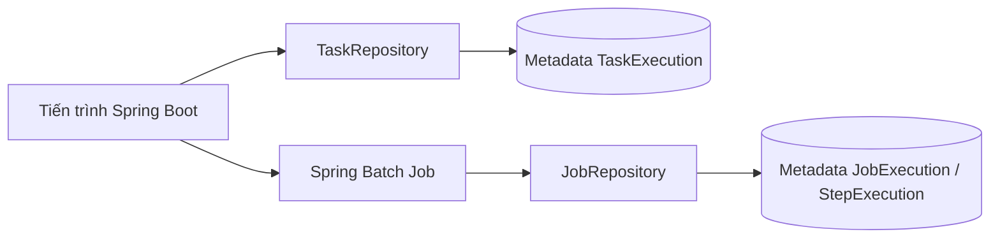

# Tùy chỉnh TaskRepository và TaskExplorer trong Spring Cloud Task

## 1. Mục tiêu và bối cảnh

Trong chương **Cấu hình mở rộng**, chúng ta tìm hiểu cách thay đổi cơ chế lưu trữ và truy vấn dữ liệu thực thi của **Spring Cloud Task** mà vẫn giữ đúng vòng đời của một ứng dụng **Spring Boot chạy hữu hạn**. Mục tiêu không phải viết lại mọi thành phần framework; mục tiêu là biết **điểm nào có thể cấu hình, điểm nào cần mở rộng và những hợp đồng dữ liệu nào phải giữ nguyên**.

Một task đối soát chạy theo lịch có thể bắt đầu từ Kubernetes CronJob, xử lý dữ liệu nghiệp vụ, ghi kết quả rồi kết thúc. Spring Cloud Task sử dụng **TaskRepository** để ghi nhận lượt chạy và **TaskExplorer** để đọc lịch sử. Khi ứng dụng lớn dần, bạn có thể cần đặt metadata ở database khác, đổi tiền tố bảng, phân quyền đọc riêng, tích hợp dashboard, hoặc mở rộng tra cứu theo khoảng thời gian và hệ thống điều phối.

Sau bài học, bạn có thể:

- Phân biệt trách nhiệm ghi và đọc của `TaskRepository` và `TaskExplorer`.
- Giải thích khi nào nên giữ cấu hình JDBC mặc định, khi nào cần `TaskConfigurer` hoặc một lớp truy vấn bổ sung.
- Định tuyến metadata Task tới datasource riêng và chuẩn bị schema tương ứng.
- Thiết kế việc đổi table prefix, đọc bằng SQL có tham số, phân trang và phân quyền an toàn.
- Xử lý lỗi kết nối, giao dịch, truy vấn thiếu dữ liệu, retry và chạy đồng thời.
- Phân biệt Task Repository với `JobRepository` khi phối hợp **Spring Batch**.

> **Lưu ý phiên bản:** Spring Cloud Task, Spring Boot và Spring Batch phát triển theo các release train có ràng buộc tương thích. API constructor, thuộc tính cấu hình và cơ chế tự khởi tạo schema có thể khác theo phiên bản. Các đoạn minh họa dưới đây chỉ áp dụng khi dự án sử dụng phiên bản cung cấp đúng API tương ứng; hãy đối chiếu dependency và DDL của bản đang triển khai trước khi sao chép vào production.

## 2. Hai giao diện với trách nhiệm khác nhau

### `TaskRepository`: nơi ghi vòng đời thực thi

`TaskRepository` là hợp đồng mà Spring Cloud Task dùng để **tạo, bắt đầu, cập nhật và hoàn tất** metadata `TaskExecution`. Mỗi lần chạy ứng dụng có thể nhận một `TASK_EXECUTION_ID`, thời điểm bắt đầu, kết quả kết thúc, thông điệp lỗi và các thông tin liên quan. Khi cấu hình JDBC, các thao tác này được ánh xạ đến schema metadata trong cơ sở dữ liệu.

Khi tác vụ chưa hoàn tất, một dòng có thể có `START_TIME` nhưng chưa có `END_TIME`. Lúc framework ghi nhận kết thúc, repository cập nhật dữ liệu cho cùng lượt chạy. Việc tự thay đổi thời điểm hoặc mã kết quả bằng SQL ngoài quy trình quản lý của framework dễ làm sai lịch sử.

### `TaskExplorer`: nơi đọc và tra cứu lịch sử

`TaskExplorer` dành cho việc **xem** `TaskExecution`, chẳng hạn tìm một lượt chạy theo ID hoặc đọc những lần chạy của một tên task. Một dashboard có thể dùng dữ liệu này để trả lời: “Lần chạy lúc 02:00 đã kết thúc chưa?”, “Mã thoát là gì?” hoặc “Một yêu cầu retry có tạo lượt chạy mới không?”.

Thông thường, `TaskExplorer` là **API đọc**, không thay thế đường ghi của `TaskRepository`. Nếu dashboard cần một câu truy vấn đặc thù mà giao diện chuẩn không cung cấp, bạn có thể xây một **dịch vụ truy vấn riêng** đọc từ schema metadata, với quyền và giới hạn tải thích hợp.

| Khía cạnh | `TaskRepository` | `TaskExplorer` |
| --- | --- | --- |
| Mục đích | Quản lý và cập nhật metadata vòng đời | Đọc, lọc, tra cứu các lần thực thi |
| Điểm sử dụng điển hình | Framework khi task khởi động/kết thúc; bộ điều phối được phép cập nhật liên kết | Dashboard, CLI kiểm tra lịch sử, dịch vụ hỗ trợ vận hành |
| Rủi ro nếu tùy chỉnh sai | Mất bản ghi, ID trùng, kết quả không nhất quán | Thiếu dữ liệu, truy vấn chậm, lộ thông tin |
| Hợp đồng quan trọng | Tạo và hoàn tất một lần chạy nhất quán, an toàn khi đồng thời | Trả đúng dữ liệu theo ID/tên, không biến thao tác đọc thành ghi |
| Thành phần liên quan | `TaskExecution`, cơ chế vòng đời, giao dịch lưu trữ | `TaskExecution`, datasource/schema, phân trang/truy vấn |

**Một datasource chứa metadata không có nghĩa mọi giao dịch nghiệp vụ đều nằm trong cùng một transaction.** Tác vụ có thể ghi vào một database nghiệp vụ và một database metadata độc lập; hệ thống cần thiết kế retry và idempotency theo ranh giới đó.

## 3. Luồng dữ liệu mặc định và các điểm có thể tùy chỉnh



Bạn có thể thay đổi cấu trúc theo nhiều mức:

1. **Cấu hình:** thay URL database, credential, connection pool, chính sách khởi tạo schema, tiền tố bảng mà không thay giao diện Java.
2. **Lựa chọn datasource/transaction:** chỉ định nguồn dữ liệu chuyên dụng cho metadata Task, nhất là khi ứng dụng có nhiều datasource.
3. **Lớp đọc chuyên biệt:** giữ `TaskExplorer` chuẩn, bổ sung dịch vụ truy vấn SQL có lọc, phân trang, mapping cho dashboard.
4. **Triển khai repository/explorer tùy chỉnh:** thay cơ chế lưu trữ ở mức sâu khi các cấu hình chuẩn không đủ; khi đó phải đáp ứng hợp đồng về vòng đời, đồng thời và tính nhất quán.

Đa số dự án nên bắt đầu từ **mức 1 hoặc 2**. Mức 3 phù hợp khi cần báo cáo; mức 4 thường chỉ dành cho ràng buộc lưu trữ đặc biệt có kiểm thử tích hợp rõ ràng.

## 4. Cấu hình JDBC cho TaskRepository mặc định

### 4.1. Database metadata bền vững

Ví dụ một ứng dụng dùng PostgreSQL để giữ lịch sử sau khi tiến trình task đã thoát:

```yaml
spring:
  application:
    name: daily-sync-task
  main:
    web-application-type: none
  datasource:
    url: jdbc:postgresql://localhost:5432/task_metadata
    username: task_app
    password: ${TASK_DB_PASSWORD}
  cloud:
    task:
      name: daily-sync
```

Bạn cần `spring-cloud-starter-task`, JDBC driver, bộ phiên bản Spring Boot/Spring Cloud tương thích và **schema metadata Task đúng phiên bản**. Cấu hình Spring Boot có thể tạo datasource từ `spring.datasource.*`, còn các thành phần Spring Cloud Task sử dụng datasource phù hợp để ghi lịch sử.

Đối với phát triển cục bộ, database nhúng có thể tiện để thử nhanh. Đối với vận hành, một database chỉ tồn tại trong bộ nhớ thường không thích hợp vì **lịch sử biến mất khi task kết thúc**. Hãy dùng database bền vững, backup và chính sách retention có kiểm soát.

### 4.2. Không coi schema tự khởi tạo là bảo đảm production

Spring Cloud Task cung cấp DDL/schema cho các database được hỗ trợ. Cách framework tự tạo bảng có thể phụ thuộc bản phát hành, database và cờ cấu hình. Trong môi trường production, hãy quản lý schema bằng migration có phiên bản, xác nhận quyền truy cập và kiểm tra DDL từ **dependency đang thực chạy**.

Những thành phần schema thường thấy gồm bảng `TASK_EXECUTION`, dữ liệu tham số thực thi và cấu trúc cấp ID/sequence tùy dialect. **Không tự giả định** tên sequence, tên cột hoặc kiểu SQL giống nhau trên PostgreSQL, MySQL, Oracle và H2.

Ví dụ truy vấn kiểm tra lịch sử với schema dùng tiền tố mặc định:

```sql
SELECT TASK_EXECUTION_ID, TASK_NAME,
       START_TIME, END_TIME, EXIT_CODE
FROM TASK_EXECUTION
ORDER BY TASK_EXECUTION_ID DESC;
```

Từ kết quả, một `END_TIME` còn trống chỉ cho biết framework **chưa ghi nhận kết thúc**; task có thể còn chạy, bị dừng cưỡng bức hoặc không cập nhật được metadata. Cần so sánh với thông tin tiến trình/container.

## 5. Đổi tiền tố bảng và tách schema

Khi một database chứa metadata của nhiều ứng dụng hoặc môi trường, bạn có thể cần bảng mang tiền tố khác thay vì tên mặc định. Spring Cloud Task có cơ chế cấu hình **table prefix** cho metadata JDBC ở những phiên bản hỗ trợ thuộc tính này.

Ví dụ minh họa:

```yaml
spring:
  cloud:
    task:
      table-prefix: APP_TASK_
```

Khi cấu hình được phiên bản hiện tại hỗ trợ, các DAO JDBC của Task phải truy cập các bảng/đối tượng schema được đặt tên theo tiền tố tương ứng. **Chỉ đổi property là chưa đủ**: cần tạo bảng, sequence hoặc cấu trúc cấp ID có tên tương thích bằng DDL/migration của chính phiên bản đó.

Trước khi đưa vào vận hành, kiểm tra:

- DDL có thật sự tạo các bảng, sequence và đối tượng hỗ trợ đúng tên sau khi thêm prefix hay không.
- Quy ước chữ hoa/chữ thường, schema mặc định và cách database xử lý tên đối tượng.
- Quyền của tài khoản task với **toàn bộ** đối tượng cần đọc/ghi, kể cả cấu trúc cấp ID.
- `TaskExplorer` có dùng cùng table prefix và cùng schema với `TaskRepository` hay không.
- Các dashboard và truy vấn SQL tùy chỉnh đã cập nhật tên bảng hoặc nguồn dữ liệu hay chưa.

Nếu chỉ cần cách ly theo quyền và chính sách backup, **tách database/schema** có thể rõ ràng hơn việc đặt nhiều tiền tố trong cùng một schema. Chọn chiến lược dựa trên yêu cầu vận hành, không dựa riêng vào việc tên bảng có trùng hay không.

Không thay trực tiếp DDL trong production rồi để ứng dụng cũ tiếp tục chạy. Cần có migration, phương án chuyển dữ liệu/rollback, và cửa sổ triển khai nếu thay đổi tác động đến ứng dụng đã có lịch sử Task Execution.

## 6. Chỉ định datasource riêng bằng `TaskConfigurer`

### 6.1. Vì sao nhiều datasource cần cấu hình rõ?

Một dịch vụ có thể dùng:

- **Datasource nghiệp vụ:** đọc/ghi đơn hàng, báo cáo hoặc giao dịch.
- **Datasource metadata Task:** chỉ lưu các lần chạy ứng dụng, thời điểm và kết quả.
- **Datasource Batch (nếu có):** lưu `JobExecution`/`StepExecution`, có thể chung hoặc tách với metadata Task tùy kiến trúc.

Khi trong Spring Context có nhiều bean `DataSource`, chỉ dựa vào lựa chọn tự động của Boot có thể khiến metadata ghi nhầm database. Tại mức tùy chỉnh này, Spring Cloud Task cung cấp điểm cấu hình `TaskConfigurer` và triển khai mặc định `DefaultTaskConfigurer` để kết nối các thành phần Task với datasource được chọn.

### 6.2. Ví dụ cấu hình khi đã có hai datasource

Giả sử dự án **đã khai báo** hai bean `businessDataSource` và `taskMetadataDataSource` bằng cơ chế cấu hình datasource của Spring Boot. Với phiên bản Spring Cloud Task hỗ trợ constructor `DefaultTaskConfigurer(DataSource)`, bạn có thể chỉ định nguồn metadata:

```java
import javax.sql.DataSource;

import org.springframework.beans.factory.annotation.Qualifier;
import org.springframework.cloud.task.configuration.DefaultTaskConfigurer;
import org.springframework.cloud.task.configuration.TaskConfigurer;
import org.springframework.context.annotation.Bean;
import org.springframework.context.annotation.Configuration;

@Configuration(proxyBeanMethods = false)
public class TaskStorageConfiguration {

    @Bean
    TaskConfigurer taskConfigurer(
            @Qualifier("taskMetadataDataSource") DataSource taskDataSource) {
        return new DefaultTaskConfigurer(taskDataSource);
    }
}
```

Đây là **một phần cấu hình**, không phải dự án hoàn chỉnh: cần định nghĩa thực tế hai `DataSource`, pool, connection URL, credential và migration. Đối chiếu constructor/`TaskConfigurer` với API của **phiên bản đang dùng**; nếu đã có một `TaskConfigurer` khác, cần tránh đăng ký trùng gây mơ hồ. Khi cấu hình table prefix, bảo đảm `DefaultTaskConfigurer` và các thành phần liên quan đều dùng cùng chiến lược prefix tương thích với bản thư viện.

Trình tự thiết lập đề xuất:

1. Tạo database hoặc schema metadata và chạy DDL đúng phiên bản Spring Cloud Task.
2. Khai báo datasource metadata với pool, credential và timeout riêng.
3. Đăng ký cấu hình Task để `TaskRepository` và `TaskExplorer` cùng trỏ tới metadata datasource.
4. Chạy một task ngắn thành công rồi chạy một task cố ý thất bại.
5. Kiểm tra cả hai bản ghi được tạo, cập nhật và đọc từ **cùng database**; xác nhận database nghiệp vụ không có bảng metadata ngoài dự định.

**Giao dịch:** một datasource riêng cho Task và một datasource khác cho nghiệp vụ thường không tạo thành một giao dịch nguyên tử trên cả hai hệ thống. Ví dụ công việc đã ghi dữ liệu nghiệp vụ thành công nhưng repository mất kết nối ở lúc ghi `END_TIME`; scheduler có thể retry dù nghiệp vụ đã thay đổi. Hãy sử dụng khóa nghiệp vụ, transaction ở nơi thích hợp và cơ chế idempotent.

### 6.3. Khi nào cần triển khai `TaskConfigurer` sâu hơn?

Một số hệ thống cần thay `TaskNameResolver`, thay transaction manager hoặc kiểm soát cách tạo repository/explorer theo yêu cầu riêng. Khi đó, triển khai `TaskConfigurer` phù hợp với hợp đồng của phiên bản có thể là điểm mở rộng chính thức. Tuy nhiên, đây là cấu hình **cấp nền tảng**: cần kiểm thử đầy đủ tạo → bắt đầu → kết thúc → tra cứu, bao gồm lỗi DB và nhiều lần chạy đồng thời.

Không thay bean chỉ vì cần thêm một cột nghiệp vụ vào dashboard. Trường hợp đó thường được xử lý tốt hơn bằng một bảng audit riêng nối với `TASK_EXECUTION_ID`.

## 7. Đọc TaskExecution bằng TaskExplorer

### 7.1. Tra cứu theo ID

Khi `TaskExplorer` được Spring quản lý, lớp service có thể inject và tra cứu một lần chạy theo ID. Đây là phép đọc phù hợp cho API tra cứu chi tiết hoặc công cụ xử lý sự cố:

```java
import java.util.NoSuchElementException;

import org.springframework.cloud.task.repository.TaskExecution;
import org.springframework.cloud.task.repository.TaskExplorer;
import org.springframework.stereotype.Service;

@Service
public class TaskHistoryService {
    private final TaskExplorer taskExplorer;

    public TaskHistoryService(TaskExplorer taskExplorer) {
        this.taskExplorer = taskExplorer;
    }

    public TaskExecution getRequiredExecution(long executionId) {
        if (executionId <= 0) {
            throw new IllegalArgumentException("executionId phải dương");
        }

        TaskExecution execution = taskExplorer.getTaskExecution(executionId);
        if (execution == null) {
            throw new NoSuchElementException(
                    "Không tìm thấy TaskExecution " + executionId);
        }
        return execution;
    }
}
```

Ý nghĩa của `executionId` là **ID nội bộ do TaskRepository cấp**, không phải `externalExecutionId` từ Kubernetes hoặc scheduler. Nếu chỉ có mã từ hệ thống ngoài, ứng dụng cần truy vấn theo cột `EXTERNAL_EXECUTION_ID` hoặc theo bảng ánh xạ của riêng nó.

### 7.2. Kiểm soát quyền truy vấn và dữ liệu trả về

Không nên trả nguyên object `TaskExecution` không qua xem xét từ một API public. Metadata có thể chứa argument, tên task, thông điệp lỗi hoặc thông tin hỗ trợ điều tra. Thiết kế DTO trả về những trường thật sự cần thiết, chẳng hạn:

```json
{
  "taskExecutionId": 4108,
  "taskName": "daily-sync",
  "startTime": "2026-11-24T02:00:00Z",
  "endTime": "2026-11-24T02:02:10Z",
  "exitCode": 0
}
```

Dữ liệu JSON chỉ minh họa. Thời gian, mã thoát, định dạng múi giờ và các trường nullable phải được chuyển đổi từ metadata thực tế. Nếu không có `END_TIME`, API nên trả `null` và nêu rõ đó là *chưa ghi nhận kết thúc*, chưa đủ căn cứ để kết luận task còn đang chạy.

## 8. Mở rộng truy vấn khi TaskExplorer chuẩn chưa đủ

### 8.1. Giữ TaskExplorer, thêm một lớp đọc chuyên biệt

Ví dụ dashboard cần danh sách 50 lần chạy gần nhất của một task và không cần sửa metadata. Thay vì viết một `TaskExplorer` hoàn toàn mới, có thể tạo read service dùng `NamedParameterJdbcTemplate`. Mẫu dưới đây giả định schema JDBC mặc định có bảng `TASK_EXECUTION` và ứng dụng truy cập PostgreSQL:

```java
import java.util.List;
import java.util.Map;

import org.springframework.beans.factory.annotation.Qualifier;
import org.springframework.jdbc.core.namedparam.NamedParameterJdbcTemplate;
import org.springframework.stereotype.Repository;

@Repository
public class TaskHistoryQuery {
    private final NamedParameterJdbcTemplate jdbc;

    public TaskHistoryQuery(
            @Qualifier("taskMetadataJdbc")
            NamedParameterJdbcTemplate jdbc) {
        this.jdbc = jdbc;
    }

    public List<Map<String, Object>> latestByName(String taskName, int limit) {
        if (taskName == null || taskName.isBlank()) {
            throw new IllegalArgumentException("taskName không được rỗng");
        }
        if (limit < 1 || limit > 100) {
            throw new IllegalArgumentException("limit phải từ 1 đến 100");
        }

        String sql = """
            SELECT TASK_EXECUTION_ID, TASK_NAME, START_TIME,
                   END_TIME, EXIT_CODE
            FROM TASK_EXECUTION
            WHERE TASK_NAME = :taskName
            ORDER BY START_TIME DESC, TASK_EXECUTION_ID DESC
            LIMIT :limit
            """;
        return jdbc.queryForList(
                sql, Map.of("taskName", taskName, "limit", limit));
    }
}
```

Để tạo `NamedParameterJdbcTemplate` gắn đúng datasource metadata:

```java
import javax.sql.DataSource;
import org.springframework.beans.factory.annotation.Qualifier;
import org.springframework.context.annotation.Bean;
import org.springframework.context.annotation.Configuration;
import org.springframework.jdbc.core.namedparam.NamedParameterJdbcTemplate;

@Configuration(proxyBeanMethods = false)
public class TaskQueryConfiguration {
    @Bean("taskMetadataJdbc")
    NamedParameterJdbcTemplate taskMetadataJdbc(
            @Qualifier("taskMetadataDataSource") DataSource dataSource) {
        return new NamedParameterJdbcTemplate(dataSource);
    }
}
```

Hai ví dụ này giả định bean `taskMetadataDataSource` đã được cấu hình. Chúng minh họa **lớp truy vấn phụ trợ**, không đăng ký thay thế `TaskExplorer` chuẩn. Nếu chỉ có một datasource duy nhất, bạn có thể dùng datasource đó, nhưng phải đảm bảo nó chính là nơi Spring Cloud Task ghi metadata.

**Lý do dùng bind parameter:** `:taskName` và `:limit` được truyền qua API JDBC để tránh ghép chuỗi input trực tiếp vào SQL. Nếu dùng table prefix do cấu hình cung cấp, tên bảng là định danh SQL **không bind như dữ liệu thông thường**: phải lấy từ cấu hình tin cậy, validate bằng allowlist phù hợp rồi mới đưa vào câu SQL, tuyệt đối không nối từ query parameter của người dùng.

**Lý do giới hạn số dòng:** các bảng Task có thể tăng nhanh theo lịch, retry và số ứng dụng. Truy vấn có thứ tự, giới hạn và chỉ mục phù hợp sẽ ổn định hơn `SELECT *` rồi tải toàn bộ lịch sử vào bộ nhớ.

### 8.2. Kiểu trả về và phân trang ổn định

`List<Map<String, Object>>` thuận tiện cho ví dụ nhưng API thật nên chuyển sang DTO với kiểu dữ liệu rõ ràng; chuẩn hóa timestamp sang `Instant`/UTC và xử lý `NULL`. Các trang dữ liệu lớn nên cân nhắc **keyset pagination** (ví dụ theo cặp `START_TIME`, `TASK_EXECUTION_ID`) để giảm độ lệch khi có bản ghi mới được thêm trong lúc xem.

Khi cần lọc theo external ID, ví dụ:

```sql
SELECT TASK_EXECUTION_ID, TASK_NAME, EXTERNAL_EXECUTION_ID,
       START_TIME, END_TIME, EXIT_CODE
FROM TASK_EXECUTION
WHERE EXTERNAL_EXECUTION_ID = :externalId
ORDER BY TASK_EXECUTION_ID DESC;
```

Không giả định `EXTERNAL_EXECUTION_ID` luôn duy nhất. Một hệ thống ngoài có thể dùng cùng ID cấp Job cho nhiều lần thử, nên kết quả cần được đối chiếu với attempt, môi trường và thời gian.

### 8.3. Chỉ mục và hiệu năng

Nếu truy vấn thường xuyên theo `TASK_NAME` và thời điểm, một chỉ mục có thể hữu ích. Ví dụ SQL PostgreSQL **cần đánh giá trước khi áp dụng**:

```sql
CREATE INDEX idx_task_exec_name_start
    ON TASK_EXECUTION (TASK_NAME, START_TIME DESC);
```

Trước khi thêm index hãy kiểm tra DDL sẵn có, plan truy vấn, kích thước bảng và chi phí ghi phát sinh. Một index mới không phải lúc nào cũng cần. Nếu dashboard truy vấn replica, cần chấp nhận **replication lag**: Task Repository có thể đã cập nhật thành công trên primary nhưng kết quả từ replica vẫn chưa phản ánh ngay.

## 9. Khi buộc phải thay TaskRepository hoặc TaskExplorer

Việc viết implementation mới là thay đổi **hợp đồng hạ tầng**, không đơn giản là thay câu SQL. Chỉ cân nhắc khi JDBC implementation hiện tại thực sự không phù hợp, chẳng hạn tổ chức bắt buộc dùng một storage khác và chấp nhận đầu tư kiểm thử/tích hợp.

Một implementation tùy chỉnh cần xác định ít nhất:

| Khía cạnh | Hợp đồng cần giữ |
| --- | --- |
| Tạo execution | Mỗi lượt chạy hợp lệ có ID phân biệt, không trùng dưới tải đồng thời. |
| Bắt đầu và hoàn tất | Các mốc thời gian, trạng thái/kết quả và thông điệp lỗi được ghi nhất quán theo sự kiện framework. |
| Đọc lại | `TaskExplorer` phải thấy đúng dữ liệu được repository ghi, gồm ID, tên, thời gian, exit code và tham số. |
| Lỗi lưu trữ | Quy định khi nào báo lỗi, retry, rollback hoặc từ chối khởi chạy; không âm thầm làm mất metadata. |
| Đồng thời | Không ghi đè metadata khi nhiều lần chạy cùng tên hoặc nhiều tác vụ cập nhật gần nhau. |
| Giao dịch | Có cơ chế xử lý được partial write và không hứa hẹn atomicity vượt phạm vi lưu trữ. |
| Retention | Quy định thời gian lưu, phân quyền và xử lý bản ghi bị treo do crash. |
| Tích hợp | Không phá liên kết với `TaskExecutionListener`, external execution ID hoặc Spring Batch khi được dùng. |

Đừng tự ghi trực tiếp vào `TASK_EXECUTION` như một cách “tùy chỉnh TaskRepository” nếu không nắm rõ transaction, cấp ID và toàn bộ schema. Một cập nhật sai `END_TIME` hoặc `EXIT_CODE` có thể làm dashboard hiểu rằng task đã xong dù tiến trình vẫn đang chạy.

### Cần thêm dữ liệu nghiệp vụ thì làm gì?

Giả sử mỗi lần xử lý cần lưu `tenantId`, `requestId`, số bản ghi đã đối soát và URL báo cáo. Thay vì sửa schema do framework quản lý, tạo bảng nghiệp vụ riêng với khóa liên kết `TASK_EXECUTION_ID`, ví dụ:

```sql
CREATE TABLE TASK_AUDIT (
    TASK_EXECUTION_ID BIGINT PRIMARY KEY,
    REQUEST_ID VARCHAR(120) NOT NULL,
    BUSINESS_DATE DATE NOT NULL,
    PROCESSED_COUNT BIGINT,
    REPORT_URI VARCHAR(500)
);
```

Đây là **bảng minh họa thuộc sở hữu ứng dụng**, không phải bảng chuẩn của Spring Cloud Task. Kích thước cột, kiểu khóa, unique constraints và quy tắc xóa/phụ thuộc phải thiết kế theo DB thực tế. Trong hệ thống chạy lại theo request, `REQUEST_ID` có thể lặp giữa nhiều `TASK_EXECUTION_ID`; vì vậy không tự đặt unique constraint cho request nếu muốn lưu mọi attempt.

## 10. Giao dịch, lỗi và tính nhất quán

### 10.1. Khi repository không ghi được lúc khởi chạy

Nếu datasource metadata sai credential, schema thiếu hoặc database ngừng hoạt động, Spring Cloud Task có thể không tạo được bản ghi. Ứng dụng có thể thất bại sớm trước khi chạy nghiệp vụ. Không nên báo “chưa có yêu cầu chạy” chỉ vì dashboard không tìm thấy `TaskExecution`: lịch của scheduler và log nền tảng vẫn có thể chứng minh đã gửi yêu cầu.

### 10.2. Khi nghiệp vụ thành công nhưng metadata kết thúc thất bại

Giả sử task đã gửi 10.000 bản ghi vào hệ thống ngoài nhưng mất kết nối Task Repository đúng lúc ghi `END_TIME`. Hệ thống giám sát có thể thấy bản ghi chưa kết thúc; trong khi **tác động nghiệp vụ đã xảy ra**. Nếu bộ điều phối retry toàn bộ task mà không có idempotency key, dữ liệu có thể bị ghi trùng.

Đặt chính sách rõ ràng cho:

- Khóa nghiệp vụ theo ngày xử lý, batch ID hoặc request ID.
- Retry với backoff và giới hạn số lần ở cấp scheduler.
- Transaction/upsert, khóa duy nhất hoặc cơ chế chống trùng ở hệ thống đích.
- Kiểm tra trạng thái từ cả Task Repository lẫn nền tảng điều phối trước khi kết luận task còn chạy.

### 10.3. Khi đọc quá nhiều hoặc đọc dữ liệu nhạy cảm

Dashboard không được cấp quyền sửa/xóa bảng Task chỉ để đọc trạng thái. Với triển khai nhiều thành phần, cân nhắc tài khoản database **read-only**, giới hạn truy vấn theo ứng dụng/tenant, áp dụng timeout, phân trang và theo dõi audit truy cập. Các tham số khởi chạy hoặc lỗi có thể chứa thông tin nhạy cảm nếu người phát triển bất cẩn; cần lọc và kiểm soát truy cập ngay từ lúc ghi.

### 10.4. Khi đổi database hoặc table prefix

Thay datasource/prefix mà không di chuyển dữ liệu có thể tạo cảm giác lịch sử task “biến mất”. Lịch sử cũ vẫn ở schema cũ, trong khi Explorer mới đọc nơi khác. Hãy quản lý việc chuyển đổi bằng migration xác định: dừng hoặc điều phối lượt chạy trong giai đoạn cutover, backup, chuyển dữ liệu nếu có yêu cầu, kiểm tra ID/sequence, chạy thử đối chiếu và cập nhật dashboard.

### 10.5. Khi chạy đồng thời

Hai tiến trình cùng `taskName` phải có thể được ghi nhận **hai lần chạy riêng**. Không sử dụng tên task làm khóa chính trong implementation tự xây. Nếu phải ngăn nghiệp vụ chạy trùng theo `businessDate`, triển khai cơ chế đó ở tầng nghiệp vụ/điều phối; Task Repository mặc định là nơi **ghi lịch sử**, không phải công cụ khóa nghiệp vụ.

## 11. Quan hệ với Spring Batch

Một ứng dụng có thể tích hợp cả **Spring Cloud Task** và **Spring Batch**:



Hai repository có trách nhiệm khác nhau:

- `TaskRepository` ghi **lượt chạy ứng dụng** hữu hạn.
- `JobRepository` ghi **JobInstance, JobExecution, StepExecution và ExecutionContext** cho quy trình Batch.
- `TaskExplorer` dùng để xem lịch sử Task; API khám phá/tra cứu của Batch dùng để xem lịch sử Job và Step.

Chúng có thể cùng sử dụng một database nếu schema/prefix, quyền và transaction được thiết kế phù hợp, hoặc tách database khi vận hành yêu cầu. Việc tùy chỉnh `TaskConfigurer` **không tự động cấu hình lại** `JobRepository` của Batch. Ngược lại, đổi datasource Batch không có nghĩa metadata Task sẽ theo datasource đó.

Khi dùng Batch launcher bất đồng bộ, runner của ứng dụng cần đợi hoặc theo dõi job đến trạng thái cuối trước khi kết thúc Task theo nghiệp vụ. Nếu Batch thất bại nhưng ứng dụng nuốt lỗi rồi kết thúc bình thường, Task Repository có thể ghi thành công dù Job Repository ghi thất bại. Cần chuyển kết quả giữa hai tầng theo chính sách rõ ràng.

## 12. Quy trình triển khai tùy chỉnh an toàn

Một kế hoạch triển khai có thể kiểm chứng:

1. **Xác định yêu cầu:** cần đổi nơi lưu, đổi prefix, thêm báo cáo hay thay implementation? Ghi rõ kết quả mong đợi và ranh giới dữ liệu.
2. **Kiểm tra phiên bản:** xác nhận `TaskConfigurer`, `DefaultTaskConfigurer`, thuộc tính table prefix và DDL đúng với dependency được khóa phiên bản.
3. **Chuẩn bị schema và credential:** migrate database metadata, phân quyền tối thiểu, giữ secret ngoài repository.
4. **Cấu hình datasource/task:** bảo đảm Task Repository và Explorer dùng cùng nơi lưu; nếu có Batch, kiểm tra riêng Job Repository.
5. **Chạy task thành công:** xác nhận một `TASK_EXECUTION_ID` được tạo và có `END_TIME`, mã kết quả phù hợp.
6. **Chạy task thất bại có chủ đích:** xác nhận kết quả lỗi được phản ánh trong metadata và mã thoát tiến trình.
7. **Chạy lại cùng tham số:** xác nhận các lượt chạy không ghi đè nhau và tầng nghiệp vụ có chính sách chống trùng.
8. **Kiểm tra dashboard:** truy vấn theo ID, tên, thời gian, external ID; phân trang và quyền đọc hoạt động.
9. **Thử sự cố:** mô phỏng repository không kết nối được, tiến trình bị kill, timeout và nhiều lượt chạy đồng thời.
10. **Quan sát sau triển khai:** theo dõi độ trễ truy vấn, pool connection, lỗi ghi metadata, các execution chưa có `END_TIME` và tăng trưởng bảng.

### Bảng quyết định nhanh

| Nhu cầu | Cách tiếp cận phù hợp |
| --- | --- |
| Đổi URL, username hoặc pool của metadata | Cấu hình datasource và migration; giữ implementation chuẩn. |
| Dùng nhiều datasource trong một ứng dụng | Chỉ định Task datasource rõ ràng, cân nhắc `TaskConfigurer`. |
| Tránh trùng tên bảng giữa nhiều ứng dụng | Table prefix hoặc tách schema/database, kèm DDL tương ứng. |
| Dashboard cần lọc thêm theo khoảng thời gian | Bọc `TaskExplorer` và bổ sung SQL read service có tham số. |
| Cần lưu `requestId`, số bản ghi và báo cáo | Bảng audit/metadata nghiệp vụ liên kết qua `TASK_EXECUTION_ID`. |
| Cần thay toàn bộ storage metadata | Triển khai Task Repository/Explorer tùy chỉnh sau khi định nghĩa và kiểm thử hợp đồng. |
| Cần checkpoint và restart step xử lý dữ liệu lớn | Spring Batch và `JobRepository`, không ép vào `TaskRepository`. |

## 13. Câu hỏi tự kiểm tra

1. Vì sao một dashboard chỉ đọc không nên dùng trực tiếp `TaskRepository` để tự sửa `EXIT_CODE` hoặc `END_TIME`?
2. Khi ứng dụng có `businessDataSource` và `taskMetadataDataSource`, nguy cơ nào xuất hiện nếu framework tự chọn nhầm datasource?
3. Tại sao đổi `spring.cloud.task.table-prefix` mà chưa chạy migration có thể khiến Task không khởi động được?
4. Một API cần trả 30 lần chạy mới nhất của một `taskName`. Bạn sẽ dùng `TaskExplorer` chuẩn hay thêm read service SQL? Cần giới hạn nào?
5. Tại sao việc dùng hai datasource không bảo đảm giao dịch ghi metadata và ghi dữ liệu nghiệp vụ là nguyên tử?
6. Nếu một Kubernetes Pod bị kill sau khi ghi dữ liệu thành công, `END_TIME` còn trống có nghĩa mọi dữ liệu nghiệp vụ đều chưa ghi không?
7. Vì sao thay `TaskConfigurer` không tự làm `JobRepository` của Spring Batch đổi datasource?
8. Trong trường hợp cần thêm `tenantId` và `requestId`, ưu điểm của bảng audit riêng so với tự sửa bảng `TASK_EXECUTION` là gì?

**Ghi nhớ:** `TaskRepository` giữ tính nhất quán của **vòng đời ghi TaskExecution**; `TaskExplorer` cung cấp cách **đọc và truy vết lịch sử**. Hãy ưu tiên cấu hình datasource, schema/table prefix và mở rộng lớp truy vấn trước khi thay implementation nền tảng. Mọi tùy chỉnh phải được kiểm tra dưới điều kiện lỗi, đồng thời, retry và tích hợp Spring Batch để ứng dụng Spring Cloud Task có thể kết thúc hữu hạn và được vận hành an toàn.
