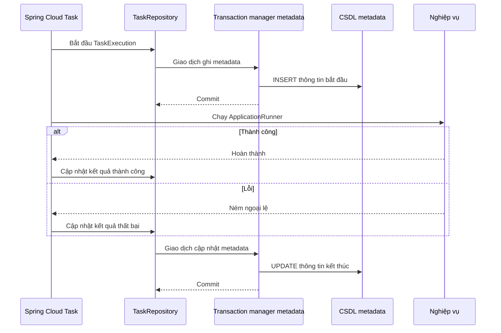
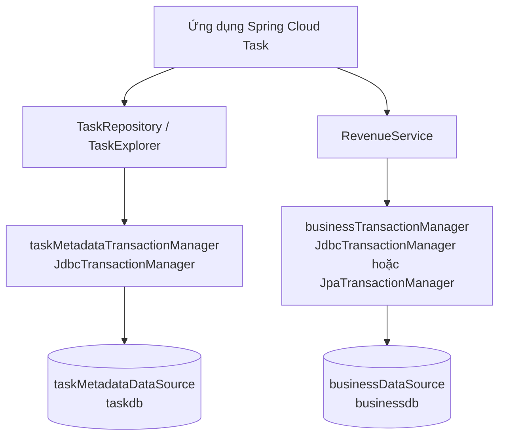

# Chọn `PlatformTransactionManager` cho kho thực thi

Trong chương **Cấu hình mở rộng** của **Spring Cloud Task**, một ứng dụng chạy hữu hạn cần ghi lại thời điểm bắt đầu, kết thúc, mã thoát và trạng thái của từng lần chạy vào **`TaskRepository`**. Việc ghi metadata này cần giao dịch phù hợp với nơi lưu dữ liệu. Nếu chọn nhầm transaction manager, ứng dụng có thể xử lý nghiệp vụ nhưng không ghi được trạng thái, hoặc ghi metadata vào nhầm database.

**`PlatformTransactionManager`** là giao diện quản lý giao dịch của Spring. Trong Spring Cloud Task, việc chọn manager trở nên đặc biệt quan trọng khi có **nhiều `DataSource`**, dùng JPA cho nghiệp vụ, phối hợp với Spring Batch hoặc cần tách metadata sang một cơ sở dữ liệu vận hành riêng.

Sau bài học, bạn có thể:

- Giải thích transaction manager tham gia vào vòng đời `TaskExecution` như thế nào.
- Xác định khi nào cấu hình mặc định của `DefaultTaskConfigurer` là đủ.
- Chọn manager tương ứng với `DataSource` lưu metadata.
- Cấu hình minh họa hai database cho nghiệp vụ và metadata task.
- Phân biệt giao dịch `TaskRepository`, giao dịch nghiệp vụ và giao dịch Spring Batch.
- Chẩn đoán lỗi commit, rollback, chọn sai database và retry.

## 1. `TaskRepository` cần giao dịch để làm gì?

Một lần thực thi Spring Cloud Task được mô tả bằng **`TaskExecution`**. Sau khi `ApplicationContext` khởi tạo thành công, framework ghi thông tin bắt đầu trước khi chạy `ApplicationRunner` / `CommandLineRunner`. Khi các runner hoàn thành hoặc phát sinh lỗi được framework nhận biết, thông tin kết thúc được cập nhật.

Ví dụ dữ liệu trong bảng `TASK_EXECUTION`:

| `TASK_EXECUTION_ID` | `TASK_NAME` | `START_TIME` | `END_TIME` | `EXIT_CODE` |
| ---: | --- | --- | --- | ---: |
| 101 | `daily-reconcile` | 08:00:00 | 08:00:09 | 0 |
| 102 | `daily-reconcile` | 09:00:00 | 09:00:03 | 1 |
| 103 | `daily-reconcile` | 10:00:00 | `NULL` | `NULL` |

Mỗi hàng ghi nhận **một lần chạy**, không phải từng bước nghiệp vụ. Giao dịch giúp những thao tác cập nhật metadata có ranh giới commit/rollback thích hợp, nhưng:

- Ghi bắt đầu thành công **không bảo đảm** phần nghiệp vụ sau đó thành công.
- Không có một giao dịch JDBC tự động kéo dài từ đầu đến cuối **toàn bộ tiến trình**.
- Nếu JVM bị kill đột ngột, lỗi xảy ra trước khi khởi tạo TaskRepository hoặc database metadata mất kết nối, bản ghi có thể thiếu hoặc chưa được cập nhật `END_TIME`.
- Giao dịch metadata thành công không chứng minh dữ liệu doanh thu hay kết quả nghiệp vụ đã chính xác.



Sơ đồ mô tả đường chạy thường gặp; chi tiết giao dịch tùy phiên bản và cấu hình. Metadata cấp task và dữ liệu nghiệp vụ là **hai phạm vi trách nhiệm**.

## 2. Ba thành phần được `TaskConfigurer` cung cấp

**`TaskConfigurer`** là điểm mở rộng của Spring Cloud Task để cung cấp:

| Thành phần | Trách nhiệm |
| --- | --- |
| `TaskRepository` | Tạo và cập nhật `TaskExecution`, ghi lịch sử mỗi lần chạy. |
| `TaskExplorer` | Truy vấn metadata và trạng thái thực thi đã lưu. |
| `PlatformTransactionManager` | Quản lý giao dịch dùng khi thao tác với kho thực thi. |

Triển khai mặc định **`DefaultTaskConfigurer`** dùng các lựa chọn hợp lý theo môi trường:

- **Có `DataSource`:** dùng repository JDBC. Các phiên bản Spring Cloud Task hiện đại dùng **`JdbcTransactionManager`** mặc định; tài liệu phiên bản cũ có thể gọi **`DataSourceTransactionManager`**. Cả hai là các lựa chọn transaction manager JDBC.
- **Không có `DataSource`:** có thể dùng repository trong bộ nhớ cùng **`ResourcelessTransactionManager`**. Chế độ này không đem lại lịch sử bền vững sau khi tiến trình kết thúc.
- **Một `DataSource` duy nhất:** thường để framework tự cấu hình vì không có sự mơ hồ về nguồn dữ liệu.
- **Nhiều `DataSource`:** cần chọn rõ nguồn dữ liệu cho `TaskRepository`. Nếu tùy chỉnh manager, cũng phải chỉ rõ manager tương ứng.

**Không nhầm lẫn giữa hai việc:** Chọn một bean transaction manager mặc định bằng `@Primary` và chọn **`DataSource` của TaskRepository**. Chỉ đặt `@Primary` trên manager nghiệp vụ không chứng minh rằng metadata đã dùng đúng database. Việc chọn `TaskConfigurer`/`DataSource` phải rõ ràng.

### Quy tắc chọn loại manager

| Cách lưu metadata | Manager phù hợp | Lưu ý |
| --- | --- | --- |
| Database JDBC | `JdbcTransactionManager` hoặc `DataSourceTransactionManager` theo phiên bản | Gắn với **cùng datasource** mà repository sử dụng. |
| In-memory để thử nghiệm | `ResourcelessTransactionManager` | Không phải giao dịch JDBC, không bảo đảm lưu lịch sử qua lần chạy mới. |
| Nghiệp vụ dùng JPA, metadata JDBC ở database khác | `JpaTransactionManager` cho JPA; `JdbcTransactionManager` cho metadata | Hai transaction manager quản lý hai tài nguyên khác nhau. |
| Có yêu cầu commit nguyên tử trên nhiều database | Có thể cân nhắc hạ tầng JTA/XA | Cần transaction coordinator và tài nguyên hỗ trợ; không tự đạt được bằng hai `JdbcTransactionManager`. |

Nguyên tắc quan trọng nhất: **manager ghi metadata phải quản lý đúng `DataSource` chứa các bảng Spring Cloud Task**.

## 3. Trường hợp một datasource: ưu tiên mặc định

Giả sử ứng dụng Spring Boot chỉ có một PostgreSQL database được dùng cho cả metadata và nghiệp vụ. Một `application.yml` minh họa:

```yaml
spring:
  main:
    web-application-type: none
  datasource:
    url: jdbc:postgresql://localhost:5432/taskdb
    username: task_user
    password: ${TASK_DB_PASSWORD}
  cloud:
    task:
      name: dailyReconcile
      initialize-enabled: false
```

Với các dependency Spring Boot JDBC, Spring Cloud Task và driver PostgreSQL tương thích:

1. Spring Boot tạo một `DataSource` từ `spring.datasource.*`.
2. Spring Cloud Task có thể dùng datasource đó cho `TaskRepository` và `TaskExplorer`.
3. `DefaultTaskConfigurer` cung cấp transaction manager JDBC phù hợp nếu không bị thay bằng cấu hình riêng.
4. Mỗi lần khởi chạy `java -jar` ghi metadata vào `taskdb`.

Ở đây `initialize-enabled: false` nghĩa là **các bảng metadata phải được tạo trước** bằng migration phù hợp phiên bản. Trong môi trường thực hành, có thể dùng cơ chế khởi tạo được hỗ trợ; trong sản xuất nên kiểm soát DDL bằng Flyway, Liquibase hoặc công cụ migration tương đương.

Trong trường hợp này, thường **không cần** tự tạo bean `TaskConfigurer` hoặc manager riêng cho metadata. Chỉ tùy chỉnh nếu thực sự cần chọn datasource khác, cách lưu khác hoặc chính sách giao dịch đặc thù.

## 4. Hai database: tách giao dịch metadata và nghiệp vụ

Xét một tác vụ đối soát:

- **`businessdb`** chứa `revenue_day`, giao dịch bán hàng và số liệu doanh thu.
- **`taskdb`** chứa `TASK_EXECUTION` cùng các bảng metadata Spring Cloud Task.

Mục tiêu là để mọi thao tác `TaskRepository` đi đến `taskdb` và mọi thao tác `RevenueService` đi đến `businessdb`.



### 4.1. Cấu hình YAML

Khai báo hai nguồn dữ liệu:

```yaml
spring:
  main:
    web-application-type: none
  cloud:
    task:
      name: dailyReconcile
      initialize-enabled: false

app:
  datasource:
    business:
      url: jdbc:postgresql://localhost:5432/businessdb
      username: business_user
      password: ${BUSINESS_DB_PASSWORD}
    task:
      url: jdbc:postgresql://localhost:5432/taskdb
      username: task_user
      password: ${TASK_DB_PASSWORD}
```

**`app.datasource.*` là namespace do chúng ta đặt**, Spring Cloud Task không tự đọc để dựng bean. Bắt buộc có cấu hình Java tương ứng; chỉ khai báo YAML không đủ. Các mật khẩu được lấy từ biến môi trường hoặc secret manager, không hardcode.

### 4.2. Định nghĩa hai `DataSource` và hai manager

Ví dụ Spring Boot với JDBC. Tạo `TaskDataSourceConfig.java`:

```java
package com.example.task.config;

import javax.sql.DataSource;

import org.springframework.beans.factory.annotation.Qualifier;
import org.springframework.boot.autoconfigure.jdbc.DataSourceProperties;
import org.springframework.boot.context.properties.ConfigurationProperties;
import org.springframework.cloud.task.configuration.DefaultTaskConfigurer;
import org.springframework.cloud.task.configuration.TaskConfigurer;
import org.springframework.context.annotation.Bean;
import org.springframework.context.annotation.Configuration;
import org.springframework.context.annotation.Primary;
import org.springframework.jdbc.support.JdbcTransactionManager;
import org.springframework.transaction.PlatformTransactionManager;

@Configuration(proxyBeanMethods = false)
public class TaskDataSourceConfig {

    @Bean("businessDataSourceProperties")
    @Primary
    @ConfigurationProperties("app.datasource.business")
    DataSourceProperties businessProperties() {
        return new DataSourceProperties();
    }

    @Bean("taskDataSourceProperties")
    @ConfigurationProperties("app.datasource.task")
    DataSourceProperties taskProperties() {
        return new DataSourceProperties();
    }

    @Bean("businessDataSource")
    @Primary
    DataSource businessDataSource(
            @Qualifier("businessDataSourceProperties")
            DataSourceProperties properties) {
        return properties.initializeDataSourceBuilder().build();
    }

    @Bean("taskMetadataDataSource")
    DataSource taskMetadataDataSource(
            @Qualifier("taskDataSourceProperties")
            DataSourceProperties properties) {
        return properties.initializeDataSourceBuilder().build();
    }

    @Bean("businessTransactionManager")
    @Primary
    PlatformTransactionManager businessTransactionManager(
            @Qualifier("businessDataSource") DataSource dataSource) {
        return new JdbcTransactionManager(dataSource);
    }

    @Bean("taskMetadataTransactionManager")
    PlatformTransactionManager taskMetadataTransactionManager(
            @Qualifier("taskMetadataDataSource") DataSource dataSource) {
        return new JdbcTransactionManager(dataSource);
    }

    @Bean
    TaskConfigurer taskConfigurer(
            @Qualifier("taskMetadataDataSource") DataSource dataSource,
            @Qualifier("taskMetadataTransactionManager")
            PlatformTransactionManager metadataManager) {
        return new DefaultTaskConfigurer(dataSource) {
            @Override
            public PlatformTransactionManager getTransactionManager() {
                return metadataManager;
            }
        };
    }
}
```

**Giải thích:**

1. Hai `DataSourceProperties` được bind độc lập với cấu hình trong YAML. `@Primary` chỉ chọn bên nghiệp vụ làm mặc định khi Spring phải phân giải nhiều bean cùng kiểu.
2. `businessTransactionManager` nhận **`businessDataSource`**; `taskMetadataTransactionManager` nhận **`taskMetadataDataSource`**.
3. `new DefaultTaskConfigurer(dataSource)` tạo các thành phần repository/explorer cho datasource metadata.
4. Override `getTransactionManager()` trả về manager đã chọn cho metadata. Đây là **điểm mở rộng trong `TaskConfigurer`**, thay vì phỏng đoán framework chọn bean `@Primary`.
5. `@Qualifier` trên các tham số làm rõ phụ thuộc, tránh lỗi chọn nhầm nguồn dữ liệu.

Ví dụ sử dụng API mở rộng được Spring Cloud Task mô tả. **Hãy biên dịch và kiểm tra đúng phiên bản** Spring Cloud Task/Spring Boot của dự án, vì API và tự cấu hình có thể thay đổi giữa release train. Nếu chỉ cần chọn đúng database và chấp nhận manager JDBC mặc định, có thể đơn giản hóa bean cuối:

```java
@Bean
TaskConfigurer taskConfigurer(
        @Qualifier("taskMetadataDataSource") DataSource taskDataSource) {
    return new DefaultTaskConfigurer(taskDataSource);
}
```

Đây là **lựa chọn thay thế** cho bean `taskConfigurer` ở ví dụ trước, không đăng ký đồng thời cả hai. Lúc này `DefaultTaskConfigurer` tự tạo transaction manager JDBC cho datasource đã truyền.

### 4.3. Chọn transaction manager cho service nghiệp vụ

Với hai manager, phương thức xử lý doanh thu nên chỉ rõ manager nghiệp vụ:

```java
package com.example.task.service;

import java.time.LocalDate;
import javax.sql.DataSource;

import org.springframework.beans.factory.annotation.Qualifier;
import org.springframework.jdbc.core.JdbcTemplate;
import org.springframework.stereotype.Service;
import org.springframework.transaction.annotation.Transactional;

@Service
public class RevenueService {
    private final JdbcTemplate businessJdbc;

    public RevenueService(
            @Qualifier("businessDataSource") DataSource businessDataSource) {
        this.businessJdbc = new JdbcTemplate(businessDataSource);
    }

    @Transactional(transactionManager = "businessTransactionManager")
    public void markReconciled(LocalDate businessDate) {
        businessJdbc.update(
            "UPDATE revenue_day SET reconciled = true WHERE business_date = ?",
            java.sql.Date.valueOf(businessDate)
        );
    }
}
```

Giả sử bảng nghiệp vụ `revenue_day` đã tồn tại. Transaction của `markReconciled` quản lý kết nối đến `businessdb`. Nó **không** tự bao trùm các lần ghi metadata ở `taskdb`. Trong ứng dụng dùng Spring Data JPA, manager nghiệp vụ thường là `JpaTransactionManager` cùng `EntityManagerFactory` thích hợp; transaction manager JDBC của Spring Cloud Task vẫn cần khớp database metadata.

**Lưu ý về schema:** Khi có nhiều datasource, việc tự khởi tạo bảng metadata có thể cần cấu hình riêng. Ví dụ trên dùng `initialize-enabled: false` và yêu cầu migration đã tạo các bảng Spring Cloud Task trên `taskdb` theo DDL của phiên bản đang triển khai.

## 5. Kiểm tra manager có khớp datasource không

Hãy trả lời rõ hai câu hỏi trước khi triển khai:

1. **`TaskRepository` thực sự ghi vào `DataSource` nào?** Database/schema nào có các bảng `TASK_EXECUTION`?
2. **`TaskConfigurer#getTransactionManager()` cung cấp manager nào?** Manager đó quản lý chính datasource metadata hay datasource khác?

| Nguồn của `TaskRepository` | Manager sử dụng | Đánh giá |
| --- | --- | --- |
| JDBC `taskdb` | `JdbcTransactionManager(taskMetadataDataSource)` | Phù hợp với lưu trữ metadata task. |
| JDBC `taskdb` | `JdbcTransactionManager(businessDataSource)` | Sai tài nguyên; giao dịch metadata có thể không được quản lý đúng. |
| JDBC `taskdb` | `ResourcelessTransactionManager` | Không cung cấp transaction JDBC cần thiết. |
| In-memory repository | `ResourcelessTransactionManager` | Có thể dùng để minh họa, không có lịch sử bền vững. |
| JDBC `taskdb`, nghiệp vụ JPA | `JpaTransactionManager` của nghiệp vụ | Không phải lựa chọn thông thường cho JDBC metadata; chỉ cân nhắc nếu hiểu và kiểm chứng được cách phối hợp datasource/JPA. |

**Cùng tên bean không có nghĩa cùng datasource.** Cũng không thể dựa vào việc hai datasource trỏ đến cùng hostname để khẳng định chúng dùng chung transaction: chúng có thể là hai connection pool với các giao dịch độc lập.

## 6. Commit, rollback và tình huống lỗi

Giả sử `dailyReconcile` xử lý ngày 2026-11-24:

1. Spring Cloud Task tạo bản ghi `TaskExecution` bắt đầu trên `taskdb` và giao dịch metadata hoàn tất.
2. `RevenueService` mở transaction nghiệp vụ trên `businessdb`.
3. Service cập nhật một số bản ghi, rồi gặp ngoại lệ; transaction nghiệp vụ rollback theo quy tắc rollback được áp dụng.
4. Spring Cloud Task cố ghi mã lỗi và thời điểm kết thúc vào `taskdb`.

Kết quả có thể là **`businessdb` rollback nhưng `taskdb` vẫn giữ bản ghi lần chạy thất bại**. Đó thường là điều mong muốn, vì thất bại cũng phải được ghi nhận để tra cứu.

| Sự kiện | Database nghiệp vụ | Database metadata |
| --- | --- | --- |
| Task bắt đầu | Chưa có tác động nghiệp vụ | Ghi metadata bắt đầu. |
| Xử lý và commit thành công | Ghi dữ liệu doanh thu | Ghi kết quả kết thúc sau đó nếu có thể. |
| Xử lý ném lỗi trước commit | Có thể rollback giao dịch đang mở | Có thể ghi trạng thái lỗi. |
| Process bị kill hoặc OOM | Các commit đã hoàn tất có thể vẫn tồn tại | `END_TIME` có thể trống. |
| Metadata DB mất kết nối khi kết thúc | Nghiệp vụ có thể đã xong | Kết quả cuối có thể chưa được ghi. |

**Không mở một transaction bao toàn bộ quá trình dài** chỉ để “giữ mọi thứ đồng bộ”. Với task chạy hàng phút/hàng giờ, giao dịch JDBC quá dài có thể gây lock, timeout và quá tải tài nguyên. Thay vào đó, giữ transaction nghiệp vụ ngắn, có ranh giới rõ ràng; dùng idempotency, checkpoint và chính sách retry phù hợp.

Giao dịch JDBC cục bộ trên hai database **không tạo commit nguyên tử xuyên database**. Muốn tính chất đó cần giải pháp giao dịch phân tán thực sự, hoặc thiết kế eventual consistency / outbox / reconciliation. Việc dùng chung một bean `PlatformTransactionManager` không tự bổ sung tính năng phân tán.

## 7. Tương quan với Spring Batch

Một ứng dụng Spring Cloud Task có thể chạy một **Spring Batch Job**. Khi đó tồn tại ba cấp độ:

| Phạm vi | Kho dữ liệu | Transaction liên quan |
| --- | --- | --- |
| **Spring Cloud Task** | `TaskRepository` với `TASK_EXECUTION` | Ghi vòng đời **toàn tiến trình ứng dụng**. |
| **Spring Batch** | `JobRepository` với `BATCH_JOB_EXECUTION`, `BATCH_STEP_EXECUTION`... | Ghi metadata Job/Step, checkpoint và restart theo quy tắc Batch. |
| **Nghiệp vụ** | Bảng doanh thu, giao dịch, báo cáo... | Ghi/rollback dữ liệu theo từng đơn vị xử lý. |

Spring Batch `JobRepository` và Spring Cloud Task `TaskRepository` là **hai repository khác nhau**, ngay cả khi các bảng được đặt trong một database vật lý. Các manager cho metadata Batch, chunk/step và metadata Task có thể cần cấu hình riêng theo cách tổ chức datasource và phiên bản framework.

Ví dụ, một Batch Step commit mỗi 500 bản ghi. Nếu xử lý lỗi ở phần cuối, Spring Batch có thể dùng checkpoint/`JobExecution` để restart theo điều kiện đã cấu hình. Trong khi đó, Spring Cloud Task vẫn ghi nhận **lần chạy tiến trình** thành công hay thất bại. Đừng giả định rollback một chunk sẽ xóa bản ghi `TaskExecution` đã có từ đầu.

Khi cấu hình tích hợp, kiểm tra:

- `TaskConfigurer#getTransactionManager()` trả manager cho **metadata Task**.
- Spring Batch `JobRepository` và các `Step` dùng manager phù hợp với **schema Batch và datasource của step**.
- Service nghiệp vụ chọn đúng manager bằng `@Qualifier` hoặc `@Transactional(transactionManager = "...")`.

Đối với Spring Batch, tên tham số cấu hình transaction manager trong `@EnableBatchProcessing`/builder có thể thay đổi theo phiên bản; cần đối chiếu tài liệu API cụ thể trước khi áp dụng.

## 8. Xác minh cấu hình bằng lần chạy thực

### 8.1. Chạy task và quan sát dữ liệu

Sau khi tạo bảng metadata **đúng schema phiên bản** trên `taskdb` và có executable JAR, chạy:

```bash
java -jar daily-reconcile.jar --business-date=2026-11-24
```

Kết nối đến `taskdb` và truy vấn:

```sql
SELECT
    TASK_EXECUTION_ID,
    TASK_NAME,
    START_TIME,
    END_TIME,
    EXIT_CODE
FROM TASK_EXECUTION
ORDER BY TASK_EXECUTION_ID DESC;
```

Chạy thêm lần thứ hai và kiểm tra có một `TaskExecution` mới. Đối chiếu `businessdb`: bảng metadata phải nằm ở database/scope đã được chỉ định. Nếu metadata xuất hiện ngoài ý muốn ở cả hai database, cần rà lại `TaskConfigurer`, quyền và migration.

### 8.2. Giả lập lỗi và kiểm tra rollback

Trong môi trường test, cho service nghiệp vụ ném một ngoại lệ trước commit, để lỗi lan truyền ra runner. Kiểm tra:

1. Giao dịch trên `businessdb` rollback theo quy tắc áp dụng.
2. `taskdb` ghi mã thoát/thông tin lỗi nếu framework và kết nối metadata vẫn hoạt động.
3. Mã thoát process phản ánh thất bại, để scheduler/launcher có thể phát hiện.
4. Khi retry, cùng `business-date` không tạo ghi dữ liệu trùng.

Thử thêm trường hợp metadata database ngừng hoạt động trong **môi trường test**. Một task có thể lỗi trước lúc ghi bắt đầu hoặc không cập nhật được kết thúc; `TaskRepository` không thay thế log và thông tin từ container/platform.

### 8.3. Bảng lỗi cấu hình thường gặp

| Triệu chứng | Nguyên nhân có thể | Cách xử lý |
| --- | --- | --- |
| Nhiều bean `DataSource`, Spring không xác định được nguồn | Thiếu lựa chọn rõ ràng | Cấu hình `TaskConfigurer` nhận datasource metadata qua `@Qualifier`. |
| `TaskExecution` được ghi vào database nghiệp vụ | Repository nhận nhầm `DataSource` | Kiểm tra bean `TaskConfigurer`, `@Primary` và URL datasource. |
| `TASK_EXECUTION` không tồn tại | Schema chưa tạo, sai DB/schema hoặc sai DDL version | Chạy migration phù hợp phiên bản, kiểm tra quyền. |
| `NoUniqueBeanDefinitionException` với manager | Nhiều bean cùng kiểu, thiếu qualifier | Đặt tên rõ ràng và dùng `@Qualifier`/`@Primary` có chủ đích. |
| Nghiệp vụ rollback nhưng metadata task vẫn tồn tại | Hai transaction có ranh giới độc lập | Có thể đúng; dùng exit code và log để diễn giải kết quả. |
| Nghiệp vụ đã xong nhưng `END_TIME` trống | DB metadata mất kết nối hoặc process bị kill | Đối chiếu log, mã thoát, trạng thái container và DB. |
| `@Transactional` không rollback như kỳ vọng | Sai manager, gọi nội bộ qua `this`, exception bị nuốt hoặc rollback rule khác | Kiểm tra Spring AOP, manager và cách xử lý exception. |
| Task theo lịch bị chạy trùng | Scheduler retry hoặc chạy đồng thời | Idempotency, khóa nghiệp vụ, giới hạn retry và kiểm soát concurrency. |

## 9. Nguyên tắc vận hành an toàn

**Ưu tiên đơn giản.** Một datasource phù hợp thường không cần custom manager. Khi có hai datasource trở lên, xác định rõ repository JDBC dùng nguồn nào và manager nào chịu trách nhiệm transaction.

**Không nhầm transaction manager với orchestrator.** `PlatformTransactionManager` điều phối commit/rollback; cron, Kubernetes CronJob, Spring Cloud Data Flow hoặc launcher khác quyết định khi nào và bao nhiêu lần task được chạy. Transaction manager không tự lập lịch hay khóa các yêu cầu trùng.

**Quản lý schema.** Dùng DDL/migration của đúng phiên bản Spring Cloud Task, giới hạn quyền người dùng database, kiểm soát connection pool và không tự ý chỉnh `TASK_EXECUTION` bằng SQL nghiệp vụ.

**Quan sát ba mặt.** Đọc mã thoát process, `TaskExecution` trong metadata và dữ liệu thực tế trong database nghiệp vụ. Khi một trong ba không nhất quán, cần điều tra thời điểm commit, log và sự kiện hạ tầng trước khi retry.

**Giảm rủi ro chạy lặp.** Thiết kế idempotency theo ngày nghiệp vụ/request ID, transaction nghiệp vụ ngắn và chính sách chạy lại có giới hạn. Một lần retry thường tạo một `TaskExecution` mới chứ không tự phục hồi mọi thao tác đã ghi.

## 10. Bài tập tự kiểm tra

1. Vì sao một `TaskRepository` dựa trên JDBC cần transaction manager phù hợp, dù ứng dụng chỉ chạy vài giây?
2. Trong hệ thống chỉ có một `DataSource`, khi nào dùng `DefaultTaskConfigurer` là đủ? Điều kiện nào khiến bạn phải cấu hình riêng?
3. Với hai database trong ví dụ, bean nào quản lý transaction metadata, bean nào quản lý nghiệp vụ và bean nào gắn `TaskRepository` với `taskdb`?
4. Nếu `businessdb` đã commit nhưng `taskdb` mất kết nối lúc cập nhật `END_TIME`, điều gì có thể xảy ra? Nên kiểm tra gì trước khi retry?
5. Vì sao `TaskRepository` không đồng nhất với Spring Batch `JobRepository`?
6. Một service ném lỗi nhưng tự bắt và bỏ qua. Đổi sang transaction manager khác có phải cách sửa đúng để task thất bại không?
7. Hai container cùng đối soát `business-date=2026-11-24`. Chọn đúng `JdbcTransactionManager` đã đủ ngăn xử lý trùng chưa? Cần bổ sung biện pháp nào?

**Ghi nhớ:** Chọn đúng `PlatformTransactionManager` cho Spring Cloud Task nghĩa là bảo đảm `TaskRepository` sử dụng giao dịch thuộc **đúng datasource lưu metadata**. Hãy phân biệt nó với giao dịch nghiệp vụ và Spring Batch, đồng thời bổ sung kiểm soát retry, idempotency và giám sát để vận hành các ứng dụng hữu hạn an toàn.

**Tài liệu tham khảo:** [Spring Cloud Task — Features / TaskConfigurer](https://docs.spring.io/spring-cloud-task/reference/features.html) và [Spring Framework — Transaction Management](https://docs.spring.io/spring-framework/reference/data-access/transaction.html). Khi áp dụng ví dụ, hãy đối chiếu API với phiên bản cụ thể đang sử dụng.
