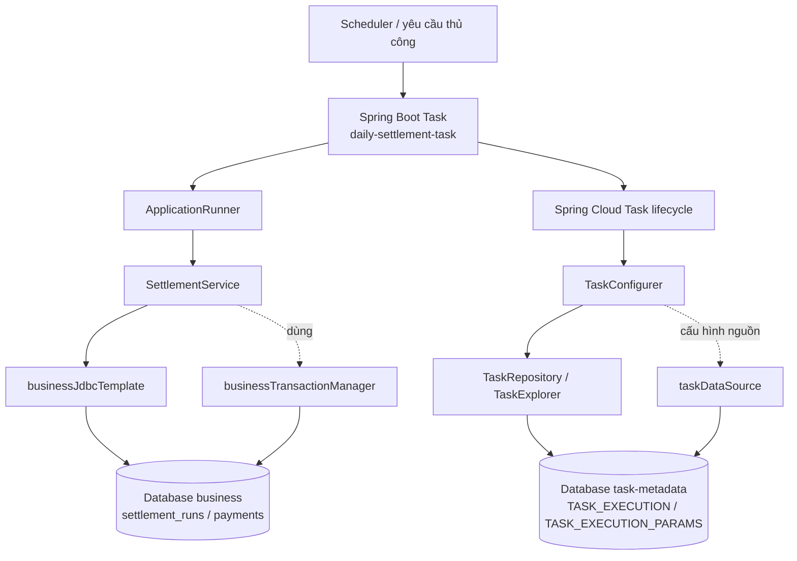
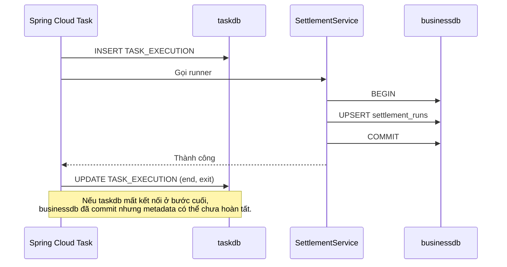

# Tách `DataSource` nghiệp vụ và `DataSource` của Task

## Mục tiêu học tập

Sau bài này, bạn có thể:

- Giải thích vì sao ứng dụng **Spring Cloud Task** cần một `DataSource` dành cho metadata thực thi và khi nào nên tách nó khỏi `DataSource` chứa dữ liệu nghiệp vụ.
- Khai báo hai nguồn kết nối JDBC trong Spring Boot bằng `DataSourceProperties`, `@Qualifier` và `@Primary`.
- Dùng `TaskConfigurer`/`DefaultTaskConfigurer` để chỉ định **chính xác** nơi `TaskRepository` và `TaskExplorer` lưu, đọc `TaskExecution`.
- Phân biệt transaction của thao tác nghiệp vụ với transaction ghi metadata Task và hiểu vì sao hai database không tự tạo một giao dịch nguyên tử.
- Vận hành an toàn với migration riêng, quyền truy cập tối thiểu, xử lý lỗi, theo dõi Task theo lịch hoặc yêu cầu và phối hợp với Spring Batch khi cần.

> **Ngữ cảnh:** Đây là bài thuộc chương **Cấu hình mở rộng** của module **SPRING_CLOUD_TASK**. Một Spring Cloud Task là ứng dụng Spring Boot có vòng đời hữu hạn; mỗi lần chạy được theo dõi bằng `TaskExecution` và metadata trong `TaskRepository`. Những tác vụ như nhập liệu, đối soát và kết xuất báo cáo thường phải truy cập đồng thời dữ liệu nghiệp vụ và lịch sử thực thi. Tách hai nguồn dữ liệu giúp quản lý quyền, dung lượng và vòng đời schema riêng, nhưng cũng yêu cầu cấu hình rõ ràng để tránh ghi metadata sai nơi.

## 1. Vấn đề khi một ứng dụng có hai cơ sở dữ liệu

Giả sử ứng dụng `daily-settlement-task` chạy lúc 02:00 mỗi ngày:

1. Đọc các giao dịch chờ đối soát từ database **business**.
2. Cập nhật trạng thái đối soát và tạo bản ghi tổng hợp tại database **business**.
3. Ghi thời gian bắt đầu, kết thúc, mã thoát và tham số của lần chạy vào database **task-metadata** để bộ phận vận hành tra cứu.
4. Kết thúc tiến trình; khi scheduler chạy lại thì có một `TaskExecution` mới.

Với **một** `DataSource` duy nhất, Spring Cloud Task có thể dùng nguồn kết nối đó làm repository mặc định. Khi có **nhiều** `DataSource`, cần chủ động chỉ định nguồn cho hạ tầng Task bằng `TaskConfigurer`. Chỉ đặt `@Primary` lên một `DataSource` hoặc đặt tên bean là `taskDataSource` chưa phải là hợp đồng cấu hình đầy đủ cho Task trong mọi phiên bản.

| Khía cạnh | `businessDataSource` | `taskDataSource` |
| --- | --- | --- |
| Mục đích | Đọc/ghi đơn hàng, giao dịch, hồ sơ nghiệp vụ. | Lưu metadata của những lần chạy Task. |
| Bảng tiêu biểu | `settlement_runs`, `payments`, `orders`. | `TASK_EXECUTION`, `TASK_EXECUTION_PARAMS`, `TASK_SEQ` hoặc cấu trúc cấp ID tương đương. |
| Đối tượng truy cập | Service nghiệp vụ, JDBC/JPA repository. | `TaskRepository`, `TaskExplorer`, listener vòng đời. |
| Transaction manager | `businessTransactionManager`. | Do `TaskConfigurer` cung cấp cho repository Task. |
| Quyền thông thường | Chỉ các bảng nghiệp vụ cần thiết. | Chỉ các bảng và cấu trúc cấp ID cho metadata Task. |
| Lưu trữ và backup | Theo yêu cầu bảo toàn dữ liệu nghiệp vụ. | Theo yêu cầu giám sát, kiểm toán và retention lịch sử chạy. |

Tách `DataSource` **không đòi hỏi hai máy chủ PostgreSQL khác nhau**. Hai `DataSource` có thể trỏ tới hai database trên cùng máy chủ, hai schema, hai tài khoản hoặc hai cụm khác nhau. Điều quan trọng là **đúng điểm đến, quyền hạn và quy tắc transaction**. Bài này minh họa hai database PostgreSQL riêng để dễ kiểm tra kết quả.

## 2. Sơ đồ luồng dữ liệu



Trong sơ đồ:

- `ApplicationRunner` thực thi logic nghiệp vụ thông qua service.
- `businessJdbcTemplate` và `businessTransactionManager` chỉ phục vụ database nghiệp vụ.
- `TaskConfigurer` tạo/cấu hình những thành phần repository của Task dựa trên `taskDataSource`.
- `TaskExecution` ghi nhận vòng đời **toàn bộ tiến trình Task**, không lưu từng bản ghi thanh toán.

Hai luồng có thể thành công/thất bại ở các thời điểm khác nhau. Ví dụ: cập nhật nghiệp vụ đã commit nhưng kết nối tới database metadata bị mất lúc Task kết thúc. Trường hợp này cần điều tra từ cả hai nguồn, không suy ra một transaction chung chỉ vì cả hai nằm trong một ứng dụng.

## 3. Dependency và giả định của ví dụ

Ví dụ dưới đây trình bày cú pháp theo phong cách **Spring Boot 3.x**, Spring Cloud Task tương thích, Spring JDBC và HikariCP. Với Spring Boot 4.x hoặc release khác, cần đối chiếu package Java và tương thích BOM trước khi sử dụng.

Trong `pom.xml` của dự án đã có Spring Boot parent/BOM và Spring Cloud BOM phù hợp, các dependency quan trọng là:

```xml
<dependencies>
    <dependency>
        <groupId>org.springframework.cloud</groupId>
        <artifactId>spring-cloud-starter-task</artifactId>
    </dependency>
    <dependency>
        <groupId>org.springframework.boot</groupId>
        <artifactId>spring-boot-starter-jdbc</artifactId>
    </dependency>
    <dependency>
        <groupId>org.postgresql</groupId>
        <artifactId>postgresql</artifactId>
        <scope>runtime</scope>
    </dependency>
</dependencies>
```

`spring-cloud-starter-task` là starter cho vòng đời Task; `spring-boot-starter-jdbc` cung cấp các thành phần JDBC và transaction cần dùng trong ví dụ; driver PostgreSQL hỗ trợ **cả hai** `DataSource`. Không cần thêm driver lần thứ hai chỉ vì ứng dụng có hai nguồn kết nối cùng loại.

**Giả định triển khai:**

- Database `businessdb` có bảng `settlement_runs`.
- Database `taskdb` có đầy đủ schema Spring Cloud Task của **đúng phiên bản**.
- Tài khoản `BUSINESS_DB_USER` chỉ có quyền cần thiết trên dữ liệu nghiệp vụ.
- Tài khoản `TASK_DB_USER` chỉ có quyền cần thiết với repository Task.
- Migrations được chạy **trước** lúc Task bắt đầu; runtime không tự tạo bảng.

Nếu mới làm quen với Spring Cloud Task, hãy bắt đầu bằng một `DataSource`, kiểm chứng vòng đời Task trước, rồi chuyển sang hai nguồn như bài này. Ví dụ sau tập trung vào việc phân tuyến kết nối, không xây dựng lại đầy đủ nghiệp vụ đối soát.

## 4. Khai báo hai nhóm properties

Tạo `application.yml`:

```yaml
spring:
  application:
    name: daily-settlement-task
  main:
    web-application-type: none
  cloud:
    task:
      initialize-enabled: false
  sql:
    init:
      mode: never

app:
  datasource:
    business:
      url: jdbc:postgresql://localhost:5432/businessdb
      username: ${BUSINESS_DB_USER}
      password: ${BUSINESS_DB_PASSWORD}
      hikari:
        pool-name: business-pool
        maximum-pool-size: 8
        minimum-idle: 1
    task:
      url: jdbc:postgresql://localhost:5432/taskdb
      username: ${TASK_DB_USER}
      password: ${TASK_DB_PASSWORD}
      hikari:
        pool-name: task-metadata-pool
        maximum-pool-size: 3
        minimum-idle: 1
```

Các điểm cần đọc kỹ:

- `app.datasource.business.*` và `app.datasource.task.*` là **namespace do ứng dụng tự đặt**, chưa tự tạo ra bean `DataSource` nào. Cần Java `@ConfigurationProperties` ở mục tiếp theo.
- `spring.cloud.task.initialize-enabled=false` để runtime không tự tạo schema Task; database `taskdb` phải được migration đầy đủ trước khi chạy.
- `spring.sql.init.mode=never` ngăn cơ chế khởi tạo SQL chung của Spring Boot vô tình chạy script trên datasource mặc định/primary. Migration nghiệp vụ thực hiện qua quy trình riêng.
- `spring.main.web-application-type=none` phù hợp với tiến trình Task chạy hữu hạn không cần web server.
- Hai pool có giới hạn kết nối **độc lập**. Với nhiều Pod chạy đồng thời, tổng kết nối có thể bằng số Pod nhân với quy mô từng pool; cần tính giới hạn của cả hai database.

Đừng đặt mật khẩu thật trong file commit vào Git. Sử dụng biến môi trường, secret manager hoặc cơ chế cung cấp secret được kiểm soát. Với các biến `BUSINESS_DB_*` và `TASK_DB_*` chưa được khai báo, ứng dụng có thể thất bại khi bind cấu hình.

## 5. Tạo hai bean `DataSource` rõ ràng

Để binding `url` JDBC và cấu hình HikariCP nhất quán, mỗi nguồn có một `DataSourceProperties` và một `HikariDataSource`. Cấu hình sau dùng API phổ biến của Spring Boot 3.x:

```java
package com.example.task.config;

import javax.sql.DataSource;

import com.zaxxer.hikari.HikariDataSource;
import org.springframework.beans.factory.annotation.Qualifier;
import org.springframework.boot.autoconfigure.jdbc.DataSourceProperties;
import org.springframework.boot.context.properties.ConfigurationProperties;
import org.springframework.context.annotation.Bean;
import org.springframework.context.annotation.Configuration;
import org.springframework.context.annotation.Primary;

@Configuration(proxyBeanMethods = false)
public class MultiDataSourceConfiguration {

    @Bean("businessDataSourceProperties")
    @Primary
    @ConfigurationProperties("app.datasource.business")
    DataSourceProperties businessDataSourceProperties() {
        return new DataSourceProperties();
    }

    @Bean("businessDataSource")
    @Primary
    @ConfigurationProperties("app.datasource.business.hikari")
    HikariDataSource businessDataSource(
            @Qualifier("businessDataSourceProperties")
            DataSourceProperties properties) {

        return properties.initializeDataSourceBuilder()
                .type(HikariDataSource.class)
                .build();
    }

    @Bean("taskDataSourceProperties")
    @ConfigurationProperties("app.datasource.task")
    DataSourceProperties taskDataSourceProperties() {
        return new DataSourceProperties();
    }

    @Bean("taskDataSource")
    @ConfigurationProperties("app.datasource.task.hikari")
    HikariDataSource taskDataSource(
            @Qualifier("taskDataSourceProperties")
            DataSourceProperties properties) {

        return properties.initializeDataSourceBuilder()
                .type(HikariDataSource.class)
                .build();
    }
}
```

**Vì sao dùng các annotation này?**

| Cơ chế | Tác dụng |
| --- | --- |
| `@ConfigurationProperties("app.datasource.business")` | Bind URL, tên người dùng và mật khẩu cho nguồn nghiệp vụ. |
| `@ConfigurationProperties("app.datasource.business.hikari")` | Bind thông số pool Hikari cho nguồn nghiệp vụ. |
| `@Qualifier("businessDataSourceProperties")` | Chọn đúng properties cho bean tương ứng, tránh nhập nhằng khi có hai bean cùng kiểu. |
| `@Bean("taskDataSource")` | Cấp tên bean ổn định để `TaskConfigurer` nhận đúng datasource. |
| `@Primary` trên nguồn nghiệp vụ | Cho các thành phần chỉ inject `DataSource` theo kiểu một lựa chọn mặc định. |
| `DataSourceProperties.initializeDataSourceBuilder()` | Áp dụng đúng cách chuyển `url` thành JDBC URL khi dựng Hikari. |

`@Primary` **không có nghĩa** metadata Task sẽ được ghi vào nguồn nghiệp vụ trong cấu hình hoàn chỉnh: ở mục kế tiếp, `TaskConfigurer` nhận `taskDataSource` bằng `@Qualifier`. Đây là chỗ chỉ định nơi ghi Task một cách tường minh.

Đồng thời, `@Primary` **không thay thế `@Qualifier` cho mã nghiệp vụ** khi hệ thống cần đảm bảo chính xác nguồn dữ liệu. Nếu một service xử lý tài chính trỏ nhầm database, kết quả có thể sai dù ứng dụng vẫn khởi động thành công.

## 6. Chỉ định `taskDataSource` cho Spring Cloud Task bằng `TaskConfigurer`

Spring Cloud Task hỗ trợ mở rộng qua interface `TaskConfigurer`. Cách ngắn gọn với cấu hình JDBC thông thường là trả về `DefaultTaskConfigurer` được khởi tạo bằng datasource dành riêng cho metadata:

```java
package com.example.task.config;

import javax.sql.DataSource;

import org.springframework.beans.factory.annotation.Qualifier;
import org.springframework.cloud.task.configuration.DefaultTaskConfigurer;
import org.springframework.cloud.task.configuration.TaskConfigurer;
import org.springframework.context.annotation.Bean;
import org.springframework.context.annotation.Configuration;

@Configuration(proxyBeanMethods = false)
public class TaskRepositoryConfiguration {

    @Bean
    TaskConfigurer taskConfigurer(
            @Qualifier("taskDataSource") DataSource taskDataSource) {
        return new DefaultTaskConfigurer(taskDataSource);
    }
}
```

Cấu hình trên yêu cầu Spring Cloud Task sử dụng **`taskdb`** thông qua datasource được truyền vào. Với `DefaultTaskConfigurer` tương ứng phiên bản, các thành phần liên quan thường gồm:

- `TaskRepository`: ghi và cập nhật `TaskExecution`, metadata tham số và kết quả Task.
- `TaskExplorer`: tra cứu lịch sử Task bằng ID/tên.
- `PlatformTransactionManager` phục vụ thao tác repository Task.
- `getTaskDataSource()`: trả về datasource đang phục vụ Task khi implementation hỗ trợ.

`DefaultTaskConfigurer(DataSource)` là constructor có trong các phiên bản Spring Cloud Task phổ biến; luôn kiểm tra Javadoc của release thật khi nâng cấp. Nếu ứng dụng còn có JPA/`EntityManager` hoặc tự định nghĩa nhiều transaction manager, cần xác minh transaction manager mà `TaskConfigurer` trả về thực sự phục vụ repository Task. Không trông chờ `@Primary` sẽ tự bảo đảm lựa chọn chính xác cho mọi thành phần tùy biến.

**Không tự đăng ký một `TaskRepository` khác song song với `TaskConfigurer`** nếu chưa hiểu cơ chế auto-configuration. Có hai nguồn cấu hình cạnh tranh dễ dẫn đến ghi metadata ở một nơi, đọc bằng `TaskExplorer` ở nơi khác.

### Vì sao chỉ đặt tên bean `taskDataSource` chưa đủ?

Trong ứng dụng một nguồn, framework thường tự chọn được datasource. Trong ứng dụng hai nguồn, phần tự cấu hình chỉ thấy một tập các bean `DataSource` và có thể phải dựa vào cơ chế chọn mặc định hoặc cần người dùng chỉ định. Vì thế nên thể hiện chính sách một cách chủ động:

```text
TaskRepository -> TaskConfigurer -> @Qualifier("taskDataSource") -> taskdb
BusinessService -> @Qualifier("businessJdbcTemplate") -> businessdb
```

Sự khác biệt ở đây là **đường đi phụ thuộc rõ ràng**. Ngay cả khi cấu hình bean mặc định của Spring Boot thay đổi khi nâng cấp, ứng dụng vẫn có một điểm kiểm soát nơi lưu metadata Task.

## 7. Dùng nguồn nghiệp vụ bằng `JdbcTemplate` và transaction riêng

Tạo `JdbcTemplate` và transaction manager chỉ trỏ về `businessDataSource`:

```java
package com.example.task.config;

import javax.sql.DataSource;

import org.springframework.beans.factory.annotation.Qualifier;
import org.springframework.context.annotation.Bean;
import org.springframework.context.annotation.Configuration;
import org.springframework.jdbc.core.JdbcTemplate;
import org.springframework.jdbc.support.JdbcTransactionManager;
import org.springframework.transaction.PlatformTransactionManager;

@Configuration(proxyBeanMethods = false)
public class BusinessJdbcConfiguration {

    @Bean("businessJdbcTemplate")
    JdbcTemplate businessJdbcTemplate(
            @Qualifier("businessDataSource") DataSource dataSource) {
        return new JdbcTemplate(dataSource);
    }

    @Bean("businessTransactionManager")
    PlatformTransactionManager businessTransactionManager(
            @Qualifier("businessDataSource") DataSource dataSource) {
        return new JdbcTransactionManager(dataSource);
    }
}
```

`JdbcTransactionManager` thích hợp với ví dụ JDBC hiện đại; trên release hoặc cấu hình khác có thể dùng `DataSourceTransactionManager`. Điều kiện quyết định là transaction manager phải sử dụng **đúng datasource nghiệp vụ**.

Giả sử database nghiệp vụ đã có bảng:

```sql
CREATE TABLE settlement_runs (
    business_date DATE PRIMARY KEY,
    status        VARCHAR(20) NOT NULL,
    updated_at    TIMESTAMPTZ NOT NULL DEFAULT CURRENT_TIMESTAMP
);
```

Service nghiệp vụ:

```java
package com.example.task.business;

import java.time.LocalDate;

import org.springframework.beans.factory.annotation.Qualifier;
import org.springframework.jdbc.core.JdbcTemplate;
import org.springframework.stereotype.Service;
import org.springframework.transaction.annotation.Transactional;

@Service
public class SettlementService {

    private final JdbcTemplate businessJdbcTemplate;

    public SettlementService(
            @Qualifier("businessJdbcTemplate")
            JdbcTemplate businessJdbcTemplate) {
        this.businessJdbcTemplate = businessJdbcTemplate;
    }

    @Transactional(transactionManager = "businessTransactionManager")
    public void settle(LocalDate businessDate) {
        // PostgreSQL: UPSERT theo business_date giúp tránh bản ghi trùng.
        businessJdbcTemplate.update("""
                INSERT INTO settlement_runs(business_date, status)
                VALUES (?, 'DONE')
                ON CONFLICT (business_date)
                DO UPDATE SET
                    status = EXCLUDED.status,
                    updated_at = CURRENT_TIMESTAMP
                """, businessDate);
    }
}
```

Runner gọi service (nằm trong bean riêng để interceptor `@Transactional` có hiệu lực):

```java
package com.example.task;

import java.time.LocalDate;
import java.util.List;

import com.example.task.business.SettlementService;
import org.springframework.boot.ApplicationArguments;
import org.springframework.boot.ApplicationRunner;
import org.springframework.boot.SpringApplication;
import org.springframework.boot.autoconfigure.SpringBootApplication;
import org.springframework.cloud.task.configuration.EnableTask;
import org.springframework.stereotype.Component;

@SpringBootApplication
@EnableTask
public class DailySettlementTaskApplication {
    public static void main(String[] args) {
        SpringApplication.run(DailySettlementTaskApplication.class, args);
    }
}

@Component
class SettlementRunner implements ApplicationRunner {

    private final SettlementService service;

    SettlementRunner(SettlementService service) {
        this.service = service;
    }

    @Override
    public void run(ApplicationArguments args) {
        List<String> values = args.getOptionValues("business-date");
        if (values == null || values.size() != 1) {
            throw new IllegalArgumentException(
                    "Cần đúng một --business-date=yyyy-MM-dd");
        }

        LocalDate date = LocalDate.parse(values.get(0));
        service.settle(date);
    }
}
```

Luồng sau khi khởi động thành công:

1. Spring Cloud Task tạo lần chạy trong repository của **taskdb**.
2. `SettlementRunner` đọc và kiểm tra tham số.
3. `SettlementService` dùng `businessJdbcTemplate` và `businessTransactionManager` để ghi `settlement_runs` trong **businessdb**.
4. Khi runner trả về hoặc ném exception, hạ tầng Task cập nhật thông tin kết thúc/lỗi trong **taskdb** nếu còn kết nối và còn đủ khả năng ghi repository.
5. Tiến trình kết thúc; công cụ vận hành đọc `TASK_EXECUTION` từ **taskdb** để biết kết quả lần chạy.

**Giới hạn ví dụ:** câu SQL `ON CONFLICT` là cú pháp PostgreSQL; nó giúp tránh nhân đôi **bản ghi kết quả** theo ngày, nhưng không tự bảo đảm mọi hiệu ứng nghiệp vụ phức tạp đều idempotent. Nếu đối soát còn ghi tiền, phát sự kiện hoặc gọi API, cần thiết kế replay/deduplication riêng.

## 8. Hai transaction manager có độc lập không?

**Có, trong cấu hình này mỗi nguồn dữ liệu có transaction manager cục bộ riêng.** Nhưng cần phân biệt hai loại thao tác:

| Loại thao tác | Nguồn dữ liệu | Transaction được quản lý bởi |
| --- | --- | --- |
| `INSERT/UPDATE settlement_runs` | `businessdb` | `businessTransactionManager` của `SettlementService`. |
| Tạo/cập nhật `TASK_EXECUTION` | `taskdb` | Transaction manager mà `TaskConfigurer` cung cấp. |
| Gọi API bên ngoài hoặc phát message | Hệ thống ngoài database | Không được bao phủ tự động bởi hai transaction manager JDBC này. |

Một transaction ở `businessdb` **không tự bao phủ** thao tác ghi `TASK_EXECUTION` tại `taskdb`. Ví dụ:



Điều này dẫn tới ba tình huống quan trọng:

- **Nghiệp vụ thành công nhưng metadata Task lỗi:** bản ghi `settlement_runs` đã commit, nhưng `TASK_EXECUTION` có thể chưa có `END_TIME`. Khi retry phải kiểm tra trạng thái nghiệp vụ theo `business_date`, không mặc định chạy lại các tác động không idempotent.
- **Nghiệp vụ lỗi nhưng TaskRepository còn hoạt động:** exception cần lan truyền để Task và scheduler nhận ra thất bại, tránh ghi sai thành công.
- **Không thể kết nối taskdb khi Task bắt đầu:** ứng dụng có thể thất bại trước khi runner nghiệp vụ được chạy; cần cảnh báo hạ tầng và kiểm tra kết nối repository.

Nếu thật sự cần nguyên tử qua **hai database khác nhau**, chỉ dùng `@Transactional(transactionManager = "businessTransactionManager")` là không đủ. XA/JTA có thể là một phương án trong hệ thống hỗ trợ nhưng làm tăng độ phức tạp vận hành; với tác vụ hữu hạn thường nên ưu tiên **idempotency, retry có kiểm soát, trạng thái nghiệp vụ rõ ràng hoặc outbox** tùy yêu cầu. Không thêm giao dịch phân tán chỉ để làm bản ghi giám sát và dữ liệu nghiệp vụ luôn đồng thời.

### Lưu ý `@Transactional` khi có nhiều manager

Không nên viết `@Transactional` không chỉ rõ manager trong một ứng dụng có nhiều `PlatformTransactionManager` nếu chưa kiểm tra cơ chế chọn mặc định. Nên dùng:

```java
@Transactional(transactionManager = "businessTransactionManager")
public void settle(LocalDate date) {
    // Logic nghiệp vụ.
}
```

Và nếu có service khác viết metadata ngoài vòng đời Task, hãy phân biệt rõ manager của Task với manager nghiệp vụ. Không lấy transaction manager từ `TaskConfigurer` rồi áp dụng tùy tiện vào database nghiệp vụ.

## 9. Schema và migration cho từng database

### 9.1. `taskdb`: schema Spring Cloud Task

Với prefix mặc định, `taskdb` cần các bảng và cấu trúc cấp khóa của Spring Cloud Task theo đúng release, thường bao gồm:

- `TASK_EXECUTION`: từng lần chạy với `TASK_EXECUTION_ID`, tên, thời gian và kết quả.
- `TASK_EXECUTION_PARAMS`: những đối số gắn với lần chạy.
- `TASK_TASK_BATCH`: liên kết lần chạy Task với Spring Batch Job nếu có tích hợp.
- Sequence hoặc bảng cấp ID (ví dụ `TASK_SEQ`), và các cấu trúc bổ sung tùy tính năng/version.

Không tự tạo hai bảng đầu rồi bỏ qua cấu trúc cấp ID. Hãy lấy **script DDL chính thức cho release và database đang dùng**, đưa vào migration rồi kiểm tra trước khi chạy Task. Tên, kiểu cột và sequence có thể thay đổi theo dialect/version.

### 9.2. `businessdb`: schema nghiệp vụ

`businessdb` chỉ cần các bảng ứng dụng như `settlement_runs`, `payments`, `orders`. Tạo và nâng cấp bằng migration riêng. Tài khoản runtime của Task chỉ được truy cập bảng nghiệp vụ thực sự cần dùng.

Có thể dùng Flyway hoặc Liquibase cho cả hai nơi, nhưng phải cấu hình **hai luồng migration khác nhau** với datasource và đường dẫn script riêng. Nếu chỉ khai báo một bean migration mặc định, không nên mặc định rằng framework sẽ tự migrate cả hai database.

### 9.3. Vì sao tắt auto initialization?

Khi có nhiều `DataSource`, cơ chế tạo schema tự động có thể không biết phải chọn nguồn nào hoặc có thể dựa vào nguồn mặc định của Spring Boot. Do đó, trong ví dụ:

```properties
spring.cloud.task.initialize-enabled=false
spring.sql.init.mode=never
```

Hai thuộc tính này ngăn hai cơ chế khởi tạo đã nêu; **chúng không tự tạo bảng**. Trước lúc khởi chạy, cần xác minh migration Task chạy trên `taskdb`, migration nghiệp vụ chạy trên `businessdb`. Nếu dùng Spring Batch, còn phải quản lý thêm schema `BATCH_*` theo datasource riêng của JobRepository.

**Không sử dụng một script `schema.sql` chung cho cả hai database** nếu không cố ý thiết kế như vậy. Khi chạy nhiều bản sao Task đồng thời, tách migration khỏi startup cũng tránh các tiến trình cạnh tranh DDL.

## 10. Kiểm tra cấu hình đã ghi đúng nơi

Chạy ứng dụng sau khi chuẩn bị schema:

```bash
java -jar daily-settlement-task.jar --business-date=2026-11-24
```

### 10.1. Kiểm tra database Task

Kết nối vào **taskdb** bằng công cụ SQL và thực thi:

```sql
SELECT TASK_EXECUTION_ID,
       TASK_NAME,
       START_TIME,
       END_TIME,
       EXIT_CODE,
       ERROR_MESSAGE
FROM TASK_EXECUTION
ORDER BY TASK_EXECUTION_ID DESC
LIMIT 10;
```

Kỳ vọng: có bản ghi mới tương ứng mỗi lần chạy `daily-settlement-task`. Với Task hoàn tất bình thường, metadata thường có `END_TIME` và mã thoát thể hiện kết quả. Nếu không có bản ghi, cần kiểm tra log, quyền SQL, datasource mà `TaskConfigurer` đang nhận và khả năng ứng dụng lỗi quá sớm.

Kiểm tra tham số:

```sql
SELECT TASK_EXECUTION_ID, TASK_PARAM
FROM TASK_EXECUTION_PARAMS
WHERE TASK_EXECUTION_ID = :execution_id;
```

`:execution_id` là **named parameter minh họa** cho công cụ truy vấn hoặc `NamedParameterJdbcTemplate`, không phải cú pháp SQL chuẩn trực tiếp trong mọi client. Thay bằng ID cụ thể hoặc tham số theo cơ chế client. Không ghi mật khẩu/token vào đối số CLI vì metadata có thể lưu lại.

### 10.2. Kiểm tra database nghiệp vụ

Kết nối vào **businessdb**:

```sql
SELECT business_date, status, updated_at
FROM settlement_runs
WHERE business_date = DATE '2026-11-24';
```

Kỳ vọng: có một dòng `DONE` khi xử lý thành công. Trong bài, `business_date` là primary key và `UPSERT` giúp lần chạy lại không sinh thêm dòng cho cùng ngày.

### 10.3. Kiểm tra không ghi chéo

Với hai database PostgreSQL riêng, có thể kiểm tra bảng không thuộc phạm vi mong đợi:

```sql
-- Chạy trên businessdb: thường phải trả về NULL.
SELECT to_regclass('public.task_execution');

-- Chạy trên taskdb: thường phải trả về NULL.
SELECT to_regclass('public.settlement_runs');
```

Hai truy vấn `to_regclass` chỉ kiểm tra sự tồn tại của bảng tại schema được chỉ định. Chúng không chứng minh mọi đường đi runtime đều dùng đúng datasource nếu ứng dụng còn schema khác hoặc cấu hình động; kết hợp với query dữ liệu, log kết nối và giới hạn quyền SQL để có kiểm chứng chặt chẽ.

### 10.4. Thử đường đi thất bại

Để kiểm tra đầy đủ, nên thử trên môi trường test:

1. Chạy một ngày hợp lệ và xác nhận **Task metadata** nằm ở taskdb, **bản ghi nghiệp vụ** nằm ở businessdb.
2. Chạy `--business-date=bad-date` để ép lỗi phân tích tham số; xác nhận không có bản ghi nghiệp vụ `DONE` cho ngày không hợp lệ.
3. Cho tài khoản nghiệp vụ thiếu quyền ghi để tái hiện lỗi businessdb; kiểm tra Task có ghi nhận thất bại và tiến trình trả mã thoát phù hợp.
4. Tắt kết nối taskdb trong một môi trường cô lập để quan sát Task thất bại khi không ghi được repository; không giả định luôn có `TaskExecution` trong trường hợp lỗi quá sớm.
5. Chạy lại cùng `business_date` và xác nhận idempotency không phụ thuộc vào `executionId` của Task.

**Đừng dùng lỗi có chủ đích trên production.** Bài thử chỉ có ý nghĩa khi log, code thoát tiến trình, dữ liệu nghiệp vụ và metadata Task đều được quan sát.

## 11. Phối hợp với Spring Batch khi có nhiều nguồn

Một ứng dụng Spring Cloud Task có thể chạy Spring Batch Job. Khi đó có **ba trách nhiệm dữ liệu** cần nghĩ đến:

| Repository/nguồn | Ghi những gì? | Cách định tuyến |
| --- | --- | --- |
| `TaskRepository` | `TASK_EXECUTION`, tham số Task, trạng thái vòng đời ứng dụng. | `TaskConfigurer` gắn với `taskDataSource`. |
| `JobRepository` của Spring Batch | `BATCH_JOB_EXECUTION`, `BATCH_STEP_EXECUTION`, JobParameters, trạng thái restart. | Cấu hình datasource/transaction manager **riêng cho Batch** theo Spring Boot/Spring Batch release. |
| DataSource nghiệp vụ | Đọc, biến đổi, ghi dữ liệu nghiệp vụ. | `@Qualifier` và transaction manager nghiệp vụ. |

Spring Batch `JobRepository` **không tự chuyển sang taskdb chỉ vì TaskConfigurer dùng taskdb**. Có thể chọn lưu metadata Batch cùng `taskdb` hoặc trong một nguồn thứ ba, nhưng phải cấu hình `JobRepository` rõ ràng. Spring Boot có cơ chế chọn nguồn Batch chuyên biệt ở một số release (ví dụ `@BatchDataSource`), còn cấu hình transaction và schema cần theo phiên bản đang sử dụng.

Bảng `TASK_TASK_BATCH`, khi integration `spring-cloud-task-batch` hoạt động, liên kết `TASK_EXECUTION_ID` với `JOB_EXECUTION_ID`. Nếu Task và Batch dùng database khác nhau, việc tạo liên kết và tra cứu tập trung cần được kiểm thử; **không suy ra rằng một foreign key xuyên database được đảm bảo**.

Với Job có khả năng lỗi, hãy kiểm tra đồng thời `BatchStatus`, `TaskExecution.exitCode` và mã thoát process. Tùy cấu hình tích hợp có thể cần:

```properties
spring.cloud.task.batch.fail-on-job-failure=true
```

Thuộc tính chỉ giúp lan truyền trạng thái thất bại theo cơ chế framework được hỗ trợ; vẫn cần đảm bảo runner chờ Job hoàn tất và không nuốt exception. Scheduler thường đánh giá trạng thái thành công/thất bại dựa trên mã thoát tiến trình.

## 12. Lỗi thường gặp và chẩn đoán

| Triệu chứng | Nguyên nhân hay gặp | Kiểm tra và khắc phục |
| --- | --- | --- |
| `NoUniqueBeanDefinitionException` cho `DataSource` | Có hai bean cùng kiểu nhưng nơi inject không có `@Qualifier`, `@Primary` hoặc cơ chế chọn khác. | Dùng `@Qualifier` ở các injection quan trọng; đặt `@Primary` có chủ đích. |
| `TASK_EXECUTION` được tạo ở businessdb | Task mặc định chọn nguồn primary hoặc không có `TaskConfigurer` đúng. | Xác minh bean `TaskConfigurer` và `@Qualifier("taskDataSource")`; kiểm tra kết nối runtime. |
| Task báo thiếu bảng `TASK_EXECUTION` dù schema đã có | Task đang dùng sai database/schema hoặc migration chạy sai đích. | Kiểm tra URL, schema search path, tài khoản và datasource được truyền cho configurer. |
| `TaskRepository` không sinh được `executionId` | Thiếu sequence/bảng cấp ID, DDL không đúng release hoặc thiếu quyền. | Chạy đầy đủ script chính thức, kiểm tra quyền truy cập cấu trúc cấp khóa. |
| `JdbcTemplate` nghiệp vụ đọc nhầm metadata | Inject datasource không rõ hoặc chỉ dựa vào bean primary. | Khai báo `businessJdbcTemplate` từ `businessDataSource` và inject bằng tên/qualifier. |
| `@Transactional` không dùng đúng nguồn | Có nhiều manager, annotation thiếu tên hoặc gọi nội bộ cùng bean làm proxy không hoạt động. | Chỉ rõ `transactionManager`; gọi service qua bean Spring riêng. |
| `url` có nhưng Hikari báo thiếu `jdbcUrl` | Bind trực tiếp thuộc tính không tương thích hoặc nhầm prefix cấu hình. | Dùng `DataSourceProperties.initializeDataSourceBuilder()` và prefix đúng. |
| Không thấy log metadata ở taskdb | Task chết trước khi ghi, kết nối metadata lỗi, hoặc TaskExplorer trỏ nhầm database. | Đọc log bootstrap, query đúng taskdb và kiểm tra TaskConfigurer. |
| Business commit nhưng Task còn `END_TIME NULL` | Repository lỗi lúc cuối hoặc process bị dừng. | Dựa vào dữ liệu nghiệp vụ và log để đối soát; retry idempotent. |
| Lộ mật khẩu trong `TASK_EXECUTION_PARAMS` | Truyền secret qua command-line argument. | Chuyển secret vào cơ chế bảo mật chuyên dụng và hạn chế quyền truy vấn metadata. |
| Hết kết nối database khi chạy nhiều Pod | Hai connection pool trên mỗi tiến trình cộng dồn. | Giảm pool size, giới hạn concurrency và tính connection budget. |
| Batch Job ghi nhầm repository | Đã cấu hình TaskConfigurer nhưng chưa chọn nguồn cho Spring Batch. | Cấu hình Batch datasource/transaction manager/schema riêng; kiểm thử JobRepository. |

## 13. Những nguyên tắc vận hành an toàn

**Tách quyền:** tài khoản nghiệp vụ không cần quyền đối với `TASK_EXECUTION`; tài khoản Task không cần quyền ghi bảng thanh toán. Thiết lập quyền tối thiểu làm lộ sai tuyến kết nối ngay trong thử nghiệm và giới hạn tác động của sự cố.

**Tách migration:** lưu script versioned cho mỗi database. Khi nâng cấp Spring Cloud Task hoặc Spring Batch, xác minh DDL tương ứng trước khi rollout. Bản ghi lịch sử trong taskdb phải được sao lưu/retention theo yêu cầu vận hành.

**Giám sát cả hai chiều:** theo dõi `TaskExecution`, thời điểm, exit code, log ứng dụng, trạng thái Kubernetes Job/CronJob hoặc scheduler; đồng thời theo dõi commit và khóa nghiệp vụ ở businessdb. Một bên báo thành công không tự chứng minh toàn bộ hệ thống đã đạt kết quả mong muốn.

**Khả năng phục hồi:** giữ nghiệp vụ idempotent theo khóa như ngày đối soát và vùng dữ liệu, không theo `executionId`. Khi cần replay, xác định rõ tác động nào đã hoàn tất, tác động nào phải tiếp tục và khi nào cần can thiệp thủ công.

**Thông tin nhạy cảm:** bảng metadata Task có thể chứa đối số dòng lệnh và thông điệp lỗi. Hạn chế dùng secret trong args, phân quyền đọc repository, xác định thời gian lưu và che dữ liệu trên dashboard/log.

**Cấu hình kiểm chứng được:** log an toàn thông tin nhận diện pool/đích kết nối lúc khởi động (không log mật khẩu), giữ tên bean ổn định và viết kiểm thử tích hợp trên hai database độc lập để phát hiện ghi nhầm nguồn sớm.

## 14. Bài tập thực hành

### Bài tập 1 — Kiểm tra tuyến dữ liệu

Thiết lập `businessdb` chứa `settlement_runs`, `taskdb` chứa schema Task. Dùng cấu hình mục 4–7, chạy:

```bash
java -jar daily-settlement-task.jar --business-date=2026-11-24
```

Truy vấn hai database và chỉ ra:

- Bảng nào có `TASK_EXECUTION_ID` mới?
- Bảng nào có hàng `settlement_runs` theo ngày?
- Vì sao một lần chạy lại cùng ngày tạo ID Task mới nhưng vẫn chỉ có một hàng kết quả nghiệp vụ?

### Bài tập 2 — Tháo `TaskConfigurer`

Trên môi trường test, tạm tháo bean `TaskConfigurer` và quan sát hành vi khi ứng dụng có hai nguồn. Ghi nhận ứng dụng chọn nguồn nào, có lỗi ambiguity hay lỗi thiếu bảng không. Sau đó khôi phục cấu hình và giải thích vì sao cần chỉ định explicit `taskDataSource`.

### Bài tập 3 — Kiểm tra rollback cục bộ

Trong `SettlementService.settle(...)`, sau khi `UPSERT` hãy ném exception ngay trước khi transaction kết thúc. Kiểm tra `businessdb` đã rollback thay đổi trong transaction đó chưa; đối chiếu `TaskExecution` và exit code tiến trình. Giải thích vì sao rollback nghiệp vụ không đồng nghĩa rollback bản ghi metadata vòng đời Task.

### Bài tập 4 — Lỗi TaskRepository ở thời điểm kết thúc

Trên môi trường cô lập, làm gián đoạn kết nối đến `taskdb` sau khi runner đã commit `settlement_runs`. Quan sát trạng thái thiếu `END_TIME` và điều tra bằng log/scheduler. Đề xuất chính sách retry dựa trên `business_date` để không tạo tác động trùng.

### Bài tập 5 — Mở rộng cho Spring Batch

Nếu chuyển nghiệp vụ đối soát thành Job ba Step, bạn sẽ đặt `JobRepository` ở đâu? Vẽ ba đường dữ liệu Task, Batch và business, rồi giải thích cách cấu hình transaction, schema và bảng `TASK_TASK_BATCH` sao cho truy vết được JobExecution của đúng lần chạy Task.

## Ghi nhớ

- Spring Cloud Task dùng `TaskRepository` để lưu vòng đời các tiến trình chạy hữu hạn; khi có **nhiều `DataSource`**, cần chỉ định nguồn metadata bằng `TaskConfigurer`.
- `DefaultTaskConfigurer(taskDataSource)` là cách cấu hình phổ biến để repository và explorer Task dùng database metadata đã chọn.
- Tạo `businessDataSource`, `taskDataSource`, `JdbcTemplate` và các transaction manager có **tên, qualifier và trách nhiệm rõ ràng**.
- Hai nguồn dữ liệu nghĩa là hai transaction JDBC cục bộ. Không mặc định việc cập nhật nghiệp vụ và metadata Task thuộc một giao dịch nguyên tử.
- Dùng script migration đúng phiên bản, kiểm tra truy vấn ở **cả hai database**, thiết kế idempotency, phân quyền và quan sát lỗi.
- Nếu dùng Spring Batch, cần định tuyến **JobRepository** riêng; cấu hình TaskConfigurer không tự cấu hình toàn bộ Batch.

## Tài liệu tham khảo

- [Spring Cloud Task — Features: DataSource và TaskConfigurer](https://docs.spring.io/spring-cloud-task/reference/features.html)
- [Spring Cloud Task — Task Repository Schema](https://docs.spring.io/spring-cloud-task/docs/current/reference/html/appendix-task-repository-schema.html)
- [Spring Cloud Task — API: DefaultTaskConfigurer](https://docs.spring.io/spring-cloud-task/docs/current/apidocs/org/springframework/cloud/task/configuration/DefaultTaskConfigurer.html)
- [Spring Cloud Task — API: TaskConfigurer](https://docs.spring.io/spring-cloud-task/docs/current/apidocs/org/springframework/cloud/task/configuration/TaskConfigurer.html)
- [Spring Boot — Data Access: Configuring Multiple DataSources](https://docs.spring.io/spring-boot/how-to/data-access.html)
- [Spring Boot — SQL Database Initialization](https://docs.spring.io/spring-boot/how-to/data-initialization.html)
- [Spring Boot — Spring Batch](https://docs.spring.io/spring-boot/reference/io/spring-batch.html)
