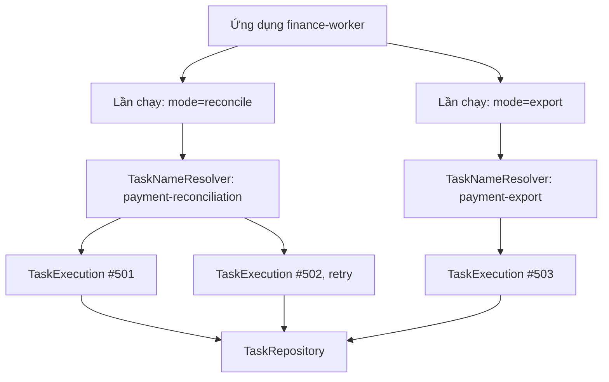
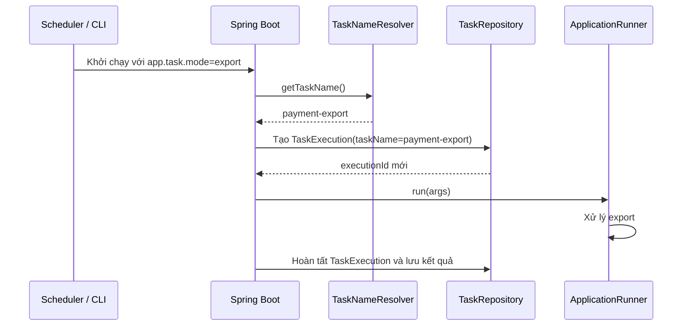

# Tùy chỉnh cách xác định tên tác vụ trong Spring Cloud Task

## 1. Bài toán và mục tiêu

Một ứng dụng **Spring Cloud Task** thực hiện công việc hữu hạn rồi kết thúc. Mỗi lần chạy được ghi lại dưới dạng `TaskExecution` trong `TaskRepository`, gồm tên tác vụ, thời điểm bắt đầu/kết thúc, mã thoát và thông tin lỗi. Khi cùng một ứng dụng được khởi chạy nhiều lần theo lịch hoặc theo yêu cầu, **tên tác vụ** là thông tin quan trọng để tìm các lần chạy cùng loại và điều tra sự cố.

Trong chương **Cấu hình mở rộng**, chúng ta tìm hiểu cách Spring Cloud Task xác định tên này và cách thay đổi quy tắc khi ứng dụng cần phục vụ nhiều chế độ nghiệp vụ. Chủ đề không chỉ là đổi nhãn trong log: tên được dùng để phân loại lịch sử thực thi và có thể ảnh hưởng đến chính sách vận hành theo tên.

Sau bài học, bạn có thể:

- Giải thích sự khác nhau giữa `spring.application.name`, `spring.cloud.task.name`, `TaskExecution.taskName` và `executionId`.
- Nêu đúng thứ tự ưu tiên của `SimpleTaskNameResolver` mặc định.
- Đặt tên qua YAML, biến môi trường hoặc tham số khởi chạy mà không cần viết Java tùy chỉnh.
- Viết một bean `TaskNameResolver` để ánh xạ chế độ chạy thành tên nghiệp vụ ổn định.
- Xác minh tên thực tế trong `TaskRepository` và tránh làm phân mảnh lịch sử khi chạy lại, chạy theo lịch hoặc kết hợp Spring Batch.

## 2. Tên tác vụ nằm ở đâu trong mô hình Spring Cloud Task?

Giả sử có chương trình `finance-worker.jar`, nhận một trong hai chế độ: `reconcile` (đối soát) hoặc `export` (xuất dữ liệu). Hai chế độ dùng chung tệp JAR nhưng là hai loại công việc cần theo dõi riêng.

| Khái niệm | Ví dụ | Vai trò |
| --- | --- | --- |
| Tên ứng dụng Spring Boot | `finance-worker` | Nhận diện chương trình hoặc đơn vị triển khai qua `spring.application.name`. |
| Tên tác vụ Spring Cloud Task | `payment-reconciliation` hoặc `payment-export` | Phân loại bản ghi `TaskExecution` theo công việc nghiệp vụ. |
| Định danh lần thực thi | `executionId = 501` | Phân biệt một lần chạy cụ thể với các lần chạy khác. |
| Tham số nghiệp vụ | `businessDate=2026-11-23` | Xác định phạm vi dữ liệu lần chạy cần xử lý. |
| Phiên bản bản đóng gói | `finance-worker:2.1.0` | Xác định phiên bản mã đang triển khai, không phải tên loại công việc. |

Ví dụ, hai lần đối soát cùng ngày có thể cùng `taskName = payment-reconciliation` và cùng tham số `businessDate`, nhưng **không có cùng `executionId`**. Lần chạy sau có thể là retry và tạo một bản ghi lịch sử mới. Đừng nhúng `executionId` hoặc ngày xử lý vào tên tác vụ chỉ để phân biệt từng lần chạy.



Các ID ở sơ đồ chỉ để minh họa. Trên thực tế, tên tác vụ phải được xác định **khi Spring Cloud Task bắt đầu ghi metadata**, trước khi runner hoàn thành công việc; không nên chờ tới cuối runner mới quyết định tên.

## 3. Cơ chế mặc định: `SimpleTaskNameResolver`

Spring Cloud Task định nghĩa interface **`TaskNameResolver`** trong package `org.springframework.cloud.task.repository`. Interface này có một phương thức cốt lõi:

```java
public interface TaskNameResolver {
    String getTaskName();
}
```

Mặc định, framework cung cấp **`SimpleTaskNameResolver`**. Theo tài liệu API, nó chọn tên theo thứ tự:

1. Nếu đã cấu hình **`spring.cloud.task.name`**, dùng giá trị này.
2. Nếu không có tên tác vụ tường minh, dùng **ID của `ApplicationContext`**; trong cấu hình Spring Boot thông thường, ID này chịu ảnh hưởng bởi `spring.application.name`.

| `spring.application.name` | `spring.cloud.task.name` | Tên tác vụ dự kiến khi dùng resolver mặc định |
| --- | --- | --- |
| `finance-worker` | `payment-reconciliation` | `payment-reconciliation` |
| `finance-worker` | Không khai báo | Theo ID của `ApplicationContext`, thông thường gắn với `finance-worker` |
| Không khai báo | `payment-export` | `payment-export` |
| Không khai báo | Không khai báo | Theo ID context do Spring Boot thiết lập; không nên dựa vào một chuỗi mặc định không được xác nhận |

Điểm dễ nhầm là **`spring.application.name` không tự luôn có ưu tiên cao hơn `spring.cloud.task.name`**. Khi có thuộc tính của Spring Cloud Task, resolver mặc định ưu tiên thuộc tính đó. Ngoài ra, một `TaskNameResolver` tự viết có thể áp dụng quy tắc hoàn toàn khác; không nên suy luận thứ tự ưu tiên mặc định sau khi đã thay resolver.

Về vận hành, tên tác vụ phải ổn định theo *loại công việc*. Nó được lưu ở trường `taskName` của `TaskExecution`, thường tương ứng cột `TASK_NAME` trong bảng `TASK_EXECUTION` của schema JDBC.

## 4. Cách 1: đặt tên tường minh bằng cấu hình

Nếu một ứng dụng chỉ làm **một loại tác vụ**, cách dễ hiểu nhất là khai báo `spring.cloud.task.name` thay vì tự triển khai resolver.

### 4.1. Cấu hình `application.yml`

```yaml
spring:
  application:
    name: finance-worker
  main:
    web-application-type: none
  cloud:
    task:
      name: payment-reconciliation
  datasource:
    url: ${TASK_DB_URL}
    username: ${TASK_DB_USER}
    password: ${TASK_DB_PASSWORD}
```

Ở đây `finance-worker` là tên ứng dụng Spring Boot; `payment-reconciliation` là tên Spring Cloud Task lưu vào metadata thực thi. `DataSource` kết nối đến database có schema Spring Cloud Task, giúp dữ liệu lịch sử còn tồn tại sau khi chương trình dừng.

### 4.2. Ghi đè khi khởi chạy

Spring Boot hỗ trợ cung cấp cấu hình qua command-line:

```bash
java -jar finance-worker.jar \
  --spring.cloud.task.name=payment-reconciliation \
  --businessDate=2026-11-23
```

Hoặc biến môi trường:

```bash
export SPRING_CLOUD_TASK_NAME=payment-reconciliation
java -jar finance-worker.jar --businessDate=2026-11-23
```

Phần `--businessDate` là tham số nghiệp vụ; `--spring.cloud.task.name` là thuộc tính cấu hình Spring. Hai tham số phục vụ các mục đích khác nhau. Tên được resolver xác định từ **cấu hình hữu hiệu của lần khởi chạy**, vì thế cần kiểm soát nguồn cấu hình và thứ tự ưu tiên của Spring Boot trong môi trường thực tế.

**Khi nào nên dừng ở cách này?** Khi mỗi bản triển khai đại diện một loại công việc ổn định, hoặc bộ điều phối có thể truyền tên tác vụ rõ ràng theo định nghĩa công việc. Viết resolver riêng lúc này chỉ tăng chi phí bảo trì.

## 5. Cách 2: định nghĩa `TaskNameResolver` của riêng ứng dụng

Giả sử tổ chức muốn dùng **cùng một JAR** cho hai tác vụ độc lập: đối soát và xuất dữ liệu. Bộ điều phối truyền `app.task.mode=reconcile` hoặc `app.task.mode=export`; ứng dụng cần ghi `taskName` phù hợp ngay khi bắt đầu.

Khi quy tắc đặt tên yêu cầu ánh xạ nghiệp vụ, dùng một bean triển khai `TaskNameResolver`. Một cách cài đặt là ánh xạ danh sách chế độ **được phép** sang tên cố định:

```java
import java.util.Locale;

import org.springframework.cloud.task.repository.TaskNameResolver;
import org.springframework.context.annotation.Bean;
import org.springframework.context.annotation.Configuration;
import org.springframework.core.env.Environment;

@Configuration(proxyBeanMethods = false)
public class TaskNamingConfiguration {

    @Bean
    TaskNameResolver taskNameResolver(Environment environment) {
        return () -> {
            // Giữ đường override tường minh để vận hành có thể kiểm soát tên.
            String configured = environment.getProperty("spring.cloud.task.name");
            if (configured != null && !configured.isBlank()) {
                return configured.trim();
            }

            String mode = environment.getProperty("app.task.mode", "reconcile")
                .trim().toLowerCase(Locale.ROOT);

            return switch (mode) {
                case "reconcile" -> "payment-reconciliation";
                case "export" -> "payment-export";
                default -> throw new IllegalArgumentException(
                    "Chế độ tác vụ không được hỗ trợ: " + mode);
            };
        };
    }
}
```

Ở đây `getTaskName()` được hiện thực qua lambda vì interface chỉ có một phương thức cần triển khai. Bean được Spring quản lý và Spring Cloud Task sử dụng để xác định tên khi tạo `TaskExecution`.

**Đặc điểm của ví dụ:**

- `spring.cloud.task.name` được ưu tiên **vì chính mã tùy chỉnh đã quyết định như vậy**; thứ tự này không còn tự động do `SimpleTaskNameResolver` áp đặt.
- `app.task.mode` là thuộc tính **tự định nghĩa của ứng dụng**, không phải thuộc tính chuẩn của Spring Cloud Task.
- Danh sách chế độ hợp lệ được cố định; một giá trị sai làm ứng dụng báo lỗi sớm thay vì tạo một nhóm lịch sử khó hiểu.
- Tên trả về là tên nghiệp vụ ổn định; nó không chứa UUID, timestamp, ID khách hàng hay ngày xử lý.
- Nếu cần dùng cả tên cấu hình lẫn cơ chế tùy chỉnh, phải chủ động định nghĩa thứ tự ưu tiên như ví dụ.

Khi thay đổi cách định nghĩa bean, cần bảo đảm chỉ có **một resolver hữu hiệu** được Spring Cloud Task chọn. Nếu ứng dụng dùng nhiều cấu hình tùy chỉnh hoặc starter khác cùng đăng ký resolver, hãy kiểm tra việc nạp bean và cấu hình tự động của đúng phiên bản thư viện.

### 5.1. Vì sao nên xác định tên trước khi chạy logic nghiệp vụ?

Trong một lần khởi chạy bình thường, Spring Cloud Task gọi `TaskNameResolver.getTaskName()` khi hạ tầng bắt đầu tạo bản ghi `TaskExecution`. Quá trình này diễn ra trước các `ApplicationRunner` và `CommandLineRunner` xử lý công việc chính. Bởi vậy:

- Có thể dựa vào thuộc tính cấu hình hoặc biến môi trường đã được nạp khi tạo context.
- Không nên dựa vào kết quả chỉ được tạo ra **sau khi runner xử lý xong**.
- Không nên gọi API không ổn định hoặc truy cập dịch vụ ngoài chỉ để xác định tên; lỗi ở bước này có thể khiến metadata không được tạo.
- Nếu lựa chọn chế độ có ảnh hưởng đến tên, logic runner cần sử dụng **cùng nguồn cấu hình** với resolver để tránh ghi một tên nhưng thực hiện công việc khác.



## 6. Cần đồng bộ resolver với tác vụ thực sự được chạy

Một lỗi thiết kế là resolver ghi `payment-reconciliation`, nhưng runner lại thực hiện chế độ `export`. Có thể tránh bằng cách cùng đọc `app.task.mode` từ cấu hình, không diễn dịch thông tin này ở hai nơi bằng hai thuật toán khác nhau.

Ví dụ về runner cho ứng dụng có hai chế độ:

```java
import org.springframework.boot.ApplicationRunner;
import org.springframework.boot.SpringApplication;
import org.springframework.boot.autoconfigure.SpringBootApplication;
import org.springframework.cloud.task.configuration.EnableTask;
import org.springframework.context.annotation.Bean;
import org.springframework.core.env.Environment;

@SpringBootApplication
@EnableTask
public class FinanceWorkerApplication {

    public static void main(String[] args) {
        SpringApplication.run(FinanceWorkerApplication.class, args);
    }

    @Bean
    ApplicationRunner financeRunner(Environment environment) {
        return args -> {
            String mode = environment.getProperty("app.task.mode", "reconcile")
                .trim().toLowerCase(java.util.Locale.ROOT);

            switch (mode) {
                case "reconcile" -> {
                    // TODO: gọi dịch vụ đối soát, đợi xử lý hoàn tất.
                    System.out.println("Đang thực hiện đối soát");
                }
                case "export" -> {
                    // TODO: gọi dịch vụ xuất dữ liệu, đợi xuất xong.
                    System.out.println("Đang thực hiện xuất dữ liệu");
                }
                default -> throw new IllegalArgumentException(
                    "Chế độ không hợp lệ: " + mode);
            }
        };
    }
}
```

Ví dụ trên thể hiện điểm nối giữa **đặt tên** và **chọn công việc**; các nhánh `TODO` cần thay bằng xử lý nghiệp vụ thực. Với ứng dụng thật, nên trích xuất việc đọc/kiểm tra `mode` thành một bean cấu hình chung để cả resolver và runner dùng cùng giá trị đã chuẩn hóa. Cũng cần bảo đảm runner chờ công việc hoàn tất và truyền lỗi ra ngoài nếu thất bại; nếu runner trả về trước khi việc nền xong, metadata có thể báo kết thúc quá sớm.

### 6.1. Khởi chạy hai chế độ

Chạy đối soát:

```bash
java -jar finance-worker.jar \
  --app.task.mode=reconcile \
  --businessDate=2026-11-23
```

Chạy xuất dữ liệu:

```bash
java -jar finance-worker.jar \
  --app.task.mode=export \
  --businessDate=2026-11-23
```

**Điều kiện của ví dụ:** không khai báo sẵn `spring.cloud.task.name` trong `application.yml` nếu muốn quy tắc ánh xạ theo `mode` có hiệu lực. Trong resolver ví dụ, giá trị `spring.cloud.task.name` tường minh sẽ luôn được ưu tiên hơn `app.task.mode`.

Ứng dụng còn cần dependency `spring-cloud-starter-task`, driver JDBC thích hợp và schema Spring Cloud Task tương ứng trong database được trỏ bởi `spring.datasource`. Phiên bản Spring Boot và Spring Cloud phải tương thích theo BOM; code ví dụ sử dụng cú pháp Java hiện đại phù hợp với Java 17 trở lên.

## 7. Xác minh tên tác vụ trong `TaskRepository`

Sau khi khởi chạy, hãy **kiểm tra tên được ghi thực tế** thay vì chỉ dựa trên nội dung YAML hay tên file JAR. Trong schema JDBC Spring Cloud Task thường gặp, có thể truy vấn:

```sql
SELECT TASK_EXECUTION_ID,
       TASK_NAME,
       START_TIME,
       END_TIME,
       EXIT_CODE,
       EXIT_MESSAGE
FROM TASK_EXECUTION
WHERE TASK_NAME IN ('payment-reconciliation', 'payment-export')
ORDER BY TASK_EXECUTION_ID DESC;
```

Tên bảng/cột cần đối chiếu với schema của phiên bản triển khai. Có thể dùng `TaskExplorer` để tra cứu lịch sử bằng API thay cho SQL trực tiếp. Kết quả giả định:

| `TASK_EXECUTION_ID` | `TASK_NAME` | Chế độ đầu vào | Kết quả |
| --- | --- | --- | --- |
| `501` | `payment-reconciliation` | `reconcile` | Thành công |
| `502` | `payment-reconciliation` | `reconcile` | Thất bại |
| `503` | `payment-export` | `export` | Thành công |
| `504` | `payment-reconciliation` | `reconcile` | Thành công sau khi chạy lại |

Một lần chạy lại tạo một `TaskExecution` mới nhưng giữ cùng `TASK_NAME` nếu vẫn là cùng loại công việc. Điều này giúp theo dõi tỷ lệ thành công, số lần retry và thời gian chạy **theo tên logic**, trong khi `TASK_EXECUTION_ID` phân biệt từng lần chạy.

Nếu `TASK_NAME` khác mong đợi, kiểm tra lần lượt: có thuộc tính `spring.cloud.task.name` được truyền từ bên ngoài không; bean resolver tùy chỉnh có thực sự được chọn không; môi trường đang nạp `app.task.mode` nào; và có đang truy vấn **đúng database metadata** không.

## 8. Quy tắc đặt tên an toàn và dễ vận hành

Tùy chỉnh resolver là công cụ mạnh nhưng dễ bị lạm dụng. Một số quy tắc nên áp dụng:

| Quy tắc | Ví dụ nên làm | Cách làm dễ gây vấn đề |
| --- | --- | --- |
| Phản ánh loại công việc | `payment-reconciliation` | `task-1`, `worker` |
| Giữ ổn định qua các lần chạy | Cùng tên cho mọi lần đối soát | Thêm timestamp hoặc UUID vào tên |
| Đưa dữ liệu thay đổi vào tham số | `--businessDate=2026-11-23` | Tên `payment-reconciliation-2026-11-23` |
| Tách định danh triển khai | Image `finance-worker:2.1.0`, tên task giữ nguyên | Đổi tên task mỗi khi nâng cấp image |
| Có quy ước chữ và ký tự | Chữ thường, dấu gạch ngang, ngắn gọn | Tên dài không giới hạn hoặc ký tự khó dùng trong truy vấn |
| Không tiết lộ dữ liệu nhạy cảm | `payment-export` | Chứa token, email, mã hồ sơ cá nhân trong tên |

`TASK_NAME` có giới hạn độ dài do schema quy định; với schema tham khảo thường là `VARCHAR(100)`, nhưng cần kiểm tra đúng **phiên bản** và database thực tế. Resolver nên trả về giá trị **không null, không rỗng, hợp lệ và có độ dài nằm trong giới hạn**, đồng thời xử lý chế độ không được hỗ trợ một cách rõ ràng.

Nếu tên xuất hiện trong nhãn metric hoặc trace, số lượng tên khác nhau quá lớn có thể gây vấn đề **cardinality** cho hệ thống quan sát. Vì vậy tránh tạo tên từ dữ liệu người dùng, ID sự kiện hoặc timestamp ngay cả khi database vẫn lưu được.

### 8.1. Có nên đưa môi trường vào tên?

Nếu `dev`, `staging` và `prod` có `TaskRepository` và hệ thống giám sát tách biệt, có thể giữ tên `payment-reconciliation` ở mọi môi trường. Nếu nhiều môi trường dùng chung kho metadata, cần quy ước phân tách môi trường đáng tin cậy, có thể gồm phân vùng database/schema, quyền truy cập hoặc một prefix ổn định. **Không chỉ dựa vào prefix tên** để giải quyết yêu cầu cách ly dữ liệu.

### 8.2. Nếu có nhiều tenant thì sao?

Không nên tự động gắn mọi `tenantId` vào `taskName`. Điều đó làm số lượng tên tăng nhanh và biến thông tin có thể nhạy cảm thành nhãn hệ thống. Nên lưu tenant hoặc phạm vi xử lý trong metadata/đối số và cơ chế audit được thiết kế phù hợp, đồng thời giữ tên tác vụ phản ánh loại công việc. Nếu nghiệp vụ bắt buộc phân tách lịch sử theo tenant, cần thiết kế giới hạn số lượng và kiểm soát truy cập cụ thể.

## 9. Tác động của tên lên chạy theo lịch, chạy lại và vận hành

### 9.1. Chạy theo lịch hoặc theo yêu cầu

Spring Cloud Task theo dõi lần chạy; việc lên lịch thường do cron, Kubernetes CronJob, Spring Cloud Data Flow hoặc một bộ điều phối khác thực hiện. Bộ điều phối có thể dùng cùng JAR với nhiều tham số khác nhau. Resolver giúp ánh xạ định nghĩa được chạy sang tên tác vụ phù hợp trong `TaskRepository`.

Ví dụ có hai lịch độc lập: đối soát lúc 02:00 và xuất dữ liệu lúc 03:00. Việc đặt tên `payment-reconciliation` và `payment-export` làm rõ lịch sử, ngay cả khi cùng image. Không nên phụ thuộc vào thời điểm chạy để suy ra loại tác vụ vì lịch có thể được đổi, chạy bù hoặc kích hoạt thủ công.

### 9.2. Chạy lại và tính idempotent

Nếu một lần đối soát thất bại và bộ điều phối khởi chạy lại `--app.task.mode=reconcile --businessDate=2026-11-23`, resolver nên trả về cùng **`payment-reconciliation`**. Lần chạy mới có `executionId` mới. Đây là cơ sở để tìm toàn bộ lần thử của cùng loại công việc.

Việc giữ tên **không tự bảo đảm idempotency**. Kết quả nghiệp vụ cần được bảo vệ bằng khóa thích hợp, transaction, kiểm tra trạng thái và cách chạy lại an toàn; ví dụ tránh ghi trùng bản đối soát cho cùng ngày.

### 9.3. Giới hạn phiên chạy đồng thời

Một số phiên bản Spring Cloud Task hỗ trợ cơ chế giới hạn một instance theo tên tác vụ, với thuộc tính `spring.cloud.task.single-instance-enabled` và các dependency/điều kiện đi kèm. Nếu sử dụng tính năng này, **tên tác vụ trở thành khóa phân nhóm khi kiểm soát chạy đồng thời**. Đổi resolver từ một tên chung sang hai tên riêng có thể thay đổi hành vi giới hạn đồng thời. Cần thử nghiệm cùng cấu hình database và thư viện thực tế; cơ chế này không thay thế khóa nghiệp vụ chống ghi trùng.

### 9.4. Phối hợp với Spring Batch

Một ứng dụng Spring Cloud Task có thể khởi chạy Spring Batch job. Khi đó cần phân biệt:

- `TaskNameResolver` xác định tên của **lần chạy ứng dụng** trong `TaskRepository`.
- `JobRepository` của Spring Batch theo dõi `JobExecution` và `StepExecution`, với `jobName` riêng.
- Đổi `taskName` không tự đổi tên job Batch, sửa tham số job hay thay đổi khả năng restart của Batch.

Nếu một JAR có thể chạy hai Batch job, bạn có thể chọn tên task theo chế độ, đồng thời vẫn cần xác định và truy vết đúng `jobName`, tham số job và kết quả xử lý. Đừng đồng nhất `TaskExecution.executionId` với ID của `JobExecution`.

## 10. Những sai lầm thường gặp khi tự viết resolver

| Hiện tượng | Nguyên nhân có thể | Hướng xử lý |
| --- | --- | --- |
| Mọi lần chạy đều mang tên `finance-worker` | Không nạp `spring.cloud.task.name`; resolver tùy chỉnh không được sử dụng. | Xem cấu hình hữu hiệu, bean `TaskNameResolver` và fallback theo context ID. |
| `mode=export` nhưng `TASK_NAME=payment-reconciliation` | Có tên tường minh ưu tiên cao hoặc logic đọc `mode` không đồng nhất. | Kiểm tra `spring.cloud.task.name`, resolver và nhánh runner. |
| Lịch sử bị chia thành hàng nghìn tên | Tạo tên từ ngày, UUID, đơn hàng hoặc tenant. | Dùng tên cố định theo loại công việc, chuyển giá trị biến động sang tham số phù hợp. |
| Task không khởi động khi mode sai | Resolver hoặc runner từ chối chế độ chưa được hỗ trợ. | Kiểm tra tham số đầu vào, danh sách chế độ cho phép và log bootstrap. |
| Đổi tên xong không tìm thấy lịch sử cũ | Bản ghi trước đây vẫn giữ `TASK_NAME` cũ. | Ghi nhận kế hoạch đổi tên, dùng truy vấn nhiều tên khi chuyển đổi và cập nhật dashboard. |
| Ứng dụng log một tên nhưng DB lưu tên khác | Log lấy từ property không phải resolver thực tế, hoặc cấu hình khác nhau giữa các lần chạy. | Tra cứu `TASK_NAME` trong database; log thêm tên đã giải quyết và `executionId` nếu có. |
| Tên quá dài gây lỗi ghi metadata | Vượt giới hạn trường `TASK_NAME` của schema. | Rút ngắn và kiểm tra đầu vào trước khi framework ghi repository. |
| Task được ghi nhận thành công trước khi xử lý nền xong | Runner trả về trước khi công việc bất đồng bộ hoàn thành. | Đồng bộ điểm kết thúc và truyền lỗi về runner; tên không giải quyết lỗi lifecycle. |

Một bẫy quan trọng: nếu resolver ném ngoại lệ trong giai đoạn bắt đầu, Spring Cloud Task **có thể chưa tạo được `TaskExecution`**. Khi tìm lỗi, phải xem log khởi động và trạng thái process/container, ngoài kho metadata. Trường `endTime` trống cũng chưa chắc có nghĩa tiến trình còn chạy: JVM có thể đã bị dừng trước khi repository được cập nhật.

## 11. Kiểm thử hành vi đặt tên theo kịch bản

Trước khi triển khai theo lịch, hãy thử một số tổ hợp để biết chính xác tên sẽ được ghi:

| Đầu vào | Resolver được dùng | `taskName` kỳ vọng |
| --- | --- | --- |
| Có `spring.cloud.task.name=payment-reconciliation` | `SimpleTaskNameResolver` | `payment-reconciliation` |
| Không có `spring.cloud.task.name`, có `spring.application.name=finance-worker` | `SimpleTaskNameResolver` | Theo context ID, thông thường là `finance-worker` |
| `app.task.mode=reconcile`, không có tên tường minh | Resolver tùy chỉnh ở mục 5 | `payment-reconciliation` |
| `app.task.mode=export`, không có tên tường minh | Resolver tùy chỉnh ở mục 5 | `payment-export` |
| `app.task.mode=export`, `spring.cloud.task.name=custom-export` | Resolver tùy chỉnh ở mục 5 | `custom-export` vì override tường minh được ưu tiên |
| `app.task.mode=unknown`, không có tên tường minh | Resolver tùy chỉnh ở mục 5 | Lỗi cấu hình, không tạo tên mới từ giá trị lạ |

Khi kiểm thử tích hợp, nên chạy ứng dụng với database metadata thử nghiệm và truy vấn `TASK_EXECUTION`. Không nên chỉ gọi trực tiếp `getTaskName()` rồi xem như mọi thứ đã đúng, vì lỗi liên quan đến lựa chọn bean, cấu hình runtime, schema hoặc lifecycle có thể chỉ xuất hiện khi ứng dụng chạy thật.

### Ví dụ SQL xác nhận lịch sử theo tên

```sql
SELECT TASK_NAME,
       COUNT(*) AS EXECUTION_COUNT,
       MIN(START_TIME) AS FIRST_START,
       MAX(START_TIME) AS LAST_START
FROM TASK_EXECUTION
WHERE TASK_NAME IN ('payment-reconciliation', 'payment-export')
GROUP BY TASK_NAME
ORDER BY TASK_NAME;
```

Câu SQL là ví dụ với schema JDBC phổ biến. Việc triển khai thực tế phải có database bền vững và schema đúng phiên bản; đối số chạy, mã thoát và dữ liệu đầu ra được kiểm tra riêng.

## 12. Bài tập thực hành và câu hỏi tự kiểm tra

**Bài tập:** Hãy mô tả cách mở rộng resolver để một ứng dụng `inventory-worker` xử lý ba loại công việc `inventory-import`, `inventory-export`, `inventory-reconciliation` từ `app.task.mode`. Yêu cầu giữ tên ổn định khi chạy lại cùng chế độ, từ chối mode không hợp lệ, cho phép override tường minh có kiểm soát và truy vấn được lịch sử theo `TASK_NAME`.

**Câu hỏi 1.** Trong resolver mặc định, `spring.cloud.task.name` và `spring.application.name` cùng có giá trị. Thuộc tính nào quyết định `taskName`?

**Câu hỏi 2.** Vì sao `TaskNameResolver` cần dùng thông tin đã sẵn có khi ứng dụng bắt đầu, thay vì chờ runner xử lý xong mới đặt tên?

**Câu hỏi 3.** Hai lần chạy cùng `app.task.mode=reconcile` và cùng `businessDate` cần có hai `taskName` khác nhau không? Chúng được phân biệt bằng gì?

**Câu hỏi 4.** Vì sao không nên trả về `payment-reconciliation-<UUID>` dù tên này có thể giúp phân biệt từng lần chạy?

**Câu hỏi 5.** Một ứng dụng đã đổi tên task, nhưng dashboard chỉ truy vấn tên mới. Làm sao để vẫn xem được các bản ghi lịch sử trước khi đổi tên?

**Gợi ý đáp án:** (1) `spring.cloud.task.name`; (2) metadata bắt đầu được tạo trước khi logic nghiệp vụ chạy; (3) không, cùng tên logic, khác `executionId`; (4) lịch sử và metric bị phân mảnh, tăng số lượng tên; (5) giai đoạn chuyển tiếp cần tra cứu cả tên cũ và tên mới hoặc có bản đồ ánh xạ được kiểm soát.

## 13. Tổng kết và tài liệu tham khảo

**`TaskNameResolver` là điểm mở rộng quyết định tên logic của một lần chạy Spring Cloud Task.** Resolver mặc định (`SimpleTaskNameResolver`) ưu tiên `spring.cloud.task.name`, sau đó dùng ID của `ApplicationContext`. Chỉ nên thay resolver bằng mã Java khi cần ánh xạ quy tắc nghiệp vụ hoặc chế độ chạy thành tên nhất quán.

Một resolver tốt luôn trả về tên hợp lệ, ổn định theo loại công việc, không chứa bí mật hoặc dữ liệu biến động theo từng lần chạy. Cần kiểm tra tên thực tế trong `TaskRepository`, giữ đúng ranh giới với dữ liệu nghiệp vụ, và nhận thức được ảnh hưởng của tên đối với lịch chạy, retry, giới hạn đồng thời, dashboard và Spring Batch.

Nguồn tham khảo chính thức:

- [Spring Cloud Task Reference Guide — Task Name](https://docs.spring.io/spring-cloud-task/docs/current/reference/htmlsingle/)
- [Spring Cloud Task API — `TaskNameResolver`](https://docs.spring.io/spring-cloud-task/docs/current/apidocs/org/springframework/cloud/task/repository/TaskNameResolver.html)
- [Spring Cloud Task API — `SimpleTaskNameResolver`](https://docs.spring.io/spring-cloud-task/docs/current/apidocs/org/springframework/cloud/task/repository/support/SimpleTaskNameResolver.html)
- [Spring Boot Reference Guide — Externalized Configuration](https://docs.spring.io/spring-boot/reference/features/external-config.html)
