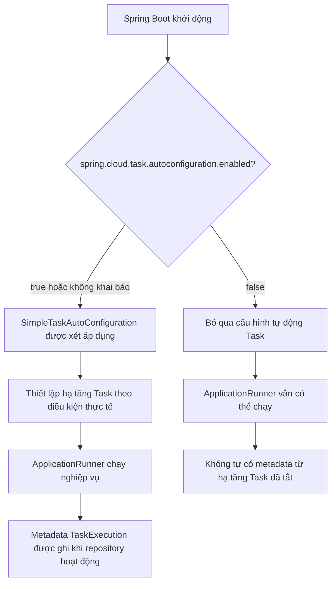
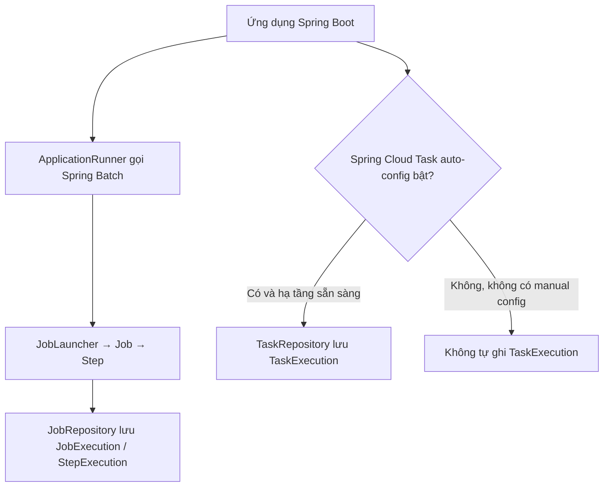
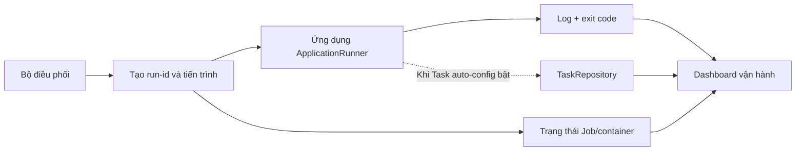

# Tắt tự cấu hình Spring Cloud Task có chủ đích

Trong chương **Cấu hình mở rộng** của module **SPRING_CLOUD_TASK**, chúng ta sẽ tìm hiểu trường hợp một ứng dụng Spring Boot có dependency Spring Cloud Task nhưng **không muốn Spring Cloud Task tự động tạo hạ tầng theo dõi thực thi** ở một cấu hình triển khai cụ thể.

Spring Cloud Task phù hợp với ứng dụng chạy hữu hạn: nhận tham số, thực hiện công việc, ghi nhận lần chạy bằng `TaskRepository` và kết thúc. Khi tự cấu hình được bật, framework có thể thiết lập repository, explorer và thành phần quản lý vòng đời để lưu trạng thái, thời gian và kết quả tác vụ. Tuy nhiên, có những tình huống cần **tắt có chủ đích** phần tự cấu hình ấy: tách một chế độ chạy CLI đơn giản, thử nghiệm không cần metadata, hoặc thay hạ tầng mặc định bằng một cấu hình riêng do đội phát triển kiểm soát.

Đây là một quyết định về **vòng đời và khả năng quan sát**. Tắt tự cấu hình mà không hiểu tác động có thể khiến scheduler vẫn báo tiến trình thoát thành công nhưng không xuất hiện `TaskExecution` nào trong cơ sở dữ liệu.

## 1. Mục tiêu học tập

Sau bài này, bạn có thể:

- Nêu rõ **tắt tự cấu hình Spring Cloud Task** có nghĩa gì và không có nghĩa gì.
- Dùng thuộc tính `spring.cloud.task.autoconfiguration.enabled=false` hoặc loại `SimpleTaskAutoConfiguration` khỏi Spring Boot auto-configuration.
- Giải thích tác động tới `TaskRepository`, `TaskExplorer`, metadata vòng đời và các extension phụ thuộc vào chúng.
- Phân biệt tắt tự cấu hình với tắt khởi tạo schema, đổi nơi lưu metadata và đóng `ApplicationContext`.
- Xây dựng một `ApplicationRunner` chạy được cả khi tự cấu hình Task bật và tắt, rồi kiểm tra sự khác nhau trên database JDBC.
- Đưa ra tiêu chí để quyết định khi nào nên tắt, cách kiểm chứng an toàn và cách bật lại.

## 2. Tự cấu hình Spring Cloud Task hoạt động ra sao?

Trong một dự án dùng Spring Boot và Spring Cloud Task tương thích, thư viện cung cấp `SimpleTaskAutoConfiguration` để tạo các thành phần phổ biến. Trên các phiên bản hỗ trợ, lớp này được điều kiện hóa theo thuộc tính:

```text
spring.cloud.task.autoconfiguration.enabled
```

Khi thuộc tính không được khai báo, điều kiện auto-configuration **mặc định là bật**; đặt thành `false` làm điều kiện không khớp. Các thành phần Spring Cloud Task thường được cấu hình tự động bao gồm:

| Thành phần | Công dụng khi tự cấu hình được bật |
| --- | --- |
| `TaskRepository` | Tạo và cập nhật thông tin về từng lần chạy, lưu trong Map/JDBC tùy nguồn dữ liệu. |
| `TaskExplorer` | Tra cứu thông tin thực thi đã có trong repository. |
| `TaskNameResolver` | Xác định tên task gắn với bản ghi thực thi. |
| Transaction manager dùng cho Task | Phục vụ các thao tác metadata thích hợp với cấu hình repository. |
| Thành phần khởi tạo schema Task | Hỗ trợ tạo bảng metadata khi dùng JDBC và bật khởi tạo. |
| Hạ tầng vòng đời Task | Ghi nhận các sự kiện bắt đầu/kết thúc hoặc thất bại nếu được bật và có đầy đủ phụ thuộc. |

Tên bean và cách chia auto-configuration/lifecycle có thể thay đổi theo phiên bản. Điểm cố định cần nắm là: **tự cấu hình cung cấp các thành phần mặc định để ứng dụng ghi nhận lần chạy; tắt nó làm mất các bảo đảm mặc định ấy**.



Sơ đồ mô tả trường hợp **không có cấu hình Task thủ công khác**. Tắt auto-configuration không phải một công tắc xóa những bean do ứng dụng tự đăng ký: nếu bạn tự tạo `TaskRepository` hoặc tự bật `@EnableTask` thì hành vi thực tế cần được xem xét riêng.

## 3. Khi nào nên tắt tự cấu hình?

### 3.1. Chế độ CLI không cần lưu lịch sử Task

Một cùng source code có thể được đóng gói để chạy trong hai môi trường:

- **Môi trường sản xuất:** chạy đối soát cuối ngày, yêu cầu ghi lịch sử mỗi `TaskExecution` vào PostgreSQL.
- **Môi trường phát triển cục bộ:** người học muốn chạy một lệnh đọc file rồi in kết quả, không cần repository và không có database metadata.

Trong môi trường cục bộ, nhóm phát triển có thể chọn tắt tự cấu hình Task. Khi đó kết quả lệnh vẫn cần được quan sát qua **stdout/stderr và exit code**, vì Spring Cloud Task không tự lưu lịch sử.

### 3.2. Tạm thay thế hạ tầng mặc định trong một ứng dụng tích hợp

Một ứng dụng có repository riêng, transaction manager riêng hoặc quy trình chạy đặc thù có thể cần kiểm soát cách bean được tạo để tránh mâu thuẫn. Có thể tắt auto-configuration rồi khai báo các thành phần cần thiết theo thiết kế.

**Không nên suy luận** rằng chỉ cần tắt auto-configuration thì một `TaskRepository` tùy biến sẽ tự làm việc. Nếu vẫn cần ghi `TaskExecution`, ứng dụng phải cung cấp đầy đủ hạ tầng và lifecycle thích hợp với phiên bản Spring Cloud Task đang dùng, sau đó xác minh bằng bài thử thực tế.

### 3.3. Phát triển và chẩn đoán có kiểm soát

Một chế độ tạm thời không ghi metadata có thể giúp cô lập tác động của Task auto-configuration khi chẩn đoán lỗi tạo bean hay kết nối repository. Sau khi phân tích, cần xác định rõ cấu hình nào được triển khai ở từng môi trường và khôi phục cơ chế giám sát nếu quy trình vận hành yêu cầu.

### 3.4. Khi nào *không* nên tắt?

Không nên dùng công tắc này để che lấp lỗi cấu hình production. Ví dụ, nếu Task không ghi được vì thiếu bảng `TASK_EXECUTION`, tắt tự cấu hình có thể khiến ứng dụng nghiệp vụ tiếp tục chạy nhưng **lịch sử thực thi biến mất**. Cách xử lý đúng là sửa schema, kết nối, quyền hoặc cấu hình repository.

Nếu hệ thống cần tra cứu lần chạy, hiển thị tiến độ, điều tra lỗi hoặc phối hợp cùng Spring Batch, hãy đánh giá kỹ trước khi bỏ thành phần ghi metadata.

## 4. Cách thứ nhất: tắt bằng thuộc tính cấu hình

Cách linh hoạt nhất là thuộc tính chính thức:

```properties
spring.cloud.task.autoconfiguration.enabled=false
```

Tương đương trong `application.yml`:

```yaml
spring:
  cloud:
    task:
      autoconfiguration:
        enabled: false
```

Nếu cần chọn theo từng môi trường, đặt thuộc tính này trong profile, chẳng hạn `application-local.yml`:

```yaml
spring:
  cloud:
    task:
      autoconfiguration:
        enabled: false
```

Và chạy ứng dụng với profile `local`:

```bash
java -jar task-demo.jar --spring.profiles.active=local
```

Hoặc chỉ tắt cho một lần chạy, không sửa cấu hình gốc:

```bash
java -jar task-demo.jar --spring.cloud.task.autoconfiguration.enabled=false
```

**Lưu ý:** option dòng lệnh của Spring Boot có thể ghi đè giá trị trong file cấu hình theo thứ tự ưu tiên cấu hình phù hợp; đừng thêm option này vào lệnh chạy production nếu bạn vẫn muốn lưu metadata.

### 4.1. Phạm vi của thuộc tính

Thuộc tính này điều khiển **auto-configuration của Spring Cloud Task**, không đồng nghĩa với:

- Gỡ dependency Spring Cloud Task ra khỏi classpath.
- Tắt toàn bộ tự cấu hình của Spring Boot.
- Dừng `ApplicationRunner`, `CommandLineRunner` hoặc vô hiệu hóa mã nghiệp vụ bạn tự viết.
- Tắt kết nối JDBC hay mọi bean `DataSource` do Spring Boot tạo.
- Xóa bảng `TASK_EXECUTION` hoặc dữ liệu lịch sử Task đã được lưu.
- Chặn scheduler, Kubernetes Job hoặc API bên ngoài khởi chạy tiến trình.

Vì thế, khi một ứng dụng đã có bảng Task trong PostgreSQL, chuyển sang `autoconfiguration.enabled=false` **không xóa lịch sử cũ**. Nó thay đổi việc ứng dụng hiện tại tự thiết lập và sử dụng các thành phần Task mặc định; các record cũ vẫn nằm trong database theo quy trình quản trị dữ liệu.

## 5. Cách thứ hai: loại lớp auto-configuration bằng annotation

Nếu lựa chọn tắt là một quyết định thiết kế cố định trong một ứng dụng, có thể loại `SimpleTaskAutoConfiguration` khỏi Spring Boot auto-configuration:

```java
package com.example.task;

import org.springframework.boot.autoconfigure.SpringBootApplication;
import org.springframework.cloud.task.configuration.SimpleTaskAutoConfiguration;

@SpringBootApplication(exclude = SimpleTaskAutoConfiguration.class)
public class StandaloneUtilityApplication {
    public static void main(String[] args) {
        org.springframework.boot.SpringApplication.run(
                StandaloneUtilityApplication.class, args);
    }
}
```

Tài liệu Spring Cloud Task cũng mô tả cách tương đương qua `@EnableAutoConfiguration(exclude = {SimpleTaskAutoConfiguration.class})`. Với ứng dụng đã dùng `@SpringBootApplication`, thuộc tính `exclude` ngay trên annotation này thường gọn hơn.

So sánh:

| Tiêu chí | Property `autoconfiguration.enabled=false` | Annotation `exclude` |
| --- | --- | --- |
| Phạm vi thay đổi | Theo cấu hình môi trường hoặc lần chạy | Theo class cấu hình/ứng dụng |
| Bật lại tạm thời | Dễ: thay profile hoặc ghi đè property | Phải sửa mã/cấu hình, build và triển khai lại |
| Phù hợp | Một artifact có nhiều chế độ chạy | Ứng dụng không muốn dùng auto-config Task theo thiết kế |
| Nguy cơ cấu hình nhầm | Property bị ghi đè bởi profile, env, command line | Loại nhầm config ở ứng dụng thực sự cần metadata |
| Cần kiểm chứng | Condition evaluation và dữ liệu thực thi | Điều kiện loại trừ và dữ liệu thực thi |

**Không cần đặt cả hai cùng lúc** trong ví dụ. Chọn một cơ chế làm chủ cấu hình để người vận hành dễ biết vì sao Task không được tự cấu hình.

## 6. Ví dụ đầy đủ: cùng ApplicationRunner, hai chế độ

Ví dụ sau chạy hữu hạn theo mô hình Spring Cloud Task. Khi **auto-configuration bật**, nó có thể ghi lịch sử vào database H2 dạng file. Khi **auto-configuration tắt**, runner vẫn in kết quả và tiến trình kết thúc nhưng hạ tầng tự tạo `TaskExecution` không được kích hoạt theo cấu hình chuẩn.

### 6.1. Dự án và dependency

Giả sử dự án đã dùng Spring Boot với Spring Cloud release train **tương thích với phiên bản Boot** và Maven. Những dependency cần có trong `pom.xml`:

```xml
<dependencies>
    <dependency>
        <groupId>org.springframework.boot</groupId>
        <artifactId>spring-boot-starter</artifactId>
    </dependency>
    <dependency>
        <groupId>org.springframework.cloud</groupId>
        <artifactId>spring-cloud-starter-task</artifactId>
    </dependency>
    <dependency>
        <groupId>org.springframework.boot</groupId>
        <artifactId>spring-boot-starter-jdbc</artifactId>
    </dependency>
    <dependency>
        <groupId>com.h2database</groupId>
        <artifactId>h2</artifactId>
        <scope>runtime</scope>
    </dependency>
</dependencies>
```

Dự án phải quản lý version bằng Spring Boot parent/BOM và Spring Cloud BOM phù hợp. Để đóng gói thành JAR có thể chạy bằng `java -jar`, bổ sung plugin Spring Boot trong `build`:

```xml
<build>
    <plugins>
        <plugin>
            <groupId>org.springframework.boot</groupId>
            <artifactId>spring-boot-maven-plugin</artifactId>
        </plugin>
    </plugins>
</build>
```

Trong ví dụ ta **không thêm `@EnableTask`** và không tự khai báo repository hay task lifecycle bean. Điều này giúp so sánh trực tiếp hành vi của auto-configuration, tránh một cấu hình thủ công che khuất kết quả.

### 6.2. Ứng dụng Java

Tạo `src/main/java/com/example/task/TaskAutoConfigDemoApplication.java`:

```java
package com.example.task;

import java.util.List;

import org.springframework.boot.ApplicationArguments;
import org.springframework.boot.ApplicationRunner;
import org.springframework.boot.SpringApplication;
import org.springframework.boot.autoconfigure.SpringBootApplication;
import org.springframework.context.ConfigurableApplicationContext;
import org.springframework.context.annotation.Bean;

@SpringBootApplication
public class TaskAutoConfigDemoApplication {

    public static void main(String[] args) {
        ConfigurableApplicationContext context =
                SpringApplication.run(TaskAutoConfigDemoApplication.class, args);

        int exitCode = SpringApplication.exit(context);
        System.exit(exitCode);
    }

    @Bean
    ApplicationRunner greetingRunner() {
        return args -> {
            String name = parseName(args);
            System.out.println("Hello, " + name + "!");
        };
    }

    private static String parseName(ApplicationArguments args) {
        if (!args.containsOption("name")) {
            return "World";
        }

        List<String> values = args.getOptionValues("name");
        if (values == null || values.size() != 1
                || values.get(0).isBlank()) {
            throw new IllegalArgumentException(
                    "Cần truyền đúng một --name=<tên không rỗng>");
        }

        return values.get(0).trim();
    }
}
```

`ApplicationRunner` thực hiện logic chỉ **một lần**, dùng `ApplicationArguments` để kiểm tra tham số, sau đó thoát. `SpringApplication.exit(context)` đóng các tài nguyên được quản lý bởi context; `System.exit(exitCode)` trả mã thoát cho hệ điều hành. Lưu ý nếu `SpringApplication.run` ném exception (ví dụ runner lỗi), lệnh bên dưới không được chạy; Spring Boot xử lý lỗi khởi động và tiến trình thường kết thúc với mã lỗi.

### 6.3. Cấu hình chung

Tạo `src/main/resources/application.yml`:

```yaml
spring:
  application:
    name: task-autoconfig-demo

  main:
    web-application-type: none

  datasource:
    url: jdbc:h2:file:./task-history
    driver-class-name: org.h2.Driver
    username: sa
    password: ""

  cloud:
    task:
      name: task-autoconfig-demo
      initialize-enabled: true
      autoconfiguration:
        enabled: true
```

Vì dùng `jdbc:h2:file:./task-history`, dữ liệu H2 được lưu trong **file trên đĩa** dưới thư mục làm việc; khi JVM kết thúc, file vẫn có thể được mở lại. Đây là cách thuận tiện để so sánh hai lần chạy cục bộ. Khác với `jdbc:h2:mem:taskdb`, URL `file:` có khả năng giữ lịch sử sau khi JVM đóng.

`initialize-enabled: true` chỉ nhằm hỗ trợ tạo schema trong bài thực hành theo phiên bản Spring Cloud Task đang dùng. Khi triển khai production, hãy dùng database và migration phù hợp, không dựa vào việc mỗi tiến trình tự tạo DDL.

### 6.4. Chạy khi tự cấu hình được bật

Đóng gói:

```bash
./mvnw clean package
```

Trên Windows PowerShell, dùng `.\mvnw.cmd clean package`. Sau đó chạy (tên JAR dưới đây giả định `artifactId` và `version` khớp với ví dụ):

```bash
java -jar target/task-autoconfig-demo-0.0.1-SNAPSHOT.jar --name=Lan
```

Đầu ra nghiệp vụ mong đợi:

```text
Hello, Lan!
```

Theo cấu hình chuẩn và khi database/schema hoạt động, Spring Cloud Task tạo và cập nhật một `TaskExecution`. Đóng tiến trình, sau đó kết nối bằng một công cụ SQL tới H2 **với cùng đường dẫn file** để kiểm tra dữ liệu. Không mở H2 từ hai tiến trình đồng thời khi chưa cấu hình cách truy cập phù hợp.

Truy vấn theo schema mặc định:

```sql
SELECT TASK_EXECUTION_ID,
       TASK_NAME,
       START_TIME,
       END_TIME,
       EXIT_CODE
FROM TASK_EXECUTION
ORDER BY TASK_EXECUTION_ID DESC;
```

Ghi lại số dòng và `TASK_EXECUTION_ID` cao nhất. Nếu không có bảng `TASK_EXECUTION`, cần kiểm tra việc tự cấu hình và khởi tạo schema trước khi kết luận thí nghiệm thành công.

### 6.5. Chạy khi tự cấu hình bị tắt

Giữ nguyên JAR, tắt chỉ cho lần chạy kế tiếp:

```bash
java -jar target/task-autoconfig-demo-0.0.1-SNAPSHOT.jar   --spring.cloud.task.autoconfiguration.enabled=false --name=Mai
```

Lệnh trên dùng ký tự nối dòng POSIX; trong PowerShell, nhập toàn bộ lệnh trên một dòng hoặc dùng cách nối dòng phù hợp.

Đầu ra nghiệp vụ vẫn là:

```text
Hello, Mai!
```

Nhưng theo bố cục ví dụ (không tự thêm bean Task hoặc `@EnableTask`), `SimpleTaskAutoConfiguration` bị bỏ qua. Do đó lần chạy này **không được hạ tầng Task mặc định tự ghi thêm `TaskExecution`**. Dùng SQL ở trên kiểm tra lại: số bản ghi Task không tăng vì lần chạy bị tắt, dù lời chào và mã thoát của runner cho thấy mã nghiệp vụ đã hoàn tất.

**Chú ý cách đọc kết quả:** record cũ của lần chạy trước **vẫn tồn tại**. Không kiểm chứng bằng việc yêu cầu bảng hoàn toàn rỗng; hãy so sánh **số lượng record trước/sau** và tìm record tương ứng với lần chạy mới.

### 6.6. Bật lại

Chạy tiếp một lần **không có** tùy chọn tắt:

```bash
java -jar target/task-autoconfig-demo-0.0.1-SNAPSHOT.jar --name=Binh
```

Nếu database hoạt động, một `TaskExecution` mới lại được tạo. Thí nghiệm chứng minh rằng **cùng một runner có thể chạy được trong hai chế độ**, nhưng khả năng theo dõi do Spring Cloud Task cung cấp tùy thuộc cấu hình.

| Lần chạy | Cấu hình Task auto-config | Đầu ra console | Record Task mới |
| --- | --- | --- | --- |
| 1 | Bật | `Hello, Lan!` | Có, khi JDBC/repository hoạt động |
| 2 | Tắt | `Hello, Mai!` | Không có từ auto-configuration mặc định |
| 3 | Bật lại | `Hello, Binh!` | Có, khi JDBC/repository hoạt động |

Các giá trị này là **kết quả kỳ vọng** của bài thực hành, không phải kết quả được đo từ một dự án thực tế trong bài viết.

## 7. Đừng nhầm với các công tắc cấu hình khác

Các thuộc tính dưới đây phục vụ mục đích khác nhau:

| Cấu hình | Tác động chính | Có tắt auto-configuration Task? |
| --- | --- | --- |
| `spring.cloud.task.autoconfiguration.enabled=false` | Không áp dụng `SimpleTaskAutoConfiguration` | **Có** |
| Loại `SimpleTaskAutoConfiguration.class` bằng `exclude` | Loại lớp auto-configuration Task khỏi Spring Boot | **Có** |
| `spring.cloud.task.initialize-enabled=false` | Không tự khởi tạo schema bảng Task | **Không** |
| `spring.cloud.task.closecontextEnabled=true` | Đề nghị đóng `ApplicationContext` sau khi Task hoàn tất | **Không** |
| `spring.main.web-application-type=none` | Không chạy web application context | **Không** |
| `spring.cloud.task.name=...` | Đặt tên cho lần thực thi khi cơ chế Task đang hoạt động | **Không** |
| Thay `spring.datasource.*` | Đổi kết nối JDBC; có thể đổi nơi lưu metadata | **Không** |
| Bỏ annotation `@EnableTask` | Bỏ một cách bật lifecycle thủ công | **Không tương đương**, tùy hạ tầng auto-config hiện có |

Hai dòng cấu hình dễ gây nhầm nhất:

```yaml
spring:
  cloud:
    task:
      initialize-enabled: false
      autoconfiguration:
        enabled: true
```

Trường hợp này **vẫn tự cấu hình Spring Cloud Task** nhưng không tự tạo bảng. Nếu đã có schema đúng, repository JDBC vẫn có thể ghi metadata.

Ngược lại:

```yaml
spring:
  cloud:
    task:
      initialize-enabled: true
      autoconfiguration:
        enabled: false
```

Trường hợp này đã **tắt hạ tầng Task tự cấu hình**. Việc giữ `initialize-enabled: true` không làm một `TaskRepository` tự xuất hiện trở lại.

## 8. @EnableTask và cấu hình thủ công: vùng cần cẩn trọng

`@EnableTask` là annotation trong Spring Cloud Task được dùng để kích hoạt một phần hạ tầng lifecycle, đặc biệt trong ứng dụng tự cấu hình Task theo cách thủ công. Trong các phiên bản cung cấp `TaskLifecycleConfiguration`, annotation có thể import cấu hình lifecycle này.

Vì vậy, để chứng minh tác dụng của thuộc tính `autoconfiguration.enabled=false`, **đừng vừa tắt tự cấu hình vừa thêm `@EnableTask` vào ví dụ mà không kiểm soát các phụ thuộc của nó**. Khi đó kết quả quan sát có thể khác:

- Có thể xuất hiện thành phần listener cần `TaskRepository` hoặc các bean liên quan nhưng những bean đó không còn được tự tạo, dẫn đến lỗi khởi động.
- Nếu dự án đã khai báo repository/lifecycle thủ công, nó có thể vẫn ghi metadata dù `SimpleTaskAutoConfiguration` bị loại.
- Một thư viện khác hoặc cấu hình ứng dụng có thể chủ động tạo các bean Task mà property trên không xóa đi.

Nếu ý định là **không dùng Spring Cloud Task**, hãy kiểm tra và gỡ các thành phần Task tự cấu hình **và** cấu hình thủ công không còn cần thiết. Nếu ý định là **tùy biến Spring Cloud Task**, hãy xác định toàn bộ bean phải được cung cấp và cấu hình đúng `TaskConfigurer`, `TaskRepository`, `TaskExplorer`, transaction manager và lifecycle theo phiên bản đang dùng.

Không áp dụng giải pháp “tắt Task để tránh lỗi khởi tạo” khi doanh nghiệp vẫn bắt buộc phải có lịch sử thực thi. Thiết kế phải đáp ứng yêu cầu vận hành trước.

## 9. Tác động khi phối hợp với Spring Batch

Spring Cloud Task và Spring Batch quản lý **hai loại metadata**:

- **`TaskExecution`** mô tả vòng đời ứng dụng tác vụ.
- **`JobExecution` / `StepExecution`** mô tả job/step của Spring Batch; thông tin này do `JobRepository` của Batch quản lý.

Giả sử một `ApplicationRunner` gọi `JobLauncher` để chạy job Batch, trong khi tự cấu hình Spring Cloud Task bị tắt.

- Runner vẫn có thể được Spring Boot gọi, nếu ứng dụng được cấu hình đầy đủ.
- Hạ tầng Spring Batch có thể vẫn tự cấu hình và ghi `JobExecution`, tùy dependency và cấu hình Batch.
- **Không có lý do để mặc định xuất hiện `TaskExecution`** chỉ vì Batch job đã chạy.
- Các tính năng tích hợp Task–Batch cần kiểm chứng riêng theo version và cấu hình đang dùng.



Đây là ví dụ điển hình cho việc **tắt auto-configuration của một thư viện không đồng nghĩa tắt mọi thư viện khác**. Nếu cần cả hai lớp giám sát, phải cấu hình Task và Batch tương ứng.

## 10. Vận hành khi cố ý không ghi TaskExecution

Với ứng dụng chạy theo lịch hoặc theo yêu cầu, việc tắt Task auto-configuration làm mất một nguồn dữ liệu mặc định về vòng đời. Do đó trước khi quyết định tắt, hãy xác định **nguồn thay thế** cho các câu hỏi:

1. Ai yêu cầu chạy? Khi nào và với tham số nào?
2. Scheduler đã tạo được tiến trình/container chưa?
3. Tiến trình hiện đang chạy hay đã kết thúc?
4. Nếu kết thúc, exit code và lý do lỗi là gì?
5. Kết quả nghiệp vụ đã ghi đủ, không trùng và có thể phục hồi hay chưa?
6. Nếu retry, làm sao tránh chạy cùng công việc hai lần?

Một hệ thống điều phối như Kubernetes Job/CronJob, scheduler ngoài ứng dụng hay dịch vụ gọi task có thể lưu `run-id`, trạng thái process, thời điểm bắt đầu/kết thúc, retry count và log. Đây là dữ liệu **bên ngoài** Spring Cloud Task, hữu ích kể cả khi ứng dụng lỗi trước khi `ApplicationContext` tạo xong.

### Minh họa lộ trình quan sát



Khi không có `TaskRepository` tự động, dashboard phải khai báo nguồn dữ liệu cụ thể thay thế; không nên hiển thị một lần chạy “thành công” chỉ vì tìm không thấy metadata lỗi.

### Bảo mật và dữ liệu tồn tại

Tắt tự cấu hình **không xóa record lịch sử** trong cơ sở dữ liệu hiện hữu, không tự động xoá log và không tắt việc truyền tham số dòng lệnh. Không đưa mật khẩu, token, thông tin khách hàng nhạy cảm vào `--parameter=value` vì dữ liệu này vẫn có thể xuất hiện trong lịch sử scheduler, hệ điều hành và console.

Nếu bạn phải lưu trạng thái phục vụ kiểm toán, hãy giữ `TaskRepository` bền vững hoặc thiết kế cơ chế lưu thay thế có cùng mức độ bảo đảm; một bảng log không cấu trúc thường không đủ cho đối soát.

## 11. Kiểm tra tự cấu hình có thực sự bị tắt hay không

Đừng suy luận từ việc **không thấy log Spring Cloud Task**. Các mức logging khác nhau có thể che bớt thông báo. Cách xác minh đáng tin cậy hơn gồm hai nguồn:

### 11.1. Xem Condition Evaluation Report

Spring Boot có thể xuất báo cáo auto-configuration khi chạy với cờ debug:

```bash
java -jar target/task-autoconfig-demo-0.0.1-SNAPSHOT.jar   --debug --spring.cloud.task.autoconfiguration.enabled=false
```

Trong báo cáo, tìm `SimpleTaskAutoConfiguration`. Với property `false`, điều kiện `@ConditionalOnProperty` dành cho lớp này không khớp. Thông báo cụ thể có thể thay đổi tùy phiên bản Boot/Task.

### 11.2. Kiểm tra record trước và sau

Khi dùng một database **lưu bền vững**:

1. Ghi lại số lượng bản ghi `TASK_EXECUTION` trước lần chạy.
2. Chạy cùng artifact với `autoconfiguration.enabled=false`.
3. Xác minh runner vẫn thực hiện nghiệp vụ, tiến trình kết thúc.
4. Truy vấn lại bảng; trong cấu hình chỉ sử dụng auto-config của bài này, **không có record mới**.
5. Bật lại auto-config, chạy lần nữa, xác minh record tăng khi repository hoạt động.

**Phân biệt không có record và không ghi được record:** nếu lần chạy auto-config bật cũng không ghi được record, nguyên nhân có thể nằm ở schema/JDBC. Khi đó chưa thể dùng chênh lệch số dòng để chứng minh công tắc bật/tắt hoạt động đúng.

### 11.3. Kiểm tra bean ở mức kiểm thử

Trong môi trường thử nghiệm, có thể dùng `ApplicationContextRunner` hoặc test khởi tạo Spring Boot để kiểm tra điều kiện các bean Task. Một phép thử có ý nghĩa là so sánh sự tồn tại của `TaskRepository`/`TaskExplorer` giữa hai cấu hình khi **không khai báo bean Task thủ công**. Không nên viết test chỉ kiểm tra một chuỗi property bằng `equals("false")`; nó không chứng minh hành vi tự cấu hình.

## 12. Các lỗi thường gặp

| Hiện tượng | Nguyên nhân cần kiểm tra | Hành động |
| --- | --- | --- |
| Runner chạy nhưng không có `TaskExecution` | Auto-config đã bị tắt; hoặc JDBC/schema lỗi | Kiểm tra property, condition report và database |
| Đặt `initialize-enabled=false` nhưng vẫn có record | Thuộc tính chỉ dừng tạo bảng, không dừng Task | Nếu muốn tắt Task, dùng đúng property autoconfiguration |
| Đặt `autoconfiguration.enabled=false` mà vẫn có listener Task | Có `@EnableTask` hoặc cấu hình thủ công khác | Kiểm tra bean lifecycle và các import cấu hình |
| Ứng dụng lỗi vì thiếu `TaskRepository` sau khi tắt | Có cấu hình thủ công/bean khác vẫn phụ thuộc repository | Bỏ phụ thuộc không cần hoặc cung cấp hạ tầng tùy biến hoàn chỉnh |
| Tắt auto-config nhưng JDBC vẫn kết nối | `DataSource` do Spring Boot tự cấu hình độc lập | Xác định datasource có còn cần cho nghiệp vụ/Batch không |
| Batch vẫn chạy và có `JobExecution` | Batch tự cấu hình riêng | Phân biệt repository Batch và repository Task |
| Bật lại nhưng không thấy record mới | Schema, quyền DB, URL, profile hoặc tên task không đúng | Kiểm tra log Task, condition evaluation, kết nối DB |
| Không thể bật lại bằng option CLI | Annotation `exclude` vẫn cố định trong mã | Bỏ exclude và rebuild, hoặc dùng property thay thế |
| Sau khi tắt, scheduler cho rằng task thành công | Exit code bằng 0, nhưng không còn metadata để kiểm tra | Bổ sung xác nhận nghiệp vụ và quan sát từ runtime |

## 13. Checklist trước khi triển khai

- [ ] Có lý do rõ ràng để **tắt** Task auto-configuration ở môi trường này.
- [ ] Biết rõ chế độ nào cần `TaskExecution` để giám sát, kiểm toán hoặc retry.
- [ ] Đã chọn **một** cơ chế quản lý: property/profile hoặc annotation exclude.
- [ ] Đã kiểm tra `@EnableTask`, cấu hình lifecycle, `TaskRepository` và `TaskConfigurer` khai báo thủ công.
- [ ] Đã kiểm tra ứng dụng vẫn chạy runner và thoát đúng mã theo kết quả nghiệp vụ.
- [ ] Nếu cần lưu lịch sử, có JDBC repository/schema bền vững và không tắt nhầm auto-configuration.
- [ ] Nếu không lưu Task metadata, scheduler/container có nguồn dữ liệu đáng tin cậy về lần chạy.
- [ ] Với Spring Batch, đã xác minh riêng `JobRepository`, `JobExecution` và chính sách restart.
- [ ] Có hướng bật lại và phép thử xác nhận record mới được tạo khi chế độ Task hoạt động.

## 14. Bài tập thực hành

**Bài 1 — So sánh hai lần chạy.** Dùng ví dụ `ApplicationRunner` với H2 file. Chạy một lần với Task auto-config bật, lần khác đặt `--spring.cloud.task.autoconfiguration.enabled=false`. So sánh lời chào, exit code, số record `TASK_EXECUTION` và condition report.

**Bài 2 — Chẩn đoán cấu hình.** Giữ `spring.cloud.task.initialize-enabled=false` nhưng để `autoconfiguration.enabled=true`, chạy trên database **đã có** schema đúng. Giải thích vì sao metadata vẫn có thể được lưu.

**Bài 3 — Tắt bằng annotation.** Tạo một nhánh thử nghiệm riêng, dùng `@SpringBootApplication(exclude = SimpleTaskAutoConfiguration.class)`. Thử ghi đè bằng property `true` trong command line và giải thích vì sao `exclude` vẫn có hiệu lực.

**Bài 4 — Đánh giá tình huống thực tế.** Một ứng dụng Spring Batch chạy ban đêm vừa ghi `JobExecution` vừa ghi `TaskExecution`. Nhóm phát triển đề xuất tắt auto-config Task vì họ chỉ cần checkpoint của Batch. Nêu những thông tin bị mất, nguồn quan sát thay thế và tiêu chí chấp nhận thay đổi.

**Bài 5 — Kế hoạch rollback.** Viết danh sách xác minh khi bật lại Task auto-config: kiểm tra schema, quyền DB, bean, Task listener, record mới, exit code và khả năng tra cứu lịch sử.

### Câu hỏi tự kiểm tra

1. Thuộc tính chính xác để tắt tự cấu hình Spring Cloud Task là gì? Giá trị mặc định khi không khai báo có ý nghĩa thế nào?
2. Tại sao tắt tự cấu hình Task không làm `ApplicationRunner` ngừng chạy?
3. `spring.cloud.task.initialize-enabled=false` khác gì `spring.cloud.task.autoconfiguration.enabled=false`?
4. Vì sao thêm `@EnableTask` vào ví dụ có thể làm kết luận “đã tắt Task” trở nên sai?
5. Nếu bảng `TASK_EXECUTION` đã có 100 bản ghi, sau khi tắt auto-config liệu 100 record đó có mất không?
6. Trong ứng dụng kết hợp Spring Batch, việc không có `TaskExecution` có đồng nghĩa không có `JobExecution` không?
7. Bạn sẽ dùng bằng chứng nào để xác nhận ứng dụng thực sự không tự cấu hình Task?

## 15. Ghi nhớ

- **`spring.cloud.task.autoconfiguration.enabled=false`** là cách cấu hình chính thức để tắt tự cấu hình Spring Cloud Task theo môi trường hoặc lần chạy.
- Có thể thay bằng **loại `SimpleTaskAutoConfiguration`** khỏi Spring Boot auto-configuration nếu ứng dụng cần một lựa chọn cố định.
- Tắt tự cấu hình **không tắt ứng dụng hay runner**, **không xóa bảng/lịch sử cũ** và **không tự động tắt Spring Batch hoặc JDBC**.
- Nếu không có cấu hình Task thủ công, hệ thống **không còn tự tạo và cập nhật `TaskExecution`** trong chế độ đã tắt; cần nguồn giám sát thay thế nếu đây là tác vụ phải vận hành.
- Phân biệt công tắc auto-config với **`initialize-enabled`**, **`closecontextEnabled`**, `web-application-type` và cấu hình `DataSource`.
- Mọi thay đổi nên được xác minh bằng **Condition Evaluation Report**, kết quả nghiệp vụ, exit code và record trước/sau trên repository bền vững.

## Tài liệu tham khảo

- [Spring Cloud Task Reference — Features](https://docs.spring.io/spring-cloud-task/reference/features.html), mục *Disabling Spring Cloud Task Auto Configuration* và *Configuration*.
- [API: SimpleTaskAutoConfiguration](https://docs.spring.io/spring-cloud-task/docs/current/apidocs/org/springframework/cloud/task/configuration/SimpleTaskAutoConfiguration.html), mô tả điều kiện `spring.cloud.task.autoconfiguration.enabled` và các bean mặc định.
- [API: EnableTask](https://docs.spring.io/spring-cloud-task/docs/current/apidocs/org/springframework/cloud/task/configuration/EnableTask.html), mô tả cách kích hoạt lifecycle khi cấu hình thủ công.

Khi áp dụng vào dự án thực tế, cần dùng tài liệu và API đúng phiên bản Spring Cloud Task tương thích với Spring Boot của ứng dụng.
